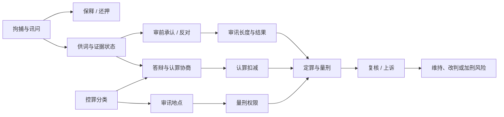

# 刑事诉讼总览 — 一份文件掌握整体结构

> 目的：先建立整套刑事程序的整体感，再进入条文、期限和文书细节。其余四份衍生材料是查阅型的；本文是**理解型与决策型**的。
> 组织方式：第一性原理（制度为什么存在）+ 工程控制论（案件有哪些状态、闸门与反馈）。
> 三个维度：**竖向**（程序是什么、由谁启动、何时完成）→ **横向**（程序之间如何互相改变选择与时间）→ **逆向**（从客户目的反推工具、风险与最佳时点）。

### 结构回链（凝结 ↔ 讲义 ↔ SG）

完整互指：Structure Map（含 **LG 逆向表**）· 上课清单：Weekly

| Overview 焦点 | 讲义 | SG |
|---|---|---|
| §1–2 强制介入 / 路径 | 本届 LGS1 · LGS2 | SG01 |
| § 路径 / 交付 | 本届 LGS3 Notes · Slides · 往届 LG03 | SG03 |
| §5 逆向谈判 | 本届 LGS4 · 往届 LG04 | SG02 |
| §3 审讯 | 本届 LGS5 Notes · LGS6 Notes | SG04 |
| § 证据定型 | 本届 LGS6 Notes · LGS7 · 往届 LG06 | SG05 · SG06 · SG07 |
| § 量刑 / 上诉 | 本届 LGS8 · 往届 LG08 · LG10 | SG07 · SG08 |

---

# 第一部分：第一性原理 — 刑事程序只解决五个底层问题

把法院层级、保释、交付审判、证据、量刑和上诉压缩到底，剩下五个不可再拆的需求。每一项程序规则都在回答其中至少一个问题。

| # | 底层问题 | 一句话 | 主要制度 |
|---|---|---|---|
| **1** | **国家可否强制介入？** | 警方何时能拘捕、搜查、讯问和扣留一个人 | PFO、48 小时带见裁判官、R&Ds、法律代表、搜查与手机内容 |
| **2** | **谁决定案件去哪里？** | 罪行分类、法院管辖与检控选择决定审讯法院和最高刑罚 | summary / indictable / triable either way、MC、DC、CFI、s.88 MO transfer、s.80A committal |
| **3** | **国家能否证明控罪？** | 控方负举证责任，但证据必须可采、可靠并按程序披露 | disclosure、s.65B statements、s.65C admitted facts、confession、identification、voir dire |
| **4** | **即使有罪，应承受什么后果？** | 法院从量刑起点出发，加入加重因素，再扣除认罪及其他减刑因素 | sentencing tariff、Ngo Van Nam、concurrent / consecutive、young offenders、costs |
| **5** | **错误如何纠正？** | 不同法院、不同决定和不同申请人走不同复核或上诉路径 | s.104 MO review、s.113 MO appeal、s.83 CPO appeal、s.81A SJ review、CFA leave |

五个问题共同服务一个更底层的目标：**在保障被告公平审讯的同时，让国家依法、及时且可复核地追究刑事责任。** 刑事程序不是一条自动流水线，而是一系列必须逐一取得合法权限的转换。

**遇到陌生题目的第一问不是“这条法例我背过没有”，而是：**
1. 当前国家在行使哪一种权力？
2. 该权力的法定来源和期限是什么？
3. 当事人正处于哪一个程序状态？
4. 下一次不可逆的闸门是什么？
5. 客户现在的决定会否改变审讯地点、可用证据、认罪扣减或上诉风险？

---

# 第二部分：控制论视角 — 案件是一个受约束的动态系统

钱学森的工程控制论关心状态、转换、反馈与目标。刑事案件也可以这样建模：律师不是按清单“走流程”，而是在每个时点观察案件状态，预测下一闸门，并用申请、陈词、谈判或文书改变系统走向。

## 2.1 六个状态变量

任何时刻，一宗刑事案件可以用六个变量描述：

| 状态变量 | 要问什么 | 改变它的典型事件 |
|---|---|---|
| **人身自由** | 未拘捕、警署保释、法庭保释，还是还押？ | 拘捕、s.52 PFO、s.9D–9J CPO、违反保释条件 |
| **控罪** | 罪名、元素、替代罪、修订可能是什么？ | 调查结果、检控决定、控罪修订、plea negotiation |
| **审讯地点** | MC、DC 还是 CFI？ | 罪行分类、检控选择、s.88 MO transfer、s.80A committal |
| **答辩状态** | 暂不答辩、认罪或不认罪？ | 首次可答辩机会、控罪修订、认罪协商 |
| **证据状态** | 已披露什么、可否同意、可否反对、是否需 voir dire？ | disclosure、s.65B、s.65C、Notice of Objection、审讯裁决 |
| **结果状态** | 未裁决、定罪、判刑、复核或上诉中？ | verdict、sentence、s.104 review、appeal、SJ review |

这六个变量不是彼此独立。例如控罪改变会改变审讯地点；审讯地点影响量刑上限；答辩时点影响认罪扣减；证据反对可能改变控方证明能力，继而改变谈判位置。

## 2.2 七个关键闸门

| 闸门 | 为什么重要 | 闸门前的律师任务 |
|---|---|---|
| **拘捕后 48 小时** | 一般案件须带见裁判官；自由状态从警署控制转为法院控制 | 查拘捕、讯问、法律代表、保释及特别例外 |
| **首次答辩机会** | 完整三分之一认罪扣减通常系于 first available opportunity | 在证据不足与扣减流失之间作有指示的选择 |
| **法院路径确定** | MC 留审、DC 移交或 CFI 交付决定权限和程序 | 查罪行分类、预计刑罚、控方选择及可作陈词事项 |
| **交付审判方式选择** | paper committal 与 PI 的功能、成本和后果不同 | 不把 PI 误当成终局无罪工具；判断是否真有策略价值 |
| **审前证据定型** | s.65B、s.65C、披露及反对通知决定审讯争点 | 形成 case theory，再决定同意什么、挑战什么 |
| **裁决与判刑** | 定罪理由、量刑起点和命令成为后续救济对象 | 保留异议、核准事实基础、准备求情和报告 |
| **上诉期限届满** | 路径和起算点不同，逾期会失去正常救济入口 | 当日确认法院、决定、申请人、期限和加刑风险 |

## 2.3 四个反馈回路

1. **保释反馈**：法院每次出庭原则上须重新考虑保释（s.9G(11) CPO）；但同一论点已经提出两次后，第三次须有重大情况变化。系统允许纠偏，但不允许无限重复。
2. **证据反馈**：披露改变辩方案情理论；辩方的 s.65B 反对、s.65C 协议或供词异议又改变控方需要传召的证据和审讯长度。
3. **认罪与量刑反馈**：越早认罪，节省的司法资源越多，扣减通常越大；程序时间本身因此成为量刑变量。
4. **复核与上诉反馈**：裁判官可按 s.104 MO 重开或更改决定；上级法院可确认、撤销、变更，某些路径甚至可能增加刑罚。

---

# 第三部分：竖向 — 一宗案件的八段主干

## 3.1 侦查、拘捕与警署阶段

**核心问题：**警方是否有权拘捕、搜查、讯问和继续拘留？被告能否取得法律意见？

- 一般须立即带往警署主管；无法立即完成查询时，可按 recognisance 处理。
- 一般须在拘捕后 **48 小时**内带见裁判官；递解案件为 **72 小时**。国安案件存在特别的延长拘留及限制接触律师机制。
- 供词不能只问“有没有签名”，要分开检查：是否自愿、是否受威胁／诱因／压迫、是否违反 1992 R&Ds，以及即使自愿是否应依剩余酌情权排除。

## 3.2 首次出庭与保释

**核心问题：**为什么暂不答辩、案件会延期多久、被告在此期间是否自由？

- MC Court 1 是 plea court，多数案件首次出庭时控方要求 “no plea to be taken”，以继续调查、确认控罪或决定地点。
- 法院没有固有保释权，必须有法定基础。一般依据 CPO ss.9D–9G；MC/DC 拒绝保释或条件需变更时，可按 **s.9J CPO**向 CFI 法官申请复核。
- 一次还押一般不超过 **8 整天**（s.79 MO 原文 8 clear days，库外·已外部核实；讲义写 8 days），除非双方同意；每次出庭原则上重新考虑保释。
- 谋杀案件的保释权限有特别限制，不能把一般 MC/DC 路径照搬。

## 3.3 控罪分类与法院路径

**核心问题：**案件最终由哪一级法院审，最高可判多少？

- **Summary offence**：通常在 MC 以简易程序审理；一般检控时效为 **6 个月**，但先查个别条例是否另定期限。
- **Indictable offence**：可能在 MC 简易审理，或移交 DC／交付 CFI，取决于罪行及法定安排。
- **Triable either way / dual offence**：必须区分名称与实际可用程序，不能只凭最高刑罚猜法院。
- 一般量刑权限：MC 单一罪行最高 **2 年**，多罪连续可达 **3 年**；DC 一次最高 **7 年**；CFI 可判终身监禁。特别裁判官权限另有上限。

## 3.4 移交、交付与答辩

- **DC transfer**：按 s.88(1)(a) MO 移交（裁判官不得拒绝控方就可公诉罪提出的移交请求；s.88(1)(b) MO 只管简易罪随可公诉罪一并移交）；移交后新控罪书须于 **14 日**内提交（s.75(3) DCO），逾期被告可被撤销控罪，效果等同无罪（s.75(4) DCO）。
- **CFI committal**：默认书面交付；被告可选择 PI。return day 一般在 **10–42 日**区间。
- PI 只测试 prima facie case，门槛低；即使释放，也不等同无罪，控方可能再次起诉（s.85 MO）。选择 PI 前必须说明真实利益，而非把它当成“免费试审”。
- paper committal 后公诉书通常须于 **7 日**内提交；PI 路径的时点不同。
- 书面交付不审查 prima facie case；交付后被告可**一次性**向原讼庭法官申请 **s.16 CPO 撤销**（公诉书提交后、答辩前；通知不少于 14 日，Cap. 221G；国安案件不适用）。s.16 撤销等同无罪，除律政司依 s.81E CPO 上诉外终局——与 PI 后依 s.85 MO 的非终局释放正好相反（本届 LGS 3 2026）。

## 3.5 审前准备与证据塑形

律师应先建立 **case theory**，再处理文件；否则披露、承认和反对会变成互不相干的动作。

- 核对控罪元素、控方证人、物证、供词、辨认及被告版本。
- s.65B CPO：在符合条件时以书面陈述取代证人口头作证；辩方是否反对会改变控方举证方法。
- s.65C CPO：把无争议事实写成 admitted facts，缩短审讯，但不可误认关键争点。
- CFI / DC 审前程序受 PD 9.3 / PD 9.4 控制，包括名单、问卷、已承认事实和 readiness 文件等期限。

## 3.6 审讯与供词争议

- 控方须在排除合理疑点标准下证明各元素。
- 供词异议通常引发 voir dire；主审法官先裁定可采性，再继续主审。
- Notice of Objection 的官方标准是：准确指出被反对的供词、人员行为、具体时间地点、法律基础和对被告自由意志的影响；结尾明确请求判为非自愿／不可采，或依剩余酌情权排除。
- **Notice 本身不应引用判例或条例条文**；这是文书体裁要求，不代表分析阶段无需法律依据。

## 3.7 量刑

量刑不是“从最高刑开始减”，而是：

> **适当起点 ± 加重／减轻因素 − 认罪及其他扣减 = 最终刑罚**

- 根据罪行严重性、指引／tariff、角色、损害、前科和其他因素定起点。
- （2026-09-29 起，认罪折扣、较轻替代认罪与 O.N.E. bind over 的主述移至 06 Institution - Plea Advice and ONE Bind Over。）
- Ngo Van Nam 框架：首次可答辩机会认罪通常获 **1/3**；其后按时点递减——排期前约 25%，排期后至开审前约 25%–20%，开审首日约 20%，审讯中低于 20%。
- 法院权限限制的是最终可判刑期；讲义指出 DC 可采用高于 7 年的起点，只要扣减后最终刑期不超过权限。
- 多罪须处理 concurrent / consecutive 与 totality；被告在保释期间再犯可作为严重加重因素。

## 3.8 判后复核与上诉

先确认**原审法院 + 谁提出 + 要挑战什么**，再找路径：

| 原审／决定 | 常见路径 | 关键期限或特点 |
|---|---|---|
| MC 定罪、命令或刑罚 | 上诉至 CFI | s.113 MO（期限 s.114 MO），通常 **14 日** |
| MC 决定的法律错误／越权 | 案件呈述上诉至 CFI（控辩任一方） | s.105 MO，**14 clear days**，不可延期 |
| MC 自身决定 | 向原裁判官申请 review | s.104 MO；较便宜，裁判官权限广，但不是所有错误都适合 |
| DC／CFI 定罪或刑罚 | 上诉至 CA | s.83Q CPO，通常 **28 日**（判刑在定罪后逾 7 日者可自判刑日起计），部分须 leave |
| DC 判无罪（控方） | 案件呈述上诉至 CA | s.84 DCO，**7 clear days**；国安三法官案另有 s.81DA CPO |
| 刑罚过轻等 | SJ 向 CA 申请 review | s.81A CPO，须 leave，判刑后 **21 日**内，门槛高 |
| CA 决定 | 向 CFA 申请 leave | **28 日**内（s.33 HKCFAO）；法律问题须具重大及普遍重要性，或有重大不公 |

---

# 第四部分：横向 — 程序之间真正会互相牵动的地方

## 4.1 总耦合图

## 4.2 九组关键耦合

### 1. 暂不答辩 × 控罪／地点 × 认罪扣减

“no plea to be taken”通常表示控方仍在调查、决定适当控罪或地点。它可为被告保留在控罪明确后于首次可答辩机会认罪的空间。相反，被告若过早作无罪答辩，日后改口认罪可能失去完整三分之一扣减。**但不能为了扣减在未获充分法律意见和披露时机械认罪。**

### 2. 控罪分类 × 法院地点 × 量刑上限

同一行为如何起诉会决定案件留在 MC、移交 DC 还是交付 CFI；地点又决定最高刑罚和审前程序。答“控罪可否修订”时，必须继续问：修订是否改变罪行分类、地点、答辩策略和量刑暴露？

### 3. 保释 × 每次出庭 × 重大情况变化

保释在每次出庭都重新进入系统，但第三次重复同一论点须显示重大情况变化。律师不能只写“再次申请”，而要识别新事实，并比较：向原法院更新申请，还是按 s.9J 向 CFI 法官申请。

### 4. 还押时间 × 调查进展 × 答辩时点

“暂不答辩”的延期不是抽象等待：被告可能每 8 日被带上、反复处理保释，同时控方取得化验、法律意见或新证据。延长调查时间可能令控罪更准确，也可能令客户持续失去自由，因此每次延期都要问用途、进展及可否缩短。

### 5. 交付方式 × 控方证据展示 × 后续再检控

PI 可能让辩方较早观察控方证据，但门槛只是 prima facie，成本和策略泄露均存在；PI 后释放不一定终结检控。paper committal 效率较高，其释放后果却不同：书面交付后仍可一次性申请 s.16 CPO 撤销，而 s.16 撤销等同无罪（除 s.81E 上诉）。选择不能只看“多一次挑战机会”。

### 6. s.65B × s.65C × 证人和争点

反对 s.65B 可能迫使控方传召证人并接受盘问；同意 s.65C 可缩短无争议部分。两者必须由案情理论驱动：**对有争议的事实保留盘问，对真正中性的事实主动承认。**

### 7. 供词异议 × R&Ds × 审讯结构

一项供词可同时涉及真实性、自愿性、R&Ds 违反及剩余酌情权。Notice 写得过宽会暴露整套辩方；写得过窄又可能未给控方足够通知。voir dire 的裁定还会直接改变主审中控方证据强度和谈判位置。

### 8. 认罪协商 × 时点 × 量刑

提出较轻控罪的认罪方案，不等于自动保留三分之一扣减。讲义中的 Lam Kai Man 说明，若较轻控罪的正式认罪未在程序开始前记录并持续维持，控方后来接受也未必获得完整扣减。**谈判内容与留下可证明的时点同样重要。**

> **2026-10-06限定补充**：同时阅读09主题0A.4的明确书面提议例外及证明责任，不能把上段理解为只有庭上记录才可能取得折扣。

### 9. 上诉 × 救济范围 × 加刑风险

上诉不是只可能“维持或减刑”。MC 上诉中，CFI 可在权限内增加刑罚（s.119(1)(e) MO）；CA 纠正量刑错误时也可能判更重；SJ 可按 s.81A 申请复核过轻刑罚。因此，客户咨询必须同时评估成功概率、可用救济、成本、已服刑期及加刑暴露。

## 4.3 横向时间错位总表

| 较早的决定 | 当时看似只影响 | 实际延后影响 |
|---|---|---|
| 警署供词／ROI | 调查 | 可采性、voir dire、主审证据、谈判能力 |
| 第一次答辩 | 当日程序 | 完整认罪扣减、控罪协商、量刑 |
| 接受／反对 s.65B | 证据提交方式 | 是否传证人、盘问机会、审讯长度 |
| 签署 s.65C admitted facts | 节省时间 | 某项事实是否再可争议、整体 case theory |
| 选择 PI | 交付程序 | 证据暴露、成本、时间、被释放后再检控可能 |
| 保释陈词的内容 | 当日自由 | 第三次申请是否有“重大变化”可说 |
| 求情时承认的事实 | 量刑 | 上诉时可挑战的事实基础 |
| 选择 review 或 appeal | 救济方式 | 时限、成本、权限范围与加刑风险 |

---

# 第五部分：逆向 — 从客户目的反推程序工具

逆向不是“钻漏洞”，而是先定义客户的合法目标，再反推最有效、风险最低且仍可及时采取的程序组合。

## 5.1 目的 → 工具 → 代价

| 客户目的 | 首选工具／问题 | 不能忽略的代价或限制 |
|---|---|---|
| **尽快恢复自由** | 警署保释、首次法庭保释、提出针对风险的条件、s.9J CPO | 法院须有法定权力；第三次重复陈词须重大变化；违反条件会恶化位置 |
| **避免案件进入更高法院** | 早期就控罪、严重性、预计刑罚和地点向控方陈词；适当认罪协商 | 地点主要由法律和控方选择决定，不能承诺结果；较轻控罪仍须有事实基础 |
| **保住完整认罪扣减** | 在 first available opportunity 前尽快取得指示、厘清控罪并记录正式方案 | 不可在证据和指示不足时盲目认罪；“试探性询问”未必保留扣减 |
| **争取较轻控罪解决** | 以控罪元素、证据缺口和相称刑罚提出书面 plea proposal | 方案被拒后是否持续维持、何时正式提出，会影响日后扣减 |
| **迫使关键证人接受盘问** | 对关键 s.65B statement 及时反对 | 会增加审讯时间和成本；对中性证据反对可能无战略价值 |
| **缩短审讯、集中真正争点** | s.65C admitted facts；同意无争议 s.65B | 先核实不能误认会破坏辩方理论的事实 |
| **排除供词** | 及时 Notice of Objection；具体写出行为、基础、影响和请求 | Notice 不应变成法律论文，也不应泄露无关防线；须与客户指示一致 |
| **在交付阶段测试控方案件** | 考虑 PI；或书面交付后申请 s.16 CPO 撤销（公诉书后、答辩前，只一次） | prima facie 门槛低；释放未必终局；可能提前暴露辩方策略 |
| **减轻刑罚** | 校准起点、前科、角色、求情材料、及时认罪、报告与 totality | 不要把所有个人背景都叫“减刑因素”；先处理正确量刑起点和原则 |
| **纠正 MC 的明显错误且控制成本** | 先比较 s.104 review 与 s.113 appeal | review 和 appeal 权限、时限与策略不同。⚠️ 2026-09-28 更正（附录 H 第 12 项）：旧写「不能把 review 当作自动延长上诉期」**与讲义相反**，原句留此备考——正解是复核决定不利后**仍可**就原决定上诉（须能用 s.105 或 s.113 MO），且**上诉期自复核决定之日、或自拒绝复核之日起算**；但复核申请本身须于裁定后 **14 个足日**内书面提出、裁判官**无权延期**，且已上诉者原则上不得再请求复核（s.104(9)）、拒绝复核之决定不可上诉（s.104(10)）。依据：往届 [LG10] 讲义 :235/:239/:241/:243；详见 SG08 Desk §0 |
| **挑战过重刑罚** | 确认法理错误、明显过重、错误事实前提等 grounds | 上诉法院可能纠错后仍维持，某些路径有加刑风险 |

## 5.2 五个高阶逆向策略

### 策略一：以“下一个闸门”管理案件，而非按文件顺序工作

每次接手先写一句：**下一个不可逆或高代价时点是什么？** 被捕案件可能是 48 小时；首次出庭可能是答辩与保释；审前案件可能是 s.65B 反对期；判后案件可能是 14 日或 28 日上诉期。先守闸门，再整理全卷。

### 策略二：用条件化保释陈词逐项消除风险

不要只说“客户有固定住址”。先拆法院担忧：潜逃、再犯、干扰证人、妨碍司法；再为每项风险匹配条件，例如现金、报到、交出旅行证件、不得接触证人。条件必须可执行且与客户生活相容，否则获准后违反更糟。

### 策略三：把认罪时点当作会贬值的程序资产

首次机会的三分之一扣减不会永久保留。需要调查、等待控罪确定或提出较轻控罪方案时，应书面记录客户立场、正式方案及持续意愿；不要只作假设询问。与此同时，不能让扣减压力取代对控方证据、法律元素和客户指示的独立判断。

### 策略四：只承认不会伤害案情理论的事实

s.65C 的价值不是“承认越多越合作”，而是删除无争议噪音，让法庭聚焦真正争点。反向检查每项 admitted fact：它是否间接证明身份、意图、管有、连续性或供词真实性？如果会，就不是中性事实。

### 策略五：上诉前先做“净结果”分析

不是发现可争辩错误就自动上诉。应比较：原刑罚、最可能的新结果、上诉法院权限、加刑风险、已服刑期、讼费和所需时间。MC 刑罚上诉尤其必须明确警告 s.119(1)(e) 的增加刑罚权限。

## 5.3 通用逆向提问法

收到任何刑诉问题，依次问：

1. **目标**：客户真正要什么——自由、避免某法院、排除证据、缩短审讯、减刑还是推翻定罪？
2. **当前状态**：六个变量现在分别是什么？
3. **权限**：谁有权作出所需决定，法源是什么？
4. **闸门**：最近的期限或不可逆时点是什么？
5. **耦合**：这个动作会否改变控罪、地点、证据、扣减或上诉风险？
6. **反馈**：失败后是否可凭新事实再申请，还是只能走上级救济？
7. **净结果**：最佳、最可能和最坏结果分别是什么？

---

# 第六部分：一页速记

## 6.1 一条主线

> **侦查／拘捕 → 48 小时 → 首次出庭与保释 → 控罪及地点 → transfer／committal → 披露与审前管理 → s.65B／s.65C／供词异议 → 审讯 → 量刑 → review／appeal**

## 6.2 六个状态变量

**自由 · 控罪 · 地点 · 答辩 · 证据 · 结果**

## 6.3 七个闸门

**48 小时 · 首次答辩 · 地点确定 · 交付方式 · 证据定型 · 判刑 · 上诉期满**

## 6.4 最重要数字

- **48 小时**：一般拘捕后带见裁判官；递解案件 **72 小时**。
- **8 整天**：一次还押上限（双方同意除外；s.79 MO 原文 8 clear days，库外·已外部核实）。
- **6 个月**：summary offence 一般检控时效，先查特别条例。
- **7 日**：PI 传召证人通知、paper committal 后提交公诉书等若干期限。
- **14 日**：MC 上诉、DC transfer 后新控罪书、s.16 撤销申请通知、若干刑诉通知。
- **28 日**：DC／CFI 至 CA 上诉（s.83Q CPO）；CA 至 CFA 许可申请（s.33 HKCFAO）；多项审前管理事项。
- **1/3 → 25% → 25–20% → 20% → <20%**：认罪扣减随时点递减的基本框架。
- **2 / 3 / 7 / life**：MC 单罪 2 年、多罪连续 3 年、DC 7 年、CFI 可终身。

## 6.5 四句方向盘

1. **法院无固有保释权，先找法定来源。**
2. **先建立案情理论，再决定承认、反对和传谁作证。**
3. **认罪方案的内容和记录时点同样重要。**
4. **上诉可能带来更重结果，必须评估净收益。**

---

## 与其他衍生材料的关系

| 文件 | 用途 | 什么时候看 |
|---|---|---|
| **本文** | 建立整体结构、横向耦合和逆向决策 | 最先看；考前再看一遍 |
| 01 时限表 | 查具体小时、日数、条文和起算点 | 做题时随手查 |
| 02 程序流程图 | 看法院分流、保释、交付、审前、量刑和上诉路径 | 复习某个程序时 |
| 03 真题矩阵 | 认识 RPE、memo、appeal grounds 及历年考点 | 排复习优先级、做模拟题后 |
| 04 三人对比 | 比较三套笔记、查看 SG01–SG08 的能力链 | 核对同题分歧、练文书时 |

> 本文以本库往届 2025 Criminal Litigation 讲义、SG 官方材料和 past-paper review 为底稿，2026-09-27 已对照本届 2026 讲义（LGS 1–8）修订。它是学习导航，不替代考试时核对现行条例、Practice Directions 和课程最新指示。

---

2026-09-27 复审修订（依据 PCLL Audit 2026-09-27 附录 I）：s.88 DCO → s.88 MO（一般移交为 (1)(a)，(1)(b) 仅管简易罪一并移交）；§3.4 补 s.16 CPO 撤销与 s.75(3)/(4) DCO；§3.8 上诉表 28 日出处改 s.83Q CPO、14 日期限补 s.114 MO，补 s.105 MO、s.84 DCO、s.81A 21 日、CFA 28 日（s.33 HKCFAO）；还押改"8 整天（s.79 MO 原文 8 clear days，库外·已外部核实；讲义写 8 days）"；§4.1 Mermaid 13 个节点加双引号；回链表文件夹链接改为具体文件，本届 LGS3 链接改指新入库的 `Revised LGS3 2026.md`，补本届 LGS 4/6/7/8；"转往 DC"统一为"移交 DC"；文末依据说明更新。

2026-09-28 复审修订（依据 PCLL Audit 2026-09-27 附录 H 第 12 项，与 SG08 Desk 同步）：§5.1 策略表「纠正 MC 的明显错误」一行原写「不能把 review 当作自动延长上诉期」，与往届 [LG10] 讲义 :241 相反，已就地更正并保留旧句备考；标题未改动。

## 2026-10-04 N1–N3 补作与来源挂接

**成果入口更新**：SG2九问 · SG4六问。本次只接通本届SG准备与凝结层的双向入口；旧总结和历史记录保留。具体事实、疑点和来源在各成果内，不在总览重复扩写。

## 2026-10-06 实质内容入口

本轮在以下主题稿的0A节新增具体规则、条件、证据、程序选择、后果和演练示例。此页原有正文及引注保留；同一细节从下列入口阅读，避免另复制一份。

- 0A. 从截查到警署探访：逐个权力与证据节点
- 0A. 控罪内容、合并与最终审讯路线
- 0A. 答辩选择、谈判记录与案件终结效果（2026-10-10 [09] 并入 [06] 主卡后改指）
- 0A. 披露、供认争议与半程裁决的实质路径
- 0A. 把卷宗转成大律师能执行的指示与审讯文件
- 0A. 量刑选择、计算步骤与可执行请求
- 0A. 保释申请的法律决定链与条件设计（2026-10-10 [16] 并入 [05] 主卡后改指）

06卡已另作事实与法律纠错：答辩意见与ONE主卡。

**留痕**：2026-10-06新增本入口；未将导航页/清单改造成另一份重复主题稿。

> **2026-10-06 链接修复留痕**：按本机Obsidian内部链接解析修正编码、跨库或定位问题；本次仅调整链接与技术标注，原有正文行序保留。逐处记录见课程总库 `output/reviews/Obsidian Link Repair - 2026-10-06.md`。 完整修复记录

## SG04修订状态（2026-10-21）

SG04当前任务与成果：程序六问完整英文、Vidler及三份原册样本评价、Brief MD／Word、来源与指示矩阵已同步；真实proof、CRO与客户书面确认等仍按06登记。相关13／14卡及期限表已补alibi假日计算与改委Counsel手续。此状态不表示已交件或已获导师认可。

## 2026-10-29材料回流

LGS14新材料已经归位；复习方法按本届Notes先独立作答，再对照录制／marking guide，不把旧卷高频当本届必考保证。

当前材料／任务入口。
