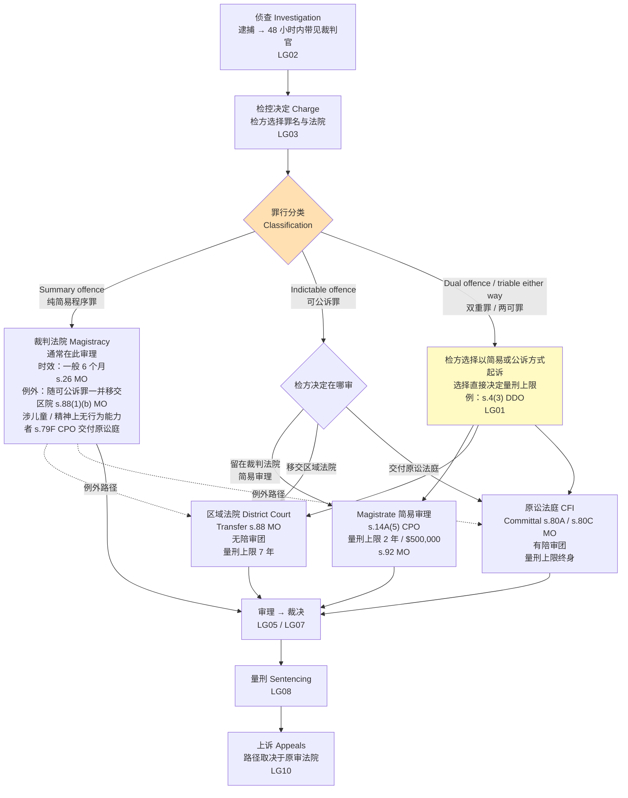
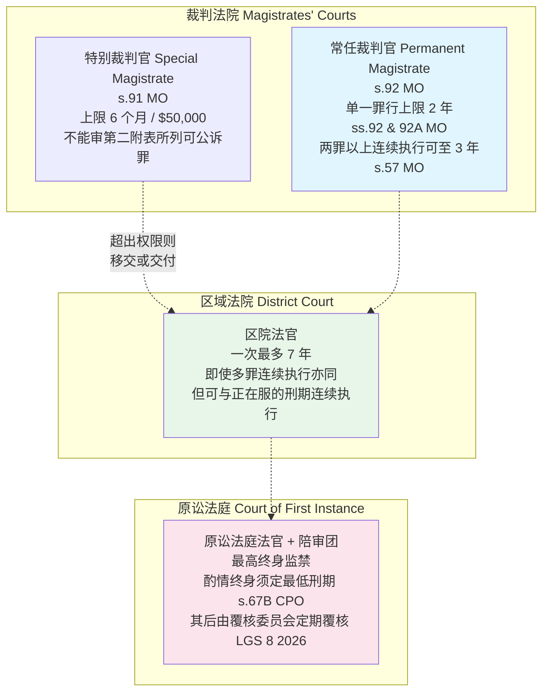
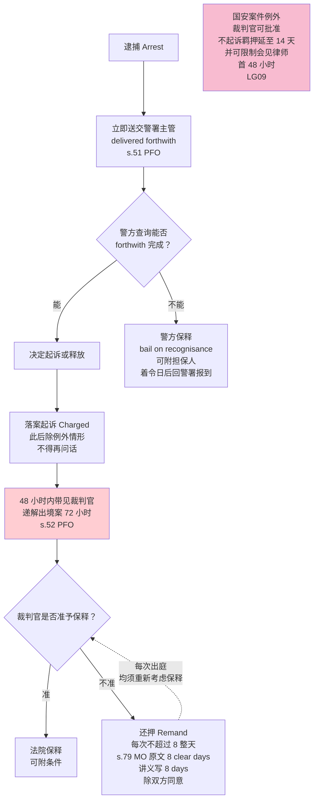
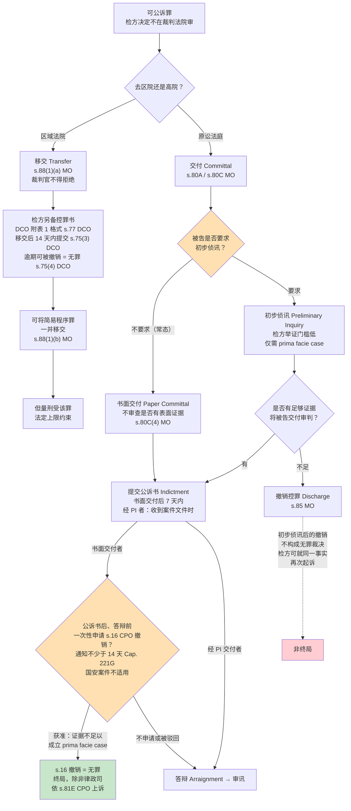
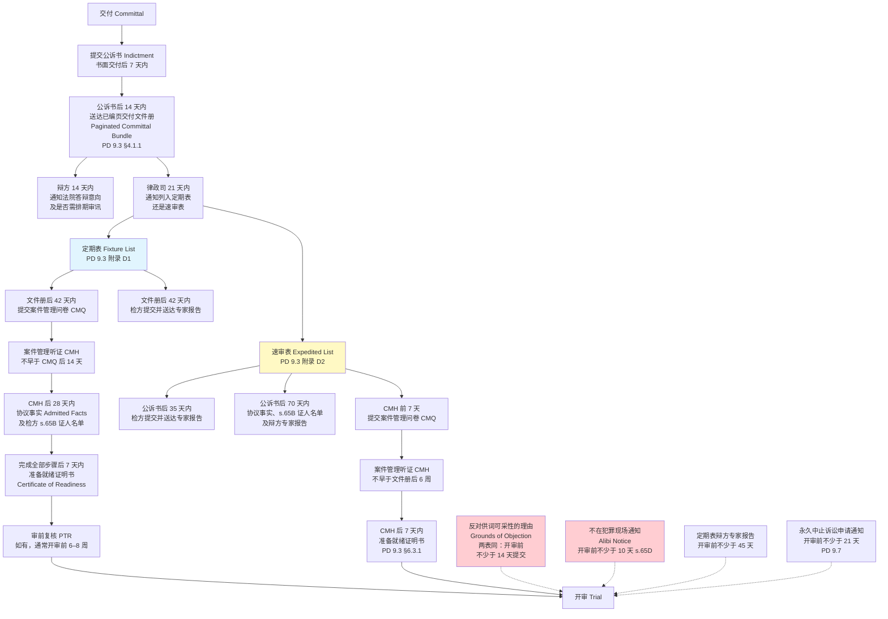
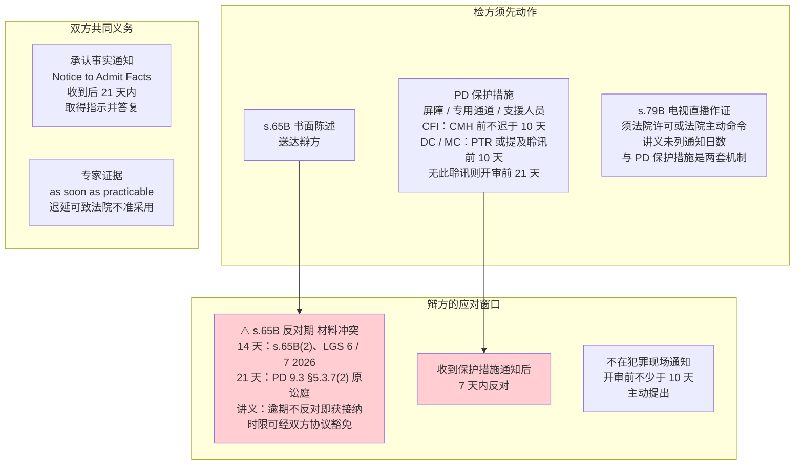
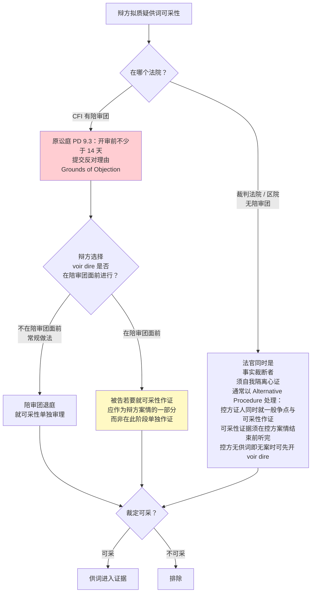
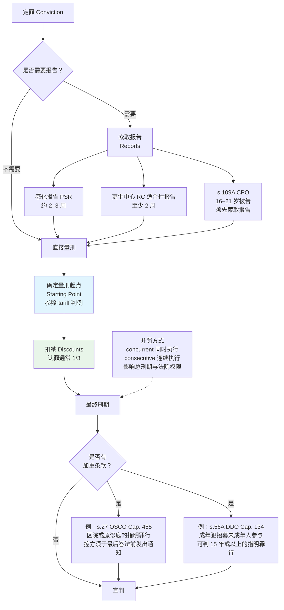
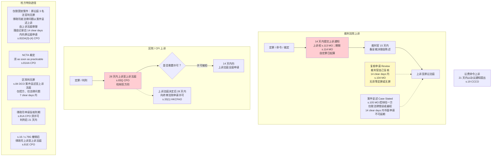

# 刑事诉讼程序流程图 Criminal Procedure Flowcharts

> 依据：往届讲义正文（现 `04 Base Lectures/[LG01]–[LG99]`，2025 年版）；2026-09-27 复审已对照本届讲义（`04 Base Lectures/00 This Year Moodle 2026-27/` 的 LGS 1–8，含新入库的本届 LGS 3）修订。本届 LGS 9/10 尚未发布，国安与上诉部分仍依往届 LG09/LG10。
> 术语：transfer（裁判法院 → 区院）= **移交**；committal（裁判法院 → 原讼庭）= **交付**。
> Mermaid 图在 Obsidian 内直接渲染。节点上的天数与 01 Deadlines and Time Limits 一致。
> 与民诉最大的不同：**刑诉没有单一主干**。案件走哪条路，由"罪行分类 + 检方选择 + 被告选择"三者决定，所以第一张图是**分流图**，不是流程图。

---

## 一、总分流：一个案件可能走的三条路

> **第一性问题**：读到任何刑诉题，先问"这是什么罪、在哪个法院"。这两个答案决定了后面全部程序、时限和上诉路径。分类错了，后面全错。

---

## 二、法院层级与量刑权限

**两个容易考的陷阱**

裁判官有权审理某可公诉罪，**不等于**可以判该罪的法定最高刑。s.92 MO 的但书明确限制在 2 年 / $500,000。讲义特意用双感叹号标注了这一点。典型例子是盗窃条例 s.10（抢劫），公诉定罪可判终身，但在裁判法院简易定罪只能判 2 年。

区院法官可以采用**高于 7 年的量刑起点**，只要扣减后的最终刑期不超过 7 年（*HKSAR v Li Yan* [1998] 4 HKC 12，LGS 1 2026；此时仍须给予有意义的认罪扣减）。这是"起点"与"最终刑期"的区分。（*Ngo Van Nam* 是认罪扣减阶梯与区院 Plea Day 的判例，不是本点的出处。）

---

## 三、侦查到首次出庭（LG02）

**保释的横向要点**：s.9G(11) CPO 规定被告每次出庭法院都须重新考虑保释——所以被拒一次不是终局。但已两次提出论据后，第三次须证明**情况有实质改变**。谋杀案裁判官与区院法官均无权批准保释（s.9G(10)）。

---

## 四、移交与交付：两条不同的路（LG03 / LGS 3 2026）

**这是刑诉最重要的一处逆向知识**：被告要求初步侦讯，看似多一次机会，实则风险不对称——检方门槛只是表面证据，多数被告仍会被交付审判；而即使成功获撤销，**也不构成无罪裁决，检方可以再来一次**（s.85 MO）。相反，书面交付时裁判官不审查表面证据、也不作撤销；被告交付后可**一次性**向原讼庭法官申请 **s.16 CPO 撤销**（公诉书提交后、答辩前；通知不少于 14 日），s.16 撤销等同无罪，除律政司依 s.81E CPO 上诉外是终局的。所以"要不要求 PI"是一个需要权衡的战术决定，不是默认动作。（原稿写"文件移交后的撤销是终局的"，像是裁判官在书面交付时作撤销，已按本届 LGS 3 2026 更正。）

另一处易忽略的不对称：移交区院时可以把简易程序罪**一并**带过去（s.88(1)(b) MO），但交付高院时 s.80A / s.80C **没有对应条文**。所以被告同时面对简易罪与可公诉罪、而案件要上高院时，简易罪会留在裁判法院——程序上被拆成两处。唯一例外是 s.79F CPO（易受伤害证人的快速交付，简易罪亦适用）。

---

## 五、审前时间表（CFI，PD 9.3 / LG05）

> 注意两表的起算点不同：**定期表**——协议事实与 s.65B 证人名单从 **CMH** 起算（28 天）、准备就绪证明书从**完成全部步骤**起算（7 天）、检方专家报告从**提交文件册**起算（42 天）；**速审表**——协议事实、s.65B 证人名单与辩方专家报告从**提交公诉书**起算（70 天），检方专家报告从**提交公诉书**起算（35 天），准备就绪证明书从 **CMH** 起算（7 天）。原图把两表数字混成一条线（并称"全部从 CMH 起算"），已按 PD 9.3 附录 D1/D2 拆开。

---

## 六、证据与通知的双向时限（LG06）

**这是刑诉里最容易失分的一组时限**：讲义明言 s.65B 陈述若在期限内不反对即获接纳为证据（LGS 6 2026），辩方随之可能失去盘问陈述人的机会（陈述人仍可依 s.65B(4) 经许可或由法院主动传召）。但时限并非绝对：双方可协议豁免送达要求及时限（s.65B(2) 但书），PD 9.3 期限亦写明"or such time as may be allowed by the court"。⚠️ 反对期本身有冲突——s.65B(2) 与本届 LGS 6 / 7 讲义写 14 天，原讼庭 PD 9.3 §5.3.7(2) 写 21 天——两者并列，考前回条文确认。讲义里有案例（Defendants 未 as soon as practicable 委任专家并提交报告）因迟延而被拒绝采用专家证据。

---

## 七、审判中的供词争议（voir dire，LG06 / LG07）

---

## 八、量刑（LG08）

> 量刑题的固定结构：**先定起点（引 tariff 判例）→ 再谈扣减 → 再看是否超出该法院权限**。讲义给了大量 tariff：贩运海洛英／可卡因不超过 10 克审后起点 2–5 年（*HKSAR v Huang Ruifang (No. 3)* [2025] 2 HKLRD 138 已修订 *R v Lau Tak Ming* 的量刑表，LGS 8 2026）、持械抢劫展示刀具起点 5 年（*Mo Kwong-sang v R* [1981] HKCA 62，LG08 / LGS 8 2026）、未经许可受雇 after plea tariff 15 个月（*HKSAR v Usman Butt* [2010] 5 HKLRD 452，出自往届 LG13）。

---

## 九、上诉路径（LG10）— 起算点各不相同

**三个必须分清的数字**：裁判法院 **14 天**（s.113 / s.114 MO）、区院与 CFI **28 天**（s.83Q CPO）、讼费 **21 天**（s.19 CCCO）。另：终审法院许可 **28 天**（s.33(1) HKCFAO）；律政司复核刑期 **21 天**（s.81A CPO）；案件呈述——裁判法院 **14 clear days**（s.105 MO）、区院 **7 clear days**（s.84 DCO，仅控方）；s.81DA 只适用于国安三法官案。

一处特殊规则：若**判刑日距定罪日超过 7 天**，则针对定罪或判刑的上诉通知可自判刑日起算——这解决了定罪后长时间等待量刑报告的情形。

s.104 MO 的复核值得单独记：它是向**原裁判官**申请，14 clear days 内，且**无须等到定罪或无罪裁决**。讲义提到一宗案例，因申请在 14 clear days 内提出，裁判官在判刑后仍非 functus，可以处理改变答辩的申请。这是一条容易被忽略的救济路径。

---

## 十、把流程图和课程进度对起来

前五周（8/31–10/3）刑诉现场只上了 LG01（法院与检方角色）与 LG02（侦查、起诉、时效、保释），第 4 周有一次 SG1（侦查阶段）。也就是上面图三那一段。LG03（律师义务、罪行分类、起草控罪、移交与交付）与 LG04（与检方谈判、审讯概览）是**预录**，须在指定现场课前看完；第 5 周另有 LG7 预录（Practical Litigation Issues，在 LG6 之后看）。

这个安排有个后果：**图一那张分流图对应的 LG03 是录播**，而它恰恰是全科的地基。前五周如果只跟现场课，会缺掉最关键的分类与路由知识。建议早看 LG03 录播。

---

## 相关

- 时限逐条查阅 → 01 Deadlines and Time Limits
- 历年考点分布 → 03 Past Paper Matrix and Analysis
- 三人笔记对比 → 04 Cross-Set Comparison and SG Progression
- 原始讲义 → 04 Base Lectures（本届 `00 This Year Moodle 2026-27/`；往届 `[LG01]–[LG99]`）

---

2026-09-27 复审修订（依据 PCLL Audit 2026-09-27 附录 I）：
- 图四：标题"移交与转介"改为"移交与交付"（transfer=移交，committal=交付，全文统一）；删去"文件移交后的撤销是终局的"错误分支（像是裁判官在书面交付时作撤销），补 s.16 CPO 节点（公诉书后、答辩前，一次，通知 14 天，s.16 撤销除 s.81E 上诉外终局）；补 s.75(3)/(4)、s.77 DCO。
- 图五：PD 9.3 定期表（附录 D1）/ 速审表（附录 D2）分两路；删去"全部从 CMH 起算"的错误说法；补文件册 14 天、辩方专家报告、永久中止 21 天。
- 图六：s.65B 反对期 14 / 21 天并列标 ⚠️（不裁断），删去"失权型""自动成为证据"绝对化表述；s.79B 电视直播与 PD 保护措施分开；补 DC/MC 21 天。
- 图七：14 天反对理由移到原讼庭分支；裁判法院/区院分支补 Alternative Procedure。
- 图八：RC 改"更生中心"、报告"至少 2 周"；"s.27 … 可判 15 年以上"拆为 s.27 OSCO（答辩前通知）与 s.56A DDO（招募未成年人，15 年门槛）；Lau Tak Ming 改注已被 *Huang Ruifang (No. 3)* [2025] 修订；Usman Butt 出处改 LG13。
- 图九：28 天改 s.83Q CPO、14 天期限 s.114 MO；补 s.105 MO、s.84 DCO、s.81A CPO、s.81E CPO、s.33 HKCFAO；s.81DA 标"仅限国安三法官案、由上诉法庭审理"。
- 图一：两可罪连到原讼庭；删"唯一选项"，补 s.88(1)(b) MO、s.79F CPO 例外。图二：3 年上限改 s.57 MO；删"服刑 20 年后覆核"。图三：还押改"8 整天（s.79 MO 原文 8 clear days，库外·已外部核实；讲义写 8 days）"。区院起点判例改 *Li Yan*。
- 文件头与"相关"的过期路径 `01 Lectures (LG)` 已更新。

## 2026-10-06 实质内容入口

本轮在以下主题稿的0A节新增具体规则、条件、证据、程序选择、后果和演练示例。此页原有正文及引注保留；同一细节从下列入口阅读，避免另复制一份。

- 0A. 从截查到警署探访：逐个权力与证据节点
- 0A. 控罪内容、合并与最终审讯路线
- 0A. 答辩选择、谈判记录与案件终结效果（2026-10-10 [09] 并入 [06] 主卡后改指）
- 0A. 披露、供认争议与半程裁决的实质路径
- 0A. 把卷宗转成大律师能执行的指示与审讯文件
- 0A. 量刑选择、计算步骤与可执行请求
- 0A. 保释申请的法律决定链与条件设计（2026-10-10 [16] 并入 [05] 主卡后改指）

**留痕**：2026-10-06新增本入口；未将导航页/清单改造成另一份重复主题稿。
