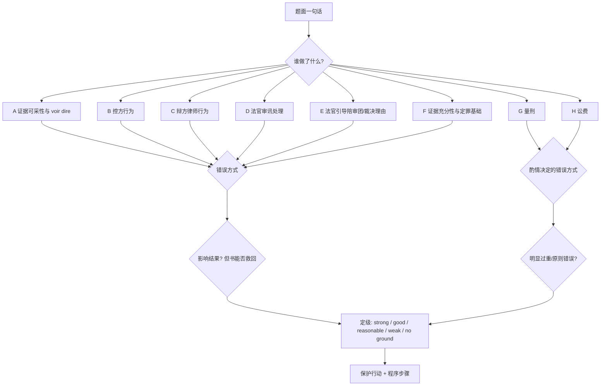

# EX01 上诉理由穷举矩阵（Appeal Grounds Exhaustive Matrix）

> **本卡承担什么**：考试 Q2（判后上诉备忘录）的**理由发现与定级引擎**。三层结构：**环节**（谁在哪个环节做了什么，A–H）→ **事实类型** → **错误方式**；每一格另附一列**往届实例与定级**作为证据，它不是一层。每一格要么有本届依据，要么标"待证"，不凭经验填写。
> **不承担什么**：上诉程序的完整制度知识见 16 刑事上诉卡；量刑规则全貌见 15 量刑卡；备忘录怎么写见 EX02 备忘录模板卡。本卡只回答"这个事实是不是理由、属于哪一格、往届怎么判、多强"。


<!-- BEGIN:cite-legend -->
> [!info]- 引注图例
>
> | 码 | 文件 | 层级 | 学年 |
> |---|---|---|---|
> | L10 | LGS.TEN.Notes.2026（上诉） | 本届讲义 | 2026-27 |
> | L12 | LGS 12 Notes 2026（备忘录与 To Chi Wing 范例） | 本届讲义 | 2026-27 |
> | L8 | crim.pro.LGS.EIGHT.2026（量刑） | 本届讲义 | 2026-27 |
> | L6 | LGS.SIX.Notes.2026（审讯程序、供认、认人） | 本届讲义 | 2026-27 |
> | L5 | LGS.FIVE.Notes.2026（沉默权等） | 本届讲义 | 2026-27 |
> | R21 | LGS14 2021 主考讲评（文字伴生） | 本届官方 | 2026-27 |
> | R21S | LGS14 2021 补考讲评（文字伴生） | 本届官方 | 2026-27 |
> | R22 | LGS14 2022 主考讲评（文字伴生） | 本届官方 | 2026-27 |
> | R24D | POST LGS15 REVISION：2024 Dec 主考讲评.pptx | 本届官方 | 2026-27 |
> | R24S | POST LGS15 REVISION：2024 补考讲评.pptx | 本届官方 | 2026-27 |
> | R1419 | LGS13：PCLL Lec 13 2026（2014–2019 各卷）.pptx | 本届讲义 | 2026-27 |
> | R23 | LGS13：PCLL Exam 2023 revision Lecture.pptx | 本届讲义 | 2026-27 |
> | R20 | 2020 RPE and Written Exam Slides.pptx | 本届官方 | 2026-27 |
> | SD25 | Specimen_Directions_2025.pdf（司法机构陪审团指引范本） | 本届官方 | 2026-27 |
> | SG8T | Otter Transcript - SG08 (2026-11-18) | 本届讲义 | 2026-27 |
> | MEL | Supp Exam Paper 2025 - 2026（Melvin 案 Q2） | 本届官方 | 2026-27 |
> | T1419 | PP 2014-2019 - Review Transcript | 本届讲义 | 2026-27 |
> | T21 | PP 2021 (Dec) - Review Transcript | 本届讲义 | 2026-27 |
> | T23 | PP 2023 - Review Transcript | 本届讲义 | 2026-27 |
> | T24D | PP 2024 Dec. - Review Transcript | 本届讲义 | 2026-27 |
> | SG7T | Otter Transcript - SG07 (2026-11-11) | 本届讲义 | 2026-27 |
<!-- END:cite-legend -->

> 图例说明：全部来源均为本届 Moodle 可见或本届课堂材料。R21／R21S／R22 是本届 LGS14 重发的历年讲评（LGS14 README 已登记身份）；R24D／R24S 是 2026-11-19 随 LGS15 发布的 2024 两套试卷复习幻灯片；R1419、R23 是本届 LGS13 文件夹内的讲稿；R20 在本届 PAST PAPERS 文件夹。pptx 按幻灯片序号（Slide N）定位，PDF 按 PDF 页定位。四份讲评录音转写（T1419、T21、T23、T24D，位于 `02 Past Papers/`）已吸收，口头补充以"录音补充"标在各行。


---

## 速读定位层

### 适用范围

| 项 | 内容 |
|---|---|
| 题型 | 历届 Q2 都是"受训律师致监督合伙人的备忘录"，就定罪、量刑、讼费的上诉理由及程序步骤提供意见（逐卷证据见 EX02 §1） |
| 分值结构 | Part 1 约 22–25 分（理由），Part 2 约 2–5 分（程序与保护行动）〔R22 L234 "Part 1 = 22 - 25 marks. Part 2 = 2 - 5 marks."〕 |
| 每条理由分值 | 多为 2–4 分；应找出约 6–11 条〔R21 L242 "Grounds of appeal are rarely worth more than 4 marks"〕〔R21 L243 "anything between a minimum of 6 and 11 grounds"〕 |
| 本卡用法 | ① 先用 §0A 四问逐句扫题面；② 每个可疑事实按 环节 → 事实类型 → 错误方式 落格；③ 查该格的往届实例与定级；④ 按 §1 前的 IRAC 插槽写成一段，插进 EX02 §0G 模板的对应插口 |

### 关键术语

| 术语 | 一句话定义 | 依据 |
|---|---|---|
| unsafe or unsatisfactory | 定罪不安全或不令人满意，类别不封闭 | 〔L10 L409 "This is a very wide category in which the categories are not closed."〕 |
| wrong decision of law | 法官在法律问题上判错，且须实质影响结果 | 〔L10 L447 "The trial Judge’s decision on the law must have been material"〕 |
| material irregularity | 审讯过程中有实质影响的不规范 | 〔L10 L463 "The irregularity must be ‘material’"〕 |
| proviso | 即使有错，若合理陪审团必然仍会定罪，上诉可被驳回 | 〔L10 L493 "if a hypothetical reasonable jury, properly directed"〕 |
| manifestly excessive／wrong in principle | 量刑明显过重／原则错误 | 〔📄R24D Slide 14〕〔📄R1419 Slide 34〕 |
| flagrant incompetence | 律师严重失职；门槛极高，只在例外情况下成立 | 〔L10 L427 "Flagrant incompetence should only be advanced in exceptional circumstances"〕 |

### 三类法定理由会重叠，考试不必强行归类

讲义明言三类常常重叠〔L10 L485 "These 3 grounds of appeal frequently overlap"〕；讲评也说不必选"桶"，明显时可以写〔R22 L249 "No need to choose “bucket” ground of appeal falls into"〕。所以本卡的第一层（环节）按**扫描题面的顺序**（谁、在哪个环节做了什么）分类，三类法定理由只作为每格的属性。

---

## 本卡地图



| 任务 | 直达 |
|---|---|
| 判断一个事实是不是理由 | §0A 四问 |
| 把一行写成备忘录的一段 | §1 前的通用 IRAC 插槽；EX02 §0G |
| 防遗漏的格子表 | §0B 错误方式；§1–§8 各环节分支 |
| 查往届怎么判、多强 | 各分支表的"往届实例"列；§9 逐卷覆盖表 |
| 写保护行动与 Part 2 | §10、§10A 衔接表（三张）、§11 程序步骤 |
| Melvin 案逐段扫描 | §12 |
| 缺口与待证 | §13 覆盖报告、open 块 |

---

## 0A. 判断框架：每个事实过四问

| 问 | 内容 | 依据 |
|---|---|---|
| ① 谁错了 | 法官、控方、辩方律师、程序本身 | 三类理由实例覆盖法官、控方、律师〔L10 L425 "misconduct by the Prosecution or investigating authorities"〕〔L10 L427 "‘flagrant’ incompetence by Counsel"〕 |
| ② 落哪一类 | 定罪：s.83 三类；量刑：明显过重或原则错误；讼费：错误原则 | 〔L10 L183 "the conviction is unsafe or unsatisfactory"〕〔L10 L445 "(ii) a wrong decision of law"〕〔L10 L461 "(iii) material irregularity in the course of the trial"〕 |
| ③ 是否影响结果 | 法律错误须实质影响结果；不安全的定罪不能适用但书 | 〔L10 L459 "It is not every wrong decision of law that leads to a conviction being overturned"〕〔L10 L443 "If the court finds that the conviction is unsafe or unsatisfactory, then the proviso cannot be applied"〕 |
| ④ 多强 | 每条都要给结论：strong／good／reasonable／weak／no ground | 〔R21 L109 "conclude – good/strong or reasonable (borderline) or weak or no ground of appeal?"〕〔R22 L250 "Must advise on strength of grounds you identify"〕 |

**定级规律（官方讲评归纳）：**

| 情形 | 往届定级 | 怎么写（考场可写） | 依据 |
|---|---|---|---|
| 先想清楚为什么要排除某项证据；对被告无害的证据不必挑战（录音，2014–19 [48:29]） | 通用口径 | —（思考口径，不需要例句） | 〔T1419 L699–L700 "think about why you want evidence excluded"〕 |
| 题面每一段、每个事实都可能藏着理由（"be suspicious of everything"） | 通用口径 | —（思考口径，不需要例句） | 见 B3 行录音补充 |
| 法官适用错误法律测试（如举证标准、举证责任） | 强 | *"The Judge applied the wrong legal test. The Prosecution must prove the voluntariness of a confession beyond reasonable doubt: DPP v Ping Lin; principle (e) of the R&Ds — not on the balance of probabilities. Because the error goes to the legal standard itself, it is a wrong decision of law and this is a strong ground of appeal."*<br>举证责任倒置时：*"The burden of proof remains on the Prosecution throughout. By directing that the defendant had to prove [X], the Judge reversed the burden; even where a statute appears to place the burden on the defendant, it may be read down to an evidential burden only: HKSAR v Lam Kwong Wai."*〔R21 L122 "P has burden to prove voluntariness of confession BRD – DPP v. Ping Lin"〕〔R21 L217 "Case law has read this down to be an evidential burden only: HKSAR v. Lam Kwong Wai"〕 | 〔📄R24D Slide 6〕〔R21 L215 "M erred in law in wrongly shifting BOP to D"〕 |
| 仅基于证人可信度的攻击 | 较弱；但若同时适用了错误法律测试则变强 | *"Findings of credibility are difficult to overturn on appeal because the trial Judge saw the witnesses give evidence. However, the Judge here [failed to evaluate the evidence in the context of the animosity between the witness and the defendant: HKSAR v Syed Rashid Aslam / applied the wrong legal test]. The trial transcript should be obtained. This is a reasonable ground of appeal."*〔L10 L431 "the Judge’s failure to properly evaluate the evidence in the context of the animosity between the witness and the Defendant"〕〔R21S L127 "We should also ask for the trial transcript"〕 | 〔R21S L126 "This is a reasonable / weak ground of appeal only as trial J is best placed"〕〔R21S L106 "the fact that the J has applied the wrong legal test makes this ground stronger"〕〔📄R23 Slide 11〕 |
| 偏见（只凭可信度时较弱，多处表现时可升为强） | 视情况；须取审讯誊本 | 测试必须写出（录音：不写测试拿不到满分）：*"The test for apparent bias is whether a reasonable, fair-minded and well-informed observer would conclude that there is a real possibility that the Judge was biased: HKSAR v Mohammed Emran Hossain. Here [facts: e.g. remarks before all the evidence was heard / revoking bail on the day a previous conviction emerged]. The trial transcript should be obtained to confirm what was said. Given [the several instances], this is a [reasonable / strong] ground of appeal."*〔L10 L423 "The test as to a J’s bias is whether the circumstances are such as would lead a reasonable"〕 | 〔📄R24D Slide 9〕〔📄R1419 Slide 32〕 |
| 律师严重失职 | 门槛高，多为较弱或合理；后果严重时可强 | *"A ground based on the flagrant incompetence of counsel will only succeed in exceptional circumstances; a mere error of judgment or a tactical decision is insufficient: HKSAR v Ho Chung Wah. The question is whether the defendant received less than a fair trial. Here counsel's failure to [object / call / advise] was not a tactical choice because [reason], and it [had a direct effect on the verdict]. Although the threshold is high, this is a [reasonable / strong] ground of appeal."*〔R21 L174 "Not just a mere error of judgment or a tactical decision"〕 | 〔📄R24D Slide 10〕〔R21 L174 "Flagrant incompetence as a ground of appeal rarely succeeds due to high threshold"〕〔📄R24S Slide 8〕 |
| 重复 Notice of Objection 内容（供认应被排除） | 只有 2 分，但给分最严；四件事缺一件就拿不满 | 拿满 2 分要四件事齐全（录音：给分最严）：① 举证责任与标准；② 自愿性测试与 PIA；③ 本案事实与 R&D 编号；④ 强弱结论。例句：*"The Judge wrongly admitted the [ROI]. The Prosecution must prove voluntariness beyond reasonable doubt: DPP v Ping Lin; principle (e) of the R&Ds. A confession is involuntary if obtained by threats, inducements or oppression by a person in authority: R v Ibrahim; uniformed officers are clearly persons in authority: Deokinanan v R. The court asks whether the conduct was capable of inducing a confession and, if so, whether the Prosecution has proved beyond reasonable doubt that it did not do so: Chau Ching Kay. Here [PW] [threatened / induced] D by [words], and D was [conditions], in breach of [Direction 4 / Direction 8 / Rule V(c)]. Even if voluntary, the [ROI] should have been excluded in the Judge's residual discretion for unfairness and substantial breaches of the R&Ds, although that discretion is rarely exercised: SJ v Lam Tat Ming. This is a strong ground of appeal."*〔R21 L123 "Confession made to a person in authority – Deokinanan."〕〔L6 L666 "Both objective and subjective tests should be used to determine voluntariness"〕〔R21S L72 "residual discretion is rarely exercised by the courts where a voluntary confession was made to a person in authority"〕〔T21 L668–L668 "you needed to cite the law, the burden of proof, the test"〕 | 〔R21 L137 "Easy 2 marks here as largely repeating content of Notice of Objection"〕 |
| 拿不准是否成立 | 也写进去，放在后面；无关理由不扣分 | 放在已确定的理由之后：*"It may further be argued that [X]. However, because [reason for doubt], this is a weaker ground of appeal."*〔R21 L248 "Prioritize your grounds of appeal – deal with the ones you are sure about first."〕 | 〔R21 L247 "include it anyway. You will not lose marks for irrelevant grounds"〕 |
| 题面有线索但不成立（非理由） | 应写明为何不成立，可得分 | 简短写明为何不成立：*"Although [fact], this is not a ground of appeal because [e.g. identity was not in dispute, so no Turnbull direction was required / the sentence is within the tariff and an appeal risks an increase under s. 83I CPO]."*〔📄R1419 Slide 20〕〔📄R20 Slide 17〕 | 〔R21S L152 "Marks can be available for discussing “non-grounds”"〕〔R22 L277 "Yes – if it arises out of something in the fact pattern."〕 |

---

## 0B. 三层结构与防遗漏机制

| 层级 | 是什么 | 来源 |
|---|---|---|
| 第一层：环节 | 谁在哪个环节做了什么，分 A–H 八支（§1–§8），另有保护行动（§10）与程序步骤（§11） | 本层自拟分类，按审讯时序；三类法定理由作属性 |
| 第二层：事实类型 | 每个环节下的具体事项，编号如 A1、E2 | 自上而下：SD25 目录 74 题、LGS5／6／8／10 讲义列举；自下而上：2014–2024 各卷讲评 |
| 第三层：错误方式 | 这件事可能怎样出错，编号 ①–⑨ | 见下表 |
| 证据列（不是一层）：往届实例与定级 | 附在每一格里：往届哪卷出现、官方怎样定级、关键依据 | R1419、R20、R21、R21S、R22、R23、R24D、R24S |

**错误方式库：**

| 编号 | 错误方式 | 适用对象 | 依据 |
|---|---|---|---|
| ① | 应引导／应处理而没有（non-direction、failure to remind himself） | 陪审团引导、法官自我提醒（裁判官或法官独审） | 往届多以"failure to remind himself of…"出现〔📄R20 Slide 13〕〔R21 L203 "M’s failure to remind himself of the lies direction"〕 |
| ② | 引导或裁定的内容错误（misdirection、错误法律测试） | 引导、证据裁定 | 〔L10 L451 "misdirection of the Jury"〕 |
| ③ | 引导不完整（漏掉必备部分） | 品格、认人等 | 良好品格两肢〔📄R1419 Slide 40〕；Turnbull 弱点〔📄R20 Slide 13〕 |
| ④ | 法官评论越界、表达个人观点、像第二份控方陈词 | 总结 | 〔📄R1419 Slide 45〕 |
| ⑤ | 篡夺陪审团职能 | 总结 | 〔📄R1419 Slide 45〕 |
| ⑥ | 采纳或依赖不可采／未经证明的材料 | 证据、裁决理由 | 〔L10 L453 "evidence wrongfully excluded / included"〕〔📄R24S Slide 6〕 |
| ⑦ | 酌情决定错误：错误原则、考虑无关因素、事实错误、遗漏重要考虑 | 量刑、讼费、证据酌情、是否索取报告 | 〔L10 L457 "If the judge acts upon a wrong principle"〕 |
| ⑧ | 未行使酌情权 | 证据、程序 | 〔L10 L469 "the Judge’s failure to exercise his discretion"〕 |
| ⑨ | 程序缺陷（未行 voir dire、未让被告就可采性作证等） | 程序 | 〔L10 L467 "procedural defects e.g. failing to arraign the Accused"〕〔📄R1419 Slide 37〕 |

**防遗漏四道机制：**
1. **自上而下**：事实类型全集来自 SD25 目录与各讲义列举（§1–§8 每格标出处）。
2. **自下而上**：每卷讲评中的每条理由都必须落到某一格（§9）；落不下就新增一格。
3. **覆盖报告**：每格标往届出现次数；0 次的保留为"课程有、往届未考"（§13）。
4. **逐句覆盖**：套用到新题时，题面每一句都要标"命中哪一格"或"无问题＋理由"（示范见 §12）。

---

## 落点总则：每个事实类型最后落到哪一类上诉理由

> **"往届发生了什么"一列的默认含义**：列出的往届事实**默认都构成**该事实类型（讲评认为是理由）；讲评明确说不是理由的标 ⚠️ **不构成**，只部分相关的标 ⚠️ **不完全构成**，并写明原因。G5、G9 两类本身就是"不应上诉"的情形，例子按该类构成计。
>
> §1–§8 每个事实类型都按同一条链写：**错误方式 → 规则（考场可写）→ 往届发生了什么 → 上诉落点 → 应用要点**。"上诉落点"用下表的归类；讲义明言三类会重叠〔L10 L485 "These 3 grounds of appeal frequently overlap"〕，所以写"主归类＋倾向"，考试中也可不写归类〔R22 L249 "No need to choose “bucket” ground of appeal falls into"〕。

| 归类 | 讲义列举的典型情形 | 但书（proviso） |
|---|---|---|
| **wrong decision of law** | 误导陪审团〔L10 L451 "misdirection of the Jury"〕；错误采纳或排除证据〔L10 L453 "evidence wrongfully excluded / included"〕；酌情决定行使错误〔L10 L455 "wrongful exercise of the trial Judge’s discretion"〕 | 可适用：合理陪审团在正确引导下必然仍会定罪时，上诉可被驳回〔L10 L493 "if a hypothetical reasonable jury, properly directed"〕 |
| **material irregularity** | 程序缺陷〔L10 L467 "procedural defects e.g. failing to arraign the Accused"〕；法官未行使酌情权〔L10 L469 "the Judge’s failure to exercise his discretion"〕；控方开案提及不可采证据〔L10 L471 "the Prosecution referring to inadmissible and highly prejudicial evidence in opening its case"〕；控方不披露〔L10 L479 "non-disclosure by the Prosecution of material information"〕 | 可适用，但须是"material"的不规范才构成理由〔L10 L463 "The irregularity must be ‘material’"〕 |
| **unsafe or unsatisfactory** | 过度干预〔L10 L415 "excessive judicial intervention - this is a question of degree"〕；偏见〔L10 L421 "the Judge’s bias - this ground of appeal frequently overlaps"〕；律师严重失职〔L10 L427 "‘flagrant’ incompetence by Counsel"〕；未评估证人敌意〔L10 L431 "the Judge’s failure to properly evaluate the evidence in the context of the animosity"〕；lurking doubt〔L10 L413 "there is a “lurking doubt”"〕 | **不能适用**〔L10 L443 "If the court finds that the conviction is unsafe or unsatisfactory, then the proviso cannot be applied"〕 |
| 量刑 | manifestly excessive／wrong in principle | 上诉量刑有加刑及损失时间风险（§7 G11） |
| 讼费 | 错误原则（s.19 CCCO 上诉）〔📄R24D Slide 17〕 | — |

**与保护行动的衔接**：每条理由定级后，到 §10A 衔接表查它触发的保护行动（誊本、新证据、保释、不上诉量刑等）。

考场写法：*"This amounts to a [wrong decision of law / material irregularity] and/or renders the conviction unsafe or unsatisfactory under s. 83(1) CPO. The proviso should not be applied because ..."*（本层自拟句式，归类依据见上表）〔L10 L183 "the conviction is unsafe or unsatisfactory"〕

---

**通用 IRAC 插槽（§1–§8 每一行都按此写成备忘录的一段）**

```text
(n) [Heading: who did what wrong] ← 事实类型＋错误方式
I [One sentence stating the error, e.g. "The Judge reversed the
 burden of proof in his summing-up."] ← 一句点出错误
R [Rule column, verbatim, with case / section]. ← 规则列
A On [date], [PW / the Judge / counsel] [did X], namely:
 "[exact words from the paper]". This [affected D / the jury / the
 fairness of the trial] because [the row's application hook].
 ← 事实插槽＋该行"应用要点"
C This amounts to a [wrong decision of law / material irregularity
 / the conviction is unsafe or unsatisfactory]; the proviso
 [can / cannot] apply. This is a [grade] ground of appeal.
 ← 上诉落点
```

> 顺序与 LGS12 官方范例一致（一句点出错误 → 原则与判例 → 引题面事实并说明影响 → 定级），EX02 §0C、§0G 采用同一顺序。
>
> 应用部分是讲评扣分最多的地方：要说明不当行为如何影响被告〔T23 L94–L95 "as long as you point out that the actions of the officer affected the defendant"〕，并分析事实对辩方的意义〔R21 L168 "didn’t analyse the significance of the brother’s evidence to D’s defence"〕。各表最后一列"应用要点"列出每类理由在 A 句里必须讲到的内容；标"本层归纳"的为依规则推出、讲评未直接说明。

## 1. 环节 A：证据可采性与 voir dire

| 事实类型 | 错误方式 | 规则（考场可写） | 往届发生了什么 | 上诉落点 | 应用要点（对辩方的意义） |
|---|---|---|---|---|---|
| **A1** 供认应被排除而未排除 | ② 适用错误测试；⑦ 剩余裁量行使错误。 | *"The Prosecution must prove the voluntariness of a confession beyond reasonable doubt: DPP v Ping Lin; principle (e) of the R&Ds. A confession is involuntary if obtained by threats, inducements or oppression exercised or held out by a person in authority, or by fraudulent misrepresentation; the misconduct must occur before or at the time of the confession. A voluntary confession may still be excluded in the Judge's residual discretion for unfairness, where its prejudicial effect outweighs its probative value, or for substantial breaches of the R&Ds, although that discretion is rarely exercised where the confession was made voluntarily to a person in authority: SJ v Lam Tat Ming."*〔R21S L71 "Misconduct must have occurred either before or at the time of the confession to render it involuntary."〕〔R21S L72 "residual discretion is rarely exercised by the courts where a voluntary confession was made to a person in authority"〕 警员身份：*"uniformed officers are clearly persons in authority: Deokinanan."*〔R21 L123 "Here – uniformed officers clearly people in authority."〕 | • 2014 Edward Lo：被告服用冰毒后神志不清时被问话；警员只以"管有"警诫他，没告诉他被调查的是贩运；另有在场警员掴打、迫签事后记录〔📄R1419 Slide 8〕〔📄R1419 Slide 9〕〔📄R1419 Slide 10〕。<br>• 2016 Andrew Tam：被告是线人，雇用他的警员承诺"如认是把风就帮你取保"，随后另一警员上门问话，他承认〔📄R1419 Slide 23〕〔📄R1419 Slide 24〕。<br>• 2017 Wan Wing Yee：未成年人在问话室过夜无食物、监护人未到场，被威胁"不合作会更糟"〔📄R1419 Slide 30〕。<br>• 2021 Lam Kam Wah：警员威胁检控其表弟未成年饮酒、以国安法检控被告且不准保释；问话 95 分钟只问 9 题；不给水和止晕药〔R21 L129 "Involuntariness - threats to charge cousin and D under NSL with no bail."〕。<br>• 2024 Dec Aaditya Pant：警员以"明星证人"威胁、以等候尼泊尔语传译要很久为诱因，用英语问话；法官以"相对可能性"标准裁定可采〔📄R24D Slide 6〕。 | **wrong decision of law**（错误采纳证据）；若法官连 voir dire 都没做，转入 A3（material irregularity）。往届几乎都定为强〔📄R1419 Slide 31〕〔📄R24D Slide 6〕；讲评提示这条"重复 Notice of Objection 即可得分，但须写原则、判例和 R&D 编号"〔R21 L137 "must have included legal principles and case law / reference to R&Ds to get full marks"〕。法官用了错误的证明标准（如 balance of probabilities）时尤其强〔📄R24D Slide 6〕。<br>**录音补充**（2024 Dec [03:49]）：重复 Notice 内容的"供认应被排除"一条只有 2 分，但给分很严：要重述反对理由，还要写判例、自愿性测试、控方负举证责任，并分析强弱〔T24D L96 "So to get these two marks, though, we are really strict."〕<br>**录音补充**（2021 Dec [42:57]）：同上：要拿满这 2 分，须写法律、举证责任、测试和判例〔T21 L668–L668 "you needed to cite the law, the burden of proof, the test"〕<br>**录音补充**（2014–19 [32:10]）：被告当时无法理解自己在做什么时，即使警员不知情，依赖其承认也不公平〔T1419 L478–L479 "If the defendant is unable to understand what he's doing"〕 | 供认是否为控方主要证据；逐项说明哪句威胁／利诱／哪种处境促成了哪一段供认，并说明影响未消散——"close the circle"〔T1419 L186–L187 "That's the last part of the circle that must be closed."〕 |
| **A2** 裁定次序错误：认定"即使非自愿"仍以剩余裁量为由采纳 | ② 适用错误法律测试。 | *"The two questions must be asked in order: (i) is the confession voluntary? If not, it is inadmissible as a matter of law and no question of discretion arises; (ii) only if it is voluntary may the Judge consider whether to exclude it in the exercise of his residual discretion."*〔L6 L708 "Remember the 2 questions: (i) Is the confession voluntary? If no → inadmissible."〕〔L6 L708 "We do not talk about residual discretion unless the confession has been ruled voluntary."〕 | 讲评中未出现完全相同的情形。最接近的是 2024 Dec：法官对可采性用了错误标准，讲评定为强〔📄R24D Slide 6〕。<br>**Melvin 案（题面第 40 行）**：法官说"Even if I am wrong and the Cautioned Statement and ROI are involuntary, I find that the breaches … were minor in nature and insufficient for them to be ruled inadmissible"〔MEL L40 "Even if I am wrong and the Cautioned Statement and ROI are involuntary"〕——把非自愿的供认放进剩余裁量去衡量。 | **wrong decision of law**（法律测试错误）。倾向定为强：讲评一贯把"错误法律测试"列为强理由（§0A 定级规律）。本格的强弱判断属于本层推论，往届无直接先例。 | 法官若按正确次序，认定非自愿后供认即不可采，不会进入陪审团；所以错误直接决定了关键证据的去留（本层归纳） |
| **A3** 应行 voir dire／替代程序而没有 | ⑨ 程序缺陷。 | *"Where the defendant both denies making the alleged admission and alleges that it was obtained by police misconduct before or at the time it was made (a 'double-barrelled' allegation), the Judge must determine its admissibility on a voir dire / alternative procedure before it goes to the fact-finder: Thongjai."*〔L12 L98 "The case of Thongjai requires that the TJ must determine the admissibility of any alleged admission"〕 | • LGS12 范例 To Chi Wing：被告否认说过"Ah Sir give me a chance"，并指警员就钥匙所在位置说谎，但审讯未做替代程序〔L12 L62 "There was no challenge made to the admissibility of the prosecution evidence and no voir dire/alternative procedure was held."〕。<br>• 2018 Mo Wan Hang：被告指警员戴头套带他上天台威胁、承诺"认了只判感化"、威胁拘捕女友，且问话记录全部捏造；法官却说挑战只针对准确性，没做 voir dire〔📄R1419 Slide 36〕〔📄R1419 Slide 37〕。 | **material irregularity**（程序缺陷；讲义例子包括"failing to give the Defendant the opportunity to give evidence on the special issue of admissibility"）〔L10 L467 "failing to give the Defendant the opportunity to give evidence on the special issue of admissibility"〕。往届定为强〔L12 L100 "it was mandatory for the TJ to test the evidence on an alternative procedure (or voir dire)"〕。<br>**录音补充**（2014–19 [1:06:40]）：法官把"指控警方不当"误当作"只争议准确性"而不做 voir dire，是法律错误〔T1419 L942–L943 "So the judge has committed an error of law."〕 | 没有 voir dire，被告失去在可采性问题上作证的机会，供认未经检验就交给事实裁判者（本层归纳） |
| **A4** 迟延警诫（Rule II）与未告知真实控罪 | ⑦ 剩余裁量未行使或行使错误。 | *"Rule II of the R&Ds requires a suspect to be cautioned as soon as an officer has evidence affording reasonable grounds to suspect that he has committed an offence. Before questioning begins, or once the investigation changes, it is only fair that the suspect knows the true nature of the allegation: HKSAR v Pang Ho Yan. Admissions obtained in breach should be excluded for unfairness, particularly where they are damaging to the defence."*〔📄R1419 Slide 9〕〔📄R1419 Slide 18〕 | • 2014：只以"管有毒品"警诫，实际调查贩运〔📄R1419 Slide 9〕。<br>• 2015 Abdul Hussain：警员看到被告的"擔保書（Form 8）"时已有合理怀疑，却先问他在店内做什么、收多少钱才警诫〔📄R1419 Slide 18〕。<br>• 2016：被告承认协助后没有立即警诫，警员继续追问细节〔📄R1419 Slide 25〕。 | **wrong decision of law**（应以剩余裁量排除而未排除）或 material irregularity（未行使酌情权）。往届定为强；但书通常不适用，因为所得承认对被告不利〔📄R1419 Slide 18〕。若承认与辩方案情一致则不是理由〔📄R1419 Slide 27〕。<br>**录音补充**（2014–19 [35:16]）：迟延警诫后所得答案对被告不利，所以不适用但书〔T1419 L516–L518 "So it's not a situation where the proviso would be applied"〕<br>**录音补充**（2014–19 [15:33]）：Rule 2 在调查的每个阶段都适用，问话之后也不停止〔T1419 L248–L249 "Rule 2 applies at every stage in a criminal investigation."〕 | 迟延警诫后的回答对被告不利，所以不适用但书〔T1419 L516–L518 "So it's not a situation where the proviso would be applied"〕 |
| **A5** 首次在被告席指认（dock ID） | ⑥ 采纳不可采证据。 | *"A first-time dock identification is the most prejudicial form of identification, because the witness tends to assume that the person in the dock is the person he saw: R v Hoang Duc Hoa; HKSAR v Wong Chi Long. It should not be permitted unless the witness is merely confirming an earlier good identification: R v Christie. A dock identification is unobjectionable where identity is not in dispute."*〔R21S L89 "This is the most prejudicial form of ID"〕〔R21S L89 "A Dock ID may be permitted where there has been an earlier good identification"〕〔📄R1419 Slide 27〕 | • 2015：店内证人不认识被告，现场也没有指认，庭上首次指认〔📄R1419 Slide 19〕。<br>• 2020：被告拒绝参加认人队列，警方没有尝试小组指认或对面指认，证人庭上首次指认〔📄R20 Slide 14〕。<br>• 2022：PW4 七个月后在庭上"认为"是 D1〔R22 L131 "PW4 attempted to perform a first-time dock identification of D1."〕。<br>• 2024 Dec：PW2 不是拘捕警员、不熟识被告，庭上首次指认〔📄R24D Slide 7〕。<br>• **非理由**：2016 被告在承认事实中已认在场，身份无争议〔📄R1419 Slide 27〕。 | **wrong decision of law**（错误采纳证据），并连带 E6（法官未作 Turnbull 引导）。往届定为强。若辩方律师当时未反对，另开 C1。<br>**录音补充**（2014–19 [48:29]）：先想清楚为什么要排除某项证据；对被告无害的证据不必挑战〔T1419 L699–L700 "think about why you want evidence excluded"〕 | 身份是否争议；指认对定罪起了多大作用（是否唯一或主要的认人证据）（本层归纳） |
| **A6** 认人程序不当 | ⑥。 | *"Showing a witness only a very small number of photographs increases the risk of a mistaken identification; the police should consider alternative methods such as a group identification. A defendant's 'refusal' to take part in an identification parade is not valid if it was tainted by a denial of legal advice; he is entitled to advice and representation at the parade."*〔R21S L87 "Why was another form of ID not used e.g. group ID"〕〔R21S L88 "was tainted by the actions of PW1 and PW2 in denying her legal advice"〕 | 2021 补 Carrie Ying：两名证人各只看了 3 张照片就"认出"被告；被告在被拒绝法律意见后"拒绝"认人队列〔R21S L87 "PW3 and PW4 were only shown 3 photos before they made their ID of D."〕。 | **wrong decision of law**（错误采纳认人证据）。往届定为强（本条 5 分），因法官说该指认"proves her guilt"〔R21S L90 "Since J found that the ID of D by PW3 and PW4 “proves her guilt” this is a strong ground of appeal"〕。 | 认人程序的缺陷如何增加误认风险；法官是否把该指认当作定罪依据〔R21S L90 "Since J found that the ID of D by PW3 and PW4 “proves her guilt”"〕 |
| **A7** 传闻证据被采纳 | ⑥。 | *"An out-of-court statement adduced to prove the truth of its contents is hearsay and inadmissible unless an exception applies. Where the maker of the statement is not called, the evidence is highly prejudicial and should not have been introduced by the Prosecution, nor admitted by the Judge: R v Li Chun-choi; R v Ko Po-kun."*〔📄R24S Slide 6〕 反面：*"The hearsay rule never makes a document as such inadmissible. It is only inadmissible for a particular purpose, namely as evidence that a statement which it contains is true."*〔📄R1419 Slide 39〕 | 2024 补 Susan Wellington：拘捕警员 PW1 在庭上复述女佣 Rhea 告诉他的话——她听到被告骂死者"deserves to die"；控方当天早上决定不传召 Rhea〔📄R24S Slide 6〕〔📄R24S Slide 8〕。 | **wrong decision of law**（错误采纳证据）；控方主动引入则同时是 B4（material irregularity）。往届定为强，且因控方在结案陈词中再次提及而加重〔📄R24S Slide 6〕。 | 传闻内容与争议的关系（例如动机、威胁）；原陈述人未出庭，辩方无从盘问（本层归纳） |
| **A8** 应采纳而被排除（非为证明内容的文件） | ② 错误排除证据。 | 同 A7 反面：文件若不是用来证明其内容为真，而是证明其存在（如照片、讯息确有其事），不受传闻规则限制〔📄R1419 Slide 39〕。 | 2018：辩方要出示朋友"Ah Fei"的截图和 WhatsApp 讯息以证明其存在，法官拒绝；而 Ah Fei 的照片已被接纳为证据〔📄R1419 Slide 39〕。 | **wrong decision of law**（错误排除证据）。往届定为合理。 | 被排除的证据对辩方案情的支持作用（例如证明某人存在、使被告的说法可信）（本层归纳） |
| **A9** 品格证据：前科、前次无罪、失去"盾牌" | ② ⑥。 | *"Evidence of previous convictions or acquittals is admissible as similar fact evidence only if it is relevant for a non-propensity purpose and of sufficient probative force to justify admission notwithstanding its prejudicial effect: DPP v P; HKSAR v Zabed Ali; R v Z. A defendant loses his shield under s. 54(1)(f) CPO only where the nature of his defence involves imputations on the character of prosecution witnesses; putting the defence case that an officer threatened him does not do so. Even where admitted, bad character goes to credibility, not propensity."*〔📄R24S Slide 6〕〔📄R24D Slide 12〕 已失效前科：*"A spent conviction under s. 2(1)(i) Rehabilitation of Offenders Ordinance may only be put with leave in the interests of justice under s. 3(2)(c)."*〔📄R20 Slide 16〕 | • 2020：被告四年前因不小心驾驶罚款 1 万元，控方未经许可就盘问〔📄R20 Slide 16〕。<br>• 2024 Dec：被告在庭上说警员问话前以"明星证人"威胁他，法官据此认为他失去盾牌，准许控方提出其纵火前科，当天撤销其保释〔📄R24D Slide 12〕〔📄R24D Slide 9〕。<br>• 2024 补：控方盘问被告"前夫之死你曾被控谋杀并获判无罪"，两案情节并不惊人相似〔📄R24S Slide 6〕。 | **wrong decision of law**（错误采纳证据）；控方主动提出时并入 B4。往届定为好至强；辩方律师未反对另开 C1〔📄R24S Slide 8〕。<br>**录音补充**（2024 Dec [08:48]–[10:46]）：被告指控警员威胁是否令他失去"盾牌"，两种结论都给分；无论如何法官都应提醒自己不良品格只关可信度〔T24D L198–L199 "So we did award marks for arguments for and against this point in the exam."〕 | 前科或无罪的偏颇效果：陪审团可能据此推断倾向；与本案争议是否相似（本层归纳） |
| **A10** 偏颇证据与相似事实（一般描述、不相干照片） | ②。 | *"General description evidence (a man 'resembling' the defendant) is not identification evidence: R v Gayle. Evidence which only deepens suspicion is not evidence of guilt: DPP v Boardman. Similar fact evidence must have sufficient probative force to outweigh its prejudicial effect: HKSAR v Zabed Ali; HKSAR v Chu Kar-keet."*〔R21 L185 "This was not evidence of ID as it was only general description evidence: R v. Gayle"〕〔R22 L124 "this evidence should have been excluded as it is more prejudicial than probative"〕 | • 2021：PW4 说看见"一个像被告的人"把车开出车库〔R21 L184 "PW4 testified saw a “man resembling D driving the Pretty Boy car out of D’s uncle’s garage.”"〕。<br>• 2022：控方出示的是不同颜色牛奶纸盒的照片，并非检获物〔R22 L124 "the photographs are not of the seized items but of differently coloured milk cartons"〕。 | **wrong decision of law**。2021 合理；2022 强。 | 该证据只加深怀疑而不能证明有罪，却可能被当作认人或倾向证据（本层归纳） |
| **A11** "目标人物"等标签进入证据 | ⑥。 | *"Information that the defendant was a police 'target' should not be disclosed to the jury, as it may predispose them to convict: R v Li Chun-choi; R v Ko Po-kun."*〔📄R1419 Slide 47〕 | 2019 Daniel Wong：陪审团得知被告是"target person"〔📄R1419 Slide 47〕；讲义案例中控方证人称被告为"target"，法官在总结中重复了三次〔L10 L473 "not only did the prosecution witness refer to the Defendant as the “target” but the trial Judge repeated this reference"〕。 | **material irregularity**（讲义归入此类）〔L10 L473 "References to the Defendant as the “target”"〕。 | "目标人物"一类标签令陪审团预设被告有罪（本层归纳） |
| **A12** 远程作证的申请被拒 | ⑦ 酌情决定错误。 | *"Under s. 6 of the Courts (Remote Hearing) Ordinance, Cap. 654, a criminal trial is 'excluded proceedings' and cannot be conducted remotely (s. 6(2)); but on the application of a party the court may permit a witness to give evidence by a remote medium such as an audio-visual link if it is in the interests of justice (ss. 6(4)–(6)), having regard to the factors in s. 9 (secure location and link, reliability of the evidence, credibility of the witness, fair and efficient trial)."*〔R21 L158 "S. 6 CRHO - court can make an order for part of hearing to be conducted remotely"〕〔R21 L159 "Exception: ss. 6(4) and (5), on the application of a party to the proceedings"〕 中文提示：旧的 s.79I CPO 已废除，不要再引〔R21 L152 "Since this exam, s. 79I has been repealed"〕。 | 2021：被告唯一的辩方证人（兄长，可证明他获准借车）因旅游限制和航班不足无法来港，法官拒绝视像作证，而控方 PW4 的短讯证据却获准〔R21 L165 "Brother’s evidence crucial to defence that D was allowed to borrow car"〕。 | **wrong decision of law**（酌情决定错误）或 material irregularity。往届定为合理，"比其他理由弱"〔R21 L167 "Conclusion – weaker ground of appeal than other grounds but reasonable in circumstances."〕；须分析该证人对辩方的重要性〔R21 L168 "didn’t analyse the significance of the brother’s evidence to D’s defence"〕。可配合申请新证据（§10）。 | 该证人对辩方案情有多关键、是否为唯一的佐证——讲评明言不分析这一点会扣分〔R21 L168 "didn’t analyse the significance of the brother’s evidence to D’s defence"〕 |
| **A13** 法官在 voir dire 中的可信度认定 | ⑦。 | *"Findings of credibility are difficult to challenge on appeal because the trial Judge was best placed to observe the witnesses' demeanour."*〔R21S L126 "trial J is best placed to observe the demeanour of the witness’ while testifying and to assess their credibility"〕<br>--- | 2023：PW3 否认知道狗牌已过期，但他在拘捕前看过牌照并用它问话；法官仍采信 PW3〔📄R23 Slide 11〕。 | **unsafe or unsatisfactory**（倾向），定为较弱〔📄R23 Slide 11〕。若可信度认定建立在错误法律测试或明显偏见上，则改按 A1、D2 写，强度上升。 | 说明法官的可信度认定忽略了哪些客观矛盾，并承认此类理由较弱（本层归纳） |

## 2. 环节 B：控方行为

| 事实类型 | 错误方式 | 规则（考场可写） | 往届发生了什么 | 上诉落点 | 应用要点（对辩方的意义） |
|---|---|---|---|---|---|
| **B1** 未披露 | ⑥。 | *"The Prosecution is under a continuing duty to disclose material which may undermine its case or assist the defence, including the disciplinary records of prosecution witnesses and the defendant's previous convictions: para. 12 Prosecution Code; R v Keane; HKSAR v Lee Ming Tee (No 2); HKSAR v Chan Kau Tai. The duty continues even after the witness has testified; the witness may need to be recalled."*〔📄R20 Slide 12〕〔📄R24S Slide 9〕 | • 2017：负责证物链的警员有纪律问题未披露〔📄R1419 Slide 33〕。<br>• 2018：问话警员 PW2 的纪律记录未披露〔📄R1419 Slide 38〕。<br>• 2020：PW2 曾因伪造证据受纪律处分；被告正好指警员伪造同案人供词〔📄R20 Slide 12〕。<br>• 2024 Dec：PW1 的纪律事宜若已披露，便可在替代程序中质疑他会否威胁被告〔📄R24D Slide 13〕。<br>• 2024 补：被告前次谋杀无罪未披露，控方却在审讯中依赖它〔📄R24S Slide 9〕。<br>• ⚠️ **不构成**——2016：DPC 23456 违规掉头一事与本案关联不足，大概不必披露〔📄R1419 Slide 27〕。 | **material irregularity**（讲义明列）〔L10 L479 "non-disclosure by the Prosecution of material information"〕；若资料足以动摇对证人可信度的信任，倾向 unsafe。往届定为好或强。可配合申请新证据（§10）。<br>**录音补充**（2014–19 [50:11]）：无关紧要的纪律事项（2016 违规掉头）即使应披露，也不重要〔T1419 L721 "Yes, it should have been disclosed. But does it really"〕 | 若当时已披露，辩方会怎样用该材料（盘问、质疑可信度），可能改变结果（本层归纳） |
| **B2** 名单上的证人既不传召也不提交盘问 | ⑨。 | *"A witness whose name appears on the back of the indictment must, if the defence so requests, be tendered by the Prosecution for cross-examination even if the Prosecution chooses not to call him in chief: HKSAR v Lam Chun Wan."*〔📄R24S Slide 8〕 | ⚠️ **不完全构成**（控方并没有拒绝提交，讲评是放在辩方律师失职下讨论的，而且以 PW1 的传闻被采纳为前提）——2024 补：控方开审当天早上决定不传召女佣 Rhea（她有不诚实罪行定罪），而她正是 PW1 所转述"威胁"的来源〔📄R24S Slide 8〕。讲评同时指出：若 PW1 的传闻证据被排除，就不需要盘问 Rhea。<br>**Melvin 案（题面第 44 行）**：控方不传召名单上的 PW4，辩方要求提交盘问，法官以"it is entirely the choice of the Prosecution"拒绝〔MEL L44 "it is entirely the choice of the Prosecution which witnesses they wish to call"〕。 | **material irregularity**（未遵循既定程序）。2024 补把它放在律师失职下讨论；Melvin 案是法官主动拒绝，更直接落在法官的程序错误上（本层推论）。 | 该证人能就什么作证、为何对辩方重要；辩方被剥夺盘问机会（本层归纳） |
| **B3** 主问依据 Notice of Objection 问具体问题 | ⑨。 | *"The Notice of Objection discloses the defence grounds to the Prosecution, but in examination-in-chief of a prosecution witness the Prosecutor may only ask general questions about the circumstances of the confession; he may not lead the witness on the specific allegations in the Notice: R v Wong Tak-ming."*〔R21 L144 "Prosecutor can only ask general question in EIC of a Prosecution witness"〕 | 2021：控方主问时直接问 PW1"你有没有威胁拘捕被告表弟（未成年饮酒）、以国安法检控被告"〔R21 L143 "During PW1’s evidence, Prosecutor asked PW1 whether he had threatened D with arresting D’s cousin"〕。 | **material irregularity**〔R21 L145 "material irregularity as proper procedures were not followed"〕。好；讲评特别提醒很多学生漏掉。<br>**录音补充**（2021 Dec [26:26]）："Be suspicious of everything"：题面每一段、每个事实都可能藏着理由；主问问具体威胁这一条很多学生漏掉〔T21 L419–L419 "be suspicious of everything, every paragraph, every fact"〕 | 控方借 Notice 内容引导证人预先否认，削弱了辩方在盘问中的效果（本层归纳） |
| **B4** 控方提及不可采材料、影射、发表个人意见 | ⑥。 | *"A Prosecutor must act fairly and impartially (para. 3 Prosecution Code) and must not express a personal opinion or refer to inadmissible and highly prejudicial material in opening or closing: R v Li Chun-choi; HKSAR v Chu Kar Keet."*〔📄R24S Slide 6〕〔L10 L475 "an insinuation by Prosecuting counsel in closing based on facts that had been redacted"〕 | 2024 补：控方盘问前次无罪，并在结案陈词中发表个人意见、再次提及传闻与无罪〔📄R24S Slide 6〕。 | **material irregularity**（讲义例子）；法官未纠正时连带 D3。往届定为强。 | 不可采材料或个人意见对陪审团的影响，以及法官有无纠正（本层归纳） |
| **B5** 有动机的控方证人（减刑交易、同案已认罪者） | ① 未作警告。 | *"Where a prosecution witness has an interest of his own to serve, such as an accomplice who has made a deal with the Prosecution for a reduced sentence in exchange for his testimony, the jury must be warned of the danger of relying on his evidence and directed how to assess it: HKSAR v Chan Kam Chiu."*〔📄R1419 Slide 26〕<br>--- | • 2016：主犯 Ben So 与控方达成减刑交易后作证指证被告，法官只叫陪审团"用常识"〔📄R1419 Slide 26〕。<br>• 2021 补：两名控方证人已认罪、判刑押后至被告案件之后，可望因"协助当局"获减刑；PW4 还因报酬太低而怀恨〔R21S L123 "Both testified as PWs against D on the basis that they were likely to get a reduction in their sentence"〕。 | **wrong decision of law**（未作引导，非引导亦属误导）或 unsafe（未评估证人敌意）。2016 好；2021 补合理／较弱（涉可信度），并须取审讯誊本〔R21S L126 "This is a reasonable / weak ground of appeal only"〕。 | 证人减刑或怀恨的动机如何影响其证供可信度，而陪审团未获提醒（本层归纳） |

## 3. 环节 C：辩方律师行为（flagrant incompetence）

**共通规则（考场可写）**：*"A ground alleging the flagrant incompetence of counsel should only be advanced in exceptional circumstances; a mere error of judgment or a tactical decision which, with hindsight, might have been made differently is insufficient: HKSAR v Ho Chung Wah. The ultimate question is whether the defendant received less than a fair trial."*〔R21 L174 "Not just a mere error of judgment or a tactical decision that you would make differently with the benefit of hindsight"〕〔📄R24S Slide 8〕 **上诉落点**：**unsafe or unsatisfactory**（讲义列在此类）〔L10 L427 "‘flagrant’ incompetence by Counsel"〕；不能靠但书挽救。实务上须先取原律师的说法并考虑放弃保密特权（open 块待证）。

| 事实类型 | 错误方式 | 规则（考场可写） | 往届发生了什么 | 上诉落点 | 应用要点（对辩方的意义） |
|---|---|---|---|---|---|
| **C1** 应反对而不反对 | 律师失职（见本节共通规则） | 见本节共通规则 | • 2021：叔父的 s.65B 书面陈述说他不准被告借车，与辩方案情正面冲突，辩方律师没在 14 日内反对〔R21 L176 "D Counsel should have objected within 14 days as otherwise statement will be admitted into evidence."〕；规则：*"Under s. 65B(4) CPO the defence may apply for leave to have the maker called for cross-examination."*〔R21 L177 "D’s Counsel could have applied to the court to compel him to attend for XXN under s. 65B(4)"〕。<br>• 2024 Dec：辩方律师没反对首次 dock ID〔📄R24D Slide 10〕。<br>• 2024 补：辩方律师没反对控方提出前次谋杀无罪〔📄R24S Slide 8〕。 | 2021 合理（证据对被告十分不利）；2024 Dec 较弱；2024 补认为不反对前次无罪"本身很可能达到门槛"〔📄R24S Slide 8〕。<br>**录音补充**（2021 Dec [32:16]）：律师未反对 s.65B 陈述：门槛高，"合理或好"两可〔T21 L506–L507 "So it's either a reasonable ground of appeal or a good ground of appeal."〕<br>**录音补充**（2024 Dec [06:38]）：律师未反对 dock ID：门槛高，较弱，只值 1 分〔T24D L129 "it is a weaker ground for appeal because of the"〕 | 律师若当时反对，该证据很可能被排除；没有反对造成了什么具体后果（本层归纳） |
| **C2** 以退出代表相威胁、左右被告是否作证 | 律师失职（见本节共通规则） | *"It is the defendant's decision whether to give evidence. Counsel may advise, but threatening to withdraw in order to pressure the defendant is unethical and leaves him with little real choice."*〔R22 L139 "This was unethical and essentially gave D1 little choice halfway through the trial."〕（"是否作证由被告决定"这一句为本层归纳，见 open 块） | 2022：D1 不愿作证指证父母，辩方律师在审讯中途以退出代表相威胁；法官之后说 D1"无法就其出现在仓库作出令人信服的解释"〔R22 L139 "Here D1’s Counsel should not have threatened to withdraw due to D1’s reluctance to testify against his parents."〕。<br>**Melvin 案（题面第 46 行）**：律师说若被告作证就退出，"since he suspected that Melvin had committed the burglary after all"〔MEL L46 "Defence Counsel would have to withdraw from representing Melvin since he suspected that Melvin had committed the burglary after all"〕；法官随后在引导中评论被告不作证（E10）。按 2022 的第二种思路，倾向强。 | 讲评两种结论都给分：弱（律师行为没有令定罪更可能），或强（法官恰恰以被告没有解释为定罪理由）〔R22 L139 "Marks were awarded both for concluding (i) it was a weak ground of appeal"〕。 | 被告因此没有作证，而法官恰恰以"无解释"定罪〔R22 L139 "was this due to his reluctance to give evidence?"〕 |
| **C3** 利益冲突、编造未获指示的辩护 | 律师失职（见本节共通规则） | 见本节共通规则 | 2023：同一律师代表两名互相推卸责任的被告；D1 说是 D2 前一天带狗出去，D2 否认；律师还提出一个两名被告都没有给过指示的"车祸"说法〔📄R23 Slide 14〕。 | unsafe；讲评列为理由（未标强弱）。<br>**录音补充**（2023 [25:01]–[25:41]）：律师编造未获指示的事实是严重的职业失德；利益冲突这一点比编造更强〔T23 L394–L396 "it is a serious act of ethical misconduct to mislead the court by inventing instructions"〕 | 冲突或编造的辩护如何损害被告自己的辩护（本层归纳） |
| **C4** 未把良好品格放进证据 | 律师失职（见本节共通规则） | *"Where the defendant has a clear record, defence counsel should ensure that it is included in the admitted facts or otherwise put in evidence, so that the Judge must give a good character direction."*〔SG8T L498 "And if you ever have a defendant which has a clear record, make sure you get them into the admitted facts."〕〔L6 L362 "Defence Counsel should ensure the Defendant’s clear record is inclu"〕 | 往届讲评未单独出题；SG08 教授口头强调。<br>**Melvin 案（题面第 48 行）**：律师只在结案陈词中告诉陪审团被告无前科，法官称陪审团"for the first time"听到〔MEL L48 "he informed the Jury that Melvin had a clear record"〕。 | unsafe（律师失职），并与 E8（法官对品格的引导）合写。强弱须结合 E8 判断。 | 清白记录未成为证据，被告失去良好品格引导（本层归纳） |
| **C5** 未申请证人保护措施 | 律师失职（见本节共通规则） | --- | 2022：D1 害怕在公众席前作证，律师没申请屏风等措施〔R22 L139 "D1’s Counsel should also have asked for witness protection measures to be put in place"〕。 | 并入 C2 讨论。 | 被告因缺乏保护措施而不敢或未能有效作证（本层归纳） |

## 4. 环节 D：法官的审讯处理

| 事实类型 | 错误方式 | 规则（考场可写） | 往届发生了什么 | 上诉落点 | 应用要点（对辩方的意义） |
|---|---|---|---|---|---|
| **D1** 过度干预 | ④ 法官言行越界 | *"Excessive judicial intervention is a question of degree. The test is whether an informed bystander would conclude that the defendant did not have a fair trial: R v Yeung Mau-lam; HKSAR v Fung Hoi Yeung. A transcript should be obtained to assess the extent of the interventions."*〔R21 L195 "Test: would an informed bystander have concluded that D had not had a fair trial?"〕 | • 2017：裁判官在被告主问时插话，问她为何"这么蠢"替不太认识的人带包裹，并低声说她的说法"quite hard to believe"〔📄R1419 Slide 32〕。<br>• 2021：裁判官打断辩方律师，自己问一连串与押送途中有关、与案无关的问题〔R21 L194 "M interrupted D’s Counsel and asked questions relating to the journey to the station."〕。 | **unsafe or unsatisfactory**〔L10 L415 "excessive judicial intervention - this is a question of degree"〕。2017 合理（须取誊本）；2021 好（与偏见、依据证据以外事实合并）。<br>**录音补充**（2014–19 [57:18]）：客户声称偏见时要谨慎；但法官在证据未听完前就说"quite hard to believe"，是偏见的有力证据〔T1419 L819 "Now, I always say to you, be careful when your client"〕〔T1419 L817 "He muttered to himself that her story was"〕 | 干预如何妨碍辩方陈述案情或证人解释，给旁观者留下不公平印象（本层归纳） |
| **D2** 偏见 | ④ 法官言行越界 | *"The test for apparent bias is whether a reasonable, fair-minded and well-informed observer would conclude that there is a real possibility that the Judge was biased: HKSAR v Mohammed Emran Hossain."*〔📄R24D Slide 9〕 | • 2019：法官在总结中讨论《逃犯条例》修订，显示对被告说法的偏见〔📄R1419 Slide 45〕。<br>• 2020：裁判官在 D2 认罪后说"reluctantly"，没有分开考虑两名被告的证据〔📄R20 Slide 10〕（讲评只把它作为加分项〔📄R20 Slide 19〕）。<br>• 2024 Dec：法官在得知被告有纵火前科的同一天撤销其保释；裁决理由说相信警员多过"酒吧女侍应"，唯一理由是她以卖酒为生〔📄R24D Slide 9〕。 | **unsafe or unsatisfactory**；与过度干预、错误采纳证据常重叠〔L10 L421 "the Judge’s bias - this ground of appeal frequently overlaps"〕。单凭可信度时较弱；多处表现时强（2024 Dec 结论为强）〔📄R24D Slide 9〕。<br>**录音补充**（2024 Dec [06:06]）：偏见理由较弱，因为要先取得审讯誊本；但必须写出偏见测试才拿满 2 分〔T24D L125–L126 "But you do need to set out the test as to bias as well for the full two marks."〕<br>**录音补充**（2014–19 [57:18]）：客户声称偏见时要谨慎；但法官在证据未听完前就说"quite hard to believe"，是偏见的有力证据〔T1419 L819 "Now, I always say to you, be careful when your client"〕〔T1419 L817 "He muttered to himself that her story was"〕 | 列出每一处偏见表现，说明合起来令公正旁观者怀疑审讯不公；必须写出测试〔T24D L125–L126 "But you do need to set out the test as to bias as well for the full two marks."〕 |
| **D3** 未解散陪审团、未指示忽略不可采证据 | ⑧ 未行使酌情权 | *"Where inadmissible and prejudicial evidence has been put before the jury, the Judge should discharge the jury or at least direct them to disregard it."*〔📄R24S Slide 7〕 | 2024 补：传闻与前次无罪已进入陪审团，法官既未解散陪审团也未指示忽略〔📄R24S Slide 7〕。 | **material irregularity**（未行使酌情权）；往届定为强。 | 不可采证据留在陪审团脑中，未被解散或指示忽略（本层归纳） |
| **D4** 未行 voir dire | ⑨（见 A3） | 见 A3。 | — | 见 A3 | 见 A3 |
| **D5** 其他酌情决定（远程作证、证人安排） | ⑦（见 A12、B2） | 见 A12、B2。<br>--- | — | 见 A12、B2 | 见 A12、B2 |

## 5. 环节 E：法官引导陪审团／裁决理由

> 陪审团审讯看 summing-up；法官或裁判官独审看 reasons for verdict 里的"自我提醒"。事实类型的骨架取自 SD25 目录；recent possession 不在 SD25 内，以 LGS12 范例和 2020 讲评补入。本节各条的**上诉落点默认是 wrong decision of law（misdirection）**〔L10 L451 "misdirection of the Jury"〕，但书可以适用；以下只写例外。

| 事实类型 | 错误方式 | 规则（考场可写） | 往届发生了什么 | 上诉落点 | 应用要点（对辩方的意义） |
|---|---|---|---|---|---|
| **E1** 法官与陪审团的职能划分（篡夺、像控方第二份陈词） | ④⑤ | *"A fair summing-up must not usurp the jury's function as the sole arbiter of fact; the Judge should not suggest his own view of the facts in a way that gives the impression of a second speech for the Prosecution: HKSAR v Yeung Chor Ming."*〔📄R1419 Slide 45〕 SD25 第 4 题〔📄SD25 p.29〕。 | 2019：法官在总结中借《逃犯条例》话题表达对被告说法的看法〔📄R1419 Slide 45〕。<br>**Melvin 案（题面第 52 行）**：法官告诉陪审团，他在陪审团就任前已裁定警员威胁利诱的指控"unworthy of belief"，"you need not concern yourself with them"〔MEL L52 "you need not concern yourself with them since I have already found these allegations to be unworthy of belief"〕。规则对照：voir dire 后供认的真实性与分量仍由陪审团决定〔L6 L754 "the weight to be attached to the statement are all matters of fact for the Jury or the fact finder"〕，且须给 Mushtaq 引导（E7）。 | misdirection；同时倾向 unsafe（陪审团被剥夺了评估供认可靠性的职能）。本层推论倾向强。 | 陪审团被剥夺独立评估事实或供认可靠性的职能（本层归纳） |
| **E2** 举证责任与证明标准 | ② | *"The burden of proof is on the Prosecution throughout to prove guilt beyond reasonable doubt, so that the jury are sure. A direction which suggests that the defendant must prove his innocence or offer a convincing explanation reverses the burden of proof. Where a statute places a reverse onus on the defendant, it may be read down to an evidential burden only: HKSAR v Lam Kwong Wai; HKSAR v Hung Chan Wa; HKSAR v Zhou Limei."*〔R21 L217 "Case law has read this down to be an evidential burden only"〕〔📄R1419 Slide 48〕 SD25 第 5 题〔📄SD25 p.33〕。 | • 2019：法官就毒品的存在适用了反向举证〔📄R1419 Slide 48〕。<br>• 2021：裁判官要被告证明他管有仿制火器不是为危害公安〔R21 L216 "S. 20(3)(c) F&AO – burden is on D to prove"〕。<br>• 2022：法官要陪审团"100% certain"（⚠️ 这一句**不构成**：对被告更有利），又说 D1 无法就其出现在印尼和配送中心作出令人信服的解释〔R22 L141 "The J also appears to have reversed the burden of proof"〕。<br>• ⚠️ **不完全构成**（这是 voir dire 中的可采性裁定，不是对陪审团的引导，归 A1）——2024 Dec：法官在 voir dire 用"相对可能性"标准〔📄R24D Slide 6〕。 | misdirection；往届定为好至强。标准表述对被告更有利（"100% certain"）的部分本身不是理由。 | 陪审团可能以为被告须证明自己无罪，直接影响定罪标准（本层归纳） |
| **E3** 依据证据以外的事实或无关考虑 | ⑥ | *"A verdict must be based on the evidence. Reasoning based on facts not in evidence, or on irrelevant or emotive considerations, is wrong in law."*（本层归纳）SD25 第 6 题〔📄SD25 p.39〕。 | 2021：裁判官说"Squid Game is a violent TV show and anyone dressed up as a character must have been intending to cause danger to public peace"〔R21 L196 "Squid Game is a violent TV show"〕。 | misdirection／unsafe；2021 与过度干预合并，定为好。 | 定罪建立在证据以外的看法上（本层归纳） |
| **E4** 间接证据与推论；recent possession | ② | *"The doctrine of recent possession is a presumption of fact: where the defendant is found in possession of recently stolen goods and offers no explanation, or an explanation the jury reject, they may infer that he stole them (or handled them). It eases the Prosecution's evidential burden but does not shift the persuasive burden; the defendant does not have to prove his innocence: R v Chan Ying Kit."*〔📄R20 Slide 19〕〔L12 L104 "it does not shift the burden onto the defendant to prove his innocence"〕 中文提示：是"may infer"，不是"must"；推论限于被发现管有的那部分财物（"全部赃物"的推论另需依据，属本层推论）。SD25 第 30 题〔📄SD25 p.141〕。 | • LGS12 范例 To Chi Wing：法官说被告"could not prove he was returning the bag to the police and the doctrine of recent possession alone provides me with enough basis to convict him"〔L12 L68 "The defendant could not prove he was returning the bag to the police"〕。<br>• 2020：讲评把 recent possession 列为加分项〔📄R20 Slide 19〕。<br>**Melvin 案（题面第 50 行）**：法官说"the burden of proof is on the Accused to offer an explanation … you must draw the inference that he is guilty of burglary of all of the Stolen Items"〔MEL L50 "the burden of proof is on the Accused to offer an explanation which he has not done"〕。 | misdirection（倒置举证责任）；LGS12 范例定为强。 | 陪审团被告知"必须"推论有罪、且推及全部财物，等于免除了控方的举证责任（本层归纳） |
| **E5** 传闻进入总结 | ⑥ | 同 A7。SD25 第 36 题〔📄SD25 p.177〕。 | **Melvin 案（题面第 54 行）**：法官提到 PW2 说 PW4 在现场告诉他看见被告在酒窖附近，并说"It is unfortunate that the evidence of the domestic helper was not available"〔MEL L54 "who told him that she had seen the Accused near the Wine Cellar on the day of the burglary"〕。 | wrong decision of law（错误采纳并引导传闻）；2024 补同类情形定为强〔📄R24S Slide 6〕。 | 陪审团依赖了一个未出庭、未被盘问者的说法（本层归纳） |
| **E6** 认人：目击（Turnbull）、CCTV、指纹 | ①③ | *"Where identification is disputed, the Judge must warn of the special need for caution because even an honest witness may be mistaken, examine closely the circumstances of the identification (distance, lighting, duration, obstruction, time lapse, prior knowledge) and identify the specific weaknesses: R v Turnbull. Turnbull applies only where identification is in issue, but applies to a dock identification that has (wrongly) been admitted."*〔📄R20 Slide 13〕〔📄R24D Slide 8〕〔L6 L872 "The leading case of R v Turnbull [1977] QB 224 lays down guidelines"〕 SD25 第 39、40、42 题〔📄SD25 p.193〕〔📄SD25 p.207〕〔📄SD25 p.218〕。 | • 2020：PW4 半夜被吵醒，惊慌，从防盗眼看出去，没开灯也没开门；PW5 的证据与 PW4 一字不差且两人讨论过；描述的身高与被告不符；法官说"Definitively identified by PW4 and nothing further need be said"〔📄R20 Slide 13〕。<br>• 2022：PW4 只说"认为"是 D1，相隔七个月〔R22 L133 "PW4’s “identification” was also not a positive identification"〕。<br>• 2024 Dec：没有任何光线、距离等资料；另一证人也没有指认被告〔📄R24D Slide 8〕。<br>• **非理由**：2015 身份在承认事实中已无争议〔📄R1419 Slide 20〕。<br>**Melvin 案（题面第 50 行）**：法官说指纹"extremely incriminating"〔MEL L50 "the fact that his fingerprint was found on the bottle of Liber Pater 2015 wine is extremely incriminating"〕。⚠️ **不构成 E6**——被告不否认指纹在酒瓶上，争议在于酒瓶如何到他手里；所以这里不是 Turnbull 问题，而是法官评论越界（E1）与推论引导（E4），本层倾向如此归类。 | misdirection／non-direction；往届好至强。 | 认人证据的具体弱点未被提醒（光线、距离、时间、误认风险）（本层归纳） |
| **E7** 被告的供认（voir dire 之后） | ①②⑤ | *"Where a confession has been admitted after a voir dire, its weight and reliability remain matters for the jury, and the Judge must give a Mushtaq direction (that if the jury consider the confession was or may have been obtained by oppression or other improper conduct they should disregard it), even if the defendant denies making it: HKSAR v Pang Hiu San."*〔L6 L866 "the Judge is required to give a Mushtaq direction even if the Defendant denies making the confession"〕（括号内为本层对 Mushtaq 引导内容的概括，待核 SD25 第 58 题原文） SD25 第 58 题〔📄SD25 p.326〕。 | **Melvin 案**：见 E1。 | non-direction／misdirection；倾向强（本层推论）。 | 陪审团未被告知可因不当取得而不理会供认（本层归纳） |
| **E8** 良好品格 | ①②③ | *"A defendant of good character is entitled to a direction that his good character (i) supports his credibility, where he has given evidence or made exculpatory statements, and (ii) makes it less likely that he committed the offence: R v Vye; HKSAR v Tang Siu Man. Where good character is an admitted fact, the Judge must not direct to the contrary."*〔📄R1419 Slide 40〕〔R22 L141 "it was an admitted fact under s. 65C that D1 had a clear record and the J should not have directed to the contrary"〕 SD25 第 59 题〔📄SD25 p.331〕。 | • 2018：被告无前科并作证，法官只把清白记录用于可信度，没提"较不可能犯案"〔📄R1419 Slide 40〕。<br>• 2020：已失效的轻微前科，可视为良好品格，应给完整 Vye 引导〔📄R20 Slide 16〕。<br>• 2022：承认事实写明 D1 无前科，法官却作相反引导〔R22 L141 "it was an admitted fact under s. 65C that D1 had a clear record"〕。<br>**Melvin 案（题面第 50 行）**：法官说清白记录"generally"使被告更可信、较不可能犯案，"in this case, the Accused declined to testify"，随即转到要被告证明自己无罪〔MEL L50 "Although a clear record would generally mean that you should consider the Accused to be more credible and less likely to have committed this offence"〕。倾向：法官以不作证为由抵消了倾向一肢（本层推论）。 | misdirection；2018 合理（两肢"并非强制但通常都提"）〔📄R1419 Slide 40〕；2022 强。 | 被告失去可信度及"较不可能犯案"两肢的有利引导（本层归纳） |
| **E9** 不良品格只关可信度 | ③ | *"The fact that the defendant has a previous conviction does not make him guilty; bad character evidence goes to credibility, not propensity: HKSAR v Zabed Ali."*〔📄R1419 Slide 46〕 SD25 第 60 题〔📄SD25 p.336〕。 | 2019：法官没告诉陪审团前科不等于有罪〔📄R1419 Slide 46〕；2024 Dec：即使纵火前科可采，也只关可信度〔📄R24D Slide 12〕。 | misdirection。<br>**录音补充**（2024 Dec [08:48]–[10:46]）：被告指控警员威胁是否令他失去"盾牌"，两种结论都给分；无论如何法官都应提醒自己不良品格只关可信度〔T24D L198–L199 "So we did award marks for arguments for and against this point in the exam."〕 | 陪审团可能把前科当作倾向证据（本层归纳） |
| **E10** 被告不作证 | ②④ | *"A defendant has a fundamental right of silence. His failure to give evidence cannot be used against him, and no adverse inference may be drawn from it: Lee Fuk Hing v HKSAR."*〔📄R23 Slide 13〕〔L5 L576 "A criminal Defendant has a fundamental right of silence"〕 SD25 第 61 题〔📄SD25 p.341〕。 | 2023：裁判官因两名被告没作证而作出不利推论〔📄R23 Slide 13〕。<br>**Melvin 案（题面第 50 行）**：法官说"the Accused declined to testify and I say nothing more about that fact but leave it to you to decide whether the Accused has proved…"〔MEL L50 "the Accused declined to testify and I say nothing more about that fact"〕。 | misdirection；2023 定为好。<br>**录音补充**（2023 [23:00]–[23:33]）：沉默权：裁判官最多只能说"被告没有提出任何东西削弱控方案情"，不能作不利推论〔T23 L365–L367 "At most, the magistrate could only have commented that there was nothing from the defendants"〕 | 陪审团被引导从沉默推出有罪；法官最多只能说被告没有提出任何东西削弱控方案情〔T23 L365–L367 "At most, the magistrate could only have commented that there was nothing from the defendants"〕 |
| **E11** 被告庭外沉默 | ② | 沉默权亦保护庭外沉默；双方地位平等时的沉默另有规则〔L5 L582 "Silence Outside the Courtroom"〕。SD25 第 62 题〔📄SD25 p.343〕。 | 未考。 | misdirection；往届未考 | 同 E10，针对庭外沉默（本层归纳） |
| **E12** 谎言（Lucas 引导） | ① | *"A lie in itself can never prove guilt; it goes only to credibility. Before a lie can support the Prosecution case it must be deliberate, relate to a material issue, have no innocent explanation and be admitted or proved by independent evidence; and the fact-finder must be sure the defendant did not lie for an innocent reason: R v Lucas; HKSAR v Yuen Kwai Choi; HKSAR v Mo Shiu Shing."*〔L6 L254 "The basic principles of a lies direction: (1) A lie in itself can never prove guilt"〕 SD25 第 56 题〔📄SD25 p.319〕。 | • LGS12 范例：被告就一罐吞拿鱼的来源说谎（不是控罪标的），法官说"His lie about the tuna fish is sufficient to convict him"〔L12 L70 "His lie about the tuna fish is sufficient to convict him."〕。<br>• 2020：法官以被告说谎为定罪依据〔📄R20 Slide 15〕。<br>• 2021：裁判官说被告的谎言"demonstrated your guilty mind"〔R21 L205 "M did not believe D and said that his “lies demonstrated your guilty mind"〕。 | non-direction（未提醒自己）；往届好至强。 | 谎言被直接当作有罪证据，未考虑无辜的说谎理由（本层归纳） |
| **E13** 被告作证 | —（往届未考） | SD25 第 54 题〔📄SD25 p.315〕；往届未考。 | — | 往届未考 | 见 SD25 第 54 题 |
| **E14** 需审慎对待的证据 | ①（见 B5） | 规则与往届见 B5。SD25 第 28 题〔📄SD25 p.128〕。 | — | 见 B5 | 见 B5 |
| **E15** 未评估证人与被告之间的敌意 | ① | *"A failure to evaluate the evidence in the context of animosity between the witness and the defendant renders the conviction unsafe: HKSAR v Syed Rashid Aslam."*〔L10 L431 "the Judge’s failure to properly evaluate the evidence in the context of the animosity between the witness and the Defendant"〕 | 2021 补：PW4 因报酬低而怀恨，法官却说"none of the witnesses have any axe to grind against her"〔R21S L125 "none of the witnesses have any axe to grind against her"〕。 | **unsafe**（讲义明言）；但涉可信度，往届定为合理／较弱。 | 证人对被告的敌意未被纳入评估（本层归纳） |
| **E16** 裁决理由不公平、不平衡 | ③ | *"The Judge's reasoning must be fair and balanced between the Prosecution and Defence cases and must address the defence case: HKSAR v Tang Siu Man; HKSAR v Jitsatta Chosita."*〔R21S L105 "J’s reasoning was unfair and unbalanced: HKSAR v. Tang Siu Man"〕 | 2021 补：法官以两名证人说法相似为由说"one could be mistaken … both could not"，却没处理被告"没有参与"的辩护〔R21S L103 "While one could be mistaken about the defendant’s involvement, both could not."〕。 | unsafe；合理，因用了错误测试而比单纯可信度强。 | 裁决理由未处理辩方案情（本层归纳） |
| **E17** 结语引导与施压 | ④ | SD25 第 66 题〔📄SD25 p.356〕；讲评未出现，**待证**。 | **Melvin 案（题面第 54 行）**："I trust you will make the right decision in this case."〔MEL L54 "I trust you will make the right decision in this case."〕；陪审团退庭很短时间即裁定〔MEL L56 "The Jury retired for a short time to consider their verdict"〕。 | 待证（倾向 misdirection／unsafe，本层推论） | 陪审团可能在压力下仓促裁定（如退庭时间很短）（本层归纳） |
| **E18** 罪行要素与定罪基础 | ① | *"The fact-finder must be sure of each element of the offence on a clearly identified factual basis; a vague finding that 'one or both' defendants committed the act cannot support a conviction."*〔📄R23 Slide 12〕 SD25 第 69 题（爆窃）〔📄SD25 p.373〕。 | 2023：裁判官说狗是"其中一人或两人"伤害的，而 D2 是在案发后才养这只狗〔📄R23 Slide 12〕。 | unsafe；强。<br>**录音补充**（2023 [22:40]）：要研究控罪的各种定罪基础，考场上会用到〔T23 L356–L356 "please do the research on the charge that you are given"〕 | 无法确定以哪一事实基础定罪（本层归纳） |
| **E19** 辩方案情或可用抗辩未交陪审团 | ① | **待证**（目前只有学生笔记提及）。 | — | 待证 | 可用的抗辩未被陪审团考虑（本层归纳） |
| **E20** 评论控方未传召的证人 | ④ | **待证**；与 B2、E5 相连。**Melvin 案（题面第 44、54 行）**：法官说"I doubt she will have anything favourable to say that helps your client"〔MEL L44 "I doubt she will have anything favourable to say that helps your client"〕，总结中又说 PW4 未作证是控方的权利。<br>--- | — | 待证；与 B2 合写时落 material irregularity（本层推论） | 法官评论影响了辩方是否传召该证人的决定（本层归纳） |
| **E21** 一名被告的证据被用作对另一被告不利的证据 | ② 证据用途错误 | *"Evidence admissible against one defendant (e.g. his own out-of-court statement or plea) is not evidence against a co-defendant; the Judge must direct the jury (or remind himself) to consider the evidence against each defendant separately."*（本层归纳，依据为 2020 讲评加分项；SD25 第 34 题专论同案被告对警方的陈述〔📄SD25 p.168〕） | 2020：讲评列为 1 分加分项，"evidence of one D should not be used as evidence against another D: rule of evidence"〔📄R20 Slide 19〕；LGS12 模拟题 Ho Yiu Fai：法官以 D2 在警方陈述中指认 Ho 为同伙作为定罪依据〔L12 L188 "she was entitled to convict Ho as D2 had identified him as a co-trafficker in his statement to the police"〕 | wrong decision of law（证据用途错误）；往届只作加分项 | 对一名被告可采的证据被用来定另一名被告的罪（本层归纳） |

## 6. 环节 F：证据充分性与定罪基础

| 事实类型 | 错误方式 | 规则（考场可写） | 往届发生了什么 | 上诉落点 | 应用要点（对辩方的意义） |
|---|---|---|---|---|---|
| **F1** 排除供认后余下证据不足 | ⑥ 定罪依赖了应排除的证据 | *"Without the inadmissible admissions there is insufficient evidence to prove the offence beyond reasonable doubt, and the defendant was entitled to an acquittal."*〔📄R23 Slide 8〕 | 2023：裁判官无法确定是哪一名被告伤害了狗，没有供认就没有证据〔📄R23 Slide 8〕；2024 Dec：餐厅老板说只有一名华人男子跟他说话，与 PW2 所说被告站在旁边相矛盾〔📄R24D Slide 11〕。 | **unsafe or unsatisfactory**；强。<br>**录音补充**（2024 Dec [08:34]）：学生多数抓到了"罪行要素未证"，漏掉的是证人之间互相矛盾而法官没有处理〔T24D L153–L155 "What they missed was this analysis of the evidence of the different witnesses"〕 | 排除供认后余下证据逐项检视，说明不足以排除合理疑点；指出证人之间的矛盾〔T24D L153–L155 "What they missed was this analysis of the evidence of the different witnesses"〕 |
| **F2** 罪行要素未证（如串谋协议） | ② 错误测试 | *"The Prosecution must prove every element of the offence beyond reasonable doubt. For conspiracy there must be evidence of an agreement to pursue a course of conduct amounting to an offence: s. 159A Crimes Ordinance, Cap. 200."*〔R21S L114 "so the elements of s. 159A Crimes Ordinance, Cap. 200 and the common law offence of conspiracy"〕 | 2021 补：出入境记录只显示被告与两名证人同日往返内地，法官却说"conclusive proof of her part in the conspiracy"；没有证据显示存在协议〔R21S L112 "J found that the “independent records of travel are conclusive proof of her part in the conspiracy.”"〕。 | wrong decision of law（错误测试）／unsafe；好。 | 逐项对照罪行要素，指出缺了哪一项的证据（本层归纳） |
| **F3** 定罪基础含糊 | ①（见 E18） | 见 E18（2023）。 | — | —<br>**录音补充**（2023 [22:40]）：要研究控罪的各种定罪基础，考场上会用到〔T23 L356–L356 "please do the research on the charge that you are given"〕 | 见 E18 |
| **F4** lurking doubt | —（整体判断） | *"A lurking doubt is a general unease about the verdict or a substantial remaining doubt about the conviction."*〔L10 L413 "in other words a general unease about the verdict or a substantial remaining doubt about the conviction"〕 往届未单独考。<br>--- | — | unsafe or unsatisfactory（讲义列举）；往届未单独考 | 整体说明对定罪的不安（本层归纳） |

## 7. 环节 G：量刑

**共通规则（考场可写）**：*"The Court of Appeal will interfere with a sentence only if it is manifestly excessive or wrong in principle. A sentencing Judge should first fix a starting point, then adjust for aggravating and mitigating factors."*〔L8 L140 "A sentencing Judge in imposing a sentence of imprisonment should first"〕 **上诉落点**：量刑上诉（s.83G、83I CPO，须许可）〔📄R24D Slide 17〕。

| 事实类型 | 错误方式 | 规则（考场可写） | 往届发生了什么 | 上诉落点 | 应用要点（对辩方的意义） |
|---|---|---|---|---|---|
| **G1** 判监禁是否原则错误（16 至未满 21 岁） | ⑦ | *"Section 109A(1) CPO: no court shall sentence a person of or over 16 and under 21 years of age to imprisonment unless the court is of opinion that no other method of dealing with him is appropriate, and for that purpose the court shall obtain and consider information about the circumstances, character and health of the offender. Imprisonment for young offenders is a last resort. Section 109A does not apply to the Excepted Offences in Schedule 3 CPO."*〔L8 L773 "No court shall sentence a person of or over 16 and under 21 years of age to imprisonment"〕〔L8 L496 "Imprisonment for young offenders between 16 and under 21 is a last resort"〕〔L8 L498 "these are Excepted Offences in Schedule 3 of the CPO"〕（"obtain and consider information…"一句为对 s.109A(1) 后半句的转述，以 L8 原文为准） | • ⚠️ **不构成**——2015：被告 20 岁，持擔保書非法工作；讲评认为严重入境罪必判监禁，s.109A 不要求索取报告〔📄R1419 Slide 21〕。<br>• ⚠️ **不构成**——2016：抢劫是例外罪行，s.109A 不适用〔📄R1419 Slide 28〕。<br>• ⚠️ **不构成**——2020：被告 22 岁，不适用；法官可以但无须索取报告〔📄R20 Slide 17〕。<br>• ⚠️ **不构成**——2021：21 岁不适用〔R21 L228 "D is also 21 so s. 109A CPO does not apply"〕。⚠️ **不构成**——2022：贩毒不适用〔R22 L155 "s. 109A CPO does not apply to TDD"〕。<br>**Melvin 案（题面第 56 行）**：被告 20 岁，爆窃；法官拒绝押后索取判前报告，说"nor am I prepared to consider any alternatives to imprisonment"〔MEL L56 "nor am I prepared to consider any alternatives to imprisonment"〕。2020 讲评已写明爆窃不是附表 3 的例外罪行〔📄R20 Slide 17〕，所以 s.109A 适用于这名 20 岁的被告。 | wrong in principle（未按 s.109A 考虑其他方法、未取得资料）〔L8 L496 "Imprisonment for young offenders between 16 and under 21 is a last resort"〕；爆窃不是例外罪行〔📄R20 Slide 17〕，s.109A 适用；法官明言不考虑任何替代刑罚、也不索取报告，倾向强（本层推论）。 | 被告年龄与罪行是否为例外罪行；说明有哪些替代刑罚未被考虑（本层归纳） |
| **G2** 未满 16 岁 | ⑦ | *"For an offender under 16, s. 109A CPO does not apply; s. 15(1) of the Juvenile Offenders Ordinance, Cap. 226 governs, and s. 8 requires the Magistrate to obtain information to determine what is in the child's best interests; a report from the Young Offender Assessment Panel may be sought."*〔📄R1419 Slide 34〕 | 2017：被告未满 16 岁；应适用 JOO s.15(1)，裁判官须依 JOO s.8 取得资料判断儿童最佳利益，可请青少年罪犯评估专案小组提供报告，送教导所前须评估〔📄R1419 Slide 34〕。 | wrong in principle。 | 未满 16 岁的特别保护如何被忽略（本层归纳） |
| **G3** 未索取报告 | ⑦⑧ | 社会服务令须先索取适合性报告〔L8 L390 "Before making a CSO, the Court must first call for a suitability report"〕；爆窃判社会服务令须情况真正特殊〔L8 L428 "It is rare for a CSO to be imposed for serious offences such as burglary"〕。 | ⚠️ **不构成**——2020：22 岁被告，讲评说可考虑区院适合性报告（爆窃不是附表 3 的例外罪行），但判监禁并非原则错误〔📄R20 Slide 17〕。 | wrong in principle（倾向较弱，除非 s.109A 适用）〔📄R20 Slide 17〕。 | 报告可能显示适合替代刑罚（本层归纳） |
| **G4** 起点过高 → 明显过重 | ⑦ | 以 tariff 案例比较起点。爆窃：*"An immediate custodial sentence is usually imposed for domestic burglary because of the risk to life and the invasion of the home: R v Chan Yui Man; AG v Lui Kam Chi; the starting point for domestic burglary is 3 years."*〔📄R20 Slide 11〕〔📄R20 Slide 17〕 商业爆窃约 2.5 年〔L12 L112 "The usual tariff for commercial burglary is 2.5 years imprisonment."〕。 | • 2021：借亲戚车兜风应约 4 个月；仿制火器 18 个月或更少已足〔R21 L225 "Charge 1: where D merely borrows a relatives’ car without permission for joyriding"〕。<br>• 2022：贩毒起点应为 9 年（Tam Yi-chun，现为 Huang Ruifang）〔R22 L163 "The appropriate starting point for Charge 1 should have been 9 years imprisonment"〕。<br>• 2024 Dec：勒索判 7 年，等于区院上限；无三合会元素、没用武力、没收到钱，参考案例起点 3 年 3 个月至 4 年〔📄R24D Slide 14〕〔📄R24D Slide 15〕。<br>**Melvin 案（题面第 56 行）**：起点 7 年，因财物价值高（只寻回一瓶）及违反信任加 6 年，共 13 年〔MEL L56 "I take as a starting point, a sentence of 7 years and enhance it by an additional 6 years"〕。对照住宅爆窃起点 3 年，倾向明显过重；"违反信任"是否成立（他是司机，不获准进入别墅）须分析（本层推论）。 | manifestly excessive；往届强。<br>**录音补充**（2024 Dec [11:38]–[12:55]）：量刑：失分在于没充分分析事实（没用武力、没造成损坏、没收到钱）；引用答案指引以外的合理案例也可以〔T24D L210–L211 "students lost marks is they didn't sufficiently analyze the fact pattern."〕 | 逐项点出题面的减轻事实（没用武力、没造成损坏、财物寻回、受害人未付款等）与 tariff 案例比较〔T24D L210–L211 "students lost marks is they didn't sufficiently analyze the fact pattern."〕 |
| **G5** 不应上诉量刑 | —（不是错误） | *"The sentence is within [or below] the tariff in [authority] and is not manifestly excessive; D should not appeal against sentence."*（本层归纳句式；各卷 tariff 案例见右列） | 2014（4 年贩毒，不过重）、2015（18 个月，不过重）、2018（3.5 年偏轻）、2019（18 年偏轻）〔📄R1419 Slide 12〕〔📄R1419 Slide 21〕〔📄R1419 Slide 41〕〔📄R1419 Slide 49〕；2021 补：组织两宗假结婚只判 18 个月，偏轻，上诉有加刑风险〔R21S L134 "D should not appeal her sentence."〕。 | 写明不上诉及理由（仍有分）〔R21S L151 "No grounds of appeal against sentence but still 4 marks available"〕。 | 说明为何不过重以及上诉风险（本层归纳） |
| **G6** 减轻因素：清白记录与年龄 | ⑦ | *"A clear record is not a mitigating factor; it is merely neutral: HKSAR v Wen Zelang. Youth or old age is not a mitigating factor unless the offender is exceptionally young or old: HKSAR v Chang Yau Hung."*〔L8 L1077 "A Clear Record is not a mitigating factor: it is merely neutral"〕〔L8 L1079 "Youth / old age unless exceptionally young / old"〕 | ⚠️ **不构成**——2020：22 岁不属极年轻〔📄R20 Slide 17〕；⚠️ **不构成**——2024 补：清白记录、慈善工作对强制刑没有影响〔📄R24S Slide 10〕。<br>**Melvin 案（题面第 56 行）**：法官说"your clear record does not entitle you to any discount"、不考虑年龄〔MEL L56 "your clear record does not entitle you to any discount on your sentence"〕。按 L8，这一句本身大致正确，不宜作为独立理由；年龄问题应放在 G1（s.109A）下论证。 | 通常不构成独立理由；年龄问题放 G1 论证 | 如实说明清白记录中性、年龄一般不另减，避免把不成立的点当理由（本层归纳） |
| **G7** 认罪折扣与协助折扣 | ⑦ | *"The one-third discount requires a clear and unequivocal plea of guilty entered on the court record: HKSAR v Lam Kai Man. A defendant who assists the authorities may receive a further discount: Z v HKSAR."*〔📄R20 Slide 17〕 | ⚠️ **不构成**——2020：被告审前致函控方提出"如撤销第二项控罪就认第一项"，讲评认为这不是明确、无条件的认罪，也未记录在案，不应给三分之一折扣（Lam Kai Man）〔📄R20 Slide 17〕；2022：D1 提供无保护陈述使 Uncle Sam 被定罪，可获最高 40% 折扣（Z v HKSAR）〔R22 L163 "On authority of Z v. HKSAR D1 could receive a 40% discount"〕。 | manifestly excessive（折扣不足）。 | 认罪或协助的时间与性质是否符合折扣条件（本层归纳） |
| **G8** 连续／同期与总量原则 | ⑦ | *"Sentences for offences committed as part and parcel of the same incident, with the same level of criminality, should generally run concurrently: HKSAR v Brian Alfred Hall. The totality principle ensures that the overall sentence reflects the totality of the criminality and is not crushing: HKSAR v Ngai Yiu-ching."*〔R21 L227 "D should also not had been ordered to serve his two sentences consecutively"〕〔L8 L176 "The Totality principle ensures the Defendant is not punished twice for the same offence"〕 | 2021：兜风与仿制火器同一事件却连续执行〔R21 L227 "M has not applied the totality principle."〕；LGS12 范例：偷钥匙与爆窃属同一交易〔L12 L112 "they formed part of one transaction"〕；⚠️ **不构成**——2022：部分连续不算原则错误〔R22 L156 "Partly consecutive sentences were not wrong in principle (1 mark)"〕。 | manifestly excessive／wrong in principle。<br>**给分口径**：2021 年主张"两罪性质不同、应连续执行"的学生，只要论证合理并有判例支持，也给分〔R21 L230 "marks were still awarded for sensible arguments with reference to authorities"〕 | 两罪是否属同一事件、同等罪责（本层归纳） |
| **G9** 法定强制刑 | —（不是错误） | *"Where the sentence is fixed by law (e.g. life imprisonment for murder: s. 2 OAPO), there is no ground of appeal against sentence; if the conviction appeal succeeds, the sentence falls away."*〔📄R24S Slide 10〕 | 2024 补：50 岁被告谋杀，终身监禁是强制刑（s.2 OAPO），法官的偏见言论不影响刑期；定罪上诉成功则刑期自然落空〔📄R24S Slide 10〕。 | 不上诉量刑。 | 强制刑下量刑无从上诉（本层归纳） |
| **G10** 同案被告刑期悬殊 | ⑦ | *"There should be no unjustified disparity between co-defendants; where there is no tariff the sentence is fact-specific: SJ v Fung Chi-Hoi."*〔📄R23 Slide 15〕（disparity 一句为本层归纳） | 2023：为何伤害程度较轻的 D2 判得比 D1 长？只"准许"虐待的 D1 本应判罚款（Cap. 169 s.3(1)(2)）〔📄R23 Slide 15〕。 | wrong in principle；强。<br>**录音补充**（2023 [26:43]）：缓刑也是严重的判刑，违反就要入狱〔T23 L419–L422 "Students didn't seem to understand that a sentence of imprisonment is a serious"〕 | 同案被告罪责与刑期的对比（本层归纳） |
| **G11** 上诉量刑的风险 | —（风险评估） | *"An appellant must always consider the risk of an increased sentence on appeal (s. 83I(b) CPO; HKSAR v Mo Hiu-fung) and of a loss of time order under s. 83W CPO where the appeal is without merit. Appealing one sentence means appealing them all."*〔L10 L671 "An appellant must always consider the risk of (i) an increased sentence or (ii) a loss of time"〕〔R21S L135 "There is a risk that the CA on appeal may increase D’s sentence under s.83I(b) CPO"〕〔R22 L148 "appealing one sentence means appealing them all"〕 | 2020、2021 补据此建议不上诉量刑〔📄R20 Slide 17〕。 | 不是理由；用于决定是否上诉量刑（§10A 表二） | 加刑或损失时间的现实风险（本层归纳） |
| **G12** 量刑中的偏见言论 | ④ | --- | ⚠️ **不构成量刑理由**——2024 补：法官说"you are clearly a malicious person and deserve to go away for life"——显示偏见，但对强制刑无影响，可用于讼费惩罚性的论证（H2）〔📄R24S Slide 10〕〔📄R24S Slide 11〕。 | 不构成量刑理由；转用于 H2 | 偏见言论可转用于讼费惩罚性（本层归纳） |

## 8. 环节 H：讼费

**上诉落点**：讼费命令依 s.19 CCCO 以 Notice of Motion 在 21 日内向上诉庭上诉〔📄R24D Slide 17〕。

| 事实类型 | 错误方式 | 规则（考场可写） | 往届发生了什么 | 上诉落点 | 应用要点（对辩方的意义） |
|---|---|---|---|---|---|
| **H1** 被定罪者付讼费只限例外情况 | ⑦ | *"Costs do not follow the event in criminal proceedings. Although a convicted defendant is liable for costs under s. 12 CCCO, costs should only be awarded against him in exceptional circumstances, e.g. where he brought suspicion on himself, protracted the proceedings or ran a wholly unmeritorious defence. He is entitled to plead not guilty and put the Prosecution to proof: HKSAR v Man Chai Wah."*〔R22 L169 "Costs should only be awarded against a convicted D under s. 12 CCCO, in exceptional circumstances."〕〔📄R24D Slide 16〕〔📄R24S Slide 11〕 | • 2022：法官以"贩毒严重"为由判讼费〔R22 L169 "D1 was entitled to plead not guilty and have the P prove the case against him"〕。<br>• 2024 补：被告的两份供认都被排除，她只是作证说丈夫之死是意外〔📄R24S Slide 11〕。<br>• 2021 补：被告拒绝参加认人队列是她的权利，且该拒绝本身无效〔R21S L144 "D is entitled to refuse to take part in an ID parade"〕。 | 错误原则；往届好。<br>**录音补充**（2023 [28:08]）：被定罪者付讼费只在例外情况，例如拒绝同意本应同意的事实而延长审讯、不必要地向控方证人提出事项〔T23 L438–L442 "Costs should be awarded on the basis only of either an extension of time for the trial"〕<br>**录音补充**（2024 Dec [12:55]）：被告有权作证为自己辩护，这不是判讼费的理由〔T24D L224–L225 "He is entitled to testify in his defence as well."〕 | 被告没有招致怀疑、没有拖延程序；作证辩护是他的权利〔T24D L224–L225 "He is entitled to testify in his defence as well."〕 |
| **H2** 讼费带惩罚性 | ⑦ | *"Costs under the CCCO are compensatory, not punitive: s. 15 CCCO."*〔R22 L171 "Costs under the CCCO should not be punitive but compensatory in nature: s. 15."〕 | 2022：法官的言论显示他在惩罚被告〔R22 L171 "The J’s comments suggest he is punishing D1."〕；2024 补：量刑时的偏见言论令人担心讼费也带惩罚性〔📄R24S Slide 11〕。<br>**Melvin 案（题面第 38 行）**：法官说"I intend to make sure you don't get that much of a pecuniary windfall and order you to pay costs"〔MEL L38 "I intend to make sure you don’t get that much of a pecuniary windfall and order you to pay costs"〕。倾向强：理由明示为惩罚，且建立在"藏了赃物"这一未经证明的推测上（本层推论）。 | 错误原则；2022 定为理由，法官明示惩罚目的时倾向强 | 法官言论显示讼费带惩罚目的（本层归纳） |
| **H3** 未考虑经济能力 | ⑦ | *"The Judge should consider the defendant's financial means before ordering costs: HKSAR v Wai Sau Cheong."*〔L12 L116 "the TJ should have considered whether the defendant had the financial means"〕 | 2024 补：没有被告财务资料，住在"Prosperous Building"不足以推断〔📄R24S Slide 11〕；2015：考虑支付能力〔📄R1419 Slide 22〕。 | 错误原则；通常与 H1 合写 | 题面有无被告经济状况的资料（本层归纳） |
| **H4** 讼费理由错误或无特殊理由 | ⑦ | *"A costs order must be made for a proper reason connected with the conduct of the defence; absent special circumstances it should not be made: HKSAR v Wai Sau Cheong."*〔📄R23 Slide 16〕 | 2023：裁判官判 D1 付讼费的理由错误，D1 并非以 Cap. 421 被控，也无特殊理由〔📄R23 Slide 16〕。 | —<br>**录音补充**（2023 [28:08]）：被定罪者付讼费只在例外情况，例如拒绝同意本应同意的事实而延长审讯、不必要地向控方证人提出事项〔T23 L438–L442 "Costs should be awarded on the basis only of either an extension of time for the trial"〕 | 讼费理由与被控罪行无关（本层归纳） |

---

## 9. 逐卷覆盖表（反向索引：从每份往届卷查到它落在哪些格子）

> §1–§8 是按格子查往届；本表反过来按卷查格子，用来证明每份讲评里的每条理由都已归入某一格（防遗漏机制第 2 道）。表中 A1、E2 等是第二层事实类型的编号。

| 卷 | 定罪理由（落格） | 量刑 | 讼费 | 程序 | 分值（讲评明示） |
|---|---|---|---|---|---|
| 2014 Edward Lo〔📄R1419 Slide 8〕 | A1、A4 | G5 | — | 28 日、CA、需许可、s.19 CCCO〔📄R1419 Slide 13〕 | 讲评未标分值 |
| 2015 Abdul Hussain〔📄R1419 Slide 16〕 | A1、A4、A5；非理由：Turnbull（身份无争议） | G1、G5 | 须考虑支付能力 | s.113 MO 14 日、免许可〔📄R1419 Slide 22〕 | 讲评未标分值 |
| 2016 Andrew Tam〔📄R1419 Slide 24〕 | A1、A4、B5／E14；非理由：dock ID、VRI | G1（例外罪行） | — | 〔📄R1419 Slide 29〕 | 讲评未标分值 |
| 2017 Wan Wing Yee〔📄R1419 Slide 31〕 | A1、D1／D2、B1（新证据） | G2、G3 | — | s.113 MO；偏见时不用 s.104〔📄R1419 Slide 35〕 | 讲评未标分值 |
| 2018 Mo Wan Hang〔📄R1419 Slide 37〕 | A3、B1、A8、E8 | G5 | — | CFI 法官不能批保释，向 CA 申请〔📄R1419 Slide 42〕 | 讲评未标分值 |
| 2019 Daniel Wong〔📄R1419 Slide 44〕 | A1、D2／E1、E9、A11、E2 | G5 | — | 〔📄R1419 Slide 50〕 | 讲评未标分值 |
| 2020 Fung Chi Wah〔📄R20 Slide 12〕 | B1、E6（Turnbull）、A5、E12、A9；加分：E4 recent possession、D2 | G1、G6、G7、G11 | — | 〔📄R20 Slide 18〕 | 共 20 分：B1 3、E6 4、A5 3、E12 2、A9／E8 3；量刑 3；程序 2；加分：E4 1、E21 1〔📄R20 Slide 12〕〔📄R20 Slide 19〕 |
| 2021 Lam Kam Wah〔R21 L119 "PART 1: APPEAL AGAINST CONVICTION (18 marks)"〕 | A1、B3、A12、C1、A10、D1／E3、E12、E2 | G4、G8 | — | s.113、Form 101／102、新证据、保释〔R21 L235 "Forms 101 (conviction) and 102 (sentence)"〕 | Part 1 22 分：A1 2、B3 2、A12 2、C1 2、A10 3、D1／E3 3、E12 2、E2 2；量刑 4（明显过重 3、原则 1）；Part 2 程序 5；文字讯息属传闻可加至 2 分〔R21 L188 "were given up to 2 bonus marks for their discussion, analysis and citation of cases"〕 |
| 2021 补 Carrie Ying〔R21S L68 "Grounds of Appeal against Conviction:"〕 | A1、A5／A6、E6、E16、F2、B5／E15 | G5、G11 | H1、H3 | 〔R21S L142 "D should appeal against her conviction under s. 82 and 83 CPO to the CA."〕 | 定罪 6 条：A1 2、A5／A6 5、E6 5、E16 2、F2 2、B5／E15 3；量刑（不上诉）4；程序 4（含讼费 2、保释 1）〔R21S L149 "6 grounds to appeal conviction – two grounds worth 5 marks"〕 |
| 2022（D1）〔R22 L121 "PART 1: APPEAL AGAINST CONVICTION (12 marks)"〕 | A10、A5、E6、C2／C5、E2、E8 | G1、G8、G4 | H1、H2 | 〔R22 L176 "He needs leave to appeal, must file Form XI"〕 | 定罪 12 分：A10 2、A5 2、E6 3、C2 2、E2 3；量刑 6；讼费 4（原则 3、惩罚性 1）；程序 5（期限 3、讼费 1、保释 1）〔R22 L152 "PART 1: APPEAL AGAINST SENTENCE (6 marks)"〕〔R22 L166 "PART 1: APPEAL AGAINST COSTS (4 marks)"〕 |
| 2023 Chow & Yue〔📄R23 Slide 8〕 | F1、A1（两被告）、A13、F3、E10、C3 | G10 | H4 | s.113 MO 14 日〔📄R23 Slide 17〕 | 讲评未标分值 |
| 2024 Dec Aaditya Pant〔📄R24D Slide 6〕 | A1、A5、E6、D2、C1、F1、A9、B1 | G4 | H1、H3 | 〔📄R24D Slide 17〕 | Part 1 22 分：A1 2、A5 2、E6 2、D2 2、C1 1、F1 4、A9 2、B1 2；量刑 4；讼费 1；Part 2 5（期限 3、讼费 1、保释 1）〔📄R24D Slide 5〕〔📄R24D Slide 17〕 |
| 2024 补 Susan Wellington〔📄R24S Slide 6〕 | A7、A9、B4、D3、C1、B2、B1 | G9、G12 | H1、H2、H3 | 〔📄R24S Slide 12〕 | Part 1 23 分：A7／A9／B4 共 8（传闻 3、前次无罪 3、控方个人意见 1、结案再提加重 1）；D3 1；C1／B2 5（Rhea 2、未反对无罪 1、门槛分析 2）；B1 2；量刑（不上诉）3；讼费 4（原则 2、惩罚性 1、经济能力 1）；Part 2 4（期限 2、讼费 1、保释 1）〔📄R24S Slide 6〕〔📄R24S Slide 8〕〔📄R24S Slide 12〕 |


---

## 10. 保护行动（"best protect D's interests"）

| 行动 | 何时写 | 依据 |
|---|---|---|
| 判缓刑的被告不在羁押中，不需要申请保释等候上诉——"Think before you write" | 录音补充（2023 [29:32]） | 〔T23 L466–L467 "Too many students wrote both defendants should seek bail."〕 |
| 陪审团定罪并判监后，原讼庭法官不能批保释等候上诉，须向上诉庭申请 | 录音补充（2014–19 [1:11:51]） | 〔T1419 L1009–L1010 "CFI judge can't grant bail after a jury has convicted your client"〕 |
| 申请保释等候上诉 | 有实质胜算，或上诉审理前将服完大部分刑期 | 〔R21S L143 "the test is whether a substantial part of her sentence would be served before the appeal hearing"〕；CA 申请 ss.83R、83Z〔📄R24D Slide 17〕；CFI 法官不能批〔📄R1419 Slide 42〕；裁判法院上诉可由裁判官或 CFI 批〔R21 L237 "Either M or the CFI J can grant bail pending appeal"〕 |
| 取得审讯誊本 | 偏见、过度干预、可信度争议 | 〔📄R24D Slide 9〕〔R21S L127 "We should also ask for the trial transcript"〕 |
| 申请新证据 | 未传召的证人、未披露资料 | CA：s.83V〔L10 L689 "Consider whether to apply to admit fresh evidence on appeal"〕；CFI：s.118(1)(b) MO〔R21 L236 "D may also wish to apply to admit fresh evidence on appeal"〕 |
| 取得客户指示 | 每份都写 | 〔📄R1419 Slide 13〕〔L12 L120 "The client’s instructions as to whether to pursue an appeal should be clarified"〕 |
| 不上诉量刑以避风险；放弃上诉用 Form VII | 刑期合理或偏轻 | 〔L10 L685 "If D is abandoning his appeal against conviction or sentence, he should file Form VII"〕 |
| 是否选 s.104 复核 | 裁判法院案件；裁判官有偏见时不宜 | 〔📄R1419 Slide 35〕〔R21 L235 "D is not advised to review under s. 104 MO"〕 |

### 10A. 衔接表：从事实类型到保护行动

> 保护行动有两种触发方式：**单条理由触发**（看到某一类事实就要做，见表一）和**综合评估触发**（看全部理由合起来的结果，见表二）。表一已覆盖全部 69 个事实类型；常见的多类型组合见表三。"多个错误累积令定罪不安全"在本届材料中未见直接依据，本表不把它当规则使用。

**表一　单条理由触发**

| 保护行动 | 触发的事实类型 | 考场写法 | 依据 |
|---|---|---|---|
| 取得审讯誊本 | A13、B5、D1、D2、E1、E15、E16、E17 | *"The trial transcript should be obtained to confirm exactly what the Judge said and how the evidence was dealt with, before the grounds are perfected."* | 〔📄R24D Slide 9〕〔📄R1419 Slide 32〕〔R21 L194 "need to request transcript to see how bad the interruptions were"〕〔R21S L127 "We should also ask for the trial transcript"〕 |
| 申请在上诉中加入新证据 | A12、B1、B2、E20 | *"D may apply to the Court of Appeal to admit fresh evidence under s. 83V CPO [or to the CFI under s. 118(1)(b) MO in a magistracy appeal], namely [the witness / the undisclosed material], which was not available at trial."* | 〔R21 L236 "D may also wish to apply to admit fresh evidence on appeal: his brother’s testimony"〕〔📄R1419 Slide 33〕〔L10 L689 "Consider whether to apply to admit fresh evidence on appeal"〕 |
| 选择上诉而非 s.104 复核（裁判法院案件） | D1、D2、E3 | *"D should not seek a review under s. 104 MO, since the Magistrate appears to have been biased; he should appeal under s. 113 MO to the CFI."* | 〔📄R1419 Slide 35〕〔R21 L235 "D is not advised to review under s. 104 MO since M appeared biased"〕 |
| 讼费另行上诉 | H1、H2、H3、H4 | *"The costs order should be appealed separately under s. 19 CCCO by Notice of Motion to the Court of Appeal within 21 days."* | 〔📄R24D Slide 17〕 |
| 先核实再主张（律师失职）：取得客户指示；更换律师、取原律师说法、放弃保密特权等后续步骤 | C1、C2、C3、C4、C5 | *"The client's instructions should be obtained promptly so that the notice of appeal can be filed within the 28-day time limit."*（后续步骤**待证**：本届材料未见） | 〔L12 L120 "The client’s instructions as to whether to pursue an appeal should be clarified"〕〔📄R1419 Slide 13〕 |
| **只触发表二的综合评估类行动**（没有专门的单条行动） | A1、A2、A3、A4、A5、A6、A7、A8、A9、A10、A11、B3、B4、D3、D4、D5、E2、E4、E5、E6、E7、E8、E9、E10、E11、E12、E13、E14、E18、E19、E21、F1、F2、F3、F4、G1、G2、G3、G4、G5、G6、G7、G8、G9、G10、G11、G12 | 这些理由的作用是计入表二的整体评估：定罪理由支撑保释的"实质胜算"，量刑理由决定是否上诉量刑 | 见表二 |

**表二　综合评估触发**

| 保护行动 | 怎样综合评估 | 考场写法 | 依据 |
|---|---|---|---|
| 申请保释等候上诉 | ① 把全部定罪理由的定级放在一起看：只要有一条 strong／good 且针对控方案情的核心证据（如供认、认人），即可支撑"实质胜算"；只有 reasonable／weak 的理由时，胜算一肢较难成立。② 刑期短本身不够：首要考虑是上诉有没有实质胜算，没有现实胜算时即使刑期很短也会被拒〔L10 L717 "The overriding consideration is whether the appeal has substantial merit."〕；上诉审理前会服完大部分刑期，是在有胜算基础上的附加理由。③ 限制：罪行严重时仍可能被拒；判缓刑者不在羁押、不需申请。①②的组合方法为本层归纳 | *"Since D has [strong] grounds of appeal against conviction, he should apply for bail pending appeal. The test is whether the appeal has substantial merit or whether a substantial part of the sentence would be served before the appeal is heard: HKSAR v Lau Man Kin. As this was a [District Court / jury] trial, the application must be made to the Court of Appeal under ss. 83R and 83Z CPO."* 注意：罪行严重时保释可能仍被拒；判缓刑的被告不在羁押，不需要申请 | 〔R21S L143 "the test is whether a substantial part of her sentence would be served before the appeal hearing"〕〔📄R24D Slide 17〕〔📄R24S Slide 12〕〔T23 L466–L467 "Too many students wrote both defendants should seek bail."〕〔T1419 L1009–L1010 "CFI judge can't grant bail after a jury has convicted your client"〕 |
| 是否上诉量刑（含撤回） | 把起点与 tariff 比较（G4）、加减因素（G6、G7）、执行方式（G8）、原则问题（G1–G3）合起来判断是否明显过重；同时衡量加刑与损失时间风险（G11）。结论为不上诉时写明理由（G5、G9） | *"D should not appeal against sentence: the sentence is within the tariff, and an unmeritorious appeal risks an increase under s. 83I CPO or a loss of time order under s. 83W CPO. If the conviction appeal succeeds, the sentence will fall away in any event."* 已提交而要撤回时用 Form VII | 〔📄R20 Slide 17〕〔📄R24S Slide 10〕〔L10 L685 "If D is abandoning his appeal against conviction or sentence, he should file Form VII"〕 |
| 客户指示与期限 | 所有理由汇总后，一次性向客户说明建议，并在 28 日（裁判法院 14 日）内提交 | 见表一"先核实再主张"一行的写法；期限计算见 §11 | 〔📄R1419 Slide 13〕 |

**表三　组合情形示范**

| 组合情形 | 落格 | 合起来触发的保护行动 | 依据与说明 |
|---|---|---|---|
| Notice 在 voir dire 被裁定不成立，上诉再提出（例：Melvin 案） | A1（应排除而未排除）＋A2（次序错误）＋A13（可信度认定）／D2（偏见）＋E1／E7（法官把 voir dire 认定告诉陪审团） | ① 取 voir dire 裁定和总结的誊本（可信度、偏见要靠誊本证明）；② 保释等候上诉（A1、A2、E1 任一条强即可支撑实质胜算，供认又是控方案情核心）；③ 不需要申请新证据：Notice 的事实与被告在 voir dire 的证供已在审讯记录中（本层推论）；④ 写法：Notice 的反对理由是这条上诉理由的事实基础，按 §0A"重复 Notice"四要素重写，不照抄<br>**考场写法**：*"The trial transcript of the voir dire ruling and of the summing-up should be obtained to establish exactly how the Judge assessed the credibility of PW2, PW3 and D, and what he told the jury about his findings. Because the confession was central to the Prosecution case and the Judge [applied the wrong test / told the jury that the allegations were unworthy of belief], D has strong grounds of appeal against conviction and should apply to the Court of Appeal for bail pending appeal under ss. 83R and 83Z CPO: HKSAR v Lau Man Kin. No application to admit fresh evidence is needed, as the grounds of objection and D's evidence on the voir dire already form part of the trial record."* | 〔📄R24D Slide 9〕〔📄R24D Slide 17〕〔MEL L40 "Even if I am wrong and the Cautioned Statement and ROI are involuntary"〕 |
| 控方证人问题 | B2（名单证人未提交盘问）＋E5（其话经他人转述进入总结）＋E20（法官评论该证人） | ① 申请新证据（该证人的证供）；② 取誊本（法官的评论原话）；③ 若这些是定罪关键，计入保释的实质胜算<br>**考场写法**：*"Since PW4 was on the list of prosecution witnesses but was neither called nor tendered for cross-examination, D should consider applying to the Court of Appeal to admit her evidence as fresh evidence under s. 83V CPO. The transcript should be obtained to confirm the Judge's comments about her. As her account was relied on in the summing-up, this ground also supports the substantial merit of the appeal for the purposes of bail."* | 〔📄R24S Slide 6〕〔📄R24S Slide 8〕 |
| 律师失职加法官据此定罪 | C2（律师以退出相威胁、被告因此不作证）＋E10（法官评论被告不作证） | ① 先取得客户指示并核实经过；② E10 本身是法律错误，可独立支撑保释的实质胜算，不必只靠门槛高的 C2<br>**考场写法**：*"Before advancing a ground based on the conduct of trial counsel, D's instructions should be obtained and the circumstances verified, since such a ground succeeds only in exceptional circumstances: HKSAR v Ho Chung Wah. In any event, the Judge's comment on D's decision not to testify was itself a misdirection: no adverse inference may be drawn from silence: Lee Fuk Hing v HKSAR. That error independently supports the substantial merit of the appeal for the purposes of bail pending appeal."* | 〔R22 L139 "Marks were awarded both for concluding (i) it was a weak ground of appeal"〕〔📄R23 Slide 13〕 |

## 11. 程序步骤

| 审级 | 法院与条文 | 许可 | 表格 | 期限 | 讼费 |
|---|---|---|---|---|---|
| 区院／原讼庭 → 上诉庭 | ss.82、83（定罪）、83G、83I（量刑）CPO | 混合事实与法律、量刑须许可 | Form XI（需许可）；纯法律 Form VIII〔L10 L625 "For appeals against conviction on a question of law only, the Defendant should use Form VIII"〕 | 28 日（s.83Q），翌日起算〔L10 L601 "The Prosecution & Defence have 28 days to appeal"〕；遇公众假期顺延〔R22 L176 "a public holiday so the appeal can be filed on the next day"〕〔L10 L621 "Do not count the day of conviction or sentence for an appeal to the CA."〕 | s.19 CCCO；**Form XI 加 notice of motion**（两份分开，notice of motion 载理由），21 日，自判刑翌日起算〔SG7T L578 "21 days of the date on which sentence was passed."〕〔SG8T L566 "the assessment of the notice of motion and form 11 application for leave of appeal."〕〔📄R24D Slide 17〕 |
| 裁判法院 → 原讼庭 | s.113 MO | 不需要〔📄R1419 Slide 22〕 | Forms 101／102〔R21 L235 "Forms 101 (conviction) and 102 (sentence)"〕 | 14 日，**定罪当日起算**（s.114 MO）〔L10 L163 "means time starts to run on the date of the conviction"〕〔📄R23 Slide 17〕 | s.19 CCCO〔📄R1419 Slide 22〕 |
| 许可被拒 | 向合议庭重提 | — | — | 14 日〔L10 L627 "If leave is refused, the applicant can apply to the full CA within 14 days of the refusal."〕 | — |

**期限计算示范（官方讲评做法）**：2024 补"August 7th is day 1 which means the deadline is September 3rd"〔📄R24S Slide 12〕。

裁判法院上诉的算法不同：2021 年 12 月 10 日定罪，讲评写"Time starts to run on December 10th so the deadline is December 23rd"〔R21 L235 "Time starts to run on December 10th so the deadline is December 23rd."〕，即定罪当日算第 1 日。

- **录音补充**（2014–19 [24:42]）：以可信度为基础的理由属混合法律与事实问题，需要许可〔T1419 L369–L370 "Therefore, you've got mixed questions of law and fact, so you will need leave."〕
- **录音补充**（2023 [30:03]）：期限必须写出具体日期；裁判法院上诉不需要许可〔T23 L476 "You do need to identify the date."〕

---

## 12. Melvin 案（2025 补考 Q2）逐段扫描示范

> 题面见〔MEL L58 "Your supervising partner has asked you to write a memo to him advising whether there are any appropriate grounds of appeal"〕。以下是落格结果和往届对照，**不是结论**；每项都要在答题时按 EX02 段落模板写出原则、适用和定级。

| 题面行号 | 摘要 | 落格 | 往届对照 |
| --------- | ------------------------------------------------------------------------------------------------------------------------------------------------------- | ----------------- | ------------------------------------------------------------------------------------------------------------------------------------------------------------------------------------------------------------ |
| 第 38 行 | 法官以"藏了赃物、出狱获利"为由判付讼费 | H1、H2、H3 | 2022、2024 补（惩罚性）〔R22 L171 "The J’s comments suggest he is punishing D1."〕 |
| 第 40 行 | voir dire 认定 PW2、PW3 可信；备选裁定"即使非自愿，违反只是轻微" | A1、A2、A13 | 非自愿即不可采〔L6 L708 "We do not talk about residual discretion unless the confession has been ruled voluntary."〕；可信度认定较弱 |
| 第 42 行 | 警员否认；庭上没有出示 CCTV 或指纹证据 | A1（不公平取供的事实基础）、F1 | 2024 Dec〔📄R24D Slide 6〕 |
| 第 44 行 | 控方不传召名单上的 PW4，法官拒绝要求提交盘问并评论"她不会有利" | B2、D2、E20 | 2024 补 Lam Chun Wan〔📄R24S Slide 8〕 |
| 第 46 行 | 辩方律师劝阻作证、以退出相威胁、称怀疑被告有罪 | C2 | 2022 直接对应〔R22 L139 "should not have threatened to withdraw"〕 |
| 第 48 行 | 辩方律师只在结案陈词中提清白记录 | C4、E8 | 〔SG8T L498 "make sure you get them into the admitted facts"〕 |
| 第 50 行 | "whether the Accused has proved…"；不作证的评论；recent possession"burden… must draw the inference… all of the Stolen Items"；指纹"extremely incriminating"；良好品格引导 | E2、E10、E4、E8、E1（指纹评论越界；不属 E6） | 〔📄R1419 Slide 48〕〔📄R23 Slide 13〕〔📄R20 Slide 19〕〔📄R1419 Slide 40〕 |
| 第 52 行 | 法官告诉陪审团自己在 voir dire 已认定指控"不可信" | E1、E7（⑤ 篡夺职能） | 〔📄R1419 Slide 45〕 |
| 第 54 行 | PW4 的话经 PW2 转述进入总结；"I trust you will make the right decision" | A7、E5、E17、E20 | 〔📄R24S Slide 6〕 |
| 第 56 行 | 拒绝判前报告；20 岁不作减轻；不考虑替代刑；清白记录不扣减；起点 7 年加 6 年＝13 年 | G1、G3、G4、G6 | s.109A〔L8 L773 "No court shall sentence a person of or over 16 and under 21 years of age to imprisonment"〕；清白记录中性（对被告不利的规则要如实写）〔L8 L1077 "A Clear Record is not a mitigating factor"〕；住宅爆窃起点〔📄R20 Slide 11〕；爆窃不是 s.109A 的例外罪行，s.109A 适用于 20 岁的被告〔📄R20 Slide 17〕；"清白记录不扣减"本身大致正确，不作独立理由（G6） |
| 第 58–64 行 | Part 1 含保护行动（23 分）；Part 2 程序（4 分） | §10、§11 | 〔MEL L60 "Write a memo to your supervising partner advising on:"〕〔📄R24S Slide 12〕本题 8 月 3 日定罪及判刑：按 2024 补的算法，8 月 4 日为第 1 日，28 日期限为 2026-08-31（周一），讼费 21 日为 2026-08-24（周一）（本层计算） |

<!-- BEGIN:open -->
- **O-EX01-1｜待证格**：E17（结语施压）、E19（辩方案情未交陪审团）、E20（评论未传召证人）在讲评中未出现，只有 SD25 专题或无专题；答题时要先查 SD25 正文或讲义再定级。
- **O-EX01-2｜爆窃最高刑**：本卡未在本届讲义中找到 Cap. 210 s.11 的最高刑表述，量刑"接近上限"一类论证须先核法例。
- **O-EX01-3｜（已解决）**：四份讲评录音转写已吸收并并入各行。
- **O-EX01-4｜错误方式依据**：错误方式 ①③④⑤ 目前以讲评实例为依据，未逐一核对 SD25 各专题 Notes 的原文要求。
- **O-EX01-5｜2025 主考**：`PCLL 8050_ 2025 Dec for printing` 只有试卷，讲评尚未发布（LGS15 录像后补）。
- **O-EX01-6｜§1–§8 增强后的待核点**：① ~~CPO 附表 3 是否把爆窃列为例外罪行~~（已解决：2020 讲评明言不是〔📄R20 Slide 17〕）；② C2"是否作证由被告决定"一句为本层归纳，须找讲义或 SG 原文；③ E7 对 Mushtaq 引导内容的概括待核 SD25 第 58 题原文；④ C 组律师失职理由的实务步骤（取原律师说法、放弃保密特权）本届材料未见，未写入规则。
<!-- END:open -->

## 13. 覆盖报告

| 环节 | 事实类型数 | 往届出现≥1次 | 课程有、往届未考 | 待证 |
|---|---|---|---|---|
| A 证据可采性 | 13 | 12 | A2 | — |
| B 控方行为 | 5 | 5 | — | — |
| C 律师行为 | 5 | 5 | — | — |
| D 法官审讯处理 | 5 | 5 | — | — |
| E 陪审团引导 | 21 | 15 | E7、E11、E13 | E17、E19、E20 |
| F 证据充分性 | 4 | 3 | F4 | — |
| G 量刑 | 12 | 12 | — | — |
| H 讼费 | 4 | 4 | — | — |

---

## 材料矩阵

| 来源 | 已读范围 | 用途 |
|---|---|---|
| L10 LGS10 Notes 2026 | 定罪三类理由、但书、程序、保释、损失时间 | 规则 |
| L12 LGS12 Notes 2026 | 全文，含 To Chi Wing 范例 | 规则、写法 |
| L8 LGS8 | s.109A、减轻因素、总量原则、报告 | 量刑规则〔L8 L38 "young offenders including the provisions of s.109A CPO"〕 |
| L5、L6 | 沉默权、谎言、供认、认人 | 引导规则 |
| SD25 | 目录全部 74 题；正文未逐题读 | 事实类型骨架 |
| R1419、R20、R21、R21S、R22、R23、R24D、R24S | 笔试部分全部幻灯片 | 往届实例与定级 |
| SG8T | 检索相关段落 | 教授口径 |
| T1419、T21、T23、T24D（讲评录音转写） | 笔试部分全文 | 口头补充（各行"录音补充"） |
| MEL | 全文 | §12 示范 |
