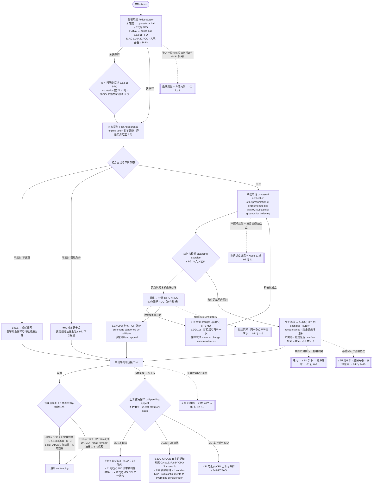
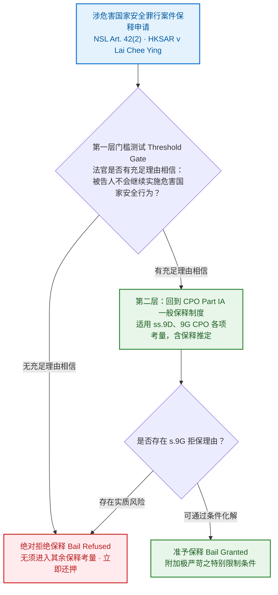

# 05 专题卡片 — 保释制度全景实务精要（Bail in Criminal Proceedings）

> **整课互指**：Master Overview §1–§5 · Structure Map · 时限表 · 流程图 · SG01 Classroom · PDF排版导出件（已移至 Export/）

## 速读定位层

> **白话导引（从头到尾一遍过）**：客户被带进警署那一刻，保释问题就已经开始。案件还未落案，警方可以按 operational bail（s.52(3) PFO）让他在指定日期回署报到；一旦落案起诉，就转入 police bail（s.52(1) PFO），警方决定是否放人直到首次出庭。警方不保释的，法律要求在 48 小时内把他带到裁判官面前——这条时限从此把案件交给法庭处理。首次提堂通常暂不答辩、押后数周，此时辩方要做的第一件实事就是选对申请形态：控方不反对就按原条件顺延（B.E.S.T.），要改条件就明确提出改什么，控方反对才打一场真正的争议申请。争议申请的骨架是 s.9D 的获保推定对抗 s.9G 的法定拒保理由：法官先问有没有 substantial grounds for believing 被告人会弃保、再犯或干扰证人，再用 s.9G(2) 的因素权衡，辩方的任务是逐项反驳并把每一项风险翻译成可执行的条件包。被拒了也不是终点：被告人每 8 天可被带上法庭重申保释（s.79 MO），还可以凭传票加誓章向高等法院原讼庭法官申请复核（s.9J CPO）；获保的一方则要防律政司司长在 48 小时内申请复核（s.9H CPO）。拿到保释只是换取自由的承诺——违反条件会被逮捕撤保（s.9K CPO），开庭不到庭更是独立刑事罪（s.9L CPO）加没收担保金（s.9M CPO）。案件进入审讯、定罪和上诉阶段后，保释规则换了一套逻辑：定罪后保释推定消灭，六类判刑报告各有羁押红线，上诉待决保释则要看法院层级走 14 日或 28 日的轨道，并过 *Lau Man Kin* 的实质胜算门槛。本卡沿这条时间轴，把每个环节的规则、攻防与后果一次讲清。

### 适用范围

**覆盖（按办案时序）**——自被捕到上诉待决的完整「羁押 ↔ 释放」链：

1. **警署阶段双轨保释**：s.52(3) PFO operational bail（未落案，回署报到）与 s.52(1) PFO police bail（已落案，延至首次提堂）；警方在一般法下无权扣旅行证件；ICAC（s.10A ICACO）与入境主任（s.36 IO）各有保释权；连同 **48 小时强制提堂闸门**（起算点三说并列，见 0C.1 与审计留痕 D-48H）〔LGS2N L645 "Operational: s.52(3) PFO (where no charges have yet been laid"；LGS2N L647 "the police may grant or refuse bail until the Defendant’s first court appearance"；LGS2N L649 "Note the ICAC also has power to grant bail: s. 10A ICACO"〕。
2. **首次提堂与争议保释**：暂不答辩与押后（实务可至 6 周）→ 无反对顺延（B.E.S.T.）／无反对但变更条件／受争议申请三种形态的选题逻辑 → s.9D 保释推定对 s.9G 拒保理由的法定结构 → s.9G(2) 八大评估因素与 s.9G(3)–(10) 其他理由 → s.9D(3) 条件库逐类拟定红线（→ 0B、0C.2）〔LGS2N L837 "There are generally 3 types of bail application"；LGS2N L781 "(1) The court need not admit an accused person to bail if it appears to the court that there are substantial grounds for believing"〕。
3. **担保人制度**：六要素审查（年满 18 岁属 rule of practice、深厚关系、清白背景、财力 s.9D(4)、到庭宣誓受询、知悉 s.9M 后果）、s.9F 补偿协议刑事罪、律师禁任担保人（→ 0D）〔LGS2N L745 "Key point: A surety essentially guarantees that the Defendant will"；LGS2N L767 "cannot enter into an agreement to indemnify a surety"〕。
4. **拒保后救济族**：s.79 MO 8 天带堂（B/U，可放弃）＋ s.9G(11) 同一争点两次过滤 ＋ s.9J 被告人 CFI 复核（传票＋誓章、终局无上诉）＋ s.9H 律政司司长复核（48 小时聆讯、无上诉）＋ s.9I 复核期间还押（→ 0C.2、0E.1）〔LGS2N L817 "If bail is refused then, the court must reconsider bail on each subsequent occasion"；LGS2N L855 "the Defendant can apply for a review before a Court of First Instance Judge: s.9J CPO"；LGS2N L859 "The Secretary for Justice can apply for the review of the grant of bail"〕。
5. **违令与潜逃的执行力**：s.9K 逮捕手令；*R v Ashley*——纯粹违反条件既非刑事罪亦非藐视法庭；s.9L 弃保潜逃罪（简易：6 个月＋7.5 万／公诉：12 个月＋无限额）；s.9M 没收现金或担保金（全部或部分；担保人可 show cause 抗辩）（→ 0D.3）〔LGS2S L598 "Failing to appear in court without reasonable cause when on bail: is a criminal offence: s. 9L CPO"；LGS2S L599 "court can order forfeiture of cash bail in whole or in part"〕。
6. **定罪后报告羁押红线**：感化／CSO／RC（s.4(3) RCO 有裁量）／DTC（s.4(5) DTCO 有裁量）可保释候判（实务多还押）；TC（s.4 TCO 用 "shall"）与戒毒所（s.4(3) DATCO）法律上不可保释（→ 0C.4）〔LGS8V L862 "The Defendant must be remanded in custody during preparation of TC Suitability Report"；LGS8S L360 "Bail is not possible pending the preparation of the report"〕。
7. **上诉待决保释轨道**：裁判法院 14 日轨（Form 101/102 ＋ s.119(1)(a) MO → 被拒后 s.122(2) MO 向原讼庭单一法官）与 DC／CFI 28 日轨（s.83Q CPO 上诉通知；原审无权批保，CA 专属 ss.83R/83Y CPO；传票＋誓章），另有 CFI 向终审法院批保的 s.34 HKCFAO 轨；门槛 *HKSAR v Lau Man Kin*——substantial merits 是必要条件且为 overriding consideration（→ 0C.5）〔LGS2N L869 "If Magistrate refuses bail then, the Defendant can apply for bail pending appeal to a single Judge"；LGS2N L873 "the overriding consideration is whether there are substantial merits to the appeal"；LGS2N L705 "The Court of First Instance can, however, grant bail pending appeal to the Court of Final Appeal under s.34 HKCFAO"〕。
8. **特别制度**：国安案件 NSL A.42(2) 双层门槛（*HKSAR v Lai Chee Ying*，第一层不过关即绝对拒保）；少年犯 JOO（Cap. 226）s.4 释放担保与 s.5/6 分押；程序条文补遗 s.9N（查询权）／s.9P（报道限制）（→ 0E）〔ADV-V2 L650 "Judge must first decide whether they have sufficient grounds for believing"；LGS2N L851 "If bail is refused, then the juvenile will be detained: s.5 JOO but kept separate from any adults"；LGS2N L741 "no report of a bail proceedings shall be published"〕。

**不覆盖（边界声明，由相邻主卡承担）**：① 保释口头讼辩的呈现层与演练逐题（→ PCLL8051 课程卡及四案答案，本卡 0F 只保留本届脚本与规则口径）；② 侦查阶段权利与辩护整体（→ 07 Investigation Rights 卡）；③ 量刑制度主体（→ 15 Sentencing 卡 与 LGS8；本卡只取报告期羁押红线）；④ 交付／移交程序主体与 SG03 移交任务（→ 08 Charges and Trial Route 卡；本卡只取「移交中保释延续」接口，见 0C.3）；⑤ O.N.E. Bind Over 制度（→ 06 Plea Advice 卡）；⑥ NSL 完整体系与上诉保释专项讲义：库内无本届专题源件，已登记于审计留痕待核实区。

### 术语（核心概念与实务运作定义）

| 术语 | 定义与章节 |
|---|---|
| 保释（Bail） | 被羁押者向法庭或警方承诺在指定时间归押，凭此具约束力的承诺获释，可附条件或无条件。保释的制度目的是在审讯完成前恢复人身自由，同时以归押承诺与附加条件维护司法公正；每次出庭法庭都必须重新考虑保释问题。它与「撤销控罪」的区别在于保释只是暂时获释，控罪与羁押风险并未消灭（0C）。〔LGS2N L639 "Key Point: Bail means the release of a person from custody on his/her undertaking to return when required to do so"〕 |
| 运作保释（Operational Bail） | 当案件尚未落案、警方仍在侦查时，嫌疑人获释但须于另一指定日期回警署报到，依据《警队条例》（Police Force Ordinance, Cap. 215）s.52(3)；侦查不能立即完成时，警方亦可用担保书（连同或不连担保人）放人。其制度目的是让侦查在不羁押的情况下继续进行。它与警署保释的区别在于运作保释发生在落案之前（0C.1）。〔LGS2N L645 "This is bail for a person to come back to the police station at another date/time"；LGS2N L645 "bail on recognisance (with or without sureties) can also be granted for the arrestee to report back"〕 |
| 警署保释（Police Bail） | 被告人已经落案起诉后，由警方决定准予或拒绝、延续至首次提堂的保释，依据《警队条例》s.52(1)；通常条件是现金保释或被告人自己的担保。其制度目的是在首次提堂前由侦查机关作出初步保释判断。它与法庭保释的区别在于警署保释由警方决定而非法院；口径差异见 0C.1 与审计留痕 D-REC-POL。〔LGS2N L647 "the police may grant or refuse bail until the Defendant’s first court appearance"；LGS2N L647 "The usual conditions of police bail are cash bail or the Defendant’s own recognisance"〕 |
| 法庭保释（Court Bail） | 由裁判官或法官在法庭上准予或拒绝的保释；法庭没有固有保释权，必须有法定依据。警署已批保释不等于法庭也会批，两级决定相互独立。其制度目的是由司法机关在对抗程序中作保释裁量（0B、0C.2）。〔LGS2N L657 "The Magistrate may also extend bail on the same or different conditions as those imposed by police. The fact that the police have granted bail"；LGS2N L667 "a court has no inherent power to grant bail. A statutory basis for the grant of bail must exist."〕 |
| 保释推定（Presumption of Entitlement to Bail） | 一般罪行在定罪前由《刑事程序条例》（Criminal Procedure Ordinance, Cap. 221）s.9D 的 "shall" 确立获保推定，其根基是无罪推定；但保释权并非绝对，受 s.9G 限制，且定罪后推定消灭。其制度目的是把「自由为原则、羁押为例外」落成法定默认规则。它与 s.9G 例外的区别在于推定是起点、s.9G 是法庭可据以拒保的法定门槛（0B.1）。〔LGS2N L713 "is based on the presumption of entitlement to bail, however, the right to bail is not absolute and is qualified by s.9G"；LGS2N L675 "THIS PRESUMPTION OF ENTITLEMENT TO BAIL DOES NOT EXIST POST-CONVICTION"〕 |
| 实质理由（Substantial Grounds） | s.9G(1) CPO 规定的拒保门槛：法庭须有实质理由相信三大风险（不归押、再犯、干扰司法）之一将发生，且不论是否拟附加 s.9D(2) 条件都要考虑。其作用是把拒保从自由裁量变成须证明的法定门槛。它与 s.9G(2) 评估因素的区别在于门槛决定「可否拒保」、因素决定「附加什么条件」（0B.2）。〔LGS2N L781 "(1) The court need not admit an accused person to bail if it appears to the court that there are substantial grounds for believing"〕 |
| 顺延保释（B.E.S.T., Bail Extended on the Same Terms） | 已有保释、控方不反对且无须改变条件时，辩方向法庭请求按相同条件延期的速办形态，法庭文件常记作 "B.E.S.T."。其制度目的是让无争议案件不消耗实质保释聆讯。它与有争议申请的区别在于控方一旦反对即不得再用 B.E.S.T. 形式（0C.2、0F）。〔LGS2N L823 "you can simply ask for “Bail to be Extended on the Same Terms.” This is often marked down as “B.E.S.T”"；ADV-V2 L956 "Ask for BEST – Bail to be extended on the same terms if the application is opposed"〕 |
| 带堂（Brought Up / B/U） | 未获保释的被告人每 8 天被带回法庭重新审查保释的机制，依据《裁判官条例》（Magistrates Ordinance, Cap. 227）s.79；被告人可以放弃这一权利。其制度目的是防止羁押状态被默认化、保持司法审查的周期性。它与 s.9G(11) 过滤的区别在于带堂是权利、过滤是对重复申请的限制（0C.2）。〔LGS2N L821 "must be “brought up” (abbreviated on court forms to “B/U”) every 8 days although he can waive this right"〕 |
| s.9G(11) 两次过滤 | 每次出庭法庭都须重新考虑保释，但同一事实或法律争点已被听过两次后，法庭无须第三次重听；辩方要再启动实质申请，必须证明 material change in circumstances。其制度目的是防止保释问题无限重复消耗司法资源。它与带堂权的区别在于过滤针对「同一争点」，并不剥夺审查本身（0C.2）。〔LGS2N L817 "an argument of fact / law has already been heard by the court twice, it need not rehear the same argument"；LGS2S L656 "allows D to make one more request for bail after bail has been refused for the first time. After that D can only make a"〕 |
| 复核（Bail Review：s.9J / s.9H CPO） | 被告人（s.9J）或律政司司长（s.9H）以传票加誓章向原讼法庭（Court of First Instance, CFI）法官申请重审保释决定；两条轨道的决定都终局、无上诉。其制度目的是给被拒或被批一方提供高一级纠偏渠道。它与上诉的区别在于复核在原审层级内由 CFI 法官作出且不可再上诉（0E.1）。〔LGS2N L855 "the Defendant can apply for a review before a Court of First Instance Judge: s.9J CPO"；LGS2N L859 "There is no right of appeal against the decision of a Court of First Instance Judge under s. 9H(9)."〕 |
| 担保人（Surety） | 以财产或担保书向法庭保证被告人到庭、违约时其担保可被没收的第三人，须到庭宣誓并接受法庭讯问。其制度目的是用第三人的监督与财产风险加固归押承诺。它与被告人自签担保书的区别在于担保必须由第三人提供（0D.1）。〔LGS2N L745 "Key point: A surety essentially guarantees that the Defendant will appear in court on the next occasion"；LGS2S L578 "ensure you never agree to be a surety for your client!"〕 |
| 担保书（Recognisance） | 保证金钱义务的具结书；现行法下法庭保释只有担保人可出具，被告人不可自签（修例前可以）。其制度目的是把金钱罚则预先书面化。它与现金保释的区别在于担保书由第三人承诺、现金由被告人或第三人实缴；警署阶段的表述差异见 0C.1 与审计留痕 D-REC-POL（0B.3）。〔LGS2N L723 "recognizance (surety only. Note previously a Defendant could offer a recognisance, however, the law was changed many years ago.)"〕 |
| 暂列后方（Stand Down） vs 押后（Adjournment） | stand down 是请法庭把案件排在当日名单较后位置（数分钟或至午间休庭后），以便取得进一步指示；adjournment 是把下次聆讯另定他日。客户开庭未到时的应急工具是前者。其制度目的是在不延误案件的前提下争取取指示时间。两者的区别在于 stand down 当日继续、adjournment 另约日期（0D.4）。〔ADV-V2 L982 "to request for it to be placed lower down on the court list the same day so that further instructions may be obtained"；ADV-V2 L984 "To have a case adjourned is to have the next hearing fixed for another day"〕 |
| 还押形式（RIPC vs RIJC） | 拒保后被告人还押于警署羁押（Remand in Police Custody）或监狱羁押（Remand in Jail Custody）。本届幻灯明言被告人通常偏好 RIJC，因条件较好。两者的区别只在羁押场所与待遇，法律后果相同（0C.2）。〔LGS2S L606 "Usually D prefers R.I.J.C (better conditions)"〕 |
| 弃保潜逃（Fail to Surrender to Custody） | 无合理辩解（without reasonable cause）不在指定时日归押的独立刑事罪行，依据《刑事程序条例》s.9L；与「纯粹违反保释条件」（非刑事罪，0D.3）必须分开。其制度目的是以刑事制裁惩罚对司法的藐视。它与一般违例的区别在于是否构成刑事罪、是否须另行定罪（0D.3）。〔LGS2S L598 "Failing to appear in court without reasonable cause when on bail: is a criminal offence: s. 9L CPO"〕 |
| 没收（Forfeiture：s.9M CPO） | 弃保后法庭可全部或部分没收现金保释或担保人的担保书，即使被告人未被定罪亦可没收；担保人经 s.54(1) CPO 通知到庭可 show cause 说明为何不应没收。其制度目的是让担保与现金承诺具备实际执行力。它与刑事定罪的区别在于没收是不依赖定罪的财产后果（0D.3）。〔LGS2S L599 "court can order forfeiture of cash bail in whole or in part or forfeiture of surety's recognisance"；ADV-V2 L311 "To show cause why the money pledged should not be forfeited"〕 |
| 上诉待决保释（Bail Pending Appeal） | 定罪后上诉期间的保释：保释推定不再适用，属例外，必须有法定依据，并过 s.83Z / *Lau Man Kin* 的实质胜算门槛。其制度目的是在上诉改判可能性与社会防卫风险之间作平衡。它与定罪前保释的区别在于没有推定、门槛更高且须证明上诉具实质胜算（0C.5）。〔LGS2N L863 "The grant of bail pending appeal is exceptional"；LGS2N L873 "the overriding consideration is whether there are substantial merits to the appeal"〕 |
| 国安保释门槛（NSL A.42(2) Threshold） | 国安案件先问法官是否有充足理由相信被告人不会继续实施危害国家安全行为，不过关即绝对拒保，过关才回到《刑事程序条例》Part 1A 一般制度。其制度目的是在国安语境下把保释门槛提高至国家安全风险层级。它与一般 s.9G 门槛的区别在于国安门槛是前置闸门、不过即终局（0E.2）。〔ADV-V2 L649 "NSL 42(2) imports a stringent threshold requirement for bail applications."〕 |

### 环节定位（按程序时序）

| 环节 | 实际操作 |
|---|---|
| 48 小时提堂闸门 | 落案后未获警方保释者须在限期内送交裁判官提堂；逾期羁押构成非法拘禁，起算点三说并列（→ 0C.1、审计留痕 D-48H）〔LGS1S L201 "Every D must be brought before a Magistrate within 48 hours"；LGS2N L347 "Then within 48 hours of his arrest"〕 |
| 首次提堂选题 | 开口前先判断控方立场：无反对不变更 → B.E.S.T.；无反对要改条件 → 明确变更项；有反对 → 逐项反驳的争议申请（→ 0C.2）〔LGS2N L837 "There are generally 3 types of bail application"〕 |
| s.9D 推定 ↔ s.9G 例外 | 把「自由为原则、羁押为例外」落成两步：先有 s.9D 的 "shall" 推定，再查 s.9G(1) 三大风险是否成立（→ 0B.1–0B.2）〔LGS2N L779 "Section 9G CPO states that bail may be refused in certain circumstances"；LGS2N L713 "presumption of entitlement to bail"〕 |
| 条件包拟定 | 把抽象的弃保／再犯／干扰风险翻译成可执行、可监管的条件组合，并核可行性与相互冲突（→ 0B.3）〔LGS2S L630 "Carefully consider the bail conditions your client can offer to court and whether they counter P"〕 |
| 担保人参与 | 以第三人的关系与财产加固归押承诺，并向法庭提供可宣誓盘问的监督人（→ 0D.1–0D.2）〔LGS2N L745 "A surety essentially guarantees that the Defendant will appear in court on the next occasion"〕 |
| 8 天带堂（B/U） | 羁押状态的周期性司法审查，防止还押默认化；无新情况的重复申请会被 s.9G(11) 过滤（→ 0C.2）〔LGS2N L821 "A Defendant cannot be remanded for more than 8 days unless both the Prosecution and Defendant consent"〕 |
| s.9J / s.9H 复核 | 双方各有一条 CFI 纠偏轨道：被告人对拒保（s.9J）、律政司司长对批保（s.9H，48 小时内聆讯）；两级决定均终局（→ 0E.1）〔LGS2N L855 "the Defendant can apply for a review before a Court of First Instance Judge: s.9J CPO"；LGS2N L859 "The Secretary for Justice can apply for the review of the grant of bail"〕 |
| s.9K / 9L / 9M 执行 | 条件的牙齿：手令、潜逃罪、没收三道反馈维持归押承诺的可信度（→ 0D.3）〔LGS2S L597 "Court may issue a warrant for D’s arrest if D fails to appear in court: s. 9K CPO"；LGS2S L598 "Failing to appear in court without reasonable cause when on bail: is a criminal offence: s. 9L CPO"；LGS2S L599 "court can order forfeiture of cash bail in whole or in part or forfeiture of surety's recognisance"〕 |
| 报告期羁押红线 | 定罪后按拟判处置分别判断保释可能：感化／CSO 可候判；RC／DTC 有裁量；TC／戒毒所法定必押（→ 0C.4）〔LGS8V L862 "The Defendant must be remanded in custody during preparation of TC Suitability Report"；LGS8S L302 "Bail is possible while waiting for the pre-sentencing Probation Report"〕 |
| 上诉双轨 | 按上诉法院层级锁定正确的保释管辖与时限：MC 14 日轨 s.119(1)(a)/s.122(2) MO；DC/CFI 28 日轨 s.83Q → ss.83R/83Y CPO（→ 0C.5）〔LGS2S L667 "he can apply for bail pending appeal to the Magistrate: s. 119(1)(a) MO"；LGS2S L673 "ss. 83R and 83Y CPO"〕 |

## 🗺️ 本卡地图



**图 1 审查逻辑总括**：法庭在本卡制度中依次过一道阶梯——先看管辖（法庭无固有保释权，必须有法定依据；谋杀与叛国只能由 CFI 处理），再看推定（s.9D 的 "shall" 确立定罪前获保推定），第三查 s.9G(1) 三大拒保风险是否有 substantial grounds，第四用 s.9G(2) 因素做 balancing exercise，第五看辩方能否用 s.9D(3) 条件包逐项化解风险，最后才是救济与执行（B/U、s.9J 复核、s.9K/9L/9M 后果、上诉轨道）。控方每个反对都要挂到这架阶梯上，辩方每个动作也都是在这架阶梯上找位置。

### 任务直达表

| 你现在要做什么 | 直达章节 |
|---|---|
| 30 秒弄清范围／术语／每环任务 | 速读定位层：适用范围／术语／环节定位 |
| 客户在警署，问「何时能走、48 小时从何起算」 | [0C.1](#0c1-阶段一警署与执法机关保释police--icac--入境处)＋[0C.2](#0c2-阶段二首次提堂与争议保释)＋审计留痕 D-48H（三说并列） |
| 首次提堂开口前：选 B.E.S.T.／变更／争议 | [0C.2](#0c2-阶段二首次提堂与争议保释) 三形态＋[0F](#0f-法庭口头保释陈词实战oral-bail-application与四大禁忌) 黄金四步法 |
| 拆解控方反对理由、逐项反驳 | [0B.2](#0b2-s9g-拒保理由评估因素与攻防视角) s.9G 因素攻防＋[0F.2](#0f2-四大禁忌实务地雷) 四大地雷 |
| 设计条件包、核查可行性与相互冲突 | [0B.3](#0b3-s9d3-条件库逐类红线与可行性三禁) 条件库红线＋[0B.4](#0b4-条件金额谈判与客户指示纪律) 金额谈判 |
| 找担保人、向担保人与客户解释风险 | [0D.1](#0d1-担保人资格六要素与执业纪律红线)＋[0D.2](#0d2-担保与现金的可行性核查) |
| 裁判官拒保：8 天带堂、CFI 复核 | [0C.2](#0c2-阶段二首次提堂与争议保释)＋[0E.1](#0e1-高等法院原讼法庭保释复核s9j--s9h--s9i--s9n-cpo)＋[0J](#0j-程序失误与违规后果总表) 行 4–5 |
| 客户违反条件或开庭未到 | [0D.3](#0d3-违反保释条件-vs-弃保潜逃两级后果)＋[0D.4](#0d4-开庭未到庭的紧急控场stand-down-应急)＋五维 3 矩阵 *R v Ashley* 行 |
| 定罪后候判能否保释（六种报告） | [0C.4](#0c4-阶段四审讯期间与定罪后候判报告的羁押红线) |
| 上诉期间保释（MC 14 日 vs DC/CFI 28 日 vs CFA） | [0C.5](#0c5-阶段五上诉待决保释双轨与-cfa-轨)＋图 1 上诉分支 |
| 国安案件保释 | [0E.2](#0e2-维护国家安全案件的双层门槛nsl-art-422--图-2)＋图 2 双层门槛 |
| 想知道「某环节不做会怎样」 | [0J](#0j-程序失误与违规后果总表) 总表＋图 1 虚线后果框 |
| 需要底层原文逐条回查 | 引注图例（本卡地图折叠框）＋[审计留痕](#审计留痕材料矩阵待核事项与历史修订记录)（证据链总表／材料矩阵） |
| SG01／8051 保释观摩联动 | [0K](#0k-sg-实务应用与跨科接口) 两节 |

<!-- BEGIN:cite-legend -->
> [!info]- 引注图例（出处码 → 文件；点开折叠）
>
> | 码 | 文件 | 层级 | 学年 |
> |---|---|---|---|
> | LGS2N | 本届 LGS 2 讲义（侦查、开始程序与保释） | 本届讲义 | 2026-27 |
> | LGS2S | 本届 LGS 2 课堂幻灯 | 本届讲义 | 2026-27 |
> | LGS1S | 本届 LGS 1 课堂幻灯 | 本届讲义 | 2026-27 |
> | LGS3R | 本届 LGS 3 修订版讲义（交付与移交） | 本届讲义 | 2026-27 |
> | LGS8V | 本届 LGS 8 讲义（量刑） | 本届讲义 | 2026-27 |
> | LGS8S | 本届 LGS 8 课堂幻灯 | 本届讲义 | 2026-27 |
> | ADV-V2 | 跨课 PCLL8051《Bail Application》训练手册 Volume 2（2026-27，只读引用） | 本届讲义 | 2026-27 |
> | OLD-LG02P3O | 往届 LG02 Part Three 讲义（保释专讲·未编辑原件，早期引注行号所指） | 往届官方 | 2025-26 |
> | OLD-LG02P3 | [往届 LG02 Part Three 讲义（保释专讲·[EDITED] 学生册）](../../04%20Base%20Lectures/%5BLG02%5D%20Investigation,%20Commencement%20of%20Proceedings,%20Limitation%20Periods%20&%20Bail/%5BEDITED%5D%20crim.pro.LGS.2.PART.3.2025.md) | 往届官方 | 2025-26 |
> | OLD-LG02P2 | 往届 LG02 Part Two 讲义（侦查、限期与保释申请） | 往届官方 | 2025-26 |
> | OLD-LG09 | 往届 LG09 港区国安法刑事程序讲义 | 往届官方 | 2025-26 |
> | OLD-LG10 | 往届 LG10 上诉讲义 | 往届官方 | 2025-26 |
> | OLD-SG01S1 | 往届 SG01 Set 1 学生册（侦查阶段课堂） | 往届学生稿 | 2025-26 |
> | OLD-SG08 | 往届 SG08 上诉课堂官方册（SG 8.md） | 往届官方 | 2025-26 |
> | OLD-EXALL | 往届考试总笔记 Set 2《Crim Lit - ALL》 | 往届学生稿 | 2025-26 |
> | OLD-EXAPP | 往届考试笔记 Set 1《Appeal Grounds Notes》 | 往届学生稿 | 2025-26 |
> | OLD-EX3AP | 往届考试笔记 Set 3《Appeal Grounds Notes for Exam》 | 往届学生稿 | 2025-26 |
> | OLD-EXLG | 往届考试总笔记 Set 3《LG Notes》 | 往届学生稿 | 2025-26 |
> | OLD-EXPP | 往届考试笔记 Set 3《PP preparation》 | 往届学生稿 | 2025-26 |
> | OLD-EXSNT | 往届考试笔记 Set 2《Crim Lit - Sentencing》 | 往届学生稿 | 2025-26 |
> | COND-DL | 本库 8050《01 时限表》凝结卡（同层互指） | 凝结层 | 2026-27 |
> | COND-FC | 本库 8050《02 流程图》凝结卡（同层互指） | 凝结层 | 2026-27 |
> | CAP-K2 | PCLL8050 LGS2 PT | 本届讲义 | 2026-27 |
> | CAP-A1 | PCLL8051 LG1 PT（跨课字幕·跨库只读，随 16 并入） | 本届讲义 | 2026-27 |
> | WK2 | PCLL8050 LGS2本届修订讲义 | 本届讲义 | 2026-27 |


> ⚠️ **行号对照（2026-09-29 逐行核验，六律 5）**：往届保释专讲的**未编辑原件**（码 OLD-LG02P3O，313 行）自该件 L56「BAIL」起逐字并入本届 LGS 2 讲义（码 LGS2N，894 行），行号整体 **+581**
> （该件 L56 → 本届 L637、L90 → L671、L240 → L821、L292 → L873）；早期 `S-LG02-P3` 标记所指即这份未编辑原件，本批逐处改写为该码＋原行号。
> 同目录下的 `[EDITED]` 学生册（码 OLD-LG02P3，433 行）行号与上表不同，本卡只在引用其独有段落（课堂文书官那一段）时才用这个码。

<!-- END:cite-legend -->

## 0B. 保释基本原则、三层审查框架与条件库红线

进入这一节时，客户大概率已被带到裁判法院被告栏，书记官念完控罪、案件押后，下一个问题就是「准不准他保释」。这一节回答的是整张卡的地基：法庭凭什么准、凭什么拒、凭什么是哪些条件——s.9D 的获保推定、s.9G 的拒保理由与评估因素、s.9D(3) 的条件库，三者构成一个「推定 → 例外 → 化解」的三层框架。它与易混概念的分界在于：保释推定是**规则**，s.9G 是**法定例外**，条件包是**化解工具**；「有反对就拒保」是对这套框架最常见的误读。

### 0B.1 s.9D 获保推定、法庭权限与推定的边界

**推定从哪来。** 定罪前、在一般法之下，香港法对候审被告人确立 presumption of entitlement to bail，其宪法根基是无罪推定：A. 5(3) HKBOR 与 A. 28 BL。落到成文法，Part 1A CPO 适用于裁判法院、区域法院与原讼法庭，s.9D 写的是 "a court **shall** order an accused person to be admitted to bail"——这个 "shall" 就是推定的成文法表达〔LGS2S L513 "Pre-conviction: presumption of entitlement to bail. Foundation is the presumption of innocence: A. 5(3) HKBOR and A. 28 BL."；LGS2N L711 "Part 1A of the CPO applies in the Magistrates’ Court, District Court and Court of First Instance. S.9D, CPO states that: “a court shall order"；LGS2N L713 "is based on the presumption of entitlement to bail, however, the right to bail is not absolute and is qualified by s.9G"；LGS2S L513 "presumption of entitlement to bail. Foundation is the presumption of innocence"〕。推定不是绝对权利：s.9G 是它的法定边界（见 0B.2），且定罪后推定即告消灭〔LGS2N L675 "THIS PRESUMPTION OF ENTITLEMENT TO BAIL DOES NOT EXIST POST-CONVICTION"〕。

**推定的适用时点。** s.9D 与 s.9G 这套框架只在案件进入法庭后才运转：疑人在警署阶段尚未被带上裁判官时，Part 1A CPO 的条文并不适用，彼时的释放决定由警方按 s.52 PFO 做出（→ 0C.1）〔LGS3R L102 "Until the detainee is brought before a Magistrate the provisions in sections 9D and 9G CPO (Cap, 221) do not apply."〕。

**法庭没有固有保释权。** 法庭（无论层级）都 no inherent power to grant bail——每一个批准保释的权力都必须能在成文法里找到出处：裁判官的权力来自 s.9D／s.9G（作为审判法院）、移交或交付程序中、以及 s.119(1)(a) MO（被告人上诉至 CFI 或在裁判法院申请 s.104 review 时）；区域法院法官只有在案件将由区院审理时才有保释权，且**无权**批准向 CA 的上诉待决保释（s.83 DCO；*SJ v Wong Shu Kin* [2003] 4 HKC 256）；CFI 法官的权力来自 s.9D（案件在 CFI 审）、s.9J（复核拒保或变更条件）、s.9H（复核批保）以及谋杀／叛国控罪；CA／CFA 则在案件上诉至该院时批保（ss.83R、83Y、83Z CPO 与 s.34 HKCFAO，→ 0C.5、0E.1）。这条「权限地图」是后面所有救济路径的地基：向一个没有法定权力的法院申请保释，等于没有申请〔LGS2N L667 "a court has no inherent power to grant bail. A statutory basis for the grant of bail must exist."；LGS2N L687 "when the Defendant is appealing to the Court of First Instance or asking for a s. 104 review in the Magistrates’ Court: s.119(1)(a) MO"；LGS2N L689 "There is also no inherent power vested in the District Court to grant bail pending appeal: S-J v. Wong Shu Kin & Ors [2003] 4"；LGS2S L522 "No power to grant bail pending appeal to CA: see s. 83 DCO and ss. 83R to 83Y CPO)"〕。

** murder／叛国管辖闸门。** s.9G(10) CPO 规定：被控 murder 或 treason 的被告人，裁判官与区域法院法官**无权**批准保释，保释申请必须由 CFI 法官处理——这是三层框架里先于一切考量的管辖前置项〔LGS2S L530 "Charge is murder / treason."；LGS2N L691 "if the Defendant is charged with murder, a Magistrate or a District Court Judge cannot grant bail"；OLD-LG02P3O L110 "s. 9G(10) CPO provides that if the Defendant is charged with murder"·往届仅参考〕。

> **Exam / Advocacy Formulation:** "Pre-conviction, the court applies the presumption of entitlement to bail under section 9D CPO. Bail should therefore be granted unless there are substantial grounds for believing that the defendant would fail to surrender, offend on bail, or interfere with witnesses — section 9G CPO."

### 0B.2 s.9G 拒保理由、评估因素与攻防视角

**法定拒保理由只有三条主路。** s.9G(1) CPO：法庭若有 **substantial grounds for believing**——不论是否拟附加 s.9D(2) 条件——被告人会 (a) fail to surrender to custody（不按时归押）、(b) commit an offence while on bail（保释期间犯案）、(c) interfere with a witness or pervert or obstruct the course of justice（干扰证人或妨碍司法公正），即可不批准保释。三事并列，法庭只须对其中一项形成实质理由相信〔LGS2N L781 "(1) The court need not admit an accused person to bail if it appears to the court that there are substantial grounds for believing"；LGS2N L783 "(a) fail to surrender to custody as the court may appoint; or"；LGS2N L787 "(c) interfere with a witness or pervert or obstruct the course of justice."；LGS2N L789 "Other grounds for refusing bail set out in ss. 9G(3) to (10) CPO"〕。s.9G(3)–(10) 另列数项法定拒保理由，例如曾违反保释条件或曾弃保、违反暂缓判刑或感化令、受 Hospital Order 约束等〔LGS2N L789 "Other grounds for refusing bail set out in ss. 9G(3) to (10) CPO e.g. D has breached a bail condition or previously failed to surrender"〕。讲义紧接着强调：**这些是全部理由**——"these are the ONLY grounds on which bail may be refused"；控方要求被告人参加认人手续（ID parade）不是拒保的合法理由，被告人也没有参加认人的义务，认人可以在双方方便的时间地点进行〔LGS2N L791 "these are the ONLY grounds on which bail may be refused! A request by the Prosecution for the Defendant to participate in an ID parade"；LGS2S L615 "No obligation on D to participate. ID parade can be arranged at mutually convenient time and location if D wants to participate."；LGS2N L791 "A request by the Prosecution for the Defendant to participate in an ID parade is not a valid reason"；LGS2N L791 "these are the ONLY grounds on which bail may be refused"〕。

**攻防视角**：控方陈词的任务是把本案事实挂进这三条主路之一——挂不进去的反对（如 ID parade、证人多、案情受关注）在法律上不构成拒保依据；辩方的第一反应 therefore 是先问清对方主张哪一条理由，再把事实与条件对准它化解，而不是自说自话地铺陈背景〔CAP-K2 L3487 "So you have to find out on what basis they are objecting, if they're objecting for the defendant to take part in an ID parade"；CAP-K2 L3478–L3496 "fail to surrender to custody"〕。

**s.9G(2) 八大评估因素——法官权衡的清单。** s.9G(1) 之下的 opínio 形成过程受 s.9G(2)–(9) 约束，其中 s.9G(2) 列出法庭「可考虑」的因素：保释本质上是一场 balancing exercise，因素是评价风险的砝码，不是各自的独立罪状〔LGS2S L616 "Factors which court considers in deciding whether to refuse bail: s. 9G(2)-(9) CPO:"；LGS2S L568 "Magistrate in deciding question of bail performs a balancing exercise: what conditions must be offered to satisfy Magistrate that D will return again at next"〕：

| s.9G(2) 因素 | 法定要点（英文原词） | 攻防要点（辩方进攻—控方阻击—法官权衡） | 出处 |
|---|---|---|---|
| (a) 罪行性质与严重性 | nature and seriousness of the alleged offence 及定罪后可能的处理 | 控方以严重性推高弃保诱因（刑期越长越想跑）；辩方把案情放进具体脉络、指出比表面指控轻的量刑区间；法官听的是「严重程度 → 弃保诱因」这一环有没有事实支撑 | 〔LGS2N L797 "(a) the nature and seriousness of the alleged offence and, in the event of conviction, the manner in which the accused person is likely to"；LGS2S L617 "Nature and seriousness of offence; likely sentence if convicted"；WK2 L797 "(a) the nature and seriousness of the alleged"〕 |
| (b) 行为、举止与态度 | behaviour, demeanour and conduct | 控方指着庭上表现与警署态度说「不悔改」；辩方提醒这类软因素证明力有限，用具体守约行为反驳 | 〔LGS2N L799 "(b) the behaviour, demeanour and conduct of the accused person;"〕 |
| (c) 背景、联系、职业、社区纽带与财力 | background, associations, employment, occupation, home environment, community ties and financial position | 控方主张「联系弱即意味着可逃」；辩方用具象事实（本地出生、与家人同住、稳定受雇、按月供养家庭）论证扎根；法官要的是可核验的联系证据而非口号 | 〔LGS2N L801 "(c) the background, associations, employment, occupation, home environment, community ties and financial position of the accused person;"；LGS2S L619 "Background, associations, employment, community ties, financial position of D"〕 |
| (d) 健康与年龄 | health, physical and mental condition and age | 控方几乎不用；辩方在未成年、老弱、有医疗需要时主动提出，并连接羁押环境的风险 | 〔LGS2N L803 "(d) the health, physical and mental condition and age of the accused person;"〕 |
| (e) 既往保释历史 | history of any previous admissions to bail | **KEY FACTOR**：曾弃保、违约、保释期犯案的记录是法官最看重的负面项，控方必然提出；辩方必须准备解释每一段违约的原因，或以「此前多次获保均如期应讯」正面回击 | 〔LGS2S L621 "The history of previous admissions to bail; Has D absconded in past, breached conditions, committed offences while on bail? KEY FACTOR!"；LGS2N L813 "the court will be very concerned with any previous record of the Defendant failing to answer to bail, breaching bail conditions or committing an offence"；LGS2S L621 "history of previous admissions to bail; Has D absconded in past, breached conditions, committed offences while on bail? KEY FACTOR"；LGS2N L813 "the court will be very concerned with any previous record of the Defendant failing to answer to bail"；LGS2N L813 "the court will be very concerned with any previous record of the Defendant failing to answer to bail, breaching bail conditions"〕 |
| (f) 品格、经历与前科 | character, antecedents and previous convictions | 控方用前科推量刑与风险；辩方按 *ADV-V2* 口径邀请法庭 "place little weight" 于久远、轻微的记录，并强调 "stayed out of trouble for xx years" | 〔LGS2N L807 "(f) the character, antecedents and previous convictions, if any, of the accused person;"；ADV-V2 L920 "Given that his / her previous convictions were committed a long time ago and were of a minor nature I would invite the court to"〕 |
| (g) 控方证据的性质与分量 | nature and weight of evidence | 控方称证据强→定罪概率高→弃保动机强；辩方指出证据断裂（识别有争议、供认将依 voir dire 挑战、全赖间接证据），但只攻击证据强度、不攻击证人可信性（mini-trial 禁忌，→ 0F） | 〔LGS2N L809 "(g) the nature and weight of the evidence of the commission of the alleged offence by the accused person;"；ADV-V2 L1117 "The stronger the case, the more likely the defendant will be convicted. If a conviction is more likely, then the defendant arguably will be more"〕 |
| (h) 兜底因素 | any other thing that appears to the court to be relevant | 双方都可用：这是 balancing exercise 的弹性所在，法官按个案事实自由取材 | 〔LGS2N L811 "(h) any other thing that appears to the court to be relevant.” This is known as the residual factor since the grant of bail is"〕 |

**三项风险怎样由事实连到条件**（条件来源在 s.9D(3)，风险因素在 s.9G(2)；下表是对应思路，不意味着每项都要一起提出）：

| 风险（s.9G(1)） | 有决定意义的事实 | 可评估条件 | 必须避免的空洞说法 |
|---|---|---|---|
| 不归押（fail to surrender） | 住所、学业／工作、家庭、旅行证件、过去出庭记录、保释资金 | 交全部旅行证件、不得离港、指定住址、报到、适当现金／担保 | 「家人很多，所以不可能逃」 |
| 再犯（offence while on bail） | 具体指控模式、是否持续、接触场所／物件的机会、以往保释表现 | 居所、适当宵禁、地点限制、报到等可用措施 | 只凭现在被控罪就断言已再次犯罪 |
| 干扰证人（interfere with witness） | 认识关系、接触机会、住址邻近、已有接触／威吓指称 | 直接／间接不得接触、适当禁区或替代住址 | 不说明哪位证人、怎样可能受干扰 |

对「证据不明」的案件，辩方只能准确指出控方案情的局限，不在保释聆讯要求法庭最终裁断证人说谎（→ 0F 地雷四）〔LGS2N L831 "A bail hearing is not a mini-trial. The Judge will not be in a position to judge matters of credibility."〕。严重罪行确实会抬高弃保诱因，但分析还要比较本地联系、客观离境能力、既往履约与拟议限制的力度，不从最高刑直接跳到「必逃」。过度或无法履行的条件反而削弱整个方案的可信性（→ 0B.3、0J 行 6–8）〔LGS2N L839 "Do not ask for bail conditions that are impossible"；LGS2N L797 "(a) the nature and seriousness of the alleged offence and, in the event of"〕。

### 0B.3 s.9D(3) 条件库逐类红线与可行性三禁

s.9D(3) CPO 列出保释条件的法定类型；香港实务中无条件保释极其罕见，辩方的功课是把每一项条件与 s.9G 的具体风险对上号〔LGS2S L544 "Bail conditions set out in s. 9D(3) CPO."；LGS2S L543 "Bail is usually granted with conditions, unconditional bail is rare."〕。逐类要点与红线如下：

| 条件类型 | 法定／实务要点 | 拟定策略与禁忌 | 出处 |
|---|---|---|---|
| **现金保释（Cash Bail）** | 被告人或担保人缴存；金额须与其经济能力匹配；可请法庭给筹款时间 | 金额过高构成变相拒保，过低产生不了履约约束；谈判口径见 0B.4 | 〔LGS2S L549 "cash bail (Defendant or surety)"；LGS2N L721 "cash bail (Defendant or surety)"；LGS2S L569 "D can borrow money for cash bail: ask for time to “raise the money.”"；LGS2S L584 "can afford sum imposed on surety"；OLD-EXALL L1152 "Cash bail (Defendant or surety)"·往届仅参考〕 |
| **担保书（Recognisance）** | 修例后的法庭口径：只有担保人（surety）可出具 recognisance，被告人不可自签——切勿在法庭申请「被告人自签担保」 | 警署保释一节讲义另写通常条件含「被告人自己的担保」，两句同出本届，正文并列照录、不代裁决（→ 审计留痕 D-REC-POL）；0C.1 实操按警署口径处理 | 〔D-REC-POL；LGS2S L550 "recognizance (surety only. Note: previously a Defendant could offer a recognisance.)"；LGS2N L723 "recognizance (surety only. Note previously a Defendant could offer a recognisance, however, the law was changed many years ago.)"；LGS2N L647 "The usual conditions of police bail are cash bail or the Defendant’s own recognisance"；OLD-EXALL L1152-L1154 "Cash bail (Defendant or surety) … Recognizance (Surety only)"·往届仅参考；LGS2N L723 "recognizance (surety only. Note previously a Defendant could offer a recognisance"〕 |
| **交出旅行证件（Surrender Travel Documents）** | 必须交出**全部**护照（不得保留其中一本）及任何中国重进境许可（China re-entry permit） | 被告人**无须交出香港身份证**：年满 15 岁无合理辩解不带身份证本身属刑事罪行（s. 17C IO），扣押身份证等于制造违法；警方在一般法下亦无权扣押旅行证件（NSL 案件除外，→ 0E.2） | 〔LGS2S L553 "the Defendant must surrender ALL passports (he cannot retain one while surrendering the others) and any China re-entry permit"；LGS2N L725 "the Defendant does not need to surrender his ID card since it is a criminal offence for persons aged 15 and above"；LGS2S L553 "not to carry an ID card with them unless they have a reasonable excuse: s. 17C IO"；LGS2N L647 "the police have no power to retain travel documents under the general law"；OLD-EXALL L1156 "Surrender travel documents (i.e. all travel documents except HKID)"·往届仅参考〕 |
| **不得离港承诺（Undertaking Not to Leave HK）** | 与交出证件捆绑生效；离港包括前往澳门（Macau） | 逻辑一致性红线：不可一边承诺不离港、一边要求保留全部旅行证件 | 〔LGS2S L554 "usually this goes hand in hand with the surrender of travel documents. Leaving Hong Kong includes visiting Macau"；LGS2N L727 "undertaking not to leave Hong Kong (usually this goes hand in hand with the surrender of travel documents"；LGS2N L843 "D will not be permitted to undertake not to leave HK but retain all of his travel documents"；OLD-EXALL L1158 "Undertaking not to leave Hong Kong (usually goes hand in hand with (iii))"·往届仅参考〕 |
| **指定居所（Reside at Specific Place）** | 通常施加于家庭暴力案件 | 住址须真实有效且被告人有权居住：家暴案中若被告人仍住婚姻住所，就不能同时承诺不接触配偶（PW1）——要么先取得迁居指示，要么不提此条件 | 〔LGS2S L558 "requirement to reside at a specific place (usually imposed in domestic violence cases)"；LGS2N L729 "requirement to reside at a specific place (usually imposed in domestic violence cases)"；LGS2S L632 "in a domestic violence case D cannot undertake not to contact directly or indirectly his spouse (PW1)"；OLD-EXALL L1160 "Requirement to reside at a specific place (usually in domestic violence cases)"·往届仅参考〕 |
| **宵禁（Curfew）** | 常见于青少年／年轻成年人／三合会罪行／可能破坏安宁的案件（如 23:00–06:00，或周一至五 18:00–06:00） | 宵禁是最后手段且须先取得客户指示：上夜班的客户（通宵司机、厨师）不得提议宵禁，否则履行不能；报到时段亦不得落在宵禁区间内（→ 0J 行 6–7） | 〔LGS2S L559 "curfew (usually only for juveniles / young adults / triad offences / offences where there is a concern the Defendant may breach the peace)"；LGS2N L731 "curfew (usually only for juveniles / young adults / triad offences / offences where there is a concern the Defendant may breach the peace)"；LGS2S L635 "You are always bound by your client’s instructions. Do not offer more than your client’s instructions to you"；OLD-SG01S1 L356 "E.g. by offering curfew (try not to propose unless last resort/ client’s instructions are obtained)"·往届仅参考；OLD-EXALL L1164 "Usually for juveniles / young adults / triad offences / offences where there is a concern D may breach the peace"·往届仅参考〕 |
| **警署／廉署报到（Reporting）** | 时段通常 9:00–12:00 或 18:00–21:00（行政便利）；频度按罪行严重性定为每日、每周数次或每周一次；亦可向廉政公署报到 | 结合通勤与工作时间选警署与时段：白天上班的客户提早上报到即履行不能；若同时建议宵禁，报到时段必须错开 | 〔LGS2S L560 "reporting to the police station / ICAC (usually either 9am – 12pm or 6pm – 9pm for administrative convenience"；LGS2N L733 "Imposed either daily, several times a week or once a week depending on the severity and type of offence"；LGS2S L632 "D cannot report to the police station between the hours of 6 and 9 pm if you are also suggesting a curfew"；LGS2S L631 "Is D able to report to the police station in the morning if he is working then"；OLD-EXALL L1168 "Usually either 9am – 12nn or 6pm – 9pm for administrative convenience"·往届仅参考〕 |
| **禁足／行动限制（Restrictions on Movement）** | 不得前往或进入某地点 500 米范围内；往届课堂练习另有「不得接近被捕地点 100 米」的写法 | 可执行性红线：不可提出「禁止进入全港所有超市」这类无法监管的条件；客户若居住或工作于拟禁区内，条件一出生就是违约——先取得替代住址指示或改用其他条件 | 〔LGS2S L561 "restrictions on movement (not to visit / go within 500 metres of a certain location)"；LGS2N L735 "restrictions on movement (not to visit / go within 500 metres of a certain location)"；LGS2N L841 "can D really be prevented from entering every supermarket in Hong Kong? Does D need to live / work in the area"；OLD-SG01S1 L364 "Not to get close to 100m of the location the client being arrested"·往届仅参考；OLD-EXALL L1172 "Restrictions on movement (e.g. not to visit / go within 500m of a certain location)"·往届仅参考〕 |
| **不得接触控方证人（Non-Interference with PW）** | 直接或间接（directly / indirectly）、以口头、书面或经第三人的任何形式；两类条件几乎总是同时施加 | 几乎所有案件必备；「间接」覆盖到道歉信——想写道歉信（对日后求情可能有用）的客户，把信交经警方或律政司转交，绝不直接寄给被害人；也不要让朋友替自己传话 | 〔LGS2S L562 "not to interfere directly / indirectly with a Prosecution Witness. This includes in any form (i.e. orally or in writing or through another person.)"；LGS2N L737 "not to interfere directly / indirectly with a Prosecution Witness"；LGS2N L737 "These conditions “directly” or “indirectly” are almost always imposed together"；CAP-K2 L3094 "It even includes, if you are to write an apology letter to the witness, that would still be interfering with them directly or indirectly."；CAP-K2 L3100 "then have them do it and pass it through the police or through the prosecution, never directly to the victim."；CAP-K2 L3091 "you can't tell your friend"；OLD-EXALL L1174 "Not to interfere directly / indirectly with a Prosecution Witness (in any form, orally or in writing or through another person)"·往届仅参考〕 |

**可行性三禁**（讲义以三组 "Do not ask" 并列）：(1) 不可能遵守的条件（impossible）——修例后被告人已不能自签 recognisance，再提即暴露不专业；(2) 无法执行的条件（unenforceable）——「禁止进入全港超市」式条件无人能监管；(3) 逻辑矛盾的条件（logically inconsistent）——承诺不离港却要保留全部旅行证件，法庭一句反问就拆穿〔LGS2N L839 "Do not ask for bail conditions that are impossible e.g. D can no longer give a personal “recognisance” – the law has changed! Or that"；LGS2N L841 "Do not ask for bail conditions that are unenforceable e.g. can D really be prevented from entering every supermarket in Hong Kong? Does D need"；LGS2N L843 "Do not ask for bail conditions that are logically inconsistent e.g. D will not be permitted to undertake not to leave HK but retain all"〕。

> **Exam / Advocacy Formulation:** "The Defence proposes conditions tailored to each objection: surrender of ALL travel documents and an undertaking not to leave Hong Kong (including Macau) to address the risk of absconding; residence at a fixed address and reporting to [station] three times a week to address re-offending concerns; and an undertaking not to interfere, directly or indirectly, with any prosecution witness."

### 0B.4 条件金额谈判与客户指示纪律

条件谈判有两层纪律。第一层是对客户的功课：现金保释与报到频度都要先向客户取最大承受范围——「你最多能负担多少」，再决定向法庭提出的数字，**提出额低于上限**，为法庭当庭加码留出空间；报到次数同理（先问一周最多能报几次，再提少一点）〔CAP-K2 L3106 "is you get instructions from your client on what's the maximum they can afford"；CAP-K2 L3112 "And if he says, let's say he's charged with theft of $1,000, but he says that he can afford up to $20,000 bail."；CAP-K2 L3115 "You don't need to put forward the maximum in your bail application."；CAP-A1 L1081–L1084 "How much can you reasonably afford"；CAP-A1 L1192–L1195 "you offer a fixed sum"〕。能负担某个上限不等于律师获授权提交该上限以下的任何数字，也不等于可以替担保人承诺出资——具体授权仍在客户与担保人的指示里找。第二层是诚实纪律：客户只能出 1,000 元，律师就不能开口 10,000 元——「stick to your instructions」；条件不够就是不够，向客户如实说明后果，绝不为凑批准而编造住址、资金或意愿〔CAP-K2 L3196 "If your client tells you he can only offer a $1,000 cash bail, you cannot offer $10,000."；CAP-K2 L3208 "Never invent facts. Never mislead the court."；CAP-K2 L3208–L3214 "Never invent facts. Never mislead the court."；CAP-K2 L3211 "That is the one thing that is going to be a sure fail for you and your assessment."；CAP-K2 L3181–L3184 "you don't need to offer that as a condition"；LGS2S L635 "You are always bound by your client’s instructions. Do not offer more than your client’s instructions to you."；LGS2S L635 "You are always bound by your client's instructions. Do not offer more than your client's instructions to you."〕。

## 0C. 贯穿全周期的五阶段保释程序推进

这一节把保释放回案件的时间轴：客户此刻站在哪个阶段、上一站发生了什么、这一站法庭要处理什么、下一站的接口在哪。五个阶段各自有一套「先确认再行动」的清单——每次到庭先写清当前阶段与所求命令，不能只写一句 "request bail"；每次到庭都须处理当时的保释问题，但既往拒绝后的重复论点另受 s.9G(11) 限制（→ 0B.2、0C.2）〔LGS2N L639 "Key Point: Bail means the release of a person from"〕。

**每阶段保释状态速查**：

| 阶段 | 对应制度 | 本次要确认 |
|---|---|---|
| 未控罪／继续调查 | Operational bail，PFO s.52(3) | 回警署时间及调查状态 |
| 已控罪、首次出庭前 | Police bail，PFO s.52(1) | 是否获释、需往法院时间、实际条件 |
| 法院前候审 | CPO Part 1A | s.9D 及 s.9G、法院权限及拟条件 |
| 定罪后／上诉期间 | 适用的特定法定权力 | 不再沿用未定罪的通常保释推定 |

警方普通保释与法庭保释的可用条件**不同**：不得把警方自己的 recognisance 安排直接套到法庭申请（配合 0B.3 recognisance 行与审计留痕 D-REC-POL）〔LGS2N L647 "The usual conditions of police bail are cash bail"；LGS2N L673 "General criminal offence = presumption of entitlement to bail"；LGS2N L711 "Part 1A of the CPO applies in the Magistrates’ Court"；LGS2N L863 "The grant of bail pending appeal is exceptional"〕。

### 0C.1 阶段一：警署与执法机关保释（Police / ICAC / 入境处）

案件此时还在警署：侦查未完结、尚未落案，或刚落案等待送交法庭。这一阶段的保释由执法机关决定，规则逻辑与法庭阶段不同——s.9D/s.9G 还没有登场，起作用的是 PFO 的时限与警方裁量。

1. **运作保释（Operational Bail — s.52(3) PFO）**：警方仍在调查、尚未落案时，嫌疑人获释但须于另一指定日期回警署报到（report back）；警方的侦查若不能「立即（forthwith）」完成，也可以凭担保书（连同或不连担保人）放人、令其按期回署〔LGS2S L502 "Operational: s.52(3) PFO (where no charges have been laid, i.e. police are still investigating"；LGS2N L645 "Operational: s.52(3) PFO (where no charges have yet been laid, i.e. the police are still investigating"；LGS2N L645 "bail on recognisance (with or without sureties) can also be granted for the arrestee to report back to the police station on another date"；LGS2S L502 "Bail to come back to the police station at another date/time"〕。
2. **警署落案保释（Police Bail — s.52(1) PFO）**：被告人被落案起诉后，警方可准予或拒绝保释，保释延续至其首次到裁判法院提堂；通常条件为现金保释或被告人自己的担保，亦可连同担保人。警方在一般法下**无权扣押旅行证件**——幻灯同页明示 NSL 案件是例外；廉政公署（s. 10A ICACO）与入境主任（s. 36 IO，Cap. 115）各自另有保释权〔LGS2S L503 "Police bail: s.52(1) PFO: D has been charged. Police can grant bail until D"；LGS2N L647 "where the Defendant has been charged, the police may grant or refuse bail until the Defendant’s first court appearance"；LGS2N L647 "Police bail can also be granted with sureties"；LGS2S L503 "No power to retain travel documents (except under NSL)"；LGS2N L647 "Police bail: s.52(1) PFO (where the Defendant has been charged, the police may grant or refuse bail"；LGS2N L647 "the police have no power to retain travel documents under the general law. The usual conditions of police bail are cash bail"；LGS2N L343 "the arrested person must be delivered forthwith to the police officer in charge of the station: s. 51 PFO (i.e. the Duty Officer"；LGS2N L649 "Note the ICAC also has power to grant bail: s. 10A ICACO; as well as an immigration officer under s. 36 of Immigration Ordinance"；OLD-LG02P3O L66 "Police bail: s.52(1) PFO (where the Defendant has been charged, the police may grant or refuse bail"·往届仅参考；OLD-LG02P3O L68 "ICAC also has power to grant bail: s. 10A ICACO; as well as an immigration officer under s. 36 of Immigration Ordinance"·往届仅参考〕。
3. **国安案件的警署保释**：涉 NSL 罪行侦查中，警方可以施加更严厉的保释条件——这是警署阶段与一般案件的第一处分岔，细节在国安课展开（→ 0E.2）〔LGS2N L655 "the police can impose more stringent bail conditions in connection with offences under the NSL"；LGS2S L504 "Key Point: police can impose more stringent bail conditions under the NSL"〕。
4. **48 小时强制提堂闸门**：未获警方保释者必须在限期内送交裁判官提堂——遣送离境案为 72 小时；本届材料对起算点有三说，正文客观并列：甲说「within 48 hours … of charge」（本届 LGS 1 幻灯）；乙说「within 48 hours of his arrest」（本届 LGS 2 讲义）；丙说条文只写 "as soon as practicable"，讲义另注实务上「落案后 24 小时内、被捕后 48 小时内」（本届 LGS 3 修订讲义）。三说同出本届，本卡并列照录、不代裁决（→ 审计留痕 D-48H）。另据 SNSO，裁判官可授权警方在**未落案**情况下延长羁押至 **14 天**；逾期的羁押构成非法拘禁〔LGS1S L201 "Every D must be brought before a Magistrate within 48 hours (72 hours if deportation case) of charge: s. 52(1) PFO. Under the SNSO, a"；LGS2N L347 "Then within 48 hours of his arrest (or 72 hours for deportation cases)"；LGS3R L102 "A detainee must be brought before the Magistrate ‘as soon as practicable’ (s.52 (1) PFO) if police bail is not granted."；LGS3R L240 "In practice this will usually be within 24 hours of being charged (48 hours of arrest)."；LGS2S L494 "QN: What is the 48 hour rule in Hong Kong?"；OLD-LG02P2 L218 "Within 48 hours From arrest, if the arrested is not bailed by the police"·往届仅参考；LGS3R L102 "A detainee must be brought before the Magistrate"；LGS3R L240 "this will usually be within 24 hours of being charged (48 hours of arrest)"〕〔D-48H〕。

**客户辅导口径**：保释要求**永远要提**——即使罪名严重、明眼人一看便知不会获准，也要正式提出；若警方保释有可能，先与 OC case 谈妥现金保释金额；若案件将送交裁判官，向客户说明其到庭后仍有权申请法庭保释、警方无权无限期羁押，并预告法庭可能施加的条件类型、逐项取得指示〔LGS3R L228 "Bail must always be requested even though in cases where there is a serious offence, it will be obvious to the practitioner that bail will"〕。

### 0C.2 阶段二：首次提堂与争议保释

案件此刻首次进入裁判法院（Court 1）：书记官处理押后、暂不答辩，而法官在被告人离庭前必须处理的就是保释。这一站是整张卡攻防密度最高的环节——选错申请形态、漏驳一项反对，代价就是当场还押。

1. **暂不答辩与押后（No Plea Taken & Adjournment）**：首度提堂通常不取答辩，理由有四——控辩正就 O.N.E. Bind Over 或认罪协商谈判、控方就控罪寻求法律意见、辩方尚未收齐证人陈述与证物副本、以及保留认罪的三分之一刑期折扣；案件常押后（有时数次）至控方表示准备就绪，实务上可长达 **6 周**。押后不等于保释问题消失：裁判官必须在被告人离庭前决定保释或还押〔LGS2S L509 "First appearance – case adjourned"；LGS2N L669 "On the Defendant’s first appearance in the Magistrates’ Court, most cases will be adjourned to a later date"；LGS3R L492 "Usually on his first appearance, plea is not taken. This is for several reasons"；LGS3R L492 "for an O.N.E. Bind Over or for a plea bargain, the Prosecution is seeking legal advice on the charges"；LGS3R L492 "to preserve the Defendant’s 1/3 discount on a plea of guilty"；LGS3R L494 "the case is often adjourned (sometimes several times) until the Prosecution indicates that it is ready to proceed"；LGS3R L494 "This can take up to 6 weeks in practice"；OLD-LG02P3O L88 "This means that the Magistrate must consider whether to grant or refuse bail"·往届仅参考；OLD-SG01S1 L418 "Prosecution ask for “no plea to be taken"·往届仅参考；LGS2N L669 "most cases will be adjourned to a later date as that"〕。
2. **开口前先选对申请形态**：本届讲义列明三种形态——(i) 无反对且条件不变：请求 B.E.S.T.；(ii) 无反对但需改变条件：明确要改什么、为什么；(iii) 受争议申请：针对控方真正提出的风险和资料逐条回应。前两种形态下朗读一整篇无关反驳是浪费法庭时间；把条件变更当作既获授权是越界——变更须经法庭批准（→ 0C.3）。MC／DC 通常口头申请，CFI 用传票＋誓章（加口头补充陈词）；注意 B.E.S.T. 只用于**控方不反对**的场合，控方反对的申请中提 B.E.S.T. 属礼仪禁例（→ 0F）〔LGS2N L837 "There are generally 3 types of bail application: (i) uncontested"；LGS2N L823 "Where bail has been previously granted by the police or by another Magistrate"；LGS2N L835 "In the Magistrates’ / District Court: a bail application is usually made orally by Defence Counsel"；LGS2S L643 "CFI: summons supported by Affidavit plus oral submissions of Counsel."；ADV-V2 L956 "Ask for BEST – Bail to be extended on the same terms if the application is opposed"〕。
3. **控方不反对之顺延保释（B.E.S.T.）**：已有保释（警方或先前法庭所批）、控方不反对且无须变更条件时，向法庭请求 "Bail to be Extended on the Same Terms"，法庭文件常记作 "B.E.S.T."。若被告人已在警署缴现金保释而法庭同样批出现金保释，该笔款项可行政转接为法庭保释金，无须重新缴付〔LGS2N L823 "you can simply ask for “Bail to be Extended on the Same Terms.” This is often marked down as “B.E.S.T”"；LGS2S L571 "you can simply tell the court that he is already on police cash bail and ask that it be extended on the same terms"；LGS2S L571 "the police cash bail can be transferred to the court. This is an administrative procedure"；OLD-LG02P3O L242 "you can simply ask for “Bail to be Extended on the Same Terms.”"·往届仅参考；OLD-EXALL L1258 "you can simply ask for ‘Bail to be Extended on the Same Terms’ (B.E.S.T)"·往届仅参考；LGS2N L823 "Where bail has been previously granted by the police or by another Magistrate or Judge and the Prosecution is not objecting to bail"；LGS2S L571 "If D is on police cash bail and cash bail is then offered by the court"〕。
4. **控方反对之保释辩论（Contested Bail Application）**：控方反对时，辩方**必须**逐项反驳（MUST counter the objections）——不回应即视为接受该理由成立。反驳的路数按本案素材选配：控方证据薄弱或属推测、供认将依 voir dire 挑战、被告人有扎实抗辩、家庭与社区联系紧密、以往保释均如期守约、记录清白，或直接以定制条件化解（如担心弃保即交出全部旅行证件＋承诺不离港）。法庭在平衡时问的是：什么条件能让法庭相信被告人下次会到庭〔LGS2N L827 "If bail to objected to by the Prosecution, Defence Counsel MUST counter the objections"；LGS2S L630 "Failing to counter an objection implies you accept it is valid"；LGS2N L827 "the Defence can counter by offering to surrender all travel documents and undertaking not to leave HK"；LGS2S L568 "Magistrate in deciding question of bail performs a balancing exercise: what conditions must be offered to satisfy Magistrate that D will return again at next"；OLD-SG01S1 L354 "Did Counsel offer conditions to minimize the Prosecution’s objections"·往届仅参考；LGS2N L837 "(iii) contested (the Prosecution is objecting to bail and you must counter their objections.)"〕。首度提堂的优先目标就是拿到保释——条件日后可以变更（→ 0C.3）〔LGS2S L566 "Priority on first appearance in MC is to secure bail."〕。
5. **拒保后的还押形式与 8 天带堂周期**：拒保后被告人还押于警署羁押（RIPC）或监狱羁押（RIJC）；本届幻灯明言实务上被告人通常偏好 RIJC，因为条件较好。还押状态的司法审查按两个节拍走：s.79 MO 规定未经控辩双方同意，每次还押**不得超过 8 天**——实务效果是被告人每 8 天被带上法庭（brought up，法庭文件缩写 B/U）重新争取保释，权利可放弃；s.9G(11) CPO 规定每次出庭法庭都须重新考虑保释，但顺序上有讲究——首次拒保后可以再完整申请一次，此后同一事实／法律争点已被听过两次，法庭无须第三次重听，辩方必须证明 material change in circumstances 才能再启动实质申请〔LGS2S L606 "Usually D prefers R.I.J.C (better conditions)"；LGS2N L775 "the Defendant is remanded in either police custody (R.I.P.C) or jail custody (R.I.J.C)"；LGS2S L628 "D can only be remanded for 8 days at a time before he must be brought back before the court"；LGS2N L821 "A Defendant cannot be remanded for more than 8 days unless both the Prosecution and Defendant consent"；LGS2S L656 "S. 9G(11) CPO – allows D to make one more request for bail after bail has been refused for the first time. After that D"；LGS2N L817 "where an argument of fact / law has already been heard by the court twice, it need not"；OLD-LG02P3O L240 "In practice this means a Defendant must be"·往届仅参考；OLD-EXALL L1256 "D must be ‘brought up’ (B/U) every 8 days though he can waive this right"·往届仅参考；LGS2S L511 "Bail must be considered every time D appears before court"；LGS2S L511 "Bail must be considered every time D appears before court: s. 9G(11) CPO"；LGS2S L511 "to hear argument in favour of bail a third time, must show a material change in circumstances"；LGS2N L817 "the question of bail can be reconsidered"；LGS2N L817 "where an argument of fact / law has already been heard by the court twice, it need not rehear the same argument"；LGS2S L628 "He can waive his right to be “Brought Up” or “B/U”"；LGS2S L629 "why would D waive his right to be B/U every 8 days?"；OLD-LG02P3O L236 "the court must reconsider bail on each subsequent occasion"·往届仅参考；OLD-LG02P3O L240 "although he can waive this right and will usually do so where he knows he will not get bail"·往届仅参考；COND-FC L99 "规定被告每次出庭法院都须重新考虑保释"〕。
6. **为什么被告人会放弃 B/U（Waive B/U）**：讲义给的官方答案是一句——明知拿不到保释时通常会放弃；这与 *ADV-V2* 的实务观察互为印证：获保希望渺茫而判刑几乎必然监禁的被告人，情愿不申请保释，因为还押期会折抵刑期（→ 0F 惩教署折抵）。放弃的代价是继续羁押到下一个到庭日；辩护律师的角色是把「有没有新情况」讲清楚，而不是代客户放弃〔LGS2N L821 "although he can waive this right and will usually do so where he knows he will not get bail"；ADV-V2 L1029 "In situations where the chance of getting bail are low and the likelihood of a custodial sentence is high, some clients prefer not to apply"；LGS2N L821 "must be “brought up” … every 8 days although he can waive this right"〕。

> 💡 **【实战穿透 · SGS 1 Q A4】**：Fergus Fan 裁判官拒保后的 8 天带堂复核权（s.79 MO ＋ s.9G(11) CPO）及向高等法院原讼庭申请保释（s.9J CPO），详见 SG01 Classroom Brief A Q A4；SG 应用主述在 0K.1。〔LGS2S L655 "Where bail refused or D wants to vary conditions"；LGS2S L657 "D can also apply for a review to J in CFI: s. 9J CPO"；LGS2N L855 "the Defendant can apply for a review before a Court of First Instance Judge: s.9J CPO"〕

### 0C.3 阶段三：移交、交付与保释条件变更

案件从此处进入审级分流：控方决定把案件送去区院还是交付高院，而被告人的保释状态必须随行延续。这一阶段保释工作的关键词是「延续」与「变更」——上一站的保释不会自动原样带到下一站，但程序上必须有人负责处理它。

1. **移交／交付过程中的保释延续**：移交区域法院依 s.88 MO——对可公诉罪行，控方提出移交申请时裁判官**无权拒绝**（s.88(1)(a) "shall"），对简易罪行则有裁量权（s.88(1)(b)）；移交程序及裁判官「还押或准予保释」的决定在 s.90 MO（裁判官指定区院出庭日、还押或准保、告知移交令效力并给予 alibi 警示），移交令本身使裁判法院程序中止且不可上诉（s.89 MO）；交付原讼庭依 ss.80A–86 MO（另一途径为 s.65F CPO）。上述每一站裁判官都必须重新处理被告人的保释状态〔LGS2S L519 "Can grant bail where: (i) court of trial; (ii) during transfer / committal proceedings"；LGS2N L683-L685 "where it is the court of trial … during transfer/committal proceedings"；LGS1S L254 "Can hear summary and indictable offences transferred from the MC if Prosecution applies for a transfer to the DC: s. 88(1)(a) MO"；LGS3R L500 "A Magistrate has no power to refuse a transfer request for an indictable offence: s. 88(1)(a) MO"；LGS3R L508 "An order of transfer stays the proceedings in the MC and cannot be appealed: s.89 MO"；LGS3R L510 "The Magistrate appoints a day on which the Defendant must appear in the DC, remands the Defendant or grants him bail"；LGS1S L270 "offences committed from MC (ss. 80A to 86 MO)"；LGS3R L510 "informs the Defendant of the effect of the transfer order and gives the Defendant the alibi warning"〕。
2. **变更保释条件（Variation of Bail Conditions）**：条件获批后随生活变动而失效——居所、宵禁或报到时段与工作、家庭需要冲突时，两条变更入口可用：向原审裁判官于下次提堂时提出，或以传票＋誓章向原讼法庭法官申请（s.9J CPO）。设计条件时就该避免日后必改的安排：提出的条件必须与客户实际作息相容〔LGS2S L566 "Conditions granted by Magistrate can be varied on application to J in CFI: s. 9J CPO or on next appearance before MC"；LGS2N L739 "bail conditions can be varied on an application made to a Court of First Instance Judge: s.9J CPO"；LGS2S L631 "Is D able to report to the police station in the morning if he is working then"；LGS2N L839 "Do not ask for bail conditions that are impossible e.g. D can no longer give a personal “recognisance”"；OLD-EXALL L1176 "All bail conditions can be varied on application made to CFI (s.9J CPO)"·往届仅参考；LGS2S L631 "Ensure that your client is able to comply with the bail conditions you put forward"〕。保释期长的案件若出现紧急出境需要（直系亲属海外病危等），走的也是这条变更轨道：「不得离港」与交出证件同属 s.9D(3) 条件，变更它们即是一次条件变更申请；具体个案材料（医生证明、行程、担保）按个案取得指示后提交〔LGS2S L566 "Conditions granted by Magistrate can be varied on application to J in CFI: s. 9J CPO or on next appearance before MC"；LGS2S L544 "Bail conditions set out in s. 9D(3) CPO."；ADV-V2 L357 "Judge may confirm, revoke, vary the decision and may make such other order"〕。

### 0C.4 阶段四：审讯期间与定罪后候判报告的羁押红线

此时案件已进入审讯或刚定罪、等待判刑报告。保释逻辑在此换挡：审讯阶段沿用的仍是审前框架；一旦定罪，保释推定与无罪推定同时消灭，继续保释变成法官裁量下的特例——处理这一站之前，先确认推定还在不在〔LGS2S L512 "Bail can also be granted until next hearing, during trial, post-conviction, on appeal"；LGS2S L535 "Presumption of entitlement to bail no longer applies"；LGS2N L863 "The grant of bail pending appeal is exceptional. The presumption of innocence and presumption of entitlement to bail no longer apply"〕。

1. **审讯期间（During Trial）**：保释通常顺延至裁决日；被告人若违反条件或未到庭，法庭可签发逮捕手令（s.9K CPO），撤保或施加更苛刻的条件〔LGS2N L669 "Bail may also be granted later on in the proceedings e.g. during the trial"；LGS2S L591 "Bail may be revoked or bail conditions varied – expect more onerous conditions"；LGS2S L597 "Court may issue a warrant for D’s arrest if D fails to appear in court: s. 9K CPO"；LGS2N L879 "a warrant may be issued for the Defendant’s arrest to bring him before the court: s. 9K CPO"〕。
2. **现金保释金抵扣罚款**：定罪判罚款时，经被告人同意，缴存的现金保释金可用于冲抵罚款；若该笔款项系借用，被告人可能无权同意——缴款前就要问清资金来源〔LGS2S L570 "If D is on cash bail and is then convicted and fined, the cash bail can be used towards the fine if D consents (D"；LGS2S L570 "If D is on cash bail and is then convicted and fined, the cash bail can be used towards the fine if D consents"〕。
3. **定罪后候取判刑报告：六类羁押红线**。判刑因等待报告而押后时，被告人能否保释候判取决于拟判处置属哪一类：感化与社服令属非监禁的社区刑，故常准保释候判；更生中心／劳教中心／教导所／戒毒所均属剥夺自由的羁押式院所且需羁押评估——其中教导所（TCO s.4）与戒毒所（DATCO s.4(3)）条文用 "shall remand"，法律上绝对禁止保释；更生中心（RCO s.4(3)）与劳教中心（DTCO s.4(5)）条文用 "may be remanded"，法庭有裁量但实务一律还押。逐类对比如下：

| 报告／处置 | 条文口径 | 保释可能 | 出处 |
|---|---|---|---|
| 感化报告（Probation Report，需 2–3 周） | 非监禁社区刑 | **法律上可保释**候判，实务视判监概率而定 | 〔LGS8V L358 "This Report will take 2 - 3 weeks to prepare and assesses the suitability of the offender for probation"；LGS8S L302 "Bail is possible while waiting for the pre-sentencing Probation Report"；OLD-EXLG L5399 "Bail is possible while waiting for the pre-sentencing Probation Report"·往届仅参考；LGS8V L358 "sentencing will be adjourned, however, bail is possible during this time"〕 |
| 社区服务令报告（CSO Report，s.4(3)(b) CSOO） | 非监禁社区刑 | **法律上可保释**候判 | 〔LGS8S L316 "Court will first call for a CSO Suitability Report (2-3 weeks to prepare). Bail is possible pending preparation"；LGS8V L390 "the Court must first call for a suitability report under s. 4(3)(b) of the CSOO, however, bail is possible pending preparation of the report"；OLD-EXSNT L28 "s.4(3)(b) CSOO: Suitability report must first be obtained Bail is possible pending preparation of report"·往届仅参考〕 |
| 更生中心报告（RC Report，Cap. 567，需至少 2 周） | s.4(3) RCO "may be remanded in custody" | **有裁量权**，实务上一律还押 | 〔LGS8V L822 "A Defendant may be granted bail during preparation of RC Suitability Report: see s.4(3) RCO"；LGS8S L506 "RC Suitability Report: 2-3 weeks preparation. Bail is possible: s. 4(3) RCO but in practice D is remanded"；LGS8V L820 "This Report takes at least 2 weeks to prepare"；LGS8V L810 "Rehabilitation Centres Ordinance, Cap. 567"；OLD-EXLG L6022 "Bail is possible: s. 4(3) RCO but in practice D is remanded"·往届仅参考〕 |
| 劳教中心报告（DTC Report，Cap. 239，需至少 2 周） | s.4(5) DTCO "may be remanded in custody" | **有裁量权**，实务上一律还押（Cap. 239 中文译名两卡分歧，见审计留痕 D-DTC-NAME） | 〔D-DTC-NAME；LGS8V L842 "The Defendant may be granted bail during preparation of the DTC Suitability Report: see s.4(5) DTCO"；LGS8S L516 "DTC Suitability Report: bail is possible: s4(5) DTCO but in practice always remanded during preparation of report"；LGS8S L512 "Detention Centres Ordinance, Cap. 239"〕 |
| 教导所报告（TC Report，Cap. 280） | s.4 TCO "shall after conviction remand…into custody" | **法律上不可保释**——法庭无裁量权 | 〔LGS8V L862 "The Defendant must be remanded in custody during preparation of TC Suitability Report – the Court has no discretion to grant him / her bail"；LGS8S L527 "TC Suitability Report: bail is not possible: s. 4 TCO"；LGS8V L846 "Training Centres Ordinance, Cap. 280"〕 |
| 戒毒所报告（DATC Report） | s.4(3) DATCO "shall be remanded in custody"；涉 DDO s.8/s.36 时依 s.54A(1B) DDO 还押（不超过 3 星期） | **法律上绝对禁止保释**——不但不可能，根本不应提出保释申请；《戒毒所条例》章号两份本届材料不一致（讲义 Cap. 244／幻灯 Cap. 274），并列照录（→ 审计留痕 D-DATC-CAP） | 〔D-DATC-CAP；LGS8V L446 "The Defendant shall be remanded in custody pending preparation of report (for at least 2-3 weeks): s. 4(3) DATCO so bail is not possible"；LGS8S L360 "D MUST be remanded in custody during this time: s. 4(3) DATCO. Bail is not possible pending the preparation of the report"；LGS8V L454 "it shall remand that person in the custody of the Commissioner of Correctional Services for such period, not exceeding 3 weeks"；LGS8V L438 "Drug Addiction Treatment Centres Ordinance, Cap. 244"；LGS8S L353 "See Drug Addiction Treatment Centres Ordinance, Cap. 274"；OLD-EXLG L5603 "it shall remand that person in the custody of the Commissioner of Correctional Services for such period, not exceeding 3 weeks"·往届仅参考〕 |

### 0C.5 阶段五：上诉待决保释双轨与 CFA 轨

定罪判监后客户想在上诉期间保持自由。这一站的第一课是：**保释推定已经消失**，trial court 对上诉待决保释没有固有管辖权，一切权力必须来自成文法——所以第一步永远是核对法院层级与轨道，第二步才是准备实质胜算论证〔LGS2S L664 "Presumptions of innocence and entitlement to bail no longer apply"；LGS2N L865 "A trial court has no inherent jurisdiction to grant bail pending appeal. The power to do so must be found in the statute"〕。

1. **裁判法院上诉轨（14 日轨道）**：被告人须先依 s.114 MO 在定罪后 **14 日**内向裁判官书记递交上诉通知（载明上诉总纲）：定罪上诉用 Form 101、刑期上诉用 Form 102；保释先向**原审裁判官**申请（s.119(1)(a) MO——同一条文也覆盖被告人向 CFI 上诉或在裁判法院申请 s.104 review 的场合），被拒后可向原讼法庭单一法官申请（s.122(2) MO）。时限紧迫时，法庭可接受辩方律师「将递交上诉通知」的 undertaking 而先准保释〔LGS2N L867 "a Defendant can appeal his conviction or sentence and apply for bail pending appeal under s.119(1)(a) MO to the Magistrate"；LGS2N L867 "he has first complied with s.114 (within 14 days of his conviction, he has filed a notice of appeal with the Magistrate’s clerk setting out"；LGS2N L867 "the court will sometimes accept an undertaking from D’s counsel that the Notice of Appeal will be filed and grant bail"；LGS2S L667 "he can apply for bail pending appeal to the Magistrate: s. 119(1)(a) MO. Requirements: filed a Notice of Appeal"；LGS2S L668 "If bail is refused, D can apply to a single J in CFI: s. 122(2) MO"；LGS2N L869 "If Magistrate refuses bail then, the Defendant can apply for bail pending appeal to a single Judge in the Court of First Instance"；OLD-EXAPP L546 "a Magistrates under s.119 (1)(a) MO after complying with the 14 days appeal period and after filing Form 101"·往届仅参考；LGS2N L867 "within 14 days of his conviction, he has filed a notice of appeal with the Magistrate’s clerk"；LGS2N L867 "accept an undertaking from D’s counsel that the Notice of Appeal will be filed and grant bail"〕。
2. **区域法院／原讼法庭上诉轨（28 日轨道）**：上诉通知依 s.83Q CPO 于 **28 日**内提出；原审的 DC 法官或 CFI 法官都**无权**批准向 CA 的上诉待决保释——s.83 DCO 与 *SJ v Wong Shu Kin* 都确认区院无固有权力——保释专属上诉法庭（CA）管辖（ss.83R, 83Y CPO，"if it sees fit"），申请方式为传票＋誓章〔LGS2S L673 "DC / CFI cannot grant bail pending appeal. Only CA can “if it sees fit”: ss. 83R and 83Y CPO"；LGS2S L522 "No power to grant bail pending appeal to CA: see s. 83 DCO and ss. 83R to 83Y CPO)"；LGS2N L871 "a District Court Judge or Judge in the Court of First Instance has no power to grant bail pending appeal"；LGS2N L871 "The Court of Appeal can grant bail pending appeal “if it sees fit”: ss.83R & 83Y CPO"；LGS2N L875 "Procedure: by summons supported by affidavit once the Notice of Appeal has been filed"；OLD-LG10 L599 "The Prosecution & Defence have 28 days to appeal from the date of conviction, verdict, finding or order appealed against"·往届仅参考；LGS2S L522 "No power to grant bail pending appeal to CA: see s. 83 DCO and ss. 83R to 83Y CPO"〕。
3. **终审法院轨（s.34 HKCFAO）**：裁判法院案件的上诉若先在 CFI 审理，其后续上诉直接去 CFA——此时 CFI 法官可依 s.34 HKCFAO 批准被告人**向终审法院上诉期间**的保释；CA／CFA 在案件上诉至该院时同样可批保（ss.83R、83Y、83Z CPO 及 s.34 HKCFAO）。这是两条主轨道之外最容易漏看的第三条轨〔LGS2N L705 "The Court of First Instance can, however, grant bail pending appeal to the Court of Final Appeal under s.34 HKCFAO (where the Court of First"；LGS2N L707 "Court of Appeal / Court of Final Appeal: can grant bail where there will be an appeal. Note the presumption of entitlement to bail no"〕。
4. **裁判门槛（*HKSAR v Lau Man Kin* [2010] 3 HKC 309）**：s.83Z CPO 列两项标准——(1) 上诉聆讯前刑期已（全部或相当部分）服毕的实质风险；(2) 其他相关事项，即上诉须具实质胜算（substantial merits）。幻灯明言 (2) 最重要：即使 (1) 成立，上诉若无实质胜算仍不获批；讲义同段亦以 "the overriding consideration is whether there are substantial merits to the appeal" 收尾——两句结论一致：刑期短而上诉无理据的案件，不会获批上诉待决保释〔LGS2S L674 "The test for bail pending appeal is in s.83Z"；LGS2S L675 "Of the 2 criteria, (2) is the most important. The court will not grant bail pending appeal even if (1) is satisfied if the appeal"；LGS2N L871 "the court will consider two criteria: (1) the likelihood of the sentence being completed before the appeal is heard"；LGS2N L873 "In practice, the court will not grant bail on appeal unless (i) there are substantial merits to the appeal"；LGS2N L873 "However, the overriding consideration is whether there are substantial merits to the appeal. This means that if the length of the custodial sentence is short"；OLD-LG10 L715 "The overriding consideration is whether the appeal has substantial merit"·往届仅参考；LGS2S L674 "(1) likelihood of sentence being completed before appeal heard; and (2) any other relevant matter"；LGS2S L674 "there is a substantial risk that the appeal would not be heard until all or a substantial part of the sentence had been served"；LGS2S L674 "(2) means that the appeal must have substantial merits"；LGS2N L873 "the appeal is prima facie likely to be successful … there is a substantial risk that the appeal might not be heard"；LGS2N L873 "However, the overriding consideration is whether there are substantial merits to the appeal"；LGS2N L873 "the court will not grant bail on appeal unless … the overriding consideration is whether there are substantial merits to the appeal"〕。
5. **考场提示**：讲师在 LGS 2 结尾特别点名——上诉待决保释那两张 slides「often comes up in your written exam when you are asked to give advice on actions to best protect your client's interests」；书面题问「上诉期间如何最好保护客户利益」时，保释轨道与时限是必答项〔CAP-K2 L3721 "Review the slides on bail pending appeal"；CAP-K2 L3724 "because that often comes up in your written exam when you are asked to give advice on actions to best protect your client's interests."；CAP-K2 L3721–L3724 "Review the slides on bail pending appeal"〕。

> **Exam / Advocacy Formulation:** "My Lord, the Defendant appeals against conviction within 14 days under section 114 MO and applies for bail pending appeal under section 119(1)(a) MO. Should your Worship refuse, the Defendant may renew the application before a single Judge of the Court of First Instance under section 122(2) MO. The appeal carries substantial merits, which is the overriding consideration under section 83Z CPO."

## 0D. 担保人制度、违令逮捕与弃保潜逃后果

保释批下来只是换取自由的承诺，这一节讲的是承诺的「担保装置」与「违约账单」：谁来做担保人、担保人要过哪六道审查、什么行为会让担保安排当场作废；以及违约与潜逃分别触发什么后果——两者层级完全不同，向客户解释时必须分开讲清。

### 0D.1 担保人资格六要素与执业纪律红线

担保人（surety）本质上是法庭前的「保证人」：他向法庭保证被告人下次到庭，并以自己缴存的现金或出具的担保书（recognisance）承担违约后果。担任担保人是沉重义务（onerous obligation），律师有责任确保拟任担保人**明白**义务——他放进去的钱在被告人不到庭时会被没收〔LGS2N L745 "Key point: A surety essentially guarantees that the Defendant will appear in court on the next occasion"；LGS2N L749 "Being a surety is an onerous obligation. As a lawyer, you must ensure that any proposed surety is aware of their obligations (i.e. that any"；LGS2N L745 "A surety essentially guarantees that the Defendant will appear in court on the next occasion"〕。法庭必须确信担保人是合适的「保证人」，审查标准六道（当庭宣誓受询）：(1) 能到庭（available to come to court）；(2) 可被法庭宣誓讯问（may be questioned on oath）；(3) 与被告人相识多年、关系深厚；(4) 背景清白——理想上无案底，久远轻微的犯罪法庭可接受，但不诚实或三合会相关前科不行；(5) 财力足以承担担保额：s.9D(4) CPO；(6) 明白担保人义务、并愿意接受被告人弃保的后果（担保书被令缴付或现金被没收）〔LGS2N L753 "must be available to come to court"；LGS2N L755 "may be questioned on oath by the court"；LGS2N L757 "should be someone who knows the Defendant well and has known Defendant for a sufficient period of time"；LGS2N L759 "ideally should have a clear record (court may accept minor criminal offences committed a long time ago but not offences of dishonesty/triad related offences)"；LGS2N L761 "should have sufficient financial resources: s.9D(4);"；LGS2N L763 "should be aware of his obligations as a surety and willing to accept the consequences if the Defendant absconds"；LGS2N L759 "ideally should have a clear record (court may accept minor"〕。两条年龄与纪律线：**年满 18 岁**才被接受——讲义明言此条没有法律授权、只是 rule of practice（实践规则）；以及任何人**不得**订立补偿担保人的弥偿协议——无论协议在担任之前或之后订立、无论金额多小，都属刑事罪：s.9F CPO〔LGS2N L765 "will not be accepted if she is under the age of 18. (There is no legal authority for this – it is a rule of"；LGS2N L767 "cannot enter into an agreement to indemnify a surety in exchange for the surety’s undertaking as to bail. This is a criminal offence: s.9F CPO."；LGS2N L765 "will not be accepted if she is under the age of 18"〕。补充两条结构性规则：法庭可就多项控罪任命多于一名担保人（每项控罪各设担保）；担保人若相信被告人即将弃保，可以书面通知法庭并请求解除担保义务〔LGS2N L769 "the court can appoint more than one surety"；ADV-V2 L317 "if surety gives written notice that surety believes bailee is about to abscond & wishes to be relieved of obligations s. 9K Cap. 221"〕。

**执业纪律死线**：律师**永远不要**担任自己客户的担保人——构成重大利益冲突（讲义并以设问 "Why?" 留给课堂讨论：因为律师对案件成败的判断会与自身财产风险捆绑）〔LGS2S L578 "ensure you never agree to be a surety for your client!"；LGS2N L771 "Never agree to be a surety for your client. This would represent a substantial conflict of interest."；OLD-LG02P3O L190 "Never agree to be a surety for your client. This would represent a substantial conflict of interest."·往届仅参考〕。

**攻防视角**：控方或法官会在担保人宣誓受询环节挑战两点——与被告人的关系是否足够深厚、财力是否真实匹配担保额；辩方按 0D.2 的核查清单提前把人、钱、证件准备到能经受盘问的程度。担保失格仍提出，等于保释包当场作废（→ 0J 行 9）。

### 0D.2 担保与现金的可行性核查

「愿意」之外还要证明「能做到」，四项核查在提请保释前完成：

1. **现金：问清何时能交、钱是谁的、真能动用多少**。资产净值不等于当天可支付的现金；金额不足可请法庭给筹款时间（ask for time to raise the money）。担保人一侧：了解客户、在法庭可接受范围内有足够资源、明白义务、能到庭受询问——不能替尚未接受的人承诺担保〔LGS2N L749 "Being a surety is an onerous obligation. As a lawyer, you must ensure that"；LGS2S L569 "D can borrow money for cash bail: ask for time to “raise the money.”"；LGS2N L761 "should have sufficient financial resources: s.9D(4);"；LGS2N L745 "Key point: A surety essentially guarantees that the Defendant will"〕。
2. **证件与离港承诺分别处理**：交出全部旅行证件与「不得离港」是两件事；不得离港包括澳门。核对全部护照及适用通行证，不因交出一本护照就称已消除所有离境能力；也不机械请求交出必须随身持有的 HKID（→ 0B.3 对应行）〔LGS2N L725 "the Defendant does not need to surrender his ID card"；LGS2S L554 "Leaving Hong Kong includes visiting Macau"；LGS2S L554 "Leaving Hong Kong includes visiting Macau!"；LGS2N L725 "the Defendant must surrender ALL passports"〕。
3. **条件须与实际安排相容**：报到时间、宵禁、住址和禁区须与实际工作／上课／居住安排相符；住所就在拟禁区内的，先取得替代住址指示，不向法庭提交客户当天就无法遵守的方案〔LGS2N L729 "requirement to reside at a specific place (usually imposed in"；LGS2N L839 "Do not ask for bail conditions that are impossible"〕。
4. **担保不是替客户买保险**：surety 承担促使归押的责任、违约后可能失去现金或担保书；讲义中「通常」「理想上」等措辞是实践描述，不能当法定硬条件引用——准备时区分权力、法定条件与法院通常期待三层（rule of practice 之辨见 0D.1 年龄条）〔LGS2N L765 "There is no legal authority for this – it is a rule of practice!"；LGS2S L586 "Must be 18 years old or older."〕。

> ⛓️ **后果点题**：担保资格不足仍提出保释会令整个保释申请当场作废 → 0J 行 9；与担保人订立弥偿协议 → 0J 行 10（s.9F 刑事罪）；未核可行性即提条件 → 0J 行 6–8。

### 0D.3 违反保释条件 vs 弃保潜逃：两级后果

向客户解释违约后果时，第一句话就要把两级分开——**纯粹违反条件不是刑事罪**，**开庭不到庭是刑事罪**。混同这两层，客户要么过度恐慌、要么致命轻敌。

**第一级：违反保释条件（Breach of Conditions）。** 纯粹违反条件（例如未按时报到）既非刑事罪亦非藐视法庭：*R v Ashley* [2004] 1 WLR 2057。但法庭的执行工具箱随即打开：依 s.9K CPO 签发逮捕手令把被告人带到法庭；撤保或以相同／不同条件重批——实务上预期条件会加重（more onerous）；保释金亦可被没收。违反条件同时暴露对法庭命令的公然漠视（flagrant disregard），会成为下次保释申请的负面因素〔LGS2N L879 "Breaching bail conditions is not a criminal offence nor is it contempt of court: R v. Ashley [2004] 1 WLR 2057, however, a warrant may"；LGS2S L592 "Just breaching bail conditions (e.g. failing to report to police station when required) is not a criminal offence."；LGS2S L593 "Breach of bail conditions is also not contempt of court (but it does show flagrant disregard for court!)"；LGS2S L591 "Bail may be revoked or bail conditions varied – expect more onerous conditions."〕。

**第二级：弃保潜逃（Fail to Surrender to Custody）。** 无合理辩解（without reasonable cause）不在指定时日归押，构成独立刑事罪：s.9L CPO——简易定罪可处罚款 75,000 元及监禁 6 个月；公诉定罪可处罚款无限额及监禁 12 个月。法庭若接受被告人有良好理由，可不将其定罪。无论是否定罪，s.9M CPO 都允许法庭把现金保释或担保人的担保书**全部或部分**没收——所以潜逃的账单是「刑事罪＋没收」双轨，且没收不以为前提〔LGS2S L598 "Failing to appear in court without reasonable cause when on bail: is a criminal offence: s. 9L CPO"；LGS2N L883 "on summary conviction a Defendant is liable to a fine of HK$75,000 and imprisonment for 6 months."；LGS2S L598 "court may decide not to convict D if it accepts there is a good reason for the failure."；LGS2S L599 "on failing to surrender to custody, court can order forfeiture of cash bail in whole or in part or forfeiture of surety’s recognisance. The court"；LGS2N L887 "The effect of ss.9L & 9M mean that a Defendant may be convicted of a criminal offence but even if not convicted, any cash bail"；LGS2S L599 "on failing to surrender to custody, court can order forfeiture of cash bail in whole or in part"〕。

**担保人的 show cause 抗辩**：s.9M 没收是裁量性的（in whole or in part）。依 s.54(1) CPO，担保人获送达通知到庭后，可就为何不应没收所押款项说明理由（show cause）；抗辩的实质是证明自己已采取一切合理步骤确保被告人归押，被告人潜逃属其无法预见与控制的突发行为〔ADV-V2 L309 "Surety given notice to attend court"；ADV-V2 L311 "To show cause why the money pledged should not be forfeited"；ADV-V2 L307 "s. 9M & s. 54(1) Cap. 221"；ADV-V2 L313 "Surety needs to have taken all reasonable steps to ensure that defendant answered his bail"；LGS2S L599 "court can order forfeiture of cash bail in whole or in part or forfeiture of surety's recognisance"〕。弃保记录还会沉淀为 KEY FACTOR：下一次保释申请里，它就是 s.9G(2)(e) 桌面上最重的负面砝码（→ 0B.2）〔LGS2N L813 "any previous record of the Defendant failing to answer to bail, breaching bail conditions"〕。

> ⛓️ **后果点题**：不按时归押即构成 s.9L 刑事罪，法庭可依 s.9M 没收担保，且该记录会成为日后法庭拒保考量的 KEY FACTOR → 0J 行 13；纯粹违令 → s.9K 手令 → 撤保加苛 → 0J 行 6–8。

### 0D.4 开庭未到庭的紧急控场（Stand Down 应急）

情境：早上点名时客户未到，法庭随时可能签发 s.9K 手令、启动 s.9M 没收。本届幻灯以课堂提问形式提出该情境（法庭有什么选项、辩方律师能做什么），讲义的执行口径是：律师要穷尽一切手段阻止手令签发〔LGS2S L600 "so what are the court's options when a D on bail fails to appear in court?"；LGS2S L601 "as D's lawyer if your client is on bail and hasn't arrived in court"；CAP-K2 L3460 "As you need to do everything you can to prevent a warrant being issued for his arrest."〕。应急分三步：

1. **向法庭申请 stand down 而非 adjournment**：请法庭把案件排在当日名单较后位置（数分钟，或至午间休庭后），争取时间取得指示；规范用语是 "May we have this matter stood down to take further instructions?"——adjournment 是把聆讯另定他日，两者不可混用〔ADV-V2 L976 "Stood Down vs Adjourned"；ADV-V2 L982 "to request for it to be placed lower down on the court list the same day so that further instructions may be obtained"；ADV-V2 L984 "To have a case adjourned is to have the next hearing fixed for another day"；ADV-V2 L986 "May we have this matter stood down to take further instructions?"；ADV-V2 L986 "May we have this matter stood down to take further instructions"〕。往届学生册补充一个实务口径：可请法庭文书官（court clerk）把案件「往后挪一点」——该册用词与本届规范语不同，只作往届参考〔OLD-LG02P3 L416 "Ask the court clerk to move the case down a bit"·往届仅参考；OLD-LG02P3 L414 "Court clerk is the most important person in the court who controls every thing from the court diary to every thing"·往届仅参考〕。
2. **快速排查原因**：交通瘫痪、突发急病送医、还是看错法庭名单——排查结果决定下一步用什么文件说话。
3. **抢救「合理辩解」**：若确因急病送医，立即索取急诊凭证；s.9L(1) 的要件是 without reasonable cause——法庭接受良好理由即可不定罪，这正是把「刑事罪」挡在门外的法定缺口〔LGS2S L598 "Failing to appear in court without reasonable cause when on bail: is a criminal offence: s. 9L CPO"；LGS2S L598 "court may decide not to convict D if it accepts there is a good reason for the failure"〕。个案性的具体操作细节（申请名义、附件清单）须按个案取得指示后确定，不写入通用方案（→ 审计留痕 待核实区）。

> **Exam / Advocacy Formulation:** "Your Worship, the Defendant has not yet arrived and we understand he has been taken to hospital. May we have this matter stood down until after the morning break so that we can obtain medical proof and further instructions? We ask that no warrant issue in the meantime."
## 0E. 特殊保释机制：高院复核、国安门槛与少年犯

保释决定此刻已经作出——或拒或准。这一节处理三类超出常规首提流程的制度：被拒或被苛的一方如何上高等法院原讼庭翻盘、获保的一方要防律政司司长怎样的追击，以及国安案件为什么在进入 s.9D 之前先过一道特别门槛、未满 16 岁的被告人在少年体制下有什么特别安排。它与常规流程的分界在于：复核改的是「已经作出的保释决定」，国安门槛改的是「进入一般制度的入场资格」，少年犯改的是「由谁、用什么形式放人」。

### 0E.1 高等法院原讼法庭保释复核（s.9J / s.9H / s.9I / s.9N CPO）

**被告人申请复核（s.9J CPO）。** 裁判官或区院法官拒保、或所设条件过苛时，被告人可向 CFI 单一法官申请复核；形式是传票（summons）配誓章（affidavit），并辅以律师口头陈词。CFI 法官可确认、撤销或变更原裁定，并可就讼费作出其认为公正的命令；**该决定终局，无上诉权**——但若出现实质情况改变（material change in circumstances），被告人可再次依 s.9J 申请，或改按 ss.9D／9G CPO 向审理案件的法院提出〔LGS2S L657 "D can also apply for a review to J in CFI: s. 9J CPO"；LGS2N L855 "the Defendant can apply for a review before a Court of First Instance Judge: s.9J CPO"；LGS2S L643 "CFI: summons supported by Affidavit plus oral submissions of Counsel."；LGS2N L835 "In the Court of First Instance: the application is by summons supported by Affidavit."；ADV-V2 L357 "Judge may confirm, revoke, vary the decision and may make such other order, including as to costs, as he thinks just."；LGS2S L658 "this refusal cannot be appealed, however, if there is a material change in circumstances, D could apply again"；LGS2S L658 "or proceed under ss. 9D/9G CPO"；OLD-SG01S1 L402 "(2) apply for review of the bail refusal to a Judge in the CFI under CPO s9J"·往届仅参考〕。

**律政司司长申请复核（s.9H CPO）。** 裁判官或区院法官**准予**保释后，律政司司长可向 CFI 法官申请复核；以传票＋誓章向内庭法官（Judge in chambers）提出，**聆讯须于原决定后 48 小时内进行**。法官可确认、修改、撤销或变更保释，可就讼费作出公正命令，并可签发逮捕手令；同样**无上诉权**（s.9H(9)）〔LGS2S L660 "SJ can apply for a review of a decision granting bail to J in CFI: s. 9H CPO."；LGS2N L859 "The Secretary for Justice can apply for the review of the grant of bail by a Magistrate / District Court Judge"；LGS2N L859 "There is no right of appeal against the decision of a Court of First Instance Judge under s. 9H(9)."；ADV-V2 L327 "Secretary for Justice can apply to a HC Judge to review the bail decision of a magistrate or a District Court Judge"；ADV-V2 L331 "Application by summons and affidavit to Judge in chambers"；ADV-V2 L333 "Hearing must take place within 48 hours of the decision"；ADV-V2 L335 "Judge can confirm, amend, revoke or vary the order"；ADV-V2 L337 "Can make such order, including as to costs, as he thinks just"；ADV-V2 L339-L341 "Can issue a warrant for arrest … No appeal"〕。

**复核期间还押（s.9I CPO）。** 裁判官或法官已准予保释而律政司司长申请复核时，若律政司司长提出要求，被告人**须还押羁押**候审——批保不等于立即自由，控方一纸复核申请即可把被告人留在羁押中等待 48 小时内的复核聆讯〔ADV-V2 L343 "When magistrate or judge grants bail and SFJ reviews then the defendant is remanded in custody if SFJ so applies"〕。

**法庭的查询权（s.9N CPO）。** 复核或保释聆讯中，法庭可就被告人的情况向控辩双方查询，但**不得就被控罪名本身提问**；控方可以誓章提出：前科、另案被控、弃保记录、案情与定罪可能性等材料；双方亦可提交经同意的相关事项（relevant matters agreed between the parties），法庭还可采纳其认为可信或有价值的其他资料〔ADV-V2 L259 "Enquiries of + concerning defendant"；ADV-V2 L261 "No questions re offence charged"；ADV-V2 L265-L271 "previous convictions … history of absconding … circumstances of offence and probability of conviction"；ADV-V2 L273 "Relevant matters agreed between the parties"；ADV-V2 L275 "Other material or representations which court considers credible or trustworthy"〕。

**报道限制（s.9P CPO）**：s.9P(1) 规定，除非公开司法利益（interests of public justice）要求，保释程序的报道不得发表，仅可披露 s.9P(2) 所列的有限资料——被告人姓名、控罪性质与获准保释的条件〔LGS2N L741 "no report of a bail proceedings shall be published other than to give details of the limited information set out in s. 9P(2)"；LGS2N L741 "no report of a bail proceedings shall be published"；OLD-LG02P3O L160 "The reporting of bail proceedings is generally limited"·往届仅参考〕。

**攻防视角**：辩方在 s.9J 誓章里要把「新情况」写实——material change 是复核被拒后唯一的重启钥匙，泛泛重申旧论点只会被终局决定锁死；控方一侧，s.9H 加 s.9I 是对批保决定的组合拳：48 小时内开庭，外加一纸还押要求。两条轨道都终局，向客户解释时不得暗示「还可以再上诉」（→ 0J 行 4–5、14）。

### 0E.2 维护国家安全案件的双层门槛（NSL Art. 42(2) · 图 2）

国安案件的保释逻辑在进入 s.9D 之前就分岔了。《香港国安法》第 42(2) 条对一般保释制度构成特别例外：法官必须先判断是否有充足理由（sufficient grounds）相信被告人**不会继续实施危害国家安全行为**——这一层不过关，即绝对拒保，无须进入其余保释考量；过关后才回到 CPO Part IA 的一般制度（ss.9D、9G，含保释推定），但可附加极严苛的特别限制条件〔LGS3R L230 "with regard to offences related to national security, the National Security Law states that a suspect/defendant should not be granted bail"；ADV-V2 L249 "Art. 42(2) No bail shall be granted to a criminal suspect or defendant unless the judge has sufficient grounds for believing that the criminal suspect"；ADV-V2 L647 "42(2) creates a specific exception to the HKSAR rules and principles governing the grant and refusal of bail."；ADV-V2 L649 "NSL 42(2) imports a stringent threshold requirement for bail applications."；ADV-V2 L650 "Judge must first decide whether they have sufficient grounds for believing that the criminal suspect or defendant will not continue to commit acts endangering national"；ADV-V2 L249 "No bail shall be granted to a criminal suspect or defendant unless the judge has sufficient grounds"；ADV-V2 L647 "42(2) creates a specific exception to the HKSAR rules and principles governing the grant and refusal of bail"〕。



**图 2 要点**：第一层是入场资格测试，第二层才是一般保释权衡——两层顺序不可倒转。

**核心先例**：*HKSAR v Lai Chee Ying* [2021] HKCFA 3；（2021）24 HKCFAR 33（para. 53(b)）确立 42(2) 的门槛地位，且「sufficient grounds」的判断属法庭的评价与判断（the court's evaluation and judgment），**不涉及举证责任的分配**〔ADV-V2 L251 "PARA. 53(B) LAI CHEE YING (2021) 24 HKCFAR 33"；ADV-V2 L650 "Judge should regard the NSL 42(2) “sufficient grounds” question as a matter for the court’s evaluation and judgment. Not involving the application of a burden"〕。门槛与一般制度的关系还有一处法理衔接：42(2) 处理的风险与 s.9G(1)(b)（保释期间犯案）重叠——它针对的正是被告人获保后继续实施危害国家安全行为的可能〔ADV-V2 L231 "ARTICLE 42(2)OVERLAPS WITH S. 9G(1)(B) ABOVE"；ADV-V2 L235 "ART 42(2) DEALS WITH THE RISK OF AN ACCUSED COMMITTING ACTS ENDANGERING NATIONAL SECURITY IF BAIL WERE TO BE GRANTED"〕。警署阶段同样有国安特则：警方可为 NSL 罪行施加更严厉的保释条件（→ 0C.1）〔LGS2N L655 "the police can impose more stringent bail conditions in connection with offences under the NSL"〕。

**口径提示**：往届 LG09 讲义曾记「依 A.62 NSL，s.42(2) 条在保释推定上取代 s.9D CPO」之说，本届材料未记该取代关系，故以本届口径为准、往届说法仅作备考（详见审计留痕待核实区）〔OLD-LG09 L172 "the general rules as to bail still apply in national security cases"·往届仅参考；OLD-LG09 L172 "the provisions of A. 42(2) NSL effectively supersede s. 9D CPO when it comes to the presumption of entitlement to bail"·往届仅参考〕。另：NSL 案裁判官可授权警方在未落案情况下延长羁押至 14 天（SNSO），见 0C.1 48 小时闸门。

### 0E.3 少年犯保释（Juvenile Offenders Ordinance, Cap. 226）

未满 16 岁的被捕者走的是少年体制：放人的主体、担保的形式与羁押的安排都和成年人不同，但进了少年法庭之后，保释的实体权衡仍然走 s.9D／s.9G 那套框架。

1. **警署阶段的释放担保（s.4 JOO）**：未满 16 岁人士被捕而未能即时带见少年法庭时，适当警务人员可应其父母／监护人／负责任的人士出具的担保书（recognizance）将其释放，**担保金额不限**（in any amount），以确保其到庭。三项例外：(1) 指控属杀人或其他严重罪行；(2) 为少年利益须将其移离不良人士的影响；(3) 释放将妨碍司法公正（defeat the ends of justice）〔LGS2N L847 "where a person under 16 is arrested and cannot be brought before the Juvenile Court immediately"；LGS2N L847 "the appropriate police officer may release the juvenile on a recognizance by his parent / guardian or responsible person in any amount to secure his"；LGS2N L847 "(i) the charge is one of homicide or a serious crime"；LGS2N L847 "(iii) the release of the juvenile would defeat the ends of justice"；LGS2S L648 "S. 4 JOO: police can release juvenile on recognizance by his parent / guardian / responsible parent to secure attendance in court."；LGS2N L847 "the appropriate police officer may release the juvenile on a recognizance by his parent / guardian or responsible person"〕。
2. **少年法庭的保释权（s.3A(4) JOO）**：少年法庭（JC）可准予或拒绝保释；少年法庭的裁判官就保释而言拥有常任裁判官的全部权力〔LGS2N L849 "The JC can also grant or refuse bail and the Magistrate sitting in the juvenile court has all the powers of a permanent magistrate when"；LGS2S L650 "JC – can grant or refuse bail. Has all the powers of a permanent magistrate: s. 3A(4) JOO."〕。
3. **还押的分押保护（s.5／s.6 JOO）**：拒保后少年被拘留（s.5 JOO），但**必须与成年在押人员分开关押**（s.6 JOO）〔LGS2N L851 "If bail is refused, then the juvenile will be detained: s.5 JOO but kept separate from any adults: s.6 JOO."；LGS2S L651 "Juveniles on remand are kept separately from adults."〕。
4. **条件设计的实务衔接**：宵禁是少年／年轻成年人案件的常见条件（→ 0B.3），担保人常由父母出任——六要素审查照常适用，其中「相识多年、关系深厚」一项在亲子担保中最容易满足；但财力（s.9D(4)）与到庭宣誓受询两项仍是法官必查项（→ 0D.1）。

## 0F. 法庭口头保释陈词实战（Oral Bail Application）与四大禁忌

前面各节给的是「说什么」的规则，这一节给「怎么说」的脚本。MC／DC 的保释申请由辩方律师口头提出；CFI 用传票加誓章，外加口头补充陈词。无论哪个法庭，控辩双方讲的是两个相反的故事——*ADV-V2* 把它说得很直白：辩方主张更多自由、更少更轻的条件，控方主张更少自由、更多更重的条件，而最极端的「条件」就是拒保本身〔ADV-V2 L1057 "Therefore, defence counsel will argue for more liberty and fewer or less severe conditions and the prosecution will argue for less liberty and more or"；ADV-V2 L1059 "The most severe condition is simply a refusal to admit the defendant to bail. The least severe is release on unconditional bail."〕。陈词的骨架是 theory of the case——一个能说服法官头脑与心的故事：「this defendant should get bail because …」，其底层原则写在 A. 5(3) HKBOR（s. 8, Cap. 383）里：候审之人不得被普遍羁押，但释放可附到庭担保〔ADV-V2 L1033 "the lynchpin is the theory of the case – a story which is persuasive to the judge’s mind and heart"；ADV-V2 L1043 "...It shall not be the general rule that persons awaiting trial shall be detained in custody..."；ADV-V2 L1049 "... but release may be subject to guarantees to appear for trial..."〕。

### 0F.1 黄金四步法（完整英文脚本，原样保留）

```text
【Step 1：基本个人背景定位】
"Your Worship, the Defendant is aged 24, a permanent Hong Kong resident with strong local family and community ties. He resides with his parents at [Address] and is gainfully employed as an accountant earning HK$30,000 per month..."
LGS 2 Slide 64

【Step 2：正面化解控方拒保理由 (Refuting Prosecution Objections)】
· 针对潜逃风险："D has a clean record / has fully complied with police bail / voluntarily surrendered."
· 针对重犯风险："This is an isolated incident; the alleged weapon was a household tool with no evidence of violent intent."
· 针对干扰证人："D does not know the Prosecution witness and is willing to undertake not to contact anyone directly or indirectly."
LGS 2 Slide 65 · 往届 SG01 Set 1 L354

【Step 3：针对案情弱点精准提炼 (Nature & Strength of Evidence)】
"The Prosecution case rests entirely on circumstantial evidence / identification is heavily disputed and will be challenged / the alleged confession will be challenged on voir dire..."
LGS 2 Slide 64, 66

【Step 4：构筑无可抗拒的定制化保释条件包 (Robust Conditions Package)】
"To address any lingering concerns of the Court, the Defence proposes:
 1. Cash bail of HK$20,000;
 2. D's mother acts as surety with a recognisance of HK$20,000;
 3. Surrender all travel documents and undertake not to leave Hong Kong;
 4. Reside at his declared address and observe a curfew from 11 pm to 6 am;
 5. Report to Mong Kok Police Station every Monday, Wednesday, and Friday between 9 am and 12 nn;
 6. Not to interfere directly or indirectly with any Prosecution witnesses."
LGS 2 Slide 59, 65 · 往届 SG01 Set 1 L398
```

脚本之后的校核线：报到时段须与宵禁时段错开——幻灯的反例正是「晚上 6–9 点报到」撞上宵禁，故上例把报到排在上午 9 时至正午（→ 0B.3 报到行）〔LGS2S L632 "D cannot report to the police station between the hours of 6 and 9 pm if you are also suggesting a curfew."〕。

**八步结构骨架**（*ADV-V2* 给的完整动线，四步法是它的攻防浓缩）：(1) 宣告出庭（"May it please the court I appear for this defendant."）；(2) 告知将申请保释；(3) **逐项**回应控方反对；(4) 视情况分析控方案件弱点；(5) 视情况陈述个人背景；(6) 按**客户指示**提出合理、现实、可执行的条件；(7) 正式申请批保；(8) 记录法庭命令并向客户解释全部条件〔ADV-V2 L1155 "1. Announce the appearances;"；ADV-V2 L1159 "3. Deal with Prosecution objections in turn;"；ADV-V2 L1165 "6. Offer reasonable and realistic conditions of bail - in accordance with the instructions of the client;"；ADV-V2 L1183 "May it please the court I appear for this defendant."〕。逐因素回应的路数：控方案件越强→定罪越可能→弃保动机越强，所以拆证据强度；罪行越严重→刑期越长→动机越强，所以把案情放进脉络；社区根基薄弱是事实问题，用婚姻、家庭、稳定受雇回应；前科用 "place little weight" 处理，查清当年弃保原因，久远轻微的记录邀请法庭轻放，并强调 "stayed out of trouble for xx years"；认识控方证人则以**经指示的**不接触承诺回应〔ADV-V2 L1117 "The stronger the case, the more likely the defendant will be convicted."；ADV-V2 L1135 "The defendant’s previous convictions (or antecedents) will affect his sentence if he is convicted."；ADV-V2 L1143 "Give an undertaking on behalf of the defendant (on instructions) not to go near a certain person and not to interfere with or contact them."〕。

**出庭礼仪与称谓**：入庭、离庭、法官入庭时要鞠躬；不得背对法官转身离去，需要转身时先请示（"Sir/Your Honour/My Lord, may I have a moment…"）；同一时刻只应有一名律师站着，对方起立插话时自己先坐下，合适时机再起立续讲；电子设备飞行模式并接法庭 Wi-Fi（Practice Direction 32, January 2014）〔ADV-V2 L1291 "you should bow on entering the court room and on leaving the court room"；ADV-V2 L1293 "it is considered rude to turn your back on a Judge without first seeking permission"；ADV-V2 L1297 "only one counsel should be standing at a time"；ADV-V2 L1301 "see Practice Direction 32, January 2014."〕。称谓按法院分层：高等法院法官称 "My Lord / My Lady"（间接称 Your Lordship / Ladyship）；区域法院法官称 "Your Honour"；裁判官称 "Sir / Madam"（实务亦用 "Your Worship"）；对方律师称 "my learned friend"；**不要**以 "Good morning" 开场——用 "May it please the Court, I appear for XX"；若法庭先向你问好，点头并接 "May it please the court…"；致谢不说 "Thank you"，说 "Much obliged / Most grateful"；收尾用 "Unless I can assist you further … that is my submission" 或 "I invite the court to consider granting bail to XXX. This is my submission."〔ADV-V2 L888-L892 "High Court Judge | My Lord/My Lady … Magistrate | Sir or Madam"；ADV-V2 L896 "Address or refer to the opposing counsel/ solicitor/prosecutor as “my learned friend”"；ADV-V2 L1365 "Never begin with “Good Morning” or “Good Afternoon”. Use the phrase… “May it please the Court, I appear for XX.”"；ADV-V2 L1369 "a) Nod b) Nod, and say ‘May it please the court…’"；ADV-V2 L1435 "Do not say ‘Thanks!’ ‘Thank you’ or ‘Much Appreciated.’ Instead, say that you are ‘Much obliged/ Most Grateful’"；ADV-V2 L1439 "End Strong – “I invite the court to consider granting bail to XXX. This is my submission.”"〕。四条 DO NOT：不乞求恩典（beg for indulgence）；不要求「整理思绪的时间」；不说 "clean record"——正确用语是 **clear record**；控方反对的申请中不得提 B.E.S.T.〔ADV-V2 L948 "DO NOT"；ADV-V2 L954 "Say Clean record the correct term in is Clear Record"；ADV-V2 L956 "Ask for BEST – Bail to be extended on the same terms if the application is opposed"〕。座位方向：控方永远坐在法官**左手边**，辩方坐右手边〔ADV-V2 L1317 "The Prosecutor always sits on the Judge’s left and Defence Counsel on the right."〕。

**被法庭打断与答问**：被打断立即停口、不与法官抢话，听清要点、等法官说完再答；答前先确信自己听懂了问题，并确保**真的回答了问题**；不知道答案不要猜——错了就是误导法庭：查卷、向指示律师取指示，仍无法回答就承诺当日内回复并务必兑现；中途收到 Additional Instructions：请法庭稍候、评估是否有利于陈词后再纳入（未被直接问及则不提）；说错了立即纠正——"I apologise your worship I have made an error / it appears I have made a mistake"；法庭批出的条件与所提不同：先想为什么——是法庭不同意你的方案，还是 genuine mistake？是笔误就当场澄清（"Your worship may I clarify the reporting conditions…?"），客户无法遵守的条件要当庭告知法庭；脑中一片空白：请求片刻、深呼吸、重看笔记、重整再讲〔ADV-V2 L1399 "Immediately stop what you are saying. Do not talk over the Magistrate/Judge."；ADV-V2 L1407 "Do not guess. If you are wrong you will mislead the court."；ADV-V2 L1419 "Ask for a moment to take further instructions."；ADV-V2 L1423 "Be brave. Correct your mistake as soon as you realise the error."；ADV-V2 L1427 "If your client is unable to comply with the conditions, you should inform the court."；ADV-V2 L1431 "Calm down. You will survive your first bail application."〕。带卷须知：四案 briefs 有意留有信息缺口与不一致，用以训练「按 enquiry 链追问」；指示律师会在 SGS 前或当庭给 Additional Instructions；医学报告可需 6 周才备妥，首二次保释申请没有医疗报告不构成不利——裁判官知晓程序；brief 里的黑话（"49 jai"、"chase the dragon"）要查清再用；同时准备控辩两方陈词以预判弱点；过滤无关与有害信息〔ADV-V2 L1333 "All the briefs have deliberate gaps in information and deliberate inconsistencies."；ADV-V2 L1335 "The case files are designed to lead you to a chain of enquiry."；ADV-V2 L1343 "Medical Reports can take up to 6 weeks to prepare."；ADV-V2 L1349 "Always research new words or strange terms that you are unsure of e.g. “49 jai”, “chase the dragon.”"；ADV-V2 L1353 "Prepare both the Prosecution Submission & Defence Submission."；ADV-V2 L1355 "Filter out irrelevant and harmful information."〕。完整示范可见手册 *HKSAR v Jackson Man* 示范段与两份完整范例（wounding 与 money laundering 两案，含逐句陈词）〔ADV-V2 L1119 "See Demonstration of HKSAR v Jackson Man"〕。另记一个程序风险：控方可在保释申请阶段申请修改控罪——包括改为更严重控罪或加控，裁判官可依 s.27 MO（Cap. 227）作出修改；备庭时应预设控罪变更后的保释论点（→ 08 Charges and Trial Route 卡）〔ADV-V2 L1311 "Yes, the Prosecution may apply to amend the charge at the hearing."；ADV-V2 L1313 "The Magistrate may amend the charge under s.27 Magistrates Ordinance, Cap. 227."〕。

### 0F.2 四大禁忌（实务地雷）

1. **在法庭上向法官大谈「无罪推定与保释权利」**。s.9D 推定与无罪推定是每位裁判官／法官心里已有的基本原则——讲义原话是 "Do not lecture the court on them during your bail application"：保释陈词无须引述，应直奔事实依据与条件化解（→ 0F.1 Step 2）〔LGS2N L677 "TIP: The presumption of entitlement to bail / presumption of innocence are basic principles that every Magistrate / Judge will have in mind. Do not"；LGS2S L513 "Pre-conviction: presumption of entitlement to bail. Foundation is the presumption of innocence: A. 5(3) HKBOR and A. 28 BL."；LGS2N L677 "TIP: The presumption of entitlement to bail / presumption of innocence are basic principles that every Magistrate / Judge will have in mind"〕。
2. **要求无条件保释（Unconditional Bail）**。无条件保释在香港极罕见，辩方不应提出——讲义的关键句连「例外」的量级都说破了：除非案件真的是那 0.0001% 的例外，否则在 SGS 或实务中开口要 unconditional bail 只会暴露不专业（inexperience）〔LGS2S L633 "Do not ask for bail to be granted unconditionally."；LGS2S L543 "Bail is usually granted with conditions, unconditional bail is rare."；LGS2N L717 "KEY POINT: Do not ask for bail to be granted unconditionally in your Criminal Advocacy SGS (or in practice unless your case really is the"〕。
3. **在保释听证中过度披露辩护细节（*Nancy Ann Kissel* 陷阱）**。终审法院在 *HKSAR v Nancy Ann Kissel* [2010] HKCFA 5; [2010] 2 HKLRD 435 确立：辩护律师在保释听证中的陈述，日后在正式审讯中**可被控方采纳作为针对被告人的证据**——切勿为争取保释而虚构事实或作出无法挽回的事实承认〔LGS2S L641 "Submissions made in bail application can be used against you later at trial."；LGS2N L833 "Be very careful what you say as Defence Counsel in a bail hearing; it can be used against you later at trial: HKSAR v. Nancy"；LGS2N L833 "HKSAR v. Nancy Ann Kissel [2010] HKCFA 5; [2010] 2 HKLRD 435."〕。
4. **把保释听证当作小型审讯（Mini-trial）**。保释听证不适用证据规则——传闻与推测均可提交；但法官在此阶段不评估证人可信性：可以攻击控方案件的强度，不可以争辩 PW1 是否可信。辩方的落点是指控证据表面的重大断裂与合法抗辩的存在，而非事实盘问〔LGS2S L639 "Rules of evidence do not apply at Bail Hearing. Inadmissible or hearsay evidence and matters of speculation can all be put before the court."；LGS2S L640 "Bail hearing is not a mini-trial so J cannot determine matters of credibility. You can attack the strength of the Prosecution case but not whether"；LGS2N L829 "The rules of evidence do not apply at a bail hearing; the Prosecution may put forward speculative arguments."；LGS2S L640 "Bail hearing is not a mini-trial so J cannot determine matters of credibility."；LGS2S L640 "You can attack the strength of the Prosecution case but not whether PW1 is believable."；LGS2N L831 "A bail hearing is not a mini-trial. The Judge will not be in a position to judge matters of credibility."〕。

> **Exam / Advocacy Formulation:** "Your Worship, the Defence does not seek unconditional bail. We propose conditions tailored to each objection raised by the Prosecution, and I will address each objection in turn."

### 0F.3 拒保后与获保后的续行动作

**拒保后**：当场记录法庭给出的具体理由与己方已提出的内容——这是下一次申请「实质情况改变」的基线；每次提堂法庭须重新考虑保释（s.9G(11) CPO），但同一论点听过两次即无须第三次；被告人 s.9J 申请与律政司司长 s.9H 复核**不是同一种「上诉」**，两条轨道均终局（→ 0E.1）〔LGS2N L817 "If bail is refused then, the court must reconsider bail on each subsequent occasion"；LGS2N L855 "Besides s. 9G(11) CPO, if bail is refused or if"〕。**获保后**：核对归押日期、地点、金额及**所有**条件并向客户逐项解释；变更获批前依实际命令履行，不因律师正在准备申请就先改变做法（变更入口 → 0C.3）；定罪候判与上诉保释须重查权限与推定，不继承候审阶段的当然位置（→ 0C.4／0C.5）〔LGS2N L739 "Note: bail conditions can be varied on an application made"；LGS2N L863 "The grant of bail pending appeal is exceptional. The presumption"〕。**对 SG 与讼辩的输出**：论证要能写成「风险 → 证据 → 推论 → 条件 → 剩余风险为何可接受」，而非背景清单；呈现层演练属 PCLL8051 分工（→ 0K.3）〔LGS2N L827 "If bail to objected to by the Prosecution, Defence Counsel MUST counter the objections"〕。

### 0F.4 还押刑期的后台折抵（Remand Time Credit）

还押期通常折抵最终监禁刑期，但**法官宣判时不会主动扣减**——原应判三年依然宣判三年；折抵由惩教署署长（Commissioner for Correctional Services）在计算最早获释日期时作出。两个实务落点：(1) 向客户解释刑期时，讲的是「判刑数字」与「实际获释日」两层，不混淆；(2) 获保希望渺茫、判刑几乎必然监禁的客户，可能理性选择不申请保释以积累折抵（→ 0C.2 放弃 B/U）〔LGS2S L634 "Time spent on remand usually counts to reduce the length of a term of imprisonment"；LGS2N L825 "the Judge in passing sentence will not reduce the sentence of imprisonment to take account of time spent on remand"；LGS2N L825 "this calculation is made by the Commissioner for Correctional Services in calculating a Defendant's release date from custody"；LGS2S L634 "J does not calculate the release date or reduce the sentence to take account of remand time."；OLD-LG02P3O L244 "this calculation is made by the Commissioner for Correctional Services in calculating a Defendant's release date from custody"·往届仅参考；LGS2S L634 "J does not calculate the release date or reduce the sentence to take account of remand time"〕。

## 0G. 申请方式与时限排期汇总

各路径的申请方式与时限在前文已按阶段展开，此处只做一张索引表供开庭前速查；引用细节以对应节为准：

| 申请事项 | 法院／轨道 | 方式 | 关键时限 | 出处 |
|---|---|---|---|---|
| 首提保释（首度提堂） | MC／DC | 口头申请 | 首次提堂当场处理；押后实务可至 6 周 | 〔LGS2N L835 "In the Magistrates’ / District Court: a bail application is usually made orally by Defence Counsel."；LGS3R L494 "This can take up to 6 weeks in practice."〕 |
| 首提保释（CFI 审理案件，如谋杀／叛国） | CFI | 传票＋誓章＋口头补充陈词 | — | 〔LGS2S L643 "CFI: summons supported by Affidavit plus oral submissions of Counsel."；LGS2N L835 "In the Court of First Instance: the application is by summons supported by Affidavit."〕 |
| B.E.S.T. 顺延 | 原批保法庭 | 口头（仅限控方不反对） | 下一次到庭时提出 | 〔LGS2N L823 "you can simply ask for “Bail to be Extended on the Same Terms.”"〕 |
| 条件变更 | 原审裁判官（下次提堂）或 CFI 法官 | 口头或传票＋誓章 | 按需；获批前守旧令 | 〔LGS2S L566 "Conditions granted by Magistrate can be varied on application to J in CFI: s. 9J CPO or on next appearance before MC"〕 |
| s.9J 复核（拒保／条件过苛） | CFI 单一法官 | 传票＋誓章（＋口头陈词） | 无硬时限；决定终局 | 〔ADV-V2 L331 "Application by summons and affidavit to Judge in chambers"；LGS2S L643 "CFI: summons supported by Affidavit plus oral submissions of Counsel."〕 |
| s.9H 复核（律政司对批保） | CFI 内庭法官 | 传票＋誓章 | **聆讯须于原决定后 48 小时内** | 〔ADV-V2 L331 "Application by summons and affidavit to Judge in chambers"；ADV-V2 L333 "Hearing must take place within 48 hours of the decision"〕 |
| MC 上诉待决保释 | 原审裁判官 →（被拒）CFI 单一法官 | 向裁判官申请；须先交上诉通知 | s.114：定罪后 **14 日**内交 Form 101／102 | 〔LGS2N L867 "he has first complied with s.114 (within 14 days of his conviction, he has filed a notice of appeal with the Magistrate’s clerk setting out"；LGS2S L667 "he can apply for bail pending appeal to the Magistrate: s. 119(1)(a) MO. Requirements: filed a Notice of Appeal"；LGS2S L668 "If bail is refused, D can apply to a single J in CFI: s. 122(2) MO"〕 |
| DC／CFI 上诉待决保释 | 仅 CA | 传票＋誓章（上诉通知递交后） | s.83Q CPO：**28 日**内提上诉通知 | 〔LGS2N L875 "Procedure: by summons supported by affidavit once the Notice of Appeal has been filed."；OLD-LG10 L599 "The Prosecution & Defence have 28 days to appeal from the date of conviction, verdict, finding or order appealed against"·往届仅参考〕 |
| CFA 轨（MC 案经 CFI 上诉后） | CFI 批准 → CFA 上诉期间保释 | s.34 HKCFAO | 随上诉程序 | 〔LGS2N L705 "grant bail pending appeal to the Court of Final Appeal under s.34 HKCFAO"〕 |
| 同步风险：控罪当庭修改 | MC | 控方申请；裁判官 s.27 MO 可改 | 保释申请阶段随时可能 | 〔ADV-V2 L1313 "The Magistrate may amend the charge under s.27 Magistrates Ordinance, Cap. 227."〕 |

## 0I. 攻防与出庭前核对清单

### 0I.1 辩方／申请人：取指示清单与出庭前核对

**取指示清单**（进法庭前逐项落实，缺项如实告知法庭而不编造）：(1) 住所与同住人；(2) 职业、工作时段与通勤；(3) 家庭与社区联系（供养、同住、本地年限）；(4) 持有旅行证件的完整清单（全部护照＋中国重进境许可）；(5) 现金保释：最大可负担额、资金归属、何时能到位、是否借入；(6) 担保人候选：关系与相识年限、年龄、背景、财力、能否到庭受询问、是否明白 s.9M 后果；(7) 既往保释史：获保次数、守约情况、有无违约与原因；(8) 定罪与未决案件逐项核对——**不把 outstanding case 当 conviction**；(9) 对拟提各项条件的逐项授权（含最大数字与愿意数字）〔CAP-K2 L3106 "is you get instructions from your client on what's the maximum they can afford, right."；CAP-K2 L3196 "If your client tells you he can only offer a $1,000 cash bail, you cannot offer $10,000."；LGS2N L749 "Being a surety is an onerous obligation. As a lawyer, you must ensure that"；LGS3R L228 "Bail must always be requested even though in cases where there is a serious offence, it will be obvious to the practitioner that bail will"〕。

**出庭前核对**：(1) Brief Facts 已读？有无对当事人不利或无关的 prejudicial 内容（→ 14 Trial Preparation 卡）；(2) 申请人形态已选：B.E.S.T.／变更／争议；(3) 控方反对的**具体依据**已问清——先问清再回应（"you have to find out on what basis they are objecting"）〔CAP-K2 L3487 "So you have to find out on what basis they are objecting"〕；(4) 条件相容性：报到 vs 宵禁 vs 工作 vs 禁区 vs 住所逐项对表；(5) 金额口径：提出额低于客户上限，留加码空间〔CAP-K2 L3115 "You don't need to put forward the maximum in your bail application."；CAP-K2 L3130 "And then perhaps you offer something less than that."〕；(6) 医疗报告未到不构成不利，裁判官知晓程序——如实说明即可〔ADV-V2 L1343 "Medical Reports can take up to 6 weeks to prepare."〕；(7) 同步准备控辩双方论点，过滤无关与有害信息〔ADV-V2 L1353 "Prepare both the Prosecution Submission & Defence Submission."；ADV-V2 L1355 "Filter out irrelevant and harmful information."〕；(8) brief 里的行话与刻意缺口按 enquiry 链处理，缺口向指示律师追问〔ADV-V2 L1333 "All the briefs have deliberate gaps in information and deliberate inconsistencies."；ADV-V2 L1349 "Always research new words or strange terms that you are unsure of"〕；(9) 两项反向警示：只讲「家庭好、案情轻」不构成对任何一条 s.9G 拒保理由的回应——条件组合必须逐项对准风险（→ 0B.2 三层表）；再次申请先核 s.9G(11) 过滤与 material change（→ 0C.2）。

### 0I.2 控方／答辩人：阻击要点

控方的阻击武器全部来自程序与法定结构，逐项如下：(1) 反对必须挂进 s.9G(1) 三条法定理由之一——"They have to bring it within one of those three situations in section nine G"；挂不进去的反对（ID parade、案情受关注）法律上无效〔CAP-K2 L3493 "They have to bring it within one of those three situations in section nine G."；LGS2S L607 "Only grounds for refusing bail – see s. 9G CPO:"〕；(2) s.9G(2) 因素逐项部署，重点打 (e) 既往保释历史（KEY FACTOR）与 (a) 严重性→动机链条〔LGS2S L621 "Has D absconded in past, breached conditions, committed offences while on bail? KEY FACTOR!"；ADV-V2 L1117 "The stronger the case, the more likely the defendant will be convicted."〕；(3) 保释庭可用传闻与推测——证据规则不适用，控方可以提出 speculative arguments，但不得越界成为 mini-trial〔LGS2S L639 "Rules of evidence do not apply at Bail Hearing."；LGS2N L829 "the Prosecution may put forward speculative arguments"〕；(4) 在担保人宣誓受询环节审查关系与财力（s.9D(4)）〔LGS2N L755 "may be questioned on oath by the court"；LGS2N L761 "should have sufficient financial resources: s.9D(4);"〕；(5) 对批保决定，48 小时内以 s.9H 复核追击并可要求 s.9I 还押〔ADV-V2 L333 "Hearing must take place within 48 hours of the decision"；ADV-V2 L343 "the defendant is remanded in custody if SFJ so applies"〕；(6) 对向 CA 的上诉保释申请，核实申请法院有无管辖权——DC／CFI 均无权批保〔LGS2N L871 "a District Court Judge or Judge in the Court of First Instance has no power to grant bail pending appeal"；LGS2S L522 "No power to grant bail pending appeal to CA"〕；(7) 保存辩方在保释庭的陈述——*Kissel* 允许日后在审讯中用作针对被告人的证据〔LGS2N L833 "it can be used against you later at trial: HKSAR v. Nancy Ann Kissel [2010] HKCFA 5"〕。

## 0J. 程序失误与违规后果总表

> 逆向后果视角：每行给出「该环节不动作／做错的具体形态 → 直接后果 → 连锁后果 → 依据」。库内无明文后果的行如实标注，不臆造；图 1 的六个虚线 warnnode 与各节 ⛓️ 点题行均回链本表。

| # | 环节（时序） | 不做／做错的具体形态 | 直接后果 → 连锁后果 | 依据 |
|---|---|---|---|---|
| 1 | 首提堂争议申请（0C.2） | 不逐项反驳控方反对理由 | 不回应即视为接受该理由成立 → s.9G 拒保还押 → 下轮只能靠 s.9G(11) 新情况或 s.9J CFI 复核 | 〔LGS2S L630 "Failing to counter an objection implies you accept it is valid"；LGS2N L827 "Defence Counsel MUST counter the objections"〕 |
| 2 | 申请形态选择（0C.2） | 无反对却朗读全套反驳／把条件变更当既获授权 | **无明文后果**：消耗法庭信任、暴露未按指示与真实争点准备（分析口径）；未经批准的变更当然无效 | 〔LGS2N L837 "There are generally 3 types of bail application"；LGS2N L739 "Note: bail conditions can be varied on an application made"〕（「无明文」登记审计留痕 open 块） |
| 3 | 48 小时提堂（0C.1） | 程序侧逾期未送交裁判官 | 逾期羁押构成非法拘禁（起算点三说并列未裁决，D-48H） | 〔LGS1S L201 "Every D must be brought before a Magistrate within 48 hours"；LGS2N L347 "Then within 48 hours of his arrest"〕 |
| 4 | 8 天带堂（0C.2） | 放弃 B/U／第三遍重复同一争点 | 继续羁押至下次到堂；法庭无须再听已听两次的论点 | 〔LGS2N L821 "although he can waive this right and will usually do so where he knows he will not get bail"；LGS2N L817 "it need not rehear the same argument"〕 |
| 5 | 拒保后不行动（0F.3） | 不记录理由、不提 s.9J／再次申请 | 放弃 CFI 终局纠偏轨道；CFI 拒绝亦终局无上诉（仅实质情况改变可再来） | 〔LGS2S L657 "D can also apply for a review to J in CFI: s. 9J CPO"；LGS2S L658 "this refusal cannot be appealed"〕 |
| 6 | 条件内部冲突（0B.3） | 宵禁与报到时段冲突（6–9pm 报到＋宵禁）／承诺不离港却保留证件／禁足无法监管 | 方案自相矛盾被当庭读出 → 可行性整体失信 → 拒保或被迫当场改条件 | 〔LGS2S L632 "D cannot report to the police station between the hours of 6 and 9 pm if you are also suggesting a curfew"；LGS2N L843 "D will not be permitted to undertake not to leave HK but retain all of his travel documents"；LGS2N L841 "can D really be prevented from entering every supermarket in Hong Kong?"〕 |
| 7 | 条件与客户实际冲突（0B.3／0D.2） | 上夜班却提宵禁／住址在拟禁区内 | 客户履行不能 → 违令 → s.9K 手令 → 撤保或加苛；不到庭另触 s.9L | 〔LGS2S L631 "Is D able to report to the police station in the morning if he is working then"；LGS2S L591 "Bail may be revoked or bail conditions varied"；LGS2S L597 "Court may issue a warrant for D’s arrest if D fails to appear in court: s. 9K CPO"〕 |
| 8 | 指示与诚实纪律（0F.2／0B.4） | 无指示加码条件／为获批编造事实 | 逾越「strictly bound by instructions」红线；字幕语：编造事实是课程评估的必败点 | 〔LGS2S L635 "You are always bound by your client’s instructions"；CAP-K2 L3208 "Never invent facts. Never mislead the court."〕 |
| 9 | 担保人甄选（0D.1–0D.2） | 失格仍提出：未满 18、财力不符 s.9D(4)、不到庭受询、有不诚实／三合会前科 | 担保不被接受 → 保释包当场塌 → 无替代即拒保还押 | 〔LGS2S L584 "can afford sum imposed on surety"；LGS2S L586 "Must be 18 years old or older."；LGS2S L578 "ensure you never agree to be a surety for your client!"〕 |
| 10 | 担保人金钱纪律（0D.1） | 与担保人订立补偿弥偿协议 | 构成 s.9F 刑事罪（无论协议订立时间在担保前或后） | 〔LGS2N L767 "cannot enter into an agreement to indemnify a surety"；LGS2S L587 "a criminal offence under s.9F CPO"〕 |
| 11 | 陈词风控（0F.2 地雷三） | 保释陈词过度披露事实／虚构内容 | *Kissel*：日后审讯可被控方采纳用作针对被告人的证据 | 〔LGS2N L833 "it can be used against you later at trial: HKSAR v. Nancy Ann Kissel"；LGS2S L641 "Submissions made in bail application can be used against you later at trial."〕 |
| 12 | 获保后管理（0F.3） | 不核对命令逐项内容／变更获批前自行改变做法 | 实际违令而不自知 → 触发 s.9K／s.9M 连锁；变更前旧命令仍具约束 | 〔LGS2S L566 "Conditions granted by Magistrate can be varied on application to J in CFI: s. 9J CPO or on next appearance before MC"；LGS2S L599 "court can order forfeiture of cash bail in whole or in part or forfeiture of surety's recognisance"〕（分析口径见 0F.3） |
| 13 | 不按时归押即构成弃保潜逃（0D.3） | 无合理辩解不在指定时日归押 | s.9L 独立刑事罪（简易：6 个月＋7.5 万／公诉：12 个月＋无限额）＋s.9M 全部或部分没收＋记录成为日后拒保考量的 KEY FACTOR | 〔LGS2S L598 "Failing to appear in court without reasonable cause when on bail: is a criminal offence: s. 9L CPO"；LGS2S L599 "court can order forfeiture of cash bail in whole or in part or forfeiture of surety's recognisance"；LGS2N L813 "any previous record of the Defendant failing to answer to bail"〕 |
| 14 | 上诉轨道（0C.5） | 14／28 日逾期／向无管辖权法院申请 | 管辖错误即无权批保（DC／CFI 无权、CA 专属）；逾期丧失该轨道；无实质胜算仍不获批（*Lau Man Kin*） | 〔LGS2S L673 "DC / CFI cannot grant bail pending appeal."；LGS2S L675 "Of the 2 criteria, (2) is the most important"〕 |

## 0K. SG 实务应用与跨科接口

### 0K.1 SG01（Fergus Fan 案）：拒保后的复核路线

SG01 Brief A Q A4 的落点正是本卡 0C.2 与 0E.1 的组合：裁判官拒保后，(1) 每 8 天的带堂周期（s.79 MO）让被告人定期重返法庭，配合 s.9G(11) 以新情况再申请；(2) 独立于带堂的轨道是以传票＋誓章向 CFI 法官申请复核（s.9J CPO）——决定终局，但新情况可以再启。答题时把两条轨道分开写，并点明「复核不是上诉」〔LGS2S L655 "Where bail refused or D wants to vary conditions"；LGS2S L657 "D can also apply for a review to J in CFI: s. 9J CPO"；LGS2N L855 "the Defendant can apply for a review before a Court of First Instance Judge: s.9J CPO"〕；完整题面与答案入口：SG01 Classroom Brief A Q A4。

### 0K.2 8051 四案观摩：John Wong／Ma Man Shing／Caballarios／Pang–Toh

8051 四案事实、控辩策略及 44 题中英文答案 把本卡三类保释风险用于实际示范：John Wong 回应风险、Ma Man Shing 指出证据连接缺口、Caballarios 不反对但附条件、Pang／Toh 区分两名被告的立场与条件——引用本卡的是制度，不是从别案移植事实。三条观摩教训：**归押不是唯一风险**，亦须检视再犯与干扰司法，「无前科」不等于「无未决控罪」；**有指示才陈述事实**——Pang 就捂嘴行为无指示而推测「也可能意外」的做法不应模仿，先索取指示，仍缺资料则如实说明；**以最后命令为准**——报到地点／时段经当庭更正后才是应遵守条件，未获明确批准的旅行例外不能自行实行。出处及字幕行号见链接答案页。

### 0K.3 卡片分工与使用方法

**呈现层**：口头陈词的结构、仪态、控时与问答演练由 8051《Bail Application - Advocacy》卡承担（跨库只读引用）；本卡 0F 保留规则口径与脚本原文，两边配合使用。**相邻制度**：侦查阶段权利与辩护见 07 Investigation Rights 卡；移交与交付程序主体见 08 Charges and Trial Route 卡；判刑报告与量刑主体见 15 Sentencing 卡。**SG 使用方法**：先明确本届题面与客户角色 → 在 0B／0C 定位所需规则 → 把未知事实列成取指示问题 → 沿五阶段定步骤 → 用五维 6 的逆向表比较至少两个可能工具；相关 SG 尚无本届题面时，这套方法只用于制度练习。**证据与写法自检**：把每一句拆成「事实来自哪里／法律条件来自哪里／结论强度多大」；客户说法、模拟训练、自拟建议与法定规则各自标明，不把本卡策略分析当成讲义原话。本卡法律规则仍由引注图例中的底层材料承重。

## 1. 第一性原理

| 核心张力问题 | 制度平衡与比较方法 |
|---|---|
| 人身自由 vs 司法保全 | 无罪推定（A. 5(3) HKBOR、A. 28 BL）支撑 s.9D 的 "shall"：定罪前获保是原则；三项系统性风险（弃保、再犯、干扰司法）支撑 s.9G 的法定例外。保释制度不是法官的恩赐，而是这条张力的法定平衡机制〔LGS2S L513 "Pre-conviction: presumption of entitlement to bail. Foundation is the presumption of innocence: A. 5(3) HKBOR and A. 28 BL."；LGS2N L671 "there is a presumption of entitlement to bail based on the presumption of innocence"；LGS2S L541 "a court shall order an accused person to be admitted to bail, whether he has been committed for trial or not"；LGS2N L713 "is based on the presumption of entitlement to bail, however, the right to bail is not absolute and is qualified by s.9G"；LGS2N L673 "General criminal offence = presumption of entitlement to bail so that bail should be granted unless there are substantial grounds"；OLD-LG02P3O L92 "General criminal offence = presumption of entitlement to bail"·往届仅参考；LGS2S L607 "Only grounds for refusing bail"；OLD-LG02P3O L198 "Section 9G CPO states that bail may be refused in certain circumstances"·往届仅参考；LGS2S L609 "fail to surrender to custody as the court may appoint"；LGS2S L610 "commit an offence while on bail"；LGS2S L611 "interfere with a witness or pervert or obstruct the course of justice"；LGS2S L513 "Foundation is the presumption of innocence: A. 5(3) HKBOR and A. 28 BL."；LGS2S L541 "a court shall order an accused person to be admitted to bail"；OLD-LG02P3O L90 "Pre-conviction under the general laws of the HKSAR, there is a presumption"·往届仅参考〕 |
| 保释的法律本质 | 被告人与法庭／执法机关之间的具约束力承诺（undertaking）：以审前自由换取按时归押并受制于条件与财产担保；香港实务中无条件保释极罕见〔LGS2S L499 "What is bail? Release from custody on person’s undertaking to return on a certain date / time"；LGS2N L639 "Bail means the release of a person from custody on his/her undertaking to return when required to do so"；LGS2N L745 "A surety essentially guarantees that the Defendant will appear in court on the next occasion"；LGS2N L715 "it is extremely rare in Hong Kong for bail to be granted unconditionally"〕 |
| 条件与风险的对应性 | 保释处理的是等待程序期间「能否释放及如何控制法定风险」，不决定最终有罪无罪；条件必须对应不应讯、再犯及干预证人／妨碍司法的具体问题——脱靶条件不构成对法定风险的回应；且条件有效不要求物理上绝对阻断一切违约，它提供的是可归责、可追责的承诺结构（分析口径）〔LGS2N L831 "A bail hearing is not a mini-trial. The Judge will not be in a position to judge matters of credibility."〕 |
| 管辖法定主义 | 法庭没有固有保释权，每一个批准保释的权力都必须能指向成文法条文——管辖核对先于一切实体权衡〔LGS2N L667 "a court has no inherent power to grant bail. A statutory basis for the grant of bail must exist."〕 |

## 2. 顺向推进

| 步骤 | 参与者完成的工作 | 交接物／确认项 |
|---|---|---|
| 1. 确认申请阶段与法院权限 | 辩方核对当前阶段（警署／首提／移交／审讯／上诉）与该法院的法定保释权 | 阶段定位＋法院权限清单（→ 0B.1、0C 各节） |
| 2. 先识别法定拒保理由 | 辩方把 s.9G(1)／(3)–(10) 理由排查一遍，再把个案因素连接到理由 | 反对理由对照表；不作因素堆砌 |
| 3. 核对控方依据与记录 | 核对控方依据、证据重量、另案保释及既往守约 | 未决案件**不写成定罪**（→ 0K.2）；拒保理由记录留档（→ 0F.3） |
| 4. 提出可执行条件 | 经客户指示拟定条件包；核查全部旅行证件、住址、报到与担保人 | 条件可行性核对单（→ 0B.3、0D.2、0I.1） |
| 5. 核命令与解释后果 | 核实际命令与执行时间；向客户解释违约后果 | 完整命令记录；「提出条件 ≠ 法庭已批准」 |
| 6. 拒绝或条件不可满足时的后续 | 按权限与新情况检查复议、变更或后续申请 | 复核／变更路径（→ 0E.1、0C.3、0C.5） |

## 3. 本届核心规则、法条与判例速查矩阵

| 法律渊源 / 判例 | 核心法理与实务规则 | 底层讲义/Slides出处 | 在金字塔中的调用场景 |
|---|---|---|---|
| **CPO (Cap.221) s.9D** | 定罪前保释推定；保释条件类型清单。 | 〔LGS2S L541 "a court shall order an accused person to be admitted to bail, whether he has been committed for trial or not"；LGS2S L544 "Bail conditions set out in s. 9D(3) CPO."；LGS2S L543 "Bail is usually granted with conditions, unconditional bail is rare."〕 | 首度提堂辩方口头保释申请核心法条。 |
| **CPO (Cap.221) s.9G** | 法定拒保三大理由及 8 大考量因素。 | 〔LGS2S L608 "The court need not admit an accused person to bail if it appears to the court that there are substantial grounds for believing"；LGS2S L609 "fail to surrender to custody as the court may appoint"；LGS2S L611 "interfere with a witness or pervert or obstruct the course of justice"；LGS2S L616 "Factors which court considers in deciding whether to refuse bail: s. 9G(2)-(9) CPO:"〕 | 反驳控方反保释陈词的法定结构。 |
| **CPO (Cap.221) s.9J** | 被告人向原讼庭法官申请保释复核（传票+誓章）。 | 〔LGS2S L657 "D can also apply for a review to J in CFI: s. 9J CPO"；LGS2N L855 "the Defendant can apply for a review before a Court of First Instance Judge: s.9J CPO"；LGS2S L643 "CFI: summons supported by Affidavit plus oral submissions of Counsel."〕 | 裁判官拒保后向高等法院翻盘的法定路径。 |
| **CPO (Cap.221) s.9K, 9L, 9M** | 违反条件逮捕(9K)；弃保潜逃刑事罪(9L)；没收担保金(9M)。 | 〔LGS2S L597 "Court may issue a warrant for D’s arrest if D fails to appear in court: s. 9K CPO."；LGS2S L598 "Failing to appear in court without reasonable cause when on bail: is a criminal offence: s. 9L CPO"；LGS2S L599 "s. 9M CPO: on failing to surrender to custody, court can order forfeiture of cash bail in whole or in part"；ADV-V2 L315 "Defendant can be arrested without warrant – reasonable grounds that a condition of bail has been broken"〕 | 提醒客户遵守保释条件的严重后果告示。 |
| **MO (Cap.227) s.79** | 裁判官每次还押不得超 8 天（8-day rule）。 | 〔LGS2S L628 "D can only be remanded for 8 days at a time before he must be brought back before the court: s. 79 MO"；LGS2N L821 "A Defendant cannot be remanded for more than 8 days unless both the Prosecution and Defendant consent: s. 79 MO"〕 | 被告人羁押期间每 8 天带堂重申保释权利。 |
| **MO (Cap.227) s.119(1)(a) & s.122(2)** | 裁判法院上诉待决保释：向原审裁判官申请，被拒后可向原讼庭单一法官申请；须先依 14 日期限上诉并递交 Form 101／102。 | 〔LGS2S L667 "he can apply for bail pending appeal to the Magistrate: s. 119(1)(a) MO. Requirements: filed a Notice of Appeal"；LGS2S L668 "If bail is refused, D can apply to a single J in CFI: s. 122(2) MO"；OLD-EXAPP L546 "a Magistrates under s.119 (1)(a) MO after complying with the 14 days appeal period and after filing Form 101"·往届仅参考〕 | 裁判法院案件定罪判刑后争取暂缓入狱。 |
| **CPO (Cap.221) ss.83R, 83Y, 83Z + s.83Q** | 上诉法庭专属管辖 DC／CFI 上诉待决保释；上诉通知须在 **28 日**内（s.83Q CPO）。 | 〔LGS2S L673 "DC / CFI cannot grant bail pending appeal. Only CA can"；LGS2S L673 "ss. 83R and 83Y CPO"；LGS2N L871 "The Court of Appeal can grant bail pending appeal"；OLD-LG10 L599 "The Prosecution & Defence have 28 days to appeal from the date of conviction, verdict, finding or order appealed against"·往届仅参考〕 | 区院及高院定罪后向上诉庭申请保释。 |
| ***HKSAR v Lau Man Kin [2010] 3 HKC 309*** | 上诉待决保释：**上诉具实质胜算为首要且必要条件**（"overriding consideration"），刑期于聆讯前服毕之风险只是辅助考量；仅满足后者仍不获批。 | 〔LGS2S L675 "The court will not grant bail pending appeal even if (1) is satisfied if the appeal does not have substantial merits"；LGS2S L675 "HKSAR v. Lau Man Kin [2010] 3 HKC 309"；LGS2N L873 "the overriding consideration is whether there are substantial merits to the appeal"；OLD-LG02P3O L292 "In practice, the court will not grant bail on appeal unless"·往届仅参考〕 | 上诉保释申请必备主导先例。 |
| ***HKSAR v Nancy Ann Kissel [2010] HKCFA 5; [2010] 2 HKLRD 435*** | 保释听证中辩护律师陈述可作为审讯证据对抗被告人。 | 〔LGS2N L833 "it can be used against you later at trial: HKSAR v. Nancy Ann Kissel [2010] HKCFA 5"；LGS2S L641 "Submissions made in bail application can be used against you later at trial."；LGS2S L639 "Rules of evidence do not apply at Bail Hearing."〕 | 警示辩护大律师发言风控，防言多必失。 |
| ***R v Ashley [2004] 1 WLR 2057*** | 纯粹违反保释条件本身非刑事罪亦非藐视法庭，但法庭可依 s.9K 签发逮捕手令并撤保或加重条件。 | 〔LGS2N L879 "Breaching bail conditions is not a criminal offence nor is it contempt of court: R v. Ashley [2004] 1 WLR 2057"；LGS2S L592 "Just breaching bail conditions (e.g. failing to report to police station when required) is not a criminal offence."；LGS2S L593 "Breach of bail conditions is also not contempt of court"〕 | 界定违规后果与 9L 弃保潜逃罪之区别。 |
| **担保人禁忌（无判例依据）** | 律师不得为客户担任担保人（重大利益冲突）；担保人不得就其担保取得补偿协议（s.9F CPO 刑事罪）。 | 〔LGS2S L578 "ensure you never agree to be a surety for your client!"；LGS2S L587 "Must not enter into an agreement to be indemnified for being a surety: a criminal offence under s.9F CPO."；OLD-LG02P3O L190 "Never agree to be a surety for your client. This would represent a substantial conflict of interest."·往届仅参考〕 | 律师职业道德死线。 |
| ***R v Jones (No.2) [1972] 1 WLR 887*** | **适用语境是上诉而非担保人**：上诉已提出、定罪被告其后潜逃时，是否继续代理由大律师自行判断（专业尴尬可退出）；此点四份**往届**材料同记，本届材料未见。 | 〔OLD-EX3AP L1563 "the Counsel can withdraw from representing the client due to professional embarrassment (R v Jones (No.2))"·往届仅参考；OLD-EXAPP L546 "The client may also be reminded that the Counsel can withdraw from representing the client due to professional embarrassment"·往届仅参考；OLD-EXPP L154 "it is for counsel to decide whether to continue to represent the client or whether to withdraw"·往届仅参考；OLD-SG08 L245 "it is for counsel to decide whether to continue to represent the client or whether to withdraw"·往届仅参考〕 | 上诉待决保释获批后客户潜逃之代理伦理。 |
| ***SJ v Wong Shu Kin [2003] 4 HKC 256*** | 区域法院法官无固有权限批准向上诉法庭之上诉保释。 | 〔LGS2S L522 "No power to grant bail pending appeal to CA: see s. 83 DCO and ss. 83R to 83Y CPO)"；LGS2S L522 "and S-J v. Wong Shu Kin & Ors [2003] 4 HKC 256."；LGS2N L689 "There is also no inherent power vested in the District Court to grant bail pending appeal"〕 | 澄清区院上诉保释之管辖权误区。 |

## 4. 办案流程控制与关键节点核查

| 核对项 | 当事人如何核对 | 发现缺口后的行动 |
|---|---|---|
| 法院权限与阶段 | 核对当前审级与拟申请轨道的法定依据（s.9D／9J／9H／s.119(1)(a)／ss.83R/83Y） | 改向有管辖权的法院申请；谋杀／叛国直上 CFI（→ 0B.1、0C.5） |
| 控方反对的法定归属 | 逐项核对反对是否落在 s.9G(1) 三条理由或 (3)–(10) | 挂不进去的反对当庭指出（ID parade 等）；挂得进去的逐项反驳（→ 0I.2） |
| 条件可行性 | 报到 vs 工作时段、宵禁 vs 报到、住址 vs 禁区、金额 vs 资金归属与到位时间 | 当庭提替代方案；先取替代住址指示再提条件（→ 0B.3、0D.2） |
| 证件完整性 | 清点全部护照＋中国重进境许可；HKID 不交 | 缺一项即补核；不因交一本护照而称离境能力已除（→ 0B.3） |
| 担保人资质 | 六要素逐项过表＋到庭宣誓准备 | 失格即换人或改现金方案；不订弥偿协议（s.9F）（→ 0D.1） |
| 获保命令核对 | 归押日期、地点、金额、全部条件逐项记下并向客户解释 | 有误当庭澄清；变更获批前按旧令履行（→ 0F.3） |
| 拒保记录基线 | 记录法庭理由与已提论点 | 下次申请以 material change 为轴，不重复已听两次的论点（→ 0C.2、0F.3）〔LGS2N L817 "it need not rehear the same argument"〕 |
| 阶段切换的推定核对 | 定罪／上诉节点重查推定与管辖 | 候审口径不平移到定罪后；核对 14／28 日轨道（→ 0C.4、0C.5）〔LGS2N L863 "The grant of bail pending appeal is exceptional"〕 |
| 现金与授权 | 客户上限、愿意数、资金归属、筹款时间 | 提出额低于上限；不足时如实告知后果，不编造（→ 0B.4）〔CAP-K2 L3106 "get instructions from your client on what's the maximum they can afford"〕 |

## 5. 横向程序联动与机制衔接

| 接口 | 两个程序如何衔接 |
|---|---|
| 证件 → 应讯 | 交全部旅行证件＋不离港承诺控制**出境**风险，不完全覆盖境内失联——须配合指定住址与报到（→ 0B.3） |
| 证据 → 保释 | 证据重量影响风险评估，但保释聆讯不是信用 mini-trial：攻证据强度、不攻证人可信性（→ 0F.2 地雷四） |
| surety → 利益冲突 | 担保人须理解义务并可到庭受询；律师不自任客户担保人（→ 0D.1） |
| 程序阶段 → 推定 | 审前 s.9D 推定、定罪后消灭、上诉属例外——不同阶段不继承上一阶段的当然位置（→ 0C.4、0C.5）〔LGS2N L671 "Pre-conviction under the general laws of the HKSAR, there is"；LGS2N L863 "The grant of bail pending appeal is exceptional"〕 |
| 侦查权利 → 保释 | 警署阶段的权利告知、会见与记录义务由 07 Investigation Rights 卡承担；警方保释决定（0C.1）是两卡的分界 |
| 控罪与移交 → 保释延续 | s.88／s.90 移交与 ss.80A–86 交付程序中裁判官重处理保释（→ 0C.3）；控罪修改风险（s.27 MO）见 0F.1 与 08 卡〔LGS2S L519 "Can grant bail where: (i) court of trial; (ii) during transfer / committal proceedings"〕 |
| 答辩协商 → 押后节奏 | O.N.E. Bind Over／认罪协商是首提不取答辩的原因之一，押后实务可至 6 周（→ 0C.2）；协商主体见 06 Plea Advice 卡 |
| 量刑报告 → 羁押红线 | 六类判刑报告的保释可能由拟判处置决定（→ 0C.4）；量刑主体见 15 Sentencing 卡 |
| 呈现层 → 8051 | 口头陈词的演练、控时与问答由 8051 讼辩卡承担（→ 0K.3） |
| 另案状态核查 | 有无定罪、未决案件、既有保释及违约记录**逐个核文件**，不把 outstanding case 写成 conviction（→ 0K.2） |

## 6. 目标倒推与实务应对策略

| 客户目标 | 从目标倒推所需材料、工具与代价 |
|---|---|
| 警署拘捕后立即获释 | 倒推：确认未落案 → 申请 operational bail s.52(3) PFO（已落案则 police bail s.52(1)）；工具：现金保释／担保书、按期回署承诺；代价：存入现金、定期报到、48 小时内可能被落案送堂（LGS 2 Slide 52；→ 0C.1） |
| 首次提堂控方强烈反对，避免当庭还押 | 倒推：s.9G 三类风险逐项拆 → 按指示定制条件包（现金＋担保人＋交证件＋宵禁＋报到＋不干扰）；工具：0F.1 四步法陈词；代价：人身自由受限、护照上缴、担保人财产连带风险（LGS 2 Slide 59, 65；→ 0B.3、0D） |
| 裁判官拒保后翻盘 | 倒推：记录拒保理由 → 积累 material change → 每 8 天 B/U 再申（s.79 MO）＋ s.9J 传票誓章直上 CFI 复核；代价：CFI 一审终局无上诉权；无实质改变将遭 s.9G(11) 过滤（LGS 2 Slide 65, 68；→ 0C.2、0E.1） |
| 定罪判监后上诉期间免于入狱 | 倒推：核对法院层级选轨——MC：14 日内 Form 101/102＋s.119(1)(a) MO，被拒后 s.122(2) MO 上 CFI 单一法官；DC/CFI：28 日内 s.83Q CPO 上诉通知，专属 CA ss.83R/83Y CPO；MC 案经 CFI 上诉后可循 s.34 HKCFAO 向 CFA 轨申请；工具：传票＋誓章＋substantial merits 论证；代价：须过 *Lau Man Kin* 实质胜算门槛，滥诉恐招 s.83W 刑期不折减（→ 0C.5）〔LGS2S L667 "he can apply for bail pending appeal to the Magistrate: s. 119(1)(a) MO"；LGS2S L673 "ss. 83R and 83Y CPO"；LGS2N L705 "grant bail pending appeal to the Court of Final Appeal under s.34 HKCFAO"；LGS2N L873 "the overriding consideration is whether there are substantial merits to the appeal"〕 |
| 保释期间紧急出境（直系亲属病危等） | 倒推：这是 s.9D(3) 条件变更问题 → 走 s.9J CFI 传票＋誓章或下次提堂向原裁判官申请变更「不得离港／交出证件」；工具：变更申请＋个案证明材料（按指示取得）；代价：变更获批前不得自行离港，否则 s.9K／s.9L 连锁（→ 0C.3）〔LGS2S L566 "Conditions granted by Magistrate can be varied on application to J in CFI: s. 9J CPO or on next appearance before MC"；LGS2S L598 "Failing to appear in court without reasonable cause when on bail: is a criminal offence: s. 9L CPO"〕 |

---

## 审计留痕：材料矩阵、待核事项与历史修订记录

> 本区收纳全部校对史、溯源装置、未决冲突与材料边界；内部子标题一律使用四级标题，不入网页 TOC 主树。正文中只保留核准后的现行规则。

#### Frontmatter 与数据层

本卡 frontmatter（YAML）保留在文件头部：届别 2026-27、类型 derived、材料快照 2026-10-06、富化快照 2026-10-10、涵盖 LG＝PCLL8050 LG2、关联 LG＝PCLL8050 LG3／PCLL8051 LG2、覆盖 SG＝SG1／SG3、关联 SG＝8051 SG1／SG2、课表坐标及其出处、「字幕校核日期 2026-10-05／范围：定向补充与交叉核对；非整卷逐句审核」。辐射 LGS1／LGS8 的课表坐标未核（见待核实清单）。

#### 溯源说明与取材顺序

**引注格式**（2026-09-29 依《PCLL Provenance Manual 2026-09-29》§2.2 落实）：每条引注（全角括号）内是「码＋该文件在库内的行号＋原文摘录」，一条括注可含多条出处、以全角分号分隔；码→文件→层级→学年见本卡地图的折叠引注图例。往届（2025-26）出处一律带「·往届仅参考」；〔—〕表示该行已审、无需出处（本轮重构起正文不再使用空括号）。标 ⚠️ 处为讲义之间或讲义与条文的不一致；本卡只并列两说、不代用户裁决，未决项登记于下文 open 块。

**取材顺序**（Manual §2.6）：本届 slides → 本届 notes → 往届官方 → 往届学生稿。本届 LGS 2 讲义（码 LGS2N）已把往届「LG02 Part Three 保释专讲」整段并入，所以该旧版专讲在本卡只作往届旁证；两说都有本届出处时（如 48 小时规则的起算点）一律并列、不裁决，并登记于 open 块。

**跨课与同层**：PCLL8051《Bail Application》训练手册（码 ADV-V2）只读引用，本包不改动 8051 的任何文件；同层互指本库 8050 的《01 时限表》（COND-DL）与《02 流程图》（COND-FC）。本卡原先的 `[S-…]` 溯源码表与随附的对照说明按 Manual §4 第 3 步废除，全文只保留行内引注一种格式。

#### 证据链对齐总表（原 §9，原样保留）

| 专题模块 | 核心实务/理论要点 | 2026 本届 Slides（页码见链接文件内 "Slide NN" 标题） | 往届讲义/笔记出处 | 对应 SG / 考核场景 |
|---|---|---|---|---|
| **保释分类** | 运作保释 vs 警署保释 vs 法庭保释 | Slide 52 | LG02 Part 3 (L62–80) | SG01 Set 1 Q A4 |
| **保释推定** | s.9D CPO "shall"、人权法案 A.5(3)、基本法 A.28 〔LGS2S L513 "Pre-conviction: presumption of entitlement to bail. Foundation is the presumption of innocence: A. 5(3) HKBOR and A. 28 BL."；LGS2S L541 "a court shall order an accused person to be admitted to bail, whether he has been committed for trial or not"〕 | Slide 53, 56 | LG02 Part 3 (L90–96) | 刑事讼辩 (Advocacy) 保释陈词基础 |
| **拒保理由** | s.9G(1) 三大理由 + s.9G(3)–(10) 特殊控罪、ID parade 非法理由、8大因素 〔LGS2S L607 "Only grounds for refusing bail"；LGS2S L615 "Request to participate in an ID parade: not a valid ground for refusing bail"；LGS2S L616 "Factors which court considers in deciding whether to refuse bail: s. 9G(2)-(9) CPO:"〕 | Slide 63, 64 | LG02 Part 3 (L198–232) | SG01 Set 1 Q A4 |
| **8天带堂** | s.79 MO 周期、s.9G(11) 实质情况改变规则 〔LGS2S L628 "D can only be remanded for 8 days at a time before he must be brought back before the court: s. 79 MO"；LGS2N L817 "the court must reconsider bail on each subsequent occasion: s.9G (11) CPO however, note s.9G (11)(b)"〕 | Slide 53, 65 | LG02 Part 3 (L236–240) | SG01 Set 1 Q A4 (L374) |
| **保释条件** | s.9D(3) 条件库、禁止扣身份证、自签担保修例 〔LGS2S L544 "Bail conditions set out in s. 9D(3) CPO."；LGS2S L553 "the Defendant must surrender ALL passports (he cannot retain one while surrendering the others) and any China re-entry permit"；LGS2S L550 "recognizance (surety only. Note: previously a Defendant could offer a recognisance.)"〕 | Slide 57, 58, 59 | LG02 Part 3 (L138–158) | SG01 Set 1 (L356–366) |
| **担保人审查** | 资格6要素、s.9F 严禁补偿罪、律师严禁担保 〔LGS2S L584 "Has sufficient financial resources: s.9D(4) CPO e.g. can afford sum imposed on surety"；LGS2S L586 "Must be 18 years old or older."；LGS2S L587 "Must not enter into an agreement to be indemnified for being a surety: a criminal offence under s.9F CPO."〕 | Slide 60 | LG02 Part 3 (L162–190) | 06 Exam Notes ALL (L1178) |
| **高院复核** | s.9J (被告人申请传票+誓章) vs s.9H (律政司申请) 〔LGS2S L657 "D can also apply for a review to J in CFI: s. 9J CPO"；ADV-V2 L331 "Application by summons and affidavit to Judge in chambers"；ADV-V2 L333 "Hearing must take place within 48 hours of the decision"〕 | Slide 66, 68 | LG02 Part 3 (L274–278) | SG01 Set 1 (L402) |
| **违规与潜逃** | s.9K (逮捕令)、*R v Ashley*、s.9L (潜逃罪)、s.9M (没收) 〔LGS2S L597 "Court may issue a warrant for D's arrest if D fails to appear in court: s. 9K CPO"；LGS2S L598 "Failing to appear in court without reasonable cause when on bail: is a criminal offence: s. 9L CPO"；LGS2N L879 "Breaching bail conditions is not a criminal offence nor is it contempt of court: R v. Ashley [2004] 1 WLR 2057"〕 | Slide 61, 62 | LG02 Part 3 (L298–306) | 06 Appeal Notes (L546) |
| **上诉待决保释（裁判法院 14 日轨道）** | 14 日内 Form 101/102 + s.119(1)(a) MO；被拒后 s.122(2) MO 向原讼庭单一法官 〔LGS2S L667 "he can apply for bail pending appeal to the Magistrate: s. 119(1)(a) MO. Requirements: filed a Notice of Appeal"；LGS2S L668 "If bail is refused, D can apply to a single J in CFI: s. 122(2) MO"〕 | Slide 54, 69 | LG02 Part 3 (L280–294) · Set 1 Appeal Grounds Notes (L546) | SG08 Appeals |
| **上诉待决保释（DC/CFI 28 日轨道）** | 28 日内上诉 + s.83Q CPO 向原审法官；被拒后仅上诉庭 ss.83R／83Y CPO；*Lau Man Kin* 实质胜算 〔LGS2S L673 "DC / CFI cannot grant bail pending appeal."；LGS2S L673 "ss. 83R and 83Y CPO"；OLD-LG10 L599 "The Prosecution & Defence have 28 days to appeal from the date of conviction, verdict, finding or order appealed against"·往届仅参考〕 | Slide 55, 70 | LG10 Appeals (L599, L715) | SG08 Appeals |
| **Kissel 风险** | 保释陈词言论可作为日后正式审讯证据 | Slide 66 | LG02 Part 3 (L252) | 刑事讼辩口头陈词风控 |
| **开庭未到庭应急** | 申请 stand down（非 adjournment）；s.9L(1) 合理辩解；「手令暂缓至明早」属**自拟（非官方）** 〔ADV-V2 L982 "to request for it to be placed lower down on the court list the same day so that further instructions may be obtained"；LGS2S L598 "Failing to appear in court without reasonable cause when on bail: is a criminal offence: s. 9L CPO"〕 | Slide 62 QN | 8051 Volume 2 (L976–983) · LG02 Part 3 (L300–306) | 律师出庭突发控场 |
| **放弃8天带堂** | Waive B/U 动因：押解身心折磨（细节属自拟） + 无实质改变必遭 s.9G(11) 驳回 〔LGS2S L629 "why would D waive his right to be B/U every 8 days?"；LGS2N L821 "although he can waive this right and will usually do so where he knows he will not get bail"〕 | Slide 65 QN | LG02 Part 3 (L240) | 客户羁押辅导实务 |
| **刑期抵扣脱钩** | 法官判刑不主动减扣；惩教署后台行政折抵 | Slide 65 | LG02 Part 3 (L244) | 判刑求情与刑期解释 |
| **临时发还证件** | 以 s.9J 传票申请变保；紧急事由证明、加倍担保属**自拟（非官方）** 〔LGS2S L566 "Conditions granted by Magistrate can be varied on application to J in CFI: s. 9J CPO or on next appearance before MC"；LGS2S L553 "the Defendant must surrender ALL passports"〕 | Slide 57 | LG02 Part 3 (L150) | 长期保释特别救济 |
| **担保人免责抗辩** | s.9M 裁量权 (in whole or part)、尽责无辜抗辩 (Show Cause) 〔ADV-V2 L311 "To show cause why the money pledged should not be forfeited"；LGS2S L599 "court can order forfeiture of cash bail in whole or in part or forfeiture of surety's recognisance"〕 | Slide 60, 62 | 8051 Volume 2 (L307–313) | 没收担保金听证 |
| **四案观摩双向连接（0K.2）** | 三类拒保理由（归押／再犯／干扰司法）在四个真实示范立场中的落地；有指示才陈述事实；以最后命令为准 | Slide 63, 64 | 8051 SG01 四题答案（44 题） | SG01 保释陈词观摩 |

#### 材料矩阵（原 §9B，原样保留）

> 按《PCLL MATERIAL STANDARDS》§3.1／§8.3 建立：每类写清实际文件、届别／版本关系、已读范围、本卡用途、未读／缺失原因。底层原文均以引注图例各码为唯一入口。

| 材料（对应码） | 届别／层级 | 版本关系与已读范围 | 本卡用途 | 未读／排除说明 |
|---|---|---|---|---|
| 本届 LGS 2 修订讲义（LGS2N，894 行） | 2026-27 本届讲义 | 本届 REVISED 版；保释段（L637–L894 系往届 LG02 P3 原件整段并入、行号整体 +581）已逐段核引；2026-11-15 重构轮整段重读 | 全卡规则主源：s.9D/9G/9J/9K/9L/9M/9P、条件、担保、上诉两轨道、少年犯 | 无；讲义简写不等于无例外法律 |
| 本届 LGS 2 幻灯（LGS2S） | 2026-27 本届讲义 | Slide 51–70 保释段定向核引；2026-11-15 重构轮整段重读 | 课堂结构、KEY FACTOR 标注、QN 提问、与讲义并列的措辞差异 | 幻灯 QN 提问不等于有书面答案（如临时发还证件） |
| 本届 LGS 1 幻灯（LGS1S） | 2026-27 本届讲义 | 定向引用（48 小时甲说、DC 移交／CC 交付条文） | 0C.1 三说之一；阶段三移交接口 | 未整卷核引 |
| 本届 LGS 3 修订讲义（LGS3R） | 2026-27 本届讲义 | 定向引用（押后理由、s.89/90 移交、48 小时丙说、NSL 延押句、9D/9G 适用时点） | 0C.2 押后、0C.3 移交、0C.1 三说、0B.1 适用时点 | 未整卷核引 |
| 本届 LGS 8 讲义／幻灯（LGS8V／LGS8S） | 2026-27 本届讲义 | 定向引用（六种报告保释红线、刑期抵扣） | 0C.4、0F.4 | 量刑主体不在本卡（→ 15 卡） |
| 8051《Bail Application》训练手册 Vol.2（ADV-V2） | 2026-27 跨课本届，只读引用 | 定向引用＋2026-11-15 重构轮增读（陈词八步结构与范例 L1021–1439、法庭礼仪与称谓 L882–1017、s.9N/9H/9I 细节、stand down、show cause、NSL 42(2)／Lai Chee Ying） | 0E.1、0E.2、0F.1 的程序细节与陈词结构 | 不改动 8051 任何文件 |
| 本届 LGS 2 课堂字幕（CAP-K2） | 2026-27 本届字幕 | 定向校核（风险／条件／原则解释各段；2026-11-15 增读 L3078–3130、L3195–3225、L3460–3500） | 0B.2／0B.3／0B.4／0C.2／0C.5／0F 的讲师口径与 RIPC/RIJC 答案 | ASR 与书面规则有别；未整卷逐句回听 |
| 8051 LG1 课堂字幕（CAP-A1，跨库） | 2026-27 跨课字幕 | 定向引用（现金金额洽谈段 L1081–L1195） | 0B.4「金额控制」条 | 跨库只读，未整卷回听 |
| 往届 LG02 Part 3 保释专讲（OLD-LG02P3O／[EDITED] OLD-LG02P3） | 2025-26 往届官方／学生册 | 未编辑原件 L56 起逐字并入本届 LGS2N；[EDITED] 册只引其独有段（court clerk） | 往届旁证；行号对照见引注图例 | 本届同文一律以 LGS2N 行号为准 |
| 往届 LG09 NSL 讲义（OLD-LG09） | 2025-26 往届官方 | 定向引用（42(2) 与 s.9D 取代关系、一般规则仍适用） | 0E.2 国安节旁证 | 「A.62 取代 s.9D」说法本届材料未记，仅往届 |
| 往届 LG10 上诉讲义（OLD-LG10） | 2025-26 往届官方 | 定向引用（28 日上诉期、overriding consideration） | 0C.5 旁证 | 往届仅参考 |
| 往届 SG01 Set 1 学生册／SG08 官方册（OLD-SG01S1／OLD-SG08） | 2025-26 往届 | 定向引用（陈词要素、Jones (No.2) 语境） | 0F、五维 3 矩阵 | 往届仅参考；不作本届题面 |
| 往届考试笔记 6 份（OLD-EXALL／EXAPP／EX3AP／EXLG／EXPP／EXSNT） | 2025-26 往届学生稿 | 定向引用（B.E.S.T. 同文、条件同文、报告保释、Jones 语境） | 旁证与口径对照 | 不升格为一手规则 |
| 同层凝结卡（COND-DL／COND-FC） | 2026-27 同库同层 | 互指（D-DTC-NAME 分歧连登；「8 clear days」句见 open 块） | 边界与分歧登记 | 不复制其结论 |
| （未入库项目） | — | 字幕提示另有 “slides on bail pending appeal” 待读（CAP-K2 L3721）；NSL 本届专题讲义未见 | — | 未读／未见：登记 open 块，不以「本届」目录名消解 |

#### 未裁决冲突与待核实（open 块，机器边界保留）

<!-- BEGIN:open -->
**⚠️ 未裁决冲突**

| 编号 | 争点 | 两说（逐条带原文行号） | 现状 |
|---|---|---|---|
| D-48H | 48 小时强制提堂（s.52(1) PFO）的起算点 | of charge：本届 LGS1S L201；of arrest：本届 LGS2N L347、本届 LGS3R L240；条文只用 as soon as practicable：本届 LGS3R L102；往届 OLD-LG02P2 L218 与「arrest」说同 | 未裁决——三说都出自本届材料，「有冲突用本年讲义」的口径对本条不适用（无往届一侧可弃） |
| D-DATC-CAP | 《戒毒所条例》（DATCO）章号 | 讲义：本届 LGS8V L438 作 "Drug Addiction Treatment Centres Ordinance, Cap. 244"；幻灯：本届 LGS8S L353 作 "See Drug Addiction Treatment Centres Ordinance, Cap. 274"；往届 OLD-EXSNT L29 只写简称 DATCO | 未裁决——两句同出本届，「有冲突用本年讲义」无从择一；本包不到库外查条例正文 |
| D-DTC-NAME | Cap. 239（Detention Centre）中文译名 | 同库《01 时限表》（码 COND-DL）作「劳役中心」〔COND-DL L219 "劳役中心（DTC，Cap. 239）：仅适用于"；COND-DL L309 "DTC 更正为劳役中心"〕；本卡 0C.4 作「劳教中心」；同库《02 流程图》（码 COND-FC）经逐行复核并无 Cap. 239 中文名任何表述；库内讲义只有英文名 Detention Centres Ordinance, Cap. 239，无中文名出处 | 未裁决——待你选定后两卡一并改；本包不到库外查条例正文 |
| D-REC-POL | 警署保释的通常条件是否含「被告人自签担保」 | 一届之内两说：本届 LGS2N L647（及 OLD-LG02P3O L66）「cash bail or the Defendant’s own recognisance」；本届 LGS2S L550／LGS2N L723「recognizance (surety only… the law was changed many years ago)」；另 LGS2N L645 运作保释段有「bail on recognisance (with or without sureties)」 | 未裁决——三句同出本届；或可解为警署阶段与法庭阶段有别，但库内无此说明，不下判断；0B.3／0C.1 正文并列照录 |

**❓ 待核实**

- 上诉保释专项 slides：字幕明示本届另有 “slides on bail pending appeal” 需另读〔CAP-K2 L3721–L3724 "Review the slides on bail pending appeal"〕；经材料矩阵核查本库未登记该件，入库后登记新码并复核 0C.5。
- NSL 完整体系：本届无国安专题讲义；0E.2 以 LGS3R／ADV-V2／往届 LG09 支撑，「A.62 取代 s.9D」仅往届口径；待本届国安课到货再作深凝。
- LG1／LG8 课表坐标：原 16 卡 frontmatter 只带 LG2／LG3／8051 LG2 坐标；本卡另辐射 LGS1、LGS8，其课表坐标未核，暂不写入 frontmatter。
- 个案应用前提：客户的全部证件、具体住址、资金来源、surety 到庭安排、另案命令均不在库内；本卡不据以写最终可执行个案方案；跨境可用证件亦不能凭「香港没有边控」式假设推定。
- 8 天与「8 clear days」：本届讲义与幻灯均只写 “8 days”〔LGS2N L821 "A Defendant cannot be remanded for more than 8 days unless both the Prosecution and Defendant consent"；LGS2S L628 "D can only be remanded for 8 days at a time before he must be brought back before the court: s. 79 MO"〕；同库《02 流程图》另记该区院条例原文作 “8 clear days” 并声明已在库外核实〔COND-FC L336 "s.79 MO 原文 8 clear days"〕。本包不到库外核实，本卡一律沿用本届 “8 days” 口径。
- 0J 行 2「无明文后果」：三形态选错的法律后果库内无明文；若导师课上另有口径，回写本表行与 0C.2。
- 0D.4 的个案性操作细节（排查原因的项目清单、医疗证明的提交方式）：库内只给 stand down 规范用语与 s.9L(1) 合理辩解要件，个案操作按指示取得；历史版本曾有「手令暂缓至明早」「押后至 11:30／2:30」等自拟表述，本轮已不入正文。
- 「担保金没收抗辩」旧判语行号归属（L304）：往届未编辑原件 L304 正是 s.9M 没收盘条，[EDITED] 学生册 L304 为 s.9G(2)(d) 因素——两册行号不同所致〔OLD-LG02P3O L304 "the court can order forfeiture of recognisance from the surety or forfeiture of cash bail deposited by the Defendant in whole or in part"·往届仅参考；OLD-LG02P3 L304 "the health, physical and mental condition and age of the accused person"·往届仅参考〕；「须聘请独立律师到庭陈情」库内无依据，不入正文。
- RIPC/RIJC 之问：讲义设问而幻灯作答（"Usually D prefers R.I.J.C (better conditions)"），已按幻灯口径入 0C.2；字幕同口径〔CAP-K2 L3469 "Most defendants will prefer to be remanded in jail custody because the conditions are better."〕。

**历史账目（原 ❓ 清单中被本轮重构消解或保留的事项）**

- 标题行旧式方括号溯源码六处（§4.1／§4.2／§5／§6.1／§6.2／§6.3）：2026-11-15 四级蓝图重构后全部消除——新标题一律无旧码，此项了结。
- 「警署保释由值日官（Duty Officer）批准」一句：全库只在逮捕后送警署一节出现值日官（s.51 PFO），未记警署保释由何职级批准，该句已删且不再恢复；如确有实务惯例，须有出处才可入卡。
- 「禁足令」原列「超市、夜总会、持牌场所、游戏机店、网咖」清单：全库无此清单，本届只有把「禁止进入全港所有超市」当作不可执行反例的一句（LGS2N L841），维持删除。
- 「警署应就近被告人住所或工作地选择」：全库无此记载，维持删除；本届只要求考虑被告人能否按时段报到。
- 「回乡证／港澳通行证」之分：本届原文只写 any China re-entry permit，维持原词。
- 阶段三旧版「s.87D CPO／s.85A MO」：库内无此两条，已按 s.88／s.89／s.90／ss.80A–86 MO 改写并保留。
- 「概率不足 0.0001%」的恢复：2026-09-29/30 批次曾将该表述标为自拟删除；2026-11-15 重读本届 LGS 2 修订讲义发现 L717 原文即含 "unless your case really is the 0.0001% exception to the general rule. You risk showing your inexperience."，系旧版表述确有出处——本轮已按讲义原文恢复入 0F.2 并挂行号；此为对上一批「无据」判断的撤回。
- 16 卡处置：全部实质内容已于 2026-10-10 按主题并入本卡（逐项映射见下文合并迁移记录）；16 本体是否转重定向存根／删除，待主库统一核入链后决定；两稿备份见 `_workspace/backup-2026-10-10-8050-condensation/`。

<!-- END:open -->

#### 2026-10-05 字幕补充与校核（校核说明，原样保留）

> 校核时间：2026-10-05（Asia/Shanghai）。依据本届2026–27课堂字幕；每项标注讲次、相对录像时间及可核对的MD行号。原制作时间、历史材料快照及原稿保留。本轮为定向校核，未逐句回听所有录音；新字幕入库不等于未来SG补充指示、评分范本或整条材料链已齐。原字幕节的五条实质内容（风险因素条件三层、法庭答问只说手中有的、针对性条件不是固定套餐、金额控制取指示与首报分开、程序阶段接口）已于 2026-11-15 重构时原位熔合进 0B.2／0B.3／0B.4／0C.5，引注随迁。

#### 复审修订记录（2026-09-27 批次，历史保留）

- 2026-09-27 复审修订（依据 PCLL Audit 2026-09-27 附录 J）：逐项复核 S1–S3、M1–M5、L1–L10 后落地——实质纠正：`[S-Statute]` 法例表清除不存在的 Cap. 225（DATCO）等错号（现列 Cap. 221/226/227/232/239/244/280/567）；48 小时规则改为三方冲突并陈并补 s.9D(4A)–(4B) 国安例外；*Lau Man Kin* 由「充分条件」改为「实质胜算为必要条件且属 overriding consideration」；上诉保释拆成裁判法院 14 日轨道（s.119(1)(a)/s.122(2) MO）与 DC/CFI 28 日轨道（s.83Q，继以 ss.83R/83Y CPO）；转介程序条文改为 s.88／s.90／ss.80A–86 MO（弃用「s.87D CPO／s.85A MO」）；少年/精神保健等保释条文补齐 s.9G(3)–(10)；阶段四「判刑后能否继续保释」按六种判决逐条重列（教导所 Cap. 280 s.4「shall」→ 法律上不可保释）。新增：程序条文补遗（s.9H／s.9I／s.9N／s.9P CPO）；§0 溯源表补 6 项来源；速查矩阵新增「担保人禁忌（无判例依据）」行，*R v Jones (No.2)* 移回上诉／潜逃语境；NSL 图第二层节点改回 CPO Part IA 一般保释制度。溯源与标签：本届 LGS 2 讲义与幻灯逐字相同段（P3 行号 +581）已在图例说明；六项逆向排查逐条标注「本届官方／往届／自拟（非官方）」；「Put case back」「押后至 11:30／2:30」「手令暂缓至明早」「清晨 5 点起床、多次搜身」「加倍临时担保、24 小时内交还护照」「聘请独立律师到庭陈情」经查库内无依据，改标自拟并补正规范用语 stand down。链接卫生：证据矩阵 14 条 file:/// 绝对路径全部改为库内相对链接并去除 GitHub 式锚点。
- 引注改造（2026-09-29／30，四批）：全文改为行内引注格式，旧式方括号溯源码及卡首「旧码→新码」对照表废除；逐处纠正的行号／归属：阶段一「L60」→L64、「L68」→ICAC 条、「L80」→L88；「Set 1 L29」→L28；反馈回路 B3 幻灯指向→Slide 62；上诉轨 s.83Q 的原审批保误写改为 28 日上诉期限；「担保人禁忌」行原误引 *R v Jones (No.2)* 改标「无判例依据」；删去的无据内容：警署保释由值日官批准、「概率不足 0.0001%」（**2026-11-15 已按 LGS2N L717 撤回该删除判断并恢复**，见待核实历史账目）、「向法庭大谈无罪推定＝浪费法庭时间」的推论、禁足场所清单、警署就近住所／工作地选择、「以 1A 为准」一句代用户裁决的表述。
- 与附录 J 的分歧（已复核，不改）：(1) B.E.S.T. 出处在同一 Set 2 文件 `Crim Lit - ALL.md:1258`，非 Set 3；(2) M9 称 `04 Base Lectures` 缺 `Revised LGS3 2026.md`——该文件现存；(3) 附录 J 暗示 *R v Jones (No.2)* 与 Set 1 L546 无关，实际该页原文即含「professional embarrassment (R v Jones (No.2))」。
- 版本登记：2026-09-02 完成届 Slides (Slide 51–70) 核心证据载入与「逆向拉网排查」升级；2026-09-27 新增四案观摩双向连接（0K.2 前身）。

#### 2026-10-10 16→05 合并迁移与 §18 富化记录（历史保留）

**范围与备份**：本卡（05，编辑前 122,378 B／627 行）与「16 Institution - Bail System - Topic Supplement」（编辑前 24,542 B／264 行）于该轮开工前备份至 `_workspace/backup-2026-10-10-8050-condensation/Criminal Litigation (PCLL8050)/03 Condensation/`，备份与原件 MD5 双侧一致。该轮编辑模式＝插入式：05 原行一行不删，全部增量为新行。

**并入映射（原 16 卡节 → 当时本卡位置 → 本轮去向）**：frontmatter 全字段→本卡 frontmatter（现保留）；§0 辐射与快照→§9B 材料矩阵（现审计留痕）；0A.1 四阶段表→阶段速查表（现 0C 头表）；0A.2–0A.3 三层法→§4.0（现 0B.2–0B.3）；0A.4–0A.5 可行性与 rule of practice→§4.2.1（现 0D.2）；0A.6 三形态→阶段二导语（现 0C.2）；0A.7–0A.8 拒保后/获保后与 SG 输出→§5.3（现 0F.3）；0A 末决定链 mermaid→§5.3（本轮并入正文与图 1，独立图删除）；§1 第一性→§1 末补句（现五维 1）；§2 顺向六步→（现五维 2）；§3 规则表 19 行→去重（逐行对位见备份轮记录）；§4 工程图表→「不把 outstanding case 写成 conviction」增量入另案核查（现 0K.2／五维 5）；§5 横向耦合四条→（现五维 5）；§6 逆向表两条反向警示→（现 0I.1）；§7 卡片分工→（现 0K.3）；§8 更新记录→历史账目；字幕节 3 条→（原位熔合，见字幕校核说明）；open 块 4 条→归并（现 open 块）。

**§18 三件套（该轮新设，本轮去向）**：速读定位层（a/b/c）→本轮 0 层重写；母题分支 mermaid＋章节导航 mermaid→本轮按「图表去重」指令并入图 1 后删除；§9A 后果总表 14 行→本轮 0J（原样保留）；§9B 材料矩阵→本轮审计留痕。未改动任何 `cite-legend／open` 机器块边界；16 卡处置沿用「暂不转存根、不删除，待主库统一核入链后决定」。

#### 2026-10-06 实质内容入口与链接修复留痕（历史保留）

- 2026-10-06 入口节：原指向本卡 §4.0 的锚点「0A. 保释申请的法律决定链与条件设计」，其内容现位于 0B.2–0B.4；课程 README 中的对应锚点链接已同步改指。
- 2026-10-06 引注边界恢复与链接修复留痕：只补回机器标记、不改正文结论；链接修复仅调整编码与定位，逐处记录见课程总库 `output/reviews/Obsidian Link Repair - 2026-10-06.md`。

#### 2026-11-15 四级蓝图重构记录

**范围与备份**：按用户 2026-11-15 指示，对凝结层 Institutions 10 卡执行四级标准体例重构，本卡为第一张（样板）。重构前版本（2026-10-10 §18 版，179,156 B／1,015 行）备份于 `_workspace/backup-2026-11-15-8050-blueprint/01 Institutions/`；暂存稿与核验脚本位于 `_workspace/bail-blueprint-2026-11-15/`。

**结构映射（旧节 → 新节）**：frontmatter→文件头保留；§定位引述＋速读定位层 a/b/c→「速读定位层」（导引段＋适用范围＋术语＋环节定位）；🗺️ 本卡地图（母题分支图＋章节导航图＋任务直达表）→「本卡地图」（图 1 重绘为全流程分流与救济决策树；母题分支图并入图 1；章节导航图删除）；§0 溯源库→图例机器块（迁入本卡地图折叠框）＋审计留痕溯源说明；§00 制度全景图→并入图 1 删除；§1 第一性→五维 1；§2.1 状态机图→删除（内容并入图 1 与 0C）；§2.2 闸门表→拆入 0B.1–0B.2／0C.1／0C.2／0C.5；§2.3 反馈回路图→0D.3 正文；§3 五阶段＋阶段表＋顺向六步→0C（六步入五维 2）；§4.0→0B.2；§4.1→0B.3；§4.2＋4.2.1→0D.1–0D.2；§4.3→0E.1；§5.1→0F.1（脚本原样）；§5.2→0F.2；§5.3→0F.3；§6.1→0E.1；§6.2→0E.2（图 2 保留重绘）；§6.3→0E.3；§7 速查矩阵→五维 3；§8 逆向图→五维 6 表格化；§8.5 六项→0C.2／0D.3–0D.4／0F.2／0F.4／0C.3（自拟细节入审计）；§8.6→0K.2；§8.7→0K.3＋五维 5；§9 证据链总表→审计留痕；§9A→0J；§9B→审计留痕；字幕节→原位熔合＋校核说明入审计；open 块→审计留痕（边界保留）；修订记录／合并迁移记录→审计留痕。

**恢复项（对既往删除判断的撤回）**：「0.0001% 例外」句按 LGS2N L717 恢复（详见待核实历史账目）。

**新增项（底层材料回查捕获）**：LGS3R L102（9D/9G 适用时点）、LGS2N L645（运作保释可连担保书）、L655（NSL 警署严厉条件）、L667（无固有保释权）、L687（s.104 review）、L693–707（CFI/CA/CFA 权限地图＋s.34 HKCFAO）、L769（多担保人）、L771（律师担保冲突设问）、L797–811（s.9G(2) 全因素）、L847–849（JOO in any amount＋s.3A(4)）、L867（s.114）、L883（s.9L 量刑数额）、L887（未定罪亦可没收）；LGS2S L606（RIJC 偏好）、L615（ID parade 无义务＋可择时）、L656（9G(11) 顺序化）、L568（balancing exercise）；ADV-V2 L231/235（42(2) 与 9G(1)(b) 重叠）、L317（担保人书面免责）、L1021–1439（八步结构与两份完整范例）、L882–1017（称谓表＋DO NOT＋术语表）；CAP-K2 L3094/3100（道歉信经警方/律政转交）、L3460/3469/3487（RIJC 答案、阻止手令、先问反对依据）、L3106/3112/3115/3127/3130（金额谈判）。

**引注行号修正（本轮）**：COND-DL 两处引注因《01 时限表》2026-10 后改版行号漂移，按现行文件更正——L216→L219（「劳役中心（DTC，Cap. 239）：仅适用于」）、L306→L309（「DTC 更正为劳役中心」）；
另将本轮新增引注中超过 §2.3 摘录长度（25 词）上限的英文摘录截短至 25 词内（截短仍为原件逐字前缀）；原卡既有引注的摘录长度保持原样不动。8051 四案答案链接目标实际位于 `基本文件/` 子目录，两处 obsidian 链接已按实际路径修正（check_one 由 2 non-ok → 0）。

**图表去重**：原 9 张 mermaid＋2 段 ASCII 框图 → 图 1（全流程分流与救济决策树，经 mermaid 11.17.2 实渲染验证）＋图 2（NSL 双层门槛）；状态机、反馈回路、担保人图、决定链、逆向四诉求、母题分支、章节导航、制度全景共 7 图与 2 段 ASCII 的信息全部并入正文与表格，无信息丢失（逐图去向见结构映射）。

**噪音迁移**：正文中的「本卡旧版…」「旧引注作 Lxx…」「并入自原 16 卡」「属自拟（非官方）」类检讨与勘误文字全部移入本审计区（历史账目与各批次记录）；48 小时三说、DATCO 章号、DTC 译名、警署 recognisance 四项本届材料内部分歧按正文一句并列＋审计 D 表处理。标题锚点影响：本卡旧标题（§4.0／§5／§6.1／§6.2／§6.3 等）被新编号取代，README 与他卡指向本卡的锚点链接已同步更新（见门禁记录）。

**门禁**：cite_check.py 与 check_one.py 于本轮替换后执行（结果见任务报告）；引注守恒终核＝原卡 193 条唯一引注逐条在新卡命中（数字见任务报告）。
