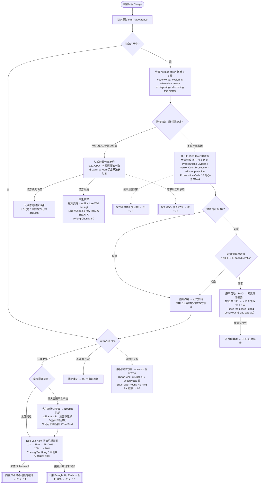

# 06 专题卡片 — 答辩意见、较轻替代认罪与 O.N.E. Bind Over 全景实务精要（Plea Advice, Charge Bargaining & O.N.E. Bind Over）

> **整课互指**：Master Overview §1–§5 · Structure Map · 时限表 · 流程图 · 05 保释卡 · SG02 Classroom · SG02 Desk 
> **实战产出锚定**：本卡是答辩前与控方谈判（O.N.E. Bind Over、认罪协商、修改案情撮要）、答辩建议（Letter of Advice）以及两份核心计分作业的单点主述依据。

## 速读定位层

> **白话导引（从头到尾一遍过）**：客户被落案起诉、首次提堂时，摆在辩方面前的是一条「答辩选择 → 协商 → 处置定局」的完整链条。第一步几乎总是申请押后暂不答辩（no plea taken）：控方要时间备齐证人陈述与文书，辩方要时间阅卷并给客户知情建议，而这次押后保住的正是「首个可行机会」的三分之一认罪折扣资格。押后期间辩方按客户指示选协商轨道：想让案件不以刑事定罪收场，就由大律师出具 without prejudice 申请函探索 O.N.E. Bind Over——客户在庭上答辩不认罪但同意案情撮要，控方不提证据，裁判官依 s.109I CPO 下达不超过两年的签保令，无定罪但签保期内 CRO 有记录；想用证据缺口换取较轻处置，就走控罪协商——以认较轻替代罪（s.51 CPO）交换控方撤回原罪，且认罪要约必须与案情理论一致、按 *Lam Kai Man* 的规则保全在法庭记录上。控方同意后还要过裁判官的最终裁量关。协商破裂或客户拒绝同意案情，案件回到正式答辩：认罪就走 *Ngo Van Nam* 折扣阶梯（时点越晚折扣越少），事实有重大争议先争取修订案情撮要、不行才上 Newton 聆讯；不认罪则排期审讯。定罪判刑后律师仍须会见客户解释结果与后续选项。若案件根本走不到审讯，还有六种「控方不继续」的处置形态（撤回、单纯 O.N.E.、O.N.E. B/O、nolle prosequi、留档、T.I.C.），各自的案底与再诉后果截然不同。本卡沿这条链，把每个环节的规则、攻防、文书与后果一次讲清。

### 适用范围

**覆盖（按办案时序）**——自落案起诉后首次提堂到答辩落地、事实清理与处置后果定局的完整「答辩选择 → 协商 → 处置」链：

1. **首次提堂暂不答辩（No Plea Taken）**：押后 6–8 周的课程口径与庭上代码词（code words），保住「首个可行机会」的三分之一折扣资格〔L5N L116 "If the O.N.E. B/O procedure is still being negotiated"；L5N L118 "Use code words when describing this procedure in court e.g. “we are"；L8N L978 "a 1/3 discount on any term of imprisonment will only be given"〕。
2. **三种协商对象与轨道边界**：不以刑事定罪处理（O.N.E. B/O）、控罪／罪项（撤减、修改或接纳较轻替代）、量刑事实（案情撮要修订），三者分别在何时用何种文书推进〔L4N L36 "The ways in which you can negotiate with the Prosecution, including asking them not"；L5N L104–L136 "Once the Defendant has been charged, at some point before"〕。
3. **O.N.E. Bind Over 程序与申请函**：检控守则 10.6–10.7 适当性审查、s.109I／MO s.61／普通法三法源、控方同意与裁判官最终裁量、PNG＋同意案情＋签保命令的庭审落地、十步申请函与七大红线〔L5N L106 "O.N.E. B/Os are only appropriate for minor offences e.g. common assault, fighting"；📄PCODE p.25–26，第10.6–10.7段；L5N L108–L110 "An O.N.E. B/O is not a conviction. It is an agreement between"〕。
4. **较轻替代认罪（s.51 CPO）**：要约、遭拒后的无效性、*Lam Kai Man* 量刑利益保留（通常记入法庭记录＋明确书面提议例外）与案情理论一致性〔L5N L294–L306 "If he pleads not guilty, then before the trial, the"；L8N L1002–L1008 "(1) the Defendant should make a clear and unequivocal statement of his"〕。
5. **答辩有效性与事实争议**：equivocal／unequivocal plea、撤回认罪门槛、Newton 聆讯触发与风险、判后解释义务〔L5N L312–L326 "See HKSAR v Wong Chi Yuk [2000] HKCA 699; [2000] 3 HKLRD"；L5N L376–L380 "A Newton Hearing / Inquiry is held where there is a disputed"；L5N L866 "Where a Defendant has been convicted and sentenced, it is the duty of Defence"〕。
6. **非起诉六种处置与后果谱系**：withdrawal／单纯 O.N.E.／O.N.E. B/O／nolle prosequi／lie on file／T.I.C. 的定罪效果、再诉可能与关键限制〔L5N L158–L200 "If the Prosecution “withdraws” the charge, in theory if new evidence comes"〕。
7. **量刑接口**：*Ngo Van Nam* 阶梯折扣、s.109B 与 Schedule 3 缓刑禁区、讼费救济〔L8N L980–L986 "a 25% reduction if he pleads guilty before trial dates are fixed;"；L8N L460–L464 "The Court can impose a suspended Sentence of Imprisonment (“S/S”) under s."；L5N L166 "Note that under s. 3 Costs in Criminal Cases Ordinance, Cap. 492"〕。
8. **SG 应用**：SG02 两份计分作业（Letter of Advice／O.N.E. Bind Over 信）、SG03 协商口答、SG07 接口（→ 0K 与审计留痕）。

**不覆盖（边界声明，由相邻主卡承担）**：① 侦查阶段权利、警诫回应与搜证规制（→ 07 卡）；② 保释制度本体（→ 05 卡）；③ 控罪选择、移交交付与审讯路径（→ 08 卡）；④ 量刑制度全景与起点、求情要素体系（→ 15 量刑卡，本卡只引折扣与缓刑禁区接口）；⑤ 供认争议与审讯中挑战（→ SG07 及 13 卡）；⑥ PCLL8051 认罪求情陈词本件（→ 8051 求情讼辩体系，本卡只供事实与折扣基石）。

### 术语（核心概念与实务运作定义）

| 术语 | 定义与章节 |
|---|---|
| 不提证据（Offer No Evidence, O.N.E.） | 控方在法庭上表示就起诉书不提证据，案件被法庭撤销（dismissed）。其法律效力等同 acquittal，依据《刑事程序条例》（Criminal Procedure Ordinance, Cap. 221）s.51A 原则上不能再以同一控罪起诉，被告人获得完全脱罪。它与「不提证据附签保」的区别在于 O.N.E. 是终局撤销、附签保则附带预防性命令（0F）。〔L5N L162 "On the other hand, if the Prosecution “offer no evidence” the case"；L5S L122 "Offer No Evidence – cannot recharge: s. 51A CPO: same as an"〕 |
| 不提证据附签保（O.N.E. Bind Over） | 控辩双方合意、经法庭预防性命令的合意处置：被告人答辩不认罪（plead not guilty, PNG）但同意案情撮要，控方不提证据，裁判官依《裁判官条例》（Magistrates Ordinance, Cap. 227）s.109I 下达签保令。它不是定罪，但签保期未届满时记录留在裁判法院档案（CRO）。它与定罪的区别在于无罪名成立、无刑罚，但留下行为约束记录（0C）。〔L5N L108–L110 "An O.N.E. B/O is not a conviction. It is an agreement between"；L5N L164 "“Offering no evidence” (or “O.N.E.”) is different from “offering no evidence on"〕 |
| 暂不答辩（No Plea Taken） | 首次提堂后申请押后（课程口径通常 6–8 周）暂不答辩，让控方备证、辩方阅卷并给出知情建议。协商进行中庭上用代码词表述而不暴露协商内容。它与正式答辩的区别在于不产生答辩记录、为协商留出时间（0C.1）。〔L5N L116 "If the O.N.E. B/O procedure is still being negotiated"〕 |
| 案情撮要（Brief Facts / Summary of Facts） | 控方就指控向法庭提交的书面案情撮要；辩方须逐字审阅并修订不实或不必要偏害内容。法庭上同意的案情可在随后民事诉讼中作为证据对抗被告人，同意即构成自认。它与证供材料的区别在于撮要是经双方确认的正式陈述（0C.5）。〔L5N L130 "Review the wording of the Brief Facts carefully – your client will"〕 |
| 无损权益（Without Prejudice） | 协商信件上标示 "without prejudice" 的标记，表示内容不应用于法庭程序。它不能收回控方已经获知的信息，不是信息抹除器。它与绝对保密的区别在于标记只影响证据使用、不影响信息流向（0G）。〔L5N L126 "You should not reveal your Defence in the O.N.E. Bind Over letter"〕 |
| 签保守行为（Bind Over；recognizance） | 法庭命令当事人在不超过 2 年期内保持治安（keep the peace）及／或行为良好（good behaviour）的命令，可附自签、担保或现金条件。两类义务按 *Lau Wai-wo* 须按个案精确区分、不能照抄。它与刑事定罪的区别在于签保是预防性命令、不构成罪名（0C.2、0C.5）。〔L8N L226 "See s.109I CPO: “A Judge, a District Judge or a magistrate shall"；L8N L230 "the traditional use of both types of conditions in all cases should not be continued"〕 |
| 较轻替代罪（Lesser Alternative Offence） | 起诉书内可被裁定的较轻罪名；被告人可提议认该罪以协商改控，或依《刑事程序条例》s.51(1)(b) 作替代答辩。被拒的认罪要约不构成有效定罪基础。它与 O.N.E. Bind Over 的区别在于替代罪通道以定罪收场、签保通道不定罪（0D）。〔L5S L198 "D can offer to PG to a lesser alternative offence: s. 51"；L5N L304 "(1) be convicted of the offence charged (in which case his guilty"〕 |
| 模棱两可认罪（Equivocal Plea） | 认罪时附加的条件若属实即等于没有承认该罪的认罪形态；法庭绝不可接纳，必须在判刑前撤销。它与 unequivocal 认罪的区别在于附带保留的认罪不产生认罪效力（0E）。〔L5N L334 "These should not be accepted by the Court since the Defendant has"；L5N L316 "The admitted facts are equivocal as to guilt: Chan Ching Chi v. R [1965]"〕 |
| Newton 聆讯（Newton Hearing / Inquiry） | 认罪（或定罪）后，就足以影响量刑的实质事实存在争议、且法庭不愿按被告人版本判刑时须举行的事实聆讯。其制度目的是让量刑建立在经查明的事实基础上。它与普通求情陈词的区别在于 Newton 是证据式的事实查证、不是陈词（0E）。〔L5N L378 "Where there is a substantial dispute on the facts and the court is not"〕 |
| 首个可行机会（First Available Opportunity） | 首次实际答辩的窗口；在此认罪通常获三分之一监禁刑扣减，此后按 *Ngo Van Nam* 阶梯递减。其制度目的是用时间折扣奖励尽早认罪、节省司法资源。它与迟延认罪的区别在于折扣幅度随时间递减（0B.5）。〔L8N L978 "a 1/3 discount on any term of imprisonment will only be given"〕 |
| 提早带庭（Brought Up Early in Court 1） | 定审期后拟改认罪时，由事务律师致函裁判法院第一法庭书记官申请把案件提早带到第一庭处理的换庭程序，避免拖到开审日沦至最低折扣档。它与正常排期的区别在于主动压缩延迟、保住折扣（0G）。〔L5S L340–L354 "MC / DC – letter to First Clerk of Court (MC) /"〕 |
| 例外罪行（Excepted Offence） | 《刑事程序条例》附表 3 所列罪行绝对禁止缓刑；s.19 伤人与 s.122 猥亵侵犯均在列，建议信漏查即成专业失职。它与一般罪行的区别在于法庭对缓刑没有裁量空间（0B.5、0G）。〔L8N L464 "Note: Check Schedule 3 CPO! If the offence is an Excepted Offence,"；L8N L774–L800 "The following offences are declared to be excepted offences"〕 |
| 一并考虑其他罪行（T.I.C.） | 被告人认主罪并自愿承认其他未被起诉的同类罪行供量刑一并考虑；不单独定罪，实务通常不再追诉，换取「彻底了结」。它与正式加控的区别在于不单独定罪、不产生判刑记录（0F）。〔L5N L192–L200 "There is another practice which has developed in the courts for which"〕 |
| 终止检控（Nolle Prosequi） | 律政司司长以书面指示终止诉讼的特权程序；被控人当庭释放，但不构成阻止后续诉讼的绝对屏障。它与撤销控罪的区别在于 nolle prosequi 由控方发起、效力上不阻却再诉（0F）。〔L5N L172–L176 "shall not operate as a bar to subsequent proceedings"〕 |
| 案件留档（Charge Left on File） | 经法官同意、在未答辩且未传证据前把控罪留档不处理的实务惯例；其后符合条件可再激活。它与终止检控的区别在于留档是暂停而非终结（0F）。〔L5N L180–L182 "A charge can only be left on the file if no plea"〕 |

### 环节定位（按程序时序）

| 环节 | 实际操作 |
|---|---|
| 落案后初查与研究 | 先读懂控方案件再谈答辩：要件、证据可用性与客户指示三者齐备之前，不预设「必须认罪」（→ 0B.1）〔L7N L164–L178 "Once the solicitor has thoroughly read and analysed the prosecution"〕 |
| 首次提堂暂不答辩 | 控方备证与辩方知情建议的时间从押后来；庭上用代码词不露协商（→ 0C.1）〔L5N L118 "Use code words when describing this procedure in court e.g. “we are"；L5N L218–L220 "This is because the Prosecution needs time to prepare the witness statements"〕 |
| 书面协商（三对象） | 不动用审讯改变「处置／控罪／事实基础」：各成一张可执行要约，不能混写（→ 0B.3、0C、0D）〔L4N L36 "The ways in which you can negotiate with the Prosecution, including asking them not"〕 |
| O.N.E. 信十步 | 把探索性请求写成 DoJ 可按 10.7 审批的文本，且不泄露答辩底线（→ 0G）〔L5N L120 "Your letter requesting an O.N.E. B/O should be addressed to either the"；L5N L126 "You should not reveal your Defence in the O.N.E. Bind Over letter"〕 |
| PNG＋同意案情 | 合意 ONE 的事实基础如何成立而不成为认罪或定罪（→ 0C.4）〔L5N L108 "plead not guilty but agree the Brief Facts"〕 |
| 较轻替代认罪路径 | 用证据缺口换较轻入罪，同时以 *Lam Kai Man* 机制保留量刑利益（→ 0D）〔L8N L1002–L1008 "(1) the Defendant should make a clear and unequivocal statement of his"〕 |
| equivocal 审查 | 拦截「认罪加保留并不等于承认犯罪」的无效认罪；不能用 Newton 绕开（→ 0E）〔L5N L330–L346 "There is a distinction between an “unequivocal” guilty plea and"；L5N L398–L406 "A Newton Inquiry is not appropriate where e.g. the Defendant"〕 |
| Newton 启动 | 认罪但重大事实分歧：先协商修订、何时强制开庭、聆讯结果如何影响量刑（→ 0E）〔L5N L376–L380 "A Newton Hearing / Inquiry is held where there is a disputed"；L5N L390 "Where there is a difference between the Prosecution’s evidence and the factual basis on"〕 |
| 六种非起诉处置比较 | 把「撤案／不继续」的口径混乱拆成六条后果完全不同的法律路径（→ 0F）〔L5N L158–L200 "If the Prosecution “withdraws” the charge, in theory if new evidence comes"〕 |
| 折扣定档与缓刑禁区 | 何时认罪值多少、哪些罪不可缓刑——把现实建议锚在阶梯与禁区上（→ 0B.5、0G）〔L8N L980–L986 "a 25% reduction if he pleads guilty before trial dates are fixed;"；L8N L464 "Note: Check Schedule 3 CPO! If the offence is an Excepted Offence,"〕 |
| 判后责任 | 定罪判刑后律师仍须会见客户解释结果与后续事项（→ 0B.5）〔L5N L866 "Where a Defendant has been convicted and sentenced, it is the duty of Defence"〕 |

## 🗺️ 本卡地图

**图 1 审查逻辑总括**：本卡制度的审查阶梯是——先看答辩时机（协商中不答辩，保折扣窗口），再看处置轨道（O.N.E. 与控罪协商是两条不可混写的文书轨道），第三过控方审查（Prosecution Code 10.7 六标准），第四过裁判官最终裁量（s.109I），第五看庭审落地（PNG＋同意案情＋签保／认罪＋案情撮要），第六看事实清理（修订 vs Newton），最后才是折扣与记录后果（*Ngo Van Nam* 阶梯、Sch 3 禁区、CRO 效果）。辩方的每份文书、每个庭上表述，都在这架阶梯上找位置；控方的每项反对与拒绝，也都落在这架阶梯的某一层。

### 任务直达表

| 你现在要做什么 | 直达章节 |
|---|---|
| 30 秒弄清范围／术语／每环任务 | [速读定位层](#速读定位层)／[适用范围](#适用范围)／[术语](#术语核心概念与实务运作定义)／[环节定位](#环节定位按程序时序) |
| 回答「客户问认不认／四项决定」 | [0B.1](#0b1-答辩前研究与知情建议)–[0B.2](#0b2-两类伦理困局的配对处理)＋[0I](#0i-攻防与出庭前核对清单)＋[0J](#0j-程序失误与违规后果总表) 行 6 |
| 协商改控／认较轻罪／修订案情撮要 | [0B.3](#0b3-三种协商对象各成一张要约不能混写)＋[0D](#0d-控罪协商与较轻替代罪s51-cpo要约效力与保全)＋[0J](#0j-程序失误与违规后果总表) 行 8 |
| 写 O.N.E. 申请函（SG02 计分作业） | [0G.1](#0g1-playbook-a--one-bind-over-申请函十步法大律师致律政司) 十步＋红线＋[0C.3](#0c3-适当性审查prosecution-code-106107-六标准攻防视角) Code 10.7 六项＋[0J](#0j-程序失误与违规后果总表) 行 2–4 |
| 写 Letter of Advice（SG02 计分作业） | [0G.2](#0g2-playbook-b--letter-of-advice-八步法律师致客户) 八步＋[0B.5](#0b5-缓刑禁区schedule-3与判后义务) 折扣与禁区＋[0J](#0j-程序失误与违规后果总表) 行 5、13、14 |
| ONE 落地程序、客户拒绝同意案情 | [0C.4](#0c4-程序落地裁判官最终裁量与庭审六步)＋[0C.5](#0c5-同意案情的后果管理民事自认道歉信与违令回路)＋[0J](#0j-程序失误与违规后果总表) 行 7 |
| 认罪后反悔／重大事实争议（Newton） | [0E](#0e-认罪有效性与认罪后争议撤回门槛与-newton-聆讯)＋[0J](#0j-程序失误与违规后果总表) 行 9–12 |
| 比较「撤案」类六种处置 | [0F](#0f-六种非起诉处置机制与讼费) 六处置表 |
| 量化认罪利益／能否缓刑 | [0B.4](#0b4-折扣阶梯认罪的时间价值ngo-van-nam-体系) 阶梯与 [0B.5](#0b5-缓刑禁区schedule-3与判后义务) Sch 3 禁区＋[0J](#0j-程序失误与违规后果总表) 行 1、13、14 |
| 想知道「某环不做会怎样」 | [0J](#0j-程序失误与违规后果总表) 总表＋图 1 虚线后果框 |
| 判后解释／SG03、SG07／跨课接口 | [0B.5](#0b5-缓刑禁区schedule-3与判后义务) 判后义务＋[0K](#0k-sg-实务应用与跨科接口) |

<!-- BEGIN:cite-legend -->
> [!info]- 引注图例（出处码 → 文件；点开折叠）
>
> | 码 | 文件 | 层级 | 学年 |
> |---|---|---|---|
> | L4N | 本届 LGS 4 谈判与审讯概览讲义 | 本届讲义 | 2026-27 |
> | L5N | 本届 LGS 5 Notes（审前问题与 O.N.E. Bind Over 主讲义） | 本届讲义 | 2026-27 |
> | L5S | 本届 LGS 5 课堂幻灯 Parts 1&2 REVISED | 本届讲义 | 2026-27 |
> | CAP-K5 | PCLL8050 LGS5 PT 课堂字幕 | 本届讲义 | 2026-27 |
> | L8N | 本届 LGS 8 Notes（量刑、认罪折扣与例外罪行） | 本届讲义 | 2026-27 |
> | L8S | 本届 LGS 8 课堂幻灯 | 本届讲义 | 2026-27 |
> | L3N | 本届 LGS 3 法律探访、控罪起草与移交讲义（Revised） | 本届讲义 | 2026-27 |
> | L7N | 本届 LGS 7 审讯实务与关键审讯文书起草讲义（Final） | 本届讲义 | 2026-27 |
> | PCODE | Prosecution Code（律政司检控守则，本届下发 PDF 扉页 2013 版） | 本届官方 | 2026-27 |
> | VCC | Victims of Crime Charter（受害人权利约章，本届下发 PDF） | 本届官方 | 2026-27 |
> | STVW | Statement on Treatment of Victims and Witnesses（证人受害人处理声明 2009） | 本届官方 | 2026-27 |
> | SGS2 | SGS2 学生册（本届） | 本届官方 | 2026-27 |
> | GLOA | Letter of Advice 评分指引（本届） | 本届官方 | 2026-27 |
> | GBO | Bind Over Letter 评分指引（本届） | 本届官方 | 2026-27 |
> | MARK | Coursework Marksheet 2026 | 本届官方 | 2026-27 |
> | JS | 案卷 HKSAR v Jeff Sham（本届 md 伴生，页码核对 docx 原件） | 本届官方 | 2026-27 |
> | WM | 案卷 HKSAR v Willy Ma（本届 md 伴生，页码核对 docx 原件） | 本届官方 | 2026-27 |
> | WHY | HKSAR v Wan Ho Yeung 判决书（SGS 3 附件） | 本届官方 | 2026-27 |
> | BC | LGS5所引Bar Code（讲义摘引，非原守则） | 本届官方 | 2026-27 |
> | OLD-MAN | 往届 SGS2 学生册＋课堂笔记 Set 1 | 往届学生稿 | 2025-26 |
> | OLD-INT | 往届 Willy Ma 面谈指示与记录 Set 1 | 往届学生稿 | 2025-26 |
> | OLD-LOA2 | 往届 Letter of Advice 学生稿 Set 2 | 往届学生稿 | 2025-26 |
> | OLD-BO1 | 往届 O.N.E. 信学生稿 Set 1 | 往届学生稿 | 2025-26 |
> | EXT | Plea Advice - Official Clarifications 2026-10-06 | 库外法源 | 2026-27 |
> | AUTH | 09 Shared Authorities - Charges and Defences | 本层自拟 | 2026-27 |
> | SGS4 | crim.pro.SGS.4.STUDENTS.2026 | 本届官方 | 2026-27 |
> | SD22 | Specimen_Directions_2025 | 本届官方 | 2026-27 |
> | SHUM | Shum Man-fai - Official Summary Notes 2026-10-06 | 库外法源 | 2026-27 |
<!-- END:cite-legend -->

## 0B. 答辩选择框架：客户自主权、协商对象与认罪利益阶梯

这一节回答全卡的地基问题：答辩决定到底是谁的决定、协商到底在协商什么、认罪到底值多少。进入这节时，案件刚完成首次提堂（或即将提堂），客户在羁押或保释中等待建议——律师的任务不是替客户选答案，而是把 s.51 与 O.N.E. 两条协商轨道、折扣阶梯与禁区摆到客户面前，让他在知情之下作指示。

### 0B.1 答辩前研究与知情建议

**方法论次序**：先读控罪与控证、取得客户逐项回应，再说明可能抗辩、实际刑罚风险、认罪折扣和程序选择。不能以最高刑恐吓客户，也不能以一个没有来源的窄刑期吸引认罪〔L7N L164–L178 "Once the solicitor has thoroughly read and analysed the prosecution"〕。知情建议的内容清单：控罪本身、法律、控方案件强弱、可用抗辩、认罪与受审两种路径下的可能刑罚——四项齐备，客户才处于能作知情决定的位置〔L5N L220 "In advising the Defendant on plea, Counsel must ensure that the Defendant is in a position to make an informed decision on plea: this means Counsel must advise on the charge, the law, the strengths and weaknesses of Prosecution’s case, any defences available and the likely sentence if convicted after a plea of guilty/trial."〕。

**职业操守基准（Bar Code para. 10.56(a)）**：律师有一般性答辩建议义务；必须向客户讲明，无论认罪与否，**答辩的选择权与责任完全属于客户**（complete freedom of choice）；为给出恰当建议，律师可以引用案件的所有方面，并可以在必要时用严厉措辞告知被告人他脱罪希望渺茫、而认罪通常被视为求情因素〔L5N L224 "“It is the duty of defending Counsel to advise his client generally"；L5N L224 "complete freedom of choice in his plea"；L5N L224 "he may advise his client in strong terms that he is unlikely to escape conviction"〕。

**客户的四项决定**：客户需要分别决定四件事——是否承认犯罪、是否愿意在特定事实基础上认罪、是否授权谈判及授权披露什么、能否接受拟议处置。律师评估法律与证据并可给强烈建议，但答辩决定不能由律师代作〔L5N L224 "“It is the duty of defending Counsel to advise his"；L5N L224 "complete freedom of choice in his plea"〕。

> **Exam / Advocacy Formulation:** "Whether you plead guilty or not guilty is entirely your decision. My duty is to advise you fully — on the charge, the strength of the Prosecution's case, the likely sentence on each path and the discount for a guilty plea — but the choice of plea remains yours alone."

### 0B.2 两类伦理困局的配对处理

**坚称无罪却执意认罪（BC 10.56(b)–(d) 四步法）**：(1) 先建议：若事实上无罪，理应答辩不认罪，但决定权在客户；(2) 探究客户坚持认罪的真实动因，排查外部胁迫或不当利益，并探讨能否消除顾虑使其按无罪答辩；(3) 客户坚持的，作严正后果警告——基于该认罪的定罪**在上诉中不太可能被推翻**（讲义用 unlikely；并非没有撤回或复核救济），且此后求情**必须完全建立在承认有罪的基础之上**；(4) 完成上述全部警告后，律师**必须继续代表该客户出庭**（Counsel must continue to represent），不得单方面遗弃〔L5N L230 "(i) advise the defendant that, if he is not guilty, he should"；L5N L232 "(ii) explore with the defendant why he wishes to plead guilty to"；L5N L234–L238 "(c) If the client maintains his wish to plead guilty, Counsel should"；L5N L240 "(d) Counsel must continue to represent the defendant if, following all of"；L5N L228–L240 "“(b) Where a defendant tells his Counsel that he did not commit"〕。

**私下承认有罪却指示不认罪（BC 10.55 严格抗辩限制）**：诉讼开始前自白的，律师只在答辩认罪、或严格按附录 12 限制行事时方可继续代理；被要求编造积极抗辩的，应退聘（return brief）。诉讼过程中自白而无法在不损害客户利益下退聘的，可以继续代理，但**绝不可提出与自白相矛盾的积极抗辩**——不得声称或暗示他人犯罪、不得传召不在场证明（alibi）；仅可要求控方履行**严格举证责任（put the Prosecution to strict proof）**，即攻击控方证据的逻辑漏洞、矛盾与证人瑕疵〔L5N L246 "(a) If the confession is made before the proceedings have started he"；L5N L248–L250 "(b) If the confession is made during the proceedings or in such"〕。

**两种困局不能混为一谈**：前者是「无罪之人要认罪」的后果警示与继续代理义务；后者是「有罪之人要不认罪」的积极抗辩禁区与 strict proof 边界。披露任何信息前自问三问：内容是否必要、客户是否授权、协商失败后会否暴露抗辩〔L5N L226–L250 "Where the Defendant wishes to plead guilty but did not"；L5N L244–L250 "“A practising barrister to whom a confession of guilt has been made"；L5N L126–L130 "You should not reveal your Defence in the O.N.E. Bind"〕。

### 0B.3 三种协商对象：各成一张要约，不能混写

| 要改变什么 | 请求的性质 | 必须先有的指示 |
|---|---|---|
| 不以刑事定罪处理 | 探索 O.N.E. Bind Over 等合适处置 | 是否真实同意案情和签保；不能与认罪混同 |
| 控罪／罪项 | 撤减、修改或接纳较轻／其他罪名 | 是否愿意承认该罪全部要件，拟认罪基础是什么 |
| 量刑事实 | 澄清或修订 summary of facts | 客户承认与争执的具体事实及其后果 |

三类对象可能在实际案件的不同阶段出现，但当前 SG 若只要求 ONE，不能擅自把信写成轻罪认罪要约——两条轨道各有自己的审查逻辑与文书（与 0G 红线六并读）〔SGS2 L150 "NOTE: YOU ARE ONLY EXPLORING THE POSSIBILITY OF AN O.N.E. BIND OVER"〕。谈判范围的边界：可以尝试协商未控且非现有法定替代罪的罪名，是否接受与如何修改起诉书由控方决定；要区分「谈判可以谈什么」与「现有起诉书能作什么裁决」〔L4N L36 "The ways in which you can negotiate with the Prosecution, including asking them not"；L5N L104–L136 "Once the Defendant has been charged, at some point before"；L5N L144–L152 "Amending the charge – Defence Counsel will usually write to"；L5N L282–L284 "A Defendant may sometimes wish to offer a guilty plea to an"；L5N L284 "The only possibility would be for the Judge to amend the charge of his own initiative."；L5N L144 "Amending the charge – Defence Counsel will usually write to the Prosecution"〕。

### 0B.4 折扣阶梯：认罪的时间价值（*Ngo Van Nam* 体系）

**机制与理由**：法庭先定不考虑认罪的量刑起点，再按认罪扣减——目的在鼓励尽早认罪、节省法庭时间与成本；认罪同时可视为悔意的显示（与受审定罪后通常不接受悔意陈词形成对照）〔L8N L974 "The Court will first fix the starting point in terms of the"；L8N L974 "save the court’s time and costs"；L8N L972 "can be treated as an indication of remorse"；L8N L974–L978 "The Court will first fix the starting point in terms of the"；L8N L978–L1002 "a 1/3 discount on any term of imprisonment will only be given"〕。

**阶梯（自 2016 年 9 月 2 日起的 *Ngo Van Nam* 新指引）**：(1) 在「首个可行机会」（首次答辩时机）认罪——**1/3**；(2) 定审期前认罪——**25%**；(3) 定审期后、开审前认罪——**25%–20%**；(4) 开审首日认罪——**20%**；(5) 审讯进行中认罪——**少于 20%**〔L8N L978 "a 1/3 discount on any term of imprisonment will only be given"；L8N L980–L986 "a 25% reduction if he pleads guilty before trial dates are fixed;"；L8N L982 "between a 25%-20% reduction if he pleads guilty once trial dates have"〕。

**四个落点判例**：罚款案件的认罪折扣通常同样适用（*HKSAR v Tai Hing Worldwide Development Ltd* [2015] 3 HKLRD 358）；*Ngo Van Nam* 属量刑程序指引，犯罪发生在新指引生效前、被捕在其后且被控人在交付时已知悉新指引的，按新指引计算（*HKSAR v Chang Yau Hung Alexander* [2024] 2 HKLRD 1367——该案仅获 25%）；审讯开始后（控方开案陈词后、PW1 作证期间）认罪的实得折扣可为 **10%**（*HKSAR v Cheung Tsz Hong* [2021] 5 HKLRD 248）；审讯中认罪后反悔不成的阶梯问题见 0E〔L8N L988 "For fines, a discount for a guilty plea will usually be applied"；L8N L990 "the revised procedures should apply"；L8N L1018 "the D was only given a 10% discount"；L8N L1018 "The CA indicated that the discount of 10% was the correct amount."〕。

**时点与最终裁量**：折扣阶梯是通常指引，最终数额属法官裁量（subject to the Judge's overriding discretion）〔L8N L1006 "The amount of the discount depends upon the stage at which it is entered on the Court’s record but remained subject to the Judge’s overriding discretion"〕。

### 0B.5 缓刑禁区（Schedule 3）与判后义务

**缓刑法定框架**：拟缓刑的监禁刑不得超过 2 年；缓刑考验期（operational period）1 至 3 年；缓刑被喻为「达摩克利斯之剑」，其法律性质仍是监禁刑罚（s.109B(5)(a) CPO）〔L8N L460–L464 "The Court can impose a suspended Sentence of Imprisonment (“S/S”) under s."；L8N L460–L464 "The Court can impose a suspended Sentence"；L8N L460–L468 "The Court can impose a suspended Sentence of Imprisonment (“S/S”) under s."；L8N L464–L790 "Note: Check Schedule 3 CPO! If the offence is an Excepted Offence,"〕。

**附表 3 例外罪行绝对禁止缓刑**：附表所列严重罪行（含误杀、强奸／企图强奸、贩运危险药物、结伙斗殴、管有攻击性武器、抢劫，以及 Cap. 212 s.17／s.19 伤人、Cap. 200 s.122 猥亵侵犯）**不得判缓刑**——先定适当刑罚种类，再查 s.109B 与附表 3；s.19 在禁区不等于法例要求该罪必判监〔L8N L464 "Note: Check Schedule 3 CPO! If the offence is an Excepted Offence,"；L8N L774–L800 "The following offences are declared to be excepted offences"；L8N L788 "Any offence contrary to section 10, 11, 12, 13, 14, 17, 19"〕。这正是 Jeff Sham 案中辩方探讨把 s.19 降为 s.39 AOABH 认罪的战略动机（s.39 不在附表 3）〔L8N L464 "Note: Check Schedule 3 CPO! If the offence is an Excepted Offence,"；SGS2 L134–L140 "(a) (i) complete the research chart at page 52 of the Jeff"〕。

**判后义务（BC para. 10.64）**：定罪判刑后，辩方律师必须亲自会见当事人、或确保其代表会见，解释结果与后续考虑事项——包括可能的刑罚选项、预期刑期、该罪是否属附表 3 例外罪行、以及被告人未满 21 岁时的 s.109A CPO 事项〔L5N L866 "Where a Defendant has been convicted and sentenced, it is the duty of Defence Counsel to see his lay client"；L5N L866 "must consider possible sentencing options, the likely sentence, whether the offence is an excepted offence under Schedule 3 CPO and s.109A CPO"〕。

> **Exam / Advocacy Formulation:** "Having regard to Ngo Van Nam, since your trial date has been fixed but the trial has not begun, a guilty plea now would attract a discount of between 20% and 25%. However, before we discuss any suspended sentence, I must check whether this offence is an excepted offence under Schedule 3 CPO."

## 0C. O.N.E. Bind Over：法源、适当性、程序落地与客户同意

O.N.E. Bind Over 是本卡第一条协商轨道，目标是让案件**不以刑事定罪收场**。它由四块拼成：协商的时机（押后暂不答辩）、控方的审查（Prosecution Code 10.7）、法庭的最终把关（s.109I）与庭审的落地动作（PNG＋同意案情＋签保）。它与认罪协商的本质区别在于：这条轨道的终点不是任何定罪，而是一纸预防性命令。

### 0C.1 协商时机：首次提堂的暂不答辩与代码词

**为什么不能先答辩**：O.N.E. B/O 协商仍在进行时，不要让答辩被处理——先认罪则定罪随之而来，控方其后再同意 O.N.E. B/O 时，被告人要撤回认罪须法庭许可；先不认罪而协商其后破裂的，被告人已错过首个可行机会，日后认罪的折扣按 *Ngo Van Nam* 受影响〔L5N L116 "If the O.N.E. B/O procedure is still being negotiated"；L5N L116 "If the Prosecution later agrees to the O.N.E. B/O, then the Defendant would need to withdraw his guilty plea which needs leave of the court."〕。

**押后的双重目的**：本届讲义描述首次出庭通常押后 6–8 周暂不答辩——这是课程口径而非每案法定期限，运用时视证据、客户知情程度与法庭指示；押后让控方准备完整证人陈述与文书证据，也让辩方全面阅卷后提供知情答辩建议〔L5N L216 "As a result of a change in sentencing approach following HKSAR v."；L5N L218–L220 "This is because the Prosecution needs time to prepare the witness statements"〕。

**庭上代码词**：申请押后暂不答辩时，用克制表达说明理由——"we are exploring alternative means of disposing / shortening this matter"——防止过早暴露底牌；这是案件处理策略而非法律禁区，申请期限按本案实际需要〔L5N L118 "Use code words when describing this procedure in court e.g. “we are"；L5N L118 "Use code words when describing this procedure in court e.g. “we are exploring alternative means of disposing/shortening this matter.”"；L5N L118 "Use code words when describing this procedure in court"；L5N L118 "Use code words when describing this procedure"〕。字幕口径一致：该程序通常应在答辩前尽早协商，最终是否同意协商处置由控方决定〔CAP-K5 L75–L139 "only really suitable for first time offenders"；CAP-K5 L127 "it is up to the prosecutor to decide"〕。

> **Exam / Advocacy Formulation:** "Your Worship, we respectfully apply for this matter to be adjourned for six weeks with no plea taken, as the Defence and the Prosecution are currently exploring alternative means of disposing of / shortening this matter."

### 0C.2 法源三轨与签保命令的两类义务

**法源双轨＋普通法**：(1) 附带签保权——CPO s.109I：对本人或其案件在法庭席前者，法官、区域法院法官或裁判官可命令其自签担保书（recognizance）、提供担保人或两者兼用；适用范围不限于已被控罪者，也不能把所有 bind-over 与本课合意 O.N.E. 程序混同；(2) 治安保证书——MO s.61（检控守则 10.7 引用此条，而 LGS5 引 s.109I；两处引用不互相排斥，各自范围引用，分歧登记审计区 D-BOSECT）；(3) 普通法签保权——DC 与 CFI 另有普通法 bind-over 权，裁判法院没有该项普通法权力；不能扩写为 MC 不享有任何签保权力〔L8N L226 "See s.109I CPO: “A Judge, a District Judge or a magistrate shall"；L8N L226 "a person who or whose case is before the court"；📄PCODE p.25；L8N L234 "common law power to impose a bind over"〕。

**两类义务不能照抄（*Lau Wai-wo*）**：keep the peace 针对涉及人身或财产的暴力、威胁或合理恐惧；good behaviour 针对犯罪行为要素、威胁或相应合理恐惧——传统上每案照抄两类条件的做法不应继续，命令必须精确说明禁止的行为。对无罪者、证人或民事诉讼当事人作命令，须有支持未来风险的事实、预先通知拟作命令、金额应考虑合理支付能力；自签担保书、找担保人、现金缴存与违令后的没收是各自独立的问题，本课 O.N.E. 常见的现金条件不能替代这一分析〔L8N L230 "the traditional use of both types of conditions in all cases should not be continued"；L8N L232 "reasonably be expected to be able to pay it"；L8N L230–L232 "Where a bind over is imposed against an acquitted Defendant, see: Lau"〕。

### 0C.3 适当性审查：Prosecution Code 10.6–10.7 六标准（攻防视角）

**适当性总则**：O.N.E. B/O 只适合轻微罪行（如普通袭击、公众地方打斗）且被告人记录清白的情形；不要在任何情况下都申请 O.N.E. B/O——罪行情节严重或被告人有多项前科时反复申请，只会养成「逢案必求签保」的坏名声。守则的用语是 "particularly appropriate"，不能改成凡有前科即无管辖权〔L5N L106 "O.N.E. B/Os are only appropriate for minor offences e.g. common assault, fighting"；L5N L114 "Do not ask for an O.N.E. B/O in all circumstances. Consider carefully"；L5N L106 "only appropriate for minor offences"；📄PCODE p.25–26，第10.6–10.7段〕。字幕口径：清白纪录、罪行是否轻微、公众利益、定罪后果、可能刑罚及投诉人意见均是控方考虑因素〔CAP-K5 L75–L139 "only really suitable for first time offenders"〕。

控方按守则 10.7 的六项裁量因素审查申请；辩方的任务是用本案事实逐项论证，而不是把六项当填空公式：

| 10.7 因素 | 控方审什么 | 辩方怎么证 | 出处 |
|---|---|---|---|
| (a) 公众利益（The Public Interest） | 案件是否属偶发、有无帮派／武器／持续暴力、公共秩序危害多大 | 论证行为危害轻微、再犯风险低，签保令的司法监督已足以维护法纪 | 〔📄PCODE p.25–26，第10.6–10.7段（印刷页23–24）〕 |
| (b) 定罪后果是否与严重性完全不相称 | 后果主张有无实证 | 用已核实的职业与家庭后果论证（如 Willy Ma 的护士身份有牧师信支持，但注册类别、工龄与雇佣条款仍须取指示；护士管理局的处分是经程序与裁量的决定，没有「每次定罪自动除名」规则） | 〔WM L418 "I have known Willy Ma and his parents since I became pastor"；EXT L14–L17 "刑事定罪不等于自动除名"；📄PCODE p.26，第10.7(b)段〕 |
| (c) 定罪后可能刑罚 | 刑罚估计有无依据 | 按罪行、伤害、记录与可靠判例估计；不能因申请 O.N.E. 就假定只罚款或释放；说明签保能否达到相称处理 | 〔📄PCODE p.26，第10.7(c)段〕 |
| (d) 年龄、记录、品格与精神状况 | 个人情况有无文件支持 | 有清白记录才明确提出；「未收到 CRO」不等于「无前科」；社会贡献与就业须有指示或文件 | 〔GBO L14 "If client has a clear record, highlights this."；📄PCODE p.26，第10.7(d)段〕 |
| (e) 受害人意见（Views of the Victim） | 受害人是否反对或已谅解 | 结合《受害人权利约章》说明受害人不予追究或伤害极轻微；受害人态度强硬时控方仍须独立裁量，不沦为私人复仇工具 | 〔📄PCODE p.25–26，第10.6–10.7段；L5N L128 "The DOJ sometimes asks for an apology to be made as a"；📄PCODE p.26，第10.7(e)段〕 |
| (f) 罪犯对该罪行的态度与悔意 | 态度证据是否真实 | 说明已有的合作、遗憾或守法安排；保持沉默不等于不合作；不为表现悔意替客户作未经授权的承认 | 〔📄PCODE p.26，第10.7(f)段；SGS2 L229 "The matters stated should done so accurately and in line with the"〕 |

六项是裁量因素而非封闭公式——信件以它们组织论证，但每个论点都要挂本案事实〔📄PCODE p.25–26〕。

### 0C.4 程序落地：裁判官最终裁量与庭审六步

**双重同意结构**：O.N.E. B/O 是控辩合意加法庭裁量——控辩双方必须同意这条路径，但**裁判官对接受或拒绝享有最终裁量权**（final discretion）；裁判官可以拒绝双方协议并要求案件正式答辩，也可以在阅卷后认为案件适合时**主动向控方建议**以 O.N.E. B/O 处理；但控方坚持不采纳时，裁判官无权强行剥夺控方的检控权〔L5N L108 "The Prosecution and Defence must agree on this approach, however, the Magistrate has the final discretion whether to accept or refuse the O.N.E. B/O."；L5N L136 "The Magistrate can suggest to the Prosecution that the case is an"〕。裁判官的表态只是司法建议：检控官通常会表示需向律政司上级索取指示并申请押后；辩方可准确向控方转达法庭建议与待决事项，但不夸称法官已同意、不把建议当施压理由或获批保证〔L5N L136 "The Magistrate can suggest to the Prosecution that the case is an"〕。

**庭审落地六步**：(1) 书记宣读控罪；(2) 被告人回答**不认罪**（plead not guilty）；(3) 控方向法庭陈词——若被告人同意案情撮要并愿意签保，控方申请不提证据；(4) 书记向被告人宣读案情撮要，被告人明确确认同意；(5) 裁判官严正训诫（warn）后依 s.109I CPO 下达签保令——不超过 2 年保持治安及／或行为良好，按实际命令以自签、担保人或现金条件履行（两类义务按 *Lau Wai-wo* 区分，→ 0C.2）；(6) 控方正式不提证据，裁判官撤销控罪，被告人当庭释放——**没有定罪**〔L5N L108–L110 "An O.N.E. B/O is not a conviction. It is an agreement between"；L5N L110 "The bind over is to keep the peace and/or to be of"〕。

**PNG 与同意案情的关系**：仅 PNG 本身不会产生无罪裁决——同意案情撮要是裁判官施加签保的事实基础，这就是为什么这条轨道要求「不认罪但同意案情」这个看似矛盾的组合〔L5N L108 "plead not guilty but agree the Brief Facts"；L5N L110 "The bind over is to keep the peace and/or to be of"〕。

**客户拒绝同意案情时的两步**：第一步与检控官交涉修订案情撮要（删除争议内容时确保以涂黑方式永久遮盖）；第二步无法取得真实同意的，**不按合意 O.N.E. 推进**，重新向客户提供认罪或不认罪的知情意见——拒绝同意不等于只剩不认罪一条路，也不能强迫客户接受不实案情〔L5N L134–L136 "What if your client refuses to agree the Brief Facts? This is"；L5N L152 "Tip: if facts are being deleted – ensure they are blacked out"；L5N L224 "“It is the duty of defending Counsel to advise his client generally"〕。

**取指示落到实际条件**：签保期限、金额、付款能力、命令禁止的具体行为逐项核对；不把客户「愿意尝试 O.N.E.」记成愿意承认任何案情、支付任何金额〔L5N L110–L136 "The bind over is to keep the peace and/or to"；L5N L134 "What if your client refuses to agree the Brief Facts? This is"〕。

### 0C.5 同意案情的后果管理：民事自认、道歉信与违令回路

**民事自认警告**：法庭上同意的案情撮要**可在随后民事诉讼中作为证据对抗被告人**——签署前逐字审查，剔除一切偏见性、无关性或直接承认民事过错的表述；案情撮要里有承认责任的内容时，裁判官也可能拒绝 O.N.E. B/O〔L5N L130 "Review the wording of the Brief Facts carefully – your client will"；L5N L130 "Note: admissions given in court as part of O.N.E. B/O procedure (e.g. agreeing Brief Facts) can be used in civil proceedings. Ensure there is no admission of liability in the Brief Facts."；L5N L130–L148 "Review the wording of the Brief Facts carefully – your client will"〕。

**道歉信两难**：律政司有时以道歉作为批出 O.N.E. B/O 的条件——因为其已按《受害人权利约章》《证人受害人处理声明》与检控守则征询投诉人意见；但严格而言，DoJ 应自行作决定。道歉引发的问题是：书面道歉可否成为民事索偿的依据？化解两策——(1) 书面措辞模糊化为「对事件发生深表遗憾（expressing sincere regret that the incident occurred）」，绝不出现承认过错责任的字眼；(2) 提议在庭上口头表达遗憾，同样需要仔细措辞〔L5N L128 "The DOJ sometimes asks for an apology to be made as a"；L5N L128 "Solution – (i) try to word any written apology vaguely – regret that the incident occurred rather than an admission of fault; or (ii) can any apology be given orally before court"〕。现行《道歉条例》在多数民事程序中一般不把道歉用作对作出者不利的责任证据，但不能把这个概括等同于本案每段案情承认必受保护〔EXT L22–L24 "在大多数民事程序中，道歉通常不被用作对作出者不利的责任证据"；EXT L24 "也不能保证转为口头表达就不留记录"〕。幻灯亦设问「O.N.E. B/O 达成后 D 应否道歉」〔L5S L57 "If O.N.E. B/O agreed – should D apologise"〕。

**违令回路**：违反签保令时须区分拒绝进入担保、违反条款、没收与藐视法庭程序——守则 10.6–10.7 说明潜在制裁（最高可涉监禁），但不等于一有争执即自动没收或即时监禁；获令后须逐项向客户解释具体禁止行为、期间、金额及违令风险；警察介入本身不能替代违令事实与适用程序〔📄PCODE p.25–26；L8N L230–L232 "Where a bind over is imposed against an acquitted Defendant, see: Lau"；L5S L55 "Must warn D of consequences of breach of"〕。

> ⛓️ **后果点题**：同意案情前不逐字审查／客户不愿仍推进 → 0J 行 7；未逐项落实签保条件即承诺 → 0J 行 7；信中泄露答辩防线 → 0J 行 2。

> **Exam / Advocacy Formulation:** "The Defence invites the Prosecution to consider, in accordance with paragraphs 10.6 and 10.7 of the Prosecution Code, whether this is a case where the public interest may be met by the Defendant being bound over — he is prepared to agree the Brief Facts as amended and to enter into a recognizance to keep the peace and be of good behaviour for such period as the Court thinks fit."

## 0D. 控罪协商与较轻替代罪（s.51 CPO）：要约、效力与保全

第二条协商轨道动的是**控罪本身**：以被告人承认较轻罪名，换取控方撤回原罪。这条轨道的每一步都挂在 s.51 CPO 的法定结构上，而它最容易失守的地方不在谈判，而在「要约之后」——被拒的认罪是 nullity，只有按 *Lam Kai Man* 保全下来的要约才可能在日后换取折扣。

### 0D.1 s.51 的法定结构：替代答辩、控方接受与审讯替代定罪

**替代答辩（s.51(1)(b) CPO）**：控方拒绝修改控罪后，被告人在答辩时仍可依 s.51(1)(b) 认罪——"he may plead not guilty to the offence specifically charged in the indictment but guilty to another offence of which he might be found guilty on that indictment"（如认误杀而非谋杀）〔L5N L294 "If he pleads not guilty, then before the trial, the Defendant may still offer a guilty plea to an alternative offence"；L5N L294 "he may plead not guilty to the offence specifically charged in the indictment but guilty to another offence of which he might be found guilty on that indictment"；L5N L292–L304 "The Prosecution may agree to this and if so, the original charge"；L5N L294–L306 "If he pleads not guilty, then before the trial, the Defendant may"；L5N L296 "except if it is introduced by D during the trial"〕。

**控方接受改控（s.51(4) CPO）**：控方接受对较轻罪的认罪时，原控罪撤回、经修订控罪呈交法庭、被告人认罪并按修订控罪定罪判刑——且无论两罪是否分列，对一罪的定罪即构成对另一罪的无罪释放（"his conviction of the one offence shall be an acquittal of the other"）〔L5N L300 "If the Prosecution accept D’s guilty plea to the lesser alternative charge"；L5N L300 "his conviction of the one offence shall be an acquittal of the other.” In other words, the Defendant will be acquitted of the other charge."〕。

**审讯替代定罪（s.51(2) CPO）**：审讯中若控方证据证明被告人不构成原罪、但指控事实包含或隐含另一属受审法院管辖范围内的罪行，被告人可被裁定该另一罪成——但这一裁定**必须以控方审讯证据排除合理疑点证明为依据，而不是以先前被拒的认罪为依据**（后者是 nullity）；此时被告人可就先前认罪要约主张扣减，是否成功及折扣幅度取决于：要约是否在首个可行机会提出、是否明确无疑、以及被告人是否在审讯全程坚持同一立场（例如没有提出与认罪矛盾的多套抗辩）〔L5N L306 "be acquitted of the original charge but convicted of a lesser alternative charge as a result of the provisions of s. 51(2) CPO"；L5N L306 "This conviction must be because the evidence put forward by the Prosecution at trial has proved beyond reasonable doubt"；L5N L306 "see HKSAR v. Ngo Van Nam [2015] HKCA 338 and HKSAR v. Lam Kai Man [2020] 4 HKLRD 107"〕。

**非法定替代罪的协商边界（*HKSAR v Asif Ahfaq Mehmood* [2022] 1 HKLRD 156, CFI）**：被告人可以提议认未被起诉、也非法定／普通法替代罪的罪行以协商修改——接受与否由控方决定；控方拒绝后，该要约对案件没有影响：陪审团不会听到、法官不应把它交给陪审团裁定、陪审团也不能据以定罪；独任法官同样不应就被告人提议的替代罪裁断其罪责——唯一可能是由法官主动修订控罪〔L5N L282–L284 "A Defendant may sometimes wish to offer a guilty plea to an"；L5N L284 "The only possibility would be for the Judge to amend the charge of his own initiative."〕。

### 0D.2 要约的四种结局推演

被告人提出认较轻替代罪后，四条支线各自的法律后果完全不同：

| 结局 | 情形 | 法律后果 | 出处 |
|---|---|---|---|
| 一：控方接受 | 撤回原罪、呈交经修订控罪、认罪定罪判刑 | 依 s.51(4)：对较轻罪的定罪 = 对原罪的 acquittal（要约早被拒后控方反悔接受的情形罕有） | 〔L5N L300 "If the Prosecution accept D’s guilty plea to the lesser alternative charge"；L5N L300 "his conviction of the one offence shall be an acquittal of the other."〕 |
| 二：控方拒绝→审讯后定**原罪** | 被拒要约=无效（nullity） | *Lee Wai Keung* [2012] 1 HKLRD 663；*R v Hazeltine* (1967) 51 Cr App R 351：被拒的认罪不构成定罪基础 | 〔L5N L304 "(1) be convicted of the offence charged (in which case his guilty"；L5N L304 "that guilty plea is treated as a nullity: HKSAR v. Lee Wai Keung"〕 |
| 三：控方拒绝→审讯后定**较轻罪** | 依 s.51(2) 以审讯证据裁定 | 可就先前要约主张扣减；是否成功与幅度按首个机会／明确性／全程坚持三因素裁量（*Ngo Van Nam*／*Lam Kai Man*） | 〔L5N L306 "the Defendant may seek to argue for a reduction in any sentence of imprisonment based on his earlier offer"〕 |
| 四：两罪均不成立 | 彻底无罪释放 | 受 autrefois acquit 保护，同一事实不得再诉 | 〔L5N L308 "acquitted of the original charge and not convicted of any lesser alternative charges"；L5S L207–L357 "Possible outcomes if D offers to PG to a lesser offence:"〕 |

### 0D.3 要约保全体系：*Lam Kai Man* 四原则与证据化纪律

**四原则全文**（*HKSAR v Lam Kai Man* [2020] 4 HKLRD 107，上诉法庭采苏格兰做法补充 *Ngo Van Nam*）：(1) 被告人应在庭上及记录中作出**明确无疑的立场声明**——正式在庭上认罪，或由其律师在记录中正式说明意向与拟认罪基础；(2) 以书面要约继续协商的做法可延续，但**必须有不在法庭记录上正式认罪的充分理由**——法庭须获信纳存在该理由，且举证责任在被告人：须证明自己明确无疑地作出过该认罪、认罪基础，以及此后全程坚持该立场；(3) 折扣数额取决于认罪**进入法庭记录的时点**，仍受法官最终裁量与 *Ngo Van Nam* 原则约束；(4) 以误杀认罪交换谋杀控罪的场合尤其重要——拟求特定折扣的，认罪及其基础必须以明确无疑的措辞正式列入记录；事后才告知法庭曾有要约被拒并不足够，被告人须就未列入记录提出充分理由并证明全程坚持。**不能两头占便宜（cannot have it both ways）**：只探问「如果我认较轻罪控方怎么答」、却不正式认罪，随后又不认罪并提出与该立场矛盾的审讯抗辩〔L8N L1002–L1008 "(1) the Defendant should make a clear and unequivocal statement of his"；L8N L1004 "the onus would be on the Defendant to show that he had clearly and unequivocally made such a plea"；L8N L1008 "The Defendant cannot have it both ways by merely enquiring what the Prosecution’s position would be"〕。

***Lam Kai Man* 事实教训**：该案辩方在交付前三次协商——(i) 认 s.120 CO（最高 5 年）；(ii) 认 s.119 CO；(iii) 提议在起诉书加入 s.119 为替代罪——控方三次拒绝，交付审讯后控方转而接受 s.119 认罪。全额 1/3 被拒：拟获接受的要约信（第 iii 封）**没有写明「若走这条路即愿意认罪」**（该表态在第 ii 封信中，但量刑时未呈交法庭）；且被告人未在交付或案件管理聆讯时表明认罪意向，反而表示将不认罪并提 consent 抗辩，浪费了大量审讯日，法官在原定开审日之后三天才知悉协商可能——最终只得 **25%**〔L8N L1012 "the Defence had made 3 attempts to plea bargain with the Prosecution prior to committal"；L8N L1012 "did not set out that the Defendant was prepared to plead guilty if this course was taken"；L8N L1014 "the utilitarian value in his offer by letter to the Prosecution was significantly less and he should only get a 25% discount"〕。

**后续判例的两个落点**：*HKSAR v Lee Wai Man (No. 2)* [2023] 2 HKLRD 407——早期认误杀被拒，审讯中改提多套抗辩（其中一套的心理元素低于减轻责任误杀所需），上诉后由谋杀改判减轻责任误杀；就其早期认罪，上诉庭**拒绝给足 1/3**，因为被告人未在审讯全程坚持已表明立场、不符合 *Lam Kai Man* 指引。*HKSAR v Wong Chun Man* [2022] HKCA 978——谋杀案中被拒认误杀的被告人，在审讯中策略性向陪审团披露认罪要约以显示与获接纳认罪的两名控方证人角色无异；因披露由辩方主动作出，被告人不得再以陪审团不应依赖该要约为由上诉〔L8N L1022 "the CA declined to award the full 1/3 discount as D did not adhere to his stated position throughout the trial"；L8N L1020 "Remember where the Defendant offers to plead guilty to a"〕。

**证据化纪律**：保留发送日期、要约原文、控方答复及指示记录，才能证明真正提出了什么、基础是什么〔L8N L1008–L1014 "(4) In cases where a plea was entered to manslaughter"〕。要约与审讯立场的一致性是硬约束：认较轻罪所需的心理元素必须与随后提出的审讯版本相容；书面要约须与案情理论一致（如 *Nancy Kissel* 一类案件所示），不一致的两头策略会在审后定轻罪时收窄折扣〔L5S L200 "MUST be consistent with D’s case theory (e.g. Nancy Kissel – the"〕。

> ⛓️ **后果点题**：要约未记入记录／未保留原文 → 0J 行 8；要约与审讯防线矛盾 → 0J 行 8；书面认罪提议与民事／量刑影响混同 → 0J 行 8、行 14。

> **Exam / Advocacy Formulation:** "If the Prosecution do not accept the offer, the earlier plea to the lesser offence is a nullity — Lee Wai Keung. However, following Lam Kai Man, we will place our client's offer and its basis squarely on the record today, so that if the lesser offence is ever proved at trial, the discount question can be properly argued."
## 0E. 认罪有效性与认罪后争议：撤回门槛与 Newton 聆讯

案件此刻已经认罪——或者客户刚说「我认罪，但是……」。这一节处理两条防线：第一，认罪本身是否有效（equivocal 与 unequivocal 之分、撤回须过的门槛）；第二，认罪之后案情撮要谈不拢怎么办（Newton 聆讯何时必须开、何时不必开、输了会怎样）。它与求情环节的分界在于：影响刑罚的事实争议走 Newton，而「根本否认犯罪」的争议是有效性问题，绝不能用量刑程序代替审讯。

### 0E.1 答辩程序与 equivocal／unequivocal 之分

**答辩程序的地域差异**：MC 与 DC 由法庭向被告人取答辩（plea is taken）；CFI 的同一程序称 **提审（arraignment）**——s.49 CPO 规定提审只在法官席前、陪审团组庭前进行，被告人必须亲自到庭；交付 CFI 的案件在交付程序中已在 MC 取过答辩，交付后再于 CFI 提审时重新答辩。DC 首日出庭虽名「答辩日（Plea Day）」却不取答辩，只收「答辩意向（indication of plea）」，意向认罪的另定认罪与判刑日〔L5N L204 "Technically “plea is taken from the Defendant” in the MC & DC."；L5N L208 "The “arraignment” is done before the Judge only and before the Jury is empanelled: s. 49 CPO"；L5N L210 "Note that where the Defendant has been committed to the CFI, plea will be taken in the MC as part of the committal proceedings."；L5N L204–L208 "Technically “plea is taken from the Defendant” in the MC & DC."；L5N L204–L270 "Technically “plea is taken from the Defendant” in the MC & DC."；L5N L276 "Note that in the DC, no plea is taken on the Defendant’s"〕。

**撤回认罪的六大情形（*HKSAR v Wong Chi Yuk* [2000] HKCA 699; [2000] 3 HKLRD 125）**：(1) 承认的事实不构成被控罪名（*Chan Wai Lam & Others v R* [1981] HKLR 139）；(2) 承认的事实就罪责而言模棱两可（*Chan Ching Chi v R* [1965] HKLR 598）；(3) 控罪表面有瑕疵、无效或不清晰（*Chao Tse Yuen v R (No 2)* [1963] HKLR 121）；(4) 认罪非自愿——受胁迫、误导或非自由选择（*Ma Kam Wing v R* [1975] HKLR 612）；(5) 认罪因欺诈或根本性错误引致（*HKSAR v Li Wa San* [2000] 1 HKLRD A7）；(6) 认罪并非深思熟虑的知情决定（*R v Wong Wai Leung* [1990] 1 HKC 144）〔L5N L312 "See HKSAR v Wong Chi Yuk [2000] HKCA 699; [2000] 3 HKLRD 125 for 6 instances in which a guilty plea may be reversed:"；L5N L312–L330 "See HKSAR v Wong Chi Yuk [2000] HKCA 699; [2000] 3 HKLRD"；L5N L312–L344 "See HKSAR v Wong Chi Yuk [2000] HKCA 699; [2000]"；L5N L314 "The facts that the Defendant has admitted do not amount to the offence charged: Chan Wai Lam"；L5N L322 "The plea was induced by fraud or fundamental mistake: HKSAR v. Li Wa San"；L5S L221–L227 "HKSAR v Wong Chi Yuk [2000] HKCA 699; [2000] 3 HKLRD 125:"〕。六大情形的公约数：错误必须达到 **令认罪意图失效（vitiated the intention to plead guilty）** 的程度——仅为自身原因想认罪、或为求轻判而认罪，都不算〔L5N L326 "Essentially the Defendant must be able to demonstrate a fundamental mistake of law."〕。

**为什么这么难**：s.113 MO——撤回认罪须法庭许可；被告人事后只是不喜欢刑期，许可不会获批〔L5N L328 "Why is it so difficult to reverse a Guilty Plea? See s. 113 MO. Reversing a guilty plea requires leave of the court. Leave will not be given where the Defendant merely wishes to reverse his guilty plea as he does not like the sentence to be passed."〕。

**两类认罪的界线**：unequivocal——记录上清晰认罪、认罪当时或定罪记录时没有任何与认罪矛盾的话；equivocal——认罪同时提出一项**若属实即等于没有承认犯罪**的主张。equivocal 的撤回空间更大〔L5N L330 "There is a distinction between an “unequivocal” guilty plea and"；L5N L316 "The admitted facts are equivocal as to guilt: Chan Ching Chi v. R [1965]"〕。

**equivocal 认罪必须撤销（*HKSAR v Chan Chi Ho Lincoln* (2018) HKCFA 64）**：附保留条件的认罪不能被法庭接纳、必须撤销——定罪并未完成，法庭在判刑前未 functus officio，可在判刑前任何时点处理撤回请求；准予撤回的首要考虑（overriding consideration）是司法公正，且该权力只应**审慎行使（exercised sparingly）**〔L5N L334 "These should not be accepted by the Court since the Defendant has"；L5N L334 "The overriding consideration in deciding whether to allow the reversal of plea (which should only ever be exercised sparingly) was the interests of justice."；L5S L238 "HKSAR v. Chan Chi Ho, Lincoln (2018) HKCFA 64 – equivocal GP"〕。

> **Exam / Advocacy Formulation:** "Your Worship, the plea is equivocal: the qualification my client just added, if true, means he is not admitting the offence. Following Chan Chi Ho Lincoln, the Court cannot accept it — the plea must be set aside before sentence."

### 0E.2 unequivocal 认罪的撤回审查：三个后续判例

**基准（*HKSAR v Shum Wan Foon* (2014) HKCFAR 303）**：即使认罪明确无误，法庭在判刑前仍有裁量权准予撤回；面对撤回请求，法官**必须作充分查究（sufficient inquiries）**，查明被告人诉求的基础及其在事实与法律上是否成立；该权力只在明确个案中、非常审慎地行使；受胁迫、利诱或误导作出的认罪是 nullity。该案裁判官未作查究、径行认定拖延而驳回——定罪被撤销〔L5N L338 "The CFA case of HKSAR v. Shum Wan Foon (2014) HKCFAR 303"；L5N L340 "The court has a discretion to allow the Defendant to reverse his guilty plea at any time before sentence even if the guilty plea was entered unequivocally."；L5N L342 "A Judge when faced with a request to reverse a guilty plea must make sufficient inquiries"；L5N L346 "Where a guilty plea is made under duress, inducement or misrepresentation it is a nullity."；L5S L244 "HKSAR v. Shum Wan Foon (2014) HKCFAR 303 – can reverse GP"〕。

**新发展一（*HKSAR v Ho Ping Fai* [2023] 1 HKLRD 497）**：同意的 Summary of Facts 没有写明被告人**明知**管有毒品、也不知道毒品作贩运用途——认罪因此是 unequivocal；但被告人一直向律师表示不知道，答辩时亦无异议；既然 SoF 与其立场不矛盾、其说法可能属实，**获准撤回认罪**，交由陪审团裁定「知情」要件是否成立。法庭处理撤回申请时**不是开迷你审讯**，只考虑司法公正之所在〔L5N L350 "In HKSAR v. Ho Ping Fai [2023] 1 HKLRD 497, the Summary of Facts agreed to did not state that D knew"；L5N L350 "it is not the function of the court to conduct a mini-trial but only to consider where the interests of justice lay."〕。

**新发展二（*HKSAR v Cheung Tsz Hong* [2021] 5 HKLRD 248, CA）**：审讯开始后（控方开案陈词后、PW1 作证期间）改认全部罪名——撤回申请被拒、陪审团照常裁定罪成。上诉庭裁定：(1) 即使没有 SoF 承认或充分证据，认罪本身（针对控罪全部要素）已构成正式认罪；(2) 该案的错误在于法官以**控方开案陈词与 Summary of Facts**（并非呈堂证据）作为定罪量刑基础——counts 1 & 2 定罪被撤销、发回重审；其余罪数的认罪明确无误、查究程序妥当，维持定罪；(3) 认罪有效成立，控方日后程序可依赖；(4) 审讯中认罪只获 **10%** 折扣（见 0B.4）；(5) 事务律师曾错误告知「审讯开始后认罪仍有 20%」——并非任何错误建议都使认罪无效：该错误关于折扣数额，**未触及认罪决定的核心（did not go “to the heart of the defendant’s decision to plead guilty”）**，故认罪并非 nullity〔L5N L352 "HKSAR v Cheung Tsz Hong [2021] 5 HKLRD 248 in the CA also considers the procedure where the Defendant wishes to reverse his plea."；L5N L354 "the J relied on the Prosecution’s Opening and Summary of Facts as a basis for conviction and sentence and these were not ‘evidence’ in the case"；L5N L356 "an error on the amount of sentencing discount did not go “to the heart of the defendant’s decision to plead guilty”"〕。

**新发展三（*HKSAR v Siu Ying Ming* [2022] 1 HKLRD 140）**：裁判法院判刑后，被告人依 s.104 MO 申请复核——**复核申请有最终决定前，裁判官尚未 functus officio**，仍有权重新审查并准予撤回认罪；本案复核聆讯缺席被驳回后，被告人经 s.113(1) MO 上诉至 CFI，CFI 依 s.119(1)(d) MO 撤销驳回、命令裁判官恢复复核申请〔L5N L358–L360 "Recently, the law on reversal of an unequivocal guilty plea was expanded"；L5N L358 "Recently, the law on reversal of an unequivocal guilty plea was expanded"；L5S L248 "New development: HSKAR v. Siu Ying Ming, [2022] 1 HKLRD 140 –"〕。与 *Chan Chi Ho Lincoln* 的区别在于：前者似限定判刑前，而 *Siu Ying Ming* 借 s.104 复核的特殊权力把撤回窗口延至判刑后〔L5N L360 "the power to allow a reversal still existed where the application to reverse was made after sentence was passed since the special review powers under s. 104 MO meant that the Magistrate was not “functus officio”"〕。

### 0E.3 Newton 聆讯：触发、程序与不适用的情形

**定义与强制触发**：Newton 聆讯处理认罪（或定罪）后与**量刑相关**的事实争议。实质事实争议重大、且法庭不愿按被告人版本判刑时，**即使辩方不希望开庭也必须举行**：*Williams v R* (1983) 77 Cr App R 329；争议事实与控罪要素相关或紧密交织（控方拟以争议事实证明罪行）时同样须开。控辩双方都有责任让法官知悉认罪基础与控方案件之间可能显著影响量刑的任何分歧：*SJ v Chan You-Tung, Anthony* [2018] 1 HKC 434〔L5N L376 "A Newton Hearing / Inquiry is held where there is a disputed fact that is relevant to sentencing"；L5N L378 "Where there is a substantial dispute on the facts and the court is not willing to sentence on the Defendant’s version of the facts, then the court must hold a Newton Inquiry even if the Defendant’s counsel does not wish this to take place: Williams v. R"；L5N L380 "A Newton Hearing is required where there is a dispute of facts relevant to or closely bound up with the ingredients of an offence"；L5N L380 "both the Prosecution and Defence should make sure that the Judge is made aware of any discrepancy"；L5S L282 "D may lose benefit of 1 /3 discount on GP. Up to"〕。

**典型触发情形**：(1) 认贩毒但求情称部分毒品自用并与朋友分享——控方 disputable 即须开 Newton（自用部分可获扣减：*HKSAR v Chong Heung Sang* [2010] 3 HKC 88；*HKSAR v Cheung Wai Man* [2019] 1 HKC 573 (CA)）；(2) 控方就罪行对受害人的影响及其康复进度举证而被告人争议；(3) 控方为申请 OS Ordinance（Cap. 455）加刑而出具社区影响陈述，遭被告人争议〔L5N L384 "the Defendant pleads guilty to TDD but claims in mitigation that the drugs were for self-consumption"；L5N L386 "evidence is produced of the impact of the offence on the Victim"；L5N L388 "the Prosecution produces a community impact statement"；L5N L376–L400 "A Newton Hearing / Inquiry is held where there is"；L5N L378 "Where there is a substantial dispute on the facts and the court"；L5N L378 "the court is not willing to sentence on the Defendant’s version"；L5N L398 "the Defendant denies committing a specific offence"〕。

**启动的主动方**：辩方应**主动**（take the initiative）向控方提示认罪基础与争议区域：*R v Underwood* [2005] 1 Cr App R (S) 13——判刑时突然改变基础是程序风险。法官也可**主动命令** Newton：认为双方呈交的 SoF 未反映真实版本时（*HKSAR v Mohammad Nadim* [2010] 1 HKC 281）；但法官不命令 Newton 时，即**受 SoF 所载基础约束量刑**（可以不采纳不可信的求情）；被告人只有单薄的 far-fetched 主张时，法官无义务为此开庭〔L5N L390 "Where there is a difference between the Prosecution’s evidence and the factual basis on which the Defendant intends to plead guilty, then the Defendant’s Counsel should take the initiative"；L5N L392 "The Judge may also order a Newton Hearing of his own initiative"；L5N L392 "he is bound to sentence on the basis set out in the Summary of Facts (although he can reject implausible or fanciful mitigation.)"〕。

**聆讯程序**：控辩双方举证、证人宣誓作证；事实属被告人专属知识（exclusive knowledge）的，被告人愿意即应作证；不作证的，法官可经解释后按其认为合适作出推断〔L5N L394 "The Judge hears evidence from both sides in a Newton Inquiry – witnesses are examined on oath."；L5N L394 "the Judge can draw such inferences as he sees fit."〕。

**不必开 Newton 的情形**：(1) 被告人否认犯罪本身——那是陪审团或事实裁定者的事，不是量刑问题；(2) 法官不能作出与经法庭批准的认罪相矛盾的事实裁定；(3) 争议事实对量刑无关紧要（immaterial）；(4) 被告人版本 "manifestly false" 或 "wholly implausible"（*HKSAR v Tong Chi Keung* CACC 332/1997；*HKSAR v Yau Wai Man* [2010] 3 HKC 503）；(5) 被告人提出的事项并非反驳控方案件、而是控方不知情的求情事项——可以在求情中提出并举证〔L5N L398 "A Newton Inquiry is not appropriate where e.g. the Defendant denies committing a specific offence"；L5N L400 "The Judge cannot make findings of fact and sentence on a basis that would be inconsistent with the Defendant’s plea of guilty"；L5N L404 "there is a dispute of fact but the fact is immaterial to sentence"；L5N L406 "the Defendant’s version is “manifestly false” or “wholly implausible”"；L5N L408 "matters which go to mitigation and of which the Prosecution has no knowledge"〕。

**不要冲向 Newton**：先探控方是否愿意修订 Brief Facts——成本与风险都更低（字幕口径：拟认罪而只争议影响量刑的事实时，先争取修订案情，失败后才考虑成本与风险更高的 Newton；进入求情后不能再提与认罪或已同意案情矛盾的答辩）〔L5N L410 "Avoid Racing to a Newton Inquiry"；CAP-K5 L2055–L2068 "see if they're willing to amend the brief facts"；CAP-K5 L2293–L2305 "Don't offer a defense and mitigation"；CAP-K5 L1444–L1456 "brief facts are just the prosecution's version"〕。客户坚称案情全系警察捏造而拒绝同意时，处理路径见 0C.4；「不认罪则控方负排除合理疑点的举证责任——陪审团／事实裁定者必须确信（SURE）」〔L5N L364 "If the Defendant pleads not guilty then there will be a trial."；L5N L366 "It means the Jury / fact finder must be SURE."〕。

### 0E.4 认罪后的事实基础管理：四类情况对号入座

| 情况 | 要采取的方向 |
|---|---|
| 认罪同时说「我是完全合法自卫」 | 先检查认罪是否明确（equivocal），不直接进入普通求情 |
| 承认犯罪但争执重大加重事实 | 尝试商定基础；必要时 Newton |
| 争论与刑罚无关的细节 | 不当然需要听证 |
| 只因不喜欢刑罚而反悔 | 不足以自动撤回认罪，须查有效救济基础（s.113 MO 许可／s.104 复核） |

本表按讲义的 equivocal／unequivocal、Newton 与撤回认罪区分组织；Newton 失利不等于已证明伪证，折扣影响按实际聆讯由法庭裁量处理〔L5N L330–L344 "There is a distinction between an “unequivocal” guilty plea and"；L5N L398–L410 "A Newton Inquiry is not appropriate where e.g. the Defendant"；L5S L282 "D may lose benefit of 1 /3 discount on GP. Up to"〕。**把 SoF 当证据的代价**：*Cheung Tsz Hong* 中法官以控方开案陈词与 SoF 定罪——该两者并非呈堂证据，counts 1 & 2 因此被撤销；未获同意的实质争议不能只靠控方单方面文本定罪量刑〔L5N L354 "the J relied on the Prosecution’s Opening and Summary of Facts as a basis for conviction and sentence and these were not ‘evidence’ in the case"；L5N L354 "The CA found that trial J should have done what she had earlier suggested when D refused to agree the Summary of Facts and held a Newton Inquiry on the disputed facts."；L5N L354 "The crucial reason why the appeal was allowed in respect of counts 1 &"〕。**提前告知义务**：拟认罪所依据的事实及与控方的实质分歧，须由辩方主动向控方与法庭说明（*Underwood*），避免判刑时突然改变基础〔L5N L390 "Where there is a difference between the Prosecution’s evidence and the factual basis on"〕。

> ⛓️ **后果点题**：equivocal 照走求情 → 0J 行 9；为无关事实贸然 Newton → 0J 行 10；把 SoF 当公认事实 → 0J 行 11；不提前通告分歧 → 0J 行 12。

## 0F. 六种非起诉处置机制与讼费

控方决定「不继续」时，至少有六种法律性质截然不同的机制——把它们笼统叫「撤案」会在客户咨询时酿成大错：有没有定罪、CRO 上留什么、同一事实还能不能再来一次，逐项不同。本节先把六机制并排对比，再补讼费工具。

### 0F.1 六处置对比

| 替代程序机制 | 法律性质与法定依据 | 刑事案底记录（CRO） | 裁判官／法官角色 | 未来能否就同一事实重新起诉？ | 底层材料出处 |
|---|---|---|---|---|---|
| **撤回控罪（Withdrawing Charge）** | 无实质裁决的撤回；须识别具体程序 | 不产生该罪定罪；不等于没有任何档案 | LGS5 一般说明需许可；另见 s.7J MO 的书面通知撤回路径（呈交检控通知书者在裁判官裁定前随时可书面通知撤回），两路径分开使用 | 理论上可重新起诉——并非无罪判定 | 〔L5N L158–L160 "If the Prosecution “withdraws” the charge, in theory if new evidence comes"；L5N L160 "The Prosecution needs leave to withdraw the charge."；L5N L160 "s. 7J MO which provides that the person filing the Notice of Prosecution can withdraw it"〕 |
| **单纯不提证据（O.N.E.）** | 控方不举证，案件 dismissed | 无该罪定罪；等同 acquittal，**不能再以同一控罪起诉**（s.51A CPO） | 法庭作相应裁决 | 不能（同一控罪）；不扩大为对任何后续程序的永久绝对豁免 | 〔L5N L162 "On the other hand, if the Prosecution “offer no evidence” the case"；L5N L162 "they cannot recharge the Defendant with the same charge. See s. 51A CPO. It is essentially the same as an acquittal on that charge."；L5S L122 "Offer No Evidence – cannot recharge: s. 51A CPO: same as an"〕 |
| **O.N.E. Bind Over** | 合意处置加法庭预防性命令 | 非定罪；未届满时 CRO 列有记录，无违规届满后从 CRO 移除 | 法庭最终裁量，确认案情和意愿 | 违反签保令另循适用程序处理，不自动恢复已终结的原控罪 | 〔L5N L108–L110 "An O.N.E. B/O is not a conviction. It is an agreement between"；L5N L164 "“Offering no evidence” (or “O.N.E.”) is different from “offering no evidence on"；📄PCODE p.25–26〕 |
| **终止检控（Nolle Prosequi）** | 律政司司长特权书面指示终止诉讼（s.15(1) MO；s.76 DCO；Code 10.4–10.5）；罕见——典型用于被告人永久性身心不适宜受审、或已达成豁免协议 | **无定罪记录** | 法庭无权干预；被告人当庭释放（discharged） | **不是阻止后续诉讼的绝对屏障**（shall not operate as a bar to subsequent proceedings） | 〔L5N L170 "This is rare! Essentially the Prosecution is asking for a stay of proceedings"；L5N L172 "Under s. 15(1) MO"；L5N L172–L176 "shall not operate as a bar to subsequent proceedings"；L5S L130–L132 "Not a bar to subsequent proceedings."〕 |
| **案件留档（Charge Left on File）** | 无成文法依据的实务惯例：控方为保留未来立场（如认罪的罪行足以代表全部犯罪性、或部分定罪上诉被推翻时可激活） | **无定罪记录**（仅留存法庭档案备查） | 须法官同意；被告人同意时法官通常不会拒绝 | **理论上可重新激活**；拖延过久可能因对被告人不公平而被拒绝继续 | 〔L5N L180 "Another alternative is that the Prosecution asks that the charge “be left on file.”"；L5N L182 "A charge can only be left on the file if no plea has yet been taken"；L5N L182 "It is not the correct procedure for a Judge to hear evidence, find the charges proved and then order them to lie on file: R v. So Hung Lee [1986] HKLR 1049."；L5N L188 "the Prosecution may be refused leave to proceed on the basis of unfairness to the Defendant."；L5S L138–L142 "Rule of practice – P wishes to preserve its position – D"；L5N L180–L188 "Another alternative is that the Prosecution asks that the charge “be left"〕 |
| **一并考虑其他罪行（T.I.C.）** | 实务惯例＋法定化（s.81 DCO）：认主罪，自愿承认其他未诉同类罪供量刑一并考虑；是清理未破案件的方式，由被告人一方发起、控方须同意，法官逐项确认知情同意 | **不单独产生定罪**；量刑适度上调 | 法官确认每项罪行及同意 | 理论上可再控（未认罪只承认），实务上通常不再控；换取「彻底洗白（clean slate）」且总刑期不得超过已认罪罪行的最高刑 | 〔L5N L192–L200 "There is another practice which has developed in the courts for which"；L5N L194 "Theoretically, the Prosecution could proceed against the Defendant on the charges that have been taken into consideration"；L5N L196 "the sentence cannot exceed the maximum sentence for the offences he has pleaded guilty to and been convicted of."；L5S L147–L152 "Rule of practice – suspect D committed other similar offences but D"〕 |

### 0F.2 讼费救济（Costs in Criminal Cases Ordinance, Cap. 492）

控方不继续起诉时的讼费工具：(1) **裁判法院**——s.3 CCCO：告发或申诉不予继续、或被告人未被交付 CFI 受审时，裁判官可判控方付被告人讼费，上限 **HK$30,000**（控辩合意更高金额或下令由高院聆案官评定者除外）；(2) **DC 与 CFI**——s.4 CCCO：被告人就起诉书所列控罪未经审讯即获终结时，法庭可裁量给讼费，并非必然全额〔L5N L166 "Note that under s. 3 Costs in Criminal Cases Ordinance, Cap. 492"；L5N L166 "costs may be awarded to the Defendant in a MC case up to the amount of $30,000"；L5N L168 "Under s. 4 CCCO, a Defendant in the DC or the CFI"〕。

## 0G. 两封计分信 Playbook、面谈取指示与双案卷穿透

SG02 的两份计分作业（各 6 分）把本卡的规则压进两封信里：**Playbook A** 是大律师致律政司的 O.N.E. Bind Over 申请函（Willy Ma），**Playbook B** 是事务律师致客户的 Letter of Advice（Jeff Sham）。这一节先给两份信的完整架构与红线，再给面谈取指示的清单，最后把 Jeff 与 Willy 两份官方案卷的法律争议穿透到能直接写信的程度。

### 0G.1 Playbook A — O.N.E. Bind Over 申请函十步法（大律师致律政司）

信件以大律师名义出具，收件人按题目确定后再核对拟函日期实际在任者。十步如下：

1. **抬头与无损权益标记**：信头按本届任务标注 **WITHOUT PREJUDICE**；该标记不使全部内容当然不可采、更收不回控方已获知的信息；写明 *HKSAR v. [Client Name]*、案件编号、被控罪名〔GBO L16 "PRESENTATION Ensure it is correctly addressed – either to the Chief Court"；L5N L126 "You should not reveal your Defence in the O.N.E. Bind Over letter"〕。
2. **精准收件人**：致刑事检控专员（DPP）、律政司检控科主管或该裁判法院的 Senior Court Prosecutor——**必须查出具体官员姓名**，不能只写机构；模拟年份 20XX 不等于今天在任情况〔L5N L120 "Your letter requesting an O.N.E. B/O should be addressed to either the"；SGS2 L148 "You have instructions to write to the DOJ to ask for an"〕。
3. **程序现状**：首次提堂日期、当前保释状态、下次提堂日（通常 Court 1），说明双方已合意押后供控方索取法律指引〔SGS2 L160 "You should assume that you are writing this O.N.E. Bind Over letter"；SGS2 L160 "writing this O.N.E. Bind Over letter on 3rd May 20XX"〕。
4. **正式要约与双承诺**：请求律政司考虑按守则行使裁量权，以下次聆讯不提证据为条件；确认客户愿意同意经核对的案情并接受签保——期限、金额、现金可行性逐项取指示，不替客户承诺〔GBO L14 "willing to agree to admit the facts and agree to be bound over"；L5N L110 "The bind over is to keep the peace and/or to be of"〕。
5. **案情概括与中性事实**：**死线——严禁披露辩护理由**；只在控方指控框架内提炼中性事实以淡化严重性。Willy 例：按控方材料是 4 月 25 日约 23:00 拥挤港铁车厢内的触耳指控，无身体伤害报告，其后在金钟月台等候警员——可据此论证相对严重性，但须同时面对「抚摸」、相关言语与受害人受惊的指称，不能把它改写成白天走廊的无意触碰〔WM L144–L160 "Shortly after 23.00 p.m. last night I was on the MTR travelling"；WM L216–L238 "Just after 23.00 p.m. yesterday I was on the MTR travelling from"；WM L384–L392 "At the above DTL Becky Chau, a female aged 22 (PW1), and"〕。
6. **个人背景与清白记录**：核实后才写 clear record；未知取指示；写社会贡献、工作记录、家庭责任〔GBO L14 "CONTENT & STRUCTURE Has an appropriate introduction and conclusion Begins by setting"；L5S L96 "(3) Forgetting to state D’s clear record – why is this important?"〕。
7. **紧扣 10.7(a)–(f) 论证**：逐项对应公众利益、后果不相称（Willy 护士执业资格）、可能刑罚轻微、受害人影响有限、全程合作态度（→ 0C.3 表）〔L5S L98 "(5) Not referencing paras. of Prosecution Code and linking into arguments."〕。
8. **阻吓与防范再犯**：论证本次逮捕与程序已构成深刻警醒、签保条件与个人情况足以降低再犯风险——是「有依据的风险判断」，不是保证不再犯〔GBO L14 "CONTENT & STRUCTURE Has an appropriate introduction and conclusion Begins by setting"〕。
9. **附件逐件排雷**：附控罪书与 Brief Facts 副本及有力支持文件；**逐件评估不利解读风险**——牧师信含儿童坐膝叙述，LGS5 明示要思考该信究竟帮忙还是帮倒忙；稳妥策略是核实后另取客观品格材料；课堂作业只需列拟附文件〔WM L418 "I have known Willy Ma and his parents since I became pastor"；L5S L100 "Think carefully – is the letter from the pastor helpful or unhelpful?"；SGS2 L162 "You do not need to attach any enclosures in your O.N.E. Bind"〕。
10. **结尾与期限**：设合理答复截止（在下次聆讯前；具体日期按本案安排），注明联络方式，大律师签署〔GBO L14 "CONTENT & STRUCTURE Has an appropriate introduction and conclusion Begins by setting"；GBO L14–L16 "CONTENT & STRUCTURE Has an appropriate introduction and conclusion Begins by setting"〕。

**七条行文红线**：(1) 不用 "my client"／"the Defendant"——直呼其名（"Mr Willy Ma"），客户化叙述〔SGS2 L247 "State in the introduction that Mr. / Mrs. / Ms. etc. is"〕；(2) 不自行称罪行 "minor"——轻微与否由检控官依守则得出〔SGS2 L251 "Review the Prosecution Code carefully – which considerations apply to your client"〕；(3) 不给法官上法律课、不堆案例〔GBO L14 "CONTENT & STRUCTURE Has an appropriate introduction and conclusion Begins by setting"〕；(4) 用谦抑表达（"I respectfully submit that…"）；(5) 赔偿或道歉不得未经指示作出；本届 LGS5 事实上要求研究赔偿、道歉与民事责任影响〔L5N L128–L130 "The DOJ sometimes asks for an apology to be made as a"〕；(6) **严禁同信混入认较轻罪要约**——本届题面明令本信只探索 O.N.E. Bind Over〔SGS2 L150 "NOTE: YOU ARE ONLY EXPLORING THE POSSIBILITY OF AN O.N.E. BIND OVER"〕；(7) 不披露辩护（含警诫会面中的任何辩解版本，→ 0G.5）〔L5N L126 "You should not reveal your Defence in the O.N.E. Bind Over letter"；L5S L85 "(1) Revealing the defence. Ask yourself these questions:"〕。字幕补充三则颗粒度口径：开首即让读者知道控罪、随函材料、客户愿意签保并同意案情及清白纪录；正文须针对本案、处理控方已知弱点、用 `complainant`／`alleged incident` 等中性语言，漏写 Without Prejudice 标签本身并非致命〔CAP-K5 L451–L619 "you have to personalize your letter to the circumstances of your client and this offense"；CAP-K5 L483–L499 "the defendant is willing to agree to be bound over and to admit the brief facts"；CAP-K5 L599–L619 "don't end up revealing the defense because that would probably do more harm than good"〕；导师针对 Willy 信明确要求**只请求 O.N.E. Bind Over**——这是本练习的聚焦要求，不推为所有实务协商的绝对禁令〔CAP-K5 L749–L784 "just stick to asking for the oni bind over"〕。

### 0G.2 Playbook B — Letter of Advice 八步法（律师致客户）

信件以事务律师名义回复客户（Jeff Sham）。八步如下：

1. **信头与目的**：律师行抬头、日期、客户姓名、案件编号与本行档案号；第一段回溯客户来信日期与咨询事项〔GLOA L14–L17 "CONTENT Correctly summarizes the client’s instructions/queries Relevant issues identified, analysed and explained"〕。
2. **严格按客户提问顺序作答**：往届第一大失分点——评分硬性要求按来信问题顺序逐项设小标题一一回应〔GLOA L16 "STRUCTURE States/summarizes issues in client centered manner Prioritizes the issues – deals"；L5S L352 "Didn’t answer all client’s questions – should answer them in order asked"〕。
3. **现实刑期评估**：不列最高刑、给狭窄现实区间；分别解释伤势、两拳、自卫若被否定的情境、个人情况、起点与折扣；往届笔记的「1–2 个月」只能作需独立检验的历史参考，不得承诺最终刑期〔L5S L353 "Advised on an unrealistically long sentence"；OLD-MAN L475 "Likely sentence is much lower (1-2 months)"·往届仅参考；OLD-MAN L605–L607 "Do not mention the maximum – only advise likely sentencing"·往届仅参考；GLOA L14 "CONTENT Correctly summarizes the client’s instructions/queries Relevant issues identified, analysed and explained"〕。2026-10-18 校准口径：本届客户信的量刑估计已按判词比较与个案评估补足，统一 tariff 不当套用——详见 0K.1。
4. **折扣梯度分析**：说明首个机会 1/3 已因先前的 PNG 丧失；已定审期未开审的当前认罪区间为 **25%–20%**；拖到开审首日 20%、审讯中少于 20%——以此督促尽早决断〔L8N L980–L986 "a 25% reduction if he pleads guilty before trial dates are fixed;"〕。
5. **审期前改认罪的换庭程序**：不必等原定审讯日、不必在审讯庭认罪——由事务律师立即致函**裁判法院第一法庭书记官（First Clerk of Court）**并抄送控方，申请 "brought up early in Court 1"，说明案情简短、拟改认罪，免除传召证人〔L5S L340–L354 "MC / DC – letter to First Clerk of Court (MC) /"〕。
6. **认较轻替代罪（AOABH）的四结局沙盘**：结局一控方接受——原罪撤销、按 AOABH 判刑，可评估缓刑或 CSO 但均非必然；结局二拒绝后审讯定原罪——被拒要约无效，无认罪扣减；结局三审讯后定较轻罪——按 *Lam Kai Man* 三因素核折扣（→ 0D.3）；结局四两罪均不成立——彻底无罪，autrefois acquit 保护〔L5N L304 "(1) be convicted of the offence charged (in which case his guilty"；L8N L978–L986 "a 1/3 discount on any term of imprisonment will only be given"；L5S L207–L357 "Possible outcomes if D offers to PG to a lesser offence:"〕。
7. **伦理题必答**：客户问「你们替我决定是否认罪」——必须明确拒绝代作决定，援引 BC 10.56(a) 声明答辩选择权完全属于客户（→ 0B.1）〔L5S L350 "Remember to answer the ethical question – should lawyer decide on plea?"〕。
8. **一致性权衡与行动指令**：指出认 AOABH 与自卫抗辩的内在冲突（认罪即意味着承认使用了非法且不合理的武力）；设答复期限，请客户于指定日期前签署指示确认，事务律师签署〔GLOA L16–L17 "STRUCTURE States/summarizes issues in client centered manner Prioritizes the issues – deals"；L5S L200 "MUST be consistent with D’s case theory (e.g. Nancy Kissel – the"〕。

### 0G.3 面谈取指示：O.N.E. 与答辩的结构化清单

取指示是事实收集工程，不是闲聊：

1. **围绕 Code 10.7 的提问清单**：出生日期与年龄、受雇机构与年资、职位、专业执照、雇主评价；家庭抚养；教会／社区服务；**案底反复确认**（香港及境外定罪、调查中案件）；定罪附带后果（停职解雇？纪律委员会吊销执照？）；事件细节的中性还原（具体动作、受害人反应、有无伤痕、有无逃离）〔SGS2 L205–L215 "Try to cover the following areas:"〕。
2. **「不认罪但同意案情」的知情同意**：用平实语言解释法律构造——形式上不认罪、实质上须向裁判官承认 SoF 中的事实并受签保约束；关键测试问句：**能否接受案情撮要中的每一个字**；客户坚称警察捏造并拒绝同意的，签保程序无法推进（→ 0C.4 两步）〔SGS2 L221 "Remember to explain to the client that in the O.N.E. Bind Over"；L5N L134 "What if your client refuses to agree the Brief Facts? This is"〕。
3. **民事连带与道歉**：郑重告知法庭同意的案情可在民事索偿中作自认证据；道歉信按 0C.5 两策处理〔L5N L130 "Review the wording of the Brief Facts carefully – your client will"；L5N L128–L130 "The DOJ sometimes asks for an apology to be made as a"；EXT L22–L24 "在大多数民事程序中，道歉通常不被用作对作出者不利的责任证据"〕。

### 0G.4 Jeff Sham 案卷穿透（Letter of Advice 的事实基石）

**案情与要件**：Jeff 37 岁银行职员、已婚有一子、无案底；被控 Cap. 212 s.19 非法及恶意伤人——可公诉罪，最高监禁 3 年。三要件（Specimen Directions Direction 22 与 *Cunningham* 路径）：非法用力（核对自卫等合法理由）；造成伤口（全层皮肤连续性中断——本案裂口与缝针支持检视该要件，仍按医疗证据核对，不以流血代替测试）；恶意（指有意造成某种身体伤害，或明知有该风险仍罔顾之继续行动，非日常语言的仇恨）。s.19 属 Sch 3 例外罪行，定罪不可缓刑〔JS L106–L108 "Statement of offence: Contrary to section 19 of the Offences against the"；📄SD22 p.111–112，Direction22，印页22-1至22-2；AUTH L13 "伤人／造成GBH的s.19是可公诉罪，最高3年"；L8N L464 "Note: Check Schedule 3 CPO! If the offence is an Excepted Offence,"；SHUM L11–L14 "客观评价所用武力是否合理"〕。

**自卫抗辩的胜算评估（*HKSAR v Shum Man-fai* [2021] HKCA 168）**：主观测试——是否真诚相信有必要自卫；客观测试——在真诚相信的情境下武力是否合理相称。辩方可控事实：PW1 Peter 自称饮 3–4 瓶、PW2 David（waiter、Peter 的朋友）称至少 6–7 瓶；抓起酒瓶的动作可支持威胁讨论，但不能从动作直接断定袭击意图。**第二拳是死穴**：控方版本是第一拳后倒到凳上、撑起后再受第二拳，随后倒地，左右手叙述亦有出入——须与 Jeff「对方试图拿凳子」的版本逐拳核对真诚信念、所见动作与力道；「酒瓶脱落后已无威胁」不是双方承认事实。Brian Yip 是 Mike 的朋友、当晚初见 Jeff，非无条件独立证人；其十年前 false accounting 定罪须在证据策略中处理，但不表示证言必然不可信〔SHUM L11–L14 "客观评价所用武力是否合理"；JS L248–L278 "Tel. No. : 9211 8880 Occupation: Waiter"；JS L220–L222 "When the game began at 11pm, the pub was very crowded and"；JS L276–L278 "When the match was on, Peter and I were standing up by"；JS L124 "Defendant states: “Ah, Sir, I saw him pick up an empty beer"；JS L480–L484 "I am Brian Yip. I am aged 42 and I am married"〕。

**协商现状与折扣计算**：卷宗记录 O.N.E. 及改认 AOABH 的请求均已遭拒（关于 O.N.E. 的回复称不符 justice 利益）；鼻骨骨折与面部伤口可以作严重性分析素材，但不能冒充为该信写明的拒绝理由。现实刑期按起点 ×（1−折扣）计算：已定审期未开审，指引区间 20%–25%——先定可靠起点再乘算，不把不确定的估计换算成虚假精确的周数。若决定改认罪，立即致函第一法庭书记官申请 Brought Up Early in Court 1〔JS L946 "Met Defendant along with Counsel, Dennis Au at 9:00 a.m outside court."；JS L1004 "We refer to your letter dated 12th June 20XX (this year). Having"；L8N L982 "between a 25%-20% reduction if he pleads guilty once trial dates have"；L5S L340–L342 "MC / DC – letter to First Clerk of Court (MC) /"〕。

### 0G.5 Willy Ma 案卷穿透（O.N.E. 申请函的事实基石）

**案情与要件**（*HKSAR v Wan Ho Yeung* 对照 *R v Court* [1989] AC 28 路径）：Willy 45 岁；被控 Cap. 200 s.122 猥亵侵犯——公诉最高监禁 10 年，Sch 3 例外罪行不可缓刑。要件按 *Court* 规则经 *Wan Ho Yeung* 重申：(1) 先核对故意侵犯与同意问题；(2) 行为及伴随情境是否「不雅」按全部外在情况判断；(3) 不雅目的并非每案独立必需要件——外在情况无不雅、明确不雅、有歧义三种情形分析不同，歧义时目的特别重要。**不能只凭「摸耳」下结论**：Court 分类针对行为与情境，不是人体部位清单；被指的「抚摸」及相关言语若获采信可能影响不雅判断，不能据此宣称控方案情极弱或必然适合 O.N.E.〔AUTH L13 "s.122循公诉最高10年"；L8N L790 "Any offence or attempted offence against section 122"；WHY L238–L242 "(i) The Defendant intentionally assaulted Miss X;"；WHY L240 "(ii) The assault and the circumstances accompanying it were capable of being"；WHY L324–L330 "“What vitiates consent to an act is deception either as to the"；WHY L342–L348 "“1. Where the manner or the external circumstances of an assault include"；WHY L340–L348 "The Appellant’s side argued that since the decision in R v Court"；WHY L370–L374 "It is obvious that the magistrate classified the behaviours of the Appellant"；WM L224 "He said something like “You have such beautiful ears. Can I stroke"〕。

**警诫陈述与信中禁区**：本届警诫会面记录其否认触碰、或称若碰到属意外、并提到手握扶手可能碰到耳部——这些辩解**绝不可写入申请信**：本届题面明令不披露辩护；谈判破裂后审讯大律师可能换策略（质疑辨认或以拥挤车厢解释身体触碰），信中书面自述会成为控方反制把柄。「职业好奇厚耳垂」不是本届警诫记录内容，不写入卡片〔WM L82–L94 "A: Nothing really happened. I was standing behind a young lady who"；SGS2 L150 "NOTE: YOU ARE ONLY EXPLORING THE POSSIBILITY OF AN O.N.E. BIND OVER"；L5N L126 "You should not reveal your Defence in the O.N.E. Bind Over letter"；L5S L85 "(1) Revealing the defence. Ask yourself these questions:"〕。

**牧师信排雷**：牧师信称 Willy 是护士、教会成员，曾协助儿童／青年活动、让难过的女孩坐膝听故事，并捐薪、助其取得 QMH 工作——它是带评价的品格信而非独立调查，不得据此推断未证明的性偏好；信中有用的护士与教会服务资料，与可能被不利解读的坐膝叙述并存，应客观评估、向客户核实并考虑另取更适合的品格材料〔WM L418 "I have known Willy Ma and his parents since I became pastor"；WM L418 "He also regularly contributes part of his salary as a nurse"；L5S L100 "Think carefully – is the letter from the pastor helpful or unhelpful?"〕。

**10.7(b) 相称性论证的边界**：已有资料只有牧师信层面的职业描述——20 年工龄、注册类别、雇主处分制度、必然解雇都未证明；现行纪律规则：适用的注册／登记护士经转介与研讯，满足条件可以作出谴责、限期或永久除名命令——定罪可触发纪律程序，但没有「每次定罪自动除名」规则；模拟年份 20XX 保留，实际适用版本按题目确认。写法：无身体伤势可据实提出；「不足一秒」无本届依据（PW1 称可能一次或两次）；职业后果先核实再与指称严重性比较，同时正视受害人受惊与相关言语〔WM L338–L366 "Particulars of offence: Willy Ma, you are charged that on the 25th"；WM L144 "Shortly after 23.00 p.m. last night I was on the MTR travelling"；WM L160 "A: No. There is no injury but I find the idea that"；EXT L14–L17 "刑事定罪不等于自动除名"；📄PCODE p.26〕。

> ⛓️ **后果点题**：信件环节的五类失分（泄露防线／混轨道／自称 minor／my client／有害附件）→ 0J 行 2–4；答问顺序与伦理题 → 0J 行 5；同意案情不逐字审查 → 0J 行 7。

> **Exam / Advocacy Formulation:** "We respectfully submit that the consequences of a conviction would be out of all proportion to the gravity of this alleged offence: no injury was reported, the complainant's alarm was transient, and our client's professional standing — which we invite you to verify with the Nursing Council's own procedures — would be put in jeopardy far beyond what this allegation, if proved, could justify."

## 0H. 时点与文书索引

| 事项 | 时点／方式 | 出处 |
|---|---|---|
| 首次提堂押后（no plea taken） | 通常 6–8 周（课程口径）；口头申请＋代码词 | 〔L5N L216 "As a result of a change in sentencing approach following HKSAR v."；L5N L118 "Use code words when describing this procedure in court e.g. “we are"〕 |
| O.N.E. 申请函 | 答辩前提出；大律师致 DPP／检控科主管／Senior Court Prosecutor；without prejudice | 〔L5N L104 "the Defendant’s legal advisors may attempt to negotiate with the Prosecution"；L5N L120 "Your letter requesting an O.N.E. B/O should be addressed to either the"〕 |
| 两份计分作业交付 | 题令 "prior to SGS FOUR"；统一死线无明文（→ 0J 行 16） | 〔SGS2 L156–L168 "COURSEWORK ASSESSED EXERCISES TO BE HANDED IN PRIOR TO SGS FOUR ON"；MARK L36 "When marking coursework, the marks will range from 0 – 6. Half"〕 |
| 定审期后改认罪 | 立即致函第一法庭书记官申请 Brought Up Early in Court 1 | 〔L5S L340–L354 "MC / DC – letter to First Clerk of Court (MC) /"〕 |
| 折扣阶梯 | 首个机会 1/3 → 定审期前 25% → 25–20% → 开审日 20% → 审讯中 <20%（实得例 10%） | 〔L8N L978–L986 "a 1/3 discount on any term of imprisonment will only be given"；L8N L1018 "the D was only given a 10% discount"〕 |
| s.9H／s.104 复核窗口 | 撤回认罪经 s.104 复核在判刑后仍可受理（Siu Ying Ming） | 〔L5N L360 "the special review powers under s. 104 MO meant that the Magistrate was not “functus officio”"〕 |

## 0I. 攻防与出庭前核对清单

### 0I.1 辩方／申请人：取指示与文书前核对

**面谈清单**（→ 0G.3 十项）；**信前核对**：(1) 客户四项决定已分别取得（→ 0B.1）；(2) 收件人姓名与职衔已核实；(3) 案情撮要逐字审过、争议行已涂黑处理（→ 0C.4/0C.5）；(4) 附件逐件评估过不利解读；(5) 10.7 六项逐项有事实支撑（→ 0C.3）；(6) 签保期限／金额／付款能力／禁止行为逐项有指示（→ 0C.4）；(7) 信中无辩护披露、无 "my client"、无 minor 自称、无混轨道（→ 0G.1 红线）；(8) 道歉措辞已按两策审查（→ 0C.5）；(9) 两类伦理困局已按 0B.2 处理；(10) 要约保全安排就绪（记录／书面／证据化，→ 0D.3）。字幕口径：控制面谈时把披露风险过滤在前〔CAP-K5 L599–L619 "don't end up revealing the defense because that would probably do more harm than good"〕。

### 0I.2 控方／答辩方：审查与阻击要点

控方一侧的审查与阻击要点如下：(1) O.N.E. 申请按 10.7 六项独立审查——受害人意见只是因素之一，DoJ 应自行决定；不沦为私人复仇工具（→ 0C.3）〔L5N L128 "the complainant wants the Defendant to apologise. However, strictly speaking, although the DOJ should take the victim’s views into account, they should make the decision itself."〕；(2) 不适合的申请坚决拒绝，避免养成申请名声（→ 0C.3）〔L5N L114 "Do not ask for an O.N.E. B/O in all circumstances. Consider carefully"〕；(3) 谈判破裂后利用信中已获知的辩方信息针对性补强——辩方信件即战场侦察（→ 0J 行 2）〔L5N L126 "Although the letter is drafted “without prejudice” it is hard to take back knowledge once acquired!"〕；(4) 较轻罪要约的拒绝效果：nullity，审讯中不因要约而折扣，除非辩方按 *Lam Kai Man* 完成举证（→ 0D.3）〔L8N L1004 "the onus would be on the Defendant to show that he had clearly and unequivocally made such a plea"〕；(5) 案情撮要修订请求被拒时守住 SoF——但记住 SoF 不是证据，Newton 才是正路（→ 0E.3）〔L5N L354 "these were not ‘evidence’ in the case"〕；(6) 法庭主动建议 O.N.E. 时，控方仍然可以拒绝——检控权不因司法建议而转移（→ 0C.4）〔L5N L136 "The Magistrate can suggest to the Prosecution that the case is an"〕；(7) 共同被告答辩分歧（D1 认罪、D2 不认罪）时，D1 的求情与判刑时点按法庭指示与全案安排评估——本届幻灯以设问提出、未给统一答案，考虑相对罪责与量刑整体性（totality & parity）、D1 是否在 D2 案中作证等因素；相关押后／报告按实际权限申请〔L5S L289 "What if D1 PGs but D2 PNG’s? When would mitigation and sentencing for D1 take place?"；L5S L289 "What if D1 PGs but D2 PNG’s? When would mitigation and sentencing"〕。

## 0J. 程序失误与违规后果总表

> 把「不做／做错会怎样」集中在一表；图 1 的虚线 warnnode 与各节 ⛓️ 点题行回链本表。【代价】指直接不利结果；【补救】指回归之路；库内无明文后果如实标「无明文」并进审计留痕 open 块，不臆造。

| # | 程序环节 | 不做／做错的情形 | 后果链（代价／门槛／补救） | 依据 |
|---|---|---|---|---|
| 1 | 首次提堂答辩时机 | 协商进行中未申请 No Plea Taken／过早排期 | 【代价】案件提早进入答辩日程，「首个可行机会」窗口流失，*Ngo Van Nam* 折扣档开始滑落（1/3→25%→20%→<20%）。【补救】若已过首个机会，尽快评估 Brought Up Early（行 13）。 | 〔L5N L116 "If the O.N.E. B/O procedure is still being negotiated"；L8N L978–L986 "a 1/3 discount on any term of imprisonment will only be given"〕 |
| 2 | O.N.E. 信内容控制 | 在申请信中泄露答辩防线 | 【代价】without prejudice 收不回信息：控方已掌握辩护方向，谈判破裂后可针对性补强证据链并在审讯反用；唯一例外是客户极明确书面指示，且已发出即不可逆。 | 〔L5N L126 "Although the letter is drafted “without prejudice” it is hard to take back knowledge once acquired!"；L5S L85 "(1) Revealing the defence. Ask yourself these questions:"〕 |
| 3 | O.N.E. 信轨道控制 | 同封信内混入较轻罪认罪要约 | 【代价】违背本届题面「只探索 ONE」的明令，混同两种处置轨道：作业直接失分，实务上亦使 DoJ 无法按 10.7 单轨审批。【补救】另起轨道、另写文书（0B.3、0F）。 | 〔SGS2 L150 "NOTE: YOU ARE ONLY EXPLORING THE POSSIBILITY OF AN O.N.E. BIND OVER"；SGS2 L148 "You have instructions to write to the DOJ to ask for an"〕 |
| 4 | O.N.E. 信手笔与附件 | 自称罪行 minor／写作 my client／塞入有害附件 | 【代价】评分指引与讲义点名失分：自定性 minor 显傲慢；"my client" 破坏客户化叙述；有害附件（牧师信儿童坐膝段）被不利解读反噬相称性论证。【补救】剔除并重取客观品格资料（0G.1 步骤 5/9）。 | 〔L5S L96 "(3) Forgetting to state D’s clear record – why is this important?"；L5S L100 "Think carefully – is the letter from the pastor helpful or unhelpful?"；SGS2 L247 "State in the introduction that Mr. / Mrs. / Ms. etc. is"；SGS2 L251 "Review the Prosecution Code carefully – which considerations apply to your client"〕 |
| 5 | Letter of Advice 作答结构 | 打乱客户提问顺序／漏答／只报最高刑／漏答伦理题 | 【代价】评分硬性失分：往届第一大失分点；不现实长刑期同被点名；伦理题漏答意味着客户自主权核心价值缺席。【补救】按 GLOA 逐题设小标题回应（0G.2 步骤 2/3/7）。 | 〔GLOA L16 "STRUCTURE States/summarizes issues in client centered manner Prioritizes the issues – deals"；L5S L352 "Didn’t answer all client’s questions – should answer them in order asked"；L5S L353 "Advised on an unrealistically long sentence"；L5S L350 "Remember to answer the ethical question – should lawyer decide on plea?"〕 |
| 6 | 答辩决定归属 | 律师替客户拍板答辩，或以最高刑／无来源窄刑期引导客户 | 【代价】侵犯客户 complete freedom of choice；诱导下作成之认罪动摇其「深思熟虑知情」性质，可能成为 *Wong Chi Yuk* 类撤回事由的讨论入口。【补救】按 BC 10.56 四步法补课（0B.2、0B.1）。 | 〔L5N L224 "complete freedom of choice in his plea"；L5N L230 "(i) advise the defendant that, if he is not guilty, he should"；L7N L164–L178 "Once the solicitor has thoroughly read and analysed the prosecution"〕 |
| 7 | 同意案情撮要 | 未逐字审查即同意／客户不愿却仍推进签保 | 【代价】同意的案情可在民事诉讼中作为自认证据对抗被告人；不实案情下没有真实同意，合意 ONE 程序便无法成立；拒绝同意不等于只剩 PNG。【补救】先修订措辞（必要时涂黑）；失败则重给答辩意见。 | 〔L5N L130 "Review the wording of the Brief Facts carefully – your client will"；L5N L134–L136 "What if your client refuses to agree the Brief Facts? This is"；L5N L152 "Tip: if facts are being deleted – ensure they are blacked out"〕 |
| 8 | 较轻罪要约的保全 | 要约未记入记录、未保留原文与指示，或要约与审讯立场矛盾 | 【代价】*Lam Kai Man*：通常须明确、记入法庭记录并始终坚持同一基础；书面例外须 D 证明理由；「两头都要」→ 审后定轻罪时折扣分档收窄。【补救】全套证据化：发送日期、原文、答复、指示记录（0D.3）。 | 〔L8N L1002–L1008 "(1) the Defendant should make a clear and unequivocal statement of his"；L8N L1008–L1014 "(4) In cases where a plea was entered to manslaughter"；L5S L200 "MUST be consistent with D’s case theory (e.g. Nancy Kissel – the"〕 |
| 9 | 认罪有效性审查 | equivolic plea 照走普通求情流程 | 【代价】附加「若属实即无罪」保留的认罪存在无效认罪风险：法庭绝不可接纳，判刑前随时撤销；用 Newton 绕开属于程序错位。【补救】先作明确性审查与劝告四步法（0B.2）。 | 〔L5N L334 "These should not be accepted by the Court since the Defendant has"；L5N L398–L406 "A Newton Inquiry is not appropriate where e.g. the Defendant denies committing"〕 |
| 10 | Newton 启动门槛 | 为无关痛痒的事实、或「根本不认犯罪」的争议贸然申请 Newton | 【代价】迷你审讯＋交叉盘问成本；控方举证后，聆讯过程可能削减认罪折扣（裁量）。【门槛】须有影响量刑的实质事实分歧且法庭不愿按 D 版本判刑；失利本身不等于已裁伪证。 | 〔L5N L378–L380 "dispute of facts relevant to or closely bound up with the ingredients"；L5S L282 "D may lose benefit of 1 /3 discount on GP. Up to"；L5N L398–L406 "A Newton Inquiry is not appropriate where e.g. the Defendant"〕 |
| 11 | 认罪后事实基础管理 | 把控方 opening／summary 当作已同意事实 | 【代价】实质争议被无证据文本解决；*Cheung Tsz Hong* 上诉庭因此对 counts 1 & 2 撤销定罪。【补救】分清「承认的事实」与「控方单方面陈述」；重大分歧按行 12 提前通知。 | 〔L5N L354 "the J relied on the Prosecution’s Opening and Summary of Facts as a basis for conviction and sentence and these were not ‘evidence’ in the case"〕 |
| 12 | 量刑事实分歧通告 | 不提前向控方与法庭说明拟认罪的事实基础与分歧 | 【代价】判刑时突然改变基础：程序风险与信任折损，可能被迫在不利条件下 Newton。【补救】按 *Underwood* 原则由辩方主动提示争议区域（0E.3）。 | 〔L5N L390 "Where there is a difference between the Prosecution’s evidence and the factual basis on"〕 |
| 13 | 定审期后的认罪时点 | 拖延到开审首日或审讯中途才认罪（不用 Brought Up Early） | 【代价】折扣滑落：定审期后至开审前 25%–20% → 开审首日 20% → 审讯中 <20%（*Cheung Tsz Hong* 实得 10%）。【补救】立即致函第一法庭书记官申请 Brought Up Early in Court 1（0G.2 步骤 5）。 | 〔L8N L980–L986 "a 25% reduction if he pleads guilty before trial dates are fixed;"；L8N L1018 "the D was only given a 10% discount"；L5S L340–L354 "MC / DC – letter to First Clerk of Court (MC) /"〕 |
| 14 | 量刑建议的法定禁区 | 未查 Schedule 3 即向客户评估缓刑可能 | 【代价】向客户承诺法律上不可能的缓刑属于专业失职级误导；s.19 伤人、s.122 猥亵侵犯均在禁区。【补救】先定适当刑罚种类，再按 s.109B 框架评估资格（0B.5）。 | 〔L8N L460–L464 "The Court can impose a suspended Sentence of Imprisonment (“S/S”) under s."；L8N L774–L800 "The following offences are declared to be excepted offences"〕 |
| 15 | 判后责任 | 定罪判刑后不再会见客户解释结果 | 【代价】违反判后解释义务（BC para. 10.64）；上诉窗口与复核路径（含 *Siu Ying Ming* 的 s.104 复核）可能在沉默中错过。【补救】排期判后会见并考虑刑罚选项、Sch 3 与 s.109A 事项。 | 〔L5N L866 "Where a Defendant has been convicted and sentenced, it is the duty of Defence"；L5N L358–L360 "Recently, the law on reversal of an unequivocal guilty plea was expanded"〕 |
| 16 | 计分作业交付时点 | 两信未按题令于 SGS FOUR 之前交付 | 【代价】两份计分作业（各 6 分）的交付面风险；统一死线在已读材料无明文 → 审计留痕 open 块 O-DEADLINE。【补救】回 SG02 原题与 Classroom 核对本届实际安排。 | 〔SGS2 L156–L168 "COURSEWORK ASSESSED EXERCISES TO BE HANDED IN PRIOR TO SGS FOUR ON"；MARK L36 "When marking coursework, the marks will range from 0 – 6. Half"〕 |

**使用口径**：行 1、13 联动 0C.1 与 0G.2 步骤 4–5；行 2–4 详 0G.1；行 5 详 0G.2；行 6 详 0B.1–0B.2；行 7 详 0C.4–0C.5 与 0G.3；行 8 详 0D.3；行 9–12 详 0E；行 14 详 0B.5；行 15 详 0B.5 判后义务；行 16 详 0K.1。

## 0K. SG 实务应用与跨科接口

### 0K.1 SG02 两份计分作业与逐句校准

SG02 的 LoA（Jeff Sham）与 O.N.E. 信（Willy Ma）各 6 分；题令两信于 SGS FOUR 之前交付（统一死线无明文 → 0J 行 16）。2026-10-18 校准接口：当前 LoA 及五问逐句表已按 SG2/SG3 对受众与推理重写；历史「1–2 个月」不当统一 tariff，本轮客户信提供约 2–3 个月、已含审前认罪考虑的个案估计，判词比较与换算在 05 内核对区；客户净稿不堆折扣公式——先定可靠基数再计算；证人关系不自动减权；WP 协商信的证据使用、庭上答辩、立场一致及量刑利益分开处理，不由本卡泛称必遭盘问。**LoA 统一入口**：05：客户信、逐句核对、SG 风格引文及全部相关研究——Word 仅含客户信；LoA 当前主述以该页为准。本轮更新的是应用入口，底层材料与既有法源不删改。

### 0K.2 SG03 协商口答与 SG07 接口

**SG03 协商口答成果**：SG03 Plea Negotiation Oral Answer——各稿区分实际指示与待核事项，资料时点按本届题册；**时点纪律**：SG04 的条件性 common assault 指示不能提前填进 SG03 的协商口径。**SG07 接口**：供认争议与审讯中挑战属 13 卡与 SG07（本卡答辩→供认耦合的 LG6 接口登记见审计留痕 O-CONFESS）。

### 0K.3 跨科联动与使用方法

**与 8051 的呼应**：本卡的答辩建议与案情撮要分析构成 8051 认罪求情陈词的事实与法律基石——求情陈词绝不能与同意的案情撮要矛盾，并须精准援引 *Ngo Van Nam* 折扣〔L8N L970 "PLEA OF GUILTY: NGO VAN NAM"；L5N L398–L400 "A Newton Inquiry is not appropriate where e.g. the Defendant denies committing"〕。**教学网拓扑**：上游承接 SG01 侦查阶段与 05 保释卡——保释获释后立即进入暂不答辩与协商窗口；下游若谈判破裂坚持不认罪，流向 SG03 移交交付与 SG04 Brief to Counsel；若定罪判刑，最终流向 SG07/SG08。**横向耦合四条**：答辩→供认（认罪与警方口供是不同法律行为，口供可争议不直接决定认罪——LG6 接口未定向核读，O-CONFESS）；协商→量刑（认罪时间、事实基础与控罪变更分别影响刑罚，折扣不是求情减幅的唯一来源〔L8N L972 "can be treated as an indication of remorse"〕）；ONE→记录（无定罪不等于所有记录与未来影响消失，未届满 CRO 记录见 0F.1）；伦理→审讯（已知有罪与要求控方严格证明相容，不得编造积极虚假案情）。**SG 练习使用**：先明确本届题面与客户角色，再在 0C／0D 定位所需规则；把未知事实列成取指示问题；沿 0B–0F 顺向模型定步骤，按图 1 找缺失输入；用五维 6 逆向表比较至少两个可能工具；相关 SG 尚无本届题面时，这套方法只用于制度练习。**写法自检**：每一句拆成「事实来自哪里／法律条件来自哪里／结论强度多大」；客户说法、模拟训练、自拟建议与法定规则各自标明，不把本卡策略分析当成讲义原话。

## 1. 第一性原理

| 核心张力问题 | 制度平衡与比较方法 |
|---|---|
| 客户绝对自决 vs 律师独立指引 | BC 10.56(a)：律师全面建议、可用严厉措辞告知脱罪渺茫与认罪宽大，但答辩的选择权与责任完全属于客户〔L5N L224 "“It is the duty of defending Counsel to advise his client generally"；L5S L163 "BC: paras. 10.55 and 10.56"；L5N L224 "complete freedom of choice in his plea"〕 |
| 预防性司法与更生 vs 报应与公众检控 | O.N.E. B/O 的本质是无定罪的预防性命令——目的在预防违法、维护公众利益与更生；「避免定罪」不等于所有就业、注册或移民后果消失〔L5N L106 "O.N.E. B/Os are only appropriate for minor offences"；📄PCODE p.25–26，第10.6–10.7段（印刷页23–24）〕 |
| 司法效率与促成早认罪 vs 宪制审讯权 | 认罪折扣鼓励尽早认罪、节省时间成本；讲义同时承认认罪可显示悔意——悔意不能被排除，阶梯只是通常指引，结果属司法裁量〔L8N L974 "The Court will first fix the starting point in terms of the"；L8N L972 "can be treated as an indication of remorse"；L8N L974 "save the court’s time and costs"；L8N L1006 "subject to the Judge’s overriding discretion"〕 |
| 受害人知情权 vs 律政司独立检控权 | 守则把受害人意见列为 10.7(e) 因素之一，须认真了解处理，但受害人同意不当然获批——控方与法庭各有职责〔📄PCODE p.25–26，第10.6–10.7段；📄VCC p.4；L5N L128 "The DOJ sometimes asks for an apology to be made as a"；L5N L108 "the Magistrate has the final discretion"〕 |
| 协商产出不是同一输出 | 认罪、改控、撤罪、ONE 及 bind over 不是同一结果：节省审讯成本不能压过客户自由决定与准确事实基础〔L4N L36 "The ways in which you can negotiate with the Prosecution, including asking them not"〕 |

## 2. 顺向推进

| 步骤 | 参与者完成的工作 | 交接物／确认项 |
|---|---|---|
| 1. 初查与聘用确认 | 核对客户、委托范围与费用；索取控罪书、Brief Facts、警诫供词 | 聘用确认（Rule 5D 链条见 14 卡）；控方初始材料包〔SGS2 L20–L42 "SGS 2: CRIMINAL LITIGATION"〕 |
| 2. 法律检索 | 完成罪行分类、最高刑、法院权限、要件、抗辩与较轻替代罪的 Research Chart | 研究表（SGS2 Exercise 1）〔SGS2 L134 "(a) (i) complete the research chart at page 52 of the Jeff"〕 |
| 3. 首次提堂 | 申请 no plea taken 押后 6–8 周，代码词表述 | 押后令＋下次提堂日 |
| 4. 知情建议 | 控罪／法律／控方强弱／抗辩／两路径刑罚逐项建议；客户四项决定逐项取指示 | 指示记录（→ 0B.1–0B.2） |
| 5. 书面协商 | 按选定轨道发 without prejudice 申请函或改控要约；逐字修订 Brief Facts | 申请函／要约函＋修订版案情（→ 0C、0D、0G） |
| 6. 落地与判后 | ONE：PNG＋同意案情＋签保；认罪：核明确性、识 Newton、算折扣；判后会见解释 | 命令记录／认罪记录＋判后解释（→ 0C.4、0E、0B.5） |

## 3. 本届核心规则、法条与判例速查矩阵

| 法律渊源／判例 | 裁判层级与引称 | 核心法理与实务规则 | 底层出处 | 调用场景 |
|---|---|---|---|---|
| ***HKSAR v Ngo Van Nam*** | CA，[2016] HKCA 396; [2015] HKCA 338 | 认罪折扣阶梯：首个机会 1/3；定审期前 25%；定审期后至开审前 25%–20%；开审首日 20%；审讯中 <20%。 | 〔L8N L970–L986 "PLEA OF GUILTY: NGO VAN NAM"；L5N L216 "As a result of a change in sentencing approach following HKSAR v."；L5S L160 "When is plea taken? HKSAR v. Ngo Van Nam"〕 | Letter of Advice 评估认罪利益的基石判例。 |
| ***HKSAR v Lam Kai Man*** | CA，[2020] 4 HKLRD 107 | 较轻罪认罪利益保全四原则：明确声明入记录；书面要约须有不在记录的充分理由且举证在 D；折扣按记录时点、受裁量约束；误杀换谋杀须正式入记录——不能两头占便宜。 | 〔L8N L1002–L1008 "(1) the Defendant should make a clear and unequivocal statement of his"；L8N L1012 "the Defence had made 3 attempts to plea bargain"〕 | 保留提议、回应与审讯立场的完整证据。 |
| ***HKSAR v Lee Wai Keung***／*R v Hazeltine* | CA [2012] 1 HKLRD 663；(1967) 51 Cr App R 351 | 被拒的较轻罪认罪是 nullity，不构成定罪基础；审讯替代定罪须控方举证（s.51(2)）；辩方主动引入的例外见 *Lam Kai Man*／*Wong Chun Man*。 | 〔L5N L304 "(1) be convicted of the offence charged (in which case his guilty"；L5S L198 "D can offer to PG to a lesser alternative offence: s. 51"〕 | 澄清认轻罪要约被拒后的法律状态。 |
| ***HKSAR v Asif Ahfaq Mehmood*** | CFI，[2022] 1 HKLRD 156 | 可协商认未控且非法定替代罪；拒绝后要约无影响——陪审团不闻、法官不交裁定；独任法官唯一路径是主动修订控罪。 | 〔L5N L282–L284 "A Defendant may sometimes wish to offer a guilty plea to an"；L5N L284 "The only possibility would be for the Judge to amend the charge of his own initiative."〕 | 区分谈判范围与现有起诉书可以作出的裁决。 |
| ***HKSAR v Wong Chi Yuk*** | CA，[2000] 3 HKLRD 125 | 撤回认罪六情形：事实不构成控罪／事实模棱两可／控罪表面瑕疵／非自愿／欺诈或根本错误／非知情决定。 | 〔L5N L312–L326 "See HKSAR v Wong Chi Yuk [2000] HKCA 699; [2000] 3 HKLRD"；L5S L221–L227 "HKSAR v Wong Chi Yuk [2000] HKCA 699; [2000] 3 HKLRD 125:"〕 | 客户要求反悔撤回认罪时的严格门槛。 |
| ***HKSAR v Chan Chi Ho Lincoln*** | CFA，(2018) HKCFA 64 | equivocal plea 不可接纳、必须撤销；判刑前法庭非 functus officio；首要考虑是司法公正、权力审慎行使。 | 〔L5N L334 "These should not be accepted by the Court since the Defendant has"；L5S L238 "HKSAR v. Chan Chi Ho, Lincoln (2018) HKCFA 64 – equivocal GP"〕 | 庭上答辩程序合规审查。 |
| ***HKSAR v Shum Wan Foon*** | CFA，(2014) HKCFAR 303 | unequivocal 认罪判刑前仍可获准撤回；法官必须充分查究；审慎行使；胁迫／利诱／误导下的认罪是 nullity。 | 〔L5N L338–L348 "The CFA case of HKSAR v. Shum Wan Foon (2014) HKCFAR 303"；L5S L244 "HKSAR v. Shum Wan Foon (2014) HKCFAR 303 – can reverse GP"〕 | 原讼庭与裁判法院处理撤回认罪的标准。 |
| ***HKSAR v Ho Ping Fai*** | CFI，[2023] 1 HKLRD 497 | SoF 未写明知要件→认罪 unequivocal 仍可撤回；法庭不开迷你审讯，只考虑司法公正。 | 〔L5N L350 "In HKSAR v. Ho Ping Fai [2023] 1 HKLRD 497"；L5N L350 "not the function of the court to conduct a mini-trial"〕 | 撤回申请的审查边界（本轮新增）。 |
| ***HKSAR v Siu Ying Ming*** | CFI，[2022] 1 HKLRD 140 | 裁判法院判刑后经 s.104 MO 复核期间未 functus officio，仍可准撤回；s.113(1) MO 上诉＋s.119(1)(d) MO 救济。 | 〔L5N L358–L360 "Recently, the law on reversal of an unequivocal guilty plea was expanded"；L5S L248 "New development: HSKAR v. Siu Ying Ming, [2022] 1 HKLRD 140 –"〕 | 判刑后亡羊补牢的复核路径。 |
| ***HKSAR v Cheung Tsz Hong*** | CA，[2021] 5 HKLRD 248 | 审讯中认罪实得 10%；SoF／开案陈词不是证据，据以定罪即错；错误建议折扣数额未触认罪决定核心→非 nullity。 | 〔L5N L352–L356 "HKSAR v Cheung Tsz Hong [2021] 5 HKLRD 248"；L8N L1018 "the D was only given a 10% discount"；L8N L1018 "to the heart of the defendant’s decision to plead guilty"〕 | 审讯中认罪的折扣与撤回（本轮新增）。 |
| ***Williams v R***／*SJ v Chan You-Tung Anthony* | (1983) 77 Cr App R 329；[2018] 1 HKC 434 | 重大事实争议且法庭不愿按 D 版本量刑时必须开 Newton；控辩双方都有责任让法官知悉影响量刑的分歧。 | 〔L5N L378–L380 "Where there is a substantial dispute on the facts and the court"〕 | 区分量刑事实与否认犯罪要件。 |
| ***HKSAR v Yan Siru*** | CFI，[2004] 3 HKLRD 347 | Newton 由控方排除合理疑点举证；聆讯中伪证且严重浪费法庭时间可削减甚至剥夺认罪折扣。 | 〔L5S L282 "D may lose benefit of 1 /3 discount on GP. Up to"〕 | 警告客户不可轻率申请 Newton。 |
| ***R v So Hung Lee*** | HC，[1986] HKLR 1049 | 留档须在未答辩且未传证据前作出；法官听完证据才留档属程序错误。 | 〔L5N L182 "A charge can only be left on the file if no plea"；L5S L140 "Why would P agree? Conviction quashed on appeal – can reactivate charges"〕 | 认罪协商留档的合法时点。 |
| ***HKSAR v Wan Ho Yeung*** | SGS3 判词 | 不雅按行为及情境分析；*Court* 三类情况并非身体部位分类；判词记录并处理辩方论证，不能把上诉人主张当裁判结论。 | 〔WHY L324–L330 "“What vitiates consent to an act is deception either as to the"；WHY L342–L348 "“1. Where the manner or the external circumstances of an assault include"；WHY L370–L374 "It is obvious that the magistrate classified the behaviours of the Appellant"〕 | Willy：接触、言词、拥挤与同意分别分析。 |
| ***HKSAR v Shum Man-fai*** | CA，[2021] HKCA 168 | 自卫按真诚相信的情境评必要性与武力合理性；两拳分别分析。 | 〔SHUM L11–L14 "客观评价所用武力是否合理"〕 | Jeff 案自卫评估的一手法源。 |
| ***CPO s.51／s.51A／s.109I／s.109B＋Sch 3*** | 成文法 | 替代答辩／O.N.E.=acquittal／签保管辖（≤2 年）／缓刑框架与例外禁区。 | 〔L5N L294–L306 "If he pleads not guilty, then before the trial, the"；L5N L162 "On the other hand, if the Prosecution “offer no evidence” the case"；L5N L110 "The bind over is to keep the peace and/or to be of"；L8N L460–L464 "not more than 2 years"；L8N L774–L800 "The following offences are declared to be excepted offences"〕 | 控罪协商与处置的核心条文群。 |
| ***MO s.19／s.61／s.15(1)／s.113(1)／s.104*** | 成文法 | MC 认罪定罪／治安保证书／nolle prosequi／撤回认罪须许可／判后复核窗口。 | 〔L5N L270 "When plea is taken, the charge and its particulars will be read"；L5N L172 "Under s. 15(1) MO"；L5N L328 "See s. 113 MO"；L5N L360 "the special review powers under s. 104 MO"〕 | 程序落地的裁判法条文群。 |

## 4. 办案流程控制与关键节点核查

| 核对项 | 当事人如何核对 | 发现缺口后的行动 |
|---|---|---|
| 答辩时机 | 协商是否进行中？首次答辩机会是否已用？ | 未协商先答辩→评估 Brought Up Early（0G.2 步骤 5）；协商中→0C.1 |
| 轨道纯度 | 信件是否只走一条轨道？ | 混写即重写（0B.3、0J 行 3） |
| 案情撮要 | 逐字审阅＋民事自认排查＋争议行涂黑 | 修订请求→失败则重给答辩意见（0C.4–0C.5） |
| 签保条件 | 期限／金额／付款能力／禁止行为逐项指示 | 未落实不推进（0C.4） |
| 要约保全 | 记录／书面／日期／答复／指示五件套 | 缺件即按 Lam Kai Man 评估折扣风险（0D.3） |
| 认罪明确性 | 有无「若属实即无罪」的保留 | equivocal→撤销重答（0E.1）；unequivocal→0E.2 程序 |
| Newton 必要性 | 争议是否影响量刑？是否否认犯罪本身？ | 不必要清单逐项过（0E.3）；先争取修订 |
| 缓刑资格 | Sch 3 清单核对（s.19/s.122 在列） | 在列→不承诺缓刑（0B.5、0J 行 14） |
| 判后跟进 | 会见解释结果＋Sch 3／s.109A 事项 | 缺席即补排会见（0B.5、0J 行 15） |
| 交付时点 | 两信核对 SGS FOUR 前交付 | 回 SG02 Classroom 核本届安排（0J 行 16） |

## 5. 横向程序联动与机制衔接

| 接口 | 两个程序如何衔接 |
|---|---|
| 答辩 → 供认 | 认罪与警方口供是不同法律行为；口供可争议但不直接决定必须认罪（LG6 接口，O-CONFESS 登记） |
| 协商 → 量刑 | 认罪时间、事实基础与控罪变更分别影响刑罚；折扣非唯一减幅，认罪亦显悔意〔L8N L972 "can be treated as an indication of remorse"〕 |
| ONE → 记录 | 无定罪不等于所有记录与未来影响消失——未届满 CRO 记录（0F.1） |
| 伦理 → 审讯 | 已知有罪与要求控方严格证明相容；不得编造积极虚假案情（0B.2） |
| 保释 → 协商 | 保释获释后即入暂不答辩与协商窗口（→ 05 卡） |
| 控罪 → 审讯 | 谈判破裂坚持不认罪→移交交付与审讯路径（→ 08 卡） |
| 求情 → 8051 | 求情陈词的事实基石与折扣援引（→ 8051 求情讼辩体系） |
| 量刑全景 | 起点、求情要素、最终处置（→ 15 卡，本卡只引折扣与 Sch 3 接口） |

## 6. 目标倒推与实务应对策略

| 客户目标 | 从目标倒推所需材料、工具与代价 |
|---|---|
| 保住清白身份，绝不能留刑事案底 | 倒推：核实清白纪录＋职业后果→大律师按 Code 10.7 发 O.N.E. B/O 申请函；代价：PNG 但承认案情撮要、按命令守行为（本课通常 ≤2 年及现金条件）、案情可被民事索偿使用、签保期内 CRO 有记录 |
| 控罪过重无法签保，争取免于即时监禁 | 倒推：查证据缺口＋Sch 3→认较轻替代罪要约（s.19→s.39 AOABH）；代价：认罪须与要件及事实一致、承认犯罪事实、控方拒绝则审讯中两头落空 |
| 指控铁证如山，争取最低服刑期 | 倒推：尽早决断→致函第一文书官申请 Court 1 Brought Up Early 改认罪；代价：认罪改变审讯与上诉路径；1/3 全额已失，锁定 25%–20% |
| 愿意认罪但不背不实黑锅 | 倒推：先协商修订案情撮要→破裂则 Newton 聆讯；代价：迷你审讯与交叉盘问、事实裁决与聆讯过程可能影响折扣 |
| 消除民事索偿隐患 | 倒推：Brief Facts 逐字审查剔除承认责任措辞→道歉按「遗憾」措辞或庭上口头；代价：控方可能拒绝修订或坚持道歉（→ 0C.5）〔L5N L130 "Review the wording of the Brief Facts carefully – your client will"〕 |

---

## 审计留痕：材料矩阵、待核事项与历史修订记录

> 本区收纳全部校对史、溯源装置、未决冲突与材料边界；内部子标题一律四级标题，不入 TOC 主树。正文只保留核准后的现行规则。

#### Frontmatter 与数据层

Frontmatter 保留在文件头：届别 2026-27、created 2026-09-29、材料快照 2026-10-01、富化快照 2026-10-10；涵盖 LG3／LG4／LG5、关联 LG6／LG8；覆盖 SG2／SG3／SG7；LG 与 SG 课表坐标及出处（课表版本 24.08.2026、核对日期 2026-10-01；时区 Asia/Hong_Kong；预录周次不是固定授课日期）。

#### 溯源说明与来源状态

引注格式依《PCLL Provenance Manual 2026-09-29》§2.2：引注内是「码＋该文件在库内的行号＋原文摘录」，可多条以全角分号分隔；码→文件见本卡地图折叠图例。往届出处一律带「·往届仅参考」。Markdown 引行号、PDF 引页码；案情以 2026–27 下发卷宗为准，往届答案只说明写法或历史课堂估计；规则、客户指示、控方指称及本卡分析分别注明。**来源状态提醒（2026-10-06）**：本卡主要用本届 LGS4/5/8、SGS2/4、JS/WM 及原评分表；Bar Code 为讲义摘引。ONE 条文口径〔D-BOSECT〕、检控守则版本标识〔D-PCODEED〕、模拟落款日期〔D-BODATE〕及 Willy 警诫回应〔D-WMSTMT〕见 open 块。实际课堂取指示未作出的承诺不视为已经获得。2026-10-06 本轮修正见历史记录；旧稿逐项旧句与新句见当年修订留痕报告。

#### 证据链对齐总表（原 §9，自引用锚点已改指新节）

| 知识模块 | 核心考核要点 | 2026 本届讲义／幻灯位置 | 官方规约／判例法条 | 库内落点（新节） |
|---|---|---|---|---|
| **O.N.E. 签保制度** | 概念、性质、期限(≤2年)、现金条件、非定罪 | LGS 5 Notes L104–110; LGS 5 Slides 3–4 | CPO s.109I; MO s.61; PCODE paras 10.6–10.7 | 0C.2 法源三轨 |
| **检控守则标准** | 10.7(a)–(f) 六大裁量标准逐项运用 | LGS 5 Notes L106; LGS 5 Slides 3 | Prosecution Code 2013/2018 | 0C.3 六标准攻防 |
| **未答辩延期** | 首次出庭申请 No Plea Taken、庭上暗语 | LGS 5 Notes L116–118; LGS 5 Slides 3 | Practice Rule | 0C.1 时机与代码词 |
| **信函起草红线** | 严禁披露辩护、严禁称 minor、剔除牧师信 | LGS 5 Notes L126; LGS 5 Slides 6–7 | GBO L14–16; SGS2 L150, L247–251 | 0G.1 十步与红线 |
| **认罪折扣阶梯** | 1/3 → 25% → 25%-20% → 20% → <20% | L8 Notes L970–986; LGS 5 Slides 15 | *Ngo Van Nam* [2016] HKCA 396 | 0B.4 折扣阶梯 |
| **提议认较轻罪** | 认罪要约被拒归于无效、折扣获取条件 | LGS 5 Notes L300–308; LGS 5 Slides 17–18 | CPO s.51(1)–(4); *Lee Wai Keung*; *Lam Kai Man* | 0D 三节 |
| **撤回认罪答辩** | 六大撤回情形、模棱两可与明确认罪区分 | LGS 5 Notes L312–360; LGS 5 Slides 19–21 | *Wong Chi Yuk*; *Chan Chi Ho Lincoln*; *Shum Wan Foon*; *Siu Ying Ming* | 0E.1–0E.2 |
| **案情撮要与 Newton** | 事实争议、强制开庭标准、伪证折扣剥夺 | LGS 5 Notes L376–380; LGS 5 Slides 23–24 | *Williams v R*; *SJ v Chan You-Tung*; *Yan Siru* | 0E.3 |
| **排除缓刑禁区** | Schedule 3 例外罪行不可判缓刑（s.19 伤人） | L8 Notes L460–468, L790 | CPO s.109B & Schedule 3 | 0B.5 缓刑禁区 |
| **建议信起草规范** | 严格按问答顺序、现实刑期、伦理问题回应 | LGS 5 Slides 31; LGS 5 Notes L224 | GLOA L14–17; BC paras 10.55–10.56 | 0G.2 八步 |
| **审期前提早认罪** | Brought Up Early in Court 1 换庭申请书 | LGS 5 Slides 30, 31 | Practice Rule | 0G.2 步骤 5 |
| **非起诉替代程序** | 撤回、O.N.E.、Nolle Prosequi、留档、T.I.C. | LGS 5 Notes L154–200; LGS 5 Slides 9–12 | CPO s.51A; MO s.15(1); DCO s.76, s.81; *R v So Hung Lee* | 0F 六处置 |

#### 材料矩阵（原 §9A.10，原样保留）

| 材料 | 届别／身份 | 本轮使用 |
|---|---|---|
| L3N 本届 LGS3 讲义（Revised） | 本届讲义 | 辐射登记〔L3N L22 "LGS 3: Role and Duties of the Lawyer at the Police"〕；法律探访与控罪起草主述在 07、08 卡，本卡只挂接口 |
| L4N 本届 LGS4 谈判与审讯概览 | 本届讲义 | 协商对象与澳洲视频边界（0B.3／五维 1） |
| L5N 本届 LGS5 Notes | 本届讲义 | 全卡主体依据（0B–0F 各节）；2026-11-15 重构轮整段重读（L104–410、L860–870） |
| L5S 本届 LGS5 幻灯 | 本届讲义 | 全卡主体依据（红线、特例、法庭动态） |
| L7N 本届 LGS7 Final | 本届讲义 | 答辩建议方法论（0B.1；审讯文书起草主述不在本卡） |
| L8N／L8S 本届 LGS8 Notes 与幻灯 | 本届讲义 | 折扣阶梯、*Lam Kai Man*、Sch 3 禁区、签保两类条件；2026-11-15 增读 L968–1024 |
| PCODE／VCC／STVW 本届下发 PDF | 本届官方 | 守则 10.6–10.7、受害人意见接口（PDF 页引） |
| SGS2／SGS4／GLOA／GBO／MARK 本届题册与评分件 | 本届官方 | SG02 作业边界、评分口径、交付时点 |
| JS／WM／WHY 本届案卷与判词 | 本届官方 | 0G.4／0G.5 案卷穿透与 Willy 要件对照 |
| SD22／SHUM／EXT／AUTH | 本届官方 PDF／库外核验记录／本层自拟 | s.19／s.122 要件与自卫标准、护士纪律规则核验、罪名速查 |
| OLD-MAN／OLD-INT／OLD-LOA2／OLD-BO1 | 往届学生稿（2025-26，仅参考） | 写法比较与历史课堂估计；不支撑本届事实 |
| SG03 Plea Negotiation Oral Answer（本届成果） | 凝结层（本届） | 0K.2 应用接口；资料时点按本届题册 |
| LGS4 澳洲录像《The Accused》 | 本届观察材料 | **只作观察讨论**，不作香港程序法源〔L4N L28 "We have also uploaded a video of an Australian criminal trial “The Accused.” Please"〕 |
| LGS6 供认接口材料 | 本届讲义（本卡未定向核读） | **未读**；答辩→供认耦合登记待补（O-CONFESS） |
| LG／SG 课后答复、课堂字幕、最终事实基础、检控实际答复 | 本届（未到齐） | **未取得**；到货后按已登记来源定位补丁（open 块） |

#### 未裁决冲突与待核实（open 块，机器边界保留）

<!-- BEGIN:open -->
**⚠️ 未裁决冲突**

- **D-BOSECT**「bind over 的法条依据」：一说 s.109I CPO〔L5N L110 "see s. 109I CPO."〕；另一说 Prosecution Code 10.7 写 s.61 Magistrates Ordinance〔📄PCODE p.25（印刷页23），第10.6–10.7段〕。现状：未裁决；本卡不把两处引用当作互相排斥，也不自行断定具体制裁路径完全相同；引用各自范围（0C.2）。
- **D-PCODEED**「Prosecution Code 适用版本」：一说学生册题面指示查阅 2018 版〔SGS2 L187 "the Prosecution Code 2018 on the DOJ website"〕；另一说 Moodle 官方下发 PDF 扉页标为 2013 版〔📄PCODE p.1〕。现状：未裁决；已核对官网与库内 PDF 的 10.6–10.7 适当性措辞和六项因素一致；不宣称整册版本相同〔EXT L28–L29 "官网10.7仍以“particularly appropriate”"〕。
- **D-BODATE**「Willy Ma O.N.E. 申请函落款日期」：一说 5 月 3 日（SGS2 题面大写指示）〔SGS2 L160 "writing this O.N.E. Bind Over letter on 3rd May 20XX"〕；另一说 4 月 29 日（SGS4 学生册 Brief 附件假设前任大律师于 29/04/20XX 撰写）〔SGS4 L130 "You can assume that the previous Counsel drafted an ONE B/O letter"〕。现状：未裁决；SG02 作业以题面 5 月 3 日为准，保留两处题面假设。
- **D-WMSTMT**「Willy Ma 被捕时之陈述记录矛盾」：一说案情撮要写被捕警诫后保持沉默〔WM L392 "arrested and cautioned D for indecent assault. D remained silent."〕；另一说警员 PC 212 口供记录其当场声称「是意外」〔WM L286 "On the 25th April 20XX, upon instruction, I and my colleague WPC"〕。现状：未裁决；系控方证据内部瑕疵，审讯可利用，但 O.N.E. 申请信中严禁透露任何答辩理由。

**❓ 并入与未决**

- 【O-MIGR1｜09并入】本届个案适当性：是否符合 ONE、是否接受 bind over 及期限，须核最新题面与检控答复，不自动沿用旧卡例子；课堂作业指示以 SG02 原案卷与 Classroom 为准。
- 【O-MIGR2｜09并入】Newton 细节负担：证据及负担细节回完整讲义与判例；本卡只凝结节理与边界（0E.3）。
- 【O-MIGR3｜09并入】折扣例外：认罪折扣例外与特殊额外减幅不以单一百分比公式覆盖；*Ngo Van Nam* 阶梯为通常指引，结果属司法裁量（0B.4）。
- 【O-MIGR4｜09并入】材料到货补丁入口：新讲义、修订稿、课堂答疑及本届 SG 题面到货时按已登记来源定位补丁；不用「本届」目录名消解学年或版本差异。
- 【O-DEADLINE】计分作业统一死线无明文：题令两信 "handed in prior to SGS FOUR"〔SGS2 L156–L168 "COURSEWORK ASSESSED EXERCISES TO BE HANDED IN PRIOR TO SGS FOUR ON"〕；全日制场次日期不等于本人时段，本届提交安排回 SG02／SG04 入口核对，逾期后果无明文 → 0J 行 16。
- 【O-CONFESS】LG6 供认接口未核读：答辩→供认耦合以 LG6 讲义为接口，本卡未定向核读；核读后补横向耦合与 07 卡、SG07 互链。
- 【O-LOA20261018】具体刑期及要约：SG02 客户信量刑估计已由判词比较及个案评估补足；旧 AOABH 接洽的明确程度、基础及记录按真实材料判断；不用后来判决填早期预测。
<!-- END:open -->

#### 复审修订记录（历史保留）

| 日期 | 修订层级与核心改动 | 依据 |
|---|---|---|
| 2026-09-29 | 初建卡片：汇总 LGS 4、LGS 5 Notes 及幻灯基本要点。 | 2026-09-28 审核要求 |
| 2026-10-06 | 全面深度重构（对齐 05 Bail C0 标准）：全景流程图与状态机；七大闸门与三反馈回路；六阶生命周期；O.N.E. 渊源、守则 10.7、六处置与 Sch 3 禁区；Playbook A/B 十步八步与红线；Jeff／Willy 案卷穿透；判例矩阵与证据链总表。**实质纠错**：Jeff 37 岁、David 身份与酒量归属、倒凳与倒地、Brian 关系；撤回未经来源确认的控方拒绝理由与固定刑期；Willy 改回夜间港铁案，撤回医院走廊、实习护士、20 年工龄、自动除名及「不足一秒」；法律纠错：区分不能缓刑与必须判监、ONE 适当性与管辖权、*Lam Kai Man* 书面例外、Newton 条件、非替代罪协商、无罪裁决与全档案删除、道歉与民事承认；补 *Lau Wai-wo* 对风险、通知、精确条款及支付能力的要求。 | 《PCLL Provenance Manual》§2.2 与当年指令 |
| 2026-10-10 | 09→06 并入与 §18 深化（一个母题一张卡）：09 Topic Supplement 实质并入（§9A 全节），09 稿引注码 CR4/CR5/CR7/CR8 按同文件改记 L4N/L5N/L7N/L8N、行号不变；§18 三件套；frontmatter 并入；图例补 BEGIN 边界并新增 L3N／L7N 两码；材料矩阵与 open 块并入；06 原 114KB 全文零删减；备份 `_workspace/backup-2026-10-10-8050-condensation/`。引注码映射：CR4→L4N；CR5→L5N；CR7→L7N；CR8→L8N。图例机器块当时仅有 END 无 BEGIN，致全卡 278 条「码未登记」结构性报错，本轮补齐。冲突核对：09 与 06 的规则口径未发现需并列登记的实质冲突；既有 D-BOSECT／D-PCODEED／D-BODATE／D-WMSTMT 保留。 | 用户 2026-10-10 指示；§8.3／§18 |
| 2026-10-15 | LGS5 PT 字幕增量校核：协商时机与决定者、申请函颗粒度、本练习请求边界、案情撮要与 Newton 顺序——实质内容已于本轮重构原位熔合入 0C.1／0C.3／0G.1／0E.3（引注随迁）；校核说明保留于此。 | CAP-K5 字幕 |
| 2026-10-18 | SG02 逐句校准接口与客户信/核对页分离：LoA 当前主述以 SG02 05 号文件为准（→ 0K.1）。 | SG02 同步 |

#### SG 答案同步与链接留痕（历史保留）

- SG 答案同步记录（2026-10-06）：本卡的书面认罪提议例外和量刑估计边界已同步回 SG02 Jeff 信及 Word；Willy 信的公众利益分析亦已分别面对实际不利资料和待取指示。具体原件、适用推理和修订记录见 SG02 判断依据。本段是应用接口更新，制度原文与既有法源不删改。
- 2026-10-06 链接修复留痕：按本机 Obsidian 内部链接解析修正编码、跨库或定位问题；本次仅调整链接与技术标注，原有正文行序保留；逐处记录见 `output/reviews/Obsidian Link Repair - 2026-10-06.md`。
- 2026-10-18 客户信与核对页分离：客户净稿与逐句核对及量刑评估分离；净稿已删除研究进度和工作待办，具体量刑为本案评估而非法院固定 tariff。

#### 2026-11-15 四级蓝图重构记录

**范围与备份**：按用户 2026-11-15 指示执行四级标准体例重构（Institutions 10 卡第二批第一张）。重构前版本（2026-10-18 状态，173,730 B／1,241 行）备份于 `_workspace/backup-2026-11-15-8050-blueprint/01 Institutions/`；暂存与核验件在 `_workspace/plea-blueprint-2026-11-15/`。

**结构映射（旧节 → 新节）**：速读定位层 a/b/c→新速读层（导引段＋适用范围＋术语＋环节定位）；🗺️ 本卡地图（母题结构图＋章节导航图＋任务直达表）→本卡地图（图 1 重绘为全流程分流决策树；母题分支图并入图 1；章节导航图删除）；§0 溯源库→图例机器块迁入地图折叠框＋审计区溯源说明；§00 全景图→并入图 1 删除；§1→五维 1（四重价值）；§2.1 状态机→删除并入图 1；§2.2 七闸门→拆入 0B（Gate 1/5）、0C（Gate 2/3/4）、0E（Gate 6/7）；§2.3 反馈回路＋异常表→0C.5／0D.3／0J；§3 六阶＋ASCII 图→0C／0B（ASCII 图删除、内容并入图 1 与 0B.5）；§4.1/4.1.1→0C.2；§4.2→0C.3（mermaid 图删除、六标准改为攻防表）；§4.3→0F.1；§4.4→0B.5；§4.5→0F.2；§5.1→0G.1；§5.2→0G.2；§5.3→0G.3；§6.1/6.2→0G.4/0G.5（四张 mermaid 图删除、内容并入正文表）；§7→五维 3（含新增判例行）；§8→五维 6（mermaid 删除、表格化）；§8.5 七特例→0C.1/0C.4/0C.5/0B.2/0I（引用随迁）；§8.6→0K.3；§9→审计区（自引用锚点改指新节）；§9A.1–9A.10→0B/0C/0D/0E/0G/0I/0K（材料矩阵入审计区）；§9B→0J；修订记录/迁移记录/open 块/字幕节/SG 同步记录→审计留痕。

**新增项（底层材料回查捕获，12 处）**：s.51(1)(b)/(2)/(4) 条文原文；*Wong Chi Yuk* 六情形的下位判例名（*Chan Wai Lam*／*Chan Ching Chi*／*Chao Tse Yuen (No 2)*／*Ma Kam Wing*／*Li Wa San*／*Wong Wai Leung*）；s.113 MO 撤回须许可与「不喜欢刑期不给许可」；*Chan Chi Ho Lincoln* 的 interests of justice／sparingly 表述；新判例 6 条——*Ho Ping Fai* [2023]（SoF 未写要件→仍可撤回；不开迷你审讯）、*Cheung Tsz Hong* [2021]（审讯中认罪 10%；SoF／开案陈词非证据；错误建议非 nullity）、*Chong Heung Sang* [2010]／*Cheung Wai Man* [2019]（TDD 自用 Newton 例）、*Mohammad Nadim* [2010]（法官主动命令 Newton；不受 SoF 约束即依 SoF 量刑）、*Tai Hing* [2015]（罚款折扣）、*Chang Yau Hung* [2024]（新指引适用时点）、*Lee Wai Man (No.2)* [2023]（不坚持全程→拒足额）；*Lam Kai Man* 四原则全文与三次要约事实（25% 结局、法庭日浪费）；Newton 程序细节（宣誓作证／专属知识推断／manifestly false 清单／求情专属事项）。arraignment 程序细节（s.49 CPO、交付案件两次答辩）。

**图表去重**：原 8 张 mermaid＋1 段 ASCII → 图 1（全流程分流决策树，实渲染验证）＋0C.3 六标准表（原 mermaid 删除）；状态机、全景图、母题分支、章节导航、Code 10.7 图、两张 Playbook 流程图、两张案卷图、逆向四诉求图、决策树图（9A.6）均并入正文与表格，信息无丢失（逐图去向见结构映射）。

**AUTH 载体缺失（既有）**：图例码 AUTH 指向的《09 Shared Authorities - Charges and Defences.md》在本库中不存在（原卡即已引用）；两处 AUTH L13（s.19 最高 3 年／s.122 最高 10 年）暂无载体文件支撑，登记待核——待该 SG 层文件恢复或改引他源后更新。另本轮将两处 TIC 引注行号按 L5N 现行文本校正（L200→L194／L196，系原卡行号偏差）。

**引注口径**：原卡正文中的空引注〔—〕（18 处）按本轮指令全部删除——〔—〕表示「该行已审、无需出处」，属制作过程标记，不入正文；其余 386 个含码引注单元逐字守恒。

**噪音迁移**：正文中的「2026-10-10 并入」「09 去重后」「总表点题」等制作过程文字全部移入本审计区；本届材料内部分歧（D-BOSECT／D-PCODEED／D-BODATE／D-WMSTMT）按正文一句并列＋审计 D 表处理。§9 证据链总表的自引用锚点已改指新节。

**门禁**：cite_check 与 check_one 于替换后执行；引注守恒终核＝原卡唯一引注单元逐条比对（结果见任务报告）。
