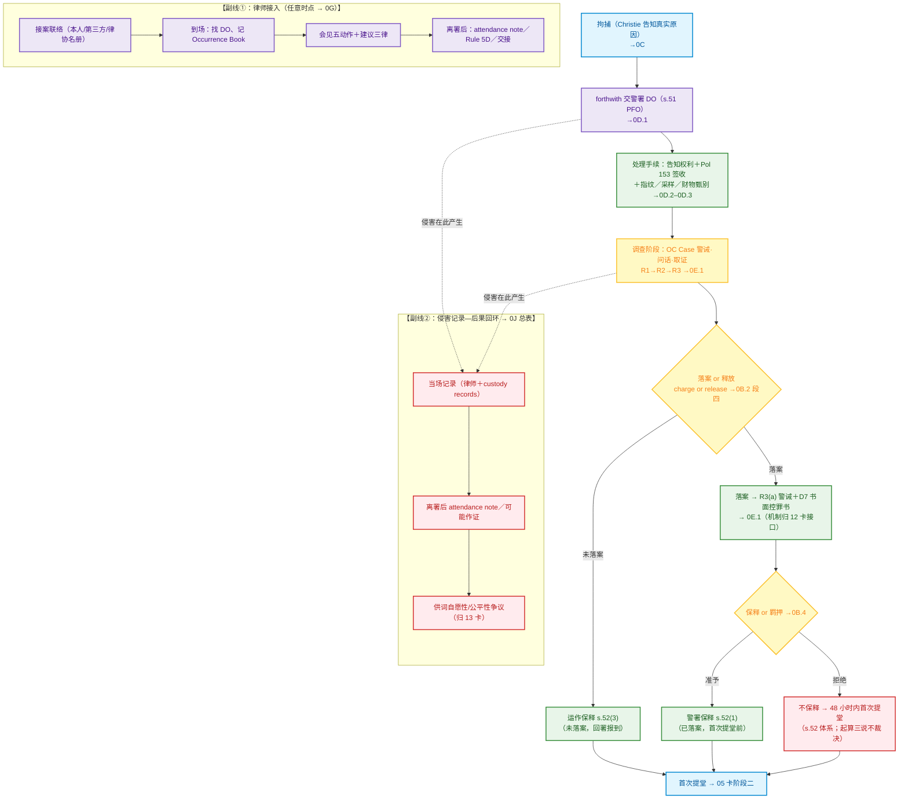
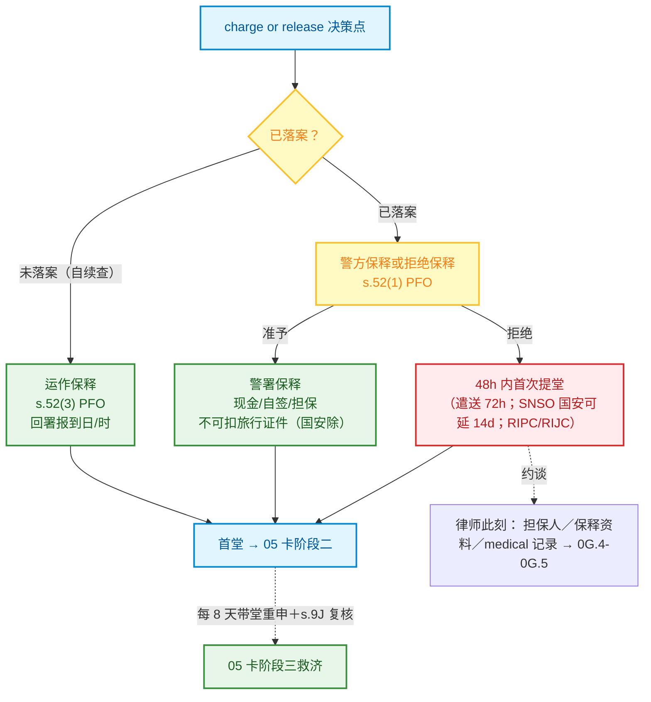

# 侦查阶段权利与辩护体系（Investigation Rights and Defence）

## 速读定位层

> 本层为 2026-10-10 深化重构新增的开篇导引；具体各层的规则、条件、例外与引注见下方 0B–0I（本轮深化）、§0A（既有）与 §1–§8（既有并实质化补强）。侦查阶段是**证据定型期**——在这个阶段被"做"掉的东西（供述、附录、医疗记录）和在警署没"做"的东西（记录、投诉、电话），在审讯阶段都补不回来。

> **白话导引（从头到尾一遍过）**：侦查阶段是证据定型期——客户此刻说的每句话、签的每个名、警方记或不记的每条记录，审讯阶段都补不回来。链条是这样走的：警方街头截停问话（还不算拘捕）→ 形成合理怀疑后正式拘捕，此时 *Christie* 五原则要求告知真实拘捕原因，漏了的可在警署合理期间内补知治愈（*Kulynycz*）→ 被捕人须 forthwith 送交独立于办案团队的值日官（DO，s.51 PFO），custody records 与 Occurrence Book 从此开始记 → 处理手续中口头告知权利并发放《在羁留人士通知书》（Pol 153）签收，拍照指纹与样本各按 s.59 系列条件 → OC Case 接管调查，问话按 R1→R2→R3 三阶触发：一有合理怀疑即须警诫，落案后原则上不得再问 → 全程客户握有沉默权与私下会见律师权（拒绝须有"不合理迟误或妨碍"的具体理由）→ 最后落案或释放：未落案走运作保释（s.52(3)），已落案走警署保释（s.52(1)），不保释则 48 小时内首次提堂。律师的位置贯穿全程：到场、被拒要理由并记簿、会见五动作、离署后 attendance note 与 Rule 5D——每一个记录动作都是日后供认争议与保释申请的弹药。对口规（1992 R&Ds）的条文细目与排除机制主述归 12 卡，本卡承侦查端触发与后果面。
>
### 适用范围

**覆盖（按程序时序）**——自接案联络／警方截查告知起，到首次提堂前的权利防线与辩护动作全链：
1. **被捕告知与边界（逮捕前告知）**：Christie 五原则＋讲义补充 (4)–(14) 八项（几项罪行只许以较重罪告知、治愈机制 *R v Kulynycz*、s.51 交值日官、48 小时、武力与手铐、指纹趾纹样本）〔CR2 L321 "Where arresting without a warrant, an officer must ordinarily"；CR2 L335 "it can be cured by informing the Defendant of the reasons for arrest at the police station"〕；
2. **警署接管**：值日官（DO）独立职能、custody records 与 Occurrence Book 的证据价值〔CR3 L80 "Throughout the detention, a detailed record is kept of the detainee’s movements"；CR3 L82 "The DO is an independent officer not involved in the investigation"〕；
3. **处理手续**：口头＋书面告知权利、Pol 153《在羁留人士通知书》发放签收、身体样本权力核对（s.59(1)(a) 无条件 vs s.59(1)(b) 有条件、s.59A 亲密样本被捕人有权拒绝、s.59C 非亲密样本可强制）〔CR3 L86 "A written copy of these rights"；CR2 L359 "sole-prints and toe-prints of that person if the officer has reason to believe"〕；
4. **讯问与记录义务**：R1–R3 三个阶段警诫与"so far as practicable"同步记录、PRCS 街头转书机制、R4/R5 录供三段式与宣读、录像替代同时记录——**对口规（1992 R&Ds）的细则、自愿性与排除测试主述归 12 卡 §5/§5.1**，本卡只承担"侦查端权利何时触发、被谁侵害、不留记录的后果"〔CR2 L411 "they must caution that suspect"；CR2 L441 "a contemporaneous written record of the interview must be kept"〕；
5. **会见／电话（律师与亲友）**：D8／Principle (c) 私下会见与在场讯问权、拒绝须有理据且不包含"律师会劝其沉默"〔CR2 L475 "This does not include the lawyer advising his client not to answer questions"〕；Pol 153 第 2/3 项通知与致电亲友；律师到访、被拒、要求记入 Occurrence Book、回所详记并可能出庭作证的完整链〔CR3 L146 "the lawyer’s testimony, and the attendance notes taken, may form part of the evidence at trial"；CAP-K2 L1795 "go to the duty officer and ask for your visit to be noted in the Occurrence Book"〕；
6. **福利（medicine／饮食／休息）**：D4 舒适与饮食、D1(b) 休息饮食记录、Pol 153 第 7 项饮水、第 8 项医疗、DO 安排政府医院〔CR3 L256 "ensure that the DO arranges to take the client to a government hospital"；SG01AN L297 "Pol 153 第 8 项"〕；
7. **保释过渡**：operational bail（s.52(3) PFO 未落案）→ police bail（s.52(1) PFO 已落案）→ 48 小时提堂 → RIPC／RIJC——**保释的制度本体（推定、拒保理由、条件、复核）主述归 05 Bail 卡**；本卡只承侦查端律师的保释信息收集、担保准备与"不超过 9D/9G 适用时点"边界〔CR2 L645 "This is bail for a person to come back to the police station at another date/time"；CR3 L102 "Until the detainee is brought before a Magistrate the provisions in sections 9D and 9G CPO"；CAP-K2 L2602 "if bail is denied by the police, then they have to bring the arrested person before the magistrate within 48 hours"〕；
8. **律师作业**：接案渠道、到场证件、被拒应对、OC Case 五问、会见五动作（Confirming–Obtaining–Advising–Reassuring–Securing）、离署后义务（attendance note 五件、Rule 5D 七日、医疗与投诉安排、讯问知会）、暗礁与"警署建议错误"的后果〔CR3 L194 "The client should be interviewed alone, and in private"；CR3 L262 "Every meeting should be evidenced and recorded"；CR3 L290 "within 7 days of instructions"〕；
9. **SG 应用**：SG01 Brief A（Fergus 截查拘捕剪刀案 Q1–Q6）与 Brief B（Tom 14 岁在羁留权利被侵害案 Q1–Q5）已过课堂，本卡为其查考补全入口与期末先例面〔SG01AN L74 "BRIEF A: FERGUS FAN"；SG01AN L248 "BRIEF B: TOM TANG"〕。

**不覆盖（边界声明，相关主卡承担）**：① 截停/拘捕/搜查权力的**警察权力本体**（s.54、s.50、s.50(6) 手机数码、公民拘捕、武力——→ 卡 11；本卡只在被侵害后果面回链）；② 1992 R&Ds **条文细目、适用对象、自愿性测试与排除机制**（→ 卡 12 §5/§5.1，含 Rules/Directions 全表；本卡只留侦查端触发点与后果接口）；③ 保释制度本体（→ 05 卡；保释增补并入 05 卡 §4.0／§5.3，2026-10-10）；④ 供认排除的 voir dire/Alternative Procedure 机制、披露与举证（→ 13 卡）；⑤ 检控决定、启动方式、时效与控罪修改（→ 卡 12 §1–§4）；⑥ 法院管辖与选址（→ 卡 10）；⑦ 国安与强制回答特殊制度（→ LGS9 体系，登记文末 open 块）。

### 术语（核心概念与实务运作定义）

| 术语（英文原词） | 核心概念与实务运作定义 | 出处 |
|---|---|---|
| 拘捕（arrest） | 警员明示拘捕、使用武力约束自由、或以言行表明必要时将以武力阻止离开，即构成拘捕；"截停查问不属拘捕"（Lord Devlin 于 *Chong Fook Kam*，终院在 *Yeung May Wan* 认可转引）。拘捕是启动全部羁留权利、警诫与送署义务的阈值事件。它与街头截查的区别在于是否实际剥夺离开自由。〔CR2 L198 "An arrest occurs when a police officer states in terms that he is arresting"〕 | *Yeung May Wan* (2005) 8 HKCFAR 137 |
| 告知真实原因（true ground of arrest） | 无令状拘捕时，警员通常须告知被捕人被捕的真实理由，不得暗藏真理由或给假理由；明知一般性质或不可行（如逃跑）时无须告知。告知义务的制度目的是让被捕人即时知悉羁留依据、有效行使法律意见权。它与事后补述的区别在于须在拘捕时或紧接其后作出。〔CR2 L321 "An officer cannot keep the true reasons to himself or give a reason that is not the true reason"〕 | *Christie v Leachinsky* [1947] AC 573 五原则 |
| 治愈违法拘捕（cure） | 初始违法的拘捕，可其后在警署、于被捕后合理期间内补告知原因而治愈。治愈的制度目的是在不推翻羁留的前提下补正程序瑕疵。它与排除证据的区别在于治愈修复拘捕本身、并不当然处理已取得证据的可采性。〔CR2 L335 "it can be cured by informing the Defendant of the reasons for arrest at the police station: R v Kulynycz"〕 | *R v Kulynycz* [1971] 1 QB 367 |
| 值日官（Duty Officer, DO） | 拘捕后，被捕人须 forthwith 被送交警署值日官（Duty Officer, DO）——独立于拘捕小队、管理羁仓与 custody records 的警署负责人，依据《警队条例》（Police Force Ordinance）s.51。DO 是被捕人投诉拘捕待遇的法定出口。它与 OC Case 的区别在于 DO 管羁留流程、OC Case 管调查取证。〔CR2 L343 "This is so that the Defendant has the opportunity to complain about the circumstances of his arrest to the DO"；CR3 L80 "The DO compiles the custody records"〕 | s.51 PFO |
| 羁留记录（custody records） | DO 在整个羁留期间就被留人于警署内的动向、访客、请求、律师陈述等所作的持续详记。记录的制度目的是把羁留过程客观化、供日后证据使用。它与 Occurrence Book 的区别在于 custody records 记被捕人个体、Occurrence Book 记警署事件。〔CR3 L80 "these records can be of value to a practitioner as they can be produced as evidence"〕 | LGS3 Part 1 |
| 事件簿（Occurrence Book） | 警署记录一切重要事件（含律师到访与被拒探访、投诉）的簿册，由值日级人员保管。律师应要求把自己的到访与被拒原因记入其中。它与 custody records 的区别在于 Occurrence Book 是警署级事件簿、非个案羁留簿。〔CR3 L136 "a note is made in the Occurrence Book"；CAP-K2 L1798 "The occurrence book is a record that the duty officer keeps of everything significant that happens"〕 | LGS3 Part 1；课堂字幕 |
| 在羁留人士通知书（Notice to Persons in Custody, Pol. 153） | 处理手续时须发给被捕人并须签收的书面权利书，D8(d) 义务要求是"实际给一份"，单靠警署墙上告示不足（*Leung Sai Tong*）。其制度目的是把权利告知实体化、可核查。它与口头警诫的区别在于 Pol 153 是书面权利清单、警诫是针对供词的口头警告。〔CR3 L86 "is given to the arrested person who is required to sign an acknowledgement of receipt"；OLD-LG02P1 L495 "It is not sufficient to rely on the Notices posted on the walls of the station"·往届仅参考〕 | D8(d) R&Ds；LGS3 附件 pol_153e.pdf（原件，未逐字核读，详 open O-T3） |
| 案件主管警长（OC Case, officer in charge） | 处理手续完成后接手调查的警员：负责警诫、问话、取供、取证、订控与保释倾向，是律师与警方对接的第一对象。其制度定位是侦查阶段的执行主官。它与 DO 的区别在于 OC Case 管调查、DO 管羁留行政。〔CR3 L92 "The investigation is undertaken by the OC Case"；CR3 L164 "the police position on bail or custody"〕 | LGS3 Part 1 |
| 警诫（caution） | 警员在 R2（一有合理怀疑即须）与 R3(a)（落案后）给予的口头警告："You are not obliged to say anything unless you wish to do so but whatever you say will be put into writing and may be given in evidence." 依据 1992 年 Rules & Directions for the Questioning of Suspects and the Taking of Statements（R&Ds）。其制度目的是在取供前固定沉默权告知。它与 Pol 153 的区别在于警诫针对供词、Pol 153 是综合权利书。〔CR1 L122 "When a Defendant is arrested by a police officer, by Rule 2 … he must be cautioned"〕 | R2/R3(a) R&Ds |
| 同步即时记录（contemporaneous record） | 警诫后问话或陈述须 "so far as is practicable" 即时记录时间、地点、在场人；街头被捕当场陈述例外，回署后作事后补录。其制度目的是保证记录与陈述同时形成、防止事后加工。它与 PRCS 的区别在于同步记录在现场作出、PRCS 回署后补写。〔CR2 L413 "the police must make a contemporaneous record of anything the cautioned person says"〕 | R2/R3(c) 及 D2/D3 R&Ds |
| 事后补录警诫陈述（Post-Recorded Caution Statement, PRCS） | 街头当场应答无须即时记录，警员回署后写出全文、由疑犯签署的陈述。其制度目的是处理无法现场记录的街头应答。它与同步记录的区别在于 PRCS 是回署补写、须经疑犯签署确认。〔CR2 L415 "This latter statement is called a Post-Recorded Caution Statement"〕 | R2 机制（讲义） |
| 会面记录（Record of Interview, ROI） | 问答式书面问讯记录，同时落入 R4（书面陈述）与 R5（问答式）规管：须再警诫、逐字不诱导、读回、给更正机会、末附真确声明——标准三段式即警诫、问答与声明。其制度目的是把问讯过程固定为可检验的书面证据。它与口头问话的区别在于 ROI 是正式书面记录、须符 R4/R5 全部规程。〔CR2 L445 "R4 applies since it is a “written statement” as does R5 since a ROI is in a Q&A format"；CR2 L443 "3 parts: a caution, the questions and answers, and the declaration"〕 | R4/R5 R&Ds |
| 录像会面（video recorded interview） | R5(b) 允许以录像代替同时书面记录（现今惯常做法）；辩方应索取副本。其制度目的是以影像完整固定问讯过程。它与书面 ROI 的区别在于录像记录全部非言语信息、但仍须符 R5 其余要求。〔CR2 L441 "except where the interview is video recorded which is routinely done these days"；CR3 L216 "copies of any video recorded interviews"〕 | R5(b) R&Ds；LGS3 Part 1 |
| 私下联络／会见律师权（right to communicate with a lawyer） | 侦查任何阶段，被捕人均可私下与律师通讯并可要求律师在场问讯，前提是不致对调查或司法行政造成不合理迟误或妨碍；拒绝须有理由且不包括"律师会劝客户保持沉默"一类理由。依据 D8 R&Ds 与《基本法》第 35 条。其制度目的是保障辩护权在侦查端的即时介入。它与庭审法律援助的区别在于此权在羁留期间即时生效、不待落案。〔CR2 L475 "communication can only be prevented or delayed if the officer has reasonable grounds"；CAP-K2 L1834 "the key point is they have to be able to justify why they are refusing access"〕 | D8 R&Ds；A.35 BL；*Mohammed v The State* |
| 沉默权（right to silence） | 被捕人无义务答问或提供入罪证据，并由 R1/R2 强化；被捕时保持沉默不得用作不利推断；例外有 OSCO ss.3/4、POBO s.14、NSL A.43(5) 等强制供讯条款。其根基是《香港人权法案》第 11(2)(g) 条与普通法。它与认罪权的区别在于沉默权是消极不作答、认罪是积极承认。〔CR2 L349 "no adverse inference can be drawn from the Defendant’s exercise of his right of silence"；CR1 L124 "such right may be abrogated"〕 | 普通法＋A.11(2)(g) HKBOR、As.39/87 BL |
| 警员电话与通知亲友（Pol 153 第 2/3 项） | 被捕人有权要求警方设法通知亲友并知结果、并获合理机会以电话与亲友联络；对应 D8(a)(i) 致电友人。其制度目的是维持被捕人与外界的最低联络。它与律师通讯权的区别在于此项面向亲友、律师通讯另有独立保障。〔SG01AN L302 "right to require the police to try to inform a relative or friend"；SG01AN L294 "should be allowed to speak on the telephone to his friends"〕 | Pol 153；D8(a)(i)（简化为律师文字见 CR2 L473） |
| 休息饮食记录（Direction 1(b)） | 须记录讯问、取供期间休息与给予饮食的时间（饮食性质亦应记载、不得提供酒精）。依据 1992 年 R&Ds Direction 1(b)。其制度目的是防止以疲劳或饥渴状态取得供词。它与 Direction 4 的区别在于 D1(b) 是记录义务、D4 是安排义务。〔CR2 L455 "a record should be kept of the times breaks and refreshments were given"；OLD-EXLG L767–L771 "Nature of the refreshment should be noted … In no circumstances should alcoholic drinks"·往届仅参考〕 | D1(b) R&Ds |
| 舒适与饮食安排（Direction 4） | 为受讯人作舒适与饮食的合理安排（座位与饮食义务，不含医疗——医疗在 Pol 153 第 8 项）。依据 D4 R&Ds。其制度目的是保障讯问环境的基本适当性。它与医疗安排的区别在于 D4 只及舒适饮食、医疗另由 Pol 153 第 8 项处理。〔CR2 L457 "reasonable arrangements should be made for the comfort and refreshment"；SG01AN L304 "Direction 4 only requires reasonable arrangements for the comfort and refreshment"〕 | D4 R&Ds；Pol 153 第 8 项 |
| 未成年在场（Direction 5） | "so far as practicable" 16 岁以下之讯问须父母／监护人在场；缺席时由非警员且与该少年同性者在场；义务非绝对，但 "一座士力架" 类案情难以主张不可行。依据 D5 R&Ds 与 *Fung Wing Ching*。其制度目的是保护未成年人的讯问程序。它与成人讯问的区别在于多一道适当成年人在场要求。〔CR2 L459 "So far as practicable, children and young persons under the age of 16 years"；SG01AN L294 "非警员、且与疑犯同性别"〕 | D5 R&Ds；*Fung Wing Ching* |
| 语言与签署（Direction 6） | 尽可能以母语问讯、以所用语言记录、另备认证英文译本并随原件认证、须签署；取得对方看不懂之另一语言文本的签署无证据价值。依据 D6(a)–(d) R&Ds。其制度目的是保证陈述内容被准确理解与确认。它与翻译陈述的区别在于 D6 要求认证译本、非任何译文均可。〔CR2 L469 "It is of no evidential value to obtain a signature to a document in another language that the Defendant cannot read"；CR2 L467 "a certified English translation should be produced"〕 | D6(a)–(d) R&Ds |
| 书面控罪通知（Direction 7） | 落案（无令状拘捕）后即给被捕人一份载明控罪的书面通知（以警诫文开头、简单语言并载精确罪行）；上庭后新控或先保释后补控各有处理。依据 D7 R&Ds（主述归 12 卡接口）。其制度目的是让被捕人即时知悉控罪内容。它与口头告知的区别在于 D7 是书面通知、须载精确罪行。〔OLD-EXLG L833 "D should forthwith be given a written notice containing a copy of the entry in the charge sheet"·往届仅参考；SG01AN L161 "Rule III(a)（落案警诫）与 Direction 7（书面控罪通知）"〕 | D7 R&Ds（主述归 12 卡接口） |
| 向律师面示他人陈述（Rule 6） | 落案后可给被捕人看同案他人陈述，但不得言或作为以邀其回应评论；其主动开口须立依 R3(a) 警诫；非宣誓同案犯庭外陈述不得用作针对另一被告之证据。依据 R6 R&Ds。其制度目的是在不污染证据的前提下让被捕人知悉案情。它与正式举证的区别在于 Rule 6 只允许"看"、不允许讨论或回应。〔CR2 L447 "nothing shall be said or done to invite any reply or comment"〕 | R6 R&Ds |
| 自愿性（voluntariness, Principle (e)） | 口供可否采纳的根本条件是自愿——不被有权之人以惧怕受屈或冀望得益或压迫所取得；是 R&Ds 中唯一具普通法效力的原则。依据 Principle (e) 与 *Ibrahim v R*。其制度目的是把口供的证明力建立在自愿基础上。它与程序违规的区别在于自愿性是证据可采性的根本门槛、程序违规只是因素。〔CR2 L407 "has not been obtained by fear of prejudice or hope of advantage"〕 | Principle (e)；*Ibrahim v R* |
| 运作保释（operational bail） | 未落案、警方尚在查期间，令被捕人另日回署报到的保释，依据《警队条例》s.52(3) PFO；调查不能 forthwith 完成时也可以担保（可附担保人）形式给予。其制度目的是让侦查在不羁押下继续。它与警署保释的区别在于运作保释在落案前、警署保释在落案后。〔CR2 L645 "This is bail for a person to come back to the police station at another date/time"〕 | s.52(3) PFO |
| 警署保释（police bail） | 已落案后警方可准或拒的保释，延续至首次提堂；条件通常为现金或自签担保（可以加担保人）；一般法下警方无权扣旅行证件。依据 s.52(1) PFO。其制度目的是在首次提堂前由侦查机关作初步保释判断。它与法庭保释的区别在于警署保释由警方决定。〔CR2 L647 "the police have no power to retain travel documents under the general law"〕 | s.52(1) PFO |
| 48 小时规则（48-hour rule） | 警方若不保释，须于拘捕后 48 小时（遣送离境 72 小时；国安 SNSO 可延至 14 天）带被捕人见裁判官；警署保释发出则不适用——起算点本届材料三说不裁决（详 0B.4 与 05 卡）。依据 s.52 PFO 体系。其制度目的是防止无限期羁留而不经司法审查。它与 8 天带堂的区别在于 48 小时针对未保释被捕人首次见堂、带堂针对已还押者的周期审查。〔CAP-K2 L2602 "if bail is denied by the police, then they have to bring the arrested person before the magistrate within 48 hours"；CAP-K2 L2613 "he doesn't need to be brought before the magistrate within 48 hours"〕 | s.52 PFO 体系；LGS1/LGS2/LGS3（三说并存） |
| 8 天带堂权（B/U, brought up） | 还押期间每次不得超过 8 天（除非控辩同意）；每 8 天带堂可重申保释，被告人可主动放弃。依据《裁判官条例》（Magistrates Ordinance）s.79。其制度目的是保持羁押状态的周期性司法审查。它与 48 小时规则的区别在于带堂适用于已落案还押者、48 小时适用于未保释被捕人。〔CR2 L821 "must be “brought up” (abbreviated on court forms to “B/U”) every 8 days"〕 | s.79 MO（主述归 05 卡） |
| 顺延保释（B.E.S.T） | 警方或另一裁判官已准保释、控方不反对且辩方无意变更条件时，可直接申请"按相同条件顺延"；警署现金保释可转作法庭现金保释。其制度目的是让无争议案件不消耗实质保释聆讯。它与新申请的区别在于 B.E.S.T. 沿用原条件、不重新争议。〔CR2 L823 "ask for “Bail to be Extended on the Same Terms.”"；OLD-LG02P3 L242 "ask for “Bail to be Extended on the Same Terms.”"·往届仅参考〕 | 实务口径（主述归 05 卡） |
| 会见记录信（attendance note） | 每次会面后律师即作的完整记录：客户案情要点（客户口诉与警方口诉分列）、所给建议、律师观感、文件归档、下一步动作；可与律师证词一并成审讯证据。依据 LGS3 Part 1。其制度目的是把会见内容固定为可出示的证据。它与记忆性记录的区别在于 attendance note 是当场完整记录、非事后凭记忆补写。〔CR3 L262 "Every meeting should be evidenced and recorded by the making of a full attendance note"；CR3 L146 "the lawyer’s testimony, and the attendance notes taken, may form part of the evidence at trial"〕 | LGS3 Part 1 |
| 聘用确认（retainer letter, Rule 5D SPR） | 受聘后 7 日内须发的聘用确认函。依据《认许规则》（Solicitors Practice Rules）Rule 5D。其制度目的是把委托关系书面化、明确收费与权限。它与口头委托的区别在于 retainer letter 是 7 日内的强制书面确认。〔CR3 L290 "A retainer letter is required to be sent within 7 days of instructions (see Rule 5D SPR)"〕 | Rule 5D SPR |
| 投诉警察课（Complaints Against Police Office, CAPO） | 警方行为（包括侵害在羁留权利）的外部投诉渠道之一；另有民事索偿、刑事告诉、内部纪律。依据讲义列明。其制度目的是给被捕人独立于警方的救济出口。它与内部投诉的区别在于 CAPO 是独立于被投诉警队的外部机构。〔CR2 L391 "The Defendant may complain to the Complaints Against Police Office"〕 | 讲义列明 |

### 环节定位（按程序时序）

| 环节（时序） | 它解决的具体问题 | 依据 |
|---|---|---|
| 截停→拘捕（街头） | 此刻客户是被截问还是被拘：拘捕是约束自由的事实动作；先定性才有其后一切权利链的起点（截问不算拘捕）〔CR2 L198 "It does not occur when he stops an individual to make inquiries."〕 | *Yeung May Wan* |
| 告知原因（逮捕时） | 让客户知道"我为何被捕"并据此决定是否行使沉默／需要律师——防止"以轻罪名套问出重罪"〔CR2 L337 "It is unlawful and unfair to arrest and question only in relation to the less serious offence"〕 | *Christie*；A.5(2) |
| 治愈（回警署） | 未当场告知的拘捕未必永久违法：合理期间内补告知可治愈，故时刻表要分清"当场失格"与"事后治愈"〔CR2 L335 "at the police station: R v Kulynycz"〕 | *Kulynycz* |
| forthwith 交 DO | 把被捕人立即暴露给独立于拘捕小队的负责人，给投诉拘捕待遇一个制度出口、防拘捕队独断〔CR3 L82 "The DO is an independent officer not involved in the investigation of the offence"〕 | s.51 PFO |
| 处理手续＋Pol 153 | 权利不是"应该知道"而是"被正式告知并签收"：把告知义务实体化、可核对，同时给警方一张证明"客户知情"的签字单〔CR3 L86 "is required to sign an acknowledgement of receipt"；OLD-EXLG L939 "as evidence that police told the suspect the rights and he understand the right"·往届仅参考〕 | D8(d)；LGS3 P1 |
| 讯前福利（休息饮食药物） | 断供、疲劳、伤痛、口渴、未就医是口供自愿性与公平性的主要攻击点来源；先有记录义务才有后日主张的弹药〔CR2 L455 "a record should be kept of the times breaks and refreshments"〕 | D4/D1(b)；Pol 153 7/8 |
| 讯问（R1→R2→R3） | 决定"此刻能不能问、要不要先警诫、其答案还能不能用"——触发点不是拘捕形式而是怀疑形成〔CR2 L411 "as soon as police officers have reasonable grounds"；CAP-K2 L1291 "he couldn't make an informed decision about his right of silence"〕 | R&Ds |
| 会见／电话（律师与亲友） | 打破信息孤岛：客户获法律建议才谈得上有意义的知情选择；警方拒绝须有"不合理迟误或妨碍"的具体理由且须能交代〔CR2 L479 "access can be excluded in certain circumstances: Mohammed v. The State"；CAP-K2 L1834 "they have to be able to justify"〕 | D8(c)、Principle (c)、Pol 153 2/3 |
| 录供（R4/R5/D6；可录像） | 把"供"变成可检验的文件：逐字、宣读、更正、签署、译本五项缺一都可能致命——尤其看不懂的文字上的签名〔CR2 L469 "It is of no evidential value to obtain a signature to a document in another language"〕 | R4/R5/D6 R&Ds |
| 落案（charge or release） | 讯问窗口大幅关阀（R3 例外外不得再问）；落案后即刻 48 小时闸门起动，D7 书面控罪＋R3(a) 警诫必须跟上〔CR3 L98 "Upon charging no further questions can be put to the detainee"〕 | R III/D7；s.75 MO 体系（归 12 卡） |
| 保释 or 羁押 | 自由路径分三岔：未落案运作保释／已落案警署保释／不保释则 48 小时见裁判官——客户此刻立刻需要可执行的担保与条件准备〔CR2 L645 "Operational: s.52(3) PFO (where no charges have yet been laid"；CR3 L100–L102 "The final decision will concern whether the detainee is kept in custody or granted bail"〕 | s.52 PFO → 05 卡 |
| 律师到署与访问 | 第三方委托下谁会见、何时见、怎么被拒怎么办、和警方说什么——关系处理与权利守护并重〔CR3 L152 "Nothing will be gained by being abrasive and hostile"；CR3 L144 "defend the right of a detained person to have access to a legal representative"〕 | LGS3 Part 1 |
| 会见（五动作） | 在有限时间内先福利、再已说已签、再指控与文件、再私密取指示、再保释信息——完整辩护 proof 留后〔CR3 L218 "full details of the client’s defence should be left till later"〕 | LGS3 Part 1 |
| 离署后义务 | 把当天做过的变成证据与档案：attendance note、医疗与投诉安排、知会讯问方"客户不答问"、Rule 5D 七日函、担保人与大律师安排、次会地点转到裁判法院羁仓〔CR3 L254 "the report should be made to the DO before you leave the police station"；CR3 L280 "a bail application will be made to a Magistrate within 24 hours"〕 | LGS3 Part 1 |


## 🗺️ 本卡地图

> 本卡按"程序时序"排章：主线自上而下顺读即流程。0A 为侦查端动作分解与警权边界接口层（动作本体主述归卡 11）；0B–0G 为深节；0J 后果总表与 0K SG 应用收尾。README 与 Structure Map 均锚定 0A 节标题，故 0A 标题与位置不改（2026-10-10 既定；本轮沿用）。
>
> **图 1 审查逻辑总括**：法庭（及其后的证据争议庭）在本卡制度中依次审查——拘捕时告知是否真实完整（*Christie*／治愈）；送交 DO 是否 forthwith；权利告知与 Pol 153 是否实际交付签收；采样是否在 s.59 授权框架内；警诫是否在客观怀疑形成时即时作出（*Chiu Wing Kai*）；录供五金与语言线是否齐备；会见权拒绝有否具实理由；最后落到自由路径（保释或 48 小时提堂）。辩方每一步的记录动作，都是在为这架审查阶梯预存证据。


**图后依据（逐项）**：拘捕告知〔CR2 L321 "an officer must ordinarily inform the arrested person of the true ground of arrest"〕；forthwith 交 DO 与其独立职能〔CR2 L343 "This is so that the Defendant has the opportunity to complain about the circumstances of his arrest to the DO"；CR3 L82 "independent officer not involved in the investigation"〕；处理手续内容与 Pol 153 签收〔CR3 L86 "is given to the arrested person who is required to sign an acknowledgement of receipt"〕；OC Case 接管调查及其动作〔CR3 L92 "This involves cautioning, interviewing, taking statements, collection of forensic samples"〕；charge or release 段〔CR3 L96 "A person can be released without charge on police bail but required to return to the police station"〕；保释或羁押段〔CR3 L100–L102 "Bail may be granted by the police if the charge is not serious"；CAP-K2 L2602 "if bail is denied by the police, then they have to bring the arrested person before the magistrate within 48 hours"〕；未提堂前 s.9D/9G CPO 不适用〔CR3 L102 "Until the detainee is brought before a Magistrate the provisions in sections 9D and 9G CPO (Cap, 221) do not apply"〕。


<!-- BEGIN:cite-legend -->
> [!info]- 引注图例
>
> | 码 | 文件 | 层级 | 学年 |
> |---|---|---|---|
> | CR1 | LGS1 法院与检控 | 本届讲义 | 2026-27 |
> | CR2 | LGS2 侦查启动及保释修订讲义 | 本届讲义 | 2026-27 |
> | CR3 | LGS3 法律探访控罪移交 | 本届讲义 | 2026-27 |
> | CAP-K2 | PCLL8050 LGS2 PT | 本届讲义 | 2026-27 |
> | WK2 | PCLL8050 LGS2本届修订讲义 | 本届讲义 | 2026-27 |
> | CAP-K1 | PCLL8050 LGS1 PT | 本届讲义 | 2026-27 |
> | OLD-LG01P1 | 往届（2025-26）LG1 Part One 编辑版（被告权利·检控义务·DLS/法援） | 往届官方 | 2025-26 |
> | OLD-LG02P1 | 往届（2025-26）LG2 Part 1 编辑版（侦查·被捕人权利·1992 R&Ds） | 往届官方 | 2025-26 |
> | OLD-LG02P3 | 往届（2025-26）LG2 Part 3（保释；课程编号入 2025 诸卷） | 往届官方 | 2025-26 |
> | OLD-EXLG | 往届学生稿·Set 3「LG Notes」（8962 行·非官方） | 往届学生稿 | 2025-26 |
> | LGS6 | 本届 LGS 6 Notes（审讯过程与举证框架） | 本届讲义 | 2026-27 |
> | SG01AN | 本届 SG01 Brief A Q1–Q6 与 Brief B Q1–Q5 与 Questions C–D 完整答案 | 凝结层 | 2026-27 |


> | SG3CAP | SG03 课堂录音整理稿（2026-10-14 Otter） | 本届课堂 | 2026-27 |
<!-- END:cite-legend -->

| 你现在要做什么 | 直达章节 |
|---|---|
| 30 秒弄清范围/术语/每环任务 | [速读定位层](#速读定位层) |
| 客户刚被捕，问"警方能对我做什么" | [0C 被捕告知](#0c-被捕告知与治愈christie-五原则几项罪行边界与警署补知)＋0D.3 样本 |
| 客户问"我要不要说话／要不要沉默" | [0F 沉默权与知情决定](#0f-沉默权与知情决定弃权前的最后防线) |
| 你要去警署见客户 | [0G 律师警署 playbook](#0g-律师警署-playbook到场被拒五动作与离署后义务) |
| 客户被迟保释／被拒会见／未获医疗 | [0J 后果链总表](#0j-环节--不做或侵害--依据-后果链总表索引) 行 6–8·行 13 |
| 录像会面／ROI 副本有没有拿到 | [0E.2 录供与副本](#0e-讯问与记录义务r1r6-触发同步记录五金与录像副本)＋0J 行 14 |
| 想知道"某环不做会怎样" | [0J 后果链总表](#0j-环节--不做或侵害--依据-后果链总表索引)（正文 10 处点题回链） |
| 准备期末复习（先例面） | [0K SG 应用](#0k-sg-应用sg01-brief-ab-锚点)→ [0K.1 Brief A/B 映射](#0k1-sg01-brief-ab-逐题映射已过作为先例面)＋05 卡 |
| 核对保释边界 | [0B.4 获自由路径分支](#0b4-获自由路径分支三岔48-小时与保释过渡边界)＋05 卡 |
| 学理复盘（五原则） | [1 第一性](#1-第一性原理) → [2 顺向](#2-顺向推进) → [4 控制](#4-办案流程控制与关键节点核查) → [5 横向](#5-横向程序联动与机制衔接) → [6 逆向](#6-目标倒推与实务应对策略) |

## 0B. 侦查阶段总框架：从拘捕到首次提堂的警署状态机

### 0B.1 全景状态机

全景状态机已升为本卡 **图 1**（见🗺️ 本卡地图，图后逐项依据随图）。

### 0B.2 五段程序与律师各时点的可做事项

| 程序段 | 本段在做什么（官方说法） | 律师在此时的关键动作 |
|---|---|---|
| 交付（Delivery to the police station） | 拘捕后 "delivered forthwith to the police officer in charge of the police station"（s.51 PFO）〔CR3 L78 "Following arrest, a person should be “delivered forthwith to the police officer in charge of the police station” (s.51 PFO). In reality, the arrested"〕 | 记拘捕时间、抵署时间差；往届学生稿提示（非官方、仅参考）："long gap"本身就是日后主张的素材〔OLD-EXLG L909 "Potential issue if long gap between time of arrest and arrival"·往届仅参考〕 |
| 处理（Processing） | 口头告知权利＋给书面 Pol 153＋签收；另作 identification、指纹、拍照、测量；DO 记录被留人财物；脱衣搜查与亲密样本须另证理由与许可〔CR3 L86 "Processing involves verbally informing the arrested person of his/her rights. A written copy of these rights, “Notice to Persons in Custody” is given to"〕 | 核客户是否**实际拿到** Pol 153；把签收与未签收分别记入 attendance note〔CR3 L86 "The officer in charge of the case (OC Case) retains the original as an exhibit."〕 |
| 调查（Investigation stage） | OC Case 接手：警诫、问话、取供、取法医样本、认人组等〔CR3 L92 "Once the processing is complete, the investigation stage begins. The investigation is undertaken by the OC Case. This involves cautioning, interviewing, taking statements, collection"〕 | 与 OC Case 建工作关系但只效忠客户；核警方拟采取的动作（含认人组、样本），为 R1–R3 各阶段留标记〔CR3 L152 "Nothing will be gained by being abrasive and hostile"〕 |
| 落案或释放（Charge or release） | 调查完成或未完的释放决定；落案论罪订罪、可查 DOJ 意见、有些罪须 SJ 同意〔CR3 L96 "Following investigation, a decision will be made to charge or release the detainee. A person can be released without charge on police bail but"〕 | 核 charge sheet 词句；D7 书面控罪书是否给；落案后不得再问（R3 例外外）——自此刻起保护客户不再被回取口供〔CR3 L98 "Upon charging no further questions can be put to the detainee"〕 |
| 保释或羁押（Bail or custody） | 警方可准保释（不严重者）或带见裁判官；未提堂前 s.9D/9G CPO 不适用〔CR3 L100 "Bail or custody The final decision will concern whether the detainee is kept in custody or granted bail. Bail may be granted by the"〕 | 当场收集保释信息、讨论现金保释额、安排担保人；为客户解释 24/48 小时流程〔CR3 L220 "if bail (police bail) is not to be granted, then information needed for any bail application"〕 |

### 0B.3 侦查段七类记录物件：谁产生、辩方要什么

| 记录物件 | 产生者／时点 | 辩方想要的核对点 | 依据 |
|---|---|---|---|
| custody records | DO，整个羁留期〔CR3 L80 "Throughout the detention, a detailed record is kept"〕 | 到署时间、会话时间、请求与回应；日后可以作证据出示〔CR3 L80 "In reality, the arrested person is brought before the Duty Officer (DO) who is informed of the reasons for his arrest, makes a note"〕 | LGS3 Part 1 |
| Occurrence Book | 值日级人员保管；律师到访与被拒即属其中事件〔CR3 L136 "If there is no objection, a note is made in the Occurrence Book (this book records events that take place at the police station)"；CAP-K2 L1798 "The occurrence book is a record that the duty officer keeps of everything significant that happens."〕 | 律师到场时刻、被拒原因原文；往届学生稿建议要求复印或拍照〔OLD-EXLG L1077 "Try to make a copy of it: photocopy/ take a photo with your phone"·往届仅参考〕 | LGS3 Part 1＋字幕 |
| Pol 153（签收本） | 处理手续时发放；OC Case 留正本作 exhibit〔CR3 L86 "Processing involves verbally informing the arrested person of his/her rights. A written copy of these rights, “Notice to Persons in Custody” is given to"〕 | 往届编辑版讲义强调是否**实际给**（墙上告示不足）；签收与否〔OLD-LG02P1 L495 "must be actually given a copy of the Pol. 153 before being interviewed"·往届仅参考〕 | D8(d)；*Leung Sai Tong* |
| PRCS | 警员回署后自街头应答书写，疑犯签署〔CR2 L415 "Note: there is no need to make a contemporaneous record when the person is being arrested on the street. The officer will make a"〕 | 签署前是否宣读、街答当真的原话者是谁〔CR2 L413 "Any subsequent questioning once the caution should have been given violates R2. The required caution in these circumstances is set out in R2. Note"〕 | R2 机制 |
| ROI／书面陈述 | 问讯警员，R4/R5 双规管〔CR2 L433 "Rules 4 and 5: These rules describe how statements must be taken. R4 refers to the “essay” type of statement where the detained person"〕 | 逐字、宣读、更正、签署、声明五金；看不懂之文字上的签署效力〔CR2 L469 "(d) the statement should be signed. It is of no evidential value to obtain a signature to a document in another language that the"〕（机制归 12 卡） | R4/R5/D6 |
| 录像会面 | 惯常做法取代同步书面记录〔CR2 L441 "R5(b) states that a contemporaneous written record of the interview must be kept (except where the interview is video recorded which is routinely done"〕 | 副本索取：属于 LGS3 明确项〔CR3 L216 "copies of any video recorded interviews"〕 | R5(b)；LGS3 Part 1 |
| 律师 attendance note | 律师离署后即作〔CR3 L262 "Every meeting should be evidenced and recorded by the making of a full attendance note setting out: A summary of the facts of the"〕 | 来源／确切指示／所给建议／观感／下一步；与律师证词一并可成审讯证据〔CR3 L146 "Access is usually not denied indefinitely (What is the ultimate remedy if refused entry to client?) but any delay can be crucial, especially where"〕 | LGS3 Part 1 |

### 0B.4 获自由路径分支：三岔、48 小时与保释过渡边界


**分支依据与三说不裁决**：
- **运作保释**（s.52(3) PFO）：未落案自续查；调查未能 forthwith 完成时亦可担保形式（可附担保人）〔CR2 L645 "Operational: s.52(3) PFO (where no charges have yet been laid, i.e. the police are still investigating. This is bail for a person to come"〕。
- **警署保释**（s.52(1) PFO）：已落案；准/拒延至**首次提堂**；常条件为现金或自签（可附担保人）；**一般法下不可扣旅行证件**（NSL 案更严格——可用旅行证件限制离港〔CAP-K2 L2659 "But the police cannot take away his travel documents."〕）〔CR2 L647 "Police bail: s.52(1) PFO (where the Defendant has been charged, the police may grant or refuse bail until the Defendant’s first court appearance.) Note"〕。ICAC 与入境主任各另有保释权〔CR2 L649 "Note the ICAC also has power to grant bail: s. 10A ICACO; as well as an immigration officer under s. 36 of Immigration Ordinance,"〕。
- **48 小时**：近年本届三处材料三说——甲（拘捕起）：CR2 L347；乙（落案后起，且 SNSO 下可延 14 天）：CR1 L234；丙（条文本身仅 "as soon as practicable"，实务约 24h 落案/48h 拘捕）：CR3 L102＋L240；**三说不裁决**，主体登记在 05 卡 §2.2 Gate 1 与 12 卡 §3.1 ；字幕口径（含警方保释则不适用 48h）〔CAP-K2 L2602 "You know that this is when if bail is denied by the police, then they have to bring the arrested person before the magistrate"〕。
- **未提堂前 s.9D/9G CPO 不适用**：保释推定闸门起算在"首次带见裁判官"之后〔CR3 L102 "The final decision will concern whether the detainee is kept in custody or granted bail. Bail may be granted by the police if the"〕；被还押则 RIPC/RIJC 两状态〔CR2 L775 "If bail is not granted, the Defendant is remanded in either police custody (R.I.P.C) or jail custody (R.I.J.C). Question: Would the Defendant usually prefer"〕；少年另走 JOO ss.4–6（包括 16 岁以下拘捕者由家长/监护人/负责人担保、三例外、被拒后与成年人**分开**看押）〔CR2 L845 "Bail for Juveniles Under s.4 JOO, where a person under 16 is arrested and cannot be brought before the Juvenile Court immediately, then the"〕。
- **边界声明**：拒保后的保释复核机制（8 天带堂 s.79 MO、s.9J CFI、s.9H SJ、B.E.S.T、条件包）**主述全部归 05 卡 §3–§6；保释增补与讼辩雷区归 05 卡（原 16 增补并入主卡，2026-10-10，备份 `_workspace/backup-2026-10-10-8050-condensation/`）**；本卡只承侦查端律师此刻该做的信息与记录准备（0G.4 Obtaining ⑦与 0G.5.3）。


> 义务链：**一般原则：被捕时必须知道为何被捕 → Christie 五原则 → 派出所补告知可治愈 → 例外（明知/不可行/无技术措辞要求）→ 几项罪行不得"以较轻套问"**。宪法底子：A.5(2) HKBOR（被捕时告知原因、随即被告知被控罪名）〔CR2 L315 "an arrested person shall be informed, at the time of arrest, of the reasons for his arrest"〕，A.28 BL（不受任意或非法拘捕、拘留或监禁）〔CR2 L222 "No Hong Kong resident shall be subjected to arbitrary or unlawful arrest, detention or imprisonment."〕。

### 0B.5 警权触发面核对表：先定动作、再找依据

把要求出示身份证、暂时截停、正式拘捕、搜身、进入处所、检取物件、读取手机及问话逐个分开。前一步合法，不会自动使后一步都合法；没有令状，也不能直接得出全部动作无权作出。〔CR2 L120–L138 "The powers of police in Hong Kong are to be"〕〔CR2 L196 "The power to arrest exists both at common law and"〕

| 动作 | 需要查明的事实 | 法律分析落点 |
|---|---|---|
| 截停 | 地点、当时表现、警员实际根据、停留多久 | s.54两种门槛和合理时间 |
| 拘捕 | 是否明确限制离开、涉嫌何罪、当时掌握什么 | 拘捕事实及合理怀疑，令状/无令状来源 |
| 搜查处所 | 为找人还是找证据、是否要求准入、是否持令状/同意 | s.50相关分项或独立令状/同意 |
| 搜查手机 | 只是检取手机还是读取内容、同意目的、能否及时取令状 | Sham Wing Kan的比例、目的、范围及记录 |
| 问话 | 当时调查阶段、何时已有合理怀疑、是否已经控罪 | R1、R2、R3不同警诫及问话限制 |

这张表把所需事实与具体权力对应，不是让客户先证明警方违法。〔CR2 L144–L184 "S.54(1) relates to any person acting suspiciously. By s. 54(1):"〕〔CR2 L198–L218 "What is an arrest? See Yeung May Wan & Ors"〕〔CR2 L247–L279 "(a) Search of Premises on Arrest without a Warrant: ss."〕〔CR2 L409–L429 "Rule 1 - At the initial stage of their investigation,"〕

### 0B.6 街头权力触发面：s.54 截停查问与搜查检取的边界

s.54(1)围绕在街道、公众地方、船只或交通工具上表现可疑者，可要求身份证、合理时间查询，并在认为必要时搜查危险物。s.54(2)围绕合理怀疑已犯、意图犯或将犯某罪，可查与该罪调查有价值的物件。〔CR2 L144–L174 "S.54(1) relates to any person acting suspiciously. By s. 54(1):"〕

讲义把前者称主观判断，随即用Wong Tze Yam限定：仍须考虑时间、地点、现场及行为等客观事实。不能截取“subjective”就说警员一句直觉足够，也不能把危险物的搜查范围改成所有有调查价值物件。〔CR2 L178–L184 "The reason for stopping the suspect – subjectively acting suspiciously"〕

**自拟例子**：同样是摸查背包，若权力依据只为移除危险物，翻查与安全无关的文件内容需另找法律基础。具体是否越界取决于实际范围与当时事实，不能仅凭结果找到违法物便倒推初始权力有效。〔CR2 L158–L180 "if the officer considers it necessary, he can search the"〕

为拘捕而进入处所、紧迫情况下依法强行进入、合法拘捕后的附带搜查、持令状搜查及同意搜查，分别核对。s.50(6)关于人身及拘捕地点附近物件的调查价值，不是一张搜查所有地方及所有数字内容的通行证。〔CR2 L247–L259 "(a) Search of Premises on Arrest without a Warrant: ss."〕

**手机内容特别处理**：Sham Wing Kan要求区分实物检取和数字内容；无令状附带搜查须与合法拘捕真正有关，在不切实可行先取令状时，有立即搜查以调查/保存证据或保护安全的合理基础。详细检查限有关内容，并作目的和范围的书面记录；讲义还说明不可强迫提供密码。〔CR2 L261–L275 "Note: to what extent does s.50(6) allow officers to search"〕

**有限同意不等于全面同意**：本届修订讲义引Chan Ka Lok，配合controlled delivery而给手机/密码，并不当然同意警方扩大搜寻先前信息；后来令状不能在该案追溯补救已经存在的不公平。这是基于该案同意与取证经过，不能扩张成所有后取令状均无效。〔CR2 L279 "In the recent case of HKSAR v. Chan Ka Lok"〕

### 0B.7 羁押时间台账与证据救济接口

记录拘捕、抵警署、每次问话、律师要求、控罪及提堂时间。s.51要求交警署负责人员；s.52的实际提堂问题须查“as soon as practicable”等适用文字及羁押状态，不能只把讲义48小时摘要当警方可自由用尽48小时的许可。〔CR2 L343–L347 "(10) Once arrested, the arrested person must be delivered forthwith"〕〔CR3 L102 "The final decision will concern whether the detainee is kept"〕

不合R&D不自动导致排除：逐次供认分析自愿性、威吓/诱因/压迫和程序违反的严重性及公平影响。违法拘捕、未及时警诫和某次口供不自愿应分别提出，不能把整案所有证据一口气称“毒树之果”。〔CR2 L397–L407 "Note: Merely breaching the R&D doesn’t necessarily mean the confession"〕

## 0C. 被捕告知与治愈：Christie 五原则、几项罪行边界与警署补知

### 0C.1 Christie v Leachinsky 五原则逐条与讲义结论

| # | 原则 | 实务落点 | 引注 |
|---|---|---|---|
| (i) | 无令状拘捕时通常须告知被捕人**真实**的拘捕理由；不得自己藏着真理由，亦不得给假理由 | 只问"警员当时说了什么"，不用 charge sheet 后来所载倒推〔CAP-K2 L1252 "then that is not informing them of the true reasons for the arrest."〕 | 〔CR2 L321 "(i) Where arresting without a warrant, an officer must ordinarily inform the arrested person of the true ground of arrest. An officer cannot keep"〕 |
| (ii) | 未被告知而被拘：警员负**非法拘禁**责任 | false imprisonment 的民事入口；拘捕违法见 0C.2 后果分架 | 〔CR2 L323 "If the citizen is not informed but is detained, the officer is liable for false imprisonment"〕 |
| (iii) | 情形使被捕人必然知道被拘一般性质者，无须再告知 | "须知悉一般性质"的例外——本案级判断，不泛化；往届学生稿概括该例外〔OLD-EXLG L588 "must know the general nature of the offence for which he is detained"·往届仅参考〕 | 〔CR2 L325 "(iii) The requirement to inform of the reasons for arrest does not exist if the circumstances are such that the arrested person must know"〕 |
| (iv) | 告知无须技术或精确措辞 | "You don't need to use the words, I am arresting you for an offense under section ten of the theft ordinance"〔CAP-K2 L1264 "You don't need to use the words, I am arresting you for an offense under section ten of the theft ordinance,"〕 | 〔CR2 L327 "(iv) In informing the arrested person of the reasons for his arrest, there is no need for technical or precise language to be used;"〕 |
| (v) | 被捕人使告知**不可行**（如逃跑）者，无须告知；其他可行情形不排除 | 例外应按实际情形核；市民拘捕同原则（0C.3）〔CR2 L329 "(v) There is no need to inform of the reasons where the arrested person makes it impracticable to do so e.g. by running away."〕 | 〔CR2 L329 "(v) There is no need to inform of the reasons where the arrested person makes it impracticable to do so e.g. by running away."〕 |

讲义补号三则：事实结论————须告知**哪个罪**＋支持拘捕的一般条件；被捕后**合理期间内**告知即属满足【(5)】；原则同样适用于**市民拘捕**【(4)】〔CR2 L331 "The Defendant must be told which offence he is being arrested for and the general conditions which justify the arrest"；CR2 L333 "satisfied if done so within a reasonable period after the arrest"〕。

### 0C.2 治愈、几项罪行边界与违法拘捕的后果分架

| 事项 | 规则 | 依据 |
|---|---|---|
| 治愈（cure） | 初始违法的拘捕，其后在警署于合理期间内被告知原因，即被治愈〔CAP-K2 L1270 "it can be cured later back at the police station"〕 | *R v Kulynycz* [1971] 1 QB 367〔CR2 L335 "(6) Where an arrest is originally unlawful, it can be cured by informing the Defendant of the reasons for arrest at the police station:"〕 |
| 几项罪行边界 | 可对几项罪有拘捕嫌疑时，**只以轻罪拘捕问话、待问出入罪回答后才告知更重者**，属不合法亦不公平；应即就该较重罪落案、或告知实际调查性质令其决定是否需要法律代表 | 〔CR2 L337 "(7) Where the Defendant could be arrested for several offences, it is unlawful and unfair to arrest and question only in relation to the"〕；知情决定详 0F |
| 违反 Christie 的通常代价 | 口供因**不公平**被排除（preamble to the R&Ds；*R v Kirk* [2000] 1 WLR 576）——套路：违法的告知／未警诫造成的"压迫气候"〔CR2 L339 "(8) Failure to comply with these principles would usually lead to confessions being excluded due to unfairness: see the preamble to the R&Ds and"〕 | 〔CR2 L339 "(8) Failure to comply with these principles would usually lead to confessions being excluded due to unfairness: see the preamble to the R&Ds and"〕 |
| 违法拘捕 ≠ 自动无罪 | 法院对实体控罪仍有管辖；但若罪行**要素**含警员依法执行职务（如袭警类），违法则影响该要件（*Yeung May-Wan* 攧案：s.36(b) OAPO 与 s.63 PFO 定罪被攧销） | 〔CR2 L220 "the police officers could not be “acting in due execution of their duties”"；CR2 L341 "(9) If the arrest is unlawful, the courts still have jurisdiction over the charge but an unlawful arrest may create a climate of oppression"〕 |
| 违法拘捕的交叉后果 | 警员可被追袭击等刑责；D 可诉袭击、侵越等民事索偿；CAPO 投诉；内部纪律；口供可因压迫气候不获采纳〔CR2 L341 "(9) If the arrest is unlawful, the courts still have jurisdiction over the charge but an unlawful arrest may create a climate of oppression"〕；另可个性化按 "if the arrest is unlawful, the courts still have jurisdiction, but there may be other matters which result evidence may be inadmissible"〔CAP-K2 L1303 "So it doesn't. If the arrest is unlawful, the courts still have jurisdiction,"〕 | 〔CR2 L341 "(9) If the arrest is unlawful, the courts still have jurisdiction over the charge but an unlawful arrest may create a climate of oppression"；CAP-K2 L1303 "So it doesn't. If the arrest is unlawful, the courts still have jurisdiction,"〕 |

**执法提示（实务推演）**：把"我方警员当场说什么／未说什么／何时补说"的第一手版本与事后 charge sheet 分开建档——"以较轻罪名义套问"（tricked into thinking that you're arresting them for something minor when actually you know that they're guilty of something more serious）一旦被坐实，拘捕即违法并直接连到 false imprisonment〔CAP-K2 L1255 "So you can't trick them into thinking that you're arresting them for something"〕。

### 0C.3 例外、边界与市民拘捕的同适用

- **明知一般性质与不可行**：(iii)(v) 两例外按情形核——例如当场否间偷窃并试图离店被制服，属"须知悉一般性质／自行造成告知不可行"的情形〔SG01AN L275 "Tom 当场否认偷窃并试图离开店铺，Alice 随即飞扑"〕。
- **市民拘捕同适用**：*HKSAR v Ip Kenneth*：*Christie* 原则同样适用于市民拘捕；其第二个教训是**公民没有"为查明是否有充分拘捕理由而先扣留对方"的普通法权力**——须已存在 breach of peace／合理忧虑／合理怀疑可逮捕罪行〔CR2 L311 "See HKSAR v. Ip Kenneth [2006] 2 HKLRD 433 for a case involving a citizen’s common law and statutory power of arrest (holding that"；SG01AN L276 "同理，*HKSAR v Ip Kenneth* [2006] 2"〕。
- **休班警员**：往届编辑版讲义另引 s.21 PFO——休班警员视为当值、可用一切必要手段止捕（对适用者适用）〔OLD-LG02P1 L353 "PFO s 21: “deemed to be on duty”; can use all means necessary to arrest"·往届仅参考〕——拘禁权本体归 卡 11。
- **武力与手铐**：武力按 s.101A CPO"当时就合理"；policemen 另受 s.50(2) PFO"all means necessary"（仅属警队人员、不适用于普通市民）〔CR2 L351 "(13) The Use of Force: By s. 101A CPO, a citizen can use such force as is reasonable in the circumstances in the prevention"；OLD-EXLG L652 "S.50(2) PFO – “all means necessary” (does not apply to lay people. Only to those “serving in the police force) S.101A CPO – “such"·往届仅参考〕；手铐属警员个案价值判断（本届讲义转述 PGO；具体编号不作庭上引用，SG01AN L304 同口径）〔CR2 L357 "(14) The Use of Handcuffs: An officer may use handcuffs when making an arrest under s.50(2) PFO. However, the PGO state that the use"；SG01AN L304 "3. Handcuffs and Medical Neglect: Handcuffing is permitted on an arrest under s. 50(2) PFO but its use is, per the PGO as reported"〕。

**总表索引**：不告知真实原因／以较轻罪套问／违法不治愈的后果链，回 [0J 后果链总表](#0j-环节--不做或侵害--依据-后果链总表索引) 行 1、行 2；不 forthwith 交 DO 见行 3；手铐争议另见行 8 福利面。


> 本节把"进了警署以后客户拥有什么"拆成五袋：**DO 与记录**、**Pol 153 告知**、**外来通讯**、**福利与医疗**、**指纹趾纹样本**；纪律照背，拒绝就给理由。

### 0C.4 无令状拘捕：真实怀疑加客观根据与违法后果

s.50(1)(a)的合理怀疑不是必须已有足够定罪证据，但也超越纯粹可能。拘捕警员须当时确有怀疑，并有支持罪行material elements的客观事实基础；上级单纯命令不够，事先简报所给事实可以有关。〔CR2 L202–L218 "By s.50(1)(a) PFO: “it shall be lawful for any police"〕

拘捕通常要说明真实理由，无须背诵准确技术法条；被捕人从情况已知道一般罪行性质、或逃跑等令告知不切实际，讲义另列例外。分析时应记录警员实际说法，不凭charge sheet后来出现的控罪倒填当场告知内容。〔CR2 L321–L331 "(i) Where arresting without a warrant, an officer must ordinarily"〕

**违法拘捕不等于自动无罪。** 法院对实体控罪通常仍有管辖；如果罪行本身要求警员正当执行职务，违法可能影响该要件。另有民事赔偿、纪律或供认公平性等问题，各有不同测试。〔CR2 L220–L227 "Note in Yeung May-Wan, since the Defendants were unlawfully arrested,"〕〔CR2 L341 "(9) If the arrest is unlawful, the courts still have"〕

## 0D. 警署权利包：DO 与三层记录、Pol 153、通讯权、福利与样本

### 0D.1 DO、custody records、Occurrence Book 与 forthwith 例外

1. **DO 的法定位置**：拘捕后须 forthwith 将被捕人送交警署负责人（s.51 PFO）；DO 独立于拘捕小队、管理羁仓、辑 custody records，并是被捕人投诉拘捕待遇的制度出口〔CR2 L343 "(10) Once arrested, the arrested person must be delivered forthwith to the police officer in charge of the station: s. 51 PFO (i.e. the"；CR3 L80 "The DO compiles the custody records and is the officer in charge of the detention cells"；CR3 L82 "The DO is an independent officer not involved in the investigation of the offence and is the officer in control of the station. Processing"〕。
2. **三层记录的用途**：custody records（动向、访客、请求、律师陈述的持续详记）＋Occurrence Book（重要事件）＋detention cell 记录——律师到署后都可向 DO 核对；其**可出示为证据**〔CR3 L80 "These records can be of value to a practitioner as they can be produced as evidence"〕；往届学生稿的实务提示（仅参考）：用记录与客户的说法对读，不当对待可经记录验证〔OLD-EXLG L915–L925 "Maltreatment by police may relate to admissibility issue – can investigate by looking at the log book"·往届仅参考〕。
3. **"forthwith"不等于"立即"**：节日期间有很好理由者不构成延后违反——*Yeung Ka Yee*：被告先被带天台避媒体，原审认定 s.51 未遵但供词仍自愿（上诉庭就该案坦言此意见严格属 obiter）〔CR2 L345 "Note that the similar provision in the UK under s. 30 of the Police and Criminal Evidence Act 1984, only requires that the arrested"；OLD-EXLG L618 "Very good reasons for a delay"·往届仅参考；CAP-K2 L1309 "Under the police force ordinance, they have to deliver the arrested person forthwith to the officer in charge of the station."〕。

### 0D.2 Pol 153：处理手续的告知实体

- **发放与签收**：处理手续包括**口头告知**权利＋发给**书面** Pol 153 并要求**签收**；OC Case 留正本作 exhibit；显示的权利包括沉默权、法律代表及其私密性、联络亲友、获得警诫陈述与问讯副本〔CR3 L86 "Processing involves verbally informing the arrested person of his/her rights. A written copy of these rights, “Notice to Persons in Custody” is given to"〕。**非在羁但被调查者**另有一份"Notice to persons under investigation by or detained in custody by police"〔CR3 L86 "Processing involves verbally informing the arrested person of his/her rights. A written copy of these rights, “Notice to Persons in Custody” is given to"〕。
- **实物交付不可省略**：D8(d) 要求**实际给**一份；单靠警署墙上告示不足（*HKSAR v Leung Sai Tong* [2002] HKEC 452；出处为往届编辑版讲义，仅参考）〔OLD-LG02P1 L495 "D8(d) provides that the Defendant should be informed of his rights. This is done by giving him a ‘Notice to Persons in Custody’ (a"·往届仅参考〕。
- **库内可核项目（逐项）**：第 2 项（可要求警方设法通知亲友并被告知结果）、第 3 项（获合理机会以电话与亲友联络）〔SG01AN L302 "right to require the police to try to inform a relative or friend"〕；第 7 项（在羁押期间"to be provided with drinking water upon request"）〔SG01AN L330 "to be provided with drinking water upon request"〕；第 8 项（"To be given medical attention if you feel unwell"）〔SG01AN L297 "To be given medical attention if you feel unwell"〕。**Pol 153 共 9 项但未列沉默权**（沉默权另出自普通法／BOR 权利及 R&Ds R1–R3）〔SG01AN L152 "确未列入沉默权"〕——往届学生稿把 Pol 153 描述为含 "remain silent"（OLD-EXLG L937）与本届审核口径并存，逐项原文待逐字核读原件（open O-T3，不作裁决）。
- **律师核对动作**：问客户是否有拿到、拿到的是什么版、签字时是否逐条被告知；往届学生稿的同段流程（仅参考）把未取得记入 attendance note〔OLD-EXLG L937 "Reflects the rights of an arrested person to remain silent"·往届仅参考〕。

### 0D.3 指纹、趾纹与身体样本：权力核对表

| 动作 | 权力依据与条件 | 辩方核对点 | 引注 |
|---|---|---|---|
| 拍照、指纹、掌纹、身高体重 | s.59(1)(a) PFO：**拘捕后一般权力**，无须附加条件 | 条件天然满足，但走法仍须 s.59 框架内 | 〔CR2 L359 "The Taking of Fingerprints and Toeprints: by s.59(1) PFO: “Where a person has been arrested…….any police officer may take, or cause to be taken"〕 |
| 脚掌印、趾印 | s.59(1)(b) PFO：**以警员有理由相信有助任何罪行的调查为前提** | 士力架式轻串通店案无从支持该“理由相信”即超权（SG01 Brief B Q2 全部论证）〔SG01AN L295 "现场无脚印证据、身份亦无争议"〕 | 〔CR2 L359 "The Taking of Fingerprints and Toeprints: by s.59(1) PFO: “Where a person has been arrested…….any police officer may take, or cause to be taken"；OLD-EXLG L671 "Sole-prints and toe-prints of that person if the officer has reason to believe"·往届仅参考〕 |
| 亲密样本（intimate samples） | s.59A PFO：警司级或以上书面授权＋被捕人**同意**（即**有权拒绝**）＋裁判官批准 | 三条件缺一即违法；拒绝抽样本本身不构成违例 | 〔CR2 L361 "Intimate samples may also be taken from an arrested person under s. 59A PFO if an officer of or above the rank of superintendent"；CR3 L188 "The right to refuse to give intimate samples"〕 |
| 非亲密样本（non-intimate：头发、口腔拭子、唾液） | s.59C PFO：警司级授权即可；**同意与否均可取**，拒者经 ss.59C(4)(e)、59C(8) 可用**合理武力** | 被捕人有权拒绝但警方可强制；强制亦须合理武力 | 〔CR2 L363 "On the other hand, non-intimate samples may be taken from a person in custody with or without consent of the arrested person under s."；OLD-EXLG L681 "May be taken from a person in custody with or without consent of the arrested person"·往届仅参考〕 |
| 脱衣搜查／亲密样本程序 | 处理手续层面另须"justification and permission"〔CR3 L88 "Strip searches and intimate samples require justification and permission."〕 | 把理由与许可各自记一项 | 〔CR3 L88 "Processing may involve identification, fingerprinting, photographs, measurements etc. The DO is required to document the property belonging to the detainee on arrival. Strip searches"〕 |
| 传票式人身检（手铐） | s.50(2) PFO 可戴手铐；讲义转述 PGO 属"价值判断"（必要性、拒捕、案情） | 往届编辑版讲义标（仅参考）："小案＋合作仍被铐"属可争症〔OLD-LG02P1 L341 "Could be unjustified if it is just minor offence and the arrested is cooperating"·往届仅参考〕 | 〔CR2 L357 "(14) The Use of Handcuffs: An officer may use handcuffs when making an arrest under s.50(2) PFO. However, the PGO state that the use"〕 |

**注意**：身份证与行政查验等其它警权（s.17C IO／s.49 POO／s.55 PFO）及认同循环归 卡 11；识别程序（ID parade）的拒绝权在本卡福利面（0D.5 表末项）〔CR3 L186 "The right of refusal to take part in any identification parade"〕。

### 0D.4 福利、休息、饮水与医疗：D4／D1(b)／Pol 153 7–8

1. **舒适与饮食**：D4 要求为受讯人作舒适与饮食的合理安排〔CR2 L457 "Direction 4 – reasonable arrangements should be made for the comfort and refreshment of the person being questioned. Direction 5 - So far as"〕；往届另记（仅参考）：受讯人与警员应尽可能同坐、并顾及如素食等饮食需求〔OLD-LG02P1 L469 "Cater dietary requirements (e.g., vegan)"·往届仅参考〕。
2. **休息与饮食记录**：D1(b) 要求记录讯问与取供期间休息与给予饮食的时间；旧本注明确：记录饮食**性质**、**不得供酒**；另 D1(a) 警员记事簿只在他无 stationery 时使用；D1(c) 不得把客户的话改写为"官方语"（否则失真）；D1(d) 不得暗示答案只会用作对己不利〔OLD-EXLG L765 "(a): police officers’ notebooks should be used for taking statements only when no other stationery is available (b): when a person is being questioned"·往届仅参考；CR2 L455 "Direction 1(b) – a record should be kept of the times breaks and refreshments were given. Direction 4 – reasonable arrangements should be made"〕。
3. **饮水**：Pol 153 第 7 项——羁留期间应索应得的 drinking water〔SG01AN L330 "to be provided with drinking water upon request"〕。
4. **医疗**：Pol 153 第 8 项——不适即应得 medical attention；往届学生稿另载 PGO 49-12（值日官应填 Pol 42 并送最近政府医院或诊所），**官方 PGO 原文不在库、庭审不宜引用编号**，只作背景待核（open O-T1）〔OLD-EXLG L805 "the Duty Officer shall complete a Pol. 42 and ensure they are taken to the nearest"·往届仅参考；SG01AN L304 "3. Handcuffs and Medical Neglect: Handcuffing is permitted on an arrest under s. 50(2) PFO but its use is, per the PGO as reported"〕。律师离场动作：要求 DO 安排送**政府**医院〔CR3 L256 "ensure that the DO arranges to take the client to a government hospital"〕；并要求 DO 把伤势与投诉记入 Occurrence Book〔CR3 L250 "complaints made to the DO by the client in lawyer’s presence, recorded in the occurrence book. AFTER INTERVIEW"〕。
5. **未成年在场**：D5"so far as practicable"16 岁以下只在父母／监护人在场下问讯，缺席时由 **非警员＋同性**者在场；往届编辑版另列"应尽量避免在校拘捕或问讯，非可避免者须校长或其指定人在场并同意"〔OLD-EXLG L809 "A child or young person should not be arrested, or even interviewed, at school"·往届仅参考〕；不可行的往届例示（被捕现场即时必问／找不到或拒到家长／等待过久致陈述被批）〔OLD-EXLG L813 "Parent or guardian cannot be located, or refuses to attend the place"·往届仅参考〕。

**总表索引**：本袋"不给 Pol 153／按 PGO 怠医／拒绝饮水／未成年独自问讯"的后果链，一并回 [0J 后果链总表](#0j-环节--不做或侵害--依据-后果链总表索引) 行 5、行 7、行 8；PGO 49-12 待核列 open O-T1。

### 0D.5 外来通讯与书面便利：D8(c) 及其脚料

1. **信件与书面材料**：往届学生稿所载（非官方、仅参考）：在羁或在场接受调查者的**信件**应尽快寄出；其**可要求**获供写作材料〔OLD-EXLG L863 "should be sent by post or otherwise with the least possible delay"·往届仅参考；OLD-EXLG L887 "should be supplied on request with writing materials"·往届仅参考〕。
2. **第三方代聘**：经第三方指示的律师，除客户在**只有该律师＋一名不低于督察级（无督察时警长）之独立警员面前**明确拒见外，应准许与该人**私下**通讯〔OLD-EXLG L861 "in the presence of only the requesting lawyer and an independent officer not below the rank of inspector"·往届仅参考〕——这一安排在 12 卡 §5.1 未转录，按往届学生稿登记；官方 R&Ds 原文以 PDF 为准（open O-T3 同款待核）。
3. **律师名册**：每间警署均有律协提供的愿协助被留人的律师名册〔CR3 L108 "there is at every police station a list of solicitors provided by the Law Society"〕。
4. **DLS（到庭才有）**：警方阶段没有 Duty Lawyer；DLS 只在 MC／JC／死因庭提供法律代表（首次出庭免费，其后收 handling charge；法援走资随与案情双测试）〔CR1 L186–L204 "The DLS provides legal representation to eligible defendants in the MC, JC and in the Coroners' Court"；OLD-LG01P1 L250 "The DLS provides legal representation to eligible defendants in the MC, JC and in the Coroners' Court"·往届仅参考〕。
5. **在羁人士其它权利脚注**（告医疗、休息期、识别程序拒绝、投诉权一起记）："The right to medical treatment, refreshment and rest periods；The right of refusal to take part in any identification parade；The right to register any complaint of ill treatment"〔CR3 L184 "The right to medical treatment, refreshment and rest periods; The right of refusal to take part in any identification parade;"〕。


> 对口规（1992 R&Ds）的条文全表、适用对象、自愿性测试与后果体系**主述归 卡 12 §5/§5.1**；本卡只承担：①各 Rules／Directions 在**侦查端**由什么事实触发；②义务被**跳过或压低**时的记录链与后果接口。

## 0E. 讯问与记录义务：R1–R6 触发、同步记录五金与录像副本

### 0E.1 R1 → R2 → R3：三阶触发与判定测试

| 阶段 | 触发与问话权 | 判定测试／关键词 | 引注 |
|---|---|---|---|
| R1 初步调查 | 可查问任何人（疑犯与否不论、在羁与否不论），未被落案或被告知可能被检控即可 | 往届学生稿补注（仅参考）：查问记录本身同样重要——拒绝作答也有机会被记下“曾有机会解释”〔OLD-EXLG L727 "The record of what has been asked may be as important as the answers"·往届仅参考〕 | 〔CR2 L409 "the police can question any person, whether a suspect or not"〕 |
| R2 合理怀疑 | **一有**合理根据怀疑即须警诫；应警诫而未警诫后再问即属违规；须"so far as practicable"即时记录 | **客观**测试（*HKSAR v Chiu Wing Kai*，CFI）；时机看**警员何时掌握客观事实**而非拘捕完成时〔CR2 L423 "In HKSAR v Chiu Wing Kai [2008] 5 HKC 494, (CFI) Saw J ruled that the test for when a police officer has evidence"〕 | 〔CR2 L411 "as soon as police officers have reasonable grounds for suspecting"；CR2 L413 "Any subsequent questioning once the caution should have been given violates R2. The required caution in these circumstances is set out in R2. Note"〕 |
| R3 落案后 | 落案或被告知可能被检控，即须 R3(a) 再次警诫；**原则不得再就本罪问话**；R3(b) 仅例外（如防止他人受害／澄清先前答案歧义），问前须按 R3(b) 警诫；R3(c) 同步记录 | 措辞据往届学生稿转录（非官方、仅参考）："Do you wish to say anything? You are not obliged to say anything unless you wish to do so ..."（含 R3(b) 例外与 R3(c) 记录要求）〔OLD-EXLG L754 "Rule 3 If a person is charged with an offence, or informed by summons that he may be prosecuted for an offence, such person"·往届仅参考〕；落案前后警诫之别详 0F.5 术语层 | 〔CR2 L425 "Rule 3: This rule applies if a person is charged with an offence, or informed by summons that he may be prosecuted for an"〕 |

**迟警诫的判例分架（机制归 12 卡，本案给触发面）**：*Chan Yuk Ling*——现场供出柜中有 ketamine 起即应警诫，迟 30 分钟构成 R2 违规，口头供认在后续问讯中亦应**公平地重新提出**，定罪谓"unsafe and unsatisfactory"〔CR2 L419 "See also HKSAR v. Chan Yuk Ling [2013] 1 HKLRD 1093 (CA) as to the timing of when the caution should have been given."〕。相对者：*Fung Wing Ching*——迟警诫但无偏见（被告早已自愿供给不利陈述），proviso 适用；同案另一次（16 岁，母未在场）构成书面口供排除（D5 机制，0D.4.5）〔CR2 L417 "See the discussion in HKSAR v. Fung Wing Ching [1998] 2 HKLRD 736 (CA) especially at p. 741, B-F (appeal dismissed: the officer had"〕。

### 0E.2 录供五金：R4/R5 的逐字、宣读、更正、签署、声明——加上 D6 语言线

| 金 | 要求 | 引注 |
|---|---|---|
| ① 再警诫 | 取供开始前须再次警诫〔CR2 L435 "Note R4 requires that the person making the statement is cautioned again before he starts, that he be given the chance to read over"〕 | R4 |
| ② 逐字不诱导 | 警员代写须就字确录对方用词，除使陈述连贯清晰相关所必需者外**不得提问或引导**〔CR2 L437 "The officer must not prompt the person making the statement."〕；往届学生稿另据 D1(c)：不得官方语化〔OLD-EXLG L773 "in writing down statement, words used should not be translated into official vocabulary"·往届仅参考〕 | R4(d) |
| ③ 宣读与更正机会 | 完成后须读回、给阅读、更正或增删机会；**不识字或拒读者**，取供警员须**向其宣读**并由在场高级警员于记录中记明处理（往届学生稿所载细目，仅参考）〔OLD-EXLG L756 "If the person making the statement cannot read … the officer who has taken it down shall read it over to him"·往届仅参考〕 | R4(e)(f)/R5(c) |
| ④ 签署与声明 | 三段式即警诫、问答与声明；"I have read the above statement …"式证书；R5(c) 另要 ROI 完成后**立即**读回并邀请签署准确记录证书；往届学生稿另记（仅参考）：**不得涂掉**记录内容〔OLD-EXLG L757 "Nothing recorded in ROI shall be obliterated"·往届仅参考〕 | R4/R5(c)；〔CR2 L443 "R5(c) states that the statement should be read over to the Defendant, he is given an opportunity to correct or add to it and"〕 |
| ⑤ 语言线（D6(a)–(d)） | 尽可能母语问讯／以所用语言记录／另备**认证**英文译本随原文件认证／须签署——看不懂之另一语言文本上的签署**无证据价值**〔CR2 L463 "whenever possible all interviews should be conducted in the mother tongue of the suspect unless he wants to use another language in which he"；CAP-K2 L1771 "So that's a good example of why you have to take the statement in the mother tongue, but also the version that you sign"〕 | D6 |
| ⑥ 录像例外 | 录像会面惯例已取代同步书面记录〔CR2 L441 "R5(b) states that a contemporaneous written record of the interview must be kept (except where the interview is video recorded which is routinely done"〕 | R5(b) |

**现场教训（Brief B Q3 先例面）**：识不起文字的 14 岁男孩被要求在以 "Record of Interview" 为标题的中文文本上签字，即同时破 ②、③与⑤；其 [0K.1](#0k1-sg01-brief-ab-逐题映射已过作为先例面) 已把本案三段免责路线图备好〔SG01AN L329 "2. 未向不识中文的 Tom 宣读（Rule IV(f) 与 Rule"〕。

### 0E.3 同案犯陈述（Rule 6）：证据规则性质的高压线

已落案或被告知可能被检控者，警员可为其出示同案他人的陈述，但 "**nothing shall be said or done to invite any reply or comment**"——即不得问真假、不得示意其有罪或证据坚强；对方主动开口须立即按 R3(a) 警诫〔CR2 L447 "Rule 6: R6 applies where after a person has been charged or informed he may be prosecuted and the officer wants to bring to"〕。性质：证据规则——同案犯的非宣誓庭外陈述不得用作针对另一被告的证据（传闻未过誓），但**纯出自愿**者可用作针对本人的证据〔CR2 L453 "R6 is a rule of evidence – the statement of one co-Accused which is not made on oath cannot be used as evidence against"；CAP-K2 L1690 "All they can do is show it to him. They can't ask him if it's true."〕；违规属**严重**违规〔CAP-K2 L1708 "it's a very serious violation because it's the rule of evidence"〕。

### 0E.4 记录五金的时间轴要求（D1–D3 接口地图）

1. **时间点要求（D2，往届学生稿所载细目）**：R2/R3 警诫后问话或陈述，须记录**警诫时间**、**问话或陈述起止时间**、**在场人**及**落案时间**；两警员在场者须**互签**〔OLD-EXLG L787 "Of the time or times which cautions were given"·往届仅参考〕。
2. **警署内讯全记（D3，往届学生稿所载细目）**：在警署或其他有合理私隐与设施之地点进行的讯问，**全部**须同步记录〔OLD-EXLG L797 "a contemporaneous record must be made of all the interviews conducted there"·往届仅参考〕。
3. **警员记事簿（D1(a)，往届学生稿所载细目）**：只在无其它 stationery 时使用〔OLD-EXLG L765 "police officers' notebooks should be used for taking statements only when no other stationery is available"·往届仅参考〕。
4. **口供文字原貌（D1(c)，往届学生稿所载细目）**：不得把对方的话改写成"官方语"——会给人陈述失真的印象〔OLD-EXLG L773 "in writing down statement, words used should not be translated into official vocabulary"·往届仅参考〕。
5. **不得单向定性（D1(d)，往届学生稿所载细目）**：不得暗示其回答**只会**用作对己不利——会阻止自证清白者开口〔OLD-EXLG L775 "avoid any suggestion that the person's answers can only be used in evidence against him"·往届仅参考〕。

### 0E.5 副本索取与"冻结"规则：让警方拿不到新供之前只能停下

1. **副本权（往届学生稿所载细目，官方 R&Ds 原文待核）**：做过警诫陈述或警诫下答问者，**有权**获得该陈述／ROI 的副本——应在**每次**问讯后尽快供给〔OLD-EXLG L865 "entitled to a copy of such statement or ROI and this should be supplied ASAP after each interview"·往届仅参考〕；LGS3 更把 "the right to have a copy of any admissions or confessions" 列入律师在警署必须捍卫的权利清单〔CR3 L174 "The right to have a copy of any admissions or confessions; That fact that once charged there is no right to question a detainee"〕。
2. **拒绝的收窄（往届学生稿所载细目）**：仅当该决定基于"合理认为会造成对调查程序或司法的**不合理迟误或妨碍**"，且**理由须完整记录**（在羁留记录或办案警员记事簿中）〔OLD-EXLG L869 "If decided to deny a person a copy of his cautioned statement or ROI"·往届仅参考〕。
3. **冻结（往届学生稿所载细目）**：决定不给者，**不得再取新陈述、不得再作新问讯**，直到副本发出；拒绝**不得**持续过正式落案点；该拒绝行为可在其后的审讯中被查询〔OLD-EXLG L873 "No further statements should be obtained and no further interviews should be conducted until a copy"·往届仅参考〕。
4. **录像与文件**：律师应索取录像会面副本、客户获给之文件（书面陈述、charge sheet 等）〔CR3 L214 "the copies of any documents given to the client, these would include any written admissions, and a charge sheet, if already charged; copies of"〕。

**总表索引**：不如期警诫（行 9）、不同步记录（行 10）、录供五金失守（行 11）、落案后违规问话（行 12）、录像副本不索（行 14）的后果链，回 [0J 后果链总表](#0j-环节--不做或侵害--依据-后果链总表索引) 各行。


### 0E.6 问话的三个阶段核对（R1–R3 触发面）

| 阶段 | 触发点与要求 | 记录重点 |
|---|---|---|
| R1初步查询 | 尚在初步调查，可询问；一般沉默权仍在 | 实际问题、是否自愿同行/留下、何时产生怀疑 |
| R2疑犯问话 | 已有合理根据怀疑犯罪，须适时警诫 | 何时已有根据、警诫原话、警诫前后各说了什么 |
| R3控罪后 | 已控罪或获告知可能被检控，原则上不继续问本罪；有狭窄例外和另行警诫 | 例外理由、问题范围、同步记录 |

R2的触发不能简单写成只有“正式拘捕”才到；讲义的案件着重警员何时已有合理根据。R3例外如避免他人受害或澄清先前陈述歧义，不是想把口供问得更完整。〔CR2 L409–L429 "Rule 1 - At the initial stage of their investigation,"〕

R4/5分别处理陈述取得及记录；客户应有阅读、更正等机会。街头口头回应与随后post-recorded caution statement不是同一时刻，要分别核对谁说、谁记录及何时确认。〔CR2 L413–L415 "Any subsequent questioning once the caution should have been given"〕〔CR2 L433–L441 "Rules 4 and 5: These rules describe how statements must"〕

## 0F. 沉默权与知情决定：弃权前的最后防线

### 0F.1 沉默权的内容与例外（于侦查端生效者）

1. **内容与来源**：无义务回答可能自证其罪的问题——*Rice v Connolly*；普通法之外由 A.11(2)(g) HKBOR（s.8 HKBORO）、As. 39 & 87 BL 支撑，再由 R1/R2 强化〔CR2 L349 "(12) The Right to Silence: There is no obligation on a suspect (or a Defendant once charged) to answer questions or to provide inculpatory"〕。客户的口头浏览器也直接听到：R2 警诫原文〔CR1 L122 "When a Defendant is arrested by a police officer, by Rule 2 of the 1992 Rules & Directions for the Questioning of Suspects and"〕。
2. **行使的保障**：被捕时保持沉默**不得**用作不利推断〔CR2 L349 "If the Defendant remains silent on arrest, then no adverse inference can be drawn"〕；律师的建议不可被当作拒绝会见理由（0D.5 颈）〔CR2 L475 "D8(b) communication can only be prevented or delayed if the officer has reasonable grounds for believing unreasonable delay, or hindrance to the processes of"〕。
3. **例外（强制供讯）**：**不是绝对**——OSCO（有组织及严重罪行，Cap. 455）ss.3/4、POBO s.14（不提供所求资料即属罪行）同此结构〔CR2 L349 "(12) The Right to Silence: There is no obligation on a suspect (or a Defendant once charged) to answer questions or to provide inculpatory"；OLD-EXLG L626 "Exception: ss.3 & 4 of the Organized and Serious Crimes Ordinance"·往届仅参考〕；NSL A.43(5) 要求指定情况向警方提供信息（→LGS9）〔CR1 L126 "A. 43(5) NSL also requires information to be provided to the police in certain circumstances"〕；交通类车主识人义务〔CAP-K1 L729 "[00:25:55.020 --> 00:26:03.900] So on a most basic level, um, if you are caught running a red light driving a car,"〕。**机制与特定严重罪行的强制回答制度本卡不代替——须另行查阅完整专题**（open 既有条目）。
4. **审讯端的后续**：审讯端缄默与不提供的可评注空间（*Li Defan* 一线、Specimen Directions）属 LGS5/6 与 13 卡 领域——往届学生稿的汇总接线已见（"审讯中缄默"条目）〔OLD-EXLG L2877 "J should not comment that D had the opportunity earlier to explain and did not"·往届仅参考〕，本卡不展开。

### 0F.2 知情决定：先知道"到底在查什么"，再决定说不说

- **原则**：客户只有在知道**真实调查性质**时，才能就是否行使沉默权作**知情决定**——*HKSAR v Pang Ho Yin*：在答较轻罪供出较重罪（自以为在求宽免）时，须就该较重罪再警诫〔CR2 L421 "In HKSAR v. Pang Ho Yin [2010] 3 HKLRD 515, the Court of Appeal held that where the Defendant, in the course of being"〕；本届字幕叙述该案：客户以为只是涉 possession、答出 trafficking 而警员未就 trafficking 警诫，"because they'd failed to caution him for trafficking drugs ... he couldn't make an informed decision about his right of silence"——定罪被销、上诉得直〔CAP-K2 L1275 "The police officer arrested the defendant for possession of drugs."〕。课堂字幕同句核〔WK2 L421 "In HKSAR v. Pang Ho Yin [2010] 3 HKLRD 515, the Court of Appeal held that where the Defendant, in the course of being"〕。
- **不是"装作没看到"的地方**：如果发现本可按几项罪拘捕时，警方**不得**以较轻罪查、待问出入罪回答后才"升级"告知——该行为 lieu违法亦不公平（0C.2 行 2 接上）〔CR2 L337 "(7) Where the Defendant could be arrested for several offences, it is unlawful and unfair to arrest and question only in relation to the"〕。
- **律师建议框架**：—解释**无须**回答；—陈述**可被**用作证据；—不答**不妨碍**日后审讯再解释〔CR3 L224 "on the right to silence and whether that right is to be exercised. A clear explanation should be given that there is no duty"〕；同时解释若决定不保持沉默，可要求律师**在场**参与任何问讯〔CR3 L226 "that if the client does not want to remain silent, they can request your attendance at any interview; on bail from the police or"〕。

### 0F.3 违反的争议入口（定位而不展开）

违规从不自动换取排除：**自愿性**（Principle (e)：非被有权之人以惧怕受屈／希冀得益／压迫所取得——*Ibrahim v R*）与**公平性**（*R v Sang* 多余裁量）是两条独立主张——重大且实质的违规才可致排除；逐次供词分别分析，不一口气"毒树之果"〔CR2 L397 "Note: Merely breaching the R&D doesn’t necessarily mean the confession will be excluded, however, substantial and significant breaches could have this result. You MUST"〕。Voir Dire／Alternative Procedure 的机制主述归 13 卡；**检举责任在控方**（prosecution bears the burden as to admissibility）〔LGS6 L592 "The Prosecution bears the burden of proof as to the admissibility of"〕。

### 0F.4 首堂声明的界面（B4 先例点题）

旧口径曾一度把"首次提堂未当场声明投诉／挑战口供"用作以此否定其后供词挑战的弹药——"if he didn't do that when he first appeared ... he could be questioned about why he hadn't raised it earlier ... perhaps it was just a recent fabrication"〔CAP-K1 L664 "For example, it used to be thought that on a defendant's first appearance in the magistrates court, [00:23:30.310 --> 00:23:38.390]"〕；近年 CFA 澄清审讯端缄默的保护幅——"the defendant's right of silence cannot be used against him in any way"〔CAP-K1 L694 "but it's the quarterfinal appeal clarified that the defendant's right of silence cannot be used against him in any way. [00:24:35.600 --> 00:24:43.400]"〕（字幕拼写 "Chan Shu Leung"即往届学生稿所记 *HKSAR v Chan Chu Leung* [2024]〔OLD-EXLG L2887 "HKSAR v. Chan Chu Leung"·往届仅参考〕，实体分析归 13 卡与本卡 open）。**辩方策略接口**不变：首次提堂**形式性**预告挑战（不自愿、诱导、重大违规），**但**不提早暴露实体抗辩细节——过早陈述事实可能于保释记录中被定格，日后指示变动即成为前后不一致的弹劾弹〔SG01AN L361 "切勿提前暴露实体抗辩战术细节"〕。

### 0F.5 律师自己的红线

- **只解释，不代编**：提供有事实基础的选择，不编入未发现的事实；客户决定开口宜置于其自己笔签的指示中（往届学生稿的自保建议，仅参考）〔OLD-EXLG L1195 "If the client insists on answering questions make sure he/she signs off the instruction"·往届仅参考〕。
- **为人师表的死线**："you are only ever as good as your instructions ... Never invent facts. Never mislead the court."〔CAP-K2 L3190 "The other tip I have before we get into the slides is always remember that as a lawyer, you are only ever as good"〕——此条同时是刑事讼辩评估的"必挂点"〔CAP-K2 L3211 "That is the one thing that is going to be a sure fail for you and your assessment."〕。
- **保释陈词的风险意识**：辩方在保释聆讯中的陈词日后可被审讯用作对己方不利——*HKSAR v Nancy Ann Kissel*〔CR2 L833 "Be very careful what you say as Defence Counsel in a bail hearing; it can be used against you later at trial: HKSAR v."〕；客户指示不足时，**只**用其指示到的范围（"cannot offer more than your client has said he can offer"）〔CAP-K2 L3193 "You are bound by your client's instructions, so you cannot, in your bail application, offer more than your client has said he can offer."〕。

**总表索引**：以较轻罪套问（行 2）、录供五金失守（行 11）、警署建议错误（行 15）、首堂界面（行 18）的后果链回 [0J 后果链总表](#0j-环节--不做或侵害--依据-后果链总表索引)。


> 依据主体是本届 LGS3 Part 1（法律探访与警署职责，[^1]），字幕地气补口令级细节（CAP-K2）。律师在侦查端的每一步都同时面向三件事：福利（人）、证据（记录）、出路（保释）。

### 0F.6 沉默与法律意见：让客户作知情决定

一般规则下疑犯不须回答自证其罪问题，不能仅因合法沉默推不利结论；特定强制答复法例另有安排。解释陈述会被使用、现有证据和取指示缺口，不能机械对所有客户规定同一句回答。〔CR2 L349 "(12) The Right to Silence: There is no obligation on"〕〔CR3 L224 "on the right to silence and whether that right is"〕

法律代表接触权受不得造成不合理延误/妨碍的限定，但警方必须能解释拒绝接触，不能把限定当成任意延后到问话结束的权力。记下提出要求、回应、等待及探访时间，才能日后分析实际影响。〔CR2 L403 "Principle (c): Right to communicate with a lawyer provided no"〕〔CR3 L140–L146 "The lawyer should insist on seeing the client without delay."〕

==**【SG03录音补充｜首访操作次序与边界】** 教授对 Q1（受伤／迷茫客户首访）的逐点校准：① **先医后谈**——客户有伤或神智不清先要求医疗评估，取不到有效指示时只做福利与证据保全；② **到场即做 conflict check**（取得身份后）；③ **要求单独私下会见**，警方不得以不合理延误／妨碍拒绝；④ 指示未取到前可**向值日官问指控、证据与事发经过**并记录；⑤ **伤情要双方留痕**——自己记＋要求警方记入 occurrence book；⑥ **供认挑战不急于登记**——先取正式指示，过早把挑战写进记录会失战术突袭（*Chan Chu Leung* 语境见本节上文）；⑦ 签署并留存 retainer/授权书，有需要转介法援及少年服务〔SG3CAP L194–260〕。==

**实务推演探访顺序**：先问伤病、疲劳、语言及即时需要，再查已说和已签什么；确认警方指控与文件，私下取指示，解释当前选择和后果；最后核对保释及后续安排。详细审讯proof可以后续完成，不能忽略此刻的福利和证据风险。〔CR3 L194–L242 "The client should be interviewed alone, and in private, if"〕

## 0G. 律师警署 Playbook：到场、被拒、五动作与离署后义务

### 0G.1 接案与到场：三种渠道与一个文件包

1. **三种接入**〔CR3 L106 "You may be instructed to act for a client at any stage of the criminal proceedings e.g. you may first encounter your client in"〕：①律协名册——每间警署均有 Law Society 提供的律师名册，客户从羁所直接致电；②旧客亲联；③**第三方**（亲友）——此时律师的开场问题必须对准"Can you accept instructions from a third party?"：指示确认是会见 **Confirming** 区块第一动作（0G.4）〔CR3 L116 "Can you accept instructions from a third party?"〕。
2. **文件包常驻**：常备公事包装有卷宗、规则副本、纸笔、**照相机**——深夜周末亦可即时出发〔CR3 L120 "One of the crucial skills needed for conducting a good interview is preparation and planning before meeting the client. This, as you will learn"〕。
3. **证件**：HKID＋Law Society card；大律师若被聘加盟则另须**委托授权函**＋HKID＋Bar 识别证〔CR3 L124 "Lawyers should make sure they have their HKID card and Law Society card to verify their credentials. A barrister, if instructed to attend, would"〕。
4. **可争议的先联络**：是否先致电警署属可争议（讲义原问"Why?"——实务上防止警方在律师到达前先快问一遭是常见考量方向，讲义未下定论）〔CR3 L126 "It is debatable whether the lawyer should contact the police station ahead of the visit. Why? WHAT TO EXPECT:"〕。
5. **着装**：即使非办公时间也应得体〔CR3 L122 "Even if called to the police station out of office hours the lawyer should dress smartly and appropriately. Lawyers should make sure they have"〕。

### 0G.2 被拒入场：坚持—查理由—记簿—回所详记（可能上庭作证）

**步骤链**：
1. **找 DO 求见**：找管理羁仓的 DO 求见；无反对者记 Occurrence Book 后引入〔CR3 L132 "The solicitor should seek out the DO in charge of detention and ask to see the detainee. The DO will check the lawyer’s ID"〕。
2. **坚持不得延误**：被套"OC Case 指示"时，DO 可能拖到联络到 OC Case 为止——**任何长时间延误须记下并追查理由**，必要时升至**ADVC**（警署内明示姓名电话）〔CR3 L140 "The lawyer should insist on seeing the client without delay. Sometimes the DO will refuse access if the OC case has left instructions that"〕。
3. **问的台词**：“I'm the lawyer. I'm here to see my client. Why? ... what's the reason why?”——先问**为什么**〔CAP-K2 L1786 "they can refuse you access. If you are refused access, what should you do?"〕。
4. **记簿**：要求到访与被拒记入 Occurrence Book——这是"**独立**证据"〔CAP-K2 L1795 "So what's the reason why? Second, go to the duty officer and ask for your visit to be noted in the Occurrence Book."〕。
5. **回所详记**：所做请求、时间、对象、姓名职级、**精确理由原文**，齐备记录——"there is a chance that you may be called as a witness"〔CAP-K2 L1804 "Okay. And then, of course, you go back to your office and you take very detailed notes about what's happened,"；OLD-LG02P1 L497–L501 "Back to office: make a detailed notes (put as an affidavit/ might be used as a witness statement later)"·往届仅参考〕。
6. **理由须够实**：拒绝／中止会见只能基于**有合理理由相信**会造成不合理迟误或妨碍——往届学生稿直评（仅参考）："we are busy / not convenient"不构成〔OLD-EXLG L1085 "We are busy' 'not convenient' – not justified"·往届仅参考〕；持"你会捎信给同党／销毁证物"等严重指控者**必须写下来**〔OLD-EXLG L1083 "allege you are going to remove exhibits, bring information to other suspects"·往届仅参考〕；字幕列举的执法场景：其余疑犯**尚在逃**、被绑架者**未获救**（律师变成信息管道）、**三合会**与大规格贩毒未全部收齐——"the key point is they have to be able to justify why they are refusing access"〔CAP-K2 L1810 "Good question. So under what circumstances would a lawyer be refused access?"〕。
7. **后果意识**：通常不会**无限**拒绝，但任何延误都可能关键——尤其在客户其后录取不利口供时；故此时刻意要求记录本身是辩护投资〔CR3 L146 "Access is usually not denied indefinitely (What is the ultimate remedy if refused entry to client?) but any delay can be crucial, especially where"〕。

### 0G.3 与 OC Case 对接：先问五件事

与 OC Case 建立工作关系，但**忠诚只在客户**；客户也要被告知"你与警方的交谈都是为其利益"〔CR3 L152 "Whatever the decision, it is important that a working relationship be attempted with the police. Nothing will be gained by being abrasive and hostile."〕。此时律师目标是取得五组信息〔CR3 L154 "At this stage the lawyer’s objectives should be to seek details of: the case/ evidence against the accused"〕：

1. 案件／证据内容；
2. 已作口供（任何 admissions）；
3. 是否要求参加认人组／采样；
4. 已落控何罪；
5. **警方对保释／羁押的立场**（尤其已落案时）。

### 0G.4 会见五动作：Confirming → Obtaining → Advising → Reassuring → Securing

> 会面应**私下单独**；律师须时刻意警觉**可能"被听见"甚至被录音**——短短的把空间、时间与文件都当受限资源用〔CR3 L194 "The client should be interviewed alone, and in private, if possible. The practitioner should always be alert to the possibility that what is being"〕。哪一件取决于指示的，指示先到位。

| 动作 | 内容清单（讲课件逐项） | 依据 |
|---|---|---|
| **Confirming** | ①客户确实需要你（尤其第三方指示）；②到庭可用 Duty Lawyer 的权利；③是否已作口头或书面承认／是否已被问讯；④本次访问的私密性 | 〔CR3 L196 "Confirming that the detainee requires your services, especially if the instructions came from a third party;"〕 |
| **Obtaining** | ①健康状况与警方对待（mistreatment／投诉）；②伤势**拍照**（不可得则**素描**或当场观察）；③是否许可投诉；④客户获发文件（书面承认、charge sheet）；⑤**录像会面副本**；⑥案情**简述**（此时只接保释相关辩护因子：证据强度、alibi 等——完整 proof 留后）；⑦警方不保释时收保释申请资料；⑧已接受之医疗详情 | 〔CR3 L206 "Obtaining information on the client’s well-being and treatment by the police, especially details of any mistreatment or complaints;"〕 |
| **Advising** | （i）沉默权：无义务答、所说可成证据、不答**不妨碍**日后审讯再解释；决定不沉默时可要求律师**在场**问讯；（ii）保释：**必问**（即使重罪明显为零亦开口）——警署可能的话与 OC 谈金额；上裁判法院的路：警方**无权无限扣人**；预估法庭条件并取指示；（iii）NSL 案：无充分理由相信不再犯国安行为即不获保（A.42(2)）；（iv）谋杀／叛国：保释只有 CFI 法官级别（s.9G(10)） | 〔CR3 L222 "Advising on the right to silence and whether that right is to be exercised. A clear explanation should be given that there is no"；CR2 L691 "Note: s. 9G(10) CPO provides that if the Defendant is charged with murder, a Magistrate or a District Court Judge cannot grant bail. Powers"〕 |
| **Reassuring** | ①程序与选择；②**尽早**把投诉记入记录的好处（客户或怕报复）；③若还押，实际会 24 小时内过堂（48 小时拘捕）；④**不可**使保释预期过高——其不确定性必须讲明 | 〔CR3 L234 "Reassuring as to the procedures that will/might take place and options available;"〕 |
| **Securing** | ①尽取释放；②必要治疗；③客户在律师在场下向 DO 投诉、记入 Occurrence Book | 〔CR3 L244 "Securing release from custody if possible;"〕 |

### 0G.5 离署后义务四件＋交接

1. **离开警署前**：客户要求记录在案的不当待遇投诉→向 DO 报；如有医疗检查需要→DO 安排送**政府**医院；客户决定不答问或不作陈述→**知会** OC Case、问讯警员或 DO〔CR3 L252 "AFTER INTERVIEW If your client complains of any ill treatment at the police station and wants it reported, the report should be made to"〕。
2. **Attendance note 五件**：客户与警方的案情要点分列／所给建议／律师观感／文件归档／下一步动作〔CR3 L260 "ATTENDANCE NOTE Every meeting should be evidenced and recorded by the making of a full attendance note setting out:"〕；**法律研究时间**亦应记并计收〔CR3 L276 "Depending on your experience and level of knowledge of the criminal law and procedure it may be that you will have to undertake some"〕。
3. **保释前备**：客户已落案遭拒保者，预期 **24 小时内**在裁判法院申请；离署时应已收足保释资料，否则下个会面地点将是**裁判法院羁仓会见室**；客户建议的担保人**即联络**并请出庭〔CR3 L278 "PREPARING FOR COURT BAIL If your client was charged, and bail denied, then you will be able to anticipate that a bail application will"〕。
4. **聘用确认**：Rule 5D SPR——**7 日内**发聘用确认函〔CR3 L290 "Regarding the meeting with the client (the retainer letter). A retainer letter is required to be sent within 7 days of instructions (see Rule"〕；如与大律师合行保释，brief 全套发送〔CR3 L286 "You may have discussed with your client the possibility of instructing a barrister to represent them at any subsequent bail application. If the client"〕。

### 0G.6 实务暗礁十条（考场与实务都看的高频失误）

* [ ] **暗礁 1：把第三方指示当作客户自己授权**。第三方指示的开场必须先获客户**本人**确认愿聘——这也是费用与专业边界的同步点〔CR3 L116 "More often than not, the first point of contact comes from a third party; either a relative or friend of the arrested person. They"；OLD-EXLG L997–L1015 "Need authorization from the detainee"·往届仅参考〕。
* [ ] **暗礁 2：把警署会面当必保密**。只有"尽可能私下单独"；说被听到／被录下的可能——**敏感话题分有限说**〔CR3 L194 "always be alert to the possibility that what is being said may be 'overheard' and even recorded"〕。
* [ ] **暗礁 3：和警方相谈只想到敌意或只想到关系**。不要abrasive & hostile；但也只对客户效忠——客户须被明示你与警方的谈话真实都在为其利益〔CR3 L152 "Whatever the decision, it is important that a working relationship be attempted with the police. Nothing will be gained by being abrasive and hostile."〕。
* [ ] **暗礁 4：代编事实让"防线完整"**。"Never invent facts. Never mislead the court."——你 only ever as good as your instructions〔CAP-K2 L3190 "The other tip I have before we get into the slides is always remember that as a lawyer, you are only ever as good"〕。
* [ ] **暗礁 5：客户开口却未留下签署指示**。客户坚持答问／作简短陈述者，更宜把这一决定纳入其书面指示（往届学生稿的自保逻辑，仅参考）〔OLD-EXLG L1137 "Write down all instructions from the clients – to protect yourself"·往届仅参考〕。
* [ ] **暗礁 6：首堂过早亮底**。形式性预告挑战而**不**提前展开实体；保释记录会被定格〔SG01AN L361 "切勿提前暴露实体抗辩战术细节"〕。
* [ ] **暗礁 7：把保释讲成"稳的"**。保释必问，但**不可**许诺结果——其附不确定〔CR3 L242 "Care must be taken not to raise a client’s hopes as there is always uncertainty attached to the grant of bail. Securing"〕；回目拆解见 05 卡 §4–§5。
* [ ] **暗礁 8：把"未答"当"已答"处理**。街头口头回应当属"随时"动作；其在警署转写为 PRCS 之前，先三类存档：谁说／谁记／何时认——不是事后一份文件包打一切〔CR2 L413 "Any subsequent questioning once the caution should have been given violates R2. The required caution in these circumstances is set out in R2. Note"〕。
* [ ] **暗礁 9：离署不走完三步**。DO 投诉记录／政府医院安排／知会"客户不答问"——一步未走就是少一件证据〔CR3 L252 "AFTER INTERVIEW If your client complains of any ill treatment at the police station and wants it reported, the report should be made to"〕。
* [ ] **暗礁 10：Rule 5D 过 7 日**。聘用确认函须于指示 7 日内发出〔CR3 L290 "Regarding the meeting with the client (the retainer letter). A retainer letter is required to be sent within 7 days of instructions (see Rule"〕；相关附件open O-T5。
* [ ] **暗礁 11（跨）：客户向医护人员随意诉苦**。向医院人员的口诉与向警方的日后口径不一，会**反过来**害自己——往届学生稿的实务提示（仅参考）：医疗赴诊之前先提醒客户仅述伤情与治疗诉求〔OLD-EXLG L1235 "Common that client will make complain to hospital staff – that may work against your client"·往届仅参考〕。
* [ ] **暗礁 12（跨）：到场证明只有一面**。谈 0G.2 链：问理由→记簿→详记→可以作证——只宣讲而不留物证的"坚持"在法院前**没有用**〔CAP-K2 L1795 "So what's the reason why? Second, go to the duty officer and ask for your visit to be noted in the Occurrence Book."〕。

### 0G.7 探访记录与后续律师交接

当日attendance note应记信息来源、客户确切指示、所给意见、决定及待办；Rule5D聘用确认等依讲义处理。时间轴和原话将服务后续供认争议、披露、答辩与保释，而不是只作日记。〔CR3 L262–L290 "Every meeting should be evidenced and recorded by the making"〕

工作衔接顺序如上行文；证据可采性主述见13卡，不能用流程叙述替代申请的实际法律测试。〔CR2 L397–L407 "Note: Merely breaching the R&D doesn’t necessarily mean the confession"〕

**总表索引**（2026-10-10 新增点题）：本节 0B.5–0B.7／0C.4／0E.6／0F.6／0G.7 各信号——当场告知缺位（→0J 行 1）、以较轻罪问话（→行 2）、不 forthwith 交 DO（→行 3）、不即时警诫（→行 9）、不同步记录（→行 10）、录像副本不索（→行 14）、律师不记 attendance note（→行 16）——在 [0J 后果链总表](#0j-环节--不做或侵害--依据-后果链总表索引) 有完整后果链；0F.6"特定强制答复法例另有安排"（沉默权例外）；0B.7"不能一口气称毒树之果"与卡 13 的 voir dire 接口。


> 主线：**被捕（含告知）→ 交警署（s.51，DO 接管）→ 处理手续（告知权利＋Pol 153＋采样）→ 调查（OC Case，R1–R3 警诫、问话、取证）→ 落案或释放（charge or release）→ 保释或羁押 → 48 小时首次提堂**。旁挂两条副线：①律师从任意时点接入的权利链；②每一次权利侵害的记录—反馈—后果回环。

## 0I. 攻防与核对清单：到场前、在场、离署三段核对
> 本节把 0G 的操作密度压成三段核对清单，供出发前与现场逐项打勾；每项的规则与引注回 0C–0G 对应节。攻防双方视角：辩方核对是"我要拿到什么"；警方合规面是"哪些义务会成为辩方攻击点"（其本体与排除机制归 12／13 卡）。

### 0I.1 到场前核对（出发前）

(1) 文件包：卷宗、R&Ds 副本、纸笔、照相机；(2) 证件：HKID＋Law Society card；大律师另带委托授权函＋Bar 识别证；(3) 接入定性：客户本人／旧客／第三方——第三方指示的"可否接案"问题已备；(4) 着装得体；(5) 是否先致电警署的取舍已有判断〔CR3 L120 "One of the crucial skills needed for conducting a good interview is preparation and planning"；CR3 L124 "Lawyers should make sure they have their HKID card and Law Society card"；CR3 L116 "Can you accept instructions from a third party?"〕。

### 0I.2 在场核对（见到客户前后）

(1) 找 DO 求见并出示证件；(2) 被拒即问理由原文、要求记入 Occurrence Book、必要时升级 ADVC；(3) 与 OC Case 对接五问（证据／口供／认人组与采样／已控何罪／保释立场）；(4) 会见五动作按序走（Confirming→Obtaining→Advising→Reassuring→Securing），Obtaining 含伤势拍照与录像副本索取；(5) 沉默权与律师在场建议到位、不代编；(6) 保释必问且不许诺结果；(7) 福利先行（伤病／饮水／休息／未成年在场）。规则回 0G.1–0G.4、0C–0F。

### 0I.3 离署前与离署后核对

(1) 投诉向 DO 报告并记 Occurrence Book；(2) 医疗：DO 安排送政府医院；(3) 客户不答问的决定知会 OC Case／讯问警员／DO；(4) attendance note 五件套当日完成；(5) Rule 5D 聘用确认函 7 日内发出；(6) 担保人即联络、大律师指示与 brief 安排；(7) 下次会见地点预设（裁判法院羁仓会见室）。规则回 0G.5。**警方端合规要点**（辩方攻击点清单）：Christie 告知、forthwith 交 DO、Pol 153 实际交付签收、R2 即时警诫、同步记录、录供五金、D8 会见理由具实——逐项对应 0J 总表行 1–12。


## 0J. 环节 × 不做或侵害 × 依据 后果链总表（索引）

> 四槽口径：**【自动后果】**指无需任何一方动作即产生的结果；**【主张负担】**指想主张此侵害者须拿出什么（时序、原话、记录、主证）；**【救济门槛】**指走哪机制、何处申请/启动；**【制度上限】**指该侵害**不必然**带来什么（不得说成自动）。依据只引库内可核行；"库内无明文"如实标出并进 open 块。**正文点题回链**：0B.7 尾、0C.3、0D.4、0E.5、0F.5、0G 各节、0B.4、0K.1 均已挂"总表索引"。
| # | 程序环节 | 不做／侵害的状态 | 后果链 | 规则与材料依据 |
|---|---|---|---|---|
| 1 | 告知真实拘捕原因（逮捕时） | 不告知／告知不实／按下藏起 | 【自动后果】拘捕违法→警员负**非法拘禁**（Christie (ii)）；通常另致供词因**不公平**面临排除。【主张负担】当事人与律师的口头证据面（警员当时说了什么、何时补说）——不用 charge sheet 后来的记载倒推当场告知。【救济门槛】民事（false imprisonment／assault）＋供词争㉚＋CAPO＋纪律。【制度上限】违法**不等于自动无罪**（法院仍有管辖；除非罪行要素含"依法执行职务"——*Yeung May-Wan* 攧案），且警署补告知**可治愈**（*Kulynycz*） | 〔CR2 L321 "(i) Where arresting without a warrant, an officer must ordinarily inform the arrested person of the true ground of arrest. An officer cannot keep"；CR2 L220 "Note in Yeung May-Wan, since the Defendants were unlawfully arrested, the police officers could not be “acting in due execution of their duties” and"；SG01AN L275 "补充（09-28 复审，据 09-27 附录"〕 |
| 2 | 几项罪行只以轻罪查问 | 只以轻罪告知、待问出入罪回答后才"升级" | 【自动后果】同一（1）不合法亦不公平；【主张负担】调查时间轴——"何时已有客观事实支持较重者"（*Chiu Wing Kai* 客观测试）＋Pang Ho Yin 知情决定；【救济门槛】就供词主张不公平／不自愿，Voir Dire（归 13 卡）；要求立刻以较重罪落案或告知真实调查性质；【制度上限】例外情形以 SG01 先例面为准 | 〔CR2 L337 "(7) Where the Defendant could be arrested for several offences, it is unlawful and unfair to arrest and question only in relation to the"；CR2 L421 "In HKSAR v. Pang Ho Yin [2010] 3 HKLRD 515, the Court of Appeal held that where the Defendant, in the course of being"；CAP-K2 L1275 "The police officer arrested the defendant for possession of drugs."〕 |
| 3 | forthwith 交值日官（s.51 PFO） | 拖后绕路（新闻/现场保护等目的）不立即送 | 【自动后果】s.51 未遵；【主张负担】拘捕与抵署时刻差（DO 记录、custody records）；"very good reasons" 证明在警方（*Yeung Ka Yee* 天台两小时获接受——但就 s.51 结论一审认定已违反、供词仍自愿；上诉庭相关内容严格属 obiter）【救济门槛】同(1)主张链；DO 投诉通道仍开；【制度上限】该违反**单独**不会使供词自动不自愿 | 〔CR2 L343 "(10) Once arrested, the arrested person must be delivered forthwith to the police officer in charge of the station: s. 51 PFO (i.e. the"；OLD-EXLG L618 "“Forthwith” Cannot mean 'immediately' when there are very good reasons for a delay: HKSAR v. Yeung Ka Yee & Ors [2002] HKEC 1546 Facts:"·往届仅参考；CAP-K2 L1309 "Under the police force ordinance, they have to deliver the arrested person forthwith to the officer in charge of the station."〕 |
| 4 | 48 小时带堂 | 超过可适用时限不带堂（三说不裁决） | 【自动后果】延长羁留自失基础——超过部分通常即属**非法拘禁**面；【主张负担】起算点与适用例外（deportation 72h、SNSO 国安 14d、警保释不适用）【救济门槛】人身保护＋供词争㉚；DO 投诉记录；【制度上限】**起算点有三说**——答题时点出 s.52 条文本身的 "as soon as practicable" 与所用讲义口径 | 〔CR2 L347 "(11) Then within 48 hours of his arrest (or 72 hours for deportation cases), the arrested person must be brought before a Magistrate. (12)"；CR1 L234 "Once a Defendant has been charged, then in Hong Kong, there is a rule that he shall be brought before a Magistrate within 48"；CR3 L102 "The final decision will concern whether the detainee is kept in custody or granted bail. Bail may be granted by the police if the"；CAP-K2 L2599 "And in the CFE it's the indictment. So we've talked about the 48 hour rule."〕 |
| 5 | 告知权利（Pol 153） | 不口头告知／不实际发放／只依墙上告示 | 【自动后果】D8(d) 违反——*Leung Sai Tong*：单靠墙示不足；【主张负担】处理手续阶段的**签收**与客户的"是否被告知"；OC Case 原证 exhibit；【救济门槛】供词自愿性/公平性争㉚；DO 投诉与 CAPO；【制度上限】不必然导致排除——重大且实质违规架构下个案衡量 | 〔CR3 L86 "Processing involves verbally informing the arrested person of his/her rights. A written copy of these rights, “Notice to Persons in Custody” is given to"；OLD-LG02P1 L495 "D8(d) provides that the Defendant should be informed of his rights. This is done by giving him a ‘Notice to Persons in Custody’ (a"·往届仅参考〕 |
| 6 | 律师会见（D8(c)） | 拒绝或尽力拖延律师与客户的私下会见 | 【自动后果】privately communicate 权被侵害；【主张负担】拒绝理由**必须**由警方给出："we are busy / not convenient"不构成；律师记簿与详记（0G.2）；客户其后口供的自愿性与公平性面上移；【救济门槛】往高级警员（ADVC）、投诉、在证据争中提出；律师本人**可能出庭作证**（attendance note 一并）【制度上限】通常不会无限拒绝 | 〔CR2 L475 "D8(b) communication can only be prevented or delayed if the officer has reasonable grounds for believing unreasonable delay, or hindrance to the processes of"；CR3 L140 "The lawyer should insist on seeing the client without delay. Sometimes the DO will refuse access if the OC case has left instructions that"；CAP-K2 L1780 "Direction eight. You should be allowed to communicate with your lawyer, but it's not absolute."〕 |
| 7 | 致电亲友（Pol 153 2/3；D8(a)(i)） | 拒绝通知／拒绝电话／未成年无家长在场讯问 | 【自动后果】D5（未成年）与 D8(a)(i)/Pol 153 双违反；【主张负担】`so far as practicable` 的真实性——士力架式轻罪难主张不可行；【救济门槛】书面供词排除层面（*Fung Wing Ching*：母未在场致书面口供排除）＋公平性主张；【制度上限】口头供词层面可因无偏见获 proviso——不是"凡 D5 违反全排" | 〔CR2 L459 "Direction 5 - So far as practicable, children and young persons under the age of 16 years should only be interviewed in the presence"；SG01AN L302 "should be allowed to speak on the telephone to his friends"〕 |
| 8 | 福利／休息／饮水／医疗 | 不给饮水、不记休息、不理 medical attention、不理所谓头痛 | 【自动后果】D4/D1(b) 与 Pol 153 第 7／8 项违反（"警署不是餐馆"属延后——须分先后因果方能主张）；【主张负担】**时序**——发生在签署之后的福利侵害**不能**作致供原因（B3 先例面）；可以作整体对遇与投诉弹药；【救济门槛】向 DO 投诉即记 Occurrence Book；政府医院；CAPO；【制度上限】讲义听课件层面不含 "Direction 4 管 medical attention"；PGO 49-12 非库内可核实文件（open O-T1） | 〔CR2 L455 "Direction 1(b) – a record should be kept of the times breaks and refreshments were given. Direction 4 – reasonable arrangements should be made"；SG01AN L297 "To be given medical attention if you feel unwell"；SG01AN L330 "to be provided with drinking water upon request"；SG01AN L330 "可支撑对整个羁留过程的指控"；CR3 L256 "If a medical examination is required, ensure that the DO arranges to take the client to a government hospital; If the client has decided"〕 |
| 9 | 即时警诫（R2） | 一有客观合理怀疑却不如期警诫 | 【自动后果】应警而未警后再问即违规；【主张负担】何时已有客观事实（*Chiu Wing Kai* 客观测试）；30 分钟间隔量级（*Chan Yuk Ling*——定罪 unsafe and unsatisfactory）|【救济门槛】供词争㉚；迟警诫所得部分个案裁断；【制度上限】迟警诫**不自动排除**——无偏见者可获 proviso 接纳（*Fung Wing Ching*） | 〔CR2 L411 "Rule 2 - This rule applies when the police have moved beyond the initial stages of the investigation. The difference between R1 & R2"；CAP-K2 L1297 "Depending on the extent of the unlawful ness, it could be that the confession ends up getting excluded,"〕 |
| 10 | 同步记录（R2／D2／D3） | 不作即记录／时间轴不全／两警未互签 | 【自动后果】R2/D2/D3 的记录义务缺口：**事后很难自证"何时问了什么"**；【主张负担】对警方版本对读（PRCS 的"谁说／谁记／何时确认"三存档）；对辩方：应给客户"曾有机会解释"的记录（D1(d) 反向）【救济门槛】证据争㉚的质疑点；不作记录的口供证明力上在同籍较量中下坡；【制度上限】义务措辞是 "so far as practicable"——警署街头当场无即时记录义务（PRCS 例外） | 〔CR2 L413 "Any subsequent questioning once the caution should have been given violates R2. The required caution in these circumstances is set out in R2. Note"；OLD-EXLG L779 "Record should be kept in accordance with Rule II and Rule III(c) When, after being cautioned in accordance with Rule II, the person is"·往届仅参考〕 |
| 11 | 录供五金（R4/R5/D6） | 不逐字/引导/不宣读/不识字仍令签/无译本 | 【自动后果】R4(e)(f)/R5(c)/D6(a)–(d) 多连违反；"看不懂之另一语言文本上的签署**无证据价值**"；无宣读与声明者控方难以证明准确记录（B3 先例面：ROI 很可能被裁不获接纳）【主张负担】文件本身与制作过程原话；【救济门槛】Voir Dire 主张不自愿＋*R v Sang* 剩余裁量；【制度上限】"很可能"不是"必然"；判定仍在 Voir Dire 举证 | 〔CR2 L433 "Rules 4 and 5: These rules describe how statements must be taken. R4 refers to the “essay” type of statement where the detained person"；CR2 L463 "whenever possible all interviews should be conducted in the mother tongue of the suspect unless he wants to use another language in which he"；SG01AN L331 "该 ROI 极可能被裁定不可接纳"〕 |
| 12 | 落案后问话（R3） | 落案或告知可能被检控后仍就本罪问话 | 【自动后果】除非 R3(b) 窄例外（防止他人受害／澄清先前歧义）且按 R3(b) 警诫——否则其所得**面临排除**；【主张负担】落案时刻与问话时刻的先后；例外须具体；【救济门槛】供词争㉚＋R&Ds 违规清单一并提；【制度上限】若对新犯的罪不在此处——D7 的书面控罪通知与落案警诫（R3(a)＋D7）主述归 12 卡 接口 | 〔CR2 L425 "Rule 3: This rule applies if a person is charged with an offence, or informed by summons that he may be prosecuted for an"；CR3 L98 "A charge sheet is drawn up setting out a statement of the offence and the relevant particulars relating to the charge. It should comply"〕 |
| 13 | 警方不保释（已落案） | 拒不给予警署保释 | 【自动后果】48 小时内带堂（三说不裁决）；状态转 RIPC／RIJC；**未提堂前** s.9D/9G 不适用；【主张负担】警方一般只以案情严重性为准；少年另走 JOO（三例外）【救济门槛】首堂（及随后 8 天带堂）＋s.9J 复核——**机制主述归 05 卡**；**律师此刻**：保释资料、担保人、医疗记录、对遇记录即备【制度上限】保释是必问的；**拒绝不是终局** | 〔CR3 L100 "Bail or custody The final decision will concern whether the detainee is kept in custody or granted bail. Bail may be granted by the"；CR2 L645 "Operational: s.52(3) PFO (where no charges have yet been laid, i.e. the police are still investigating. This is bail for a person to come"；CR2 L775 "If bail is not granted, the Defendant is remanded in either police custody (R.I.P.C) or jail custody (R.I.J.C). Question: Would the Defendant usually prefer"；SG01AN L168 "*(Advise Fergus whether he can do"〕 |
| 14 | 录像／副本索取 | 不索录像副本／警方不供副本且不停问 | 【自动后果】录像惯例已取代同步书面记录——副本不索，Voir Dire 举证面自断；警方无拘副本者 **不得再取新供**（"冻结"规则：拒绝须完整记理由＋不得持续过正式落案点）【主张负担】索取请求与拒绝理由原文；【救济门槛】同 0E.5；在法庭上可查询该拒绝【制度上限】冻结规则在库内仅由往届学生稿载明，官方 R&Ds 原文待逐字核（open O-T3） | 〔CR2 L441 "R5(b) states that a contemporaneous written record of the interview must be kept (except where the interview is video recorded which is routinely done"；CR3 L216 "copies of any video recorded interviews; brief details of the client’s case. At the first interview in custody, time may be limited and full"；OLD-EXLG L869 "If decided to deny a person a copy of his cautioned statement or ROI Reasons for this decision must be fully recorded, either within"·往届仅参考〕 |
| 15 | 警署建议（律师） | 讲解不对／超客户指示陈词／代编事实／**首堂露底** | 【自动后果】客户在其后一切程序中按其陈述画面承担；【主张负担】客户指示原范围（"only as good as your instructions"）；保释聆讯陈词**可被审讯采用**——*Kissel*；【救济门槛】严格只在指示内陈词；首堂形式性预告不亮底；"never invent facts. never mislead the court."——评估必挂点；【制度上限】只解释不代编——律师**不可**对所有客户给同一句定型答 | 〔CR2 L833 "Be very careful what you say as Defence Counsel in a bail hearing; it can be used against you later at trial: HKSAR v."；CAP-K2 L3190 "The other tip I have before we get into the slides is always remember that as a lawyer, you are only ever as good"；SG01AN L361 "切勿提前暴露实体抗辩战术细节"〕 |
| 16 | 律师即时记录 | 不做 attendance note／不完善五件套 | 【自动后果】后续每一个程序议题都自断一腿：投诉、伤病、会见迟误、已说已签——全部只余"记忆"；律师自己作证与 CAPO 面同时削弱；【主张负担】当时当时；时间轴；【救济门槛】**无**——错失不可逆；唯一救法即当场开始记；【制度上限】律师证词＋attendance note 可成审讯证据 | 〔CR3 L146 "Access is usually not denied indefinitely (What is the ultimate remedy if refused entry to client?) but any delay can be crucial, especially where"；CR3 L262 "Every meeting should be evidenced and recorded by the making of a full attendance note setting out: A summary of the facts of the"〕 |
| 17 | 到署与被拒不记 Occurrence Book | 律师未要求记簿／警方未记 | 【自动后果】客观佐证缺位——"你根本没去过"何以证明被拒；【主张负担】同一——要求记簿＋自备详记＋尽可能拍照/影印；【救济门槛】同上——这是证据起点而非救济终点；【制度上限】记簿不是使拒绝变合法的豁免牌 | 〔CAP-K2 L1795 "So what's the reason why? Second, go to the duty officer and ask for your visit to be noted in the Occurrence Book."；OLD-EXLG L1075 "Desk sergeant/ station sergeant keep the book"·往届仅参考〕 |
| 18 | 首次提堂（侦查端收梢） | 伤情不入记录／不形式性预告挑战 | 【自动后果】伤病记录灭失点；后续对供词挑战的起吊被"recent fabrication"历史的余地——近年 CFA 澄清界面后space收窄（0F.4），但记录化仍是最优动作；【主张负担】首堂记录与庭审先前档案；【救济门槛】当面向裁判官**记入记录**＋即刻医疗检查＋预告挑战（不露底）＋CRO 核前科；【制度上限】**预告≠亮底** | 〔SG01AN L357 "大律师在首次提堂时应采取四项紧急措施"；CAP-K1 L664 "For example, it used to be thought that on a defendant's first appearance in the magistrates court, [00:23:30.310 --> 00:23:38.390]"〕 |

**"库内无明文"与待核项归集**：PGO 49-12（Pol 42 表格本身）官方文本不在库（open O-T1）；Pol 153 逐项原文与 D8 脚料（第三方代聘／信件／书面材料／冻结规则）官方 R&Ds 原文未逐字核——以往届学生稿转述作占位（open O-T3）；首堂声明的法律后果历史脉络归 13 卡深展（open 既有条目）。不臆造。

## 0K. SG 应用：SG01 Brief A/B 锚点
> SG01（Criminal Procedure，Investigation Stage）已于 **2026-09-23** 上完（课表［工作表4!D13:D33］，见 frontmatter）；Brief A（Fergus Fan 截查拘捕案 Q1–Q6）与 Brief B（Tom Tang 14 岁在羁留权利被侵害案 Q1–Q5）＋ Questions C/D 的完整课堂答案在库：SG01AN 答案文件。**本卡当前用途在于查考补全（Brief 各题原理面）＋期末先例面（Brief 事实→判例坐标系）**，不再承担课堂即席职能。
### 0K.1 SG01 Brief A/B 逐题映射（已过，作为先例面）

| 题 | 问什么（题面意谓） | 答案锚点 | 本卡相关关卡 | 该题主述卡 |
|---|---|---|---|---|
| A1 | 截停、查证、搜身权力 | SG01AN L83–L105 | 0C.1 边缘（"截问不属拘捕"） | 卡 11 §1 |
| A2 | 拘捕剪刀与检取 | SG01AN L110–L133 | 0C.2（违法≠无罪） | 卡 11 §2–§3 |
| A3 | 启动检控的手续与缺同意后果 | SG01AN L137–L163 | 0E.1 R3/D7 接口 | 卡 12 §1、§3 |
| A4 | 拒保救济（8 天带堂、s.9J） | SG01AN L167–L191〔SG01AN L167 "保释被拒后的救济途径与具体程序"〕 | 0B.4 | 05 卡 §3、§6.1 |
| A5 | "暂不答辩"与 Venue | SG01AN L195–L216 | 0B.4 | 卡 10＋卡 12 |
| A6 | 控罪修改（主体、阶段、检验） | SG01AN L220–L245 | 接口（归 12） | 卡 12 §4.2 |
| B1 | 市民拘捕与武力 | SG01AN L258–L284 | 0C.3 | 卡 11 §2.2 |
| B2 | 警员多项违规与后果（母子联络拒、趾纹、医疗、诱导） | SG01AN L288–L318 | **0D（本卡主述）**＋0F.3 | 07 本体＋卡 12 §5 |
| B3 | Punti 记供、不识字签字、饮水延后 | SG01AN L322–L350 | **0E.2／0D.4（本卡主述）** | 07 本体＋卡 12 §5.1 |
| B4 | 首次提堂的辩护动作 | SG01AN L354–L380 | **0G.4–0G.5／0F.4（本卡主述）**＋05 卡 阶段二 | 07 本体 |
| B5 | 少年庭管辖 | SG01AN L384–L410 | 0D.4.5 接口 | 卡 10 §2 |
| Q C | 无罪推定与反向举证 | SG01AN L418–L445 | 0F 边缘 | LGS1／卡 12 接口 |
| Q D | 检控角色与"一切过去罪" | SG01AN L449–L481 | 接口 | 卡 12 §1、§4.1 |

### 0K.2 其它 SG 辐射（地位说明）

- **SG02**（Research／Letter of Advice／O.N.E. Bind，2026-10-07 已授）：侦查事实→意见信；尤以法律探访与事实校核链（SG02 Exercise 1 九问英文稿）；本卡 0G.4–0G.5 的探访控制点即其后端输入；答辩与 O.N.E. 本面归 06 卡。
- **SG03**（Legal Visits／Transfers／Committals／Negotiating，2026-10-14 将授）：法律探访与后续程序；本卡 0G 与 00 Classroom 对接；控罪与移交归 08 卡。
- 时间与其它 SG 的完整辐射见 Structure Map。

## 1. 第一性原理

| 核心张力问题 | 制度平衡与比较方法 |
|---|---|
| 为什么权利要"前置"在侦查阶段？ | 审讯阶段的证据几乎都已在警署内定型：警诫一旦给出、口供一旦签成、录像一旦录毕、不答与不说的时点一旦过去，后面的律师只剩"争"的余地而没有"改写"的余地。制度因此把保护**前置**到证据生产现场——Christie 让被捕人**当下**知道为何被捕；s.51 让他**立即**被暴露给独立的 DO；D8(d)/Pol 153 把"被告知"实体化为签收的纸张而非"应该知道"；R2 把警诫触发点定在**怀疑形成**那一刻而不是拘捕手续完成那一刻。这些安排都是权力不对称的校正：侦查端警方掌握时间（能否拖）、空间（警署）、文件（记录）与讯问结构，辩方的侧反只能靠"权利＋记录"两条腿。〔CR2 L321 "(i) Where arresting without a warrant, an officer must ordinarily inform the arrested person of the true ground of arrest. An officer cannot keep"；CR2 L343 "(10) Once arrested, the arrested person must be delivered forthwith to the police officer in charge of the station: s. 51 PFO (i.e. the"；OLD-LG02P1 L495 "D8(d) provides that the Defendant should be informed of his rights. This is done by giving him a ‘Notice to Persons in Custody’ (a"·往届仅参考；CR2 L411 "Rule 2 - This rule applies when the police have moved beyond the initial stages of the investigation. The difference between R1 & R2"〕 |
| 为什么记录义务被设计成"双方的资产"？ | D1(b)、D2、D3、custody records、Occurrence Book 不是辩方的福利，是**制度让可异议的事件变得可以检验**：记录让"何时有了怀疑"、"何时给过水"、"何时拒绝会见"、"何时签约给伤"成为可比对的事实问题而不是内心记忆战。这正是制度的对价：警方同时获得一份"我们依法办理"的文件（Pol 153 签收本被 OC Case 留作 exhibit）〔CR3 L86 "Processing involves verbally informing the arrested person of his/her rights. A written copy of these rights, “Notice to Persons in Custody” is given to"；OLD-EXLG L939 "as evidence that police told the suspect the rights and he understand the right"·往届仅参考〕。记录消灭争执，也同时创造争执点——这就是 0B.3 那些"记录物件"两侧都想要它的原因。〔CR2 L455 "Direction 1(b) – a record should be kept of the times breaks and refreshments were given. Direction 4 – reasonable arrangements should be made"；CR3 L80 "In reality, the arrested person is brought before the Duty Officer (DO) who is informed of the reasons for his arrest, makes a note"〕 |
| 为什么"违法"和"无效"被刻意分开？ | Christie 违法不使控罪自动消灭；R&Ds 违法不使口供自动排除。制度把**行为评价**（违纪／侵权／纪律）与**证据评价**（自愿／公平）拆开：行为违法是一等事，证据能不能用是另一等事——后者过完自愿性与公平性两道槛。这套设计使辩方能**三层**主张：供词本身（非自愿）、供词所在过程（不公平）、警员本身（侵权/违纪），但也警示辩方不得把三层压缩成"一句违法全案翻"〔CR2 L397 "Note: Merely breaching the R&D doesn’t necessarily mean the confession will be excluded, however, substantial and significant breaches could have this result. You MUST"；CR2 L341 "(9) If the arrest is unlawful, the courts still have jurisdiction over the charge but an unlawful arrest may create a climate of oppression"；LGS6 L592 "The Prosecution bears the burden of proof as to the admissibility of"〕 |
| 为什么沉默权要同时有"权利面"和"知情面"？ | 沉默只有在知情时才是权利。*Pang Ho Yin* 把焦点从"有没有沉默权"进一步推到"是否足以作出**知情决定**"——不知道实际调查性质等于没给沉默一个真实的选择对象。制度因此同时押时间线（R2 警诫落实沉默权的达成条件）与信息量（告知罪的实质）。权利被形式地告知而不能被实际行使，等于没有。〔CAP-K2 L1288 "And so the court said, because they'd failed to caution him for trafficking drugs,"；CR2 L337 "(7) Where the Defendant could be arrested for several offences, it is unlawful and unfair to arrest and question only in relation to the"〕 |
| 这些机制对谁最贵？ | 对**想快进的人**最贵——急着下结论的警员会被迟警诫／不实际发放／凭感觉拒绝会见的记录追回来；对**在场不作为的辩护**次之——不做 attendance note、不要求记 Occurrence Book、不索录像副本的辩护选择是**不可回溯**的损失；对**按档作业的人**最便宜。这与卡 12、卡 13**共同构成**侦查—证据的制度分工；侦查端每少记一样东西，证据端的主张负担就重一分。〔CAP-K2 L1795 "So what's the reason why? Second, go to the duty officer and ask for your visit to be noted in the Occurrence Book."；CR3 L146 "Access is usually not denied indefinitely (What is the ultimate remedy if refused entry to client?) but any delay can be crucial, especially where"〕 |

> 侦查辩护不是把所有问题回答得漂亮，而是先判断警方能依法做什么、客户必须做什么以及哪种行动会不可逆地改变证据。权力依据、行使条件、客户选择和记录质量是四个独立问题。所有法律结论以 0B–0K 各节的条文、判例与讲义引注为准；本表是把它们串成因果链的解释框架，不当作新增法源引用。


## 2. 顺向推进

**基础五步（2026-10-01 原版模型，由十二步细化承接）**：

1. 接案先确认羁押地点、身份、被指事项和警方拟采取的动作。
2. 分解逮捕、搜身、搜处所及取证；逐一找权力来源与条件。
3. 私下取指示，区分客户亲历、警方指称和律师尚未知的事实。
4. 解释沉默权及已说内容的后果，向客户提供有事实基础的选择；不代编回答。
5. 记录法律探访、权利请求、搜查和口供形成过程；交给后续披露与供认争议。

以下是学习与办案准备的顺向模型（十二步细化）；每步的"触发→行动→产出"对应 0B–0G 小节引注（不重复抄写），断点归 0J 总表。每一闸门的实际法律条件回 0B–0G 对应规则，不能仅凭箭头推定程序已完成。

| 步骤（触发） | 参与者完成的工作 | 交接物／确认项 |
|---|---|---|
| 1. 收到联络（客户本人／律协名册／第三方） | 核对是否可为第三方接案、装备文件包与证件 | 可入署的律师身份＋第三方指示**待本人确认**标记〔CR3 L106 "You may be instructed to act for a client at any stage of the criminal proceedings e.g. you may first encounter your client in"〕 |
| 2. 拘捕已发生 | 核 Christie 告知（何时说、说哪个罪、当时客观根据）；轻则问目标（"以较轻罪套问"线） | 当场告知面的事实档案〔CR2 L321 "(i) Where arresting without a warrant, an officer must ordinarily inform the arrested person of the true ground of arrest. An officer cannot keep"〕 |
| 3. 交警署 | 核 s.51 forthwith；记拘捕—抵署时差；找 DO 求见并记入 Occurrence Book | 进入署内的律师＋记簿证据〔CR2 L343 "(10) Once arrested, the arrested person must be delivered forthwith to the police officer in charge of the station: s. 51 PFO (i.e. the"〕 |
| 4. 处理手续 | 核口头告知与 Pol 153 实际发放、采样权力是否符合条件、指纹趾纹条 | Pol 153 签署状态与样本核对（轻罪案：趾纹理由何在）→ 0D.2–0D.3〔CR3 L86 "Processing involves verbally informing the arrested person of his/her rights. A written copy of these rights, “Notice to Persons in Custody” is given to"；CR2 L359 "The Taking of Fingerprints and Toeprints: by s.59(1) PFO: “Where a person has been arrested…….any police officer may take, or cause to be taken"〕 |
| 5. OC Case 接管调查 | 五问对接（证据／口供／认人组与样本／已控／保释倾向）＋建设工作关系 | 下几步问讯的预告面〔CR3 L148 "DEALING WITH THE OFFICER IN CHARGE OF THE CASE The lawyer will need to speak to the OC Case but should consider whether he"〕 |
| 6. 福利需求（伤病／口渴／疲倦／服药／未成年） | 先福利、再查已说已签（0F.6 顺序）；要求 DO 安排医疗／政府医院并记录 | 福利动作侧＋投诉可追（CR3 L184–L190／L250–L256；0D.4） |
| 7. R2 条件成（有客观怀疑） | 核警诫是否如期、R2 措辞、应有同步记录 | 三阶段（R1/R2/R3）的位置判定〔CR2 L409 "Rule 1 - At the initial stage of their investigation, the police can question any person, whether a suspect or not. Rule 2 -"〕 |
| 8. 问讯与取供 | 核再警诫、逐字、宣读、更正、签署、译本五金；语言线 D6；录像与否 | ROI／PRCS／录像副本的取得与瑕疵登记（CR2 L433–L445／L463–L469／L441；0E.2／0E.5） |
| 9. 落案 | 核 R3(a) 警诫与 D7 书面控罪；自此刻起原则上不得再问本罪 | 落案后保护位〔CR2 L425 "Rule 3: This rule applies if a person is charged with an offence, or informed by summons that he may be prosecuted for an"；CR3 L98 "A charge sheet is drawn up setting out a statement of the offence and the relevant particulars relating to the charge. It should comply"〕 |
| 10. 保释或羁押 | 运作保释／警署保释条件核对；保释相关资料与担保预备 | 获自由路径判断与材料〔CR2 L645 "Operational: s.52(3) PFO (where no charges have yet been laid, i.e. the police are still investigating. This is bail for a person to come"〕 |
| 11. 不保释 | 48 小时链条起动；还押（RIPC/RIJC）；保释信息与 medical 记录交付 05 卡受理点 | 首堂的包＋接办人〔CR3 L102 "The final decision will concern whether the detainee is kept in custody or granted bail. Bail may be granted by the police if the"；CR2 L775 "If bail is not granted, the Defendant is remanded in either police custody (R.I.P.C) or jail custody (R.I.J.C). Question: Would the Defendant usually prefer"〕 |
| 12. 会见结束 | DO 投诉／医疗安排／知会"客户不答问"；attendance note 五件；Rule 5D（7 日）；担保人联络／大律师指示 | 移交后续律师的完整档案〔CR3 L252 "AFTER INTERVIEW If your client complains of any ill treatment at the police station and wants it reported, the report should be made to"〕 |


## 3. 本届核心规则、法条与判例速查矩阵

| 规则节点 | 凝结后的规则或边界 | 明确出处 |
|---|---|---|
| 控方责任 | 一般举证标准是beyond reasonable doubt；不要把客户需要解释事实写成一般证明无罪责任。 | 〔CR1 L114 "The Prosecution’s Standard of Proof in a criminal case is “Beyond Reasonable Doubt” –"〕 |
| 合法逮捕 | 有或无令状都须依法逮捕；先定位权力而非只看是否有纸本令状。 | 〔CR2 L196 "The power to arrest exists both at common law and by statute. An arrest"〕 |
| 逮捕理由 | 无令状逮捕通常须告知真实逮捕理由；按讲义列的例外另外判断。 | 〔CR2 L321 "- (i) Where arresting without a warrant, an officer must ordinarily inform the arrested"〕 |
| 搜身依据 | s50(6)针对依法拘捕相关搜查及被合理怀疑有价值的物品，不能泛化为无限搜查权。 | 〔CR2 L259 "S.50(6) also allows an officer to search the arrested person or “in or about"〕 |
| 同意搜查 | 同意是独立搜查基础；撤回同意后是否可继续，要检查其他权力或令状。 | 〔CR2 L291 "- Provided consent to the search has been given, then a warrant is not"〕 |
| 沉默权 | 普通框架下没有回答可能自证其罪问题的义务；讲义提示特定法例例外。 | 〔CR2 L349 "(12) The Right to Silence: There is no obligation on a suspect (or a"〕 |
| 解释而非替答 | 探访意见应解释无须回答及陈述可被使用的后果，客户如何做仍需取指示。 | 〔CR3 L224 "- on the right to silence and whether that right is to be exercised."〕 |
| 探访记录 | 律师进入羁押地点的记录应与警方occurrence book等可核材料对应。 | 〔CR3 L136 "- If there is no objection, a note is made in the Occurrence Book"〕 |
| 证据强弱接口 | 侦查所得证据用于评估案件；被告即使提出某些抗辩的证据，控方仍可能负最终否定责任。 | 〔CR1 L96 "Where the Defendant only has an evidential burden, he cannot be convicted merely because"〕 |
| 面谈环境 | 客户应尽可能单独私下接受面谈，仍要留意会面可能被听到或录下。 | 〔CR3 L194 "The client should be interviewed alone, and in private, if possible. The practitioner should"〕 |
| 保释独立入口 | 是否在警方或法庭阶段须区分；讲义另列裁判官可处理保释的具体情况。 | 〔CR2 L681–L699 "Magistrate: can grant bail in a variety of different situations including:"〕 |
| 后续陈述风险 | 保释时辩护陈述也可能在审讯被使用，探访时要保持事实指示与陈述的一致。 | 〔CR2 L833 "Be very careful what you say as Defence Counsel in a bail hearing; it"〕 |

**本届规则补充与操作边界注（2026-10-10 实质化补强）**：
1. **48 小时三说不裁决**——拘捕起算（CR2 讲义）／落案起算（CR1 讲义；同页另行 SNSO 国安至 14 天）／条文 "as soon as practicable"（CR3）并存；官方解析位在 05 卡 Gate 1 与 12 卡 §3.1，本卡按 open O-T2 登记不重复裁决〔CR2 L347 "(11) Then within 48 hours of his arrest (or 72 hours for deportation cases), the arrested person must be brought before a Magistrate. (12)"；CR1 L234 "Once a Defendant has been charged, then in Hong Kong, there is a rule that he shall be brought before a Magistrate within 48"；CR3 L102 "The final decision will concern whether the detainee is kept in custody or granted bail. Bail may be granted by the police if the"〕。
2. **R&Ds 违规≠ 口供失效**——官方 PDF "may render ... liable to be excluded" 与本届讲义"重大且实质违规可致排除"一致；**后果属于自愿性／公平性裁量**，不是自动失效〔CR2 L383 "The R&Ds do not have force of law (except for principle (e)) but are guidelines for law enforcement officers to follow. However, the consequence"〕。
3. **侦查／审讯边界**——*Nancy Kissel* 的命题属于审讯端（保释聆讯陈词可被审讯采用）〔CR2 L833 "Be very careful what you say as Defence Counsel in a bail hearing; it can be used against you later at trial: HKSAR v."〕；12 手在前端意在顾全**保释陈词会被固定**的事实，不是审讯规范本身。
4. **保释机制边界**——警方／法庭保释的推定、理由、条件、复核全部归 05 卡；保释增补见 [05 卡]（原 16 卡已并入，2026-10-10）；本卡只承侦查端准备位与"未提堂前 s.9D/9G 不适用"边界〔CR3 L102 "The final decision will concern whether the detainee is kept in custody or granted bail. Bail may be granted by the police if the"〕。
5. **库内无明文的诚实登记**——PGO 49-12（Pol 42）、Pol 153 逐项原文、D8 脚料官方原文均挂 open（O-T1、O-T3），不按"有规则"引用。

## 4. 办案流程控制与关键节点核查

> 建模目的：把"读过讲义"变成可检查的状态。法定条件见第 3 节。基础核对四项如下；主闭环（状态 → 触发事实 → 决策点 → 行动 → 反馈 → 补救）每行后果归 0J 总表。

| 核对项 | 当事人如何核对 | 发现缺口后的行动 |
|---|---|---|
| 权力输入 | 有无令状、同意或法定无令状权力 | 分别检查，不把合法逮捕等同于所有搜查合法 |
| 指示状态 | 客户是否理解选择及后果 | 解释后确认，不能只记录律师意见 |
| 口供时间线 | 何时说、对谁说、何时有威胁 | 逐次记录，不把后来的事件自动套在 earlier statement |
| 证据保存 | 笔记、文件与时间是否能核对 | 保留缺口并请求材料，不补写未知经历 |

| 核对项 | 当事人如何核对 | 发现缺口后的行动 |
|---|---|---|
| T 指时点台账（拘捕时、抵署时、何时产生合理怀疑、落案时、48h 边界） | 抵署与拘捕有时差；该警诫未警；近 48h 未带堂——此刻处在哪一阶段：R1/R2/R3？ | 用 PRCS 的"谁说／谁记／何时确认"三存档固化时序；迟警诫／不 forthwith／超 48h 违规 → 口供争议（自愿性/公平性）＋投诉＋民事 |
| F 指福利状态（伤病／口渴／休息／药物／未成年在场） | 投诉头痛／口渴／未成年独自讯问——先福利还是先取供指示？永远先福利（0F.6 顺序） | 要求 DO 安排并记入 Occurrence Book；必要时送政府医院；D4/D1(b)／Pol 153 7/8／D5 违反 → 0J 行 7/8＋公平性主张 |
| I 指告知与指示（客户理解了吗、指示是什么） | 客户决定答问／陈述／沉默；第三方指示待确认——是否代编事实让防线完整？否——必死点 | 只解释不代编；签字确认指示；须 lawyer-present 时一同参与问讯；把修正空间留到讯问结构内（R3 例外不算后门） |
| V 指侵害与记录（被拒、被拖、被拖欠） | 律师被拒见／Pol 153 未发／录像副本不给——问理由？记簿？立即走什么渠道？ | 问理由→要理由原文→入 Occurrence Book→回所详记；拒绝理由不足（"we are busy" 不构成）→ ADVC 升格＋律师可以作证〔CR3 L146 "Access is usually not denied indefinitely (What is the ultimate remedy if refused entry to client?) but any delay can be crucial, especially where"〕 |
| D 指供词与文件（PRCS、ROI、录像、Pol 153 件、charge sheet） | 文件看不懂／未宣读／未译本／未签名——这份文件是书面陈述还是 ROI（R4/R5 双制）？ | 索取录像副本与所有获发文件；瑕疵即时记录；五金失守（行 11）／签名无证据价值 → 排除主张（不自愿／*Sang* 剩余裁量）与版本攻击 |

**三类反模式（该闭环专门捕）**：(1) 把"合法拘捕"当了一切后续都合法（断在 T）；(2) 把"先取供后补福利"当省时就（断在 F，伤损永久）；(3) 把"客户出错帮补"当忠诚（断在 I，必挂）〔CAP-K2 L3208 "Never invent facts. Never mislead the court."〕。


## 5. 横向程序联动与机制衔接

> 先沿第 3 节查清各工具的边界，再处理相互影响；每条耦合都在问一句话——"这里的规则是谁的本体？"答在边界的另一张卡上。

| 接口 | 两个程序如何衔接 |
|---|---|
| 警权（卡 11） | s.54／s.50 权力本体在彼；本卡接其**后段**：因素如何变权利侵害后果——较轻罪套问（0C.2）＋趾纹条件（s.59(1)(b)）＋双轨锁权〔CR2 L359 "The Taking of Fingerprints and Toeprints: by s.59(1) PFO: “Where a person has been arrested…….any police officer may take, or cause to be taken"；CR2 L144 "S.54(1) relates to any person acting suspiciously. By s. 54(1): if any person"〕 |
| 检控与口规（卡 12） | R&Ds 全表面、自愿性机制、落案＋D7 体系、启动与控罪修改——全由 12 承；本卡只承**触发**与**记录链**（SG01 A3＋B2/B3 映射〔SG01AN L137 "Question A3: 启动检控的手续及未合规的后果 (5 mins)"〕） |
| 保释（05 卡，含原 16 增补） | 侦查端是承办人不是法官：本卡承准备位与 48h／警条件；拒保救济（8 天带堂、s.9J、B.E.S.T）机制归彼（0B.4）〔SG01AN L167 "Question A4: 保释被拒后的救济途径与具体程序 (10"〕 |
| 证据争议（13 卡） | 供词排除机制（Voir Dire／Alternative Procedure）、披露、举证；本卡只领数据点——"prosecution bears the burden of proof as to admissibility"〔LGS6 L592 "The Prosecution bears the burden of proof as to the admissibility of"〕；"不能一口气称毒树之果"（0B.7）〔CR2 L397 "Note: Merely breaching the R&D doesn’t necessarily mean the confession will be excluded, however, substantial and significant breaches could have this result. You MUST"〕 |
| 法院与管辖（卡 10） | 少年诉讼路线（JOO）、保释管辖专属（murder/treason CFI、DC 无上诉）——选址与级别归彼（B5 映射〔SG01AN L384 "Question B5: 若 Tom 不认罪，应在哪个法院审理 (5"〕；〔CR2 L691 "Note: s. 9G(10) CPO provides that if the Defendant is charged with murder, a Magistrate or a District Court Judge cannot grant bail. Powers"〕） |
| 控罪与审讯路线（08 卡） | 落案前的客户信息与警方立场能否改变后期控罪条线、ONE Bind Over 与量刑面（SG02/SG03 辐射 0K.2） |
| 检控义务的辩方侧（LGS1） | 无罪推定／举证形态锁侦查端"不用客户自证无罪"的底线〔CR1 L74 "2. The Burden of Proof Generally, the legal Burden of Proof in criminal law is on the Prosecution and a “Defendant does not have"〕（C 题映射〔SG01AN L418 "Question C: 无罪推定与被告举证责任探讨 (10 mins) "〕） |
| NSL／特殊制度 | 强制供讯例外（OSCO/POBO/NSL A.43(5)）与 SNSO 国安 14 天羁押另面——登记不推定〔CR1 L126 "A. 43(5) NSL also requires information to be provided to the police in certain circumstances: see LGS 9 materials. In certain circumstances, comment may"；CR1 L234 "Once a Defendant has been charged, then in Hong Kong, there is a rule that he shall be brought before a Magistrate within 48"〕 |


## 6. 目标倒推与实务应对策略

> 从客户目标倒推工具；工具名称不是结论。用第 3 节逐项检查准入、证据与后果，避免先选招式再拼事实。四条倒推链从"成功那天需要出示什么"向回数，断点直接落到 0J 总表行号。

| 客户目标 | 从目标倒推所需材料、工具与代价 |
|---|---|
| 避免无意提供不利材料 | 普通案件警察问讯：解释沉默权，不能仅凭合法沉默作不利推断；已作陈述的后果另论。反向风险：OSCO／POBO 等特定强制回答权限须另行核对，不能把特例泛化到本案沉默〔CR2 L349 "no adverse inference can be drawn"；CR3 L224 "no prejudice can be attached to remaining silent"〕。倒推链（B 链）：供词若能排除或受限 → 自愿性/公平性主张 → 知情决定（*Pang Ho Yin*）→ 警诫时点（*Chiu Wing Kai*）→ 警诫前口头陈述独立封存；断环：事后警诫盖不住"知情"已破；"迟警诫必排"误区——*Fung Wing Ching* proviso 只挡无偏见者。交叉 0J 行 2、9–11 |
| 质疑警方搜查 | 识别具体动作、依据及条件。反向风险：反对权力不等于可以阻碍合法执法。倒推链（C 链）：Voir Dire 档案 → 瑕疵清单（不逐字/不宣读/不识字仍令签/无译本/诱导）→ 当时当刻证明 → 律师与 DO 两套记录 → Occurrence Book 与 custody records；断环：只凭记忆——16/17 行不可逆；侵害发生在签署之后仍当致供原因（B3 因果时序）。交叉 0J 行 8、11、14、16、17 |
| 保存将来争议 | 记录时间、权利请求与口供环境。反向风险：没有当时记录会增加后续事实争议。倒推链（D 链）：政府医院证明与记录后版本 → DO 安排与承诺 → 当场伤病 → 客户口述伤况；断环：只"让客户就医"却没记"何人被知会"；向医院人员诉苦与警方版本不一（0G.6 暗礁 11·往届仅参考）。交叉 0D.4、0J 行 8 |
| 保住自由（不在警署"自废"） | 首堂获准保 → 48h 内首堂前置包 → 警署阶段保释资料与担保人 → 客户不添新证据 → 不被拖出告知错位。断环 1：警方不保释才想起收资料——0G.4 已要求在先收；断环 2：首堂露底——形式预告只（0F.4）；对策 0G.5.3 的 24 小时预设。交叉 0J 行 13、15、18；0B.4。反向风险：保释必问但不可许诺结果〔CR3 L242 "there is always uncertainty attached to the grant of bail."〕 |


## 审计留痕：材料矩阵、待核事项与历史修订记录

> 本区收纳全部校对史、溯源装置、未决事项与材料边界；内部子标题一律四级标题，不入 TOC 主树。正文只保留核准后的现行规则。

#### 既有卡片关系和使用方法

**本轮新增接口**：刑事证据争议体系 披露 可接纳性与证明力；保释制度体系（原 16 增补并入主卡）。先看相邻体系的边界，再回本卡规则表核查。

**已有节点**：
- 11 Framework - Police Powers & Search Rules：仅作已有脉络与原未决的入口；本卡法律规则仍由图例中的底层材料承重。
- 12 Framework - Prosecution, Commencement & 1992 R&Ds：仅作已有脉络与原未决的入口；本卡法律规则仍由图例中的底层材料承重。

**SG练习使用**：先明确本届题面与客户角色，再在第3节定位所需规则；把未知事实列成取指示问题；沿顺向模型定步骤，按控制表找缺失输入；最后用逆向表比较至少两个可能工具。相关SG尚无本届题面时，这套方法只用于制度练习。

**证据与写法自检**：把每一句拆成“事实来自哪里／法律条件来自哪里／结论强度多大”。客户说法、模拟训练、自拟建议与法定规则各自标明；不要把本卡策略分析当成讲义原话。

**2026-10-10 边界再核**：单点单承重复查——查口规（1992 R&Ds）细则、自愿性与排除测试在 卡 12 §5/§5.1；保释机制在 05 卡；本卡为侦查端权利触发、记录链与辩护作业的单点主述。

#### 辐射范围与制作时材料状态（原 §0，原样保留）
#### 0. 辐射范围与制作时的材料状态

> **快照分层**：下表保留2026-10-01制作时状态；2026-10-06新增阅读范围见0A。本轮内容扩充不表示每个关联SG的全部补充指示已齐。
> 2026-10-10 深化重构：本轮新增完整材料矩阵见 0I.3。

| 辐射 | 对应课程及用途 |
|---|---|
| LG | 主辐射LGS2、LGS3；接口LGS1举证、LGS6供认 |
| SG01 | 工作台；警察权力及被捕人的权利；材料状态：本届学生册/题面已见；全套课后答复未齐 |
| SG02 | 工作台；从侦查事实写意见信；材料状态：本届学生册/题面已见；全套课后答复未齐 |
| SG03 | 工作台；法律探访和后续程序；材料状态：本届学生册/题面已见；全套课后答复未齐 |

**底层材料快照**：本届LGS2修订讲义和LGS3修订讲义已见，SG1–3学生材料已见；实际探访记录、警方完整文件和本届每组答疑不视为全齐。国家安全案件特殊权力不由本卡普通案件流程推定。

| 已到源文 | 版本和用途 |
|---|---|
| LGS1 法院与检控 | 本届发布／2026-27；本卡按所选段落核引，不以文件存在宣称全部法源/课堂补充已核完。 |
| LGS2 侦查启动及保释修订讲义 | 本届发布／2026-27；本卡按所选段落核引，不以文件存在宣称全部法源/课堂补充已核完。 |
| LGS3 法律探访控罪移交 | 本届发布／2026-27；本卡按所选段落核引，不以文件存在宣称全部法源/课堂补充已核完。 |

**总体判断**：书面讲义可支撑下列规则和体系，但本届材料链不视为全齐。具体缺口列在末尾open块；未发本届SG题面只登记辐射用途，不套用往届案情。

#### 材料矩阵（原 0I.3，原样保留）
##### 0I.3 材料矩阵（纳入／参考／未读一览）

| 材料 | 届别／身份 | 本轮使用 |
|---|---|---|
| CR1：本届 LGS1 讲义（448 行） | 本届讲义 | **全读**；沉默权与 48h 甲说、检控义务、DLS 部分（接口用） |
| CR2：本届 LGS2 修订讲义（893 行） | 本届讲义 | **全读**；Part One 全部为本卡主体；Part 3 保释（边界用） |
| CR3：本届 LGS3 修订讲义（680 行） | 本届讲义 | **全读**；法律探访与警署职责（本卡主体） |
| CAP-K2：本届 LGS2 字幕（3817 行） | 本届讲义 | **定向窗口读**（约 L1050–1118、L1250–1324、L1690–1834、L2580–2679、L3180–3249）；定向校核，不宣称整卷融合 |
| CAP-K1：本届 LGS1 字幕（3064 行） | 本届讲义 | **定向窗口读**（约 L640–789＋grep 定位）；同上口径 |
| OLD-LG02P1：往届 LG2 Part 1 编辑版（501 行） | 往届官方 | **全读 L255–L501**（被捕人权利＋R&Ds 段）；往届仅参考 |
| OLD-LG01P1：往届 LG1 Part One 编辑版 | 往届官方 | **定向读**（L246–L270 DLS/LA 段等）；往届仅参考 |
| OLD-LG02P3：往届 LG2 Part 3（432 行） | 往届官方 | **未直接读全**；引用经 05 卡既有逐字引证承接（L66／L242·往届仅参考） |
| OLD-EXLG：往届学生稿 Set 3「LG Notes」（8962 行） | 往届学生稿 | **全读 L556–L1375**（被捕人权利＋R&Ds＋法律探访）；备忘与脚料标注·往届仅参考，可疑口径（费率、面证）不作为规则主述 |
| 往届学生稿 Set 2「Crim Lit - ALL」（1498 行） | 往届学生稿 | **定位扫读**；与本卡对应段与本表基本一致；仅参照不另行升格 |
| 往届学生稿 Set 1「Research Notes」（710 行） | 往届学生稿 | **定位扫读**；属其他案研究结构，与本卡无直接承载，不视作已融合 |
| SG01AN：本届 SG01 Brief A/B 完整答案（550 行） | 凝结层（本届） | **全读**；0I.1 锚点与 Pol 153 项目可核源 |
| 本届 SG01 学生册（未赋码） | 本届官方 | 经 SG01AN 探针行引用，未独立重读；题目本体以 SG01AN 所载为准 |
| pol_153e.pdf（Pol 153 原件） | 本届官方 | **已见未逐字核读**（库内无可跑 PDF 抽取的验证制作；项目 2/3/7/8 经 SG01AN 审核口径引用）→ open O-T3 |
| Rules and Directions 1992.pdf／2012 双语版.pdf | 本届官方 | **经 12 卡注册引用**；B8 脚料官方原文未逐字核 → open O-T3 |
| Rule 5D SPR (1).pdf | 本届官方 | **未直接核读**；范围只有"7 日内"要点〔CR3 L290 "A retainer letter is required to be sent within 7 days"〕 |
| LGS1/LGS2 课堂幻灯（crim.pro.LGS.ONE/TWO.SLIDES.2026.md） | 本届讲义 | **未读取**；12 卡与 05 卡已核其行号，本卡不另行声称已融合 |
| Post LGS 2 补充录像（Post LGS 2 Recording.webloc） | 本届录像 | **未读取**——只有快捷方式；讲义自示须在 LGS 3 前观看〔CR2 L893 "REMEMBER TO WATCH ANY POST LGS 2 SUPPLEMENTAL RECORDED VIDOES BEFORE LGS 3."〕→ open O-T5 |

#### 未决事项与待核（open 块，机器边界保留）
<!-- BEGIN:open -->
##### ❓ 制作时未齐的材料与待核事项
- 国家安全及特定严重罪行的强制回答、搜查与保释制度须须另行查阅完整专题；本卡不替代。
- 个案法律探访是否获私下会面、准确时间和客户实际回答只能来自本届题面或当事人记录。
- 单词anchor只定位相应段落；引用处若有例外，使用时必须读完整原段。
- 未来新讲义、修订稿、课堂答疑及本届SG题面到货时，按本卡已登记来源定位补丁；不可用“本届”目录名消解原件内的学年或版本差异。
- **【O-T1｜2026-10-10】PGO 49-12 与 Pol 42 表**：往届学生稿（OLD-EXLG L805）摘录 "Police General Orders: 49-12: where a person in custody requests or appears to need medical attention, the Duty Officer shall complete a Pol. 42 and ensure they are taken to the nearest government hospital or clinic"；官方 PGO 文件不在库且通常不公开，SG01 答案的定策为**庭审不引用具体编号**〔SG01AN L304 "3. Handcuffs and Medical Neglect: Handcuffing is permitted on an arrest under s. 50(2) PFO but its use is, per the PGO as reported"〕；Pol 42 表式本身与 49-12 现行条文同属待核，登记不臆造。
- **【O-T2｜2026-10-10】48 小时起算点三说不裁决**：拘捕起算〔CR2 L347 "(11) Then within 48 hours of his arrest (or 72 hours for deportation cases), the arrested person must be brought before a Magistrate. (12)"〕／落案起算＋ SNSO 国安 14 天〔CR1 L234 "Once a Defendant has been charged, then in Hong Kong, there is a rule that he shall be brought before a Magistrate within 48"〕／条文“as soon as practicable”CR3 L102，实务 24h/48h并存；主题登记归 05 卡 §2.2 Gate 1 与 12 卡 §3.1；本卡不重复裁决。
- **【O-T3｜2026-10-10】Pol 153 逐项原文与 D8 脚料的官方文本**：Pol 153 全 9 项原文未逐字核读原件（库内无可跑 PDF 抽取的验证环境）；第 2/3/7/8 项经 SG01AN 审核口径引用〔SG01AN L294 "非警员、且与疑犯同性别"；SG01AN L297 "To be given medical attention if you feel unwell"；SG01AN L330 "to be provided with drinking water upon request"〕；往届学生稿描述含 "remain silent" 与本届审核“未列沉默权”**并行登记、不裁决**〔OLD-EXLG L937 "Reflects the rights of an arrested person to remain silent"·往届仅参考；SG01AN L152 "确未列入沉默权"〕。D8 脚料（第三方代聘的私下通讯条件、信件与写作材料、副本"冻结"规则）以 OLD-EXLG L861–L877 往届学生稿为占位，官方 R&Ds 原文（R&D PDF Direction 8 全节）待逐字核。
- **【O-T4｜2026-10-10】字幕 ASR "Chan Shu Leung" 与 *HKSAR v Chan Chu Leung* [2024] 的对应**：LGS1 字幕（CAP-K1 L682–L706）讲述近年澄清被告沉默权裁量之案件；）、往届学生稿记案名为 Chan Chu Leung（CA 与 CFA 两审全录）〔OLD-EXLG L2887 "HKSAR v. Chan Chu Leung"·往届仅参考〕；字面：ASR 拼写待按官方判案集核对；实体分析归 13 卡。
- **【O-T5｜2026-10-10】未读取材料登记**：本届 LGS1/LGS2 课堂幻灯（SLIDES 两份 md）、Post LGS 2 补充录像（仅 webloc 快捷方式；讲义自示须在 LGS 3 前观看〔CR2 L893 "REMEMBER TO WATCH ANY POST LGS 2 SUPPLEMENTAL RECORDED VIDOES BEFORE LGS 3."〕）、pol_153e.pdf 原件、Rule 5D SPR 原件、Sample Charge 原件——均**未直接核读**，不以"已入本届目录"当已核；SG03（2026-10-14）用法律探访部分到货后按 Desk 回流清单回吐。


<!-- END:open -->

#### 2026-10-04 N1–N3 补作与来源挂接（历史保留）
#### 2026-10-04 N1–N3 补作与来源挂接

**本届SG02接口已补足**：Exercise One九问。不改变原卡全科范围，新增以下实际探视控制点：

- 入场：HKID和Law Society card；大律师另带委托授权及Bar识别证〔CR3 L124 "Law Society card to verify their credentials."〕。
- 接触受阻：记时间、身份、确切理由并向高级警员反映；Direction8的“不合理妨碍”不是无限延误许可〔CR3 L140–L146 "Any long delay in seeing the client should be noted"〕。
- 通知与副本：核对Notice to Persons in Custody、陈述副本及已经控罪时的charge sheet〔CR3 L86 "A written copy of these rights"；CR3 L214 "a charge sheet, if already charged"〕。
- 决策：先处理福利、权利、即时陈述及保释；完整trial proof留后；不保证获保〔CR3 L218 "full details of the client’s defence should be left till later."；CR3 L242 "there is always uncertainty attached to the grant of bail."〕。
- 会面后：当日attendance note及Rule5D聘用确认；完整子问、不同确认书及案卷定位见上述答案，避免复制个案事实到通用规则〔CR3 L262 "Every meeting should be evidenced and recorded"；CR3 L290 "within 7 days of instructions"〕。

留痕：新增本节；原正文／open块不删。

#### 2026-10-05 字幕补充与校核（历史保留；实质内容已熔合入 0F.2／0I 核对清单）
#### 2026-10-05 字幕补充与校核 (Caption Supplement & Check)

> 校核时间：2026-10-05（Asia/Shanghai）。依据本届2026–27课堂字幕；每项标注讲次、相对录像时间及可核对的MD行号。原制作时间、历史材料快照及原稿保留。本轮为定向校核，未逐句回听所有录音；新字幕入库不等于未来SG补充指示、评分范本或整条材料链已齐。

**沉默权建议要对准实际调查内容。** LGS2以较轻罪讯问过程中出现较重罪的案例解释：不知道真实调查性质，会影响是否行使沉默权的知情决定。（根据字幕：PCLL8050 LGS2 PT，00:50:15–00:50:32；〔CAP-K2 L1291–L1294 "an informed decision about his right of silence"〕） 本届讲义对应Pang Ho Yin的说明：〔WK2 L421 "if the Defendant is not aware of the true nature of the investigation"〕。探访时核警诫、告知涉嫌罪行、已答问题及陈述；不从该例推论每个警诫缺陷必然排除所有证据。

**工程控制：未知指示不能变成已知事实。** 做attendance/proof时，把客户原话、听闻、律师推论和待取指示分开；不为让防线完整而补编版本。（根据字幕：PCLL8050 LGS2 PT，02:12:21–02:12:37；〔CAP-K2 L3208–L3214 "Never invent facts. Never mislead the court."〕） SG2文件管理/探访答案已有覆盖，本轮补字幕来源和实操检查，不重写其保密proof。

#### 2026-10-05 复审修订留痕（历史保留）
#### 2026-10-05 复审修订留痕

**F5／C3-02**：原句“不能保证沉默永无程序或证据后果”过于笼统，普通沉默权与特定法定调查权限分开。既有10月5日字幕关于知情决定的说明保留，二者并不矛盾。

<details><summary>修订1：修改前原文（保留）</summary>

````text
| 避免无意提供不利材料 | 先解释权利、核指示与问题性质 | 不能保证沉默永无程序或证据后果 |
````

</details>

#### 2026-10-06 SG-USE 课堂成果接口与内容扩充记录（历史保留）
#### 2026-10-06 SG-USE 课堂成果接口

SG02 Exercise1九问英文回答。本轮只增补可使用成果与接口，不把待取得的客户指示记成已知事实。
#### 2026-10-06 内容扩充记录

补实s54两门槛、拘捕与搜查边界、手机数字内容及有限同意、R1–R3警诫、沉默/探访、羁押时间与证据救济；加入工作衔接图。

旧文和此前未决事项保留；本次增加的规则分别回到本届底层来源，例子标注为自拟，不代入未取得的本届案情。

> **2026-10-06 链接修复留痕**：按本机Obsidian内部链接解析修正编码、跨库或定位问题；本次仅调整链接与技术标注，原有正文行序保留。逐处记录见课程总库 `output/reviews/Obsidian Link Repair - 2026-10-06.md`。 完整修复记录

#### 旧更新记录与制作说明（历史保留）
#### 8. 更新记录

- 2026-10-01：按本次用户要求新增topic体系稿，列明LG/SG辐射、材料快照及五原则；已有凝结正文未改写。
- 2026-10-10：**深化重构（§18 全规格主卡）**——新增速读定位层（a 范围边界／b 术语定义／c 环节问题）、🗺️ 本卡地图（母题分支＋章节导航＋任务直达）、0B–0I 深节（总框架状态机、被捕告知与治愈、警署权利包、讯问记录义务、沉默权与知情决定、律师警署 playbook 与暗礁、0H.2"环节×不做或侵害×依据"总表＋获自由路径分支、SG01 Brief A/B 逐题映射与材料矩阵）；§1/§2/§4/§5/§6 五原则节实质化补强；frontmatter enrichment_snapshot 与 enriched 更新为 "2026-10-10"；原 27KB 全部内容（0A、§1–§8、§2026-10-04、§2026-10-05 字幕、open 块、§2026-10-05 复审、§2026-10-06 SG-USE 与 §2026-10-06 内容扩充）**逐字保留重排**（零删减），详见文末「2026-10-10 深化重构记录」。
> 制作时间：2026-10-01（Asia/Shanghai）；材料快照为制作时本地已入库文件。以 topic 为单位，编号是本课现行目录锚点，不限制辐射讲次。本文件是新增体系稿；相关旧卡的原文、引注和未决项仍保留。「学习建模／策略分析」是对已引规则的组织，不是新增法条或本届案情。

> **2026-10-06 链接修复留痕**：按本机 Obsidian 内部链接解析修正编码、跨库或定位问题；本次仅调整链接与技术标注，原有正文行序保留。逐处记录见课程总库 `output/reviews/Obsidian Link Repair - 2026-10-06.md`。

#### 2026-10-10 深化重构与零删减记录（历史保留）
#### 2026-10-10 深化重构与零删减记录（本轮）

**依据**：用户 2026-10-10 指示——把本卡由 27KB 薄卡重建为 §18 全规格主卡（样板：`Civil Litigation (PCLL8010)/03 Condensation/01 Institutions/[CO11] Case Management and Trial Organisation System.md`）；SG01 已于 2026-09-23 过课，本卡回落到**查考补全与期末先例面**用途；只写本文件，不动其他文件。

**做了什么**：
1. **frontmatter**：`enrichment_snapshot` 与 `enriched` 更新为 "2026-10-10"；其余字段（created、涵盖LG、关联LG、LG／SG 课表行、课表来源与说明、字幕校核）**原样保留**。
2. **速读定位层**：新增三层（a 程序辐射范围＋不覆盖边界；b 关键术语逐一定义＋引注；c 各环节解决什么问题）。
3. **引注图例**：在既有 CR1/CR2/CR3/CAP-K2/WK2 五码之后新增 CAP-K1（LGS1 字幕）、OLD-LG01P1／OLD-LG02P1／OLD-LG02P3（往届官方）、OLD-EXLG（往届学生稿）、SG01AN（本届）；**既有五码一字未改**。机器块边界 BEGIN/END 未动。
4. **🗺️ 本卡地图**：新增母题结构图（被拘留在场权→讯问策略→对口规归 12 卡→获自由路径＋律师作业，虚线为侵害后果）、章节导航图、任务直达表。
5. **深节 0B–0I**：0B 总框架状态机与五段／记录物件；0C 被捕告知（Christie、治愈、几项罪行）与后果三分架；0D 警署权利包（DO 三层记录、Pol 153、样本权力、福利医疗、外来通讯）；0E 讯问与记录义务（R1–R6 触发、录供五金、D1–D3 脚料、副本"冻结"）；0F 沉默权与知情决定；0G 律师警署 playbook（到场、被拒、五动作、离署后、暗礁十二条）；0H 获自由路径三岔＋**0H.2 后果链总表（18 行，四槽口径）**；0I SG01 Brief A/B 逐题映射（A1–A6、B1–B5、C/D）＋材料矩阵。
6. **五原则实质化**：§1 五问、§2 十二步因果链、§4 主闭环五状态＆三类反模式、§5 八条耦合、§6 四目标倒推链；**既有各节正文全部保留在节顶**。
7. **保留全部既有内容**：0A（八小节＋工作衔接图）、§3 规则表、§7–§8、§2026-10-04 N1–N3、§2026-10-05 字幕、open 块（另加 O-T1–O-T5）、§2026-10-05 复审留痕、§2026-10-06 SG-USE、§2026-10-06 内容扩充记录——**逐字保留**，仅重排顺序并各自回挂"总表索引"点题。
8. **open 块**：新增 O-T1（PGO 49-12／Pol 42）、O-T2（48h 三说）、O-T3（Pol 153 逐项与 D8 脚料官方文本）、O-T4（"Chan Shu Leung" ASR 对应）、O-T5（未读取材料登记）。既有四条原样保留。

**未做什么**：未改 README.md／Structure Map.md／其他卡／SG 文件／底层讲义原件（只读使用）；未将 48h 起算三说、Pol 153 全项、D8 脚料、PGO 49-12 写成"有规则"——全部如实登记 open。

**零删减自证（行级比对，2026-10-10 末轮复跑）**：比对对象＝备份 `_workspace/backup-2026-10-10-8050-card07/Criminal Litigation (PCLL8050)/03 Condensation/07 Institution - Investigation Rights and Defence.md`（md5 `ebbdf7db8586dea34afcc34137d714e6`，备份于 2026-10-10 09:54）。方法：Python 逐行归一化（去首尾空白）后断言旧版每一非空行都出现在新卡中且保持相对顺序。结果：旧版 **200 个非空行，197 行原样命中且有序，仅 3 行属既定变更**——①② frontmatter `enrichment_snapshot`／`enriched` 按任务要求更新为 "2026-10-10"；③ §7「本轮新增接口」旧行原指向 `16 Institution - Bail System - Topic Supplement.md`：该文件已于同批（2026-10-10）经并卡任务**零删减并入 05 Institution - Bail**后删除（备份 `_workspace/backup-2026-10-10-8050-condensation/`），全库 12 处引用统一改指（README 2026-10-10 版 §一母题一卡落地登记）；本行随全库对齐指向 05 并注明并卡事实，旧行见备份。**除该 3 行外无任何旧行被删改**；新增全部为新增行。

**并发编辑对齐记录（2026-10-10 10:05–10:27）**：本轮写入期间，本库另一批同目标重构（README 生效版 I-1、II/III 登记）对 03 Condensation 全套卡片进行了改写（05／06／08／10–15 扩容、09 并入 06、16 并入 05、README／Structure Map 更新），并对本卡 3 处指向 16 的引用做了并入迁移（§7 接口行、0H.1 边界声明、§3 补充注第 4 条）。本轮逐一核对后采纳该等迁移，届全文 grep 确认本卡无遗留失解析的 16 引用；**未改动该批对其他文件的任何内容**（本轮授权与纪律均限定只写本卡）。

**门禁结果（2026-10-10 末轮）**：① `cite_check.py`：481 处引注，**error 0**／warn 3（3 条 C10 均为保留旧内容行的启发式提示：0A.1 表两行与 2026-10-05 复审留痕行，与旧版同款，不回改旧文）；② `check_one.py`：64 条链接，**0 non-ok**（最终复跑）；③ `native-scan --check` 与 `baseline.py check` 结果见报告附注（执行于末轮对齐完成后）。

#### 2026-11-15 四级蓝图重构记录（本轮）

**SG01AN 行号漂移（既有，待专轮）**：SG01 答案文件（SG01AN）已在后续轮次重写（现用 RPCR 码制），本卡原 SG01AN 行号整体过时——经查该 3 处引文的现载体为 LGS 6 Notes L592（SG01AN 新版改以自身 RPCR 码转引），本轮改引 LGS6 L592 并登记 LGS6 图例码；其余 SG01AN 行号（0K.1 逐题映射表与正文散引）指向旧版答案文件结构，待按新版重对后更新（open O-SG01AN）。

**原卡笔误修复（本轮）**：原卡 0K.2（原 0I.2）一处链接误用全角「〔」开头（〔SG02 Exercise 1 九问英文稿]…），使引注解析自该处吞至下一个「」」——本轮改为半角方括号标准链接并加括注；该缺陷属原卡既有，修复后全部引注单元可独立解析。

**范围与备份**：按用户 2026-11-15 四级蓝图指示执行（Institutions 10 卡第三张）。本卡 2026-10-10 已按 §18 深化（速读层／地图／0B–0I／五维实质化），本轮为**对齐新蓝图的结构手术**：重构前版本（182,255 B／985 行）备份于 `_workspace/backup-2026-11-15-8050-blueprint/01 Institutions/`；暂存与核验件在 `_workspace/inv-blueprint-2026-11-16/`。

**结构手术清单**：(1) 速读定位层顶部新增白话导引一段（全程时轴、无 LaTeX）；(2) 图 1＝原 0B.1 全景状态机升入🗺️ 本卡地图（新增审查逻辑总括段）；母题结构图与章节导航图删除（分支信息由图 1 与任务直达表承担）；0A.8 工作衔接小图删除（文句已在）；(3) 0H.1 获自由路径分支移入 0B.4（其图编为图 2）；0H.2 后果总表重编为 **0J**；原 0I SG 应用重编为 **0K**（0I.1→0K.1、0I.2→0K.2；0I.3 材料矩阵移审计留痕）；新增 **0I 攻防与核对清单**（到场前／在场／离署三段，浓缩 0G 操作密度，新增 0I 编位）；(4) 五维节表格化对齐蓝图：§1 五问→第一性原理双列表、§2 十二步→顺向推进三列表、§3 改题「本届核心规则、法条与判例速查矩阵」（表原样）、§4 控制论→办案流程控制三列表、§5 耦合→横向联动双列表、§6 逆向→目标倒推双列表（四链细节并栏保留）；(5) 全部内部锚点同步：0H.2→0J、0H.1→0B.4、0I.1→0K.1、0I.2→0K.2、0I.3→审计（正文实时指针全改；历史记录内旧编号保留并在本条登记映射）；(6) §0 辐射与材料状态、材料矩阵、open 块、全部历史记录移入本审计区。

**引注守恒与零删减**：本卡 481 处引注（2026-10-10 门禁口径）随原块逐字迁移，无删改；被删除的三张 mermaid 图与导航图不含引注（节点指针文字由正文承接）；制作说明类段落移审计区。删改仅限：上述结构重编、锚点改指、三图去重——实质内容零丢失。

**门禁**：cite_check 与 check_one 于替换后执行（结果见任务报告）。
