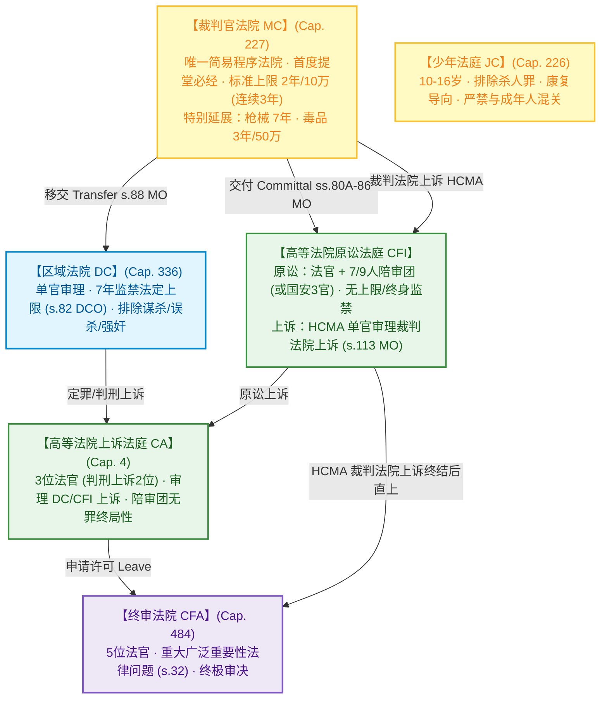
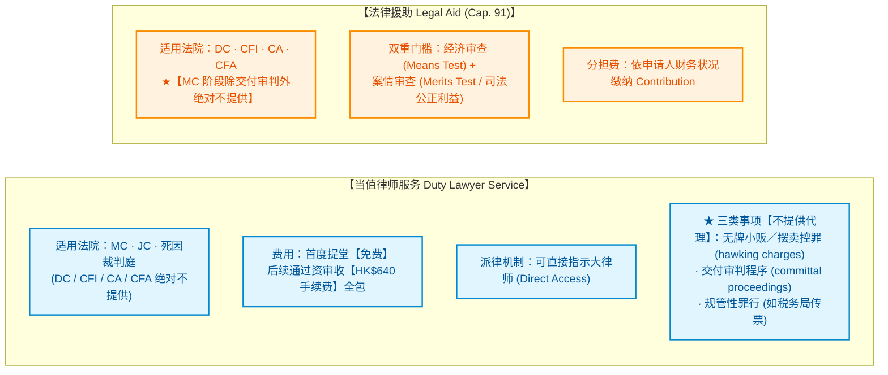

# 10 制度集群卡 — 刑事法院管辖权、量刑权力与法律代表制度（Criminal Courts, Jurisdiction & Legal Representation）

> **层级定位**：Level C · 制度集群 / 框架卡（Thematic Framework Cluster） 
> **2026-11-16 四级蓝图重构**：速读定位层加白话导引；地图收敛为图 1（母题 roadmap＋后果虚线）＋任务直达表，章节导航图删除；两张机制图挂图 2／图 3；新增 §6 全流程核对清单（原 §6 证据链对齐总表移审计留痕）；§7 后果速查总表原位保留；复审修订记录、字幕日志、open 块与 2026-10-06 入口移审计区。引注单元守恒（比对见审计区本轮记录）；历史记录内旧编号与 S-标签按原样保留。

> **整课互指**：Master Overview §1–§5 · Structure Map · 保释专题 (Level B) · 时限表 · 流程图

## 速读定位层（30 秒全景：范围 · 术语 · 环节任务）

> 本层为 2026-10-10 按《PCLL MATERIAL STANDARDS.md》§18.4 落地新增的开篇导引：30 秒锁定本卡覆盖范围、关键术语与各程序环节"解决什么问题"；规则的完整条件、例外、冲突并列与逐条原文引注仍以 §0–§7 正文为准，本层引注复用正文已登记的图例码（无新码）。
> **白话导引**：本卡回答刑事程序最初的四个「在哪」：在哪一级法院审（五级管辖与量刑上限——MC 标准 2 年/10 万、连续合计 3 年，DC 终值钉死 7 年而 *Li Yan* 只放起点，CFI 无上限可至终身）；少年在哪审（年龄分界、简易专属公诉并行、定罪后 s.3F 移送量刑三机制）；在哪里答辩（MC 案在 MC、DC 案 MC 绝不取答、CFI 案两度答辩）；找谁代表（DLS 管基层三庭但三不办，法援管 DC 以上、MC 唯一例外是交付程序——两轨在交付程序上刚好互补）。外加一条先例约束力法则：你引的判决对本席有没有拘束力。法院选错、上限超了、代表找错门，程序就要回正确节点重走——逐项后果见 §7 总表。


### 适用范围

**覆盖（按制度板块）**——刑事案件的「法院 × 管辖 × 量刑权力 × 法律代表 × 先例」配置面：
1. **五级法院管辖与量刑上限**：裁判法院（MC：单项 2 年监禁＋10 万罚款，连续合计最高 3 年；条例明文的特例扩到枪械 7 年、毒品 3 年＋50 万）→ 区域法院（DC：7 年终值上限，*HKSAR v Li Yan* 起点可逾 7 年）→ 原讼法庭（CFI：法官＋7/9 人陪审团、无上限可至终身监禁）→ 上诉法庭（CA：3 官，判刑上诉可 2 官）→ 终审法院（CFA：5 官，许可＋s.32 双闸）〔LGS1V L240 "A MC can impose a maximum sentence of 2 years imprisonment and a fine of up to HK$100,000"；LGS1V L244 "a Magistrate can sentence D to up to 7 years for the s. 20(1) summary offnce"；LGS1V L246 "on summary conviction, D is liable to a fine of HK$500,000 and to imprisonment for 3 years"；LGS1V L368 "The maximum sentence the DC can impose is 7 years imprisonment: s. 82 DCO"；LGS1V L390 "The maximum sentence that can be passed in the CFI is life imprisonment"；LGS1V L434 "The CFA sits as a panel of 5 Judges"；LGS1V L442 "it must be certified that a point of law of great and general importance is involved in the decision"〕；
2. **上移分流管道与答辩地点**：移交（Transfer s.88 MO——控方申请公诉罪移交时裁判官"shall"准、无权拒绝；随同简易罪属酌情"may"）、交付（Committal ss.80A–86 MO）、答辩三分流（MC 案在 MC 答；DC 案 MC 绝不取答、DC 首庭仅"指示答辩"；CFI 案交付程序与 CFI 内两度答辩）〔LGS1V L358 "the Magistrate “shall” make an order transferring the indictable offence to the DC"；LGS1V L366 "The Magistrate has a discretion to refuse to transfer such offences"；LGS1S L192 "when P ask for “plea to be taken” in the MC"；LGS1S L193 "If P decides to transfer the case to the DC, plea is not taken in the MC, only in the DC"；LGS1S L194 "plea may be taken in the MC and D committed to the CFI for sentencing"〕；
3. **少年法庭（JC）三层管辖逻辑**：年龄分界（10 岁绝对无刑责、10–14 岁 *doli incapax* 可推翻推定）、简易案件 JC 专属（s.3C(2) JOO 例外）、公诉案件与 DC／CFI 并行管辖（审讯法院由控方选定）、s.3F JOO 可推翻的移送 JC 量刑义务〔LGS1V L328 "children between the ages of 10 and 14 benefit from the rebuttable presumption of doli incapax"；LGS1V L330 "the JC has exclusive jurisdiction unless s. 3C(2) JOO applies"；LGS1V L342 "the other court shall, unless satisfied that it would be undesirable to do so, remit the case to a JC for sentencing"〕；
4. **法律代表双轨互补**：当值律师服务（DLS：仅 MC／JC／死因裁判庭，首提堂免费、其后 HK$640 手续费全包并可直委大律师，三不办——hawking、交付程序、规管性罪行）与法律援助（Cap. 91：means＋merits 双审查＋按财力分担费，MC 阶段唯一例外正是交付审判程序）〔LGS1V L186 "It also does not provide representation for hawking charges, committal proceedings or regulatory offences"；LGS1V L188 "Defendants must pay a handling charge of HK$640"；LGS1V L204 "Applicants must pass both a means and merits test"；LGS1V L204 "It is not available in the MC other than for committal proceedings"〕；
5. **上诉与复核路径**：MC 定罪/判刑 → HCMA（CFI 单官，s.113 MO 重审证据）；DC／CFI → CA（ss.82、83、83G–I CPO）；CA／CFI 终审面 → CFA（s.31 HKCFAO，须过 s.32 两闸）；律政司工具：s.81A 刑期复核、s.81D 法律问题转呈（不改陪审团无罪的绝对终局）；保释批/拒不属"最终裁决"〔LGS1V L400 "an appeal from the MC to the CFI is a rehearing of the evidence under s. 113 MO"；LGS1S L304 "Applications by SJ for a review of sentence: s. 81A(1) CPO"；LGS1S L316 "JURY ACQUITTALS ARE FINAL IN ALL CRIMINAL CASES"；LGS1S L329 "a decision to grant or refuse bail by a CFI Judge is not a final decision"〕；
6. **先例约束力层级**：CFA 约束全部下级、不受自身绝对约束；CA 约束下级并原则上约束自身（*per incuriam* 例外）；CFI 仅上诉角色（HCMA）之判决约束 MC 且自身受约束；DC／MC 只被上级约束、不产生拘束先例〔LGS1V L448 "An inferior court cannot create precedents; either to bind itself or other lower courts"；LGS1V L448 "subject to the “per incuriam” exception which is extremely narrow"；LGS1S L343 "Bound by its own decisions when acting in an appellate role (i.e. when hearing appeals from the MC"〕。

**不覆盖（边界声明，相关主卡承担）**：① 保释的申请条件、担保与 8 天带堂 → 05 Institution - Bail（本卡只保留"保释决定非最终裁决"一条作上诉边界）；② 警察截查、拘捕、搜查与数码设备规则 → 11 Framework - Police Powers & Search Rules；③ 检控决策、启动路径、6 个月时效、控罪修改与 1992 R&Ds → 12 Framework - Prosecution, Commencement & 1992 R&Ds；④ 控罪草拟、合并与最终审讯路线 → 08 Institution - Charges and Trial Route；⑤ 量刑制度与求情阶梯 → 15 Institution - Sentencing System；⑥ 全课时限横向汇总 → 01 Deadlines and Time Limits。

### 术语（核心概念与实务运作定义）

| 术语（英文原词） | 核心概念与实务运作定义 | 出处 |
|---|---|---|
| 移交（Transfer，s.88 MO） | 控方申请把公诉罪行（及随同的简易罪行）从裁判法院移交区域法院审理的程序；公诉罪移交裁判官无权拒绝，简易罪随同移交属酌情〔LGS1V L358 "the Magistrate “shall” make an order transferring the indictable offence to the DC"；LGS1V L366 "The Magistrate has a discretion to refuse to transfer such offences"〕 | §1.1 区域法院行 |
| 交付（Committal，ss.80A–86 MO） | 裁判法院把案件交付原讼法庭审讯或判刑的程序〔LGS1S L270 "offences committed from MC (ss. 80A to 86 MO)"〕 | §1.1 原讼法庭行 |
| 指示答辩（Indicate a plea） | 区域法院案件首次出庭时被告只被询问答辩意向而非正式取答；指示认罪后另排 Plea and Sentencing Hearing 才正式答辩〔LGS1S L193 "D is only asked to “indicate a plea”"；LGS1S L193 "then the matter can be set down for a “plea and sentencing hearing” at which plea will be formally taken from D"〕 | §3 |
| 裁判法院上诉（Magistracy Appeal，s.113 MO） | 对裁判法院定罪或判刑的上诉，由高等法院原讼法庭一名法官以重审证据方式审理〔LGS1V L400 "A single Judge in the CFI presides over Magistracy Appeals"；LGS1V L400 "an appeal from the MC to the CFI is a rehearing of the evidence under s. 113 MO"〕 | §1.1 原讼法庭行 |
| 无犯罪能力推定（*doli incapax*） | 10 至 14 岁儿童享有的可推翻推定：推定其不知行为严重不当，控方须加证推翻〔LGS1V L328 "children between the ages of 10 and 14 benefit from the rebuttable presumption of doli incapax"〕 | §1.1 少年法庭行 |
| 移送少年法庭量刑（Remittal for sentence，s.3F JOO） | 少年人在其他法院被定罪后，该法院除非信纳移送不宜，否则须把案件移送少年法庭量刑的可推翻默认义务〔LGS1V L342 "the other court shall, unless satisfied that it would be undesirable to do so, remit the case to a JC for sentencing"〕 | §2 机制三 |
| 当值律师服务（Duty Lawyer Service，DLS） | 向合资格被告在 MC／JC／死因裁判庭提供的法律代表服务：首度提堂免费、其后经资审收 HK$640 手续费、可直接指示大律师〔LGS1V L186 "The DLS provides legal representation to eligible defendants in the MC, JC and in the Coroners’ Court"；LGS1V L188 "Defendants must pay a handling charge of HK$640"；LGS1V L192 "The DLS can instruct barristers directly without going through a solicitor"〕 | §4 |
| 法律援助（Legal Aid，Cap. 91） | 依《法律援助条例》（Cap. 91，非本届幻灯笔误的 Cap. 9）提供的代表资助：仅限 DC／CFI／CA／CFA 及 MC 的交付程序，须同时通过经济审查与案情审查，并按申请人财力缴分担费〔LGS1V L204 "The availability of Legal Aid is governed by the Legal Aid Ordinance, Cap. 91"；LGS1V L204 "the amount of which depends on the financial resources of that person"〕 | §4 |
| 陪审团（Jury） | 原讼法庭审讯的事实裁判者：通常 7 人（较长或复杂案可由法官委任 9 人），只裁断罪名成立与否，不参与量刑〔LGS1V L392 "This Jury usually comprises 7 members of the public"；LGS1V L392 "They are not involved in the sentencing process"〕 | §1.1 原讼法庭行 |
| 刑期复核（Review of sentence，s.81A(1) CPO） | 律政司向上诉法庭申请覆核原讼法庭／区域法院所判刑期的程序工具〔LGS1S L304 "Applications by SJ for a review of sentence: s. 81A(1) CPO"〕 | §1.1 上诉法庭行 |
| 法律问题转呈（Reference on a question of law，s.81D CPO） | 无罪裁断后律政司仅可提请上诉法庭澄清法律问题的程序——是"转呈"不是上诉，不推翻原案结果〔LGS1V L416 "References by SJ on a question of law: s. 81D CPO (after acquittal)"；LGS1S L305 "only a “reference” not an appeal"〕 | §1.1 上诉法庭行 |
| 最终裁决（Final decision） | 终审法院上诉管辖（s.31 HKCFAO）的案件终点概念；保释的批予或拒绝不属最终裁决〔LGS1S L329 "a decision to grant or refuse bail by a CFI Judge is not a final decision"〕 | §1.1 终审法院行 |
| 重大广泛重要法律问题（Point of law of great and general importance） | 终审法院收案许可的第一闸口：须证明裁决涉及该等问题，或已造成实质及严重不公〔LGS1V L442 "it must be certified that a point of law of great and general importance is involved in the decision"；LGS1V L442 "substantial and grave injustice has been done: s. 32 HKCFAO"〕 | §1.1 终审法院行 |
| 疏忽出错例外（*per incuriam*） | 上诉法庭不受其过往判决约束的极窄例外情形〔LGS1V L448 "subject to the “per incuriam” exception which is extremely narrow"〕 | §5 |
| 量刑起点规则（*HKSAR v Li Yan*） | 区域法院法官可采纳逾 7 年的量刑起点，只要经扣减后的最终刑期不逾 7 年，且仍须给予有意义的认罪扣减〔LGS1V L368 "a DC Judge can adopt a starting point of more than 7 years as long as the final sentence to be served"；LGS1S L257 "HKSAR v. Li Yan [1998] 4 HKC 12"；COND-DL L202 "区院法官可以采用高于 7 年的量刑起点，只要经各项扣减后的最终刑期不超过 7 年"〕 | §1.1 区域法院行 |

### 环节定位（按程序时序）

| 环节（时序） | 它解决的具体问题 | 依据 |
|---|---|---|
| 答辨认庭（哪个法院取 plea） | 决定被告在哪里作正式答辩：MC 案在 MC；已移交 DC 案 MC 绝不取答、DC 首庭仅指示答辩；CFI 案交付程序取答一次、到 CFI 再取一次〔LGS1S L185 "plea is not taken in the MC but in the DC following transfer"；LGS1S L193 "If P decides to transfer the case to the DC, plea is not taken in the MC, only in the DC"；LGS1S L194 "plea may be taken in the MC and D committed to the CFI for sentencing"〕 | §3 |
| 审级分流（移交 vs 交付） | 谁有权把案件推上一级、门槛多高：公诉罪移交 DC，裁判官"shall"准而无权拒绝；随同的简易罪移交属酌情（s.88(1)(b) "may"）；交付 CFI 走 ss.80A–86〔LGS1V L358 "a Magistrate has no discretion to refuse the Prosecution’s request to transfer an indictable offence to the DC"；LGS1V L366 "The Magistrate has a discretion to refuse to transfer such offences"〕 | §1.1 DC／CFI 行 |
| 量刑权力匹配 | 某一级法院最多能判多重、何时可用特例扩展：MC 2 年/10 万起、特例须有条例明文（枪械 7 年、毒品 3 年＋50 万）；DC 终值钉死 7 年但起点可逾（*Li Yan*）；CFI 无上限〔LGS1S L203 "This extension of a M’s sentencing powers is exceptional and does not apply to all offences"；LGS1V L368 "The maximum sentence the DC can impose is 7 years imprisonment: s. 82 DCO"〕 | §1.1 |
| 少年案件分诊 | 少年被告先看审讯方式再定法院：简易→JC 专属（s.3C(2) 例外）、公诉→与 DC／CFI 并行、由控方选定；与 16 岁以上成年人合犯可由简易法院一并审理〔LGS1V L330 "on indictment (for which the JC only has concurrent jurisdiction as the District Court and Court of First Instance"；LGS1S L244 "both MC and JC can hear summary cases involving juveniles"〕 | §2 |
| 法律代表安排 | 被告在哪个法院该找哪一轨代表：MC／JC／死因看 DLS（先查三不办）；DC 以上或 MC 交付程序看法援（means＋merits＋分担费）〔LGS1V L186 "It is not available in the DC, CFI, CA or CFA"；LGS1S L159 "Available in the other courts including appeals"〕 | §4 |
| 败方上诉路径 | 输了去哪一级、走 HCMA 还是 CA/CFA、过不过 s.32 双闸：MC→HCMA（s.113 重审）；DC/CFI→CA；CA 终裁／CFI 非陪审终裁且无上 CA 者→CFA（许可＋重大广泛重要/实质严重不公）〔LGS1V L438 "appeals from a final decision of the CA"；LGS1V L440 "appeals from final decisions of the CFI (not being a verdict or finding of a Jury) from which no appeal lies to the CA"〕 | §1.1 CA／CFA 行 |
| 无罪后的控方工具 | 陪审团无罪裁决后律政司还能不能动：不能推翻（绝对终局），只能 s.81D 转呈法律问题；刑期不满走 s.81A 复核〔LGS1S L316 "JURY ACQUITTALS ARE FINAL IN ALL CRIMINAL CASES"；LGS1V L416 "References by SJ on a question of law: s. 81D CPO (after acquittal)"〕 | §1.1 CA 行 |
| 先例引用层级 | 当庭引的判决对本席有没有拘束力：下级法院不产生拘束先例；CFI 原讼单官判决不约束同级及下级（其上诉角色判决另论）〔LGS1V L448 "Both the DC and MC are bound by decisions of the CFI, CA and CFA but not by their own decisions"；LGS1S L339 "HK’s inferior courts: MC, DC, CFI (in originating jurisdiction"〕 | §5 |

## 🗺️ 本卡地图

> 两件套：**图 1 · 母题结构图**（刑事法院体系的分支 roadmap 即全流程主干与后果虚线；法院管辖与上诉链见**图 2**（§1），法律代表双轨见**图 3**（§4））→ **任务直达表**（按要做的事跳章节）。mermaid 节点看结构、不可点；点跳用直达表锚链。

**图 1 · 刑事法院体系分支 roadmap（全流程主干与后果虚线）**：

```mermaid
flowchart TD
 ROOT(["刑事法院体系（母题）<br>五级管辖 · 量刑权力 · 法律代表 · 先例"])
 ROOT --> A["① 五级法院管辖矩阵 →§1"]
 ROOT --> B["② 少年法庭三机制 →§2"]
 ROOT --> C["③ 答辩地点分流 →§3"]
 ROOT --> D["④ 法律代表双轨 →§4"]
 ROOT --> E["⑤ 先例约束力 →§5"]
 ROOT --> F["⑥ 全流程核对清单 →§6（对齐总表移审计区）"]

 A --> A1["MC 2年+10万 · 连续3年<br>特例：枪械7年 / 毒品3年+50万"]
 A --> A2["DC 7年终值<br>Li Yan 起点可逾7"]
 A --> A3["CFI 7/9人陪审团 · 无上限"]
 A --> A4["HCMA s.113 → CA 3官 → CFA 5官<br>s.32 双闸 · 无罪终局"]
 A -.-> AX[["越权量刑／管错法院代价 →§7 行2–3、6"]]
 B --> B1["年龄分界：10/14/16 + doli incapax"]
 B --> B2["简易专属 · 公诉并行（s.3C(2) 例外）"]
 B --> B3["s.3F 可推翻的移送量刑义务"]
 B -.-> BX[["少年分流误判 →§7 行4"]]
 C --> C1["MC案在MC答 · DC案在DC指示<br>CFI两度答辩"]
 C -.-> CX[["答辩地点误投 →§7 行1"]]
 D --> D1["DLS：MC/JC/死因 · $640 · 三不办"]
 D --> D2["法援 Cap.91：DC及以上 · MC仅交付<br>means+merits+分担费"]
 D -.-> DX[["代表权误配 →§7 行5"]]
 E --> E1["CFA不束自身 · CA束自身（per incuriam例外）<br>CFI仅上诉角色束MC · DC/MC只被上级束"]
 E -.-> EX[["先例层级误用 →§7 行8"]]

 classDef warnnode stroke-dasharray: 4 3;
 class AX,BX,CX,DX,EX warnnode
```



读图逻辑：实线是六条制度分支（管辖矩阵／少年法庭／答辩地点／法律代表／先例）与后果总表节点；虚线 warnnode 是各分支「不做」的后果钩子，行号统一收口 §7 总表；§1 的法院管辖与上诉链（图 2）补审级走向，§4 的双轨图（图 3）补代表权分工。


| 你现在要做什么 | 直达章节 |
|---|---|
| 30 秒弄清范围/术语/环节任务 | [速读定位层](#速读定位层30-秒全景范围--术语--环节任务) |
| 查某级法院管辖范围或量刑上限 | [§1 五级法院矩阵](#1-五级刑事法院裁判权与量刑权力全景矩阵court-hierarchy--sentencing-powers) 内 1.1 对照表（MC/JC/DC/CFI/CA/CFA 逐行） |
| 判断案件在哪个法院审、哪里答辩 | §3 答辩地点表（正文回点 §7 行 1） |
| 少年被告在哪审 | §2 少年法庭三机制＋§7 行 4 |
| 给客户安排法律代表 | §4 双轨制＋§7 行 5 |
| 败方上诉／律政司复核 | §1 mermaid 上诉链＋§1.1 CA/CFA 行＋§7 行 6–7 |
| 引判决前查约束力 | §5 先例约束力＋§7 行 8 |
| 查"某环节做错会怎样" | [§7 后果速查总表](#7-环节--不做做错的后果--依据速查总表)（§1.1–§5 正文均有"总表索引"回点） |
| 核对某条规则出处与届别 | [§0 图例](#0-底层材料溯源库与代码表source-provenance-index)＋审计区·对齐总表（原 §6） |
| SG01 B5（Tom Tang 不认罪在哪审） | §2 末 💡 实战穿透段 → SG01 Classroom |

---

## 0. 底层材料溯源库与代码表（Source Provenance Index）

> **引注格式**（2026-09-30 依《PCLL Provenance Manual 2026-09-29》§2.2 落实）：每行末尾的全角括注内是「码＋该文件在库内的行号＋原文摘录」，
> 一条括注可含多条出处、以全角分号分隔；码→文件→层级→学年见下方图例（点开折叠）。
> 往届（2025-26）出处一律带「·往届仅参考」并在行文写明届别；2026-11-16 蓝图重构起正文「空引注记号」（原为方头括号内仅破折号，表示该行已审无需出处）已全部清剿、历史区保留；
> 标 ⚠️ 处为本库材料之间的不一致：同届互不一致者并列不裁决，一为本届一为往届者按 §2.5 取本年讲义并标注冲突；未决项登记在本文件末尾的 open 块。


<!-- BEGIN:cite-legend -->
> [!info]- 引注图例（出处码 → 文件；点开折叠）
>
> | 码 | 文件 | 层级 | 学年 |
> |---|---|---|---|
> | LGS1V | 本届 LGS 1 讲义（法院与检控角色） | 本届讲义 | 2026-27 |
> | LGS1S | 本届 LGS 1 课堂幻灯 | 本届讲义 | 2026-27 |
> | LGS3R | 本届 LGS 3 修订版讲义（交付与移交） | 本届讲义 | 2026-27 |
> | LGS2N | 本届 LGS 2 讲义（侦查、开始程序与保释） | 本届讲义 | 2026-27 |
> | ADV-V2 | 跨课 PCLL8051《Bail Application》训练手册 Volume 2（2026-27，只读引用） | 本届讲义 | 2026-27 |
> | OLD-LG03R | [往届 LG03 讲义（[EDITED] LGS3 Outline）](../../04%20Base%20Lectures/%5BLG03%5D%20Lawyer's%20Duties,%20Classification%20of%20Offences,%20Drafting%20Charges,%20Transfers%20&%20Committals/%5BEDITED%5D%20LGS3%20Outline.md) | 往届官方 | 2025-26 |
> | OLD-LG09 | 往届 LG09 港区国安法刑事程序讲义 | 往届官方 | 2025-26 |
> | OLD-EXALL | 往届考试总笔记 Set 2《Crim Lit - ALL》 | 往届学生稿 | 2025-26 |
> | COND-DL | 本库 8050《01 时限表》凝结卡（同层互指） | 凝结层 | 2026-27 |
> | COND-FC | 本库 8050《02 流程图》凝结卡（同层互指） | 凝结层 | 2026-27 |
> | CAP-K1 | PCLL8050 LGS1 PT | 本届讲义 | 2026-27 |


<!-- END:cite-legend -->
**取材顺序**（Manual §2.6）：本届 slides → 本届 notes → 往届官方 → 往届学生稿。本卡的法院结构、量刑上限、答辩地点与先例约束力四节，本届 LGS 1 课堂幻灯（码 LGS1S）
与本届 LGS 1 讲义（码 LGS1V）逐页对应，两者一致时以讲义的条文表述为主、幻灯为同期旁证；两说不一者一律并列并登记文末，不代用户裁决。

**跨课与同层**：跨课只读引用 PCLL8051《Bail Application》训练手册（码 ADV-V2），本包不改动 8051 任何文件；同层互指本库 8050 的《01 时限表》（码 COND-DL）
与《02 流程图》（码 COND-FC）。本节标题按「现有标题一律不改」保留原题，其下的旧式溯源码表已按 Manual §4 第 3 步废除，全文只保留这一种引注格式。


---

## 1. 五级刑事法院裁判权与量刑权力全景矩阵（Court Hierarchy & Sentencing Powers）

**图 2 · 五级法院管辖与上诉链（MC→DC／CFI→CA→CFA）**：



### 1.1 各级法院核心权力与法定边界对照表

| 法院层级 | 称呼与被告称谓 | 管辖范围与排他排除罪行 | 标准量刑上限与法定特例扩展 | 底层出处与关键规则 |
|---|---|---|---|---|
| **裁判法院 (MC)** | "Sir/Madam" / "Your Worship"<br>称谓："The Defendant" 〔LGS1V L256 "correctly address the Magistrate as either: “Your Worship” / “Sir” or “Madam”"；LGS1V L256 "The person charged is referred to as the “Defendant.”"；LGS1S L214 "Correct mode of address: “Sir / Madam” or “Your Worship”"〕 | 审理所有简易程序罪行及可简易审理之公诉罪行，可公诉审讯的罪行亦可简易审理。⚠️ 第二附表第 1 部分的排除范围两说并列（旧写法「绝对排除」在讲义一侧不成立）〔LGS1S L215 "Offences listed in Part 1, Second Schedule MO cannot be tried in the MC"；LGS1V L260 "indictable offences listed in Part I of the Second Schedule cannot be tried by a Permanent Magistrate."；LGS1V L284 "mean these offences can be heard in the MC"；D-SCH2-EXC〕 | **标准上限**：单项罪名 **2 年监禁 + 10 万罚款**（ss.92, 92A MO）；两项以上刑期连续执行合计最高 **3 年**。**特例扩展**：① 枪械 s.20(2) F&AO 可判 **7 年**；② 毒品 s.4(3)(b) DDO 可判 **3 年 + 50 万罚款**；此类延展须有条例明文，并非通则 〔LGS1V L240 "A MC can impose a maximum sentence of 2 years imprisonment and a fine of up to HK$100,000"；LGS1V L240 "then a Defendant can be sentenced to up to 3 years"；LGS1S L202 "maximum of 2 years imprisonment and a fine up to $100,000 (single offence)"；LGS1V L244 "a Magistrate can sentence D to up to 7 years for the s. 20(1) summary offnce"；LGS1V L246 "on summary conviction, D is liable to a fine of HK$500,000 and to imprisonment for 3 years"；LGS1S L203 "This extension of a M’s sentencing powers is exceptional and does not apply to all offences"〕 | 常任裁判官可审较重罪行，特别裁判官权力更窄、多处理部门传票与小额交通案；罪虽可公诉，定罪仍在简易法院，故只能判简易上限 〔LGS1V L252 "Permanent Magistrates can try indictable offences not listed in Part 1 of the Second Schedule"；LGS1V L250 "mostly deal with departmental summons and hear more minor offences"；LGS1S L207 "Special Magistrates usually deal with less complex cases"；LGS1V L252 "if convicted, a Defendant can only be sentenced to a maximum of 2 years as the D is convicted in a summary court"〕。⚠️ 3 年合计上限的条文号两处不一致（s.57 MO ／ s.54 MO）：两侧同出本届，按 §2.5 无从择一，应试以「合计不逾 3 年」的法定后果为主 〔LGS1V L240 "up to 3 years: s. 57 MO"；LGS1S L202 "up to 3 years where sentencing for 2 or more offences runs consecutively"；LGS3R L330 "3 years as an aggregate sentence for more than one offence: s. 54 MO"；OLD-LG03R L442 "3 years as an aggregate sentence for more than one offence: s. 54 MO"·往届仅参考；D-MO-57V54〕 |
| **少年法庭 (JC)** | "Sir/Madam" / "Your Worship"<br>称谓：直呼姓名（不用 Defendant） 〔LGS1S L238 "Court is addressed as “Sir / Madam” or “Your Worship”"；LGS1V L352 "the child / young person is not referred to as the “Defendant” but by their given / last name"〕 | 10–14 岁儿童与 14–16 岁少年人，**除凶杀外**均可审理（s.3A(3) JOO）；10 岁以下无刑责，10–14 岁适用 *doli incapax* 可推翻推定 〔LGS1V L328 "children (aged under 14) and young persons (aged between 14 and 16) for any offence other than homicide"；LGS1V L328 "Children under 10 are exempted from criminal responsibility"；LGS1V L328 "children between the ages of 10 and 14 benefit from the rebuttable presumption of doli incapax"；LGS1V L340 "The JC hears cases against children or young people other than homicide: s.3A(3) JOO"；LGS1S L227 "Cannot hear offences of homicide: s. 3A(3) JOO"〕。★ 管辖性质分两层：简易程序——JC **专属管辖**（s.3C(2) JOO 情形除外）；公诉程序——仅与区域法院、原讼法庭**并行（共有）管辖**，并非专属；审讯法院由控方选定 〔LGS1V L330 "the JC has exclusive jurisdiction unless s. 3C(2) JOO applies"；LGS1V L330 "on indictment (for which the JC only has concurrent jurisdiction as the District Court and Court of First Instance"；LGS1S L228 "concurrent jurisdiction for indictable offences (DC & CFI can also try indictable offences"〕 〔❓s.3A(3) JOO 在库内只记「除凶杀外均可审理」这一面，讲义另有「10 至 16 岁」的年龄分界表述，两者如何衔接库内无进一步原文〕 | 不以监禁为首选，采康复导向：可处保护令、conditional discharge、教导所／训练中心／还院所，并可命父母代缴罚款；拒绝保释而羁押时须与成年人分隔 〔LGS1V L336 "The key point is that imprisonment for juveniles is a last resort"；LGS1V L334 "The aim of the courts in dealing with a juvenile is rehabilitation"；LGS1V L332 "power to order the parents of a juvenile to pay any fine imposed"；LGS1V L332 "conditional discharge, reformatory school, probation, Training Centre / Rehabilitation Centre / Detention Centre"；LGS2N L851 "then the juvenile will be detained: s.5 JOO but kept separate from any adults: s.6 JOO"〕 | 与 16 岁以上成年人共同被控或案情相关联时，裁判法院等简易法院可一并审理（此即「专属」的法定例外）；在其他法院定罪的少年人，该法院**如非信送审并不属不宜**即须移送 JC 量刑（s.3F JOO）——这是可推翻的默认义务，不是绝对强制移送 〔LGS1V L340 "a court of summary jurisdiction shall hear a charge where a juvenile is charged jointly with a person over the age of 16"；LGS1S L244 "both MC and JC can hear summary cases involving juveniles"；LGS1V L342 "the other court shall, unless satisfied that it would be undesirable to do so, remit the case to a JC for sentencing"；LGS1S L245 "if a juvenile is convicted of an offence by another court, the usual procedure is to remit the juvenile"〕 |
| **区域法院 (DC)** | "Your Honour"<br>称谓："The Defendant" 〔LGS1V L372 "Cases are heard by a single Judge sitting without a Jury who is addressed as “Your Honour.”"；LGS1V L372 "The person charged is referred to as the “Defendant.”"〕 | 经裁判法院移交之公诉罪行（控方依 Part IV MO 申请）及随同移交的简易罪行；不得审理第二附表第 3 部分所列罪行。★ 谋杀、误杀、强奸**必须在原讼法庭审理**，此项限制来自讲义与幻灯的明文，而非附表第 3 部分的逐项文字 〔LGS1V L358 "The DC hears indictable offences that are transferred from the MC on the application of the Prosecution"；LGS1S L255 "Can hear indictable offences as long as not excluded by Part III, Second Schedule MO"；LGS1V L364 "indictable offences except offences under Part III of Second Schedule MO"；LGS1V L366 "summary offences that are transferred to the DC along with an indictable offence under s. 88(1)(b) MO"〕；〔LGS1V L372 "the DC hears more serious criminal charges than the MC (except murder, manslaughter and rape"；LGS1S L258 "Cannot hear murder, manslaughter or rape"〕 〔附表第 3 部分并未直书 murder／manslaughter／rape，两说并列未裁，见审计区 D-SCH2-EXC〕 | **单次审决上限 7 年监禁**（s.82(2)(a) DCO），数罪连续执行亦同；★ **量刑起点规则（*HKSAR v Li Yan* [1998] 4 HKC 12）**：可采纳逾 7 年的起点，只要折减后最终刑期不逾 7 年，且仍须给予有意义的认罪扣减；同库《01 时限表》《02 流程图》两卡记同一规则 〔LGS1V L368 "The maximum sentence the DC can impose is 7 years imprisonment: s. 82 DCO"；LGS1V L368 "This applies even where the Defendant is convicted of more than one offence"；LGS1V L368 "a DC Judge can adopt a starting point of more than 7 years as long as the final sentence to be served"；LGS1S L257 "HKSAR v. Li Yan [1998] 4 HKC 12"；COND-DL L202 "区院法官可以采用高于 7 年的量刑起点，只要经各项扣减后的最终刑期不超过 7 年"；COND-FC L74 "区院法官可以采用高于 7 年的量刑起点，只要扣减后的最终刑期不超过 7 年"；OLD-EXALL L264 "a DC judge can adopt a starting point of more than 7 years"·往届仅参考〕 | 控方申请把公诉罪行移交区院时裁判官**无权拒绝**（s.88(1)(a) MO 用 “shall”）；简易罪行的移交则属酌情权（s.88(1)(b) MO 用 “may”），拒绝即留在裁判法院；本区院亦可就被告正服之刑另判 7 年连续执行 〔LGS1V L358 "a Magistrate has no discretion to refuse the Prosecution’s request to transfer an indictable offence to the DC"；LGS1V L358 "the Magistrate “shall” make an order transferring the indictable offence to the DC"；LGS1V L366 "The Magistrate has a discretion to refuse to transfer such offences"；LGS1S L254 "Can hear summary and indictable offences transferred from the MC if Prosecution applies for a transfer"；LGS1V L370 "the DC can also impose a sentence of 7 years consecutively to any sentence of imprisonment"〕 |
| **原讼法庭 (CFI)** | "My Lord / My Lady"<br>称谓："The Accused" 〔LGS1S L267 "Modes of address: “My Lord / My Lady” or “Your Lordship / Your Ladyship”"；LGS1S L267 "The person charged is called “the Accused.”"〕 | **原讼**：由裁判法院交付（ss.80A–86 MO）或区域法院移交（s.77A DCO）之案件，原则上只审公诉罪行，仅极有限情形可处理简易控罪（如 s.79F CPO）。**上诉**：HCMA 单官覆审裁判法院之定罪与判刑上诉（s.113 MO，重审证据） 〔LGS1S L270 "offences committed from MC (ss. 80A to 86 MO)"；LGS1S L271 "cases transferred to the CFI from the DC"；LGS1V L390 "The CFI hears indictable offences but has no jurisdiction to hear summary offences except in very limited circumstances"；LGS1V L400 "A single Judge in the CFI presides over Magistracy Appeals"；LGS1V L400 "an appeal from the MC to the CFI is a rehearing of the evidence under s. 113 MO"；LGS1S L291 "Reconsideration of the evidence under s. 113 MO"〕 | **无量刑上限**（可判终身监禁），以该罪法定最高刑为限。原讼标准模式为**法官 + 7 人陪审团**（较长或复杂案件可委任 9 人）；国安法案件另有三项合议庭审讯模式，须由律政司依 A.46 发出证书方适用（本届 LGS 9 未入库，细则依往届 LG09） 〔LGS1S L274 "maximum sentence is life imprisonment"；LGS1V L390 "The maximum sentence that can be passed in the CFI is life imprisonment"；LGS1V L390 "The CFI hears more serious criminal offences e.g. murder, manslaughter, rape, armed robbery or trafficking of large amounts of drugs"〕；〔LGS1V L392 "Criminal trials in the CFI for criminal offences other than those under the NSL are always heard before a Jury"；LGS1V L392 "This Jury usually comprises 7 members of the public"；LGS1V L392 "9 jurors can be appointed by the Judge"；LGS1S L282 "Two modes of trial where NSL trial in the CFI"；OLD-LG09 L200 "the case is tried by 3 judges from a pool of judges designated to handle national security cases"·往届仅参考；OLD-LG09 L202 "the new mode of trial by a panel of 3 Judges where the SJ issues a certificate under A. 46"·往届仅参考〕 | 陪审团为事实审、裁断被告人罪名成立与否，**不参与量刑**；法官为法律审，裁定法律与证据可采性（该等争辩在陪审团退席时进行）、指引陪审团并判处刑罚 〔LGS1V L392 "The Jury are the triers of fact"；LGS1V L392 "They are not involved in the sentencing process"；LGS1V L394 "The Judge is the trier of law"；LGS1V L394 "Issues of the admissibility of evidence, for example, are a matter of law"〕 |
| **上诉法庭 (CA)** | "My Lord / My Lady" — | 审理原讼法庭与区域法院之定罪上诉（ss.82, 83 CPO）与判刑上诉（ss.83G–I CPO）；法官保留的法律问题（s.81(1)）、律政司刑期复核（s.81A(1)）、律政司就法律问题转呈（s.81D）、国安案三法官无罪后之案件呈述（s.81DA） 〔LGS1S L301 "D’s appeal against conviction in CFI and DC"；LGS1S L302 "D’s appeal against sentence in CFI / DC: ss. 83G,H,I CPO"；LGS1S L303 "Reservations of questions of law by CFI J"；LGS1S L304 "Applications by SJ for a review of sentence: s. 81A(1) CPO"；LGS1S L306 "Appeals by way of case stated on questions of law following an acquittal by a panel of 3 Js"〕 〔❓上诉法庭内的庭内称呼（本格旧作 My Lord / My Lady）在本库材料中查无出处，本届 LGS 1 只给出原讼法庭的称呼，幻灯与讲义均未另立上诉法庭一节〕 | 3 位上诉法官合议，**仅判刑上诉可由 2 位审理**（s.34 HCO）；是否给予上诉许可可由单官决定（s.34A HCO）。★ **陪审团无罪裁决绝对终局**：律政司依 s.81D 只能就法律问题作出「转呈」，不能推翻无罪结果 〔LGS1S L313 "Appeals heard by 3 Justices of Appeal unless appeal is on sentence only in which case, 2 Justices sit"；LGS1V L424 "Criminal appeals are usually heard by 3 Justices of Appeal"；LGS1S L305 "only a “reference” not an appeal"；LGS1S L316 "JURY ACQUITTALS ARE FINAL IN ALL CRIMINAL CASES"〕 | 上诉法庭可给予向终审法院上诉的许可；其判决对下级法院有约束力，原则上亦约束自身（*per incuriam* 例外） 〔LGS1S L315 "The CA can grant leave to appeal to the CFA"；LGS1V L448 "decisions of the CA are binding upon all lower courts"〕 |
| **终审法院 (CFA)** | "Chief Justice / Mr/Madam Justice" — | 终审管辖：上诉法庭之最终裁决，以及原讼法庭非陪审团裁断、且不能向上诉法庭上诉之最终裁决（如裁判法院上诉）直上终院（s.31 HKCFAO）。★ **保释之批予或拒绝不属最终裁决**，故不能循 s.31(b) 直诉终院 〔LGS1V L438 "appeals from a final decision of the CA"；LGS1V L440 "appeals from final decisions of the CFI (not being a verdict or finding of a Jury) from which no appeal lies to the CA"；LGS1S L329 "a decision to grant or refuse bail by a CFI Judge is not a final decision"；LGS1S L329 "cannot be appealed under s. 31(b) HKCFAO"〕 〔❓终院内的庭内称呼（本格旧作 Chief Justice / Mr/Madam Justice）库内无出处，讲义只给出合议庭组成（首席法官＋3 位常任法官＋1 位其他普通法适用地区非常任法官）〕 | 5 位法官合议。须取得上诉许可，且须证明该裁决涉及**重大广泛重要之法律问题**，或已造成**实质及严重不公**（s.32 HKCFAO）；终院不是第二个上诉法庭，其上诉范围与权力更为有限 〔LGS1V L434 "The CFA sits as a panel of 5 Judges"；LGS1S L324 "Sits as a panel of 5 Judges"；LGS1V L442 "it must be certified that a point of law of great and general importance is involved in the decision"；LGS1V L442 "substantial and grave injustice has been done: s. 32 HKCFAO"；LGS1S L325 "The CFA is not a second CA. Its scope and power on appeals is more limited"〕 | ⚠️ *HKSAR v. Lai Chee Ying* 之中性引证两说并列：本届 LGS 1 幻灯作 [2020] HKCFA 45，跨课 8051 手册作 (2021) 24 HKCFAR 33，往届 LG09 讲义作 [2021] HKCFA 3；两侧同出本届 ⇒ 按 §2.5 并列不裁决 〔LGS1S L329 "HKSAR v. Lai Chee Ying [2020] HKCFA 45"；ADV-V2 L251 "LAI CHEE YING (2021) 24 HKCFAR 33"；OLD-LG09 L166 "HKSAR v. Lai Chee Ying [2021] HKCFA 3, (2021) 24 HKCFAR 33 at para. 53(b)"·往届仅参考；D-LCY-CITE〕 |

**总表索引（2026-10-10）**：本节各院"管错法院（罪种×法院错配）"的后果链归并 [§7 行 2](#7-环节--不做做错的后果--依据速查总表)；"越权量刑（MC 上限／DC 终值／条文号两说）"归并行 3；"上诉路径误投与无罪终局误攻"归并行 6–7。

> **Exam / Advocacy Formulation:** "Match the offence to the court first — a Magistrate's powers extend only by statute, the DC caps the final term at seven years even where *Li Yan* lifts the starting point, and only the CFI sits with a jury."（自拟考场口径；底层规则见 §1.1 各行引注）

---

## 2. 少年法庭（Juvenile Court）实务三大核心机制

```text
 【机制一：年龄分界与刑责推定】
 · 10岁以下：绝对无刑事责任 (Conclusive presumption)
 · 10–14岁：无犯罪能力推定 (Presumption of Doli Incapax，控方须证明其知悉行为严重不当)
 · 14–16岁：少年人 (Young Persons)
 · 管辖性质分两层：简易程序 → JC 专属管辖（s.3C(2) JOO 情形除外）；
 公诉程序 → JC 与区域法院、原讼法庭【并行／共有管辖】，不是专属（出处见 §1.1 少年法庭行）

 【机制二：与成年人合犯之合并管辖 (Concurrent Jurisdiction — s.3C(2) JOO)】
 · 少年人若与 16 岁以上成年人共同被控，或属于同一关联事件：
 ➔ 裁判法院 (MC) 享有合并管辖权，可一并审理该少年人与成年人。
 ➔ 此即机制一"专属管辖"的法定例外。

 【机制三：定罪后移送 JC 量刑规则 (Remittal for Sentence — s.3F JOO)】
 · 若少年人在其他法院 (如 MC/DC) 被定罪：
 ➔ 该法院**如非信送审并不属不宜**，即须把案件移送回少年法庭量刑
 ("shall, unless satisfied that it would be undesirable to do so")。
 ➔ 故这是**可推翻的默认义务**，不是绝对强制移送：法院如认定移送不适当，
 可自行量刑。
```

> 💡 **【实战穿透 · SGS 1 Q B5】**：Tom Tang 14 岁少年便利店案，若不认罪应在哪个法院审理，答案要**先看控罪审讯方式**：该罪若只可简易审理，除 s.3C(2) JOO 的合犯等例外情形外由**少年法庭专属管辖**；若属可公诉审讯的罪行，则 JC 仅与区域法院／原讼法庭**并行管辖**，须按审讯法院分流决定 〔LGS1V L330 "the JC has exclusive jurisdiction unless s. 3C(2) JOO applies"；LGS1V L330 "on indictment (for which the JC only has concurrent jurisdiction as the District Court and Court of First Instance"；LGS1S L228 "concurrent jurisdiction for indictable offences (DC & CFI can also try indictable offences"〕。s.3A(3) JOO 的原始内容是"JC 可审理儿童及少年人**除凶杀外**的控罪"，不是"专属管辖"的授权条文 〔LGS1V L340 "The JC hears cases against children or young people other than homicide: s.3A(3) JOO"；LGS1V L340 "S.3C(2) JOO also lists some situations in which other courts of summary jurisdiction (e.g. the MC) will hear cases against juveniles"；LGS1S L227 "Cannot hear offences of homicide: s. 3A(3) JOO"〕。详见 SG01 Classroom Brief B Question B5（若 Tom 不认罪，应在哪个法院审理）。

**总表索引（2026-10-10）**：少年案件分流误判（简易当公诉办／公诉当专属办）与 s.3F 漏移送、羁押未分隔的后果链归并 [§7 行 4](#7-环节--不做做错的后果--依据速查总表)。

---

## 3. 案件答辩地点与分流机制（Venue for Taking Plea）

在刑事诉讼中，**被告人在哪里作正式答辩（Take Plea），直接取决于控方选定的审理法院**：

| 最终审理法院 (Venue of Trial) | 答辩地点与程序特征 | 实务与应试核心要点 | 底层出处 |
|---|---|---|---|
| **裁判法院 (MC)** | **在 MC 答辩** | 首次提堂若控方表示案件 "For Plea"（准备答辩），即宣告案件留在 MC 审理。 | 〔LGS1S L185 "If the case is to be tried in the MC, then plea is taken in the MC"；LGS1S L192 "when P ask for “plea to be taken” in the MC or more simply state that the case is “for plea”"〕 |
| **区域法院 (DC)** | **在 DC 答辩（MC 绝不答辩）** | 控方申请移交区院后，MC 不取答辩；首次在 DC 出庭时仅**“指示答辩（Indicate a plea）”**；若指示认罪，再排期至 "Plea and Sentencing Hearing" 正式答辩宣判。 | 〔LGS1S L185 "plea is not taken in the MC but in the DC following transfer"；LGS1S L193 "If P decides to transfer the case to the DC, plea is not taken in the MC, only in the DC"；LGS1S L193 "D is only asked to “indicate a plea”"；LGS1S L193 "then the matter can be set down for a “plea and sentencing hearing” at which plea will be formally taken from D"〕 |
| **原讼法庭 (CFI)** | **在 MC 交付程序中答辩 + 在 CFI 正式答辩** | 若被告人选择认罪，可在 MC 交付程序中认罪并直接交付 CFI 判刑；若选择初级侦讯（PI），答辩在初审程序中进行；案件送达 CFI 后，在原讼庭再次正式答辩。 | 〔LGS1S L194 "plea may be taken in the MC and D committed to the CFI for sentencing"；LGS1S L194 "If P have decided to commit the case to the CFI and D elects for a preliminary inquiry"；LGS1S L194 "then plea is taken from D as part of that process"；LGS1S L185 "plea may be taken in the MC during the committal process but is taken again in the CFI"〕 |

**总表索引（2026-10-10）**：答辩地点误投（该在 DC 指示却在 MC 取答、CFI 案只备一次答辩）的后果链归并 [§7 行 1](#7-环节--不做做错的后果--依据速查总表)。

---

## 4. 法律代表双轨制：当值律师服务（DLS）vs 法律援助（Legal Aid）

**图 3 · 法律代表双轨对照（DLS vs Legal Aid）**：



> **上图各节点出处**（图内不写引注，故在图外逐栏标注）：DLS 一侧的适用法院、首度提堂免费、HK$640 手续费、可直委大律师与三类不提供代理之事项 〔LGS1V L186 "The DLS provides legal representation to eligible defendants in the MC, JC and in the Coroners’ Court"；LGS1V L186 "It is not available in the DC, CFI, CA or CFA"；LGS1V L188 "All eligible Defendants can be represented for free by the DLS on their first appearance in the MC, JC or Coroner’s Court"；LGS1V L188 "Defendants must pay a handling charge of HK$640"；LGS1V L192 "The DLS can instruct barristers directly without going through a solicitor"；LGS1V L186 "It also does not provide representation for hawking charges, committal proceedings or regulatory offences"；LGS1S L148 "Not available for certain charges or committal proceedings"〕；法援一侧的法院范围、双重审查与分担费 〔LGS1V L204 "It is not available in the MC other than for committal proceedings but is available for DC, CFI proceedings and all criminal appeals"；LGS1V L204 "Applicants must pass both a means and merits test"；LGS1V L204 "the amount of which depends on the financial resources of that person"；LGS1S L158 "Not available in the MC (except for committal proceedings.)"；LGS1S L159 "Available in the other courts including appeals"〕。两轨的法院分工因此正好互补，见下两段。

> ⚠️ **两轨在 MC 交付程序上刚好互补，别记反**：当值律师服务**不**代理交付审判程序 〔LGS1V L186 "It also does not provide representation for hawking charges, committal proceedings or regulatory offences"〕，而法律援助在裁判法院唯一的例外恰恰**就是**交付审判程序 〔LGS1V L204 "It is not available in the MC other than for committal proceedings"〕。故被交付至原讼法庭判刑的被告，在 MC 的交付聆讯中可循法援而非当值律师取得代表。

> **Exam / Advocacy Formulation:** "DLS covers the MC, Juvenile Court and Coroner's Court but never committal; Legal Aid covers committal but little else in the MC — the two tracks interlock at the committal stage, so never send the client to the wrong door."（自拟考场口径；底层规则见本节引注）
>
> 📌 章号更正：旧版把《法律援助条例》写作 "Cap. 9"，其来源正是本届 Slide 15 原件的笔误 〔LGS1S L157 "See the Legal Aid Ordinance, Cap. 9"〕；本届讲义正文则作 **Cap. 91《法律援助条例》(Legal Aid Ordinance)**，本卡一律以 Cap. 91 为准 〔LGS1V L204 "The availability of Legal Aid is governed by the Legal Aid Ordinance, Cap. 91"〕。

**总表索引（2026-10-10）**：代表权误配（DLS 接三不办事项／MC 非交付阶段求法援／DC 以上只安排 DLS）的后果链归并 [§7 行 5](#7-环节--不做做错的后果--依据速查总表)。

---

## 5. 判例先例约束力法则（Stare Decisis in Criminal Courts）

* **终审法院 (CFA)**：约束所有下级法院（CA/CFI/DC/MC）；但**不受自身过往判决之绝对约束**。 〔LGS1V L448 "decisions of the CFA are binding upon lower courts but not upon itself"；LGS1S L341 "CFA decisions are binding upon lower courts but not upon itself"〕
* **上诉法庭 (CA)**：受 CFA 约束；对下级法院（CFI/DC/MC）具有绝对约束力；**原则上受自身过往判决约束**（除非此前判决属于 *per incuriam* 疏忽出错）。 〔LGS1V L448 "The CA is bound by decisions of the CFA"；LGS1V L448 "decisions of the CA are binding upon all lower courts"；LGS1S L342 "binds the lower courts (CFI, DC, MC) and itself (unless previous decision was ‘per incuriam’"；LGS1V L448 "subject to the “per incuriam” exception which is extremely narrow"〕
* **原讼法庭 (CFI)**：
 * **原讼管辖时**：不受自身过往判决约束，下级法院（DC/MC）亦不受 CFI 原讼单官判决约束； 〔LGS1V L448 "it is not bound by its own decisions when acting in its original jurisdiction"；LGS1S L339 "HK’s inferior courts: MC, DC, CFI (in originating jurisdiction"〕（库内材料未载其对下级法院判决的约束力定性，见审计区 O-10-2）
 * **上诉管辖时 (HCMA 审理裁判法院上诉)**：其判决**对裁判法院 (MC) 具有绝对约束力**，且自身受同级上诉判决约束。 〔LGS1S L343 "Bound by its own decisions when acting in an appellate role (i.e. when hearing appeals from the MC"；LGS1V L448 "It is bound by its own appellate decisions though"；LGS1V L448 "Both the DC and MC are bound by decisions of the CFI"〕
* **区域法院 (DC) 与裁判法院 (MC)**：必须遵守所有上级法院判决，但**不受自身或同级其他法官判决的约束**。 〔LGS1V L448 "Both the DC and MC are bound by decisions of the CFI, CA and CFA but not by their own decisions"；LGS1S L344 "DC & MC: bound by decisions of all the higher courts but not their own"〕

**总表索引（2026-10-10）**：先例层级误用（把同级／自身／CFI 原讼判决当拘束先例）的后果链归并 [§7 行 8](#7-环节--不做做错的后果--依据速查总表)。

---

## 6. 全流程核对清单（接案→定审，逐闸自检）

每个闸门给出一道自检问题与未过时的动作；做错的具体后果与依据统一收口 [§7 总表](#7-环节--不做做错的后果--依据速查总表)。

| # | 闸门 | 自检问题 | 未过时的动作 | 深节回点 |
|---|---|---|---|---|
| 1 | 罪种×法院匹配 | 控罪可否 MC 简易审理？第二附表 Part 1 的两说核了吗？谋杀／误杀／强奸是否已排 CFI？ | 回 §1.1 对照表核；错配即分流重置 | §1.1／§7 行 2 |
| 2 | 量刑上限 | MC 标准 2 年/10 万、连续合计 3 年（条文号两说 D-MO-57V54）？特例须条例明文？DC 终值 7 年（*Li Yan* 只放起点）？ | 写意见前核上限；引用条文号先查登记 | §1.1／§7 行 3 |
| 3 | 答辩地点 | MC 案在 MC？DC 案 MC 不取答、DC 首庭仅指示？CFI 案两度答辩备妥？ | 按 §3 表对节点走位 | §3／§7 行 1 |
| 4 | 少年分诊 | 年龄按哪一天？简易→JC 专属（s.3C(2) 例外）？公诉→并行（控方选院）？s.3F 移送量刑义务？ | §2 三机制过一遍；羁押分隔 s.5/s.6 | §2／§7 行 4 |
| 5 | 法律代表 | MC/JC/死因→DLS（三不办）？DC 以上→法援？MC 交付程序→法援唯一例外？ | 按 §4 ⚠️ 互补段对门 | §4／§7 行 5 |
| 6 | 上诉路径 | MC→HCMA（s.113 重审）？DC/CFI→CA？CFA 双闸（许可＋重大广泛重要／实质严重不公）？ | 按图 2 上诉链走；保释决定非终局 | §1／§7 行 6 |
| 7 | 无罪后控方工具 | 陪审团无罪绝对终局？s.81A 复核与 s.81D 转呈分清了？ | 回 §1.1 CA 行 | §7 行 7 |
| 8 | 先例引用 | 下级法院不产先例？CFI 原讼单官判决不约束？CA 受自身约束（per incuriam 例外）？ | §5 五条过一遍再引 | §5／§7 行 8 |

清单用法：接案当日把 1–5 走完（法院、答辩、代表三定位）；上诉或抗辩准备时走 6–8。任何一格「未过」即回对应小节，不要把管辖缺口带到提堂日。

## 7. 环节 × 不做/做错的后果 × 依据速查总表

> 按《PCLL MATERIAL STANDARDS.md》§18.6 新增：把本卡各制度环节"不做／做错会怎样"集中在一张总表，正文 §1.1、§2、§3、§4、§5 以"总表索引"回点行号。【程序重置】指走错节点须回正确节点重新走位；【救济路径】指出错后可循的翻盘渠道；【制约束缚】指无法绕开的硬性边界；【自动后果】指无需对方动作即发生的直接结果。库内材料未写明后果者如实标"库内无明文"并登记文末 open 块（O-10-1、O-10-2），不臆造。

| # | 程序环节 | 不做／做错的状态 | 后果链 | 规则与材料依据 |
|---|---|---|---|---|
| 1 | 答辩地点操作（哪个法院取 plea） | 该在 DC 指示答辩的案在 MC 取了正式答辩；CFI 案只按单次答辩筹备 | 【程序重置】分流框架是硬性的：移交 DC 案"plea is not taken in the MC, only in the DC"；DC 首庭仅"indicate a plea"，指示认罪后再排 Plea and Sentencing Hearing 正式答辩；CFI 案在 MC 交付程序取答一次、到 CFI 再取一次——错误节点取答意味着程序回正确节点重走位。对认罪折扣节奏的策略影响属本卡推演，库内无明文 → open O-10-1 | 〔LGS1S L185 "plea is not taken in the MC but in the DC following transfer"；LGS1S L193 "If P decides to transfer the case to the DC, plea is not taken in the MC, only in the DC"；LGS1S L193 "then the matter can be set down for a “plea and sentencing hearing” at which plea will be formally taken from D"；LGS1S L185 "plea may be taken in the MC during the committal process but is taken again in the CFI"〕 |
| 2 | 审级安排（法院×罪种匹配） | 把谋杀／误杀／强奸排入 DC；把第二附表 Part 1 所列公诉罪交由常任裁判官审理 | 【制约束缚】DC 明文不能审 murder／manslaughter／rape（该等重罪属 CFI 案型）；Part 1 附表公诉罪"cannot be tried by a Permanent Magistrate"（讲义侧；幻灯侧作"cannot be tried in the MC"，两说并列未裁——见 open D-SCH2-EXC）——法院主体与罪种错配会使管辖链断裂，须回正确法院重走；【救济路径】判决若已在错误层级作出，其无效与重开的精确处置规则库内无明文 → open O-10-1 | 〔LGS1V L372 "the DC hears more serious criminal charges than the MC (except murder, manslaughter and rape"；LGS1S L258 "Cannot hear murder, manslaughter or rape"；LGS1V L390 "The CFI hears more serious criminal offences e.g. murder, manslaughter, rape, armed robbery or trafficking of large amounts of drugs"；LGS1V L260 "indictable offences listed in Part I of the Second Schedule cannot be tried by a Permanent Magistrate."〕 |
| 3 | 量刑上限核对（MC／DC） | MC 无条例明文凭据判超 2 年／10 万；MC 多罪连续合计超 3 年；DC 终值判超 7 年（不管起点写法） | 【制约束缚】上限是法定权力边界：特例延展（枪械 7 年／毒品 3 年＋50 万）属例外、须条例明文，不通用于所有罪行；DC 侧 *Li Yan* 只放行"起点逾 7 年"，终值仍钉死 7 年且须给有意义的认罪扣减——只核起点不核终值会错估上限；【救济路径】辩方循上诉重置：MC→HCMA（s.113 MO 重审）、DC→CA；【自动后果】合计 3 年的条文号两说（s.57／s.54 MO）未裁，写量刑意见引用条文号前先核 open D-MO-57V54 | 〔LGS1V L244 "a Magistrate can sentence D to up to 7 years for the s. 20(1) summary offnce"；LGS1S L203 "This extension of a M’s sentencing powers is exceptional and does not apply to all offences"；LGS1V L368 "a DC Judge can adopt a starting point of more than 7 years as long as the final sentence to be served"；COND-DL L202 "区院法官可以采用高于 7 年的量刑起点，只要经各项扣减后的最终刑期不超过 7 年"；LGS3R L330 "3 years as an aggregate sentence for more than one offence: s. 54 MO"；LGS1V L400 "an appeal from the MC to the CFI is a rehearing of the evidence under s. 113 MO"〕 |
| 4 | 少年案件分诊与移送 | 简易少年案送去 DC/CFI、公诉少年案当 JC 专属办；他院定罪后漏办 s.3F 移送且不述理由；羁押少年与成年人同关 | 【程序重置】分诊错位意味着管辖主体错误：简易→JC 专属（s.3C(2) JOO 合犯等例外）、公诉→与 DC/CFI 并行管辖、由控方选定法院审理；【制约束缚】s.3F 是可推翻的默认义务——除非信纳移送不宜（undesirable）即须移送 JC 量刑，不移送就要把"undesirable"的理由摆上桌面；羁押分隔是 s.5／s.6 JOO 明文义务 | 〔LGS1V L330 "the JC has exclusive jurisdiction unless s. 3C(2) JOO applies"；LGS1V L330 "on indictment (for which the JC only has concurrent jurisdiction as the District Court and Court of First Instance"；LGS1V L342 "the other court shall, unless satisfied that it would be undesirable to do so, remit the case to a JC for sentencing"；LGS2N L851 "then the juvenile will be detained: s.5 JOO but kept separate from any adults: s.6 JOO"〕 |
| 5 | 法律代表安排 | DLS 接办交付程序／hawking／规管罪行；在 MC 非交付阶段替客户求法援；DC 以上案件只安排 DLS | 【制约束缚】两轨硬排斥：DLS 三不办且在 DC/CFI/CA/CFA 全无；法援在 MC 除交付程序外不提供——求助错门会使该聆讯届期无获资助代表；【程序重置】被交付至 CFI 判刑的被告，在 MC 交付聆讯的正解是法援而非 DLS（两轨在"MC 交付程序"上恰好互补，见 §4 ⚠️ 段）；经济面另算：DLS 首提堂免费、其后 HK$640 手续费，法援按财力缴分担费 | 〔LGS1V L186 "It also does not provide representation for hawking charges, committal proceedings or regulatory offences"；LGS1V L186 "It is not available in the DC, CFI, CA or CFA"；LGS1V L204 "It is not available in the MC other than for committal proceedings"；LGS1V L204 "the amount of which depends on the financial resources of that person"〕 |
| 6 | 败方上诉路径选择 | MC 案直投 CA；向 CFA 上诉未过 s.32 双闸；把保释批／拒循 s.31(b) 直诉 CFA | 【程序重置】路径法定绑定：MC 上诉即 HCMA 单官重审（s.113 MO），别无他门；CFA 直线只收两类——CA 终裁、以及 CFI 非陪审终裁而无 appeal lies to CA 者；【自动后果】CFA 收案须许可＋证明重大广泛重要法律问题或实质严重不公（s.32），闸不过关会白耗上诉期；保释决定非最终裁决 ⇒ 无 s.31(b) 直诉资格 | 〔LGS1V L400 "A single Judge in the CFI presides over Magistracy Appeals"；LGS1V L438 "appeals from a final decision of the CA"；LGS1V L440 "appeals from final decisions of the CFI (not being a verdict or finding of a Jury) from which no appeal lies to the CA"；LGS1V L442 "it must be certified that a point of law of great and general importance is involved in the decision"；LGS1S L329 "cannot be appealed under s. 31(b) HKCFAO"〕 |
| 7 | 控方对无罪／刑期的反应 | 把陪审团无罪裁决当作可上诉推翻的对象；复核刑期走错条文轨道 | 【制约束缚】陪审团无罪在所有刑案中绝对终局，s.81D 只许"转呈"（reference）法律问题、不改原案结果；刑期复核的正轨是 s.81A(1) CPO；国安三法官合议庭无罪后另有 s.81DA case stated 通道（见 §1.1 CA 行） | 〔LGS1S L316 "JURY ACQUITTALS ARE FINAL IN ALL CRIMINAL CASES"；LGS1S L305 "only a “reference” not an appeal"；LGS1S L304 "Applications by SJ for a review of sentence: s. 81A(1) CPO"；LGS1S L306 "Appeals by way of case stated on questions of law following an acquittal by a panel of 3 Js"〕 |
| 8 | 先例引用与抗辩 | 在 DC/MC 拿同级或自身判决主张拘束；把 CFI 原讼单官判决当拘束先例用 | 【制约束缚】下级法院不产生拘束先例（"An inferior court cannot create precedents"）：DC/MC 只受 CFI/CA/CFA 约束；CFI 仅其上诉角色（HCMA）判决约束 MC 及自身；CFI 原讼判决的"仅具高度说服力"表述库内无出处（既有 ❓ 待裁决，open O-10-2），写成拘束力会使陈词根基被拆 | 〔LGS1V L448 "An inferior court cannot create precedents; either to bind itself or other lower courts"；LGS1V L448 "Both the DC and MC are bound by decisions of the CFI, CA and CFA but not by their own decisions"；LGS1S L343 "Bound by its own decisions when acting in an appellate role (i.e. when hearing appeals from the MC"〕 |

**使用口径**：本表各行可在正文对应小节展开——行 1↔§3（答辩地点表）；行 2–3↔§1.1（各级对照表）与审计区对齐总表"MC 裁判权／DC 7 年上限"行；行 4↔§2（少年法庭三机制）；行 5↔§4（双轨制互补段）；行 6–7↔§1 mermaid 上诉链、§1.1 CA/CFA 行与 §6"陪审团终局性"行；行 8↔§5（先例约束力五条）与 §6"先例约束力"行。库内无明文的两处已登记 open 块 O-10-1／O-10-2。

---

---

## 审计留痕：材料矩阵、待核事项与历史修订记录

> 本区收纳全部校对史、溯源装置、未决事项与材料边界；内部子标题一律四级标题，不入 TOC 主树。正文只保留核准后的现行规则。

#### 证据链对齐总表（原 §6，原样保留）

#### 6. 核心知识点 ↔ 底层材料证据链对齐总表（Evidence Traceability Matrix）

| 专题模块 | 核心实务/理论要点 | 2026 本届 Slides（页码见链接文件内 "Slide NN" 标题） | 本届讲义精确行号 | 对应 SG / 考核场景 |
|---|---|---|---|---|
| **MC 裁判权** | 2年/10万标准上限；枪械7年/毒品3年特例扩展；3年合计上限条文号两处冲突 (s.57 vs s.54 MO) | Slide 20, 21 | LGS 1 notes L240 · LGS 3 2026 L330 〔LGS1V L240 "A MC can impose a maximum sentence of 2 years imprisonment and a fine of up to HK$100,000"；LGS1V L244 "a Magistrate can sentence D to up to 7 years for the s. 20(1) summary offnce"；LGS3R L330 "3 years as an aggregate sentence for more than one offence: s. 54 MO"〕| 审级管辖权选择与抗辩 |
| **JC 少年庭** | 10-14岁 *doli incapax*；除凶杀外均可审理 (s.3A(3))；简易专属／公诉并行；s.3F 可推翻的移送义务 | Slide 22–24 | LGS 1 notes L330, L340, L342 〔LGS1V L328 "children between the ages of 10 and 14 benefit from the rebuttable presumption of doli incapax"；LGS1V L340 "The JC hears cases against children or young people other than homicide: s.3A(3) JOO"；LGS1V L342 "the other court shall, unless satisfied that it would be undesirable to do so, remit the case to a JC for sentencing"〕| SG01 Classroom Brief B Question B5 |
| **DC 7年上限** | s.82 DCO 7年上限；*Li Yan* 起点可超7年；移交强行性 | Slide 25 | LGS 1 notes L358–L372 〔LGS1V L368 "The maximum sentence the DC can impose is 7 years imprisonment: s. 82 DCO"；LGS1V L358 "a Magistrate has no discretion to refuse the Prosecution’s request to transfer an indictable offence to the DC"〕| 移交区院量刑风险评估 |
| **陪审团终局性** | CA/CFA 无权推翻无罪裁决；s.81D 法律问题转呈规则 | Slide 29, 30 | LGS 1 notes L392–L394, L416 〔LGS1S L316 "JURY ACQUITTALS ARE FINAL IN ALL CRIMINAL CASES"；LGS1V L416 "References by SJ on a question of law: s. 81D CPO (after acquittal)"〕| 上诉与律政司复核程序 |
| **DLS vs 法援** | DLS (MC/JC/死因, $640；不办 hawking、交付程序、规管罪行) vs 法援 Cap. 91 (MC 除交付程序外不提供) | Slide 14, 15 | LGS 1 notes L186, L188, L204 〔LGS1V L186 "It is not available in the DC, CFI, CA or CFA"；LGS1V L186 "It also does not provide representation for hawking charges, committal proceedings or regulatory offences"；LGS1V L204 "It is not available in the MC other than for committal proceedings"〕| 被告人出庭法律代表安排 |
| **答辩地点** | MC (在MC) vs DC (MC不答辩, DC仅指示) vs CFI (两度答辩) | Slide 18, 19 | LGS 1 notes L254 〔LGS1V L254 "Court 1 in each MC is the plea court"；LGS1S L185 "plea is not taken in the MC but in the DC following transfer"；LGS1S L194 "plea may be taken in the MC and D committed to the CFI for sentencing"〕| 首次提堂与移交答辩策略 |
| **先例约束力** | CFA/CA/CFI/DC/MC 先例层级；CFI原讼单官无约束力 | Slide 32 | LGS 1 notes L448 〔LGS1V L448 "An inferior court cannot create precedents; either to bind itself or other lower courts"；LGS1S L339 "HK’s inferior courts: MC, DC, CFI (in originating jurisdiction"〕| 法律论点法庭抗辩与引用 |

---

#### 未决事项与待核（open 块，机器边界保留）

<!-- BEGIN:open -->
> [!warning]- 未决与待核实（本轮引注改造的遗留；点开折叠）
>
> #### ⚠️ 未裁决冲突
>
> | 编号 | 争点 | 两说（逐条带原文行号） | 现状 |
> |---|---|---|---|
> | D-MO-57V54 | 裁判法院两项以上刑期连续执行 3 年上限的条文号 | 〔LGS1V L240 "up to 3 years: s. 57 MO"；LGS1S L202 "up to 3 years where sentencing for 2 or more offences runs consecutively"；LGS3R L330 "3 years as an aggregate sentence for more than one offence: s. 54 MO"；OLD-LG03R L442 "3 years as an aggregate sentence for more than one offence: s. 54 MO"·往届仅参考〕 | 未裁决——s.57 与 s.54 两说都出自本届材料（往届 LG03 与本届 LGS 3 同作 s.54），「有冲突用本年讲义」对本条无从择一；三年上限本身各说一致。同库《01 时限表》G 节同一争点已以同编号登记，两卡一并待你回条文确认 |
> | D-SCH2-EXC | 第二附表第 1 部分是否一律不得在裁判法院审理 | 〔LGS1S L215 "Offences listed in Part 1, Second Schedule MO cannot be tried in the MC"；LGS1V L260 "indictable offences listed in Part I of the Second Schedule cannot be tried by a Permanent Magistrate."；LGS1V L252 "Although s. 10 TO is an indictable offence which can be tried summarily as an exception to Part 1 Second Schedule"；LGS1V L284 "mean these offences can be heard in the MC"〕 | 未裁决——幻灯一侧写「不得在裁判法院审理」，讲义一侧写「不得由**常任裁判官**审理」并列出抢劫、加重爆窃、刑事毁坏、危害国安罪行四组双重例外；两句同出本届。本卡正文已不写「绝对排除」，改为并列两说 |
> | D-LCY-CITE | *HKSAR v. Lai Chee Ying* 的中性引证年份 | 〔LGS1S L329 "HKSAR v. Lai Chee Ying [2020] HKCFA 45"；ADV-V2 L251 "LAI CHEE YING (2021) 24 HKCFAR 33"；OLD-LG09 L166 "HKSAR v. Lai Chee Ying [2021] HKCFA 3, (2021) 24 HKCFAR 33 at para. 53(b)"·往届仅参考；OLD-EXALL L322 "HKSAR v. Lai Chee Ying [2020]"·往届仅参考〕 | 未裁决——本届幻灯作 [2020] HKCFA 45，同为本届的跨课 8051 手册作 (2021) 24 HKCFAR 33，往届 LG09 讲义作 [2021] HKCFA 3；本卡旧写法只取 [2020] 一源。两个年份在库内并存，可能对应同案两阶段上诉，但库内无此说明，不作推断 |
>
> #### ❓ 待核实
>
> - 标题行末尾仍带旧式方括号溯源码的共五处：§1.1、§2、§3、§4、§5（依次尾注 Slide 17–31、22–24、18–19、14–15、32）。Manual §8 禁止改动既有 `##`／`###` 标题文字（SG 层与本卡互指的锚点依赖标题），§4 第 3 步又要求抹除旧码，两条规则相撞，故原样保留、在此登记，待你裁决是否放行改标题。正文与表格内的旧码已全部清除，仅修订记录里作为历史账目的旧码提及保留。〔—〕
> - 原 §1.1 出处栏的「Notes p.15-18（页码未经核对）」一类页码引用，本届讲义是 md 件、无页码可对应，本批一律改为该讲义的行号引注；如你所用是 PDF 原版讲义，页码须自行回核。〔—〕
> - 上诉法庭与终审法院两格的庭内称呼（My Lord / My Lady、Chief Justice / Mr/Madam Justice）库内无出处，见正文对应括注。〔—〕
> - 第二附表第 3 部分并未直书谋杀、误杀、强奸，三者的排除另见讲义与幻灯明文，见正文 ❓ 与上方 D-SCH2-EXC。〔—〕
> - 国安法三项合议庭审讯的细则依往届 LG09（2025-26）；本届 LGS 9 尚未入库，入库后须逐条回核，届别限定已在行文写明。〔—〕
> - §5 原讼管辖一条中「仅具高度说服力」是本卡旧版的编者按语：库内讲义与幻灯只把原讼管辖的 CFI 归入 inferior court、并言其不受自身原讼判决约束，均无「说服力」一语的表述，正文已就地标注，删留待你定。〔—〕
> - §6 总表第四栏原写「LGS 1 notes（原 p.x–y，页码未经核对）」一类无从回核的页码，本批已按本卡实际引到的本届讲义行号改写（L358–L372、L392–L394 与 L416、L254、L448）；该栏现仅作定位，原文见同行锚注与 §1.1／§5 正文。〔—〕
> - §4 📌 段所称「本届 Slide 15 原件笔误」，本包已用库内同目录的 .pptx 原件复核（第 15 页正文即作 Cap. 9），未出库外；惟本包码表未为该 pptx 设码，故这次复核只在此记明，不作图例引用。〔—〕
> - 围栏图内文字不参与引注核验，图与正文如有出入，以带引注的正文为准；§2 与 §4 图内原有的行号式指向（如 notes L330／L342／L186）已改成不含行号的导航文字或移至图外。〔—〕
> - 【O-10-1｜2026-10-10】§7 行 1–2 的精确处置规则（错误层级作出的判决是否自始无效、撤销与重开审理的条文路径、错误节点取答后的矫正程序），库内材料（LGS 1 讲义／幻灯、LGS 2 讲义）只给权力边界与上诉渠道、未写"无效／撤销／矫正"的明文；本卡 §7 如实按"权力边界断裂＋循上诉救济"表述，不臆造。〔—〕
> - 【O-10-2｜2026-10-10】§7 行 8 与 §5 同源：CFI 原讼判决对下级法院"仅具高度说服力"是本卡旧版编者按语，库内讲义／幻灯均无 persuasive 一语表述；维持待裁决，不升格为规则。〔—〕
> - 【O-10-3｜2026-10-10】（已解决，留痕）文末「2026-10-06 实质内容入口」指向 08 Institution - Charges and Trial Route 的 `#0A. 控罪内容、合并与最终审讯路线` 锚点，2026-10-10 上午因 08 卡被另一批次并发重构（其 `## 0A` 标题一度更名／移除）短暂失效；08 批次其后恢复该标题，链接已自行恢复解析（check_one 复验 0 non-ok）。本条由"待跟进"改为已解决留痕；若 08 批次终稿再度更名该标题，须回头重挂。〔—〕


<!-- END:open -->

#### 版本登记（历史保留）

*版本登记：2026-09-03 Level C 制度集群卡建立；原记「已 100% 对齐 2026 本届 LGS 1 课件与讲义」，该句在 2026-09-30 引注改造后才有逐条原文可核，本卡行内引注与文末 open 块即其凭据 〔—〕*

#### 复审修订记录（历史保留）

* 2026-09-27 复审修订（依据 PCLL Audit 2026-09-27 附录 J L11、附录 G）：逐项回原件复核后落地——
 * **法援章号**：`[S-Statute]` 与 §4 图中的 "Cap. 9" 改为 **Cap. 91**（本届 notes L204 明文 "Legal Aid Ordinance, Cap. 91"；"Cap. 9" 系本届 Slide 15 原件笔误，已核 pptx）。 〔—〕
 * **当值律师服务范围补全**：§4 新增 D4 节点——DLS **不**代理 hawking charges／交付审判程序／规管性罪行（notes L186），并补一段说明 DLS 与法援在"MC 交付程序"上正好互补（notes L186 vs L204）。 〔—〕
 * **少年法庭管辖纠偏**：§1.1 与 §2 机制一改写为"简易程序专属（s.3C(2) 除外）／公诉程序与 DC、CFI 并行管辖"（notes L330）；s.3A(3) 的原始内容注明为"除凶杀外均可审理"，不再当作专属管辖的授权依据；§2 末尾 B5 实战穿透段同步改写。 〔—〕
 * **s.3F 去强行化**：§2 机制三与审计区对齐总表由"强制移送"改为**可推翻的默认义务**（原文 "shall, unless satisfied that it would be undesirable to do so"，notes L342）。 〔—〕
 * **条文号冲突只标不裁**：裁判法院多罪分期合计 3 年上限，LGS 1（Slide 20 + notes L240）作 **s.57 MO**，LGS 3 2026 L330 与往届 [LG03] Outline L442 作 **s.54 MO**，两处原文并列于 §1.1，留待用户／主审裁决。 〔—〕
 * **链接卫生（L8、M6）**：§6 矩阵 7 条 `file:///…#Slide-NN` 绝对路径改为库内相对链接并去除 GitHub 式锚点；指向 SG01 Classroom 的 `#question-b5-…` 锚点删除（该标题带 "(5 mins)" 附注，Obsidian 无法解析），改由链接文字标明题号。 〔—〕
 * **可核性升级**：§0 溯源表新增本届 `[S-LGS3-2026]` 一行；§6 第四栏由无法核对的 "Notes p.x" 页码改为可定位的本届 notes 行号（L186/L188/L204/L240/L330/L340/L342），未核实的原页码以"（页码未经核对）"保留。 〔—〕
 * **未改**：全部 `##`／`###` 标题保持原样，供 T4 的 SG01 锚点引用。 〔—〕
* **引注改造（2026-09-30，本卡四批 b1–b4）**：全文改为本包行内引注格式（码＋该文件库内行号＋原文摘录），卡首旧「溯源码表」换成本届／往届／同层三层文件图例，frontmatter 只记 cohort。〔—〕
 * 四批分工：b1 建 frontmatter、图例、§1.1 六行法院矩阵与文末 open 块；b2 补 §1.1 少年法庭行的年龄与 s.3A(3) 出处、§2 围栏内旧指向改纯导航文字、B5 实战段与 §3 答辩地点表引注；b3 清除 §4 图内旧码、增「上图各节点出处」段、改写 ⚠️ 互补与 📌 章号两段、为 §5 先例约束力五条逐条加注；b4 为 §6 总表七行补锚注、把第四栏四处「原页码未经核对」改成本届讲义实际行号、并为本记录逐条加已审标记。〔—〕
 * 口径：围栏图（§1、§4 mermaid 与 §2 text 框）内不写引注（Manual §8 禁止改图内文字并写行号），其节点出处改由图外段落承载；同一条款在 §1.1、§2、§5、§6 反复出现时，完整引文群只落在 §1.1 各栏，其余各处按所在行给一两条锚注，不重复抄全。〔—〕
 * 未决：三条 D 表冲突（D-MO-57V54、D-SCH2-EXC、D-LCY-CITE）与文末 ❓ 各条一律并列不裁决；五个 `##`／`###` 标题行尾的旧码按「现有标题一律不改」原样保留。〔—〕
* **2026-10-10 §18 三件套落地（本批）**：按《PCLL MATERIAL STANDARDS.md》§18.4／§18.6 新增——① H1 后插入「速读定位层」三层（a 辐射范围含不覆盖边界、b 关键术语 15 行、c 各环节任务 8 行）；② 「🗺️ 本卡地图」（母题分支 roadmap mermaid＋章节导航图＋任务直达表）；③ 「§7 环节×不做/做错后果×依据速查总表」8 行，覆盖答辩地点误投、审级错配、越权量刑、少年分流误判、代表权误配、上诉路径误投、无罪终局误攻、先例误用八环节，并在 §1.1／§2／§3／§4／§5 正文落"总表索引"回点；④ open 块增 O-10-1／O-10-2 两条"库内无明文"登记；⑤ frontmatter 增 `enriched: "2026-11-16"`。新引全部复用 §0 既有图例码（无新码、图例未动）；既有 §0–§6、全部图表、字幕日志与 open 块零删减。〔—〕


---

#### 2026-10-05 字幕补充与校核 (Caption Supplement & Check)（历史保留）

> 校核时间：2026-10-05（Asia/Shanghai）。依据本届2026–27课堂字幕；每项标注讲次、相对录像时间及可核对的MD行号。原制作时间、历史材料快照及原稿保留。本轮为定向校核，未逐句回听所有录音；新字幕入库不等于未来SG补充指示、评分范本或整条材料链已齐。

**法院上限与实际处理分开。** 原卡已列普通及扩大量刑权限。课堂再次提醒裁判官对部分罪行有extended sentencing jurisdiction：（根据字幕：PCLL8050 LGS1 PT，01:20:59–01:21:08；〔CAP-K1 L1954 "extended sentencing jurisdictions for some offenses"〕） 使用矩阵时先查具体罪名和特殊条文，再看数罪总刑期；“最高可判”不是对客户“本案会判”的预测，移交/交付审讯也不可只按名称想当然。

**横向接到检控角色。** 控方的任务是公平、独立及公正，并在公众利益下行动，不是无论证据变化都求定罪。（根据字幕：PCLL8050 LGS1 PT，00:34:41–00:35:19；〔CAP-K1 L958–L970 "fair, independent and impartial at all times"〕） 具体持续两阶段检控测试见同层12 Framework；其证据与公众利益两个闸门不能互相代替。

#### 2026-10-06 实质内容入口（历史保留）

本轮在以下主题稿的0A节新增具体规则、条件、证据、程序选择、后果和演练示例。此页原有正文及引注保留；同一细节从下列入口阅读，避免另复制一份。

- 0D 起草控罪与并拆

**留痕**：2026-10-06新增本入口；未将导航页/清单改造成另一份重复主题稿。

> **2026-10-06引注边界恢复**：只在既有来源表和既有未决内容外补回机器标记，表格、旧结论及冲突正文保留。

> **2026-10-06 链接修复留痕**：按本机Obsidian内部链接解析修正编码、跨库或定位问题；本次仅调整链接与技术标注，原有正文行序保留。逐处记录见课程总库 `output/reviews/Obsidian Link Repair - 2026-10-06.md`。 完整修复记录

#### 2026-11-16 四级蓝图重构记录（本轮）

**依据**：用户「四级标准体例蓝图」重构指示；Level C 制度集群卡按其 §18 规格（模块化集成箱：规则清单＋对比矩阵＋判例要旨＋防坑清单）适配执行——不新建五维层（本卡型无五原则既有正文，不臆造），主干以主题深节 §1–§5＋核对清单 §6＋后果总表 §7 承重。

**结构手术清单**：
1. **速读定位层**：顶部新增白话导引（各卡主线口径，无 LaTeX）。
2. **地图收敛**：母题结构图升为**图 1**（全流程主干与后果虚线），新增图后审查逻辑总括段；**章节导航图删除**（不含引注，任务直达表承接导航功能）；两张机制图挂**图 2／图 3** 标签（原文原位保留）。
3. **新增 §6 全流程核对清单**（八闸自检表：闸门／自检问题／未过时的动作／深节回点）；原 §6 证据链对齐总表移审计区（原样保留），正文指针改「审计区·对齐总表」。
4. **§7 后果速查总表原位保留**（标题未改——SG01 答案页与本卡互指锚点依赖标题）；各深节「总表索引」回点原样。
5. **金句**：每卡两条自拟 `Exam / Advocacy Formulation`（标明自拟、底层规则回指本卡引注）。
6. **审计归拢**：证据链对齐总表、open 块（机器边界原样保留、callout 内小标题降级）、版本登记行、复审修订记录、2026-10-05 字幕日志、2026-10-06 实质内容入口移入审计区并降级。
7. **空引注记号清剿**：正文 7 处删除；§0 图例说明句同步改写；历史区与 open 块内该类记号按原样保留（历史不改写）。
8. **frontmatter**：enriched 更新为 2026-11-16，新增 status／preservation；cohort 与字幕校核字段原样。
9. **标题不动原则**：全部既有 `##`／`###` 标题（含行尾旧式 S-标签）按「现有标题一律不改」原样保留——SG01 答案页与跨卡锚点依赖标题。

**引注守恒**：原卡 158 个引注单元（码＋行号＋摘录逐字比对）全部随块迁移；删除的章节导航图不含引注；新增内容（白话导引、图后总括段、核对清单、金句）不带新引注码，只回指本卡既有出处。守恒脚本比对见门禁回填。

**未做什么**：未改底层讲义／幻灯／PDF 原件；未删任何实质规则行；open 块 D 表冲突（D-MO-57V54／D-SCH2-EXC／D-LCY-CITE／D-CHR-EXCL／D-MO75V72／D-48H／D-LTS-FORUM／D-CONV-VERDICT／D-KTY-CITE／D-CONSENT-GGA）一律维持并列不裁决；未编辑 `moodle-sync/`。

**既有引注错误修复登记**：三处 COND-DL 行号漂移修复 L199→L202（*Li Yan* 起点规则的实际载体行；摘录逐字未动）。守恒差异单元以此登记为准。

**门禁结果（2026-11-16 跑完回填）**：①守恒：原卡 158 单元 − 新稿 158 单元，缺失 0、新增 0（COND-DL 行号修复单元差异按上条登记）；②`cite_check.py`：**error 0**（291/291 ok），warn 6 全部 C10 启发式；③`check_one.py`：**43 links, 0 non-ok**；④未运行会写库的 vault 级门禁。
