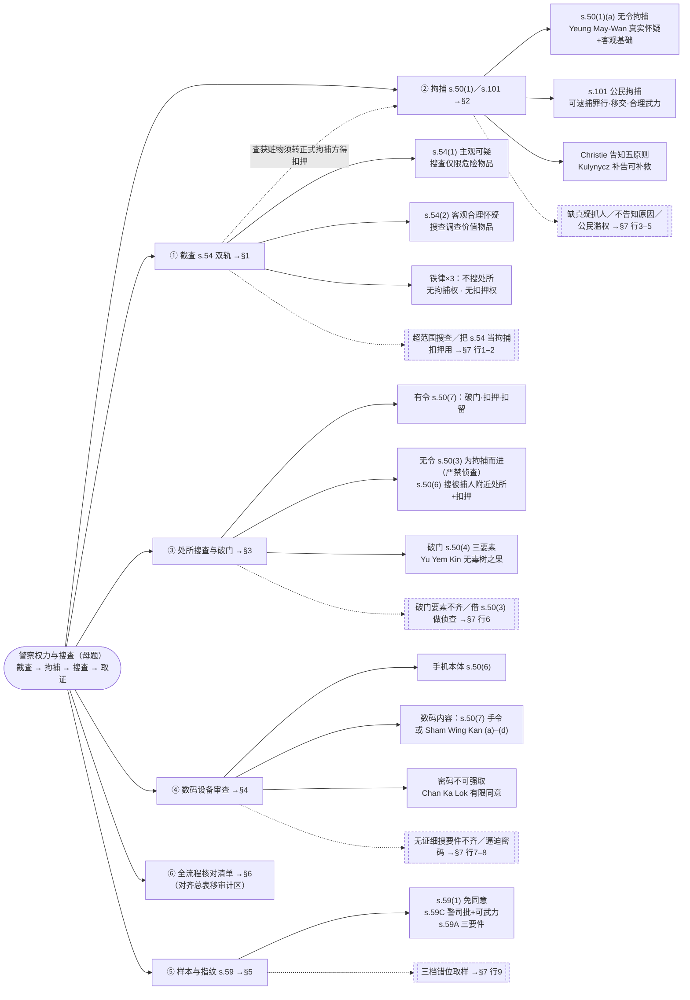
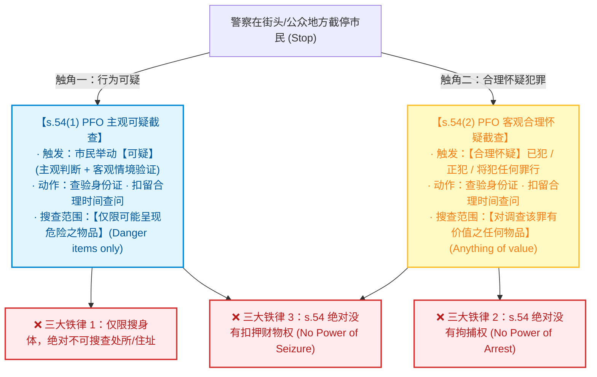
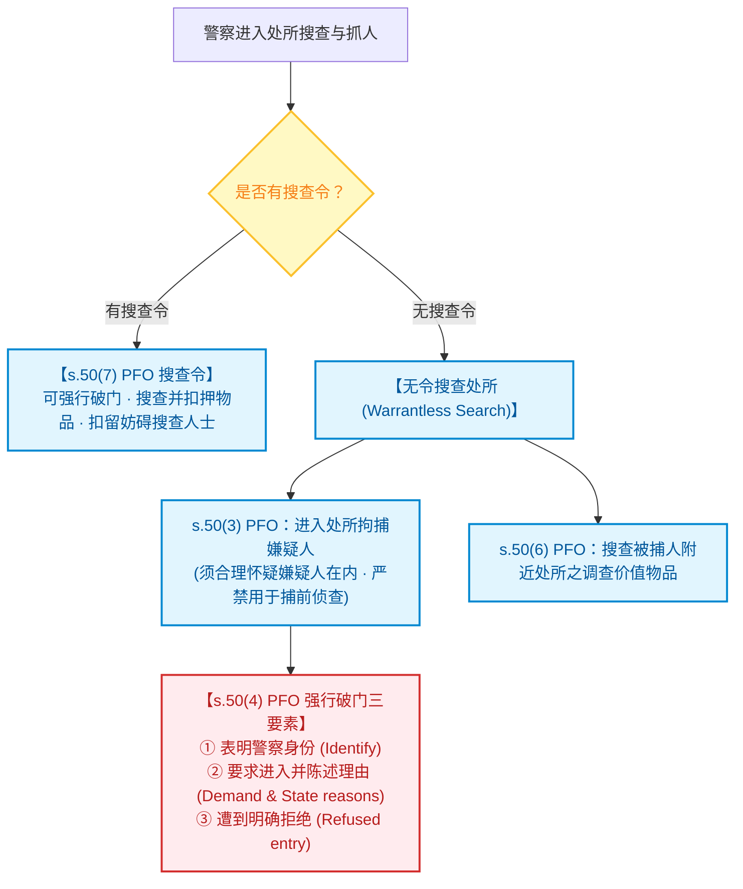

# 11 制度集群卡 — 警察权力、拘捕搜查与数码设备审查制度（Police Powers, Search & Digital Device Rules）

## 速读定位层（30 秒全景：范围 · 术语 · 环节任务，2026-10-10）

> 本层为 2026-10-10 按《PCLL MATERIAL STANDARDS.md》§18.4 落地新增的开篇导引：30 秒锁定警权主线的覆盖范围、关键术语与各程序环节"解决什么问题"；规则的完整条件、例外、冲突并列与逐条原文引注仍以 §0–§7 正文为准，本层引注复用正文已登记的图例码（无新码）。
> **白话导引**：警权卡按警察动手的时序排——街上截停查证件（s.54 双轨：(1) 举止可疑、只能搜可能危险的物品；(2) 合理怀疑犯罪、可搜有调查价值的物品；两条都没有拘捕权、没有扣押权、只搜人身不及处所）→ 要抓人就走 s.50(1)（真实怀疑＋客观合理基础，上级命令不算数）→ 抓了才能进入处所搜查（s.50(3) 为拘捕、s.50(6) 搜附近、s.50(7) 有令可破门，三要素不齐不破门）→ 手机数码内容另有一套 *Sham Wing Kan* 四要件，有限同意不是概括授权（*Chan Ka Lok*）；身体样本分三档（s.59(1) 免同意／s.59C 警司授权可强力／s.59A 三要件缺一即违法）。每一格权力都有自己的门槛与红线——做错的代价见 §7 总表。


### a. 制度辐射范围（本卡覆盖什么，不覆盖什么）

**覆盖（按警权行使时序）**——自街头截查到取样的完整「截查 → 拘捕 → 搜查 → 取证」链：
1. **截查双轨（s.54 PFO）**：s.54(1) 主观可疑截查（搜查仅限可能呈现危险之物品）与 s.54(2) 客观合理怀疑截查（可搜对调查该罪有价值之任何物品）；三大铁律——不搜处所、无拘捕权、无扣押权〔LGS2N L150 "is acting in a suspicious manner"；LGS2N L166 "if a police officer reasonably suspects a person has committed or intends to commit"；LGS2S L119 "KEY POINT 2: THERE IS NO POWER OF ARREST UNDER S.54"；LGS2S L122 "KEY POINT 3: THERE IS ALSO NO POWER TO SEIZE ITEMS FOUND UNDER S. 54"〕；
2. **拘捕两源**：警员无令拘捕 s.50(1)(a) PFO（合理相信将被起诉／合理怀疑犯可判监禁罪行；*Yeung May-Wan* 真实怀疑＋客观合理事实双层检验；上级命令绝不足）与公民拘捕（普通法 breach of the peace；s.101 CPO 可逮捕罪行＝法定刑超 12 个月；须移交警方、仅可合理武力、绝无调查扣留权）〔LGS2N L202 "it shall be lawful for any police officer to apprehend any person who he reasonably believes will be charged with"；LGS2N L216 "a mere order from a more senior officer is insufficient"；LGS2N L299 "for which a person may be sentenced to imprisonment of more than 12 months"；LGS2S L253 "no common law power for a citizen to detain another for inquiries"〕；
3. **告知义务与畸形讯问防线**（*Christie v Leachinsky* 五原则＋三项延伸）：须告知真实拘捕原因、未告知即负非法拘禁、事后补告可补救（*Kulynycz*）、以轻罪套重罪供述违法且须重新警诫（*Pang Ho Yin*）〔LGS2N L321 "an officer must ordinarily inform the arrested person of the true ground of arrest"；LGS2N L335 "Where an arrest is originally unlawful, it can be cured by informing the Defendant of the reasons"；LGS2N L337 "it is unlawful and unfair to arrest and question only in relation to the less serious offence"〕；
4. **处所搜查与破门**：有令路径 s.50(7)（可破门、扣押、扣留妨碍搜查者）；无令路径 s.50(3)（为拘捕而进入，严禁捕前侦查）＋s.50(6)（搜被捕人附近处所并扣押）；强行破门 s.50(4) 三要素；香港无毒树之果原则（*Yu Yem Kin*：违法搜查的证据可采性由法庭裁量）〔LGS2N L249 "S.50(3) PFO allows an officer to demand entry to premises and search for the purposes of making an arrest"；LGS2N L253 "(i) they have identified themselves as police officers, (ii) they have demanded entry and stated why and (iii) entry has been refused"；LGS2N L293 "This is commonly understood to mean that there is no “fruit of the poisoned tree” principle in Hong Kong"〕；
5. **数码设备审查**（*Sham Wing Kan*（上诉法庭）＋*Chan Ka Lok*（2026））：手机本体归 s.50(6)，数码内容两条合法路径——s.50(7) 手令，或符合普通法附随搜查 (a)–(d) 要件的无令搜查；香港不承认 "exigent circumstances" 原则；拒绝提供密码不构成妨碍司法公正；有限同意不等于概括搜查授权、事后手令不能追溯补正〔LGS2N L261 "given the infringement of privacy involved in a search of the digital contents of a mobile phone, the CA were keen to impose"；LGS2N L275 "The CA held that there is no doctrine of ‘exigent circumstances’ in Hong Kong"；LGS2N L275 "nor does the refusal to provide the password amount to obstruction of justice"；LGS2N L279 "The Defendant had only given limited consent for the police to use his phone for the purposes of the CDO"〕；
6. **身体样本与指纹三档**（s.59 PFO）：s.59(1) 身份识别数据（无须同意）→ s.59C 非侵入样本（警司级授权、无须同意、可合理武力）→ s.59A 侵入样本（警司书面授权＋被捕人同意＋裁判官批准三要件）〔LGS2N L359 "the police have a general power to take photographs, finger/palm-prints, weight and height from any arrested person"；LGS2N L363 "then by ss. 59C(4)(e) and 59C(8), reasonable force may be used to extract the sample"；LGS2N L361 "the arrested person consents (in other words he has the right to refuse to provide intimate samples) and a Magistrate gives approval"〕。

**不覆盖（边界声明，相关主卡承担）**：① 被拘捕后在警署的权利与辩护方逐节点应对（警署探访、录口供、律师在场）→ 07 Institution - Investigation Rights and Defence；② 保释（警署保释与法庭保释）→ 05 Institution - Bail；③ 检控决定、启动程序与 1992 R&Ds 警诫供词规则 → 12 Framework - Prosecution, Commencement & 1992 R&Ds；④ 供述可采性争议与半程裁决 → 13 Institution - Criminal Evidence Disputes；⑤ 法院管辖与法律代表 → 10 Framework - Criminal Courts, Jurisdiction & Legal Representation。

### b. 关键术语逐一一句精确定义（中文定义＝英文原词）

| 术语（英文原词） | 一句中文精确定义 | 出处 |
|---|---|---|
| 截查（Stop and search，s.54 PFO） | 警员在公众地方截停市民、查身份证并扣留合理时间查问、并可在法定范围内搜身的权力；普通法上并无此权〔LGS2S L87 "Police have no power to stop, detain and search a person at common law"；LGS2N L156 "detain for a reasonable period for enquiries"〕 | §1 |
| 主观可疑举止（Acting in a suspicious manner，s.54(1)） | s.54(1) 的触发门槛：表面主观、实则受客观事实（时间、地点、神态、专业训练）制约的可疑判断〔LGS2N L162 "The test as to whether a person is acting in a suspicious manner is subjective"；LGS2N L182 "an officer must have regard to the relevant objective facts"〕 | §1.1 |
| 合理怀疑（Reasonable suspicion，s.54(2)） | s.54(2) 的客观门槛：合理怀疑某人已犯、正犯或将犯任何罪行方可截查〔LGS2N L166 "if a police officer reasonably suspects a person has committed or intends to commit"〕 | §1.1 |
| 危险物品搜查限（Anything that may present a danger） | s.54(1) 搜身的法定范围上限：仅限可能呈现危险之物品（如凶器），远窄于 s.54(2) 的调查价值物品范围〔LGS2N L158 "if the officer considers it necessary, he can search the person for anything that may present a danger"；LGS2N L180 "Search powers – s.54(1) is more limited"〕 | §1.1 |
| 无令拘捕（Arrest without warrant，s.50(1) PFO） | 警员无须手令拘捕"合理相信将被起诉"或"合理怀疑犯可判监禁罪行"者的权力，涵盖大部分公诉罪行〔LGS2N L202 "it shall be lawful for any police officer to apprehend any person who he reasonably believes will be charged with"；LGS2N L204 "this covers most indictable offences"〕 | §2.1 |
| 真实怀疑双层检验（Genuine suspicion＋objectively reasonable grounds，*Yeung May-Wan*） | 合法无令拘捕的要件：抓人警员须亲形成真实怀疑，且该怀疑立于客观合理的事实依据之上，仅凭上级命令不构成〔LGS2N L212 "the arresting officer must have formed a genuine suspicion that an offence has been committed"；LGS2N L214 "this genuine suspicion must be formed on objectively reasonable grounds"〕 | §2.1 |
| 公民拘捕（Citizen's arrest，s.101 CPO） | 普通市民对可逮捕罪行（或破坏社会安宁）的拘捕权：抓后须移交警方、仅可用合理武力、无权为调查扣留盘问〔LGS2N L297 "A citizen has a common law power to arrest for breach of the peace"；LGS2N L301 "the citizen shall deliver the arrestee to a police officer so that he may be brought before a magistrate"；LGS2N L305 "A person may use such force as is reasonable in the circumstances in the prevention of crime"〕 | §2.2 |
| 可逮捕罪行（Arrestable offence） | s.101 CPO 公民拘捕的罪种门槛：法定刑期为超过 12 个月监禁的罪行（定义见 s.3 IGCO）〔LGS2N L299 "The definition of an Arrestable Offence is found in s. 3 Interpretation & General Clauses Ordinance"；LGS2N L299 "for which a person may be sentenced to imprisonment of more than 12 months"〕 | §2.2 |
| 告知真实拘捕原因（True ground of arrest，*Christie* 原则 (i)–(ii)） | 无手令拘捕原则上须告知真实理由；不告知而扣留即负非法拘禁（false imprisonment）之责〔LGS2N L321 "An officer cannot keep the true reasons to himself or give a reason that is not the true reason"；LGS2N L323 "If the citizen is not informed but is detained, the officer is liable for false imprisonment"〕 | §2.3 |
| 搜查令（Search warrant，s.50(7) PFO） | 由裁判官签发、授权进入处所搜查并可强行破门、扣押物品、扣留妨碍搜查者合理时间的令状〔LGS2N L283 "This includes the power to break into the premises by force, to seize the items"〕 | §3 |
| 破门三要素（s.50(4) PFO） | 无证强行进入处所前必须齐备的三件事：表明警察身份、要求进入并陈述理由、遭明确拒绝进入〔LGS2N L253 "(i) they have identified themselves as police officers, (ii) they have demanded entry and stated why and (iii) entry has been refused"〕 | §3 |
| 毒树之果原则（Fruit of the poisoned tree） | 英美证据法上"违法取证所得派生证据一概排除"的原则；香港**不采用**——违法搜查的证据可采性由法庭个别裁量（*R v Yu Yem Kin*）〔LGS2N L293 "This is commonly understood to mean that there is no “fruit of the poisoned tree” principle in Hong Kong"；LGS2N L293 "If a search is unlawful, the evidence obtained may or may not be admissible. The court will determine admissibility"〕 | §3 |
| 附随搜查（Search incidental to a lawful arrest） | *Sham Wing Kan*（CA）为无令搜查手机数码内容定下的普通法基础：搜查须真正附随于一次合法拘捕，且取证前取得手令实在不可行〔LGS2N L267 "the police first have reasonable suspicion that the person to be arrested has committed an offence (since the search is incidental to a lawful arrest)"；LGS2N L269 "the scope and purpose of the search is truly incidental to the arrest"〕 | §4 |
| 粗略检视（Cursory examination for filtering） | 无令搜查数码内容时允许的第一层检视；超出筛取用途的详细搜查，范围须限于该次附随目的相关资料〔LGS2N L271 "other than a cursory examination for filtering purpose, the scope of the detailed examination of the digital contents of a phone should be limited"〕 | §4 |
| 有限同意（Limited consent，*Chan Ka Lok*） | 被告只为特定目的（如控制交付行动）交出手机和密码的同意，不等于授权警方概括搜查一切不利证据；事后取得的手令不能追溯补正〔LGS2N L279 "not a wide consent for them to search for incriminating evidence"；LGS2N L279 "A subsequent search warrant obtained could not be applied retrospectively to cure the inadmissibility of the evidence"〕 | §4.1 |
| 非侵入性样本（Non-intimate sample，s.59C PFO） | 头部毛发、口腔拭子、唾液等样本：羁押中经警司级以上授权即可采集，无须被捕人同意，拒不合作可用合理武力〔LGS2N L363 "These samples include head hair, buccal swabs and saliva but must be authorized by an officer of or above the rank of a superintendent"〕 | §5 |
| 侵入性样本（Intimate sample，s.59A PFO） | 血、精液、尿液等高侵入样本：须同时具备警司级或以上书面授权、被捕人同意、裁判官批准三要件才可采集〔LGS2N L361 "an officer of or above the rank of superintendent gives written authorisation for such collection"；LGS2N L361 "the arrested person consents (in other words he has the right to refuse to provide intimate samples) and a Magistrate gives approval"〕 | §5 |

### c. 各环节解决什么问题（按警权行使时序）

| 环节（时序） | 它解决的具体问题 | 依据 |
|---|---|---|
| 截查定轨 | 街头拦下一个人，警员凭什么、能做什么：先定 s.54(1) 还是 s.54(2)，再定搜查范围（危险品 vs 调查价值物品）；普通法无截查权〔LGS2S L89 "s. 54(1) (a person acting suspiciously)"；LGS2S L90 "s. 54(2) (officer must have a reasonable suspicion of offending)"〕 | §1、§1.1 |
| 查获物品后的合法化 | 截查获赃物但 s.54 无扣押权：必须立即以 s.50(1) 正式拘捕，才能经 s.50(6) 合法扣押〔LGS2S L123 "they will need to do so under the s. 50 power of arrest"；LGS2N L259 "S. 50(6) also gives an officer the power to seize items found in the search"〕 | §1.1、§2.1 |
| 拘捕合法性自检 | 抓人前核：真实怀疑是否立于客观合理事实？是否只凭上级命令？s.50(1A) 下无须目睹犯案但不除双层检验〔LGS2N L212 "the arresting officer must have formed a genuine suspicion that an offence has been committed"；LGS2N L206 "According to s. 50(1A) PFO there is also no need for the officer to see the offence being committed"〕 | §2.1 |
| 告知与讯问防线 | 抓后说什么、怎么问：告知真实原因（免非法拘禁）；不得以轻罪名义套重罪供述，否则须重新警诫（*Pang Ho Yin*）〔LGS2N L323 "the officer is liable for false imprisonment"；LGS2N L421 "he cannot make an informed decision about whether to exercise his right of silence"〕 | §2.3 |
| 公民抓人边界 | 店员/市民抓人合法不合法：罪种须为可逮捕罪行或破坏安宁；抓后移交、武力合理、不得扣留盘问；Christie 五原则同样约束平民〔LGS2N L331 "The 5 principles in Christie v Leachinsky also apply where a citizen makes a private arrest"〕 | §2.2、§2.3 |
| 进屋与破门 | 搜住处怎么办：先问有没有 s.50(7) 手令；无令仅限 s.50(3)（为拘捕、非侦查）与 s.50(6)；强行破门须 s.50(4) 三要素齐备〔LGS2N L251 "This provision does not allow an officer to search private premises merely to conduct an investigation"；LGS2S L201 "Officer can use force without a warrant if one would be granted but cannot be obtained in time"〕 | §3 |
| 手机数码内容 | 手机能不能翻：本体 s.50(6)；内容须 s.50(7) 手令或 *Sham Wing Kan* (a)–(d)；密码不可强迫；有限同意不放大（*Chan Ka Lok*）〔LGS2S L215 "note: search and seizure of actual phone covered by s. 50(6) PFO"；LGS2S L220 "Arrestee cannot be compelled to provide police with password; failure does not amount to obstruction of justice"〕 | §4、§4.1 |
| 取样定档 | 取指纹/毛发/血液走哪一档：s.59(1) 基本数据免同意 → s.59C 非侵入（警司批、可武力）→ s.59A 侵入（书面授权＋同意＋裁判官批准）〔LGS2S L288 "Photos, fingerprints, palmprints, height and weight can always be taken"；LGS2S L291 "approval of senior officer required but not consent of arrestee"〕 | §5 |

## 🗺️ 本卡地图（章节位置与阅读顺序，2026-10-10）

> 两件套：**图 1 · 母题结构图**（截查→拘捕→搜查的分支 roadmap＝全流程主干与后果虚线；s.54 双轨＝**图 2** 见 §1，处所搜查决策树＝**图 3** 见 §3）→ **任务直达表**（按要做的事跳章节）。mermaid 节点看结构、不可点；点跳用直达表锚链。

**图 1 · 警察权力与搜查分支 roadmap（全流程主干与后果虚线）**：



读图逻辑：实线是截查→拘捕→搜查→取证的主干四段，每段末尾箭头指向承担小节；虚线 warnnode 是「不做」的后果钩子，行号统一收口 §7 总表；§1 的 s.54 双轨图（图 2）与 §3 的处所搜查决策树（图 3）补两条权力线的分支细节。


| 你现在要做什么 | 直达章节 |
|---|---|
| 30 秒弄清范围/术语/环节任务 | [速读定位层](#速读定位层（30%20秒全景：范围%20·%20术语%20·%20环节任务，2026-10-10）) |
| 判断一次街头截查/搜身合不合法 | §1 mermaid＋§1.1 对照表＋§7 行 1–2 |
| 判定能否当场拘捕、抓后怎么说 | §2.1（双层检验）＋§2.3（Christie）＋§7 行 3–4 |
| 回应"店员/市民抓人"题 | §2.2 公民拘捕＋§7 行 5 |
| 进屋搜查/破门分析 | §3 mermaid＋图外出处段＋§7 行 6 |
| 手机、WhatsApp、密码题 | §4 四原则＋§4.1 *Chan Ka Lok*＋§7 行 7–8 |
| 指纹/毛发/血液取样题 | §5 样本表＋§7 行 9 |
| 查"某环节做错会怎样"（证据后果） | [§7 后果速查总表](#7.%20环节%20×%20不做/做错的后果%20×%20依据速查总表（2026-10-10）)（§1–§5 正文均有"总表索引"回点） |
| 核对某条规则出处与届别 | [§0 图例](#0.%20底层材料溯源库与代码表（Source%20Provenance%20Index）)＋审计区·对齐总表（原 §6） |
| SG01 A1/A2/B1 实战穿透 | §1（A1）、§2.1（A2）、§2.2（B1）💡 段 → SG01 Classroom |

---

## 0. 底层材料溯源库与代码表（Source Provenance Index）

> **引注格式**（2026-09-30 依《PCLL Provenance Manual 2026-09-29》§2.2 落实）：每行末尾的全角括注内是「码＋该文件在库内的行号＋原文摘录」，
> 一条括注可含多条出处、以全角分号分隔；码→文件→层级→学年见下方图例（点开折叠）。
> 往届（2025-26）出处一律带「·往届仅参考」并在行文写明届别；2026-11-16 蓝图重构起正文「空引注记号」（原为方头括号内仅破折号，表示该行已审无需出处）已全部清剿、历史区保留；
> 标 ⚠️ 处为本库材料之间的不一致：同届互不一致者并列不裁决，一为本届一为往届者按 §2.5 取本年讲义并标注冲突；未决项登记在本文件末尾的 open 块。


<!-- BEGIN:cite-legend -->
> [!info]- 引注图例（出处码 → 文件；点开折叠）
>
> | 码 | 文件 | 层级 | 学年 |
> |---|---|---|---|
> | LGS2N | 本届 LGS 2 讲义（侦查、开始程序与保释） | 本届讲义 | 2026-27 |
> | LGS2S | 本届 LGS 2 课堂幻灯 | 本届讲义 | 2026-27 |
> | OLD-LG02P1 | 往届 LG02 Part One 讲义（警察截查、拘捕与搜查权力） | 往届官方 | 2025-26 |
> | OLD-SG01S1 | 往届 SG01 Set 1 学生册（侦查阶段课堂） | 往届学生稿 | 2025-26 |
> | OLD-EXALL | 往届考试总笔记 Set 2《Crim Lit - ALL》 | 往届学生稿 | 2025-26 |
> | CAP-K2 | PCLL8050 LGS2 PT | 本届讲义 | 2026-27 |
> | WK2 | PCLL8050 LGS2本届修订讲义 | 本届讲义 | 2026-27 |


<!-- END:cite-legend -->
**取材顺序**（Manual §2.6）：本届 slides → 本届 notes → 往届官方 → 往届学生稿。本卡的截查、拘捕、处所搜查与数码设备四节以本届 LGS 2 讲义（码 LGS2N）为主线，
本届课堂幻灯（码 LGS2S）作同期旁证；讲义与幻灯一致时以讲义条文为主，两说不一者一律并列并登记文末，不代用户裁决。

**旧 `[S-Statute]`／`[S-Case]` 两行的去向**：旧表所列 Cap. 232 (PFO)、Cap. 221 (CPO)、Cap. 115 (IO)、Cap. 245 (POO) 四部法例，以及 *Wong Tze Yam*、*Yeung May-Wan*、*Sham Wing Kan*、*HKSAR v Chan Ka Lok* 四件判例，都不是本库可定位的文件，其条文与判词内容一律以载明它们的讲义／幻灯原文行号为出处。
*Christie v Leachinsky*、*Yu Yem Kin*、*Kulynycz*、*Pang Ho Yin* 另四件判例同理。故本卡图例只登记库内实际存在且被正文引到的五个文件。
它们的条文与判词内容一律以载明它们的讲义／幻灯原文行号为出处，故本卡图例只登记库内实际存在且被正文引到的五个文件。


---

## 1. 警察截停、扣留与搜身权力（s.54 PFO 双轨制）`[S-LGS2-SLIDES-2026: Slide 6–11]`

**图 2 · s.54 双轨与三大铁律（截查→搜身→红线）**：


> **上图各栏出处**（图内不写引注，故在图外逐栏标注）：两轨的触发条件即本届幻灯 s.54(1)／s.54(2) 两条标题所辖各栏，其下动作与搜查范围逐条见 §1.1 对照表各行。 〔LGS2S L89 "s. 54(1) (a person acting suspiciously)"；LGS2S L90 "s. 54(2) (officer must have a reasonable suspicion of offending)"；LGS2S L87 "Police have no power to stop, detain and search a person at common law"〕
> 「三大铁律」三条逐字对应本届幻灯 KEY POINT 1／2／3，其内容在 §1.1 对照表各行另有更完整的引文群。〔LGS2S L118 "s. 54 PFO search is “of the person” who has been stopped – not the premises / the area"；LGS2S L118 "The person must also be out in “public” – i.e. not at home, in private premises"；LGS2S L119 "KEY POINT 2: THERE IS NO POWER OF ARREST UNDER S.54"；LGS2S L122 "KEY POINT 3: THERE IS ALSO NO POWER TO SEIZE ITEMS FOUND UNDER S. 54"；LGS2S L89 "s. 54(1) (a person acting suspiciously)"；LGS2S L90 "s. 54(2) (officer must have a reasonable suspicion of offending)"〕


### 1.1 s.54(1) vs s.54(2) PFO 核心法理与实操对照表

| 比较维度 | s.54(1) PFO（可疑举止） | s.54(2) PFO（合理怀疑犯罪） | 核心判例与实务红线 |
|---|---|---|---|
| **触发门槛** | 主观认为市民举止可疑（Subjective suspicious manner）。 | 客观上对犯罪存在合理怀疑（Objective reasonable suspicion of offence）。 | *Wong Tze Yam v CP [2009]*：主观判断必须受客观事实（时间、地点、神态举止、警员专业训练）制约。 〔LGS2N L150 "is acting in a suspicious manner"；LGS2N L162 "The test as to whether a person is acting in a suspicious manner is subjective"；LGS2N L166 "if a police officer reasonably suspects a person has committed or intends to commit"；LGS2N L182 "an officer must have regard to the relevant objective facts"；LGS2N L182 "So even the seemingly subjective criteria in s. 54(1) PFO is subject to elements of objectivity"〕|
| **查验与扣留** | 查身份证；扣留合理时间以便查问（Detain for reasonable period）。 | 查身份证；扣留合理时间以便查问。 | 扣留时间过长将构成非法拘禁（False Imprisonment）。 〔LGS2N L154 "stop and demand ID"；LGS2N L156 "detain for a reasonable period for enquiries"；LGS2N L170 "detain him for a reasonable period while the officer makes enquiries"；LGS2N L227 "a claim by D for false imprisonment and damages"〕 〔❓本栏「扣留时间过长将构成非法拘禁」是本卡旧版推论。库内 s.54 条文摘录只写「扣留合理时间」，未就超时的后果立言。库内把 false imprisonment 与扣留相连的原文只有非法拘捕可生索赔（讲义 L227）与 Christie 第(ii)项未告知拘禁（讲义 L323），均非「超过合理时间即非法拘禁」。已就地标注，删留待你定〕|
| **搜查权力范围** | **极度限缩**：仅在警员认为有必要时，搜查**可能呈现危险的物品（Anything of danger，如凶器、枪械）**。 | **广泛**：搜查**对调查该罪行有价值之任何物品（Anything of value to the investigation）**。 | 若仅因“神色慌张”依 s.54(1) 截查，却伸手搜查其钱包内的纸张文件，该搜查**违法超权**。 〔LGS2N L158 "if the officer considers it necessary, he can search the person for anything that may present a danger"；LGS2N L180 "Search powers – s.54(1) is more limited"；LGS2N L172 "search the person for anything of value to the investigation of the offence"〕 〔❓末栏「仅因神色慌张即搜钱包内纸张文件属违法超权」是本卡旧版设例：库内只规定 s.54(1) 的搜查范围限于可能呈现危险之物，没有同一设例的原文。已就地标注，删留待你定〕|
| **扣押与拘捕** | **无权扣押，无权拘捕**。 | **无权扣押，无权拘捕**。 | 搜出赃物/毒品后，必须立即依据 **s.50(1) PFO 正式拘捕**，方可合法扣押物品！ 〔LGS2S L119 "THERE IS NO POWER OF ARREST UNDER S.54"；LGS2S L122 "THERE IS ALSO NO POWER TO SEIZE ITEMS FOUND UNDER S. 54"；LGS2S L123 "they will need to do so under the s. 50 power of arrest"；LGS2N L259 "S. 50(6) also gives an officer the power to seize items found in the search"；OLD-EXALL L454 "No power of arrest under s.54 PFO, but the search may lead to an arrest under s.50 PFO"·往届仅参考〕|

> 💡 **【实战穿透 · SGS 1 Q A1】**：Fergus Fan 醉酒踉跄案（案情与题问的原件为**往届** SG01 Set 1 学生册，本届课堂件沿用同一题），详见 SG01 Classroom Brief A Question A1（警方截停、查验身份证及搜身的权力）。 〔OLD-SG01S1 L74 "Fergus Fan, aged 19, has been arrested. He was stopped by the police on the street"·往届仅参考；OLD-SG01S1 L78 "Comment on the police's powers to stop Fergus, ask for his ID card and search him"·往届仅参考；OLD-SG01S1 L146 "Fergus was acting suspiciously under s54(1)"·往届仅参考〕

**总表索引（2026-10-10）**：把 s.54(1) 当 s.54(2) 超范围搜查、以及把 s.54 当拘捕／扣押权用的后果链归并 [§7 行 1–2](#7.%20环节%20×%20不做/做错的后果%20×%20依据速查总表（2026-10-10）)。

> **Exam / Advocacy Formulation:** "s.54 lets the police stop and search the person — (1) for danger items on suspicious manner, (2) for investigation-value items on reasonable suspicion — but never to arrest, never to seize, and never the premises."（自拟考场口径；底层规则见 §1.1 各行引注）

---

## 2. 警察无令拘捕 vs 公民拘捕制度 `[S-LGS2-SLIDES-2026: Slide 12–16, 25–28]`

### 2.1 警务人员无令拘捕（s.50(1)(a) PFO）
1. **法定门槛**：警员**合理相信（Reasonably believes）某人将被起诉**，或**合理怀疑（Reasonably suspects）某人犯有法定监禁罪行**。 〔LGS2N L202 "it shall be lawful for any police officer to apprehend any person who he reasonably believes will be charged with"；LGS2S L149 "Reasonable belief a person will be charged with"；LGS2S L152 "Offence that can be sentenced on first conviction to imprisonment"；LGS2N L204 "this covers most indictable offences"〕
2. **终审法院主导先例 (*Yeung May-Wan v HKSAR [2005]*)**： 〔LGS2S L154 "Leading case on arrest without a warrant: Yeung May-Wan & Ors v. HKSAR (2005) 8 HKCFAR 137"；LGS2N L210 "It is both a subjective and an objective test"〕 〔❓「终审法院主导先例」一语是本卡旧版所加：库内两件本届材料都只给出引证 (2005) 8 HKCFAR 137，未书明审理法院。本卡 §4.1 自订口径为「库内未注明法院层级即不自行标注 CA／CFI」，两处标准不一，孰从待你定〕
 - 警员必须具备**真实的怀疑（Genuine suspicion）**； 〔LGS2N L212 "the arresting officer must have formed a genuine suspicion that an offence has been committed"；LGS2S L160 "Arresting officer needs a genuine suspicion an offence was committed"〕
 - 该怀疑必须建立在**客观合理的事实依据上（Objectively reasonable grounds）**； 〔LGS2N L214 "this genuine suspicion must be formed on objectively reasonable grounds"；LGS2S L161 "Genuine suspicion must be formed on objectively reasonable grounds"〕
 - **上级命令绝不足以构成合法怀疑**（Mere order from senior officer is insufficient）；抓人警员必须被简报事实或掌握事实碎片。 〔LGS2N L216 "a mere order from a more senior officer is insufficient"；LGS2N L218 "this sufficient factual basis could take the form of a briefing prior to arrest"〕
 - 依据 s.50(1A) PFO，警员**无需亲眼目睹罪行发生过程**。 〔LGS2N L206 "According to s. 50(1A) PFO there is also no need for the officer to see the offence being committed"；LGS2S L167 "there is no need for the officer to see the offence being committed"〕

> 💡 **【实战穿透 · SGS 1 Q A2】**：搜出大剪刀后依据 s.50(1) PFO 实施拘捕与 s.50(6) 扣押剪刀物证（案卷与解答见**往届** SG01 Set 1 学生册，本届课堂件沿用同一题），详见 SG01 Classroom Brief A Question A2（拘捕与检取剪刀的权力及依据）。 〔OLD-SG01S1 L204 "Fergus was then arrested and cautioned for possession of an offensive weapon"·往届仅参考；OLD-SG01S1 L214 "No power to arrest Fergus and seize the scissors under s54(1)"·往届仅参考；OLD-SG01S1 L218 "PFO s50(6) PFO - Search of a person on lawful arrest without a warrant"·往届仅参考；LGS2N L259 "S. 50(6) also gives an officer the power to seize items found in the search"〕

**总表索引（2026-10-10）**：拘捕缺真实怀疑、只凭上级命令、迷信 s.50(1A) 而免做双层自检的后果链归并 [§7 行 3](#7.%20环节%20×%20不做/做错的后果%20×%20依据速查总表（2026-10-10）)。

### 2.2 公民拘捕权（Citizen's Arrest — s.101 CPO & Common Law）
1. **两大权力渊源**：
 - **普通法**：发生**破坏社会安宁（Breach of the Peace）**时，任何公民可当场制止并拘捕 (*HKSAR v Chow Nok Hang [2013]*). 〔LGS2N L297 "A citizen has a common law power to arrest for breach of the peace"；LGS2N L297 "that citizen has the right to arrest the offender without a warrant"；LGS2S L246 "Common Law: can arrest for breach of peace"〕
 - **成文法 (s.101 CPO)**：合理怀疑某人犯有**可逮捕罪行（Arrestable Offence，即法定刑期超过 12 个月之罪行，s.3 IGCO）**。 〔LGS2N L299 "A citizen also has a statutory power of arrest under s. 101 CPO to arrest a person whom he reasonably suspects"；LGS2N L299 "The definition of an Arrestable Offence is found in s. 3 Interpretation & General Clauses Ordinance"；LGS2N L299 "for which a person may be sentenced to imprisonment of more than 12 months"〕
2. **法定限制**：公民拘捕后**必须立即（Forthwith）将捕获人移交给警务人员 (s.101(5) CPO)**；仅可使用**合理武力 (s.101A CPO)**。普通法下公民**绝对没有为调查而强行扣留他人的权力**。 〔LGS2N L301 "the citizen shall deliver the arrestee to a police officer so that he may be brought before a magistrate"；LGS2S L249 "Citizen should deliver the arrestee to a police officer upon arrest"；LGS2N L305 "A person may use such force as is reasonable in the circumstances in the prevention of crime"；LGS2S L253 "no common law power for a citizen to detain another for inquiries"〕 〔❓本栏「必须立即（Forthwith）」是本卡旧版用语。库内 s.101(5) CPO 的原文作「so that he may be brought before a magistrate as soon as he may reasonably be brought」，「forthwith」在库内只见于 s.51 PFO 解送警署主管一条，两者措辞不同。删留待你定〕

> 💡 **【实战穿透 · SGS 1 Q B1】**：7-11 店员 Alice 飞扑摔折 14 岁少年鼻骨并绳捆双手案，涉及 s.101(2) 市民拘捕与 s.101A 过量武力认定，详见 SG01 Classroom Brief B Question B1（店员 Alice 市民拘捕及捆绑双手的合法性）。另注意：Christie 五原则同样适用于**公民拘捕**，且原定非法的拘捕可因其后在警署补告原因而获补救（*R v Kulynycz*）。 〔LGS2N L331 "The 5 principles in Christie v Leachinsky also apply where a citizen makes a private arrest"；LGS2N L335 "Where an arrest is originally unlawful, it can be cured by informing the Defendant of the reasons"〕 〔❓「涉及 s.101(2) 市民拘捕」是本卡旧版用语：库内四件材料只作 s.101 CPO 及 s.101(5)、s.101A CPO，未见 s.101(2) 的任何记载（往届学生册另把移交一条误书为 s105(5)）。删留待你定〕 〔❓「s.101A 过量武力认定」若读作结论，与本卡所引往届学生册的答案相反：该册认为店员以绳捆手在被告欲离店的案情下「would seem that Alice's use of force was justified」。本卡原文照旧保留，取舍待你定〕

**总表索引（2026-10-10）**：公民拘捕抓后不移交、扣留盘问、超合理武力的后果链归并 [§7 行 5](#7.%20环节%20×%20不做/做错的后果%20×%20依据速查总表（2026-10-10）)。

### 2.3 告知拘捕原因五原则（*Christie v Leachinsky [1947]* 先例）`[S-Case]`
> 出处：本届讲义逐条列出五项原则；五项原则**亦适用于公民拘捕**。 〔LGS2N L319 "Christie v Leachinsky establishes 5 principles"；LGS2N L331 "The 5 principles in Christie v Leachinsky also apply where a citizen makes a private arrest"〕

1. **(i) 须告知真实拘捕原因**：无手令拘捕时，警员原则上必须告知被捕人**真实的**拘捕理由；既不可隐瞒，也不可给出并非真实理由。 〔LGS2N L321 "an officer must ordinarily inform the arrested person of the true ground of arrest"；LGS2N L321 "An officer cannot keep the true reasons to himself or give a reason that is not the true reason"〕
2. **(ii) 未告知即构成非法拘禁**：市民被扣留却未获告知原因的，警员须负非法拘禁 (false imprisonment) 责任。 〔LGS2N L323 "If the citizen is not informed but is detained, the officer is liable for false imprisonment"；LGS2S L265 "the officer is liable for false imprisonment and the arrest is unlawful"〕
3. **(iii) 被捕人已然知悉时例外**：若当时情境使被捕人**必然知道**他被扣押的罪行一般性质，则无须告知。 〔LGS2N L325 "the arrested person must know the general nature of the offence for which he is detained"；LGS2S L266 "No need to inform of the reasons where the arrested must know the general nature"〕
4. **(iv) 无须使用技术性或精确措辞**：告知原因时不必引经据典、字字对应法条，讲明事实核心即可。 〔LGS2N L327 "there is no need for technical or precise language to be used"；LGS2S L267 "No need for technical or precise language to be used"〕
5. **(v) 被捕人自阻告知时例外**：如被捕人逃跑或以其他行为令告知事实上不可行，则无须告知；此例外不限于举其一的例子。 〔LGS2N L329 "There is no need to inform of the reasons where the arrested person makes it impracticable to do so"；LGS2N L329 "Other examples of where there is no need to inform the persons of the reasons for arrest may also exist"〕

**与五原则并列的三项课堂延伸（原件另立，勿混入五原则）**： 〔❓本行称「三项课堂延伸」，而本届讲义同一节把 (4)–(8) 五项编号并列（(5) 结论一条与 (8) 违反则通常排除口供一条未入本卡）。是否为有意删减，待你定〕
* **(4) 适用主体**：五原则同样约束行使公民拘捕权的普通人。 〔LGS2N L331 "also apply where a citizen makes a private arrest"；LGS2S L252 "Common law principles regarding arrest also apply to a citizen's arrest"〕
* **(6) 事后补救 — *R v Kulynycz [1971]*：** 原定非法的拘捕，可在其后（如于警署）向被捕人补告拘捕原因而**获得补救**。 〔LGS2N L335 "it can be cured by informing the Defendant of the reasons for arrest at the police station"；LGS2S L272 "Can cure an unlawful arrest by informing of the reasons for arrest within a reasonable period"〕
* **(7) 以轻罪为名套取供述的禁忌（原件该条未具案名）：** 若一行为可构成数罪，警方只以较轻罪行名义拘捕并讯问，待被捕人给出不利供述后才改称正在调查较重罪行——该做法**违法且不公**；被捕人要么就较重罪行被控，要么被告知调查的真实性质，以便决定是否需要法律代表。 〔LGS2N L337 "it is unlawful and unfair to arrest and question only in relation to the less serious offence"；LGS2N L337 "The Defendant must either be charged with the more serious offence or be informed of the true nature of the investigation"〕
* ***HKSAR v Pang Ho Yin [2010] 3 HKLRD 515*（上诉庭）：** 被告因以为自承较重罪行可换取减轻，就在就较轻罪行的讯问中承认了较重罪行——上诉庭裁定警方**须就较重罪行重新向他作出警诫**，否则他在不知调查真实性质的情况下无法就是否行使沉默权作出知情决定。 〔LGS2N L421 "the Court of Appeal held that where the Defendant, in the course of being questioned for less serious offences"；LGS2N L421 "he cannot make an informed decision about whether to exercise his right of silence"；LGS2S L273 "D should be informed of the true nature of the investigation"〕
* ⚠️ 旧版在此写"此举将**直接导致**口供被法官排除"：本卡所引讲义 (7) 条与判例两条原文**均未**规定必然排除，只规定违法／须重新警诫；是否排除仍属法官按不公与证据价值行使的**酌情权**（参见卡 12 关于违反 R&Ds 后果的处理）。 〔LGS2N L337 "it is unlawful and unfair to arrest and question only in relation to the less serious offence"；LGS2N L421 "he should be cautioned for the more serious offence"；LGS2N L339 "Failure to comply with these principles would usually lead to confessions being excluded due to unfairness"；LGS2S L274 "Failure to comply with these principles would usually lead to confessions being excluded due to unfairness"；D-CHR-EXCL〕

**总表索引（2026-10-10）**：不告知拘捕原因、给假原因、以轻罪套重罪供述后不再警诫的后果链（含 D-CHR-EXCL”通常排除 vs 酌情“未裁）归并 [§7 行 4](#7.%20环节%20×%20不做/做错的后果%20×%20依据速查总表（2026-10-10）)。

---

## 3. 处所搜查与破门权力（Search of Premises）`[S-LGS2-SLIDES-2026: Slide 19–24]`

**图 3 · 处所搜查决策树（有令／无令两支）**：



> **上图各节点出处**（图内不写引注，故在图外逐节点标注）：
> - 「有搜查令」一支（s.50(7)）〔LGS2N L283 "This includes the power to break into the premises by force, to seize the items"；LGS2N L283 "to detain for a reasonable period any person who has such items in their possession or who might prejudice the purpose of the search"；LGS2S L232 "Must be reasonable cause to suspect there is likely to be a thing of value to investigation of offence"；LGS2S L235 "Can detain person with items to be seized in their possession (or who may interfere with search) for a reasonable period"〕
> - 「无令・进入拘捕」一支（s.50(3)）〔LGS2N L249 "S.50(3) PFO allows an officer to demand entry to premises and search for the purposes of making an arrest"；LGS2N L249 "if he reasonably suspects a person will be arrested and that the suspect is in the premises"；LGS2S L197 "Officer must reasonably suspect a person will be arrested and that the suspect is in the premises"；LGS2N L249 "The person in charge of the premises should allow entry"〕
> - 同支「严禁用于捕前侦查」〔LGS2N L251 "This provision does not allow an officer to search private premises merely to conduct an investigation"；LGS2S L199 "Does not allow a pre-arrest investigation"；LGS2S L199 "This provision is only applicable where the s. 50(1) is already satisfied"〕
> - 「无令・搜查附近处所」一支（s.50(6)）〔LGS2N L259 "S.50(6) also allows an officer to search the arrested person or"；LGS2S L210 "Can search the arrested person or the premises in which that person was arrested"；LGS2N L259 "S. 50(6) also gives an officer the power to seize items found in the search"〕
> - 「强行破门三要素」（s.50(4)）〔LGS2N L253 "(i) they have identified themselves as police officers, (ii) they have demanded entry and stated why and (iii) entry has been refused"；LGS2S L202 "Officer must demand entry to the premises AND state the reasons why"；LGS2S L201 "Officer can use force without a warrant if one would be granted but cannot be obtained in time"〕

* **香港无“毒树之果”原则 (*R v Yu Yem Kin [1994]*)**：搜查即使存在程序瑕疵或无令违法，所查获的实物证据**不会自动丧失可采性**，法官有最终自由裁量权平衡证据价值与公共利益。 〔LGS2N L293 "If a search is unlawful, the evidence obtained may or may not be admissible. The court will determine admissibility"；LGS2N L293 "This is commonly understood to mean that there is no “fruit of the poisoned tree” principle in Hong Kong"；LGS2S L241 "If a search is unlawful, the evidence obtained may or may not be admissible"；LGS2N L289 "A search should only be conducted without a warrant where it is reasonably necessary and reasonably impracticable to do so with a warrant"〕 〔❓本栏「法官有最终自由裁量权平衡证据价值与公共利益」：库内三处原文只作「the court will determine admissibility」，未把「公共利益」列为权衡因素。删留待你定〕

**总表索引（2026-10-10）**：借 s.50(3) 做捕前侦查、破门三要素不齐、有令不走 s.50(7) 的后果链归并 [§7 行 6](#7.%20环节%20×%20不做/做错的后果%20×%20依据速查总表（2026-10-10）)。

---

## 4. 手机与数码设备搜查制度（Digital Device Search Rules）`[S-LGS2-SLIDES-2026: Slide 21, 22]`

智能手机所承载的海量隐私，由**上诉法庭 (Court of Appeal)** 在 ***Sham Wing Kan v Commissioner of Police [2020] HKCA 186; [2020] 3 HKC 254*** 确立里程碑式规则。 〔LGS2N L261 "to what extent does s.50(6) allow officers to search the digital content of a mobile phone they have seized"；LGS2N L261 "given the infringement of privacy involved in a search of the digital contents of a mobile phone, the CA were keen to impose"；LGS2S L215 "Digital content of a mobile phone under HKSAR laws? : Sham Wing Kan v. Commissioner of Police [2020] HKCA 186; [2020] 3 HKC 254"〕

> ⚠️ **法院层级更正**：旧版写"终审法院与上诉法庭"。库内讲义与幻灯片就搜查准则所引的 *Sham Wing Kan* 均为**上诉法庭 (CA)** 判决（citation 本身即 "HKCA 186"，讲义与幻灯论及搜查准则时一律以 "the CA" 称之），卡内不得再把它记成终审法院确立的准则。 〔LGS2N L261 "Sham Wing Kan v. Commissioner of Police [2020] HKCA 186; [2020] 3 HKC 254"；LGS2S L215 "Sham Wing Kan v. Commissioner of Police [2020] HKCA 186; [2020] 3 HKC 254"；LGS2S L221 "Conclusion: can search digital content of a mobile phone with a warrant"；LGS2S L221 "then must satisfy the tests set out in Sham Wing Kan"〕
>
> ⚠️ **"紧急搜查"用语纠正**：上诉法庭在本案中**推翻**了下审 Au J. 以"exigent circumstances（紧急情况）"作为无令搜查门槛的立场，明确裁定**香港法律并不承认该原则**（本届讲义明文；**往届**讲义同一节同文）。故不可把无令搜查合法化的基础说成"情况紧急"，其真正基础是**普通法附随搜查原则 (common law search incidental to a lawful arrest)**。 〔LGS2N L275 "the CA overruled the first instance decision of Au J. who had ruled that the digital content of a mobile could be searched"；LGS2N L275 "The CA held that there is no doctrine of ‘exigent circumstances’ in Hong Kong"；LGS2N L275 "The CA preferred instead to develop the common law in respect of the search of the digital contents of a mobile phone"；OLD-LG02P1 L255 "The CA held that there is no doctrine of ‘exigent circumstances’ in Hong Kong"·往届仅参考〕 〔❓幻灯 Slide 21 未重述这一层推翻关系，只把本案规则列为「有令／依普通法要件」两条路径。本栏「上诉庭已推翻 Au J.」以讲义为据〕
>
> 📌 手机**本体**的搜查与检取本身由 **s.50(6) PFO** 涵盖；本案处理的是手机**内部数码内容**（Slide 21 括注）。 〔LGS2S L215 "note: search and seizure of actual phone covered by s. 50(6) PFO"；LGS2N L275 "as opposed to the search and seizure of the physical phone itself which could be governed by s. 50(6) PFO"〕

```text
 ┌────────────────────────────────────────────────────────────────────────┐
 │ 手机与数码内容搜查法则 (Sham Wing Kan [2020] CA & 2026 最新口径) │
 └───────────────────────────────────┬────────────────────────────────────┘
 │
 【原则一：两条合法路径】 ─────────────┼──► ① 依 s.50(7) PFO 先取得手令后搜查；或
 │ ② 无手令，但须完全符合下列普通法要件。
 │
 【原则二：无令搜查须符合普通法附随搜查原则】┼──► (a) 警员对被逮捕人所犯之罪有合理怀疑（因搜查
 │ 须附随于合法拘捕）；
 │ (b) 搜查的范围与目的须**真正附随**于该次拘捕：
 │ 即在搜查前取得手令实在不可行时，警员须有合理
 │ 基础认为必须立即搜查，且目的限于 (i) 调查涉嫌
 │ 罪行（含保全证据、防止证据灭失）、(ii) 保护在
 │ 场人士安全等法定目的；
 │ (c) 除为筛取 (filtering) 而作的**粗略检视**外，对手
 │ 机数码内容的详细搜查范围，须限于 (b) 所述目的
 │ 相关的资料。
 │
 【原则三：书面记录与提供副本】 ────────┼──► (d) 警员须在无令搜查后于合理切行时间内以书面
 │ 记明搜查目的与范围，并即时向被逮捕人提供副本；
 │ 惟如提供副本会危害正在进行的刑事调查，则属例外。
 │ (讲义 (d) 段与 Slide 21)
 │
 【原则四：拒绝提供密码绝非犯罪】 ──────┴──► ★ 被捕人**不受强迫**向警方提供手机密码；
 ★ 拒绝提供密码**不构成妨碍司法公正**，亦不构成阻差办公。
 (Slide 21)
 ⚠️ Slide 22 另以课堂提问提醒：实务上警方并非就此放弃
 （仍可寻求手令、以法证工具破解等），不可把本原则误读为
 "拒供密码即万能自保"。
```

> **上图（text 框）各原则出处**（图内不写引注，故在图外逐原则标注）：
> - 原则一（两条合法路径）〔LGS2N L263 "(1) with a warrant obtained under s.50(7) PFO; or"；LGS2N L265 "without a warrant in accordance with common law principles provided that"；LGS2S L216 "Need a warrant under s. 50(7) or if no warrant"〕
> - 原则二 (a)(b)(c)〔LGS2N L267 "the police first have reasonable suspicion that the person to be arrested has committed an offence (since the search is incidental to a lawful arrest)"；LGS2N L269 "the scope and purpose of the search is truly incidental to the arrest"；LGS2N L269 "The officer must have a reasonable belief that one of the purposes for a valid search will be served"；LGS2N L271 "other than a cursory examination for filtering purpose, the scope of the detailed examination of the digital contents of a phone should be limited"〕
> - 原则三 (d) 书面记录与副本（含「危及调查」例外）〔LGS2N L273 "a police officer should make an adequate written record of the purpose and scope of the warrantless search as soon as reasonably practicable"；LGS2N L273 "unless doing so would jeopardise the ongoing process of criminal investigation"；LGS2S L219 "Officers must record in writing the purpose and scope of warrantless search as soon as reasonably practicable"〕
> - 原则四（拒绝提供密码）〔LGS2N L275 "The CA also affirmed that a police officer cannot compel an arrestee to provide their password"；LGS2N L275 "nor does the refusal to provide the password amount to obstruction of justice"；LGS2S L220 "Arrestee cannot be compelled to provide police with password; failure does not amount to obstruction of justice"〕
> - 图末 Slide 22 的实务提醒〔LGS2S L225 "although under the general criminal law, there may be no obligation on a suspect to provide the password to a locked phone"；LGS2S L226 "QN: how do you think the police deal with this in practice? Do they just give up?"〕

### 4.1 2026 最新口径：*HKSAR v Chan Ka Lok [2026] 1 HKLRD 1446*（有限同意 ≠ 概括搜查授权）`[S-LGS2-NOTES-2026: L279]`

* **案情要点**：被告同意警方在** controlled delivery operation（"CDO"，毒品控制交付行动）**中使用其手机，并为此交出密码。警方其后在对该机**更大范围**的搜查中发现拘捕前的 WhatsApp 消息，并拟以之指控被告。 〔LGS2N L279 "where the Defendant had given consent to the police for them to use his phone for the purposes of a controlled delivery operation"；LGS2N L279 "for this purpose had given them his password"；LGS2N L279 "the pre-arrest What’s App messages the police found as part of a wider search of the phone"〕
* **裁判结果**：该等消息**不可接纳为证据 (inadmissible)**。不公之处在于把被告"协助警方拘捕他人"的配合，转而用于**侦查、起诉其本人**。 〔LGS2N L279 "could not be used to implicate the Defendant and were inadmissible"；LGS2N L279 "The unfairness lay in using the Defendant’s cooperation in catching others against him in another way which was to investigate and prosecute him"〕
* **可记入答卷的四条规则**：
 1. **同意有其范围**：被告给予的只是"为 CDO 目的使用手机"的**有限同意**，并非"警方可搜查任何对其不利证据"的**概括同意**；超出该目的的搜查即欠缺合法权能。 〔LGS2N L279 "The Defendant had only given limited consent for the police to use his phone for the purposes of the CDO"；LGS2N L279 "not a wide consent for them to search for incriminating evidence"〕
 2. **事后手令不能追溯补正**：警方**事后**取得搜查令，**不能** retroactively 治愈此前违法搜查所获证据的不溶性。 〔LGS2N L279 "A subsequent search warrant obtained could not be applied retrospectively to cure the inadmissibility of the evidence"；LGS2N L279 "The later warrant could not cure the unfairness which existed since it was only obtained based on information that had been acquired by unfair means"〕
 3. **本案本可取得手令**：被告当时**已在羁押中**，警方并无保全证据的紧迫需要，故无须（亦不得）援引 *Sham Wing Kan* 的普通法搜查权；控方**未能证明**取得手令属"合理不可行"。 〔LGS2N L279 "there was no reason why a warrant could not have been obtained in these circumstances, since the Defendant was already in custody"；LGS2N L279 "The Prosecution could not demonstrate that it was reasonably impracticable to obtain a warrant"〕
 4. **与 *Sham Wing Kan* 的衔接**：本案把"范围须真正附随目的"与"合理不可行取得手令"两项要件**具体化**——有限同意＋可得手令＝无令细搜违法。 〔LGS2N L269 "where it is not reasonably practicable to obtain a warrant before a search is conducted"；LGS2N L279 "the police did not need to exercise the common law search power in Sham Wing Kam to preserve evidence"〕 〔❓讲义 L279 该行把本案名误书为「Sham Wing Kam」，摘录照原件保留。本卡正文与图内一律作 *Sham Wing Kan*〕
* ⚠️ 该案审理法院层级在本届讲义中未注明，引用时保留"[2026] 1 HKLRD 1446"即可，不宜自行标注 CA／CFI。 〔LGS2N L279 "In the recent case of HKSAR v. Chan Ka Lok [2026] 1 HKLRD 1446"〕 

> **Exam / Advocacy Formulation:** "Consent to use the phone for the operation is not consent to search it for evidence — and a later warrant cannot cure an earlier unlawful search."（自拟考场口径；底层规则见 §4.1 四条规则）

**总表索引（2026-10-10）**：无令细搜数码内容要件不齐、超有限同意搜查、书面记录副本缺失、逼取密码或以拒供密码计阻差的后果链归并 [§7 行 7–8](#7.%20环节%20×%20不做/做错的后果%20×%20依据速查总表（2026-10-10）)。

---

## 5. 身体样本、指纹提取与证据扣押（s.59 PFO 体系）`[S-LGS2-SLIDES-2026: Slide 30]`

| 样本/数据类型 | 法定依据 | 批准层级与被捕人同意要求 | 实务要点 |
|---|---|---|---|
| **照片、指纹、掌纹、身高体重** | s.59(1) PFO | 常规警员即可执行；**无须被捕人同意**。 | 属于基本身份识别数据，被捕人必须配合。 〔LGS2N L359 "the police have a general power to take photographs, finger/palm-prints, weight and height from any arrested person"；LGS2S L288 "Photos, fingerprints, palmprints, height and weight can always be taken"；LGS2S L287 "Taking of fingerprints and toeprints: s. 59(1) PFO"；OLD-EXALL L694 "Police has a general power to take photographs, finger/palm-prints, weight and height from any arrested person"·往届仅参考〕 〔❓本栏「被捕人必须配合」是本卡旧版表述：讲义与幻灯只给「general power to take」与「can always be taken」，未就拒绝配合的后果立言（s.59C 的合理武力一条只适用于非侵入样本）。删留待你定〕 |
| **鞋印、脚趾印** | s.59(1) PFO | 须有合理理由相信有助于调查该罪行。 | 需与具体案情（如现场留有脚印）产生关联。 〔LGS2N L359 "sole-prints and toe-prints of that person if the officer has reason to believe that such prints would help the investigation of any offence"；LGS2S L289 "only if reason to believe such prints would help the investigation of an offence"；OLD-EXALL L696 "Foot/toe-prints can only be taken if there is a reasonable belief such prints will assist the investigation"·往届仅参考〕 |
| **非侵入性样本 (Non-intimate)** | s.59C PFO | 须经**高级警官（警司级以上）授权**；**无须被捕人同意**（在羁押中即可采集）。 | 包含头部毛发、口腔内侧拭子 (buccal swab)、唾液等（讲义所举）；旧版另列"指甲污垢"，属 PFO 定义层面，本页未举。被捕人不合作时，依 ss.59C(4)(e) 及 59C(8) **可使用合理武力**取样。 〔LGS2N L363 "non-intimate samples may be taken from a person in custody with or without consent of the arrested person under s. 59C PFO"；LGS2N L363 "These samples include head hair, buccal swabs and saliva but must be authorized by an officer of or above the rank of a superintendent"；LGS2N L363 "then by ss. 59C(4)(e) and 59C(8), reasonable force may be used to extract the sample"；LGS2S L291 "approval of senior officer required but not consent of arrestee"；OLD-EXALL L702 "Reasonable force may be used to extract the sample if the arrested person refuses to consent"·往届仅参考〕 〔❓本栏「旧版另列『指甲污垢』，属 PFO 定义层面，本页未举」：库内四件材料均未举指甲污垢，亦无 PFO 定义条文可对照，属本卡自记。〕 |
| **侵入性样本 (Intimate samples)** | s.59A PFO | **三项要件须同时成立**（缺一即违法）：<br>① **警司级或以上人员以书面授权**采取该样本；<br>② **被捕人同意**（即其有**拒绝权**）；<br>③ **裁判官批准 (a Magistrate gives approval)**。 | 包含血液、精液、尿液、身体孔洞拭子。严禁强行采取。⚠️ 旧版漏掉"裁判官批准"这一独立要件，并把"书面"错挂在被捕人的同意上（原件的"书面"修饰的是**高级警官的授权**）。 〔LGS2N L361 "an officer of or above the rank of superintendent gives written authorisation for such collection"；LGS2N L361 "the arrested person consents (in other words he has the right to refuse to provide intimate samples) and a Magistrate gives approval"；OLD-LG02P1 L345 "and a Magistrate gives approval"·往届仅参考〕 〔❓本栏「包含血液、精液、尿液、身体孔洞拭子。严禁强行采取」库内无出处：讲义与幻灯都只给 s.59A 的三要件，未列侵入性样本的种类清单，亦无「严禁强行」一语（该清单与禁止近似 PFO 定义层面的内容，库内不含）。〕 〔❓同一条 s.59A，本届幻灯 Slide 30 只列「senior officer 授权＋被捕人同意」两项，未记「裁判官批准」。依「有冲突用本年讲义」本卡采讲义三要件，幻灯缺项在此记明。〕 |

**总表索引（2026-10-10）**：侵入样本按非侵入档取样（缺三要件之一）与非侵入档滥用力量的后果链归并 [§7 行 9](#7.%20环节%20×%20不做/做错的后果%20×%20依据速查总表（2026-10-10）)。

---

## 6. 全流程核对清单（截查→取证，逐闸自检）

每个闸门给出一道自检问题与未过时的动作；做错的具体后果与依据统一收口 [§7 总表](#7.%20环节%20×%20不做/做错的后果%20×%20依据速查总表（2026-10-10）)。

| # | 闸门 | 自检问题（辩方核查视角） | 未过时的动作 | 深节回点 |
|---|---|---|---|---|
| 1 | 截查权源 | s.54(1) 还是 (2)？搜查范围对档了吗（危险品 vs 调查价值品）？三大铁律（无拘捕／无扣押／只搜人）记牢？ | 超范围搜查即欠缺权源；查获物要扣押就转 s.50(1) 拘捕 | §1.1／§7 行 1–2 |
| 2 | 拘捕门槛 | 抓人警员本人真实怀疑＋客观合理基础？上级命令只是命令不是基础？s.50(1A) 只免「目睹」不免「怀疑」？ | 双层自检后再抓；违法拘捕 face false imprisonment | §2.1／§7 行 3 |
| 3 | 告知原因 | 真实原因告知了吗？五项原则与其例外核对？轻罪套重罪供词后有重新警诫吗？ | Christie 五原则与延伸逐项过 | §2.3／§7 行 4 |
| 4 | 公民拘捕 | 罪行属可逮捕罪行（>12 月）？抓后即移交？武力合理？为调查扣留绝对无权？ | s.101(5) 移交；武力争议另行评估 | §2.2／§7 行 5 |
| 5 | 处所搜查 | 有令走 s.50(7)？无令则 s.50(3)（为拘捕）／s.50(6)（搜附近）？破门三要素（身份／要求＋理由／明确拒绝）齐？ | 捕前侦查绝对禁止；要素不齐不破门 | §3／§7 行 6 |
| 6 | 数码搜查 | 有 s.50(7) 手令？无令则 *Sham Wing Kan* (a)–(d) 齐？同意是有限还是概括（*Chan Ka Lok*）？ | 事后手令不能补正；要件凑不齐就不细搜 | §4／§4.1／§7 行 7 |
| 7 | 记录与密码 | 无令搜查后书面记录＋副本给了（或「危及调查」例外成立）？没逼密码？拒供密码没当阻差？ | 缺记录即要件不备；把拒供密码计罪行＝定性错误 | §4／§7 行 8 |
| 8 | 身体样本 | 三档分清（s.59(1) 免同意／s.59C 警司授权＋可合理武力／s.59A 三要件缺一即违法）？ | 侵入样本先取得书面授权＋同意＋裁判官批准 | §5／§7 行 9 |

清单用法：会见当日把 1–4 走完（拘捕合法性抗辩面）；证据异议准备时走 5–8（取证合法性与可采性面）。香港无毒树之果——违法≠必排除，由法庭裁量，但每一条红线都是 Voir Dire 的弹药。

## 7. 环节 × 不做/做错的后果 × 依据速查总表（2026-10-10）

> 按《PCLL MATERIAL STANDARDS.md》§18.6 新增：把警权主线各环节"不做／做错会怎样"集中在一张总表，正文 §1、§2.1–2.3、§3、§4.1、§5 以"总表索引"回点行号。【自动后果】＝行为本身即欠缺权源／构成违法；【制约束缚】＝无法绕开的硬性要件；【补位动作】＝做错后仍能把程序拉回正轨的法定渠道；【证据面】＝所得证据的可采性走向（香港无毒树之果，"违法 ≠ 必排除、违法 ≠ 必可用"，由法庭裁量）。库内材料未写明后果者如实标"库内无明文"并登记文末 open 块（O-11-1、O-11-2），不臆造。

| # | 程序环节 | 不做／做错的状态 | 后果链 | 规则与材料依据 |
|---|---|---|---|---|
| 1 | s.54(1) 截查搜身 | 主观可疑截查却搜与"危险"无关的物品（如钱包内纸张文件）；或扣留拖过"合理时间" | 【自动后果】搜查超出 s.54(1) 法定范围（仅限"anything that may present a danger"）＝欠缺权源的违法搜查；把 s.54(2) 的"调查价值物品"范围错套到 s.54(1) 同理。【补位动作】查获赃物／毒品后必须立即以 s.50(1) 正式拘捕，方能经 s.50(6) 合法扣押——s.54 本身一分扣押权都没有。【证据面】违法搜查所得并非当然排除（*Yu Yem Kin*：may or may not be admissible，法庭裁量）。【库内无明文】扣留超时的直接后果（既有 ❓ 登记：库内只写"扣留合理时间"） | 〔LGS2N L158 "if the officer considers it necessary, he can search the person for anything that may present a danger"；LGS2N L180 "Search powers – s.54(1) is more limited"；LGS2S L123 "they will need to do so under the s. 50 power of arrest"；LGS2N L259 "S. 50(6) also gives an officer the power to seize items found in the search"；LGS2N L293 "If a search is unlawful, the evidence obtained may or may not be admissible. The court will determine admissibility"〕 |
| 2 | s.54 的权能边界 | 截查后直接带走人（当拘捕用）／拿走物（当扣押用）／追查处所 | 【制约束缚】三大铁律硬边界：s.54 无 ARREST 权、无 SEIZE 权、搜查限于"the person"不及 premises／area——越线行为完全欠缺权源；带人人身强留面即落入 false imprisonment 索赔风险（讲义明示非法拘捕可生"false imprisonment and damages"索偿）；处所面必须另找 s.50(3)／s.50(7) 权源（行 6） | 〔LGS2S L119 "KEY POINT 2: THERE IS NO POWER OF ARREST UNDER S.54"；LGS2S L122 "KEY POINT 3: THERE IS ALSO NO POWER TO SEIZE ITEMS FOUND UNDER S. 54"；LGS2S L118 "s. 54 PFO search is “of the person” who has been stopped – not the premises / the area"；LGS2N L227 "a claim by D for false imprisonment and damages"；OLD-EXALL L454 "No power of arrest under s.54 PFO, but the search may lead to an arrest under s.50 PFO"·往届仅参考〕 |
| 3 | s.50(1) 无令拘捕门槛 | 只凭上级命令抓人；抓人警员自己未形成真实怀疑；把 s.50(1A) 的"无须目睹犯案"误读成"无须怀疑基础" | 【自动后果】拘捕违法：*Yeung May-Wan* 双层检验缺一即倒——无真实怀疑、或怀疑不立于客观合理事实；"a mere order from a more senior officer is insufficient"，未被简报事实的警员亲手抓人＝程序性硬伤；违法拘捕＝false imprisonment 索偿与后续程序全面受压。【补位动作】*R v Kulynycz*：原本非法的拘捕可在其后（如警署内）补告拘捕原因而获补救——但补救的是告知缺陷，不能补"从无怀疑基础" | 〔LGS2N L212 "the arresting officer must have formed a genuine suspicion that an offence has been committed"；LGS2N L214 "this genuine suspicion must be formed on objectively reasonable grounds"；LGS2N L216 "a mere order from a more senior officer is insufficient"；LGS2N L218 "this sufficient factual basis could take the form of a briefing prior to arrest"；LGS2N L227 "a claim by D for false imprisonment and damages"；LGS2N L335 "Where an arrest is originally unlawful, it can be cured by informing the Defendant of the reasons"〕 |
| 4 | 告知拘捕原因与讯问 | 不告知／给假原因；以轻罪名义讯问套取较重罪行供述且不再警诫 | 【自动后果】(ii) 未告知而扣留＝警员负 false imprisonment 之责；(i) 给假原因同罚；轻罪套问定性"unlawful and unfair"：被捕人须要么被就较重罪行起诉、要么被告知调查真实性质，否则其沉默权决定无知情基础（*Pang Ho Yin*：须重新警诫）。【证据面】违反是否"通常导致口供被排除"两说并列未裁——讲义 (8) 条与幻灯 Slide 28 作"usually lead to confessions being excluded due to unfairness"，本卡旧断语按 (7) 条与判例原文主张属法官酌情（open D-CHR-EXCL），写答案时须并列口径、勿单押一边 | 〔LGS2N L323 "If the citizen is not informed but is detained, the officer is liable for false imprisonment"；LGS2N L321 "An officer cannot keep the true reasons to himself or give a reason that is not the true reason"；LGS2N L337 "it is unlawful and unfair to arrest and question only in relation to the less serious offence"；LGS2N L421 "he cannot make an informed decision about whether to exercise his right of silence"；LGS2N L339 "Failure to comply with these principles would usually lead to confessions being excluded due to unfairness"〕 |
| 5 | 公民拘捕操作（s.101 CPO） | 抓后不交警方、留在现场盘问；捆绑殴打过当；对非"可逮捕罪行"动手 | 【制约束缚】s.101(5) 强制移交：抓后须把被捕人交予警务人员带见裁判官；普通法绝无"为调查而扣留"之权——扣人盘问＝无据拘禁；武力以 s.101A"reasonable in the circumstances"为界，超出即平民自身侵权；罪种不符"arrestable offence（>12 个月）"即成文法路径不可用，只剩 breach of the peace 普通法路径；Christie 五原则同样约束平民（不告知同责）。【库内无明文】平民滥权后刑责／民责如何分摊 → O-11-1 旁注 | 〔LGS2N L301 "the citizen shall deliver the arrestee to a police officer so that he may be brought before a magistrate"；LGS2S L253 "no common law power for a citizen to detain another for inquiries"；LGS2N L305 "A person may use such force as is reasonable in the circumstances in the prevention of crime"；LGS2N L299 "for which a person may be sentenced to imprisonment of more than 12 months"；LGS2N L331 "The 5 principles in Christie v Leachinsky also apply where a citizen makes a private arrest"〕 |
| 6 | 处所进入与破门 | 借 s.50(3) 进屋做"侦查性"搜查；破门三要素缺一件（未表明身份／未陈述理由／未遭明确拒绝即撞门）；能取手令却偷懒走无令 | 【制约束缚】s.50(3) 只准"为拘捕而进入搜查"且 s.50(1) 已满足——"does not allow a pre-arrest investigation"，借道侦查＝无权源进入；s.50(4) 三要素 (i)(ii)(iii) 缺一即不得用武力破门；证供面并非"破了就白搜"或"搜了就能用"——*Yu Yem Kin* 裁量；s.50(7) 手令可得时应走手令（"only be conducted without a warrant where it is reasonably necessary and reasonably impracticable to do so with a warrant"）。【证据面】同裁量口径。【库内无明文】破门错误的民事赔偿／纪律层面后果 → O-11-1 | 〔LGS2N L249 "if he reasonably suspects a person will be arrested and that the suspect is in the premises"；LGS2N L251 "This provision does not allow an officer to search private premises merely to conduct an investigation"；LGS2S L199 "This provision is only applicable where the s. 50(1) is already satisfied"；LGS2N L253 "(i) they have identified themselves as police officers, (ii) they have demanded entry and stated why and (iii) entry has been refused"；LGS2N L289 "A search should only be conducted without a warrant where it is reasonably necessary and reasonably impracticable to do so with a warrant"；LGS2S L241 "If a search is unlawful, the evidence obtained may or may not be admissible"〕 |
| 7 | 手机数码内容无令搜查 | 未取 s.50(7) 手令又缺 *Sham Wing Kan* (a)(b) 要件即细翻；把 cursory filtering 当成可任意细搜；把"协助目的"的同意当"全面搜查"同意 | 【证据面】要件不齐＝搜查违法，所得内容可采性受攻：*Chan Ka Lok* 把后果具体化——（i）有限同意 ≠ 概括授权，超出 CDO 目的的广泛搜查所得 WhatsApp 信息裁定 **inadmissible**；（ii）事后手令不能追溯补正；（iii）被告已在羁押、无保全急迫，控方证明不了"取得手令合理不可行"⇒ 普通法无令路径整段不可用。本行是"手机无令搜查三要件误判"的直接代价：要件凑合不了就别翻，翻了的后果由控方背 | 〔LGS2N L263 "(1) with a warrant obtained under s.50(7) PFO; or"；LGS2N L267 "the police first have reasonable suspicion that the person to be arrested has committed an offence (since the search is incidental to a lawful arrest)"；LGS2N L271 "other than a cursory examination for filtering purpose, the scope of the detailed examination of the digital contents of a phone should be limited"；LGS2N L279 "could not be used to implicate the Defendant and were inadmissible"；LGS2N L279 "A subsequent search warrant obtained could not be applied retrospectively to cure the inadmissibility of the evidence"；LGS2N L279 "The Prosecution could not demonstrate that it was reasonably impracticable to obtain a warrant"〕 |
| 8 | 数码搜查的记录与密码 | 无令搜查后不作书面记录／拒不提供副本（又无"危及调查"理由）；逼被捕人交密码；把拒绝给密码当阻差办公或妨碍司法处理 | 【制约束缚】(d) 书面记录＋即时副本是无令搜查的构成要件，"as soon as reasonably practicable"，唯一豁免是提供副本会危及正在进行的刑事调查——漏做即要件不备；*Sham Wing Kan* 明言：警员不能 compel 密码，被捕人拒供密码"does not amount to obstruction of justice"——把拒供密码计作罪行＝法律定性错误（实务另路： seek warrant／法证破解，见 §4 图末 Slide 22 提醒） | 〔LGS2N L273 "a police officer should make an adequate written record of the purpose and scope of the warrantless search as soon as reasonably practicable"；LGS2N L273 "unless doing so would jeopardise the ongoing process of criminal investigation"；LGS2S L220 "Arrestee cannot be compelled to provide police with password; failure does not amount to obstruction of justice"；LGS2S L226 "QN: how do you think the police deal with this in practice? Do they just give up?"〕 |
| 9 | 身体样本取样定档 | 侵入性样本按非侵入档办（未取得警司书面授权／未获被捕人同意／未得裁判官批准即抽血）；对非侵入档之外的人员或样本动用合理武力 | 【制约束缚】s.59A 三要件须同时成立、缺一即违法取样——"written authorisation"修饰的是高级警官授权而非同意；s.59C 的合理武力只覆盖非侵入档（ss.59C(4)(e)、59C(8)），侵入档无武力条文可借；s.59(1) 基本身份数据虽免同意，但"拒绝配合的后果"库内无明文（既有 ❓）。【库内无明文】违法取样所得证据的处置与责任 → O-11-2 | 〔LGS2N L361 "an officer of or above the rank of superintendent gives written authorisation for such collection"；LGS2N L361 "the arrested person consents (in other words he has the right to refuse to provide intimate samples) and a Magistrate gives approval"；LGS2N L363 "then by ss. 59C(4)(e) and 59C(8), reasonable force may be used to extract the sample"；LGS2N L359 "the police have a general power to take photographs, finger/palm-prints, weight and height from any arrested person"〕 |

**使用口径**：本表各行可在正文对应小节展开——行 1–2↔§1／§1.1（截查双轨与三大铁律）；行 3↔§2.1（双层检验）；行 4↔§2.3（Christie＋延伸，含 D-CHR-EXCL 未裁）；行 5↔§2.2（公民拘捕）；行 6↔§3（处所与破门）；行 7–8↔§4／§4.1（Sham Wing Kan＋Chan Ka Lok）；行 9↔§5（s.59 三档）。库内无明文的两处已登记 open 块 O-11-1／O-11-2。

---

---

#### 审计留痕：对齐总表、待核事项与历史修订记录

> 本区收纳全部校对史、溯源装置、未决事项与材料边界；内部子标题一律四级标题，不入 TOC 主树。正文只保留核准后的现行规则。

#### 证据链对齐总表（原 §6，原样保留）

#### 6. 核心知识点 ↔ 底层材料证据链对齐总表（Evidence Traceability Matrix）

| 专题模块 | 核心实务/理论要点 | 2026 本届 Slides（页码见链接文件内 "Slide NN" 标题） | 本届讲义精确行号 | 对应 SG / 考核场景 |
|---|---|---|---|---|
| **s.54 截查双轨** | s.54(1) 危险物品 vs s.54(2) 调查价值物品；无扣押权 | Slide 7–11 | LGS 2 Notes（s.54 一节） 〔LGS2S L112 "The reason for stopping the suspect"；LGS2N L158 "if the officer considers it necessary, he can search the person for anything that may present a danger"〕| SG01 Set 1 Q A1 |
| **s.50 无令拘捕** | *Yeung May-Wan* 真实怀疑+客观基础；上级命令不足 | Slide 12–16 | LGS 2 Notes（s.50 拘捕一节） 〔LGS2N L216 "a mere order from a more senior officer is insufficient"；LGS2N L214 "this genuine suspicion must be formed on objectively reasonable grounds"〕| SG01 Set 1 Q A2 |
| **公民拘捕权** | s.101 CPO 可逮捕罪行(12m+)；立即移交；合理武力；Christie 五原则同样适用 | Slide 25 | LGS 2 Notes L295–L301, L331 〔LGS2N L299 "A citizen also has a statutory power of arrest under s. 101 CPO to arrest a person whom he reasonably suspects"；LGS2N L331 "The 5 principles in Christie v Leachinsky also apply where a citizen makes a private arrest"〕| SG01 Set 1 Q **B1**（店员 Alice 拘捕） |
| **处所破门搜查** | s.50(3) 抓人；s.50(4) 破门三要素；*Yu Yem Kin* 无毒树之果 | Slide 19–24 | LGS 2 Notes L250–L252, L283–L291 〔LGS2N L253 "(i) they have identified themselves as police officers, (ii) they have demanded entry and stated why and (iii) entry has been refused"；LGS2N L293 "This is commonly understood to mean that there is no “fruit of the poisoned tree” principle in Hong Kong"〕| ⚠️ 往届 SG01 Set 1 **未出**处所搜查题（Q A3 讲的是检控手续）；本题仅在 LGS 2 讲授 |
| **手机数码搜查** | *Sham Wing Kan* (CA) 普通法附随搜查四要件 (a)–(d)；无"exigent circumstances"原则；不给密码非罪；*Chan Ka Lok* 有限同意 | Slide 21, 22 | LGS 2 Notes L261–L279 〔LGS2N L271 "the scope of the detailed examination of the digital contents of a phone should be limited"；LGS2N L275 "The CA held that there is no doctrine of ‘exigent circumstances’ in Hong Kong"〕| ⚠️ 往届 SG01 Set 1 **未出**手机题；本届 SG01 Classroom 亦无该题（Slide 22 为课堂提问） |
| **告知原因原则** | *Christie v Leachinsky* 五原则；*Kulynycz* 事后补告可补救；轻罪套供违法 | Slide 26–28 | LGS 2 Notes L317–L337, L421 〔LGS2N L319 "Christie v Leachinsky establishes 5 principles"；LGS2N L335 "Where an arrest is originally unlawful, it can be cured by informing the Defendant of the reasons"〕| SG01 Set 1 Q B1／B2 |
| **身体样本与指纹** | s.59(1) 身份数据无须同意；s.59C 非侵入样本可强力取得；s.59A 侵入样本三要件 | Slide 30 | LGS 2 Notes L359, L361, L363 〔LGS2N L361 "the arrested person consents (in other words he has the right to refuse to provide intimate samples) and a Magistrate gives approval"；LGS2S L291 "approval of senior officer required but not consent of arrestee"〕| 取证合法性抗辩 |

---

#### 未决事项与待核（open 块，机器边界保留）

<!-- BEGIN:open -->
> [!warning]- 未决与待核实（本轮引注改造的遗留；点开折叠）
>
> #### ⚠️ 未裁决冲突
>
> | 编号 | 争点 | 两说（逐条带原文行号） | 现状 |
> |---|---|---|---|
> | D-CHR-EXCL | 违反 Christie 五原则是否通常导致口供被排除 | 〔LGS2N L337 "it is unlawful and unfair to arrest and question only in relation to the less serious offence"；LGS2N L421 "he should be cautioned for the more serious offence"；LGS2N L339 "Failure to comply with these principles would usually lead to confessions being excluded due to unfairness"；LGS2S L274 "see preamble to the R&Ds and R v. Kirk"〕 | 未裁决——本卡 §2.3 末行的旧断语「库内两处原文（L337、L421）均未规定必然排除，是否排除属法官酌情」只取该两项；同为本届材料的讲义 (8) 条（L339）与幻灯 Slide 28 第 (6) 项（L274）却明记「违反这些原则**通常**导致口供因不公而被排除」，并引 R&Ds 前言与 *R v. Kirk*。两侧同届，「有冲突用本年讲义」无从择一，正文一律保留原样、两说在此并列 |
>
> #### ❓ 待核实
>
> - §1.1「扣留时间过长将构成非法拘禁」是本卡旧版推论，库内 s.54 摘录只写「扣留合理时间」，未就超时后果立言，正文已就地标注。〔—〕
> - §1.1 末栏「神色慌张却搜钱包内纸张文件即违法超权」是本卡旧版设例，库内无同一设例的原文，正文已就地标注。〔—〕
> - §2.1 称 *Yeung May-Wan* 为「终审法院主导先例」，库内只给引证 (2005) 8 HKCFAR 137 而未书法院；本卡 §4.1 自订「库内未注明层级即不自行标注」，两处标准不一，取舍待你定。〔—〕
> - §2.2「必须立即（Forthwith）移交 (s.101(5) CPO)」的措辞：库内 s.101(5) 原文作「as soon as he may reasonably be brought」，「forthwith」只见于 s.51 PFO 一条，删留待你定。〔—〕
> - §2.2 实战穿透 B1 所称「s.101(2) 市民拘捕」库内全无记载（只作 s.101、s.101(5)、s.101A），该册另把移交误书为 s105(5)；已就地标注。〔—〕
> - 同一行「s.101A 过量武力认定」若读作结论，与本卡所引往届学生册「would seem ... justified」相反；本卡原文照旧保留，取舍待你定。〔—〕
> - §2.3「三项课堂延伸」与本届讲义 (4)–(8) 五项编号不一（缺 (5) 结论、(8) 通常排除口供两条），是否有意删减待你定；第 (8) 条与本卡末行断语的分歧已登记为上方 D-CHR-EXCL。〔—〕
> - §3「法官有最终自由裁量权平衡证据价值与公共利益」：库内只作「the court will determine admissibility」，未列「公共利益」为权衡因素，删留待你定。〔—〕
> - §4 图末 Slide 22 提醒中「（仍可寻求手令、以法证工具破解等）」是本卡补写：幻灯原件只以课堂提问形式出现（"how do you think the police deal with this in practice?"），未列出这些做法；图内文字依 Manual §8 不作改动，此处记明。〔—〕
> - 本届讲义 L279 把 *Sham Wing Kan* 误书为 "Sham Wing Kam"（原件笔误），本卡摘录照原件、正文照正确案名。〔—〕
> - §5「被捕人必须配合」（照片／指纹行）：库内只作 general power／can always be taken，未就拒绝配合的后果立言；已就地标注。〔—〕
> - §5 侵入性样本的「血液、精液、尿液、身体孔洞拭子」清单与「严禁强行采取」库内无出处（近似 PFO 定义层面内容，库内不含）；已就地标注。〔—〕
> - §5 s.59A 三要件：本届幻灯 Slide 30 只列两项（缺「裁判官批准」），依「有冲突用本年讲义」采讲义 L361 的三要件，幻灯缺项已就地标注。〔—〕
> - §5 非侵入性样本行「旧版另列"指甲污垢"，属 PFO 定义层面」：库内四件材料均未举指甲污垢，亦无 PFO 定义条文可对照，属本卡自记。〔—〕
> - §6 第四栏原两处「LGS 2 Notes（原 p.x–y，页码未经核对）」已改成本届讲义的节名定位＋行号引注；本届讲义是 md 件、无页码可对应，如你所用为 PDF 原版，页码须自行回核。〔—〕
> - §2.3 末行「参见卡 12 关于违反 R&Ds 后果的处理」是同层（03 Condensation）互指，本次未给 COND-P12 码：卡 12 尚未改造，其行号将随改造移动，且 baseline.py 不覆盖同层互指。卡 12 改造完成后如需回指，再补码。〔—〕
> - 标题行末尾仍带旧式方括号溯源码共七处（§1、§2、§2.3、§3、§4、§4.1、§5）：依「现有标题一律不改」原样保留，是否放行改标题待你裁决。〔—〕
> - 【O-11-1｜2026-10-10】§7 行 5／行 6 的非证据面后果：破门错误或公民拘捕滥权后的民事赔偿、纪律处分层面，库内材料（LGS 2 讲义／幻灯、往届 LG02）均未立言；库内只载两条毗邻规则——违法搜查的证据可采性由法庭裁量（*Yu Yem Kin*）与 false imprisonment 索偿（讲义 L227，语境为非法拘捕而非破门）；本条如实登记，不借这两条推衍。本条同时旁注行 5「平民滥权后刑责／民责分摊」同属库内无明文。〔—〕
> - 【O-11-2｜2026-10-10】§7 行 9 的证据面与责任面：违反 s.59A 三要件所取侵入性样本的证据处置与责任后果，库内四件材料全无立言（§5 各栏只记三要件本身与既有 ❓）；如实登记，不按 *Yu Yem Kin* 的搜查裁量直接类推。〔—〕


<!-- END:open -->

#### 版本登记（历史保留）

*版本登记：2026-09-03 Level C 制度集群卡建立；原记「已 100% 对齐 2026 本届 LGS 2 课件」，该句在 2026-09-30 引注改造后才有逐条原文可核，本卡行内引注与文末 open 块即其凭据。〔—〕

#### 复审修订记录（历史保留）

* 2026-09-27 复审修订（依据 PCLL Audit 2026-09-27 附录 J L12、M7、M8、L8）：逐条回本届讲义复核后落地——
 * **s.59A 三要件补齐（M7）**：侵入性样本须 ① **警司级或以上人员书面授权** ② **被捕人同意**（有拒绝权） ③ **裁判官批准**（notes L361）。旧版漏第三项、且把"书面"错挂到被捕人同意上；同时补 s.59C 在拒不同意时依 ss.59C(4)(e)、59C(8) 可用合理武力（notes L363）。 〔—〕
 * ***Sham Wing Kan* 去误称（M8）**：改明为**上诉法庭 (CA)** 判决，删去"终审法院与上诉法庭"；旧"无手令**紧急**搜查三要素"改称**普通法附随搜查原则 (a)–(d) 四要件**，并加⚠️ 说明上诉庭已**推翻** Au J. 的 exigent circumstances 进路、明确本港无该原则（notes L275）；补手机本体仍由 s.50(6) 涵盖（Slide 21 括注）、书面记录副本之"危及调查"例外（notes L273）。 〔—〕
 * **新增 §4.1**：*HKSAR v Chan Ka Lok* [2026] 1 HKLRD 1446（notes L279）——为控制交付行动交出密码只构成**有限同意**，超出范围的 WhatsApp 搜查不可接纳；**事后手令不能追溯补正**；被告已被羁押故控方无法证明取得手令"合理不可行"。库内未注明审理法院层级，已避免臆断。 〔—〕
 * **Christie 五原则还原（L12）**：§2.3 由"4 条"补成原件的 **(i)–(v) 五项**（notes L319–L333），并把原先混进五原则的 *Pang Ho Yin* 拆出，与"公民拘捕亦适用"(L331)、***R v Kulynycz* 事后补告可补救**（L335）并列为三项"原件另立"延伸；同时删去"欺骗讯问将**直接导致**口供被排除"的绝对化表述，改按 L337/L421 原文为"违法且不公／须就较重罪行重新警诫"，排除与否属法官酌情。 〔—〕
 * **矩阵 SG 映射纠正（L12）**：公民拘捕行改指 **Set 1 Q B1**（原误标 A2）；处所搜查、手机搜查两行原标 **Set 1 Q A3**——该题实为检控手续、不含此类考点，已改为 ⚠️ 标注"往届 SG01 未出该题"；新增"身体样本与指纹"行，使 §5 有对应证据链。 〔—〕
 * **链接与行号（L8）**：§6 六条 `file:///…#Slide-NN` 改库内相对链接并去锚；三处指向 SG01 Classroom 的 GitHub 式锚点（`#question-a1-…`、`#question-a2-…`、`#question-b1-…`）删除，题号与题意移入链接文字；第四栏由无法核对的 "Notes p.x" 改为可定位的本届 notes 行号（L251–L253、L261–L279、L287–L293、L295–L301、L317–L337、L359–L363、L421）。 〔—〕
 * **未改**：`### 2.3 告知拘捕原因五原则（*Christie v Leachinsky [1947]* 先例）` 等全部 `##`／`###` 标题原样保留，供 T4 的 SG01 锚点引用。⚠️ 提请 T4：Classroom 现有指向本卡的 `#3-拘捕后搜查处所…`、`#23-拘捕中武力使用限度…` 两个锚点与本卡 §3、§2.3 的实际标题不符（本卡无"拘捕中武力使用限度"小节），需按本卡现有标题重写。 〔—〕
* **引注改造（2026-09-30，本卡四批 b1–b4）**：全文改为本包行内引注格式（码＋该文件库内行号＋原文摘录），卡首旧「溯源表」换成本届／往届两层文件图例，frontmatter 只记 cohort。〔—〕
 * 四批分工：b1 建 frontmatter、图例、§1 图外出处段与 §1.1 对照表各行、实战段 A1；b2 逐条改造 §2.1／§2.2／§2.3、抹除旧 (LNN) 指针、建文末 open 块与首条冲突 D-CHR-EXCL；b3 消化 b1 遗留的三处 C10、补 §3 与 §4 围栏图的图外出处段、§4.1 四条规则与 Slide 22 提醒；b4 为 §5 样本表四行与 §6 总表七行补锚注、改写版本登记与本记录、并把 §5 的缺件登记入 open 块。〔—〕
 * 口径：围栏图（§1、§3 的 mermaid 与 §4 的 text 框）内不写引注（Manual §8 禁止改图内文字并写行号），其节点出处改由图外段落承载；§4 图内原有的行号式指向 "(notes L273, Slide 21)" 已改成不含行号的导航文字。〔—〕
 * 未决：D-CHR-EXCL 与文末 ❓ 各条一律并列不裁决；§1、§2、§2.3、§3、§4、§4.1、§5 七个标题行末尾的旧式方括号溯源码，按「现有标题一律不改」原样保留。〔—〕
* **2026-10-10 §18 三件套落地（本批）**：按《PCLL MATERIAL STANDARDS.md》§18.4／§18.6 新增——① H1 后插入「速读定位层」三层（a 辐射范围含不覆盖边界、b 关键术语 17 行、c 各环节任务 8 行）；② 「🗺️ 本卡地图」（截查→拘捕→搜查母题分支 roadmap mermaid＋章节导航图＋任务直达表）；③ 「§7 环节×不做/做错后果×依据速查总表」9 行，覆盖 s.54 超范围搜查与误当拘捕扣押、s.50(1) 门槛误判、Christie 告知失守、公民拘捕滥权、破门三要素不齐、手机无令细搜要件不齐（含 *Chan Ka Lok* 的 inadmissible 后果）、记录副本缺失与逼取密码、s.59 三档错位，并在 §1／§2.1／§2.2／§2.3／§3／§4.1／§5 正文落"总表索引"回点；④ open 块增 O-11-1／O-11-2 两条"库内无明文"登记；⑤ frontmatter 增 `enriched: "2026-11-16"`。新引全部复用 §0 既有图例码（无新码、图例未动）；既有 §0–§6、全部图表、字幕日志与 open 块零删减。〔—〕

---

#### 2026-10-05 字幕补充与校核 (Caption Supplement & Check)（历史保留）

> 校核时间：2026-10-05（Asia/Shanghai）。依据本届2026–27课堂字幕；每项标注讲次、相对录像时间及可核对的MD行号。原制作时间、历史材料快照及原稿保留。本轮为定向校核，未逐句回听所有录音；新字幕入库不等于未来SG补充指示、评分范本或整条材料链已齐。

**权力颗粒度：不能从“警察可搜查”一步跳到结论。** 逐项记动作、门槛、对象/地点、搜查范围：stop/detain/search person不等于arrest，更不自动授权搜附近处所。课堂分别说明搜危险物品和与调查有价值物品的范围。（根据字幕：PCLL8050 LGS2 PT，00:06:55–00:07:17；〔CAP-K2 L190–L196 "not a power to search around the area"〕） 先核合法权源，再决定查证/异议及后续保释行动。

**条号识别校核。** 这一段ASR在解释subsection (1)/(2)时出现“section 50”“section 52”，不可据此改本卡s.54 PFO双轨。（根据字幕：PCLL8050 LGS2 PT，00:07:28–00:07:50；〔CAP-K2 L205–L211 "the main differences are the test to be applied"〕） 本届修订讲义明确把stop/detain/search列为s.54 PFO：〔WK2 L136 "• to stop, detain and search: s.54 PFO"〕。这是书面交叉校核，未回听音频，不改变已有正式条号。

#### 2026-10-06 实质内容入口（历史保留）

本轮在以下主题稿的0A节新增具体规则、条件、证据、程序选择、后果和演练示例。此页原有正文及引注保留；同一细节从下列入口阅读，避免另复制一份。

- 0A. 从截查到警署探访：逐个权力与证据节点
- 0A. 控罪内容、合并与最终审讯路线
- 0A. 披露、供认争议与半程裁决的实质路径

**留痕**：2026-10-06新增本入口；未将导航页/清单改造成另一份重复主题稿。

> **2026-10-06引注边界恢复**：只在既有来源表和既有未决内容外补回机器标记，表格、旧结论及冲突正文保留。

> **2026-10-06 链接修复留痕**：按本机Obsidian内部链接解析修正编码、跨库或定位问题；本次仅调整链接与技术标注，原有正文行序保留。逐处记录见课程总库 `output/reviews/Obsidian Link Repair - 2026-10-06.md`。 完整修复记录

#### 2026-11-16 四级蓝图重构记录（本轮）

**依据**：用户「四级标准体例蓝图」重构指示；Level C 制度集群卡按其 §18 规格（模块化集成箱：规则清单＋对比矩阵＋判例要旨＋防坑清单）适配执行——不新建五维层（本卡型无五原则既有正文，不臆造），主干以主题深节 §1–§5＋核对清单 §6＋后果总表 §7 承重。

**结构手术清单**：
1. **速读定位层**：顶部新增白话导引（各卡主线口径，无 LaTeX）。
2. **地图收敛**：母题结构图升为**图 1**（全流程主干与后果虚线），新增图后审查逻辑总括段；**章节导航图删除**（不含引注，任务直达表承接导航功能）；两张机制图挂**图 2／图 3** 标签（原文原位保留）。
3. **新增 §6 全流程核对清单**（八闸自检表：闸门／自检问题／未过时的动作／深节回点）；原 §6 证据链对齐总表移审计区（原样保留），正文指针改「审计区·对齐总表」。
4. **§7 后果速查总表原位保留**（标题未改——SG01 答案页与本卡互指锚点依赖标题）；各深节「总表索引」回点原样。
5. **金句**：每卡两条自拟 `Exam / Advocacy Formulation`（标明自拟、底层规则回指本卡引注）。
6. **审计归拢**：证据链对齐总表、open 块（机器边界原样保留、callout 内小标题降级）、版本登记行、复审修订记录、2026-10-05 字幕日志、2026-10-06 实质内容入口移入审计区并降级。
7. **空引注记号清剿**：正文 14 处删除；§0 图例说明句同步改写；历史区与 open 块内该类记号按原样保留（历史不改写）。
8. **frontmatter**：enriched 更新为 2026-11-16，新增 status／preservation；cohort 与字幕校核字段原样。
9. **标题不动原则**：全部既有 `##`／`###` 标题（含行尾旧式 S-标签）按「现有标题一律不改」原样保留——SG01 答案页与跨卡锚点依赖标题。

**引注守恒**：原卡 179 个引注单元（码＋行号＋摘录逐字比对）全部随块迁移；删除的章节导航图不含引注；新增内容（白话导引、图后总括段、核对清单、金句）不带新引注码，只回指本卡既有出处。守恒脚本比对见门禁回填。

**未做什么**：未改底层讲义／幻灯／PDF 原件；未删任何实质规则行；open 块 D 表冲突（D-MO-57V54／D-SCH2-EXC／D-LCY-CITE／D-CHR-EXCL／D-MO75V72／D-48H／D-LTS-FORUM／D-CONV-VERDICT／D-KTY-CITE／D-CONSENT-GGA）一律维持并列不裁决；未编辑 `moodle-sync/`。

**门禁结果（2026-11-16 跑完回填）**：待回填。

## 开篇说明与更新历史（原置卡首，已移至文末）

> **层级定位**：Level C · 制度集群 / 框架卡（Thematic Framework Cluster） 
> **2026-11-16 四级蓝图重构**：速读定位层加白话导引；地图收敛为图 1（母题 roadmap＋后果虚线）＋任务直达表，章节导航图删除；两张机制图挂图 2／图 3；新增 §6 全流程核对清单（原 §6 证据链对齐总表移审计留痕）；§7 后果速查总表原位保留；复审修订记录、字幕日志、open 块与 2026-10-06 入口移审计区。引注单元守恒（比对见审计区本轮记录）；历史记录内旧编号与 S-标签按原样保留。

> **整课互指**：Master Overview §1–§5 · Structure Map · 保释专题 (Level B) · 法院与代表权 (Level C) · SG01 Classroom
