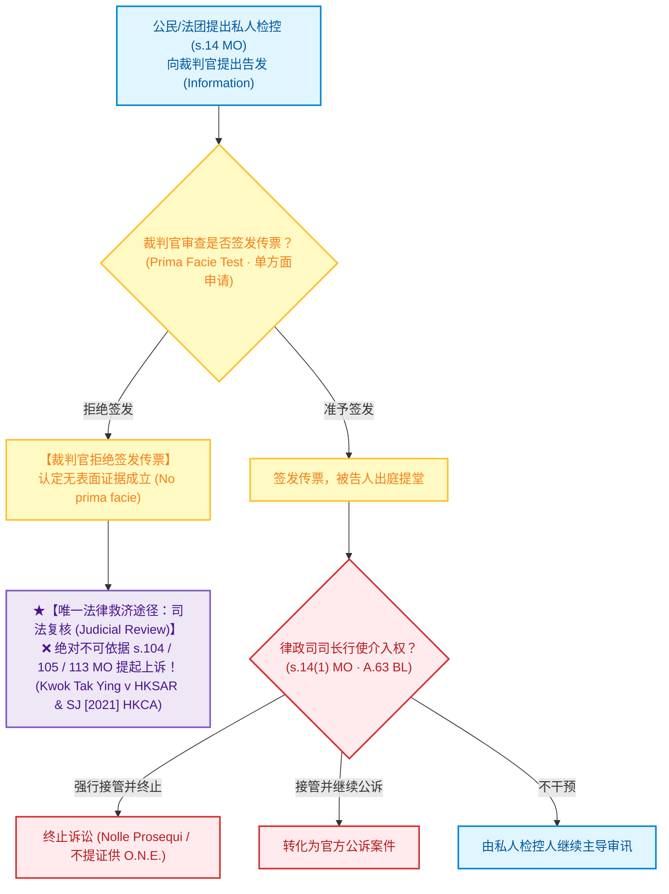
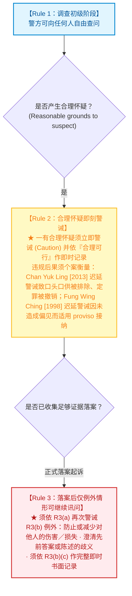

# 12 制度集群卡 — 检控决策、诉讼启动时效与 1992 问话口供规则（Prosecution, Commencement, Limitation & 1992 R&Ds）

> **层级定位**：Level C · 制度集群 / 框架卡（Thematic Framework Cluster） 
> **2026-11-16 四级蓝图重构**：速读定位层加白话导引；地图收敛为图 1（母题 roadmap＋后果虚线）＋任务直达表，章节导航图删除；两张机制图挂图 2／图 3；新增 §6 全流程核对清单（原 §6 证据链对齐总表移审计留痕）；§7 后果速查总表原位保留；复审修订记录、字幕日志、open 块与 2026-10-06 入口移审计区。引注单元守恒（比对见审计区本轮记录）；历史记录内旧编号与 S-标签按原样保留。

> **整课互指**：Master Overview §1–§5 · Structure Map · 保释专题 (Level B) · 警权与搜查 (Level C) · 时限表

## 速读定位层（30 秒全景：范围 · 术语 · 环节任务）

> 本层为 2026-10-10 按《PCLL MATERIAL STANDARDS.md》§18.4 落地新增的开篇导引：30 秒锁定检控主线的覆盖范围、关键术语与各程序环节"解决什么问题"；规则的完整条件、例外、冲突并列（六条 D 编号）与逐条原文引注仍以 §0–§7 正文为准，本层引注复用正文已登记的图例码（含 📄 官方 PDF 页码引注，无新码）。
> **白话导引**：检控卡回答三件事。谁决定检控——律政司主导、检控守则两闸测试（证据充分性＋公众利益）各自独立过，部分罪名还要司长／控方书面同意；私人能不能检控——s.14 MO 可以且无需许可，但拒发传票只能司法复核（s.104/105/113 全是死路），律政司任何阶段可接管；什么时候必须启动与怎么改控罪——简易罪 6 个月时效（过了裁判官就没管辖权），控罪 verdict 前可改但要过 *Lui Tsun Sum* 的实质偏见防线。再加 1992 R&Ds——警诫、记录、取供方式、少年与律师权的程序规则，违反了口供「面临被排除」而非自动出局。时效、同意书、传票、口供规则都是辩方的第一道攻防线——做错会怎样见 §7 总表。

### 适用范围

**覆盖（按检控工作时序）**——自「检不检」到「口供能不能用」的完整链：
1. **检控决策**：《基本法》A.63 的宪制独立＋检控守则 para 5 的**双重测试**（证据充分性即合理定罪机会 → 公众利益 para 5.9 因素），检控官职责并非不惜一切代价定罪〔LGS1V L146 "A.63 of the Basic Law (“BL”) provides that the DOJ shall control criminal prosecutions free of any interference"；LGS2N L499 "does the evidence demonstrate a reasonable prospect of conviction"；LGS1V L148 "It is not the role of the Prosecutor to obtain a conviction at all costs"〕；
2. **检控同意书**：须律政司司长同意的罪行（s.33(5) POO、POBO Part II、s.55(3) CO、国安法 A.41(2) 书面同意）与须控方同意的情形（公诉罪简易审理 s.94A MO）；未取同意构成程序失当，定罪前可修改／撤回重检治愈，定罪后为「良好上诉理由」（两说并列 D-CONSENT-GGA）〔LGS2N L505 "For some offences, the Secretary for Justice must give her consent to prosecution"；LGS2N L515 "the consent of the Prosecutor must be obtained: s. 94A MO"；LGS2N L513 "a procedural irregularity and can provide a good ground of appeal post-conviction"〕；
3. **私人检控**（s.14 MO）：无须许可、单方面（ex parte）申请、Prima Facie 测试签发传票；律政司 s.14(1) 可任意阶段介入／终止（s.15 nolle prosequi）；**拒发传票的唯一挑战途径是司法复核**（*Kwok Tak Ying*：s.104／105／113 MO 全被否定）〔LGS2S L453 "S. 14 MO: possible for individuals/bodies to bring a private prosecution not commenced by SJ – no leave is required"；LGS2N L603 "the Magistrate needs to be satisfied that the essential elements of the offence are prima facie present"；LGS2N L619 "Judicial review is the only avenue of challenge available against M"〕；
4. **五大启动路径**：拘捕落案（48 小时带堂，起算点三说并列 D-48H）、告发＋传票、拟检控通知书（s.7D MO，限最高刑 ≤6 个月／1 万）、定额罚款（不留案底 Cap. 297 s.2(3)）、私人检控〔LGS2N L547 "Generally, criminal proceedings are commenced in one of two ways"；LGS2N L569 "the maximum sentence that can be imposed does not exceed a fine of $10,000 or imprisonment for 6 months"；LGS2S L445 "s. 2(3) Rehabilitation of Offenders Ordinance, Cap. 297"〕；
5. **时效死线**：简易罪行 6 个月（s.26 MO，自投诉／告发**产生**起算）、逾期裁判官无管辖权、条例特例（版权 3 年／防贿 1–2 年）；公诉罪行无一般时效，极度迟延时辩方可申请永久终止程序（PD 9.7）；NSL 一律公诉（A.41(3)）〔LGS2N L523 "a complaint or information must be laid within 6 months from the time when the complaint or information arose"；LGS2N L523 "a Magistrate has no jurisdiction to deal with the complaint or information"；LGS2N L527 "There is no general limitation period for indictable offences"；LGS2S L383 "Excessive delay: application for a permanent stay? PD 9.7"〕；
6. **控罪修改与重叠控罪**：Duplicity 指一罪一告发、混入两罪不作废且可经修改治愈；控方裁决（verdict）前可随时修改，s.27 MO 规范行使方式（休庭／≤$5,000 费用／召回证人／结案后不得再举证）；*Lui Tsun Sum* 实质偏见防线（间隔越久偏见越大，该案定罪被撤销）〔LGS2N L565 "The requirement that a separate complaint / information is required for each offence is called THE RULE AGAINST DUPLICITY"；LGS3R L448 "A duplicitous Charge Sheet/Indictment does not render the charges/counts a nullity"；LGS2S L402 "Longer the time between arraignment and amendment – the greater the likely prejudice"〕；
7. **1992 R&Ds**：除原则 (e)（自愿性，overriding）外不具法律效力，违规使口供「**面临被排除**」（may render liable to be excluded），按违规严重性与次数个案衡量；Rule 2 一有合理怀疑（客观测试）即须警诫＋即时记录；Rule 3 落案后仅限例外讯问；R4／R5／D5／D6／D8／R6 的取供合规网；迟延警诫两判对照（*Chan Yuk Ling* 排除＋撤定罪 vs *Fung Wing Ching* proviso 接纳）〔LGS2N L383 "The R&Ds do not have force of law (except for principle (e)) but are guidelines for law enforcement officers to follow"；📄RD1992 p.1 "Non-conformity with these Rules and Directions may render answers and statements liable to be excluded"；LGS2N L411 "as soon as police officers have reasonable grounds for suspecting that a suspect has committed an offence, they must caution that suspect"；LGS2S L319 "late caution rendered oral confession inadmissible. Conviction set aside"；LGS2S L318 "Caution was late but no prejudice caused – proviso applied"〕。

**不覆盖（边界声明，相关主卡承担）**：① 街头截查、拘捕与搜查（警权本体）→ 11 Framework - Police Powers & Search Rules；② 法院管辖、答辩地点与法律代表 → 10 Framework - Criminal Courts, Jurisdiction & Legal Representation；③ 保释全部细节 → 05 Institution - Bail；④ 警署探访、录口供时辩护方逐节点操作 → 07 Institution - Investigation Rights and Defence；⑤ 控罪内容、合并与最终审讯路线 → 08 Institution - Charges and Trial Route；⑥ 供述可采性争议、Voir Dire 操作与半程裁决 → 13 Institution - Criminal Evidence Disputes；⑦ 认罪建议与 O.N.E. Bind Over → 06 Institution - Plea Advice and ONE Bind Over。时限横向汇总 → 01 Deadlines and Time Limits。

### 术语（核心概念与实务运作定义）

| 术语（英文原词） | 一句中文精确定义 | 出处 |
|---|---|---|
| 检控双重测试（Two-stage prosecutorial test，para 5 PC） | 检控决定的两道闸：先问证据是否显示合理定罪机会（充分性），再问检控是否符合公众利益〔LGS2N L491 "In deciding whether to prosecute, 2 considerations are relevant"；📄PROSCODE p.17 "The test is whether the evidence demonstrates a reasonable prospect of conviction"〕 | §1 |
| 公众利益考量（Public interest，para 5.9 PC） | 双重测试第二闸：权衡罪行严重性、嫌疑人前科、检控延误与替代处分等因素，清单非穷尽〔LGS2N L501 "There is no exhaustive list of the factors the Prosecutor should consider"；📄PROSCODE p.18 "There can be no exhaustive list of the considerations to be addressed"〕 | §1 |
| 检控同意书（Consent to prosecute） | 法定罪行的检控前置许可：部分罪须律政司司长（书面）同意，公诉罪简易审理须控方同意（s.94A MO）；未取属程序失当〔LGS2S L359 "Not required for all offences."；LGS2S L363 "A. 41(2) – need SJ’s written consent (does not apply to arrests or applications for bail.)"〕 | §1 |
| 私人检控（Private prosecution，s.14 MO） | 个人或法团不经律政司、自行向裁判官提告发而启动的公诉程序，是普通法权利的成文化，非绝对权利〔LGS2N L597 "criminal proceedings may be begun by persons other than the Secretary for Justice"；LGS2S L452 "but it is not an absolute right"〕 | §2 |
| 表面证据测试（Prima facie test） | 裁判官签发私人传票前的筛检标准：须信纳控罪各构成要素表面成立，行使常规案件管理权〔LGS2N L603 "the Magistrate needs to be satisfied that the essential elements of the offence are prima facie present"〕 | §2.1 |
| 司法复核（Judicial review） | 裁判官拒发私人传票后**唯一**可用的挑战途径（*Kwok Tak Ying*：三条 MO 上诉路径均因 ex parte 无被告诉讼地位而落空）〔LGS2N L611 "the issuance of a summons is an ex parte application in which the prospective D has no locus standi"；LGS2N L613 "s. 105 MO cannot be used to appeal a refusal to issue a private summons"〕 | §2 |
| 不提证供（Nolle prosequi，s.15 MO） | 律政司介入私人检控后终止诉讼的法定方式之一（另可撤回控罪或不提证供）〔LGS2S L457 "SJ can intervene by terminating proceedings (e.g. entering nolle prosequi under s. 15 MO"〕 | §2 |
| 告发／投诉（Information／Complaint） | 未拘捕情形下启动程序的文书：公诉罪行提告发、轻微罪行提投诉；书面、载控罪陈述及合理详情，一般一罪一份〔LGS2S L408 "If D is not arrested, an information may be drawn up (indictable offences) or a complaint (minor offences)"；LGS2N L559 "the complaint / information must be in writing with a statement of the offence alleged to have been committed"〕 | §3.1 |
| 拟检控通知书（Notice of intended prosecution，s.7D MO） | 轻微罪行（最高刑 ≤6 个月／1 万罚款）的存档启动方式：被告可书面认罪不出庭，不回应则视同认罪量刑，亦可转而发传票〔LGS2S L441 "D can PG by filling in form; no need to appear in court"；LGS2N L573 "the Magistrate will determine the matter as if the Defendant had pleaded guilty"〕 | §3.1 |
| 重叠控罪禁止（Rule against duplicity） | 每项独立罪行须各自一份投诉／告发，不得在同一控罪中并列两项或以上罪行；犯之则非作废、可修改治愈〔LGS2N L563 "Generally, a separate complaint or information is required for every distinct offence"；LGS2N L565 "The Prosecution cannot allege two or more offences in the same charge"〕 | §3.2 |
| 检控时效（Limitation period，s.26 MO） | 简易罪行投诉／告发须自其产生之日起 6 个月内提出的死线；逾期裁判官无管辖权〔LGS2S L378 "S. 26 MO: generally 6 months from the time the complaint or information arose"；LGS2S L380 "After limitation period expires, court has no jurisdiction over offence"〕 | §4.1 |
| 永久终止程序（Permanent stay of proceedings） | 公诉罪行虽无一般时效，但遇极度迟延时辩方可申请的彻底止诉救济（PD 9.7）〔LGS2N L527 "where there is excessive delay, the Defence may make an application for a permanent stay of proceedings"〕 | §4.1 |
| 警诫（Caution，Rules 2／3(a)） | 一有合理怀疑某人犯事（客观测试 *Chiu Wing Kai*）即须作出的权利告知；落案后再讯问须依 R3(a) 重新警诫〔LGS2N L423 "has evidence which would afford reasonable grounds for suspecting that a person has committed an offence is an objective one"；LGS2N L427 "Such persons must be immediately cautioned in the manner set out in R3(a)"〕 | §5 |
| 即时记录（Contemporaneous record） | R2 要求对被警诫者的陈述在合理可行范围内当场记下（时间、地点、在场人）；街头逮捕时起听后补的正式版本即 PRCS〔LGS2N L413 "the police must make a contemporaneous record of anything the cautioned person says"；LGS2N L415 "This latter statement is called a Post-Recorded Caution Statement"〕 | §5 |
| 口供自愿性（Voluntariness，Principle (e)） | 口供可采性的根本条件：非经强权者以对受损的恐惧或对利益的期望、或压迫所取得；是 R&Ds 中唯一有普通法效力且 overriding 的原则〔LGS2N L407 "It is a fundamental condition of the admissibility of a confession that it is voluntary"；📄RD1992 p.1 "That principle set out in paragraph (e) above is overriding and applicable in all cases"〕 | §5.1 |
| 案中案（Voir Dire／Alternative Procedure） | 裁定口供可采性的单独听证：排除路径为（a）非自愿或（b）法官行使剩余裁量权〔LGS2N L387 "may be excluded from evidence in a Voir Dire / Alternative Procedure either because it is (a) involuntary or (b) although voluntary"〕 | §5.1 |

### 环节定位（按程序时序）

| 环节（时序） | 它解决的具体问题 | 依据 |
|---|---|---|
| 检不检（双重测试） | 证据够不够、值不值：先过"合理定罪机会"，再过"公众利益"；检控官不是求定罪机器〔LGS2S L353 "Sufficiency of Evidence – test: is there a reasonable prospect of conviction"；LGS1S L110 "Not the role of a Prosecutor to obtain a conviction at all costs"〕 | §1 |
| 开案合规（同意书） | 启动前查该罪要不要 SJ 书面同意／控方同意：漏取构成程序失当，早救修改重检、晚救上诉良好理由〔LGS2N L505 "For some offences, the Secretary for Justice must give her consent to prosecution"；LGS2N L513 "the irregularity to be cured by the charge being amended or withdrawn and then re-laid"〕 | §1 |
| 选启动路径 | 五条路怎么选：已抓人→拘捕落案（48 小时带堂）；未抓人→告发＋传票；轻微罪→NIP／定额罚款；自力救济→私人检控〔LGS2N L549 "The arrest of the Defendant who is then charged and a charge sheet prepared by the police"；LGS2S L446 "If D disputes liability then an information is laid and a summons issued"〕 | §3.1 |
| 核时效死线 | 简易罪 6 个月起算点与条例特例；公诉无时效但防"过度迟延"（PD 9.7 永久终止）〔LGS2S L385 "Always check the relevant Ordinance"；LGS2N L527 "There is no general limitation period for indictable offences"〕 | §4.1 |
| 起草控罪 | 一罪一告发（duplicity 防线）；verdict 前修改的自由与界限（s.27 MO 保障、*Lui Tsun Sum* 偏见防线）〔LGS2S L417 "Separate complaint / information is required for each offence"；LGS2S L401 "Charge can be amended any time up until verdict is delivered"〕 | §3.2、§4.2 |
| 警诫时机（R2） | 什么时候必须 caution：一有合理怀疑（客观测试）立即警诫＋即时记录；街头逮捕改走 PRCS 流程〔LGS2N L411 "as soon as police officers have reasonable grounds for suspecting that a suspect has committed an offence, they must caution that suspect"；LGS2N L415 "there is no need to make a contemporaneous record when the person is being arrested on the street"〕 | §5、§5.1 |
| 落案后讯问（R3） | 落案后还能不能问：原则不可，仅 R3(b) 例外（防伤害／澄清歧义），且须再次警诫＋完整即时记录〔LGS2S L323 "Police can only question post-charge in limited circumstances"；LGS2N L429 "to prevent harm to another person or clear up an ambiguity in a previous statement given by that person"〕 | §5 |
| 取供合规（R4/5、D5/6/8、R6） | 自撰 vs 问答式 ROI 的程序网：再警诫、逐字、读回、签署；少年在场人；母语与签署效力；律师私下会见；同案犯陈述不得诱取回应〔LGS2N L443 "The usual type of written statement has 3 parts: a caution, the questions and answers, and the declaration"；LGS2N L447 "nothing shall be said or done to invite any reply or comment"〕 | §5.1 |
| 违规后果定性 | 违反 R&Ds 不等于口供自动排除：官方原文 "may render liable to be excluded"，按严重性与次数个案衡量，路径为非自愿／剩余裁量权〔LGS2S L302 "Must consider the seriousness of the breach and the number of breaches to determine the consequences"；LGS2N L397 "substantial and significant breaches could have this result"〕 | §5.1 第 1 项 |

## 🗺️ 本卡地图（章节位置与阅读顺序）

> 两件套：**图 1 · 母题结构图**（检控决策与启动分支 roadmap 即全流程主干与后果虚线；私人检控全流程见**图 2**（§2），1992 讯问规则链见**图 3**（§5））→ **任务直达表**（按要做的事跳章节）。mermaid 节点看结构、不可点；点跳用直达表锚链。

**图 1 · 检控决策与启动分支 roadmap（全流程主干与后果虚线）**：

```mermaid
flowchart TD
 ROOT(["检控与启动（母题）<br>决策 → 同意 → 启动 → 时效 → 控罪 → 口供"])
 ROOT --> A["① 检控决策与同意书 →§1"]
 ROOT --> B["② 私人检控 s.14 MO →§2"]
 ROOT --> C["③ 五大启动路径+duplicity →§3"]
 ROOT --> D["④ 时效与控罪修改 →§4"]
 ROOT --> E["⑤ 1992 R&Ds 口供规则 →§5"]
 ROOT --> F["⑥ 全流程核对清单 →§6（对齐总表移审计区）"]

 A --> A1["A.63 独立 + 双重测试<br>证据闸 → 公众利益闸"]
 A --> A2["SJ 同意罪清单<br>s.94A 控方同意"]
 A -.-> AX[["同意书瑕疵代价 →§7 行1"]]
 B --> B1["ex parte + prima facie<br>裁判官筛检发传票"]
 B --> B2["SJ s.14(1) 任意阶段介入<br>nolle prosequi s.15"]
 B -.-> BX[["拒发传票误投上诉路径 →§7 行10"]]
 C --> C1["拘捕落案<br>48h 带堂（三说 D-48H）"]
 C --> C2["告发+传票 · NIP s.7D<br>定额罚款 · 私人检控"]
 C -.-> CX[["启动路径选错 →§7 行4"]]
 C --> C3["一罪一告发 duplicity<br>不作废·可修改治愈 →§3.2"]
 C3 -.-> CX3[["duplicity 中弹 →§7 行5"]]
 D --> D1["简易罪 6 个月 s.26<br>逾期无管辖 · 条例特例"]
 D -.-> DX[["时效漏算 →§7 行2–3"]]
 D --> D2["公诉无时效<br>过度迟延→permanent stay"]
 D --> D3["verdict 前可改 · s.27 保障<br>Lui Tsun Sum 实质偏见防线"]
 D3 -.-> DX3[["晚改换罪无保障 →§7 行6"]]
 E --> E1["R2 合理怀疑即警诫<br>+ 即时记录/PRCS"]
 E --> E2["R3 落案后限讯问<br>R4/5·D5·D6·D8·R6 取供网"]
 E -.-> EX[["迟警诫/违规取供 →§7 行7–9"]]

 classDef warnnode stroke-dasharray: 4 3;
 class AX,BX,CX,CX3,DX,DX3,EX warnnode
```

读图逻辑：实线是决策→同意→启动→时效→控罪→口供的主干，每段末尾箭头指向承担小节；虚线 warnnode 是「不做」的后果钩子，行号统一收口 §7 总表；§2 私人检控全流程（图 2）与 §5 讯问规则链（图 3）补两条机制的分支细节。

| 你现在要做什么 | 直达章节 |
|---|---|
| 30 秒弄清范围/术语/环节任务 | [速读定位层](#速读定位层30-秒全景范围--术语--环节任务) |
| 写"应否检控"分析 | §1（双重测试＋A.63）＋§7 行 1 |
| 办私人检控／救被拒传票 | §2 mermaid＋§2.1 补强＋§7 行 10 |
| 选启动路径／查 48 小时提堂 | §3.1 五路径＋⚠️ D-48H＋§7 行 3–4 |
| 查简易罪时效 / 永久终止 | §4.1＋§7 行 2 |
| 起草或攻击控罪书 | §3.2（duplicity）＋§4.2（修改防线）＋§7 行 5–6 |
| 警诫时机与口供排除 | §5 mermaid＋§5.1 第 1、5 项＋§7 行 7 |
| 取供方式合规（少年／语言／律师／同案犯） | §5.1 第 6–12 项＋§7 行 8–9 |
| 查"某环节做错会怎样" | [§7 后果速查总表](#7-环节--不做做错的后果--依据速查总表)（§1–§5 正文均有"总表索引"回点） |
| 核对某条规则出处与届别 | [§0 图例](#0-底层材料溯源库与代码表source-provenance-index)＋审计区·对齐总表（原 §6） |
| SG01 Q A3/A6/B2/B3/D 实战穿透 | §1（A3、QD）、§4.2（A6）、§5.1 末（B2、B3）💡 段 → SG01 Classroom |

---

## 0. 底层材料溯源库与代码表（Source Provenance Index）

> **引注格式**（2026-09-30 依《PCLL Provenance Manual 2026-09-29》§2.2 落实）：每行末尾的全角括注内是「码＋该文件在库内的行号＋原文摘录」，
> 一条括注可含多条出处、以全角分号分隔；码→文件→层级→学年见下方图例（点开折叠）。
> 往届（2025-26）出处一律带「·往届仅参考」并在行文写明届别；2026-11-16 蓝图重构起正文「空引注记号」（原为方头括号内仅破折号，表示该行已审无需出处）已全部清剿、历史区保留；
> 带 📄 者指向官方 PDF 原件，其页码是 **PDF 物理页**而非页脚印刷页码（换算：1992 规则与指示的印刷页 = 物理页 + 288、检控守则的印刷页 = 物理页 − 2、2012 年双语本的印刷页 = 物理页 − 1），摘录已按 PDF 文本层逐字核对；
> 标 ⚠️ 处为本库材料之间的不一致：同届互不一致者并列不裁决，一为本届一为往届者按 §2.5 取本年讲义并标注冲突；未决项登记在本文件末尾的 open 块。

<!-- BEGIN:cite-legend -->
> [!info]- 引注图例（出处码 → 文件；点开折叠）
>
> | 码 | 文件 | 层级 | 学年 |
> |---|---|---|---|
> | LGS1V | 本届 LGS 1 讲义（法院与检控角色） | 本届讲义 | 2026-27 |
> | LGS1S | 本届 LGS 1 课堂幻灯 | 本届讲义 | 2026-27 |
> | LGS2N | 本届 LGS 2 讲义（侦查、开始程序与保释） | 本届讲义 | 2026-27 |
> | LGS2S | 本届 LGS 2 课堂幻灯 | 本届讲义 | 2026-27 |
> | LGS3R | 本届 LGS 3 修订版讲义（交付与移交） | 本届讲义 | 2026-27 |
> | PROSCODE | 检控守则 Prosecution Code 官方 PDF（📄 页码引注） | 本届官方 | 2026-27 |
> | RD1992 | 1992 年查问疑犯及录取口供规则与指示官方 PDF（📄 页码引注） | 本届官方 | 2026-27 |
> | RD2012 | 2012 年版规则与指示（附中文本）官方 PDF（📄 页码引注） | 本届官方 | 2026-27 |
> | OLD-EXLG | 往届考试总笔记 Set 3《LG Notes》 | 往届学生稿 | 2025-26 |
> | SG01S1 | 本届 SG01 学生册（侦查阶段课堂，01 SG 场景层内） | 本届官方 | 2026-27 |
> | CAP-K1 | PCLL8050 LGS1 PT | 本届讲义 | 2026-27 |
> | CAP-K2 | PCLL8050 LGS2 PT | 本届讲义 | 2026-27 |
> | WK2 | PCLL8050 LGS2本届修订讲义 | 本届讲义 | 2026-27 |

<!-- END:cite-legend -->
**取材顺序**（Manual §2.6）：本届 slides → 本届 notes → 往届官方 → 往届学生稿。本卡的检控决策、私人检控、启动方式与时效各节以本届 LGS 2 讲义（码 LGS2N）与本届课堂幻灯（码 LGS2S）为主线；
LGS 1 讲义／幻灯（码 LGS1V／LGS1S）供检控守则与受害人宪章部分，控罪修改与重叠控罪取本届 LGS 3 修订讲义（码 LGS3R），三份官方 PDF（码 PROSCODE／RD1992／RD2012）为守则与规则原文；
讲义与幻灯一致时以讲义条文为主，两说不一者一律并列并登记文末，不代用户裁决。

**旧 S-Statute／S-Case／S-Exam-LG 三行的去向**：旧表所列 Cap. 227 (MO)、Cap. 221 (CPO)、Cap. 221C、Cap. 201 (CO)、Cap. 245 (POO)、Cap. 528 等法例，以及 *Kwok Tak Ying*、*Lui Tsun Sum*、*Ng Siu Chau*、*Tse So So*、*Chan Yuk Ling*、*Fung Wing Ching*、*Pang Ho Yin*、*Chiu Wing Kai*、*Ng Chi Keung*、*Choi Yan Kwong* 十件判例，都不是本库可定位的文件，其条文与判词内容一律以载明它们的讲义／幻灯原文行号（或官方 PDF 页码）为出处；Set 3 学生笔记改以码 OLD-EXLG 登记，其非官方性质在正文逐处写明。

---

## 1. 检控决定与检控守则（The Decision to Prosecute & Prosecution Code）

1. **宪制独立地位**：《基本法》第 63 条明确规定律政司主管刑事检察工作，**不受任何干涉**。 〔LGS1V L146 "A.63 of the Basic Law (“BL”) provides that the DOJ shall control criminal prosecutions free of any interference"；LGS1S L107 "A. 63 BL: DOJ controls criminal prosecutions free of any interference"；LGS2N L489 "The decision whether or not to prosecute is made by the Secretary for Justice or by counsel in the Prosecutions Division"〕
2. **检控双重测试（Two-Stage Prosecutorial Test — para 5 PC）**： 〔LGS2N L491 "In deciding whether to prosecute, 2 considerations are relevant"；LGS2N L497 "See para 5 of the Prosecution Code"；📄PROSCODE p.17 "the decision to prosecute includes two … likely to prove the offence"〕
 - **第一步：证据充分性测试（Sufficiency of Evidence）** 
 → 是否存在**合理定罪机会（Reasonable prospect of conviction）**？ 〔LGS2N L499 "does the evidence demonstrate a reasonable prospect of conviction"；LGS2S L353 "Sufficiency of Evidence – test: is there a reasonable prospect of conviction"；📄PROSCODE p.17 "The test is whether the evidence demonstrates a reasonable prospect of conviction"〕
 - **第二步：公众利益考量（Public Interest — para 5.9 PC）** 
 → 即使证据充分，检控官仍须权衡：罪行严重性、嫌疑人背景与前科、其他替代检控的做法（讲义原文为 cautions or warnings，或 caution, warning or other acceptable form of diversion）、检控延误等。**检控官职责并非不惜一切代价定罪**。 〔LGS2N L501 "There is no exhaustive list of the factors the Prosecutor should consider"；LGS2S L354 "nature and circumstances of the offence, the seriousness of the offence, the criminal history of the suspect"；LGS2S L354 "the availability of other alternatives to prosecution such as cautions or warnings, delay in prosecution"；📄PROSCODE p.18 "There can be no exhaustive list of the considerations to be addressed"；📄PROSCODE p.19 "the availability and efficacy of alternatives to … acceptable form of diversion"；LGS1V L148 "It is not the role of the Prosecutor to obtain a conviction at all costs"；LGS1S L110 "Not the role of a Prosecutor to obtain a conviction at all costs"〕 〔❓本栏「其他替代检控的做法（讲义原文为 cautions or warnings，或 caution, warning or other acceptable form of diversion）」中的「签保守行为」在本库材料里无出处：库内两处原文只作 cautions or warnings 与 caution, warning or other acceptable form of diversion，均未举 bind over 为检控替代方案。已就地标注，删留待你定〕
3. **检控同意书制度（Consent to Prosecute）**： 〔LGS2N L505 "For some offences, the Secretary for Justice must give her consent to prosecution"；LGS2S L359 "Not required for all offences."〕
 - **须律政司司长同意的罪行**（para 6.1 PC）：① 《公安条例》s.33(5)（公众地方管有攻击性武器）；② 《防止贿赂条例》第 2 部（s.31 POBO，如索取／接受利益、贿赂公职人员）；③ 《刑事罪行条例》s.55(3)（无合法目的而制造或管有爆炸品）。**国安法罪行须律政司长书面同意**（A.41(2) NSL；但该条不适用于逮捕或保释申请）。 〔LGS2N L505 "see para. 6.1 PC. For examples see"；LGS2N L507 "s. 33(5) P.O.O: Possession of an offensive weapon in a public place"；LGS2N L509 "Part II of POBO (e.g. soliciting or accepting an advantage, bribery of a public servant)"；LGS2N L511 "making or possessing an explosive substance without a lawful object"；LGS2S L360 "Example: s. 33(5) P.O.O – possession of an offensive weapon"；LGS2S L363 "A. 41(2) – need SJ’s written consent (does not apply to arrests or applications for bail.)"〕
 - **须控方（Prosecutor）同意**：公诉罪行在裁判法院简易审理须控方同意（s.94A MO）；**简易罪行在裁判法院审理无须控方同意**。 〔LGS2N L515 "the consent of the Prosecutor must be obtained: s. 94A MO"；LGS2N L515 "no consent is needed for summary offences to be tried in the MC"；LGS2S L361 "Indictable offences triable summarily in MC: need consent of Prosecutor: s. 94A MO"；LGS2S L362 "Do not need Prosecutor’s consent for a summary offence to be tried in MC."〕
 - **程序瑕疵救济**：未取得法定同意属**程序失当（procedural irregularity）**。定罪前可经修改控罪或撤回后重新提出告发而治愈；**定罪后方才发现，则「可构成上诉的良好理由」（本届讲义作 can provide a good ground of appeal，本届幻灯作 a good ground of appeal）**——⚠️ 原件用词是「良好理由」，**并非自动、必然成立的推翻定罪理由**，上诉庭仍须按个案裁断。 〔LGS2S L364 "failing to obtain P’s consent to prosecute where required is a procedural irregularity"；LGS2N L513 "a procedural irregularity and can provide a good ground of appeal post-conviction"；LGS2N L513 "the irregularity to be cured by the charge being amended or withdrawn and then re-laid"；LGS2S L365 "P may also withdraw the charge and re-lay it"；LGS2S L366 "If the failure to obtain consent is only discovered post conviction, then it is a good ground of appeal."；D-CONSENT-GGA〕 〔❓本行「并非自动、必然成立的推翻定罪理由，上诉庭仍须按个案裁断」是本卡 2026-09-27 改写时补入的推论：库内两源只分别作 can provide a good ground of appeal 与 it is a good ground of appeal，未见就此种瑕疵之自动性或个案裁断立言的原文。已就地标注，删留待你定〕

> 💡 **【实战穿透 · SGS 1 Q A3 & Q D】**：检控同意书瑕疵救济与检控官“司法秉行者”角色（Minister of Justice / 证据充足与公众利益测试），Q A3 与 Q D 的题问原文见本库**本届** SG01 学生册（01 SG 场景层，码 SG01S1），详见 SG01 课堂 Brief A Q A3（启动检控的手续及未合规的后果） 及同页 Q D（律政司与检控官的角色及全盘起诉探讨）。 〔SG01S1 L92 "what procedural formalities must be complied with by both the police and the Prosecution"；SG01S1 L92 "What would be the effect of failing to comply with these formalities"；SG01S1 L162 "The role of the Department of Justice and a Prosecutor is to protect the citizens of Hong Kong"；SG01S1 L162 "they should prosecute it to the full extent of the law"〕
> ⚠️ **锚点说明（交由 T4 处理）**：SG01 课堂笔记的提问标题为 `### Question A3: … (5 mins)` 格式，标题自带括号时长附注，Obsidian 无法生成可跳转锚点，故此处只链接到文件本身（参见附录 J M6）。

**总表索引（2026-10-10）**：漏取律政司司长书面同意或控方同意（含"何时要、漏了如何救"）的程序代价归并 [§7 行 1](#7-环节--不做做错的后果--依据速查总表)。

---

## 2. 私人检控机制（Private Prosecutions — s.14 MO）

**图 2 · 私人检控全流程（告发→签发→介入→救济）**：

### 2.1 图表要点补强
> **§2 上图各节点出处**（图内不写引注，故在图外逐节点标注）：「公民／法团提出私人检控」「向裁判官提出告发」两栏出自本届讲义私人检控首段与本届幻灯 Slide 47；「裁判官审查是否签发传票」菱形与「拒绝签发 → 司法复核」一栏出自本届讲义对 *Kwok Tak Ying* 三条上诉路径的逐一否定；
> 「律政司司长行使介入权」菱形出自同段幻灯对 s.14(1) MO 与 s.8(1B)(b) MO 的表述。 〔LGS2N L597 "criminal proceedings may be begun by persons other than the Secretary for Justice"；LGS2S L453 "possible for individuals/bodies to bring a private prosecution not commenced by SJ"；LGS2N L617 "None of the grounds of appeal under MO can be used to appeal a M"；LGS2N L605 "usually the application for issuance of the summons is ex parte"；LGS2S L456 "s. 14(1) MO: SJ can intervene at any stage of the proceedings"〕

* **宪制基础**：私人检控是普通法权利并获成文法确认（Slide 47），受《基本法》第 35 条法院取览权保障，但**并非绝对权利**；A.63 应与 A.35 一并解读。 〔LGS2S L451 "Common law right that has been given statutory basis"；LGS2S L452 "right of access to the courts is constitutionally protected in A. 35 BL"；LGS2S L452 "but it is not an absolute right"〕
* **无须许可**：s.14 MO 下个人／法团提起私人检控**不需要 leave**；仍须提出告发（complaint／information），并由裁判官依 s.8 MO 发出传票。 〔LGS2S L453 "S. 14 MO: possible for individuals/bodies to bring a private prosecution not commenced by SJ – no leave is required"；LGS2S L454 "Still requires an information or a complaint to be laid by an individual"；LGS2S L455 "M must then issue a summons under s. 8 MO requiring D to appear before M"〕
 * ⚠️ **条文分歧（须由授课教师确认）**：一般公诉罪行的告发条文，本届幻灯 Slide 43 与本届讲义同引 **s.75 MO**；同一语境下本届幻灯 Slide 47 就私人检控之公诉罪行告发写作 **s.72 MO**，而本届讲义是把 s.72 MO 用作裁判官**签发传票／逮捕令**的依据。本卡 §3.1 采 s.75 MO，两处并存、不作裁断。 〔LGS2S L410 "S. 75 MO – laying of complaint / information for indictable offences"；LGS2N L559 "See s. 75(1) MO: the complaint / information must be in writing"；LGS2S L454 "in accordance with s. 10 MO (summary offences) or s. 72 MO (indictable offences)"；LGS2N L561 "under s.72 MO, the Magistrate can issue a summons to appear in court or a warrant for arrest"；D-MO75V72〕
* **裁判官筛检**：可依 s.8(1B)(b) MO 以「良好因由（good cause）」拒绝签发私人传票；申请原则上属**单方面（ex parte）**程序，仅例外情况下才邀请律政司出席（Slide 48）。审查标准为 **Prima Facie test**——须信纳控罪各构成要素表面成立，并行使常规案件管理权。 〔LGS2S L456 "M can refuse to issue a private summons for good cause"；LGS2N L605 "usually the application for issuance of the summons is ex parte"；LGS2N L603 "the Magistrate needs to be satisfied that the essential elements of the offence are prima facie present"；LGS2N L603 "M should exercise his usual case management powers in deciding whether to issue summons"〕
* **律政司介入**：s.14(1) MO 允许**任何阶段**介入；终止方式含依 s.15 MO 提出 nolle prosequi、撤回控罪或不提证供（Slide 47）。是否接管须权衡检控守则 para 7(4) 所列因素（公共利益与司法、罪行严重性、相关方意见、公平审讯前景，Slide 49）；若无合理定罪机会或公众利益不容许继续，律政司可终止私人检控（*Ng Chi Keung v Secretary for Justice* [2016] 2 HKLRD 1330 (CFI)）。 〔LGS2N L599 "the Secretary for Justice can intervene and assume conduct of the proceedings"；LGS2S L457 "SJ can intervene by terminating proceedings (e.g. entering nolle prosequi under s. 15 MO"；LGS2N L601 "The factors the Secretary for Justice should have in mind in deciding whether to take over a private prosecution are listed in para. 7(4)"；LGS2S L481 "Factors include: interests of public justice, seriousness of offence, views of any interested party, the prospects of fair trial"；LGS2N L601 "The Secretary for Justice can also discontinue a private prosecution where there is no reasonable prospect of conviction"〕
* **拒绝签发传票后的唯一挑战途径是司法复核**：*Kwok Tak Ying* 中 s.104、s.105、s.113 MO 三条上诉路径**全被否定**——理由：签发传票属 ex parte 申请，潜在被告并无诉讼地位（locus standi），不属裁判官「以简易程序裁断事项」，故不落入上述条文涵盖范围（本届幻灯 Slide 48 与本届讲义同段逐条列明）。 〔LGS2N L611 "the issuance of a summons is an ex parte application in which the prospective D has no locus standi"；LGS2N L613 "s. 105 MO cannot be used to appeal a refusal to issue a private summons"；LGS2N L615 "There must be an inter partes hearing over which the M has exercised his summary jurisdiction"；LGS2N L619 "Judicial review is the only avenue of challenge available against M"〕

**总表索引（2026-10-10）**：拒发传票后误投 s.104／105／113 MO 上诉的后果归并 [§7 行 10](#7-环节--不做做错的后果--依据速查总表)。

> **Exam / Advocacy Formulation:** "A refusal to issue a private summons is challenged by judicial review alone — s.104, s.105 and s.113 MO are all dead ends; and the SJ may take over the prosecution at any stage."（自拟考场口径；底层规则见 §2.1 各条引注）

---

## 3. 诉讼启动五大方式与重叠控罪禁止（Commencement & Duplicity）

### 3.1 刑事诉讼启动五种路径
> **§3.1 本节取材**：五种路径的清单出自本届讲义 METHODS OF COMMENCING PROCEEDINGS 段，各路径的条文细节取本届讲义与本届幻灯 Slide 41–46 对读；两处有出入者（告发条文、48 小时起算）就地以 ⚠️ 并列。 〔LGS2N L535 "There are various different methods of commencing criminal proceedings"；LGS2N L547 "Generally, criminal proceedings are commenced in one of two ways"；LGS2N L551 "the information is laid before a Magistrate who issues a summons or a warrant of arrest"〕

1. **拘捕并落案起诉（Arrest and Charge）**：出具控罪书（Charge Sheet，须符合 s.75 MO 及《起诉书规则》Cap. 221C），控罪书在首次提堂时「提出（laid）」于裁判官前；初期由警方（OC Case）决定控罪，其后由控方决定是否继续、修改或加控。 〔LGS2N L555 "the charge sheet must fulfil the requirements of s. 75 MO"；LGS2N L549 "The arrest of the Defendant who is then charged and a charge sheet prepared by the police"；LGS2N L555 "the OC Case will decide what charges to lay against a suspect"；LGS2N L555 "the Prosecution will also need to decide whether to proceed with these charges"〕
 * ⚠️ **「48 小时」起算点存在三种本届原文，本卡不代为裁断**：① LGS 1 讲义与本届课堂幻灯把死线挂在**落案（charge）**之后，并另注 SNSO 下可延长至 14 天；② LGS 2 讲义挂在**逮捕（arrest）**之后；③ LGS 3 本届讲义回到条文本身的 "as soon as practicable"，再给出实务上的 24／48 小时。应试时按所引讲义的表述作答，并宜点出条文依据是 s.52(1) PFO 的「合理切实可行内」义务。 〔LGS1V L234 "then in Hong Kong, there is a rule that he shall be brought before a Magistrate within 48 hours"；LGS1V L234 "a Magistrate can authorize an extended period of detention of an arrested person without charge to 14 days"；LGS1S L201 "Every D must be brought before a Magistrate within 48 hours (72 hours if deportation case) of charge"；LGS2N L347 "Then within 48 hours of his arrest (or 72 hours for deportation cases), the arrested person must be brought before a Magistrate"；LGS3R L102 "A detainee must be brought before the Magistrate"；LGS3R L240 "there is a right to be brought before a Magistrate as soon as practicable"；LGS3R L240 "this will usually be within 24 hours of being charged (48 hours of arrest)"；D-48H〕
2. **提出告发并签发传票（Information and Summons）**：针对未被拘捕人士，公诉罪行提出告发（information）、轻微罪行提出投诉（complaint）；须以书面作出并载有控罪陈述及使被告人获合理讯息之详情（s.75(1) MO）；简易罪行依 s.10 MO，**每一项独立罪行须各自一份投诉／告发**。裁判官据此签发传票或逮捕令（s.72 MO、s.8 MO 及 Cap. 227C 表格 1）。⚠️ 私人检控语境下 Slide 47 写作 s.72 MO，见 §2.1 分歧说明。 〔LGS2S L408 "If D is not arrested, an information may be drawn up (indictable offences) or a complaint (minor offences)"；LGS2N L559 "the complaint / information must be in writing with a statement of the offence alleged to have been committed"；LGS2N L563 "Generally, a separate complaint or information is required for every distinct offence"；LGS2N L561 "under s.72 MO, the Magistrate can issue a summons to appear in court or a warrant for arrest"〕
3. **拟检控通知书（Notice of Intended Prosecution — s.7D MO）**：限于法定最高刑**不超过 6 个月监禁或 1 万罚款**的轻微罪行（如《道路交通条例》Cap. 374 s.41 超速）；由任何获授权检控的公职人员或法团**通过在裁判法院存档**而启动；被告人可填表书面认罪，**无需出庭**。若不回应，裁判官可依 s.7F MO 视同认罪并量刑，亦可依 s.101A MO 发出传票或拘票（本届讲义拟检控通知书段与本届幻灯 Slide 46）。 〔LGS2N L569 "the maximum sentence that can be imposed does not exceed a fine of $10,000 or imprisonment for 6 months"；LGS2N L569 "e.g. s. 41 Road Traffic Ordinance, Cap. 374 (driving in excess of the prescribed speed limit.)"；LGS2N L569 "A Notice of Intended Prosecution can be instigated by any public officer or body corporate authorized to prosecute"；LGS2S L441 "D can PG by filling in form; no need to appear in court"；LGS2N L573 "the Magistrate will determine the matter as if the Defendant had pleaded guilty"；LGS2N L573 "may lead to a summons or warrant being issued under s. 101A MO"〕
4. **定额罚款通知书（Fixed Penalty Notice）**：适用于交通、乱丢垃圾等轻微罪行；缴付定额罚款后**依法不留刑事案底**（Cap. 297《刑事定罪（累犯者）条例》s.2(3)）。**若被告人争议法律责任，则提出告发并发出传票**（Slide 46）。 〔LGS2S L444 "Minor criminal offences e.g. road traffic, littering"；LGS2S L445 "D does not receive a criminal conviction provided the"；LGS2S L445 "s. 2(3) Rehabilitation of Offenders Ordinance, Cap. 297"；LGS2S L446 "If D disputes liability then an information is laid and a summons issued"〕
5. **私人检控（Private Prosecution — s.14 MO）**：详见 §2 及 §2.1。 〔LGS2N L597 "By s. 14 MO, criminal proceedings may be begun by persons other than the Secretary for Justice"；LGS2S L453 "S. 14 MO: possible for individuals/bodies to bring a private prosecution"〕

**总表索引（2026-10-10）**：48 小时带堂迟延（起算点三说 D-48H）与启动路径选错（NIP 超限／定额罚款争议仍索罚）的后果归并 [§7 行 3–4](#7-环节--不做做错的后果--依据速查总表)。

### 3.2 重叠控罪禁止原则（Rule Against Duplicity — Slide 44, 45）
> **§3.2 本节取材**：规则表述取本届讲义 Key Point 段，错误与正确范例取本届幻灯 Slide 44–45；「重叠控罪不作废」的更正取本届 LGS 3 修订讲义。 〔LGS2N L565 "The requirement that a separate complaint / information is required for each offence is called THE RULE AGAINST DUPLICITY"；LGS2N L565 "The Prosecution cannot allege two or more offences in the same charge"；LGS2S L417 "Separate complaint / information is required for each offence"〕

* **核心原则**：**每一项独立罪行须各自一份投诉／告发**（s.10 MO；《起诉书规则》Cap. 221C），此项要求即 **Rule Against Duplicity**——控方**不得在同一控罪中并列两项或以上罪行**（本届幻灯 Slide 44）。 〔LGS2N L563 "Generally, a separate complaint or information is required for every distinct offence and the complaint/information must comply with the Indictment Rules, Cap. 221C"；LGS2S L409 "S. 10 MO – laying of complaint / information for summary offences"〕
* **错误范例 (Duplicitous)**（Slide 44 原文）： 〔LGS2S L418 "Example of a duplicitous charge"〕
 > ❌ *"STATEMENT OF OFFENCE: Possession of dangerous drugs, contrary to sections 8(1) and 8(2)(b) of the Dangerous Drugs Ordinance, Cap 134 and trafficking of dangerous drugs, contrary to sections 4(1)(a) and 4(3)(b) of the Dangerous Drugs Ordinance, Cap 134."*（将「管有」与「贩毒」两项独立罪名混入同一罪状） 〔LGS2S L420 "Possession of dangerous drugs, contrary to sections 8(1) and 8(2)(b) of the Dangerous Drugs Ordinance, Cap 134"；LGS2S L420 "trafficking of dangerous drugs, contrary to sections 4(1)(a) and 4(3)(b) of the Dangerous Drugs Ordinance"〕
* **合规范例**（Slide 45）： 〔LGS2S L424 "Example of correctly drafted charges"〕
 > ✅ First Count: Statement of Offence — Theft contrary to section 9 of the Theft Ordinance, Cap. 210 + Particulars of Offence. 〔LGS2S L427 "Theft contrary to section 9 of the Theft Ordinance, Cap.210"〕 
 > ✅ Second Count: Statement of Offence — Common assault contrary to section 40 of the Offences against the Person Ordinance, Cap. 212 + Particulars of Offence. 〔LGS2S L432 "Common assault contrary to section 40 of the Offences against the Person Ordinance, Cap.212"〕
* ⚠️ **重叠控罪并不使控罪「作废」**：本届 LGS 3 修订讲义明确重叠控罪并非无效、审讯中修改即可治愈；实务上控方**可在裁决前任何时候**修改，裁判官／法官亦可主动修改，但须听取辩方关于偏见与不公的抗辩。故旧版本卡语「违法作废」为过度表述，已改正；辩方抗辩应循 §4.2 的偏见／不公标准，或依《起诉书规则》R.3(3) 要求交付进一步详情。 〔LGS3R L448 "A duplicitous Charge Sheet/Indictment does not render the charges/counts a nullity"；LGS3R L448 "Amending the charge at trial can cure the defect"；LGS3R L448 "the Prosecution can actually amend the charge at any time prior to verdict"；LGS3R L422 "Such a general power is consistent with R. 3(3) of the Indictment Rules"〕

**总表索引（2026-10-10）**：一券两罪（duplicity 中弹）与辩方应对的后果链归并 [§7 行 5](#7-环节--不做做错的后果--依据速查总表)。

---

## 4. 检控时效死线与控罪修改（Limitation Periods & Amendments）

### 4.1 时效死线（Limitation Periods）
> **§4.1 本节取材**：时效死线、逾期后果与个别条例特例取本届讲义 LIMITATION PERIODS 段与本届幻灯 Slide 40；公诉罪行无一般时效及永久终止程序申请亦出自同一对照。 〔LGS2N L523 "a complaint or information must be laid within 6 months from the time when the complaint or information arose"；LGS2S L378 "S. 26 MO: generally 6 months from the time the complaint or information arose"；LGS2N L527 "There is no general limitation period for indictable offences"〕

* **简易程序罪行（Summary Offences）**：
 * **原则（s.26 MO）**：除非个别条例另定时效，投诉或告发须**自其产生之日起 6 个月内提出**（原文 "within 6 months from the time when the complaint or information arose"）。 〔LGS2N L523 "unless an Ordinance specifies a different limitation period"；LGS2S L378 "S. 26 MO: generally 6 months from the time the complaint or information arose"〕
 * **法律后果**：时效届满后，裁判官**对该投诉或告发无管辖权**（Lacks jurisdiction，本届讲义同段与本届幻灯 Slide 40「court has no jurisdiction over offence」）。 〔LGS2N L523 "a Magistrate has no jurisdiction to deal with the complaint or information"；LGS2S L380 "After limitation period expires, court has no jurisdiction over offence"〕
 * **个别条例特例**：《版权条例》(Cap. 528) s.120A —— 自犯罪之日起 **3 年**届满后即不得提起检控；《防止贿赂条例》(Cap. 201) s.31A —— 视简易罪行类型分别为 **1 年或 2 年**（本届讲义同段与本届幻灯 Slide 40）。**务必逐条查阅创设罪行的条例**。 〔LGS2N L525 "no prosecution shall be commenced after the expiration of 3 years from the date of the offence"；LGS2N L525 "s. 31A Prevention of Bribery Ordinance, Cap. 201 which provides for different limitation periods for summary offences"；LGS2S L385 "Always check the relevant Ordinance"〕
* **公诉程序罪行（Indictable Offences）**：原则上**无时效限制**；但存在极度迟延（excessive delay）时，辩方可申请**永久终止程序（Permanent Stay of Proceedings）**，参见《刑事诉讼程序指引》PD 9.7（本届讲义同段与本届幻灯 Slide 40）。 〔LGS2N L527 "where there is excessive delay, the Defence may make an application for a permanent stay of proceedings"；LGS2S L383 "Excessive delay: application for a permanent stay? PD 9.7"〕
* **国安法罪行**：库内材料未载 NSL 罪行的时效规定，惟依 A.41(3) 一律**以公诉程序审讯**（本届讲义同段与本届幻灯 Slide 40）。 〔LGS2N L529 "no limitation periods are mentioned for any of the offences created by the NSL"；LGS2N L529 "by A. 41(3), they shall be tried on indictment"；LGS2S L384 "NSL: appears no limitation period for indictable offences"〕

**总表索引（2026-10-10）**：简易罪 6 个月时效漏算与公诉案"过度迟延"应对的后果链归并 [§7 行 2](#7-环节--不做做错的后果--依据速查总表)。

### 4.2 控罪修改与重大偏见防线（*HKSAR v Lui Tsun Sum [2020]*）

* **修改权主体**：控方**可于裁决（verdict）宣告前的任何时候**申请修改控罪（本届幻灯 Slide 42、本届讲义 Arrest and Charge 段及 *HKSAR v Ng Siu Chau* [1999] HKCA 36）。裁判官亦可**依职权**修改，其规范依据为 **s.27 MO**——按 *Tse So So* [2007] 10 HKCFAR 368（Ribero P.J.）的说明，**s.27 并非授权条款**，而是规范审讯中裁判官如何行使「已假定存在」的修改权：面对形式／实质缺陷或告发与证据间的差异，**只要经程序保障后不造成不公，即须优先修改而非驳回**，并就实体是非裁判（本届 LGS 3 讲义 s.27 条文摘录）。修改权不限于审讯本案之裁判官，**任何主审裁判官均可行使**（同处）。区域法院／原讼法庭修改起诉书则依 **s.23 CPO**（以不造成不公为限，见本届 LGS 3 讲义）。 〔LGS2N L555 "The Prosecution can apply to amend the charge any time up until verdict is delivered"；LGS2S L401 "See HKSAR v. Ng Siu Chau [1999] HKCA 36"；LGS3R L422 "has general power to amend an information or a charge to ensure the effective exercise of her jurisdiction"；LGS3R L426 "amend the complaint, information or summons if he is satisfied that no injustice would be caused"；LGS3R L434 "The power to amend a charge is not restricted to the trial Magistrate and can be exercised by any presiding Magistrate"；LGS3R L420 "S. 23 CPO gives a DC or CFI Judge the power to amend the Indictment"〕
* **修改的法定配套（本届 LGS 3 讲义所录 s.27(2)、(3) MO）**：缺陷非属重大，或可能造成的不公可经**费用命令、休庭（adjournment）、召回并进一步讯问证人**而治愈时，裁判官**应当**修改；修改后须读回并解释新控罪、允许各方传召／召回证人、给予合理必要休庭，并可命令赔付**不超过 $5,000** 的费用；**控方结案后才修改的，除驳回性证据外控方不得再呈证据**。—— 实务救济路径即：**以休庭化解偏见，而非直接要求撤销定罪**。 〔LGS3R L428 "would be cured by an order as to costs, an adjournment or leave to recall and further examine witnesses"；LGS3R L430 "read and explain the amended complaint, information or summons to the defendant"；LGS3R L430 "make an order that the complainant or informant shall pay to the defendant such costs, not exceeding $5,000"；LGS3R L430 "if the amendment is made after the case for the complainant or informant is closed, no further evidence may be called by the complainant"〕
* **重大偏见防线（*HKSAR v Lui Tsun Sum & Ors* [2020] HKCA 516）**：被告人原被控串谋敲诈及自称三合会会员；修改建议**来自审裁处**（依 §2.5 采本届口径：本届幻灯记为**裁判官 M**；另一来源记为 DC 法庭，两说已并列登记文末），于辩方结案陈词阶段提出且遭辩方反对，最终**以修改后的完全不同罪名（三合会会员罪）定罪**。上诉庭确立的检验：**自提堂至修改之间相隔越久，可能造成之偏见越大**；本次修改并非技术性调整，而是控方无法证明原控罪要素后**为确保定罪**而换罪，故对辩方构成**实质偏见（substantial prejudice）**。上诉庭在该案**撤销定罪**（「撤销定罪」的记载与本届幻灯 Slide 42 的偏见结论存在出处差异，两说并列登记文末）。 〔LGS2S L402 "late amendment of charge just before verdict"；LGS2S L402 "Suggestion came from M at point of D"；LGS2S L402 "Longer the time between arraignment and amendment – the greater the likely prejudice"；LGS2S L402 "the amendment caused substantial prejudice to Ds"；LGS2S L402 "The Prosecution could not establish the elements of their original charge and so the amendment was made to secure"；OLD-EXLG L1561 "DC court interrupted Ds"·往届仅参考；OLD-EXLG L1565 "CA overturned the conviction: the amendments are to be made to secure a conviction"·往届仅参考；D-LTS-FORUM〕
 * ⚠️ 这是**个案结论**：库内未确立「凡过晚修改即必撤定罪」的一般规则，正确的表述是「过晚且换为不同罪名、且无休庭等程序保障以化解偏见时，定罪将难以维持」。 〔LGS3R L448 "Amending the charge at trial can cure the defect"〕 〔❓「凡过晚修改即必撤定罪」的一般规则库内并无确立，本行的正确表述是本卡对两案结论的归纳，并非任何原件原文，已就地标注〕
 * ⚠️ **另一处并存的时限表述**：Slide 38 就「未取得法定同意」的瑕疵指控方修改 "can be done at any time up until **conviction**"，与本届幻灯 Slide 42／本届讲义 Arrest and Charge 段的 up until **verdict** 并存，库内未见调和说明。 〔LGS2S L365 "this can be done at any time up until conviction"；LGS2S L401 "Charge can be amended any time up until verdict is delivered"；LGS2N L555 "The Prosecution can apply to amend the charge any time up until verdict is delivered"；D-CONV-VERDICT〕

> 💡 **【实战穿透 · SGS 1 Q A6】**：Fergus 案控罪修改主体（控方 vs 裁判官职权 s.27 MO）、修改阶段与休庭救济（Adjournment），详见 SG01 课堂 Brief A Q A6（控罪修订的权力、阶段与检验标准）。**s.27 MO 与 *Tse So So* 的规范依据在本节上文，而非独立小节**；SG01 旧锚点 `#5-控罪修改制度…s27-mo` 指向的标题在本卡从未存在，交由 T4 改写。 〔SG01S1 L112 "whether there is any possibility his charge can be amended and if so by who and at what stage"；SG01S1 L112 "any test that must be satisfied for the court to allow an amendment"〕

**总表索引（2026-10-10）**：过晚修改、换罪且无休庭等程序保障（*Lui Tsun Sum* 实质偏见）的后果链归并 [§7 行 6](#7-环节--不做做错的后果--依据速查总表)。

---

## 5. 1992 年查问疑犯及录取口供规则与指示（1992 Rules & Directions）

**图 3 · 1992 R&Ds 讯问流程（Rule 1→2→3）**：

> **§5 上图各节点出处**（图内不写引注，故在图外逐节点标注）：Rule 1 节点出自本届讲义 Rule 1 条与本届幻灯 Slide 33；Rule 2 节点的即刻警诫与「合理可行」即时记录出自本届讲义 R2 各条。 〔LGS2N L409 "At the initial stage of their investigation, the police can question any person"；LGS2S L315 "Rule 1: initial stage of investigation. Police can question anyone"；LGS2N L411 "as soon as police officers have reasonable grounds for suspecting that a suspect has committed an offence, they must caution that suspect"；LGS2N L413 "the police must make a contemporaneous record of anything the cautioned person says"〕
> 节点内所附 *Chan Yuk Ling*／*Fung Wing Ching* 两案结论出自本届幻灯 Slide 33；Rule 3 节点的再次警诫与 R3(b) 例外出自本届讲义 R3 段与本届幻灯 Slide 34。 〔LGS2S L319 "late caution rendered oral confession inadmissible. Conviction set aside"；LGS2S L318 "Caution was late but no prejudice caused – proviso applied"；LGS2S L318 "Written confession excluded as breach of Direction 5"；LGS2N L427 "Such persons must be immediately cautioned in the manner set out in R3(a)"；LGS2N L429 "to prevent harm to another person or clear up an ambiguity in a previous statement given by that person"〕

### 5.1 核心原则（Principles）与重要指示（Directions）
> **§5.1 本节取材**：条文原文取 1992 年规则与指示官方 PDF（📄 后为 **PDF 物理页**，印刷页 = 物理页 + 288），课堂表述取本届讲义 R&Ds 段与本届幻灯 Slide 31–36；2012 年警方内部版另附补充指引与中文本。 〔📄RD1992 p.1 "Non-conformity with these Rules and Directions may render answers and statements liable to be excluded from evidence in subsequent criminal proceedings"；📄RD1992 p.1 "That principle set out in paragraph (e) above is overriding and applicable in all cases"；📄RD2012 p.1 "Produced by Crime Wing Headquarters"〕

> 本节现同时收录 **Rules I–VII** 与 **Directions 1(b)、4、5、6、8**（标题按 T3 规则保持原状未改）。

1. **法律地位与违规后果（先定性，再谈排除）**：R&Ds **不具法律效力**（唯原则 (e) 例外），仅为执法者指引。官方 PDF NOTE 段原文为 "Non-conformity with these Rules and Directions **may render** answers and statements **liable to be excluded**" —— 违规使口供**面临被排除的风险**，**并非自动失效**；「仅违反 R&D 并不必然导致口供被排除，但重大而实质的违规可生此结果」，后果须按**违规严重性与次数**判断。排除的两条路径：(a) 口供**非自愿**；(b) 虽自愿，但法官行使**剩余裁量权**予以排除（于 Voir Dire／替代程序中裁定）。其他后果：民事索偿（袭击／非法拘禁）、刑事告诉、CAPO 投诉、警方内部纪律。 〔LGS2N L383 "The R&Ds do not have force of law (except for principle (e)) but are guidelines for law enforcement officers to follow"；LGS2S L301 "Does not have force of law (except principle (e)). Guidelines only but breach can have serious consequences"；LGS2N L397 "Merely breaching the R&D doesn’t necessarily mean the confession will be excluded"；LGS2S L302 "Must consider the seriousness of the breach and the number of breaches to determine the consequences"；LGS2N L387 "may be excluded from evidence in a Voir Dire / Alternative Procedure either because it is (a) involuntary or (b) although voluntary"；LGS2N L389 "file a civil suit against the police and sue for damages for assault or false imprisonment"；📄RD1992 p.1 "Non-conformity with these Rules and Directions may render answers and statements liable to be excluded"〕
2. **Principle (e) 供词自愿性（Voluntariness）**：**唯一具有直接普通法法律效力**的原则，且 NOTE 段称其 "overriding and applicable in all cases"。任何口头回答与书面陈述的可采性的**根本条件**是自愿 —— 非经**强权者（person in authority）**施加的**对受损的恐惧或对利益的期望**（fear of prejudice or hope of advantage）或**压迫（oppression）**所取得。 〔LGS2N L407 "It is a fundamental condition of the admissibility of a confession that it is voluntary"；LGS2N L407 "has not been obtained by fear of prejudice or hope of advantage, exercised or held out by a person in authority, or by oppression"；LGS2S L310 "Principle (e) - It is a fundamental condition of the admissibility of a confession that it is voluntary"；📄RD1992 p.1 "That principle set out in paragraph (e) above is overriding and applicable in all cases"〕
3. **Principle (a)、(b)、(d)**（本届讲义正文仅列 (c)(d)(e)，(a)、(b) 见官方 PDF NOTE 段）： 〔LGS2N L403 "Right to communicate with a lawyer provided no unreasonable delay or hindrance is caused to the processes of investigation or the administration of justice"〕
 * (a) 市民有**协助警员查明并缉捕犯罪人**的义务； 〔📄RD2012 p.2 "That citizens have a duty to help a police officer to discover and apprehend offenders"〕
 * (b) 警员**除依法逮捕外，不得以强制手段**迫使任何人前来或留在警署； 〔📄RD2012 p.2 "That police officers, otherwise than by arrest, cannot compel any person against his will to come to or remain in any police station"〕
 * (d) 一旦掌握足以「提出控罪」的证据，须**毫不迟延**地令该人被落案或告知其可能被检控，以避免为套取自罪入罪之问而继续盘问。 〔LGS2N L405 "As soon as an officer has enough evidence to ‘prefer’ a charge, he should immediately charge the suspect"；📄RD2012 p.2 "he should without delay cause that person to be charged or informed that he may be prosecuted for the offence"〕
4. **适用对象（Rule 7）**：「负责侦查罪行或提出控罪的**非警务人员**，在合理可行范围内亦须遵守本 Rules」——适用于警员、**ICAC、海关、入境处**等执法人员。**不适用于保安员、教师、雇主、神职人员**（但彼等仍可能构成 *person in authority*，自愿性问题照样须审查）。2012 年警方内部版文字相同，另附给警员的补充指引及中文本（本届讲义 R&Ds 首段）。 〔LGS2N L371 "Persons other than police officers charged with the duty of investigating offences or charging offenders"；LGS2S L299 "Applies to law enforcement officers – police, C&E, Immigration, ICAC"；LGS2N L381 "They do not apply to security guards, teachers, employers"；LGS2N L367 "The 2012 version is identical to the wording of the R&Ds but provides additional guidance for police officers"；📄RD1992 p.5 "shall, so far as may be practicable, comply with these Rules"〕
5. **Rule 2 的「合理怀疑」为客观测试**：*HKSAR v Chiu Wing Kai* [2008] 5 HKC 494 (CFI, Saw J)。R2 要求就受警诫者的陈述作「**so far as is practicable**」的即时记录（时间、地点、在场人）。**街头逮捕当场陈述无须即时记录**：警员回署后写出全文、由疑犯签署，即 **Post-Recorded Caution Statement（PRCS）**。 〔LGS2N L423 "has evidence which would afford reasonable grounds for suspecting that a person has committed an offence is an objective one"；LGS2N L413 "the police must make a contemporaneous record of anything the cautioned person says"；LGS2N L415 "there is no need to make a contemporaneous record when the person is being arrested on the street"；LGS2S L316 "Contemporaneous record must be made of suspect’s response"〕
6. **Rules 4 与 5 —— 录取口供的两种方式**：R4 规范被拘留者**自撰的「散文式」书面陈述**，R5 规范**问答式（Q&A）**记录；**警员代写的讯问记录（ROI）同时受 R4 与 R5 规管**。共同要求：开始前须**再次警诫**、完成后须**读回**并有机会增正、末尾须有**真实性声明**（R4(e)(f)、R5(c)；一般书面陈述三段式：警诫 + 问答 + 声明）。R4(d)：警员代写须**逐字记录**所用字词，除使陈述连贯、清晰、相关所必需者外**不得提问，亦不得引导**；R5(a)(b)：须保存准确的讯问记录与即时书面记录（例行录影讯问除外）。 〔LGS2N L445 "Where a Record of Interview (“ROI”) is taken by an officer, R4 applies since it is a “written statement”"；LGS2N L435 "R4 requires that the person making the statement is cautioned again before he starts"；LGS2N L443 "The usual type of written statement has 3 parts: a caution, the questions and answers, and the declaration"；LGS2N L437 "he shall take down the exact words used without asking any questions other than those necessary to make the statement coherent, legible and relevant"；LGS2N L441 "a contemporaneous written record of the interview must be kept"；LGS2S L326 "Arrestee must be cautioned again before the statement is taken / given"〕
7. **Direction 5 未成年人保护（16 岁以下）**：官方原文 —— "**So far as practicable**, children and young persons under the age of 16 years should only be interviewed in the presence of a parent or guardian, or, in their absence, some person who is **not a police officer** and **is of the same sex as the child**"（官方 PDF 原文，出处见行末引注）。故：① 义务受「**在合理可行范围内**」限定，**不是绝对要求**；② 父母／监护人不在场时，替代在场人须同时满足「**非警务人员**」与「**与该少年同性**」两项条件（旧版卡写成「必须在场」且漏列同性要件，已改正）。后果同样是**裁量性、个案衡量**：*HKSAR v Fung Wing Ching* [1998] 2 HKLRD 736 (CA) 中母亲未在场导致**书面**口供被排除，而**口头**口供因迟延警诫未造成偏见（被告早已主动作出不利陈述）而适用 **proviso** 获接纳、上诉被驳回。⚠️ 本届讲义同段记该案被告 "only 16"，而 Direction 5 文本适用 "under the age of 16 years"，库内未见对此张力的说明。 〔LGS2N L459 "So far as practicable, children and young persons under the age of 16 years should only be interviewed"；LGS2S L339 "some person who is not a police officer and is of the same sex as the child"；📄RD1992 p.6 "should only be interviewed in the presence of a parent or guardian, or, in their absence, some person"；LGS2N L417 "the failure to have the Defendant’s mother present at the interview was a breach of the R&Ds since the Defendant was only 16"；LGS2S L318 "Written confession excluded as breach of Direction 5"〕
8. **Direction 1(b) 与 Direction 4 —— 休息、饮食与其记录**：应为被问讯者作出**合理的舒适与饮食安排**（D4），并**记录**休息、饮食供应的时间（D1(b)）。 〔LGS2N L457 "reasonable arrangements should be made for the comfort and refreshment of the person being questioned"；LGS2N L455 "a record should be kept of the times breaks and refreshments were given"；LGS2S L338 "Direction 4: reasonable arrangements for comfort and refreshments"〕
9. **Direction 6 —— 语言与签署**：讯问**尽可能以疑犯母语**进行（除非其明显通晓并愿选用另一语言）；陈述应以讯问所用语言记录；须另备**认证的英文译文**；陈述须签署 —— **取得一份被告无法阅读的语文文本之签署，不具任何证据价值**。 〔LGS2N L463 "whenever possible all interviews should be conducted in the mother tongue of the suspect unless he wants to use another language"；LGS2N L465 "the statement should be recorded in the language used in the interview"；LGS2N L467 "a certified English translation should be produced"；LGS2N L469 "It is of no evidential value to obtain a signature to a document in another language that the Defendant cannot read"〕
10. **Direction 8 与 Principle (c) —— 私下会见律师权**：在不造成对调查程序或司法之不合理迟延或阻碍的前提下，① 可与**律师（solicitor 或 barrister）私下通讯**，② 并可要求律师**在场讯问**；仅当警员**有合理理由相信**准许通讯会造成该等不合理迟延或阻碍时，方可阻止或延后。**「律师会建议客户不回答问题」并不构成阻止理由**。此权**并非绝对**，可在特定情形下被排除（*Mohammed v. The State* [1999] 2 WLR 552），另受 **A.35 BL**（保密法律意见与选择律师权）与原则 (c) 强化。在押人士须被告知自身权利：**Pol. 153《在押人士须知》**（载于 2012 版 R&Ds 末页）。 〔LGS2N L473 "the Defendant should be able to communicate privately with a solicitor or barrister"；LGS2N L475 "communication can only be prevented or delayed if the officer has reasonable grounds for believing unreasonable delay"；LGS2N L475 "This does not include the lawyer advising his client not to answer questions"；LGS2N L479 "But this is not an absolute right and access can be excluded in certain circumstances"；LGS2N L477 "the right to confidential legal advice and choice of lawyers for the timely protection of the Defendant’s legal rights"；LGS2S L345 "D must be informed of his rights: Pol. 153 (Notice to Persons in Custody)"〕
11. **Rule 6 同案犯口供出示禁忌**：已落案或被告知可能被检控之人，警员可为其出示**同一罪行另一人**的陈述，但 "**nothing shall be said or done to invite any reply or comment**"——不得询问该陈述是否属实、不得暗示其有罪或控方证据坚强；若该人**主动**发言，须**立即依 R3(a) 再次警诫**。其法理为**证据规则**：同案被告的非宣誓庭外陈述**不得用作针对另一同案被告的证据**；但若其陈述纯出自愿、未受警员诱导，则可用作**针对作出该陈述之被告本人**的证据。 〔LGS2N L447 "nothing shall be said or done to invite any reply or comment"；LGS2N L449 "the officer cannot ask whether the statement of the other person is true or not or imply that the Defendant must be guilty"；LGS2N L451 "he must be immediately cautioned in accordance with R3(a)"；LGS2N L453 "the statement of one co-Accused which is not made on oath cannot be used as evidence against another co-Accused"〕
12. **重罪改控时的警诫义务（*HKSAR v Pang Ho Yin* [2010] 3 HKLRD 515）**：就较轻罪行被盘问期间承认较重罪行者（自以为是减轻情节），须**就该较重罪行予以警诫**；否则被告不知侦查之真实性质，无法就是否行使沉默权作出知情决定。⚠️ 违规效果同样是「口供**面临被排除**」，而非自动排除（另见卡 11 §2.3 关于以轻罪名义拘捕套供的讨论）。 〔LGS2N L421 "the Court of Appeal held that where the Defendant, in the course of being questioned for less serious offences, admits to a more serious offence"；LGS2N L421 "he should be cautioned for the more serious offence on the basis"；LGS2N L421 "he cannot make an informed decision about whether to exercise his right of silence"〕

> 💡 **【实战穿透 · SGS 1 Q B2 & Q B3】**：Tom Tang 14 岁少年便利店案，涉及 Direction 5（拒绝联系母亲／无同性非警务人员在场）、Direction 6（母语原则；在被告不识中文的文本上签署不具证据价值）、Direction 4（拒绝提供饮水）及警员利益诱导（触及原则 (e) 自愿性）。**后果不是「口供彻底不可采」，而是须按违规严重性与次数个案衡量**：辩方可在 Voir Dire 主张排除（非自愿，或法官剩余裁量权），多项重大违规叠加时排除机会显著提高。详见 SG01 课堂 Brief B Q B2（警员行为的合法性与违规后果） 及同页 Q B3。 〔SG01S1 L130 "Comment on the legitimacy of the police’s actions"；SG01S1 L130 "Include in your analysis the possible consequences of any breaches of procedure"；SG01S1 L126 "He told them he was only 14 years old and asked if he could call his mother"；SG01S1 L136 "PC 1234 wrote up his statement in Punti and told him to sign it"；SG01S1 L138 "Comment on the above behaviour by PC 1234 including the likely effect of such behaviour"；LGS2N L397 "substantial and significant breaches could have this result"〕

> **Exam / Advocacy Formulation:** "Breach of the R&Ds does not automatically exclude the confession — it raises the exclusion question, weighed by the seriousness and number of breaches, on voluntariness or the residual discretion."（自拟考场口径；底层规则见 §5.1 第 1–2 条引注）

**总表索引（2026-10-10）**：迟延警诫（R2）、落案后违规讯问（R3）与取供方式瑕疵（R4/5、D5、D6、D8、R6）的证据后果归并 [§7 行 7–9](#7-环节--不做做错的后果--依据速查总表)。

---

## 6. 全流程核对清单（检控启动→口供，逐闸自检）

每个闸门给出一道自检问题与未过时的动作；做错的具体后果与依据统一收口 [§7 总表](#7-环节--不做做错的后果--依据速查总表)。

| # | 闸门 | 自检问题（辩方核查视角） | 未过时的动作 | 深节回点 |
|---|---|---|---|---|
| 1 | 检控决策与同意 | 两闸测试各自独立过了吗？该罪名要司长／控方书面同意吗（s.33(5) POO／s.31 POBO／s.55(3) CO／s.94A MO）？ | 未获同意构成程序失当，定罪后构成良好上诉理由；补同意路径核 §1 | §1／§7 行 1 |
| 2 | 启动方式 | 五方式选对（拘捕落案／告发传票／NIP／定额罚款／私人检控）？NIP 只限 ≤6 月或 $1 万罪？ | 选错路径回正确节点；48 小时起算点按所引讲义口径并核 s.52(1) PFO | §3.1／§7 行 3–4 |
| 3 | 时效 | 简易罪 6 个月从「产生」日起算？版权 3 年、防贿 1／2 年特例？ | 逾期裁判官无管辖权；公诉案过度迟延评估 stay | §4.1／§7 行 2 |
| 4 | 控罪起草 | 一罪一告发？duplicity 触雷（如管有＋贩毒混一状）？ | 重叠控罪不作废但可修改治愈——辩方循偏见／不公抗辩或 R.3(3) 索详情 | §3.2／§7 行 5 |
| 5 | 控罪修改 | 修改时点（verdict 前）？性质变了？休庭／费用／召回证人保障给了？ | 过晚＋换罪＋无保障即 *Lui Tsun Sum* 式实质偏见——上诉撤销点 | §4.2／§7 行 6 |
| 6 | 警诫与记录 | 合理怀疑一出现就警诫了？即时记录（或 PRCS）做了？落案后只有 R3(b) 例外才可继续问？ | 迟延警诫与违规讯问按 *Chan Yuk Ling*／*Fung Wing Ching* 两轨评估 | §5.1 #5／§5 图 3／§7 行 7 |
| 7 | 取供方式 | R4/R5 逐字记录、不引导、读回、签署声明齐？D5 少年在场（非警务＋同性）？D6 母语与可读文本？D8 律师权没被无据阻止？ | 逐项对 1992 R&Ds；违规叠加提升排除机会 | §5.1 #6–#11／§7 行 8–9 |
| 8 | 口供后果口径 | 「面临被排除」而非自动出局？按严重性与次数衡量？排除路径分清（非自愿 vs 剩余裁量）？ | Voir Dire 主张排除；两说并列不单押 | §5.1 #1–#2／§7 行 7–9 |

清单用法：接案当日把 1–5 走完（检控合法性与控罪面）；口供证据到手后走 6–8（R&Ds 合规审查面）。

## 7. 环节 × 不做/做错的后果 × 依据速查总表

> 按《PCLL MATERIAL STANDARDS.md》§18.6 新增：把检控主线各环节"不做／做错会怎样"集中在一张总表，正文 §1、§2.1、§3.1、§3.2、§4.1、§4.2、§5.1 以"总表索引"回点行号。【程序代价】指程序本身的失当定性；【治愈路径】指出错后仍能把程序拉回正轨的法定渠道；【证据面】指所得证据／口供的可采性走向（R&Ds 违规属"面临被排除"（may render liable to be excluded）而非自动排除，按严重性与次数个案衡量）；【制约束缚】指无法绕开的硬性要件。库内材料未写明后果者如实标"库内无明文"并登记文末 open 块（O-12-1、O-12-2），不臆造。

| # | 程序环节 | 不做／做错的状态 | 后果链 | 规则与材料依据 |
|---|---|---|---|---|
| 1 | 检控同意书（SJ／控方） | 该取未取即启动（s.33(5) POO／POBO Part II／s.55(3) CO／NSL A.41(2)；公诉罪简易审漏 s.94A 同意）；或误以为检控都要 SJ 同意 | 【程序代价】漏取法定同意即构成**程序失当（procedural irregularity）**，非全案当然无效；【治愈路径】定罪前：修改控罪或撤回后重新提出告发即可治愈；定罪后才发现：构成「良好上诉理由」——⚠️ 两说并列未裁（"can provide" vs "is a" good ground，D-CONSENT-GGA），**不是自动必然推翻定罪**（个案裁断论属本卡既有 ❓ 推论）；【制约束缚】同意书并非普及义务——"Not required for all offences"，简易罪在 MC 审理无须控方同意 | 〔LGS2S L364 "failing to obtain P’s consent to prosecute where required is a procedural irregularity"；LGS2N L513 "the irregularity to be cured by the charge being amended or withdrawn and then re-laid"；LGS2S L366 "If the failure to obtain consent is only discovered post conviction, then it is a good ground of appeal."；LGS2S L359 "Not required for all offences."；LGS2S L362 "Do not need Prosecutor’s consent for a summary offence to be tried in MC."〕 |
| 2 | 简易罪 6 个月时效 | 漏算时效：自"投诉／告发**产生**"起算失误；不查创设条例的特例 | 【程序代价】时效届满后裁判官**对该投诉／告发无管辖权**——法院门都进不去，控方此路彻底封死；【制约束缚】起算是"from the time when the complaint or information arose"而非犯罪日（本卡 2026-09-27 已更正）；条例可另定时效：版权 3 年、防贿 1–2 年，"Always check the relevant Ordinance"；公诉罪无一般时效，但辩方有对应武器：过度迟延 → PD 9.7 永久终止程序 | 〔LGS2N L523 "a complaint or information must be laid within 6 months from the time when the complaint or information arose"；LGS2N L523 "a Magistrate has no jurisdiction to deal with the complaint or information"；LGS2S L385 "Always check the relevant Ordinance"；LGS2N L525 "no prosecution shall be commenced after the expiration of 3 years from the date of the offence"；LGS2N L527 "where there is excessive delay, the Defence may make an application for a permanent stay of proceedings"〕 |
| 3 | 48 小时带堂 | 拘捕落案后不按"合理切实可行"尽快带见裁判官；写答案时起算点选边不标明 | 【制约束缚】条文本身是 s.52(1) PFO 的 "as soon as practicable" 义务，实务表述为 24／48 小时；⚠️ 起算点三说并列未裁（of charge／of arrest／as soon as practicable，D-48H），应试按所引讲义表述并点出条文依据；SNSO 下可延至 14 天（裁判官授权）；【库内无明文】迟带堂的个案后果（释放、赔偿或证据影响）库内未立言 → O-12-1 | 〔LGS3R L240 "there is a right to be brought before a Magistrate as soon as practicable"；LGS3R L240 "this will usually be within 24 hours of being charged (48 hours of arrest)"；LGS1S L201 "Every D must be brought before a Magistrate within 48 hours (72 hours if deportation case) of charge"；LGS2N L347 "Then within 48 hours of his arrest (or 72 hours for deportation cases), the arrested person must be brought before a Magistrate"；LGS1V L234 "a Magistrate can authorize an extended period of detention of an arrested person without charge to 14 days"〕 |
| 4 | 启动路径选择 | NIP 用在最高刑 >6 个月／1 万的罪行；被告争议定额罚款仍硬收；未抓人却按"拘捕落案"办 | 【程序代价】NIP 的法定上限是硬性门槛（≤6 个月监禁或 1 万罚款），超限罪行没有 s.7D 这条路；定额罚款条款只给"不留案底"的出清机制，被告一争议，正路就是告发＋传票，不存在"坚持罚款"的程序；被告不回应 NIP 可能换来 s.101A 传票／拘票与视同认罪量刑；【治愈路径】程序走回头：提告发由裁判官签发传票（s.72 MO／s.8 MO），⚠️ 私人检控语境条文 s.75／s.72 两说并列（D-MO75V72） | 〔LGS2N L569 "the maximum sentence that can be imposed does not exceed a fine of $10,000 or imprisonment for 6 months"；LGS2S L445 "D does not receive a criminal conviction provided the"；LGS2S L446 "If D disputes liability then an information is laid and a summons issued"；LGS2N L573 "may lead to a summons or warrant being issued under s. 101A MO"；LGS2N L573 "the Magistrate will determine the matter as if the Defendant had pleaded guilty"〕 |
| 5 | 控罪书起草（duplicity） | 一券塞进两项独立罪名（如"管有＋贩毒"式罪状）；辩方误判"duplicity 会令控罪作废" | 【程序代价】并非作废——"does not render the charges/counts a nullity"，犯错的代价是**给控方一张可修改的靶子**而非一颗银弹；【治愈路径】审讯中修改即可治愈；控方裁决前任何时点可改；辩方正解是（i）抗辩修改的偏见与不公（→ 行 6）、（ii）依 R.3(3) 要求交付进一步详情，不是等"控罪自动倒下"；【制约束缚】一罪一告发的合规写法见 §3.2 合规范例（First Count／Second Count 分列） | 〔LGS2N L565 "The Prosecution cannot allege two or more offences in the same charge"；LGS3R L448 "A duplicitous Charge Sheet/Indictment does not render the charges/counts a nullity"；LGS3R L448 "Amending the charge at trial can cure the defect"；LGS3R L422 "Such a general power is consistent with R. 3(3) of the Indictment Rules"；LGS2S L427 "Theft contrary to section 9 of the Theft Ordinance, Cap.210"〕 |
| 6 | 控罪修改攻防 | 控方拖到近裁决才申请修改换成不同罪名；裁判官不修程序保障直接改；辩方只对"太晚"喊口号不提偏见 | 【证据面（个案防线）】*Lui Tsun Sum*：提堂至修改间隔越久、偏见越大；该案近裁决换罪定罪被上诉庭撤销——但库内确立的是**个案检验**而非"凡晚改必撤"的一般规则；【制约束缚】s.27 MO 的配套：不公可经费用（≤$5,000）／休庭／召回证人治愈；修改后须读回解释、允许传召召回证人；控方结案后才改的，除驳回性证据外不得再呈证据——辩方真实武器是"要休庭、要召回、要不公论证"，不是"反对修改"四字；⚠️ 修改时限终点两说并列（conviction／verdict，D-CONV-VERDICT） | 〔LGS2S L402 "Longer the time between arraignment and amendment – the greater the likely prejudice"；LGS2S L402 "the amendment caused substantial prejudice to Ds"；OLD-EXLG L1565 "CA overturned the conviction: the amendments are to be made to secure a conviction"·往届仅参考；LGS3R L428 "would be cured by an order as to costs, an adjournment or leave to recall and further examine witnesses"；LGS3R L430 "make an order that the complainant or informant shall pay to the defendant such costs, not exceeding $5,000"；LGS3R L430 "if the amendment is made after the case for the complainant or informant is closed, no further evidence may be called by the complainant"〕 |
| 7 | 警诫时机（R2） | 已有合理怀疑仍继续"自由查问"不警诫；警诫了但不做即时记录；把街头当堂陈述硬套即时记录要求 | 【证据面】迟延警诫的代价谱系（两案对照）：*Chan Yuk Ling*——迟致口头口供**被排除、定罪被撤销**；*Fung Wing Ching*——迟但未造成偏见，**适用 proviso 口供获接纳**；定性句是官方 "may render … liable to be excluded"，按违规**严重性与次数**个案衡量，多项重大违规叠加时排除机会显著上升（Voir Dire／剩余裁量权路径）；忘记记录 = 另加一层 R2 违规；【制约束缚】"合理怀疑"是客观测试（*Chiu Wing Kai*），警员主观善意救不回来；街头逮捕当场陈述无需当场记录，回署 PRCS 签署补足 | 〔LGS2N L411 "as soon as police officers have reasonable grounds for suspecting that a suspect has committed an offence, they must caution that suspect"；📄RD1992 p.1 "Non-conformity with these Rules and Directions may render answers and statements liable to be excluded from evidence in subsequent criminal proceedings"；LGS2S L302 "Must consider the seriousness of the breach and the number of breaches to determine the consequences"；LGS2S L319 "late caution rendered oral confession inadmissible. Conviction set aside"；LGS2S L318 "Caution was late but no prejudice caused – proviso applied"；LGS2N L423 "has evidence which would afford reasonable grounds for suspecting that a person has committed an offence is an objective one"；LGS2N L415 "This latter statement is called a Post-Recorded Caution Statement"〕 |
| 8 | 落案后讯问与取供方式 | 落案后径行继续盘问；ROI 代写时提问引导、不逐字、不读回；少年无合适在场人；让被告签署他读不懂的文本 | 【证据面】R3 违规：落案后只许 R3(b) 两例外（防伤害／澄清歧义）内讯问且须 R3(a) 再警诫，外无据——所得陈述进入"面临被排除"区间；R4／R5 违规（代写引导、缺逐字、缺读回、缺真实性声明）叠加同一评估；D5 违规个案：*Fung Wing Ching* 母亲未在场 → **书面**口供被排除（注意 ⚠️ "only 16" 与 "under 16" 文本张力已登记）；D6 是硬后果：取得被告无法阅读文本的签署"**不具证据价值**"；【制约束缚】D5 义务受 "So far as practicable" 限定且替代在场人须"非警务人员＋与少年同性"双要件 | 〔LGS2N L427 "Such persons must be immediately cautioned in the manner set out in R3(a)"；LGS2N L429 "to prevent harm to another person or clear up an ambiguity in a previous statement given by that person"；LGS2S L323 "Police can only question post-charge in limited circumstances"；LGS2N L437 "he shall take down the exact words used without asking any questions other than those necessary to make the statement coherent, legible and relevant"；LGS2S L318 "Written confession excluded as breach of Direction 5"；LGS2N L459 "So far as practicable, children and young persons under the age of 16 years should only be interviewed"；LGS2N L469 "It is of no evidential value to obtain a signature to a document in another language that the Defendant cannot read"〕 |
| 9 | 律师权与同案犯陈述 | 以"律师会教他不开口"为由拒绝会见；向已落案者出示同案犯陈述并追问"他说的是不是真的" | 【制约束缚】D8／原则 (c)：阻律师只许在"有合理理由相信会造成不合理迟延或阻碍"时——"律师会建议客户不回答问题"**明文不构成理由**；该权非绝对（*Mohammed*）；R6：出示同案犯陈述可以，但引诱回应即破防——警方不得问真假、不得暗示有罪，主动发言须立即 R3(a) 再警诫；同案犯非宣誓庭外陈述**不得用作针对另一同案被告**，只可用作针对陈述者本人；【库内无明文】阻律师会见的证据面后果 → O-12-2 | 〔LGS2N L473 "the Defendant should be able to communicate privately with a solicitor or barrister"；LGS2N L475 "This does not include the lawyer advising his client not to answer questions"；LGS2N L479 "But this is not an absolute right and access can be excluded in certain circumstances"；LGS2N L447 "nothing shall be said or done to invite any reply or comment"；LGS2N L453 "the statement of one co-Accused which is not made on oath cannot be used as evidence against another co-Accused"；LGS2N L451 "he must be immediately cautioned in accordance with R3(a)"〕 |
| 10 | 私人检控救济 | 裁判官拒发传票后走 s.104／105／113 MO 上诉 | 【程序代价】三条上诉路**全被否定**（*Kwok Tak Ying*）：签发传票是 ex parte 申请、潜在被告无诉讼地位、不属裁判官"以简易程序裁断事项"——投错门径即程序空转；【制约束缚】唯一途径是**司法复核**；另记：律政司 s.14(1) 可在任何阶段介入接管或终止（s.15 nolle prosequi／撤回／不提证供），私人检控人无权阻挡（para 7(4) 因素） | 〔LGS2N L611 "the issuance of a summons is an ex parte application in which the prospective D has no locus standi"；LGS2N L613 "s. 105 MO cannot be used to appeal a refusal to issue a private summons"；LGS2N L615 "There must be an inter partes hearing over which the M has exercised his summary jurisdiction"；LGS2N L619 "Judicial review is the only avenue of challenge available against M"；LGS2S L481 "Factors include: interests of public justice, seriousness of offence, views of any interested party, the prospects of fair trial"〕 |

**使用口径**：本表各行可在正文对应小节展开——行 1↔§1（同意书清单与两说）；行 2↔§4.1（时效与特例）；行 3–4↔§3.1（五路径与 D-48H）；行 5↔§3.2（duplicity）；行 6↔§4.2（s.27 MO 与 *Lui Tsun Sum*）；行 7↔§5 mermaid＋§5.1 第 1、5 项（R2 与后果定性）；行 8↔§5.1 第 6–8 项；行 9↔§5.1 第 10–11 项；行 10↔§2／§2.1（私人检控与 JR）。库内无明文的两处已登记 open 块 O-12-1／O-12-2。

---

## 审计留痕：对齐总表、待核事项与历史修订记录

> **§4.2 本节取材**：修改权条文取本届 LGS 3 修订讲义的 s.27 MO 摘录与 *Tse So So* 段，修改时限与 *Lui Tsun Sum* 案情取本届幻灯 Slide 42 及本届讲义 Arrest and Charge 段；所引 Set 3 学生笔记属往届材料，已在括注内标「·往届仅参考」。 〔LGS3R L424 "The Magistrate can also amend the charge of his own volition during the trial under s. 27"；LGS3R L420 "Defects in the Indictment/Charge Sheet can be cured by an amendment"；LGS2S L401 "Charge can be amended any time up until verdict is delivered"〕
> 本区收纳全部校对史、溯源装置、未决事项与材料边界；内部子标题一律四级标题，不入 TOC 主树。正文只保留核准后的现行规则。

#### 证据链对齐总表（原 §6，原样保留）

#### 6. 核心知识点 ↔ 底层材料证据链对齐总表（Evidence Traceability Matrix）

| 专题模块 | 核心实务/理论要点 | 2026 本届 Slides（文件内以「Slide NN」为标题，链接不再附锚点） | 本届讲义／其他出处（行号已逐条核对） | 对应 SG / 考核场景 |
|---|---|---|---|---|
| **检控双重测试** | 证据充分性（合理定罪机会）+ 公众利益（para 5.9 PC 因素）；s.15(1) CPO 不检控之权 | LGS 2 Slide 37 · LGS 1 Slide 10–12 | LGS 2 讲义 L489–501 · LGS 1 讲义 THE ROLE OF THE PROSECUTION 段 〔LGS2N L499 "Sufficiency of evidence: The test is: does the evidence demonstrate a reasonable prospect of conviction"；LGS2N L501 "There is no exhaustive list of the factors the Prosecutor should consider in deciding whether the public interest justifies a prosecution"；LGS2S L353 "Sufficiency of Evidence – test: is there a reasonable prospect of conviction"；LGS1V L146 "A.63 of the Basic Law (“BL”) provides that the DOJ shall control criminal prosecutions free of any interference"〕 | 检控决策与答辩协商 |
| **检控同意书瑕疵** | s.33(5) POO、s.31 POBO、s.55(3) CO 须律政司司长同意；s.94A MO 须控方同意；未获同意属程序失当，定罪后为「良好上诉理由」而非必然撤销 | LGS 2 Slide 38 | LGS 2 讲义 L503–515 〔LGS2N L505 "For some offences, the Secretary for Justice must give her consent to prosecution"；LGS2N L513 "Failing to obtain such consent from the Secretary for Justice is a procedural irregularity and can provide a good ground of appeal post-conviction"；LGS2N L515 "the consent of the Prosecutor must be obtained: s. 94A MO"；D-CONSENT-GGA〕 | 本届 SG01 **Q A3**（启动检控的手续及未合规后果） |
| **私人检控救济** | Prima Facie 测试；申请属 ex parte；拒发传票**唯一**挑战途径为司法复核（s.104／105／113 MO 全部不适用） | LGS 2 Slide 47, 48 | LGS 2 讲义 L597–621 〔LGS2S L467 "M needs to be satisfied that the essential elements of the offence are prima facie present"；LGS2N L605 "usually the application for issuance of the summons is ex parte"；LGS2N L619 "Judicial review is the only avenue of challenge available against M"；LGS2S L474 "None of the grounds of appeal under s. 113 MO can be used to appeal a M’s refusal"〕 | 私人检控司法救济 |
| **五大启动方式与 48 小时** | 拘捕落案／告发传票／s.7D NIP／定额罚款／私人检控；⚠️ 48 小时起算点三说并存 | LGS 2 Slide 41, 43, 46, 51 | LGS 2 讲义 L535–573、L347 · LGS 1 讲义 L234 · LGS 3 讲义 L240 〔LGS2N L549 "The arrest of the Defendant who is then charged and a charge sheet prepared by the police"；LGS1V L234 "then in Hong Kong, there is a rule that he shall be brought before a Magistrate within 48 hours"；LGS2N L347 "Then within 48 hours of his arrest (or 72 hours for deportation cases)"；D-48H〕 | 首次提堂与送审羁押 |
| **重叠控罪禁止** | 一罪一告发；duplicitous 控罪**并非作废**、审讯中修改可治愈；可要求进一步详情（R.3(3)） | LGS 2 Slide 44, 45 | LGS 2 讲义 L563–565 · LGS 3 讲义 L422、L448 〔LGS2N L565 "The requirement that a separate complaint / information is required for each offence is called THE RULE AGAINST DUPLICITY"；LGS2S L417 "Separate complaint / information is required for each offence"；LGS3R L448 "A duplicitous Charge Sheet/Indictment does not render the charges/counts a nullity"〕 | 控罪书起草与瑕疵抗辩 |
| **6 个月时效** | s.26 MO：自投诉／告发**产生**起 6 个月；逾期裁判官无管辖权；版权 3 年、防贿 1／2 年 | LGS 2 Slide 40 | LGS 2 讲义 L521–531 〔LGS2N L523 "a complaint or information must be laid within 6 months from the time when the complaint or information arose"；LGS2S L378 "S. 26 MO: generally 6 months from the time the complaint or information arose"；LGS2N L523 "a Magistrate has no jurisdiction to deal with the complaint or information"〕 | 诉讼时效法定抗辩 |
| **控罪修改权力与偏见** | verdict 前可改（*Ng Siu Chau*）；s.27 MO 规范行使方式、以休庭／费用／召回证人为保障；*Lui Tsun Sum* 实质偏见 → 该案定罪被撤销 | LGS 2 Slide 42 | LGS 2 讲义 L555 · LGS 3 讲义 L420–434 · Set 3 笔记 L1557–1565 〔LGS3R L420 "Defects in the Indictment/Charge Sheet can be cured by an amendment"；LGS2S L402 "Suggestion came from M at point of D"；OLD-EXLG L1565 "CA overturned the conviction: the amendments are to be made to secure a conviction"·往届仅参考；D-LTS-FORUM〕 | 本届 SG01 **Q A6**（修订权、阶段与检验标准） |
| **R&Ds 法律地位与违规后果** | 除原则 (e) 外**不具法律效力**；"may render … liable to be excluded"；按违规**严重性与次数**衡量；排除路径为非自愿／剩余裁量权 | LGS 2 Slide 31, 32 | LGS 2 讲义 L383–397 · 官方 PDF NOTE 段 〔LGS2N L383 "The R&Ds do not have force of law (except for principle (e)) but are guidelines for law enforcement officers to follow"；LGS2N L397 "substantial and significant breaches could have this result"；📄RD1992 p.1 "Non-conformity with these Rules and Directions may render answers and statements liable to be excluded"〕 | 案中案 Voir Dire 排除口供 |
| **Rule 7 适用对象** | 涵盖 ICAC、海关、入境处等非警务执法人员；**不**适用于保安员、教师、雇主（仍可能为 person in authority） | LGS 2 Slide 31 | LGS 2 讲义 L371–381 · 官方 PDF Rule VII 〔LGS2N L371 "Persons other than police officers charged with the duty of investigating offences or charging offenders"；LGS2N L381 "They do not apply to security guards, teachers, employers"；📄RD1992 p.5 "shall, so far as may be practicable, comply with these Rules"〕 | 非警员讯问之合规审查 |
| **Rule 2 警诫时机** | 一有合理怀疑（客观测试 *Chiu Wing Kai*）即须警诫并作「合理可行」即时记录；街头逮捕改采 PRCS | LGS 2 Slide 33 | LGS 2 讲义 L411–423 〔LGS2N L411 "as soon as police officers have reasonable grounds for suspecting that a suspect has committed an offence, they must caution that suspect"；LGS2N L423 "has evidence which would afford reasonable grounds for suspecting that a person has committed an offence is an objective one"；LGS2N L415 "This latter statement is called a Post-Recorded Caution Statement"〕 | *Chan Yuk Ling*／*Fung Wing Ching* 迟延警诫之争 |
| **Rule 3 落案后讯问** | 须依 R3(a) 再次警诫；仅 R3(b) 例外（防止／减少伤害或损失、澄清歧义）；须完整即时书面记录 | LGS 2 Slide 34 | LGS 2 讲义 L425–431 〔LGS2N L427 "Such persons must be immediately cautioned in the manner set out in R3(a)"；LGS2N L429 "to prevent harm to another person or clear up an ambiguity in a previous statement given by that person"；LGS2S L323 "Police can only question post-charge in limited circumstances"〕 | 落案后陈述之可采性 |
| **Rules 4／5 与 ROI** | 散文式自撰与问答式两类；代写 ROI 同受 R4、R5 规管；逐字记录、不引导、读回、签署真实性声明 | LGS 2 Slide 34 | LGS 2 讲义 L433–445 〔LGS2N L445 "R4 applies since it is a “written statement” as does R5 since a ROI is in a Q&A format"；LGS2S L326 "Accurate records must be kept of the statement/interview"〕 | 书面口供瑕疵抗辩 |
| **Rule 6 同案犯陈述** | 出示可以，但「不得言或作为以诱取任何回应或评论」；主动发言须立即依 R3(a) 警诫；其基础是证据规则 | LGS 2 Slide 35 | LGS 2 讲义 L447–453 〔LGS2N L447 "nothing shall be said or done to invite any reply or comment"；LGS2N L453 "the statement of one co-Accused which is not made on oath cannot be used as evidence against another co-Accused"〕 | 共同被告口供争议 |
| **Direction 5 少年讯问** | "**So far as practicable**"；父母／监护人在场，缺席时须由**非警务人员且与该少年同性**之人在场；*Fung Wing Ching* 排除书面口供、口头口供因 proviso 获接纳 | LGS 2 Slide 36 | LGS 2 讲义 L459 · 官方 PDF Direction 5 〔LGS2N L459 "children and young persons under the age of 16 years should only be interviewed in the presence of a parent or guardian"；📄RD1992 p.6 "should only be interviewed in the presence of a parent or guardian, or, in their absence, some person"；LGS2S L318 "Written confession excluded as breach of Direction 5"〕 | 本届 SG01 **Q B2**（少年犯口供合法性） |
| **Directions 1(b)、4、6** | 舒适与饮食安排并记录；母语讯问、以该语言记录、认证英文译文；被告无法阅读之文本签署**不具证据价值** | LGS 2 Slide 36 | LGS 2 讲义 L455–469 〔LGS2N L457 "reasonable arrangements should be made for the comfort and refreshment of the person being questioned"；LGS2N L455 "a record should be kept of the times breaks and refreshments were given"；LGS2N L469 "It is of no evidential value to obtain a signature to a document in another language that the Defendant cannot read"〕 | 本届 SG01 **Q B3**（Punti 口供、拒绝给水） |
| **Direction 8／原则 (c)** | 私下通讯与律师在场讯问；仅在有合理理由相信会造成不合理迟延或阻碍时方可阻止（不含「律师会劝其沉默」）；非绝对权利（*Mohammed*）；Pol. 153 告知义务 | LGS 2 Slide 36 | LGS 2 讲义 L471–479 〔LGS2N L471 "Provided that no unreasonable delay or hindrance is reasonably likely to be caused to the processes of investigation or the administration of justice"；LGS2N L475 "This does not include the lawyer advising his client not to answer questions"；LGS2N L479 "But this is not an absolute right and access can be excluded in certain circumstances"〕 | 拒绝律师会见之救济（另见卡 11） |

---

#### 未决事项与待核（open 块，机器边界保留）

<!-- BEGIN:open -->
> [!warning]- 未决与待核实（本轮引注改造的遗留；点开折叠）
>
> #### ⚠️ 未裁决冲突
>
> | 编号 | 争点 | 两说（逐条带原文行号） | 现状 |
> |---|---|---|---|
> | D-CONSENT-GGA | 未取得法定同意的后果是「可为」还是「即为」上诉良好理由 | 〔LGS2N L513 "can provide a good ground of appeal post-conviction"；LGS2S L366 "discovered post conviction, then it is a good ground of appeal"〕 | 两说同属本届，按 §2.5 并列不裁决；本卡正文保留双措辞并标 ⚠️ |
> | D-MO75V72 | 公诉罪行告发的条文依据是 s.75 MO 还是 s.72 MO | 〔LGS2S L410 "S. 75 MO – laying of complaint / information for indictable offences"；LGS2S L454 "in accordance with s. 10 MO (summary offences) or s. 72 MO (indictable offences)"〕 | 两说同属本届（幻灯内部即不一致），按 §2.5 并列不裁决；本卡正文采 s.75 MO 并标 ⚠️ |
> | D-48H | 「48 小时」死线自落案（charge）还是自逮捕（arrest）起算 | 〔LGS1S L201 "Every D must be brought before a Magistrate within 48 hours (72 hours if deportation case) of charge"；LGS2N L347 "Then within 48 hours of his arrest (or 72 hours for deportation cases)"；LGS3R L240 "this will usually be within 24 hours of being charged (48 hours of arrest)"〕 | 三说同属本届，按 §2.5 并列不裁决；条文本身只写 as soon as practicable（s.52(1) PFO） |
> | D-LTS-FORUM | *Lui Tsun Sum* 的修改建议来自裁判官（M）还是区域法院法庭 | 〔LGS2S L402 "Suggestion came from M at point of D"；OLD-EXLG L1561 "DC court interrupted Ds"·往届仅参考〕 | 一为本届幻灯、一为往届学生笔记，按 §2.5 从本届（裁判官 M）；往届表述已在正文标 ⚠️ 保留 |
> | D-CONV-VERDICT | 控方修改控罪的时限终点是 conviction 还是 verdict | 〔LGS2S L365 "this can be done at any time up until conviction"；LGS2S L401 "Charge can be amended any time up until verdict is delivered"〕 | 两说同属本届（且同为本届幻灯），按 §2.5 并列不裁决；本卡正文以 verdict 为主线、conviction 一处标 ⚠️ |
> | D-KTY-CITE | *Kwok Tak Ying* 一案的引注形态 | 〔LGS2S L463 "Kwok Tak Ying v. HKSAR & Secretary for Justice [2021] HKCA 1491"；LGS2N L603 "Kwok Tak Ying v. HKSAR and the Secretary for Justice [2021] 4 HKLRD 841"〕 | 两说同属本届（一为幻灯一为讲义），按 §2.5 并列不裁决；正文与本记录双列 |
>
> #### ❓ 待核实
>
> - §1 第 2 项「其他替代检控的做法（讲义原文为 cautions or warnings，或 caution, warning or other acceptable form of diversion）」中的「签保守行为」库内无出处：本届幻灯与检控守则 5.9(n) 只举 caution／warning／diversion，未举 bind over；已就地标注。〔—〕
> - §1 第 3 项「并非自动、必然成立的推翻定罪理由，上诉庭仍须按个案裁断」是本卡 2026-09-27 补入的推论，库内无对应原文；已就地标注。〔—〕
> - §1 第 3 项两说之别已编号 D-CONSENT-GGA，正文与本块双向对应，取舍待你定。〔—〕
> - 图例码 SG01S1 指向 `01 SG` 场景层内的本届 SG01 学生册（与卡片同层的课堂件，非 04／05／06 底层库），故不在 baseline.py 的快照保护范围内；同名 .docx 原件受保护。改造期间如你正在编辑该册，引注行号可能移动。〔—〕
> - 本卡 §1 正文仍带旧式方括号溯源码的只有 §1 标题行（依「现有标题一律不改」原样保留），是否放行改标题待你裁决。〔—〕
> - §3.1 的「48 小时」起算点分歧已编号 D-48H，与卡 05《Institution - Bail》复审记录里的 D-48H 指同一争点、沿用同一编号字符串，未另立编号；跨卡是否统一编号体系待你定。〔—〕
> - §2.1／§3.1 的告发条文分歧已编号 D-MO75V72，正文与本块双向对应，取舍待你定。〔—〕
> - 各节标题行（§2、§3、§4、§4.2、§5 等）行尾的旧式方括号溯源码依「现有标题一律不改」原样保留；标题行不参与引注核验，正文出处已改由本节图外段与逐行括注承载。〔—〕
> - §4.2 的审级分歧已编号 D-LTS-FORUM，按「有冲突用本年讲义」取本届幻灯的裁判官 M；往届 Set 3 笔记的 DC court 表述只作并列留档，未据此改写案情，取舍待你定。〔—〕
> - §4.2 末项 verdict／conviction 时限分歧已编号 D-CONV-VERDICT，两处同属本届且同出一套幻灯，故按 §2.5 并列不裁决；正文以 verdict 为主线是本卡 2026-09-27 已作的选择，未回退。〔—〕
> - §4.2 第 1 条把 *Tse So So* 的「s.27 并非授权条款」说明挂到 Ribero P.J. 名下，出处为本届 LGS 3 讲义 L434 引文；本卡未另核判词原文。〔—〕
> - §5 图内节点文字（含 *Chan Yuk Ling*／*Fung Wing Ching* 附注）依 Manual §8 未作改动，其出处全部列于图外新段；图与正文如有出入，以带引注的正文为准。〔—〕
> - §5.1 第 7 项：Direction 5 文本只适用 16 岁以下，而本届讲义同段记 *Fung Wing Ching* 被告 only 16，两项表述之间的张力、以及该案书面口供被排除是否另有依据，库内未见说明，已就地标 ⚠️。 〔—〕
> - §5.1 第 3 项：原则 (a)、(b) 的原文摘录取 2012 年版 PDF 第 2 页（该页重述 1992 年 NOTE 段），未同时取 1992 年原版第 1 页，因该页文本层在 officer 一词处连字断行、摘录须截断；若要求只认 1992 年原版，改写方式待你定。 〔—〕
> - §5.1 第 10 项：*Mohammed v. The State* [1999] 2 WLR 552 只见本届讲义转述，库内无判词原件可核；案件名称拼写已按讲义原文（v. 带句点）对齐。 〔—〕
> - §6 总表首行原标「LGS 1 讲义原 p.5–8、页码未经核对」，本批改为本卡图例码 LGS1V 的库内行号引注并删去该页码说明，是否恢复原措辞待你定。 〔—〕
> - 本卡 📄 引注（PROSCODE／RD1992／RD2012）另由本轮新建的 crim/pdfcheck.py 对 PDF 文本层逐条核验，该脚本未纳入 gate_all.py 门禁，是否加入待你定。 〔—〕
> - 【O-12-1｜2026-10-10】§7 行 3 的个案后果：迟于"合理切实可行"时限带见裁判官的个案层面后果（是否生释放、赔偿或证据影响），库内材料只给义务本身（s.52(1) PFO as soon as practicable、24／48 小时表述、SNSO 延 14 天）与 D-48H 起算点分歧，未就违反后果立言；如实登记，不从 05 保释卡的相邻规则倒推。〔—〕
> - 【O-12-2｜2026-10-10】§7 行 9 的证据面：违反 Direction 8 阻挠律师私下会见／在场讯问后，所取口供的可采性处置，库内只见 R&Ds 的一般后果原则（"may render … liable to be excluded"＋严重性与次数两层衡量）可套用，未见针对 D8 的判例或明文；按一般原则表述并在此登记，不另作推断。〔—〕

<!-- END:open -->

#### 版本登记（历史保留）

*版本登记：2026-09-03 Level C 制度集群卡建立；原记「已 100% 对齐 2026 本届 LGS 1 & 2 检控、时效与 1992 规则」，该句在 2026-09-30 引注改造后才有逐条原文可核，本卡行内引注与文末 open 块即其凭据。 〔—〕

#### 复审修订记录（历史保留）

* 2026-09-27 复审修订（依据 PCLL Audit 2026-09-27 附录 J L8、L13 及 F3 链接清单）：逐项回本届原件（LGS 2 讲义／幻灯片、LGS 3 讲义、1992 R&Ds 官方 PDF）逐字比对后落地—— 〔—〕

* **实质纠正**
 1. §1.3「未取得同意＝**必然成立**的上诉理由」→ 本届讲义 L513 原文为 "can provide a good ground of appeal"、Slide 38 作 "a good ground of appeal"，改为「良好上诉理由，非自动／必然撤销」，并保留 ⚠️ 提示。 〔—〕
 2. §3.2「混入同一罪状，**违法作废**！」→ LGS 3 本届讲义 L448 明确 "A duplicitous Charge Sheet / Indictment **does not render the charges / counts a nullity**"，改为「非作废、可经修改治愈」，并补 R.3(3) 进一步详情路径。**此项附录 J 未列，属本次复核自行发现。** 〔—〕
 3. §4.1 时效起算：原写「自**犯罪发生**之日起 6 个月」→ s.26 MO 与讲义 L523 均为「自**投诉／告发产生**之时起 6 个月」，已改正。 〔LGS2N L523 "a complaint or information must be laid within 6 months from the time when the complaint or information arose"〕
 4. §4.2「定罪**必予撤销**」→ 改为个案结论（Set 3 笔记 L1565 记 CA 在该案撤销定罪），并写出 Slide 42 确立的真正检验（提堂至修改间隔越久、偏见越大）。 〔—〕
 5. §5.1 Direction 5：原「**必须**在父母、监护人或合适独立成年人在场下进行」→ 官方 PDF／讲义 L459／Slide 36 原文为 "**So far as practicable**"，且替代在场人须「**非警务人员且与该少年同性**」；同性要件原卡漏列，已补。 〔—〕
 6. §5 Mermaid 与 §5.1 的口供排除表述全面去绝对化：官方 NOTE 段为 "may render … liable to be excluded"，Slide 31 要求按违规**严重性与次数**判断；*Fung Wing Ching*（迟延警诫适用 proviso，口头口供获接纳、仅书面口供因 D5 被排除）与 *Chan Yuk Ling*（口供被排除、定罪被撤销）并列呈现。R3 节点「原则上绝对禁止继续讯问」改为「仅 R3(b) 例外情形」。 〔—〕
* **新增（附录 J L13 指出的遗漏）**：原则 (a)、(b)（本届讲义正文未列，出自官方 PDF NOTE 段）、原则 (d)、**Rule 7 适用对象**、**Rules 4 与 5／代写 ROI**、**Direction 1(b)、4、6**、*Chiu Wing Kai* 客观测试、PRCS、*Pang Ho Yin* 重罪改控警诫、§2.1 私人检控补强（A.35 BL、s.8(1B)(b)、s.15 MO nolle prosequi、para 7(4) PC、*Ng Chi Keung*、ex parte）、§4.2 的 **s.27 MO 修改权条文**（LGS3 L424–434）、*Ng Siu Chau*、*Tse So So*、s.23 CPO、休庭／费用／召回证人保障、§4.1 各条例章号与 NSL A.41(3)。 〔—〕
* **溯源与标签**：§0 旧「底层材料溯源表」的 `[S-Statute]`／`[S-Case]`／`[S-Exam-LG]` 三行，在 2026-09-30 引注改造中换为十码图例（本届 LGS1V／LGS1S／LGS2N／LGS2S／LGS3R／PROSCODE／RD1992／RD2012／SG01S1，往届 OLD-EXLG），法条与判例的出处一律改为「码＋库内行号＋原文摘录」或「📄 码＋PDF 物理页＋原文摘录」；*Kwok Tak Ying* 两种引注并存——本届幻灯 Slide 48 作 [2021] HKCA 1491、本届讲义作 [2021] 4 HKLRD 841，已编号 D-KTY-CITE 并列登记文末；`[S-Statute]` 条文清单展开并**改正 s.33(5) 归属**（《公安条例》Cap. 245，非 Cap. 212 OAPO）。§6 矩阵所有「Notes p.×」未核对页码改为**已核对的行号**，LGS 1 讲义亦改按库内行号引注。 〔LGS2S L463 "Kwok Tak Ying v. HKSAR & Secretary for Justice [2021] HKCA 1491"；LGS2N L603 "Kwok Tak Ying v. HKSAR and the Secretary for Justice [2021] 4 HKLRD 841"；D-KTY-CITE〕
* **链接卫生**：§6 矩阵 7 处 `file:///` 绝对路径 + `#Slide-NN` 假锚点全部改为库内相对链接（幻灯片文件不带锚点，Slide 编号写入链接文字）；本卡 4 个指向 SG01 Classroom 的 `bad-anchor` 链接（原第 32、92、121 行，含 Question D 那条）已去掉锚点，改为文件级链接＋问题文字标签，并在 A3 框内加 T4 交接说明。**卡内标题一律未改**，以利 T4 依现有标题写锚点。 〔—〕
* **未修 · 待用户决定**
 1. §3.1 「48 小时」起算点：本届三处原文不一致（LGS 1 讲义 L234／Slide「of charge」；LGS 2 讲义 L347「of his arrest」；LGS 3 讲义 L240「as soon as practicable，实务上落案后 24 小时／逮捕后 48 小时」），已以 ⚠️ 并列，未择一。 〔—〕
 2. 私人检控公诉罪行告发条文：Slide 43／讲义 L559 作 **s.75 MO**，Slide 47 作 **s.72 MO**（讲义 L561 则把 s.72 MO 用作签票依据），已以 ⚠️ 并列。 〔LGS2S L410 "S. 75 MO – laying of complaint / information for indictable offences"；LGS2S L454 "in accordance with s. 10 MO (summary offences) or s. 72 MO (indictable offences)"；D-MO75V72〕
 3. *Lui Tsun Sum* 案情审级：Slide 42 记建议来自「M（裁判官）」，Set 3 学生笔记 L1561 记作「DC court」，已并列并标注 Tier 差异。 〔—〕
* **与附录 J 的分歧**：附录 J L13 称 Direction 5 违规「写得过于绝对」一点，经核对后**部分采纳**——讲义 L417 与 Slide 33 均明确《书面》口供因违反 D5 被排除，故本卡保留「书面口供被排除」的结论，只把「直接导致」改为个案衡量式表述；另附录 J 建议补「Rules IV、V、VII 与原则 (a)(b)(d)」，其中原则 (a)、(b) 在本届讲义正文并不存在，只能引官方 PDF NOTE 段，已按此处理并标明出处层级。 〔—〕
* **观察到但未修（超出本包范围）**：§1 第 2 项正文使用 `→` 数学语法表示箭头（Obsidian 可渲染，但非纯文本），建议后续统一为「→」；本卡 §5 流程图节点内的括号附注仍保留半形括号于节点文字中（连线标签内无半形括号，符合 §5.7 规则）。 〔—〕
* **引注改造（2026-09-30，本卡五批 b1–b5）**：全文改为本包行内引注格式（码＋该文件库内行号＋原文摘录），卡首旧「底层材料溯源表」换成本届／往届两层文件图例，frontmatter 只记 cohort。 〔—〕
 * 五批分工：b1 建 frontmatter、§0 图例与取材顺序、§1 三项与实战 A3／QD（含 📄 检控守则页码）、open 块首条 D-CONSENT-GGA；b2 改造 §2 图外出处段与 §2.1 五条、§3.1 五路径（含 D-MO75V72、D-48H 就地指针）、§3.2 重叠控罪四条；b3 改造 §4.1 时效五行与 §4.2 控罪修改五条、实战 A6、§5 围栏图图外出处段与 §5.1 取材行（含 📄 1992／2012 规则页码）、open 块 D-LTS-FORUM 与 D-CONV-VERDICT；b4 逐行改造 §5.1 十二条与实战 B2／B3、§6 总表十六行、版本登记与本记录，并补 D-KTY-CITE 与 §5.1 遗留 ❓；b5（本批）为「复审修订记录」的 11 行历史账目补挂已审哨兵，并订正本记录的批次数与 b4 造成的一处双空格。 〔—〕
 * 口径：§2、§5 两处围栏图（本卡仅有的两个 mermaid 围栏）内不写引注（Manual §8 禁止改图内文字并写行号），节点出处改由图外段落承载；§0 十码全部在正文用到；官方 PDF 三份（PROSCODE／RD1992／RD2012）以 📄＋PDF 物理页引注，印刷页换算式写在 §0 引注格式说明；1992 年 PDF 文本层在 officer 一词含连字断行，故摘录一律避开该词。 〔—〕
 * 未决：D-CONSENT-GGA、D-MO75V72、D-48H、D-LTS-FORUM、D-CONV-VERDICT、D-KTY-CITE 六项一律登记文末，同届互不一致者并列不裁决，一为本届一为往届者（仅 D-LTS-FORUM）按 §2.5 取本年讲义；§1、§2、§3、§4、§4.2、§5 六个标题行末尾的旧式方括号溯源码，按「现有标题一律不改」原样保留。 〔—〕
* **2026-10-10 §18 三件套落地（本批）**：按《PCLL MATERIAL STANDARDS.md》§18.4／§18.6 新增——① H1 后插入「速读定位层」三层（a 辐射范围含不覆盖边界、b 关键术语 16 行、c 各环节任务 9 行）；② 「🗺️ 本卡地图」（检控决策树：启动路径与时效分支 roadmap mermaid＋章节导航图＋任务直达表）；③ 「§7 环节×不做/做错后果×依据速查总表」10 行，覆盖同意书瑕疵、6 个月时效漏算、48 小时带堂、启动路径选错、duplicity 中弹、过晚修改换罪、迟延警诫、落案后讯问与取供瑕疵、律师权与同案犯、私人检控救济误投十环节，并在 §1／§2.1／§3.1／§3.2／§4.1／§4.2／§5.1 正文落"总表索引"回点；④ open 块增 O-12-1／O-12-2 两条"库内无明文"登记；⑤ frontmatter 增 `enriched: "2026-11-16"`。新引全部复用 §0 既有图例码（含 📄 PDF 页码引注，无新码、图例未动）；既有 §0–§6、全部图表、六条 D 冲突、字幕日志与 open 块零删减。〔—〕

#### 2026-10-05 字幕补充与校核 (Caption Supplement & Check)（历史保留）

> 校核时间：2026-10-05（Asia/Shanghai）。依据本届2026–27课堂字幕；每项标注讲次、相对录像时间及可核对的MD行号。原制作时间、历史材料快照及原稿保留。本轮为定向校核，未逐句回听所有录音；新字幕入库不等于未来SG补充指示、评分范本或整条材料链已齐。

**持续的两阶段测试。** 控方不仅在起诉时，还须在案件继续期间检查：有无reasonable prospect of conviction；若证据足够，检控是否符合公众利益。（根据字幕：PCLL8050 LGS1 PT，00:35:09–00:36:27；〔CAP-K1 L967–L1000 "whether to initiate a prosecution"〕） 本届修订讲义亦列证据充分性测试：〔WK2 L499 "Sufficiency of evidence: The test is: does the"〕。O.N.E.请求应清楚区分“证据门槛不足”与“即使证据足够仍不宜继续”，不把个人同情当作两个门槛的替代品。

**修改控罪不是弥补所有失败的捷径。** 课堂以临近无罪裁断时更改控罪说明要检查修改的时点及对被告的公平；辩方可建议较轻控罪，但不因建议而取得控罪选择权。（根据字幕：PCLL8050 LGS2 PT，01:38:11–01:38:57；〔CAP-K2 L2314–L2332 "they have no right to do so"〕） 回到本卡原修改规则、程序机会和异议，不把案例结果写成所有晚期修改一律允许或一律禁止。

#### 2026-10-06 实质内容入口（历史保留）

本轮在以下主题稿的0A节新增具体规则、条件、证据、程序选择、后果和演练示例。此页原有正文及引注保留；同一细节从下列入口阅读，避免另复制一份。

- 0B 侦查阶段总框架
- 0D 起草控罪与并拆
- 0A 披露供认与半程裁决路径

**留痕**：2026-10-06新增本入口；未将导航页/清单改造成另一份重复主题稿。

> **2026-10-06引注边界恢复**：只在既有来源表和既有未决内容外补回机器标记，表格、旧结论及冲突正文保留。

> **2026-10-06 链接修复留痕**：按本机Obsidian内部链接解析修正编码、跨库或定位问题；本次仅调整链接与技术标注，原有正文行序保留。逐处记录见课程总库 `output/reviews/Obsidian Link Repair - 2026-10-06.md`。 完整修复记录

#### 2026-11-16 四级蓝图重构记录（本轮）

**依据**：用户「四级标准体例蓝图」重构指示；Level C 制度集群卡按其 §18 规格（模块化集成箱：规则清单＋对比矩阵＋判例要旨＋防坑清单）适配执行——不新建五维层（本卡型无五原则既有正文，不臆造），主干以主题深节 §1–§5＋核对清单 §6＋后果总表 §7 承重。

**结构手术清单**：
1. **速读定位层**：顶部新增白话导引（各卡主线口径，无 LaTeX）。
2. **地图收敛**：母题结构图升为**图 1**（全流程主干与后果虚线），新增图后审查逻辑总括段；**章节导航图删除**（不含引注，任务直达表承接导航功能）；两张机制图挂**图 2／图 3** 标签（原文原位保留）。
3. **新增 §6 全流程核对清单**（八闸自检表：闸门／自检问题／未过时的动作／深节回点）；原 §6 证据链对齐总表移审计区（原样保留），正文指针改「审计区·对齐总表」。
4. **§7 后果速查总表原位保留**（标题未改——SG01 答案页与本卡互指锚点依赖标题）；各深节「总表索引」回点原样。
5. **金句**：每卡两条自拟 `Exam / Advocacy Formulation`（标明自拟、底层规则回指本卡引注）。
6. **审计归拢**：证据链对齐总表、open 块（机器边界原样保留、callout 内小标题降级）、版本登记行、复审修订记录、2026-10-05 字幕日志、2026-10-06 实质内容入口移入审计区并降级。
7. **空引注记号清剿**：正文 10 处删除；§0 图例说明句同步改写；历史区与 open 块内该类记号按原样保留（历史不改写）。
8. **frontmatter**：enriched 更新为 2026-11-16，新增 status／preservation；cohort 与字幕校核字段原样。
9. **标题不动原则**：全部既有 `##`／`###` 标题（含行尾旧式 S-标签）按「现有标题一律不改」原样保留——SG01 答案页与跨卡锚点依赖标题。

**引注守恒**：原卡 245 个引注单元（码＋行号＋摘录逐字比对）全部随块迁移；删除的章节导航图不含引注；新增内容（白话导引、图后总括段、核对清单、金句）不带新引注码，只回指本卡既有出处。守恒脚本比对见门禁回填。

**未做什么**：未改底层讲义／幻灯／PDF 原件；未删任何实质规则行；open 块 D 表冲突（D-MO-57V54／D-SCH2-EXC／D-LCY-CITE／D-CHR-EXCL／D-MO75V72／D-48H／D-LTS-FORUM／D-CONV-VERDICT／D-KTY-CITE／D-CONSENT-GGA）一律维持并列不裁决；未编辑 `moodle-sync/`。

**门禁结果（2026-11-16 跑完回填）**：待回填。
