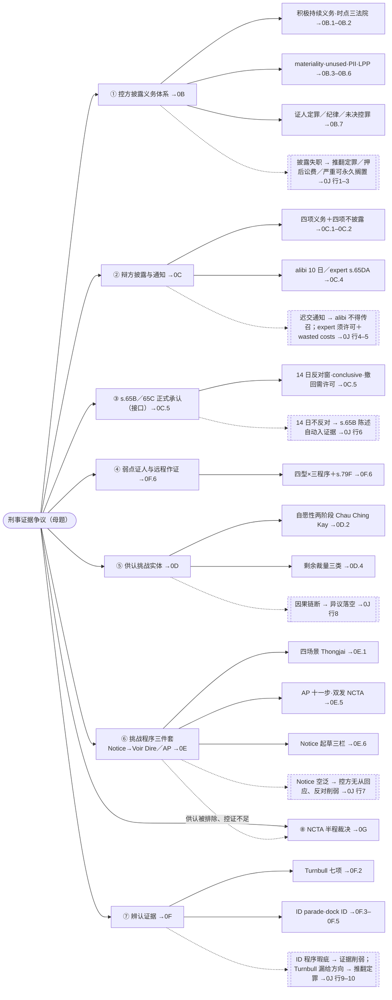
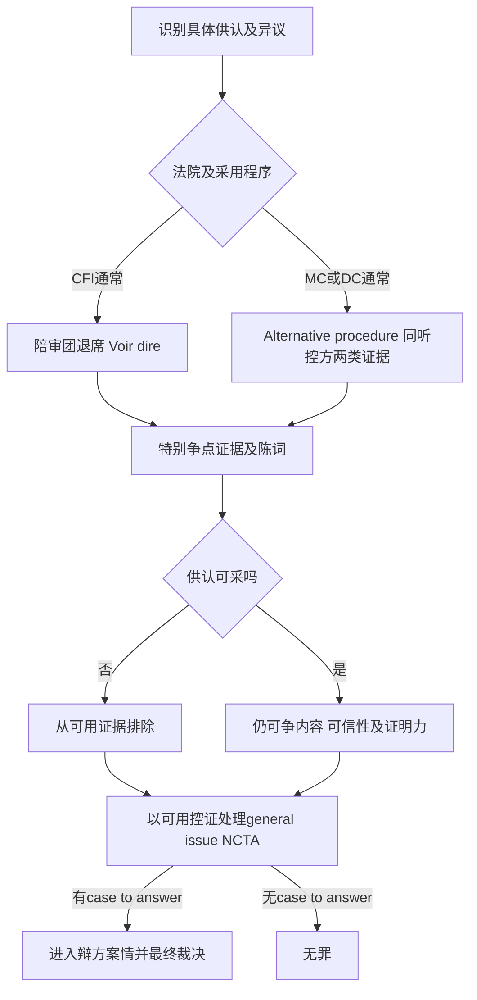
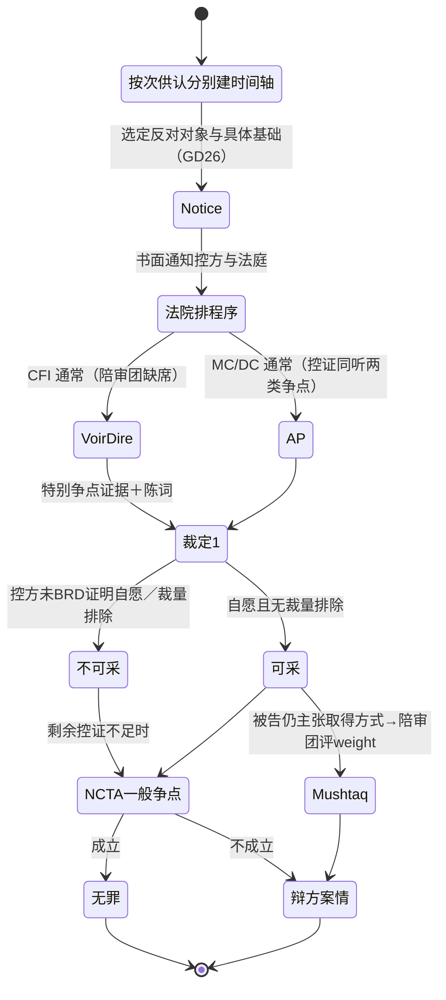

# 刑事证据争议体系 披露 可接纳性与证明力
> **2026-10-10 深化重构**：新增「速读定位层」「🗺️ 本卡地图」与 0B–0I 深节（控方披露体系／辩方披露与通知／供认实体挑战／Notice→Voir Dire→Alternative Procedure／辨认与弱点证人／NCTA／环节×不做后果×依据总表／SG 应用与材料矩阵），既有 0A 与 §1–§8 全部保留（零删减，重排不重写）。**【11 月两连弹】SG06（2026-11-04 口供排除·Notice of Objection 起草）与 SG07（2026-11-11 挑战证供·Brief A/B）备考入口见 [0K](#0k-sg-应用)**；今日 LG5（13:00–15:30）/LG6（16:00–18:30）授课的课堂口径待字幕入库后回补（open 块 O-13.6）。

> **2026-10-06内容扩充**：先读新增“0A. 披露、供认争议与半程裁决的实质路径”，其中逐条展开条件、例外、证据、行动和后果；原有分析与引注保留。课堂字幕只作教师解释及核对，ASR内容与书面规则有别。


> 制作时间：2026-10-01（Asia/Shanghai）；材料快照为制作时本地已入库文件。以topic为单位，编号是本课现行目录锚点，不限制辐射讲次。
> 本文件是新增体系稿；相关旧卡的原文、引注和未决项仍保留。下述“学习建模／策略分析”是对已引规则的组织，不是新增法条或本届案情。


## 速读定位层（30 秒全景：范围 · 术语 · 环节任务）

> 本层为 2026-10-10 深化重构新增的开篇导引；具体各层的规则、条件、例外与引注见下方 0A（既有）与 0B–0K（本轮深化及重编），按本层术语定位后直达。

> **白话导引（从头到尾一遍过）**：证据争议的主线是「取得 → 进入 → 半程」三道闸。取得端：控方承担积极、持续、繁重的披露义务（Prosecution Code 12）——拟用证据、unused material 都在范围内，PII 与 LPP 是两类须经法院衡平的例外；辩方反向只有四项披露义务（alibi 10 日、expert、stay 通知、供认反对理由）。进入端：无争议事实用 s.65B／s.65C 一次定型（14 日反对窗、conclusive）；有争议的供认走「自愿性（控方 BRD 举证）→ 剩余裁量（不公平／偏害／实质违反 R&Ds）」两阶，程序上按法院选 voir dire（CFI 陪审团退席）或 Alternative Procedure（MC/DC 同听两类争点），起草 Notice of Objection 按 GD26 三栏。辨认证据几乎总可采，攻防靠 ID parade 程序记录与 Turnbull 方向；弱点证人走 Part 3A 三种特别程序。半程：NCTA 用 Galbraith 两肢滤掉取至最高仍不能定罪的案件，2023 年 ss.81AA–AAJ 给控方上诉通道。每个环节「不做」的后果链收在 0J 总表。
>
### 适用范围

**覆盖（按程序时序）**——自侦查取证完成到审讯半程的「证据取得 → 证据进入 → 半程过滤」全链：
1. **控方披露义务体系**：积极、持续、onerous 的 disclosure 义务（Prosecution Code para. 12；普通法公平审讯权）；三级法院的披露时点（CFI s.80B MO／DC s.79 DCO／MC 无条文但同规则）；materiality 宽测试（*Keane*）；**unused material** 与不可采证据的披露；PII 与 LPP 两类例外的成立与程序；控方证人定罪／纪律／未决控罪的披露边界〔CR6 L68–L82 "The Prosecution’s duty of disclosure is based on the Defendant’s"；CR6 L134–L146 "Unused material and inadmissib"〕；
2. **辩方披露与通知义务**：辩方只有四项披露义务（alibi s.65D CPO；expert s.65DA CPO；stay 通知 PD 9.7；供认反对理由），不披露抗辩、审讯策略、证人陈述、proof of evidence 与自认有罪的客户密告；自我入罪特权及其法定例外〔CR6 L192–L202 "In contrast to the Prosecution, the Defendant has a much more limited"；CR6 L204–L216 "His defence before the start of the trial"〕；
3. **正式承认接口（s.65B／s.65C）**：书面陈述与事实的正式承认——14 日反对窗、hearsay 不借后门、conclusive 与永久、撤回需许可；起草操作由 SG05 与 14 卡承担，本卡承担规则定型与误用后果〔CR6 L302–L320 "SECTION 65B CPO: FORMAL ADMISSION OF WRITTEN STATEMENTS"；CR6 L322–L354 "Like s. 65B, the Prosecution and Defence can"〕；
4. **供认挑战实体法**：关联 → 自愿性（控方 BRD 举证；威胁／利诱／压迫／欺诈虚假陈述；消散与因果联系）→ 剩余裁量（不公平／偏见高于证明价值／实质违反 R&Ds）；否认作出与自愿性并存（Thongjai double-barrelled）〔CR6 L638–L648 "When considering whether a confession is admissible, there are"；CR6 L624–L632 "The Defendant admits making a confession but does not raise"〕；
5. **挑战程序三件套**：**Notice of Objection**（辩方交付的书面反对理由，起草规范见 GD26）→ **voir dire**（案中案；CFI 通常陪审团缺席；时机三选项；Wong Kam-ming 三限制；Okafor 理由五情形）→ **Alternative Procedure**（MC/DC 常用；控证同时就一般／特别争点作证；双发 NCTA；供认证据特别争点须在控方案情结束前听完）〔CR6 L768–L792 "A Voir Dire can be held in all 3 courts:"；CR6 L820–L858 "In the Alternative Procedure, the Prosecution witnesses give evidence and"〕；
6. **辨认证据**：可采性与证明力两问；Turnbull 情况七项与陪审团指引七项；ID parade 组成与律师角色；group／confrontation／photo／video／voice／forensic 各形态；dock ID 三许可与两 may〔CR6 L872–L908 "The leading case of R v Turnbull [1977] QB 224 lays down"；CR6 L1014–L1020 "This is the most prejudicial and least favourable method of ID."〕；
7. **易受伤害证人与远程作证**：Part 3A CPO 四类证人 × 三种特别程序（Live TV Link s.79B／Video Recorded Evidence s.79C／Deposition s.79E）＋ Notice of Transfer s.79F／discharge s.79G；CRHO（Cap. 654，2025 年 3 月生效）远程作证令〔CR6 L438–L476 "The CPO contains special procedures in Part 3A"〕；
8. **NCTA 与半程裁决**：Galbraith 两肢（could/may not will/must）；*Re SJ’s Reference (Nos. 1–3 2021)* 四点；迟来 NCTA 的例外门槛；2023 年 Division 3 CPO（ss. 81AA–AAJ）控方对 NCTA 裁定的上诉通道〔CR6 L1034–L1052 "This is a submission on the law made by the"；CR6 L1078–L1084 "Ss. 81AA – AAJ of Division 3 CPO, added in 2023"〕；
9. **攻防与 SG 应用**：披露失职的推翻风险、迟交反对通知与程序瑕疵的证据削弱、SG05（s.65B/C 定型）／SG06（口供排除）／SG07（挑战证供）的题型映射（见 0J、0K）。

**不覆盖（边界声明，相关承担者标明）**：① 审讯准备与文书全流（brief to counsel、defence statement 类）→ 14 Institution - Trial Preparation and Documents；② 警察权力与搜查、警署内律师职责的侦查端主体 → 11 Framework - Police Powers & Search Rules（本卡只引警诫／R&Ds 接口）；③ 检控启动、移交与 1992 R&Ds 的制度框架 → 12 Framework - Prosecution, Commencement & 1992 R&Ds（R&Ds 的条文本体在该卡，本卡只处理「违反 R&Ds 对供认可采性的后果」）；④ **传闻证据规则与定罪记录作为证据**（hearsay 例外全表、bad character／s.54(1)(f) shield、similar fact evidence、spent convictions ROO）→ 属 LG5 主题，对应主卡未建，本卡 §3 既有表行保留 CR5 引注作接口，只在供认与辨认语境引用（供认即不利己承认的传闻例外、s.65B 不开传闻后门、SG07 Brief B 的 SFE 边界点 *Noor Mohamed*）；⑤ 量刑与认罪折扣 → 15 Institution - Sentencing System（SG07 Brief A Q4／Brief B Q3 归该域）；⑥ 上诉程序本体（s.83 系列、表格、时限）→ SG08／LG10 对应卡（未建，登记 open O-13.3）。

### 术语（核心概念与实务运作定义）

| 术语（英文原词） | 一句中文精确定义 | 出处 |
| ----------------------------------------- | --------------------------------------------------------------------------------------------------------------------------------------------------------------------------------------------------- | ------------------- |
| 披露义务（duty of disclosure） | 控方基于被告公平审讯权、依 Prosecution Code para. 12 承担的积极且持续至刑事程序终结的相关材料披露义务〔CR6 L70 "There is an onerous duty on Prosecution under the Prosecution Code to disclose all"〕 | PC para. 12 |
| 实质相关性（materiality） | *Keane* 宽测试：与争点相关或可能相关、引出或可能引出新争点、或有真实（非幻想）机会提供通向 (a)/(b) 的证据线索〔CR6 L118–L124 "relevant or possibly relevant to an issue in the case"〕 | R v. Keane |
| 未用材料（unused material） | 警方／控方在侦查或备案中收集但审讯不拟依赖的材料（通常因不利控方），仍须披露〔CR6 L138 "material that has been collected by the police / Prosecution in the course"〕 | HKSAR v Wun Shu Fai |
| 公共利益豁免（Public Interest Immunity, PII） | 披露将损害公共利益的敏感材料（如线人身份、警务手法、国家机密），经法院衡平后作为披露义务的例外〔CR6 L86 "Public interest immunity may apply to some such material"〕 | PC para. 12.5 |
| 法律专业特权（Legal Professional Privilege, LPP） | 客户与律师之间为取得或提供法律意见、或为进行中／合理预期诉讼所作的保密通讯，免于披露（仅客户可放弃）〔CR6 L96 "attaches to communications made (i) between a lawyer and a"；CR6 L114 "only the client has the power to waiver"〕 | A. 35 BL |
| 不在场通知（alibi notice） | 辩方最迟开审前 10 日给出的不在场证明及 particulars 的法定通知（s.65D CPO；MC 无明文但可致押后与讼费）〔CR6 L244–L246 "A Defendant must give an alibi notice not less than 10 days"〕 | s.65D CPO |
| 书面陈述承认（s.65B written statement） | 控辩同意下毋须证人出庭即以书面陈述作为其内容的证据、效力视同口头作证的机制（14 日反对窗）〔CR6 L306 "A s.65B written statement is treated as if oral evidence"；CR6 L310 "they must object within 14 days of service"〕 | s.65B CPO |
| 承认事实（Admitted Facts, s.65C） | 控辩共同签署确认的事实清单，一经承认即为决定性证据、上诉与重审持续有效、撤回需法庭许可〔CR6 L328 "conclusive evidence” according to s. 65C(1)"；CR6 L352 "stays with you on appeal and on a re-trial"〕 | s.65C CPO |
| 供认（confession）／承认（admission） | confession 是认罪的 admission；admission 更宽，可就程序事实、陈述或认罪作出；二者均为传闻的「不利己承认」例外〔CR6 L582–L584 "an admission is wider than a confession which is an"〕 | 普通法 |
| 自愿性（voluntariness） | 供认非因有权人士施加之恐惧损害或希望获益（威胁、利诱）或压迫而作出；控方须排除合理疑点证明〔CR6 L650 "obtained by fear of prejudice or hope of advantage exercised"；CR6 L648 "The Prosecution must prove voluntariness beyond reasonable doubt."〕 | Ibrahim；Ping Lin |
| 剩余裁量（residual discretion） | 供认纵属自愿，法官仍可因不公平、偏见高于证明价值或实质违反 R&Ds 而排除的裁量〔CR6 L700–L706 "the court has a residual discretion to exclude it"〕 | 普通法 |
| 有权人士（person in authority） | 对被告或对其程序／侦查行使权力或控制的人（警察、裁判官、检控官、雇主、教师；同囚、同事、医生不是），且须被告主观感知〔CR6 L660 "someone who exercised some authority or control over the Defendant"〕 | Deokinanan |
| 案中案（voir dire） | 「trial within a trial」：一般争点暂停，法院先审证据可采性的特别争点，只听与该争点有关的证据〔CR6 L572 "The trial on the main issue of guilt (‘the general issue’) stops"〕 | 普通法 |
| 替代程序（Alternative Procedure） | MC/DC 常用方式：控方证人就一般＋特别争点一并作证受盘问，控证临时结束后先裁特别争点〔CR6 L820–L822 "the Prosecution witnesses give evidence and are cross-examined on both"〕 | 普通法 |
| 反对通知（Notice／Grounds of Objection） | 辩方就供认可采性向控方与法庭出具的书面反对理由，载明反对对象、失当行为与所求后果〔CR6 L790 "give the Prosecution written notice of objections to admissibility"〕 | SG06 课题 |
| 消散（dissipation） | 先行的压迫／威胁／利诱在下次陈述前是否已消退；未消退则后一份亦受影响〔CR6 L688 "it must have dissipated by the time of a second"〕 | R v. Leung Kit-ling |
| 因果联系（causal nexus） | 被投诉行为须发生在供认之前或当时并实际导致供认；事后行为不能倒果为因〔CR6 L758 "if the misconduct of the person in authority / person to"〕 | 普通法 |
| Turnbull 指引 | 控方案情全部或大部依赖被告否认的错误辨认时，法官须向陪审团作特别谨慎警告并紧贴辨认情形的指引体系〔CR6 L872 "lays down guidelines with respect to the circumstances of"〕 | R v Turnbull |
| 认人行列（ID parade） | 由 OC Parade 独立警官主持、1 名嫌疑人＋至少 8 名外貌相近演员的辨认程序（2 名嫌疑人须另配 ≥12 人）〔CR6 L946 "It usually comprises 8 actors who are drawn from"〕 | ID Parade Book |
| 被告栏指认（dock ID） | 证人于庭上指认坐在被告栏之人——偏见最高、最不利的辨认方式，法官恒有酌情权拒绝收取〔CR6 L1014 "This is the most prejudicial and least favourable method of ID."〕 | R v. Hoang Duc Hoa |
| 易受伤害证人（vulnerable witness） | Part 3A CPO 下可用特别程序作证的四类证人：儿童、精神上无行为能力人士、恐惧证人与指明性罪行事主〔CR6 L442 "cover four types of vulnerable witnesses: (i) children"〕 | ss. 79A–79G CPO |
| 无案可答（No Case to Answer, NCTA） | 控方案情终结时辩方主张控方证据取至最高仍不足令获正确指引的陪审团合理定罪的半程法律陈词〔CR6 L1034 "also known as a ‘half-way’ or ‘half-time’ submission"〕 | R v. Galbraith |
| Mushtaq 方向 | 供认经裁定可采而被告仍主张系遭压迫等取得时，法官指示陪审团若认为可能如此取得并致不可靠即应置之不理〔CR6 L754 "if they consider that written or oral statements were, or"〕 | R v Mushtaq |
| 双管齐下异议（double-barrelled allegation） | 被告既否认作出供认、又指该（如有作出的）供认因失当行为非自愿——两者互不排斥，须开 voir dire〔CR6 L632 "An assertion that the Defendant did not make the confession"〕 | Thongjai |

### 环节定位（按程序时序）

| 环节（时序） | 它解决的具体问题 | 依据 |
|---|---|---|
| 侦查后 → 控方披露 | 防止「伏击式审讯」：辩方在开审前知道控方拟用证据＋可能削弱控方或推进辩方的材料，才能把资源用在真争点上〔CR6 L68 "based on the Defendant’s common law right to a fair trial"〕 | PC para. 12；BL As. 39/87；HKBOR A. 11(2) |
| unused material 清单 | 控方不用的材料不等于无价值——它们可能是辩方的调查起点（train of enquiry）〔CR6 L136 "may lead the Defendant on a train of enquiry"〕 | Keane；Wun Shu Fai |
| PII／LPP 声称 | 国家利益、侦查手法与律师保密如何不被披露义务辗过，又防止「一贴敏感标签便无须法院审查」〔CR6 L92 "they must clearly articulate what information they wished"〕 | Nayab Amin |
| 辩方 alibi／expert 通知 | 审前把两类突袭型辩方证据交给控方核查，换取该证据可进入审讯的资格〔CR6 L240–L246 "there is no formal requirement of an alibi notice"；CR6 L268–L278 "following committal, transfer or an order for re-trial"〕 | s.65D／s.65DA CPO |
| s.65B／s.65C 承认 | 把无争议证据一次定型：省时省钱、收窄争点，同时锁定「承认即不可反悔」的纪律〔CR6 L384–L390 "Both ss. 65B and 65C Admissions help to"〕 | ss. 65B/65C CPO |
| 弱点证人许可 | 让儿童、精神上无行为能力、恐惧证人与性罪行事主能开口——否则关键证据根本不存在〔CR6 L442–L444 "Both P and D can apply to use these protections"〕 | CPO Part 3A |
| Notice of Objection | 把「我反对」变成有结构的通知：反对哪份供认、谁做了什么、导致什么后果——控方才能回应、法庭才能排程序〔CR6 L790 "We will consider how to draft these Grounds of"〕 | GD26；SG06 |
| voir dire／AP | 把「该不该听」与「信不信」分开：不可采的供认不进事实裁断者耳中，可采的再交给陪审团评 weight〔CR6 L572–L576 "Only on whether certain evidence should be admissible"；CR6 L812–L818 "It saves time and costs as it prevents"〕 | Wong Kam-ming |
| 承认后 Mushtaq 方向 | 供认进了门不等于必须为真：被告仍可就取得方式争 weight，陪审团按指引决定是否置之不理〔CR6 L754 "The jury will then decide whether to disregard the confession"〕 | Mushtaq；SJD 58 |
| Turnbull 方向 | 辨认错误是冤案高发源：以法官警告＋紧贴情形的指引控制「诚实但错误」的证人风险〔CR6 L896 "a mistaken witness can be a convincing one"〕 | Turnbull；SJD 39 |
| ID parade 操作 | 在警方主导辨认的最早时点把偏见压到最低；律师在场即时记录异议才能保住庭上攻击材料〔CR6 L944 "Your role is to ensure that the ID parade is fairly conducted"〕 | ID Parade Book |
| NCTA | 半程把「取至最高仍不能定罪」的案件滤掉，避免无辜者背辩方举证压力走完全程〔CR6 L1038–L1048 "whether a Jury properly directed may convict rather than"〕 | Galbraith |

### SG 截止点提示（11 月两连弹）

| 倒计时（以 2026-10-10 为基准） | SG 与本卡对应 | 立即要做 |
|---|---|---|
| **T-25 日：SG06（2026-11-04 19:00–21:00）** 口供排除 | 角色为 Prosecutor；范围包括披露责任、NCTA、审讯策略（含境外证人）、cautioned statements、voir dires／alternative procedure、**草拟 Notice of Objection**〔CO26 L586 "Role of Prosecutor, duties of disclosure, no case to answer"〕；第三案卷 John Lace 当堂发放 | 0E.6＋0K.3：按 GD26 三栏起草规范预演；往届范本两篇对照（0K.6 行 12–13） |
| **T-32 日：SG07（2026-11-11 19:00–21:00）** 挑战证供 | Brief A Mohammed（供认＋PC4300 披露＋dock ID）；Brief B Donald（开案偏见＋SFE 边界）；2 Brief 共 7 问，均须课前备齐完整答案〔S7B L60–L65 "Review your LGS 5 – 9 notes"〕 | 0K.4：七问与本卡章节逐问映射＋已有完整答案入口 |


## 🗺️ 本卡地图（章节位置与阅读顺序）

> 本卡按「证据生命周期」排章：取得（披露）→ 进入（挑战）→ 半程（NCTA）→ 后果与 SG；五原则节是学理回扣层，随时可旁插。
>
> 本节两件套：**图 1 · 母题结构图**（下一张，Criminal Evidence Disputes 的分支 roadmap 即全流程主干与后果虚线；特别机制图 2 见 0E.7 程序状态机）→ **任务直达表**（按要做的事跳章节）。

**图 1 · 刑事证据争议分支 roadmap（全流程主干与后果虚线）**：



| 你现在要做什么 | 直达章节 |
|---|---|
| 30 秒弄清范围/术语/每环任务/两连弹 | [速读定位层](#速读定位层30-秒全景范围--术语--环节任务) |
| 向控方追讨未披露材料（含弱点证人/纪律记录） | [0B 控方披露体系](#0b-控方披露义务体系) |
| 回应 s.65B 送达／起草 s.65C 承认事实（SG05） | [0C.5 正式承认接口](#0c5-s65bs65c-接口定型把无争议证据一次锁死)＋[0K.2](#0k2-sg0510-28s65bc-定型jeff-sham) |
| 挑选供认异议并搭因果链 | [0D 供认实体挑战](#0d-供认可采性的实体挑战) |
| 起草 Notice of Objection（SG06 核心动作） | [0E.6 Notice 起草规范](#0e6-notice-of-objection-起草规范sg06-核心gd26往届范本对照)＋[0K.3](#0k-sg-应用) |
| 在 CFI／DC／MC 各选什么挑战程序 | [0E.1–0E.5](#0e-挑战程序三件套notice-of-objection--voir-dire--alternative-procedure) |
| 攻击或防御辨认（SG07 Q3 dock ID） | [0F 辨认与弱点证人](#0f-辨认证据与易受伤害证人) |
| 半程申请或反对 NCTA | [0G NCTA](#0g-ncta-与半程裁决) |
| 查「某环不做会怎样」 | [0J 后果链总表](#0j-环节--不做后果--依据-总表) |
| 11 月两连弹备考（SG06/SG07） | [0K SG 应用](#0k-sg-应用) |
| 学理复盘（五原则） | §1 第一性 → §2 顺向 → §4 控制论 → §5 横向 → §6 逆向 |


<!-- BEGIN:cite-legend -->
> [!info]- 引注图例
>
> | 码 | 文件 | 层级 | 学年 |
> |---|---|---|---|
> | CR5 | LGS5 审前及审讯问题 | 本届讲义 | 2026-27 |
> | CR5P | LGS5 Part3课后补充 | 本届讲义 | 2026-27 |
> | CR6 | LGS6 披露和证据争议 | 本届讲义 | 2026-27 |
> | CR6S | LGS6 披露和证据争议（投影片伴生 md） | 本届讲义 | 2026-27 |
> | CAP-K6 | PCLL8050 LGS6 PT 课堂字幕 | 本届讲义 | 2026-27 |
> | CR7 | LGS7 诉讼实务及文书Final | 本届讲义 | 2026-27 |
> | CO26 | 本届课程大纲 | 本届官方 | 2026-27 |
> | GD26 | 本届官方《口供异议通知草拟指引 2026》 | 本届官方 | 2026-27 |
> | S5B | 本届 SGS5 学生册 | 本届官方 | 2026-27 |
> | S7B | 本届 SGS7 学生册 | 本届官方 | 2026-27 |
> | OLD-LG6N | 往届 LG06 讲义 2025 REVISED（与本届 LGS6 的版本链见 0I.6） | 往届官方 | 2025-26 |
> | OLD-LG6S | 往届 LG06 投影片 2025 | 往届官方 | 2025-26 |
> | OLD-SET2EX | 往届学生稿·Set 2「Crim Lit - EXAM NOTES」（上诉理由框架，505 行，非官方） | 往届学生稿 | 2025-26 |
> | OLD-SET3LGN | 往届学生稿·Set 3「LG Notes」（全课汇总笔记，8962 行，非官方） | 往届学生稿 | 2025-26 |
> | OLD-SET3NO | 往届学生稿·Set 3 Notice of Objection（DCCC 498/2024 应考稿，非官方） | 往届学生稿 | 2025-26 |
> | OLD-SG6PRE | 往届归档·SGS 6 官方范本 Precedent Notice of Objection（ESCC 118/2018；00 Official 封面标 PCLL 2021-2022） | 往届官方 | 2021-22及更早 |
> | OLD-SG6G1 | 往届归档·SGS 6 草拟指引 REVISED (Set 1) | 往届官方 | 2021-22及更早 |


> | LAW21 | Criminal Litigation SG04 - Authorities Verification - 2026-10-21 | 库外法源 | 2026-27 |
> | SG5REC | SG05课堂录音全文（2026-10-28） | 本届讲义 | 2026-27 |
> | V6 | SG06法源与来源身份核验 | 库外法源 | 2026-27 |
<!-- END:cite-legend -->


## 0A. 披露、供认争议与半程裁决的实质路径

### 0A.1 三个问题各有不同后果

**Disclosure**问辩方应取得什么；**admissibility**问法庭能否用；**weight**问可用材料有多大证明力。材料未被控方使用、甚至本身不可采，也可能提供有用调查线索而须披露；可采也不等于必可信。〔CR6 L68–L82 "The Prosecution’s duty of disclosure is based on the Defendant’s"〕〔CR6 L134–L146 "Unused material and inadmissib"〕〔CR6 L754 "Whether the Defendant in fact made the confession, whether it"〕

### 0A.2 控方披露是积极、持续的义务

控方应披露相关材料，贯穿刑事程序；辩方没有先猜中材料才享有披露的负担，但及时请求具体录像或文件可防止流失。MC没有同样的法定时间条款，不表示公平披露义务消失。〔CR6 L68–L80 "The Prosecution’s duty of disclosure is based on the Defendant’s"〕

| 材料 | 应问的实质问题 | 不能采用的推理 |
|---|---|---|
| 控方拟用证据 | 何时送达、是否齐全、是否有更正或附件 | 只读Brief Facts便当控方证据全部已知 |
| Unused material | 能否削弱控方或推进辩方/合理调查线索 | 控方不打算用，所以不须披露 |
| 保密/PII材料 | 具体保护利益、内容及不披露对公平审讯影响 | 一贴“敏感”便无须法院审查 |
| LPP材料 | 是否符合特权而非一般保密 | 只因对方律师参与就所有材料都豁免 |

unused并非一律必须交全部无关物；应解释它与案件争点的实际关联。PII和LPP是不同的例外基础。〔CR6 L82–L96 "What does the Prosecution not need to disclose? The Prosecution"〕〔CR6 L134–L146 "Unused material and inadmissib"〕

Nayab Amin说明PII请求须准确交代欲保留的信息，让法院评估公共利益与公平审讯；不能在控方自己不取完整陈述的情况下声称身份不可披露。应争取审前处理有关问题，避免庭中突然无法继续。〔CR6 L92 "See the recent case of HKSAR v. Nayab Amin [2020]"〕

### 0A.3 辩方准备不是民事式全面披露

本课区分辩方一般不须披露的trial strategy、proof和证人陈述，与alibi、expert evidence及挑战供认可采性等特定通知安排。不要套用民事discovery规则，也不能反过来说任何辩方事项都可以到庭才提出。〔CR6 L202–L216 "We will deal with the Defendant’s disclosure of alibi evidence,"〕〔CR6 L280–L296 "For a recent case dealing with an application to adduce"〕

### 0A.4 每次供认分别制作时间轴

口头回应、post-recorded statement、书面ROI、VRI以及动作示意，可能是不同证据。对每项写：时间、地点、在场人、警诫、此前发生的行为、客户是否承认作出、具体异议。〔CR6 L594–L606 "Different forms of Confession:"〕

**因果联系**必须逐项说明：不当行为发生在供认前还是后，是否仍影响自由选择，中间是否有改变。某次威胁在第一份口供之后，不会倒流成为第一份口供的原因；前一份遭排除也不必然决定后一份，须分析影响是否持续。〔CR6 L756–L758 "Conduct complained of must have caused the Defendant to confess:"〕〔CR6 L802 "The absence of reasons for admitting or excluding a confession"〕

### 0A.5 可采性的两层分析

第一层是自愿性。控方须排除合理疑点证明供认自愿，辩方无需证明不自愿；威吓、诱因、压迫等须与该次陈述建立联系。第二层是即使自愿，法院是否按剩余裁量因不公平而排除。把这两层分别提出，避免只说“警方不守规则”。〔CR6 L576 "Admissibility is a question of law. This means that it"〕〔CR6 L592 "The Prosecution bears the burden of proof as to the"〕〔CR6 L742–L758 "(iii) Substantial breaches of the Rules & Directions"〕

轻微R&D违反不自动排除；重大或实质违反的性质、影响和具体保护对象都有关。也不能只凭ROI写有“自愿”或客户签名，就认为可采性已经无争议。〔CR6 L602 "The Defendant may confess in a written Record of Interview"〕〔CR6 L744 "Minor breaches of little consequence will not lead to the"〕

**否认作出与自愿性可并存。** Thongjai的double-barrelled情形是：客户说没有供认，同时指出若法庭认定确有陈述，该陈述也因不当行为不可采。事实裁断者可能不信前一点却相信后一点，故不能强迫辩方只能选其一。〔CR6 L624–L632 "The Defendant admits making a confession but does not raise"〕

讲义L628把纯粹否认/伪造列为需调查的情形，而L754又把是否作出、准确性与签名列为事实及可信性问题。课堂应明确究竟是否指称警方伪造或其他会影响可采性的行为，不能把任何普通内容不准确都自动称为不自愿。此处保留两段功能差别，具体异议按实际指示提出。〔CR6 L628 "The Defendant denies making the confession – a Voir Dire"〕〔CR6 L754 "Whether the Defendant in fact made the confession, whether it"〕

### 0A.6 Voir dire与alternative procedure不能套错法院

Voir dire是暂停general issue，先审special issue。CFI通常在陪审团不在场时进行，防止它听到最终不可用材料；有特别策略选择在陪审团前处理时，证据时序不同，不能照抄MC alternative procedure。〔CR6 L570–L576 "CHALLENGING THE ADMISSIBILITY OF A CONFESSION BY VOIR DIRE /"〕〔CR6 L768–L786 "A Voir Dire can be held in all 3 courts:"〕

**MC/DC常用alternative procedure的顺序**：控方证人同时就一般/特别争点作证及盘问→临时结束控证待special issue→辩方可对special issue作NCTA→若需辩方特别争点证据，先只听该部分→裁定供认→再作general issue NCTA→如有case to answer才进入一般辩方案情。〔CR6 L820–L858 "In the Alternative Procedure, the Prosecution witnesses give evidence and"〕



异议明确、裁定时点和可用证据范围都要在记录上清楚；程序分流详见 0E 状态机（图 2）与 0E.1–0E.5；特殊情况与罕见策略选择回原讲义。〔CR6 L782–L804 "Usually, the Voir Dire is held out of the Jury’s"〕

### 0A.7 在特别争点作证会否变成承认犯罪

Wong Kam-ming说明voir dire不得盘问供认是否真实即是否犯案；控方不能把D在特别争点所说的内容作为实体证据直接提出。若D随后就general issue作证，相关不一致可产生盘问问题，须在决定作证前解释。〔CR6 L762 "The case of R v. Wong Kam-ming [1980] AC 247"〕

供认获准不代表jury必须相信；其后仍可能争是否作出及其可靠性，并需要适当Mushtaq指示。已排除的供认则不得再让jury听到或由独任法官纳入有罪理由。〔CR6 L754 "Whether the Defendant in fact made the confession, whether it"〕〔CR6 L864 "Where following a voir dire / Alternative Procedure, the Judge"〕

### 0A.8 NCTA不是提早做最终无罪陈词

Galbraith第一支：没有证据证明被告实施有关罪，停案。第二支：虽有证据但极薄弱，取其最高点仍不能让获正确指示的jury合理定罪，停案；若强弱主要取决于证人可信性且有可合法定罪的事实版本，通常交最终事实裁断。测试是could/may，不是法官此刻已经相信must convict。〔CR6 L1034–L1052 "This is a submission on the law made by the"〕

NCTA成功则无罪；失败只表示须回应，不是预判有罪。最终仍按全部证据及控方排除合理疑点责任判断。不要把special issue的NCTA与general issue的半程申请混写。〔CR6 L842–L858 "The Defendant can make a NCTA submission on special issue;"〕〔CR6 L1054–L1062 "The Prosecution has a right of reply to the NCTA"〕

### 0A.9 从异议到文书的可用输出

**本卡自拟异议表**：证据编号→想排除的具体内容→自愿性/公平性/其他依据→支持事实及来源→所求程序→若失败还可怎样争weight。把需要的录像、羁押记录、医疗资料和证人列成有目的请求；不预设每种程序瑕疵必然带来终止检控。〔CR6 L68–L92 "The Prosecution’s duty of disclosure is based on the Defendant’s"〕〔CR6 L576–L606 "Admissibility is a question of law. This means that it"〕〔CR6 L754–L758 "Whether the Defendant in fact made the confession, whether it"〕


## 0B. 控方披露义务体系

> 主线：**义务性质（积极·持续）→ 时点（三级法院）→ 范围（materiality·unused·不可采）→ 例外（PII·LPP）→ 证人材料 → 辩方边界 → 失灵后果**。主体依据本届 LGS6 讲义（CR6）与投影片（CR6S）；后果链归并 [0J 总表](#0j-环节--不做后果--依据-总表 行 1–3。

### 0B.1 义务性质：积极、持续、onerous

披露义务的根基是被告的普通法公平审讯权（另见 BL As. 39 & 87、HKBOR A. 11(2)）〔CR6 L68 "The Prosecution’s duty of disclosure is based on the Defendant’s common law right"〕。三个修饰词各有操作含义：

| 修饰 | 操作含义 | 引注 |
|---|---|---|
| onerous（繁重） | Prosecution Code para. 12 课以披露全部相关材料的繁重义务 | 〔CR6 L70 "There is an onerous duty on Prosecution under the Prosecution Code to disclose all"〕 |
| positive（积极） | 辩方无先查询的义务，但及时点名请求具体文件（如 CCTV）可防证据流失，属良好实务 | 〔CR6 L72 "There is, however, no onus on the Defence to make their own enquiries."〕 |
| continuing（持续） | 贯穿「刑事程序」全程直至控方案情最终完结；审中新到手材料同样触发 | 〔CR6 L70 "This means it continues throughout “the criminal process”"〕 |

义务主体是控方整体（DOJ 而非个别检控官），控方应促使侦查机关知其义务——*Lee Ming-Tee & SFC* 为 leading case〔CR6 L130 "the Prosecution should make investigative agency aware of their duty"〕；披露义务一般不延伸至证人〔CR6 L132 "The duty of disclosure does not generally extend to witnesses."〕。

### 0B.2 时点与三级法院差异

| 法院 | 披露时点规则 | 引注 |
|---|---|---|
| CFI | 交付程序一部分：s.80B MO——交付前至少 7 日送达 complaint/information、拟传证人陈述、文件证物及证物清单 | 〔CR6 L76 "at least 7 days before committal, the Prosecution must serve"〕 |
| DC | s.79 DCO | 〔CR6 L78 "In the DC: see s.79 DCO."〕 |
| MC | 无法定时间条款，但 *HKSAR v. Gao Heija* 确认同一套规则适用（无律师被告未获 Brief Facts／证人陈述／未传证人陈述／主控证人前科 → 定罪上诉推翻） | 〔CR6 L80 "makes it clear that the same rules apply in the MC"〕 |

### 0B.3 范围：materiality 宽测试与「两个方向」

*R v. Keane* 定下的宽定义三肢——(a) 与案件争点相关或可能相关；(b) 引出或可能引出控方拟用证据表面上不显见的新争点；(c) 有真实（而非幻想）机会提供通向 (a)/(b) 的证据线索〔CR6 L118–L124 "relevant or possibly relevant to an issue in the case"〕。因此控方须同时披露**削弱控方案情**与**协助辩方案情**的材料〔CR6 L128 "must disclose both material which undermines the Prosecution’s case"〕。

**unused material**（侦查／备案中收集但控方不拟使用者）与**不可采证据**均在义务范围内，因为它们可能引导辩方走向相关、可采的材料〔CR6 L136 "may lead the Defendant on a train of enquiry"〕；*Wun Shu Fai* 要求控方在涉及从犯证据的重案中主动披露，并建议以检控官向侦查人员发出书面指示、书面确认材料有无，并存留记录〔CR6 L138 "the Prosecution have a duty to be proactive in disclosing material"〕；控方证人获豁免（immunity）及可致其减刑的资料必须披露〔CR6 L140 "must disclose to the Defence all material relevant to an immunity"〕。但无关的 unused material 无义务披露——*Lau Wing Wing*：关键在评估其对争点的实际关联、可被辩方作何种用途及辩方是否已知〔CR6 L146 "no duty on the Prosecution to disclose unused material which is not relevant"〕。

**失灵判例对**：*Wong Tin Lung*（凶器与袋上检出第三人指纹未披露、与辩方「替朋友拿袋」一致 → 推翻定罪）〔CR6 L142 "the Prosecution failed to disclose that another person’s fingerprints"〕；*Chong Ho Yin*（殴打案中相互矛盾医疗证据未披露 → material irregularity，定罪 unsafe and unsatisfactory）〔CR6 L144 "failure to disclose was a material irregularity"〕。


==**【SG05录音补充｜2026-10-28 25:29】** unused material索取：具体列出人物供词、笔记、草图、CCTV等，再加其他应披露材料的兜底请求；控方义务主动持续，辩方仍积极追索。清单不是材料本身，对可能影响案件的项目要实际查阅。 〔SG5REC L220 "you should always particularize as far as possible"〕〔SG5REC L228 "Ideally, originals, if you can"〕==

### 0B.4 例外一：PII 与 Nayab Amin 程序

PII 适用于**本来相关、本应披露**的材料——披露将损害公共利益者（线人或卧底身份、机密给予侦查者的信息、政府机构运作与进行中的侦查）〔CR6 L86 "Material which comes within PII is prima facie relevant, disclosable material"〕。法院的衡平两端：不披露的公共利益 vs 防止错判的司法利益，控罪严重性为一因素〔CR6 L88 "the court has to essentially perform a balancing exercise"〕。*Apple Daily*：用以取得手令的信息可属 PII 而免披露；**PII 声请只及于真正相关材料**——无关材料根本不在披露之列〔CR6 L90 "a claim for PII only applies in respect of information that is relevant"〕。

*Nayab Amin*（CA）确立的操作规程（其对 PII 的论述属 obiter——上诉终因 recent possession 误指成功）〔CR6S L58 "The CA’s comments on PII were obiter"〕：

1. 控方须**明确表述**欲保留的信息是什么；
2. 须从证人取得**全面、详细、准确**的陈述呈交法官；
3. 法官据此判断是否披露会造成「对重要公共利益真实而严重损害的风险」；
4. 「innocence at stake」例外（*Agara* 继续适用于香港）：未披露材料是否可能就被告清白**引起合理疑点**；线人身份只在其不披露将**剥夺公平审讯**时披露；
5. 「active informers」在警方指示下行事者，不自动落入线人类别，应逐案判断；
6. **PII 问题应审前处理**，不留到审讯中〔CR6 L92 "they must clearly articulate what information they wished to withhold"〕。

### 0B.5 例外二：LPP 两型与边界

LPP 覆盖 (i) 律师与客户间为给予／取得法律意见的通讯；(ii) 为已有或预期诉讼与第三方的通讯——根基是客户能毫无保留咨询律师（*Derby Magistrates* 判词：「客户必须确信其对律师的密告非经同意永不公开」）〔CR6 L96 "a man must be able to consult his lawyer in confidence"〕；A. 35 BL 保障机密法律意见权，被表述为基本人权与绝对宪法权利〔CR6 L98 "LPP has been described as a fundamental human right"〕。法定排除例：POBO ss. 14 & 15；NSL 下 LPP 文件不得被搜查检取但举证责任在主张方（*Lai Chee-Yee*：「mere possibility or a general apprehension of future litigation is insufficient」）〔CR6 L100 "LPP can be overridden by statute in certain limited circumstances"；CR6 L112 "the burden is on the plaintiff to establish LPP"〕。

| 型 | 范围与门槛 | 引注 |
|---|---|---|
| Legal Advice Privilege | 律师—客户保密通讯以求取法律意见；不需预期诉讼；通讯逸出第三方或非保密场合（如餐厅谈话）即失；为求教如何犯罪者不保；律师关系开始前的材料不保 | 〔CR6 L108 "There is no need for litigation to be contemplated for Legal Advice Privilege"；CR6 L108 "communications for the purpose of getting legal advice on how to commit a crime are not covered"〕 |
| Litigation Privilege | 更宽：客户与第三方及／或律师与第三方通讯；三要件——诉讼进行中或合理预期、sole or dominant purpose 为进行该诉讼、诉讼属对抗式而非调查式（*Three Rivers*） | 〔CR6 L110 "(i) litigation must be in progress or in reasonable contemplation"〕 |

**边界**：LPP 不保非通讯文件（如普通法庭文件、客户姓名地址）、不保物件／事实／行为、不保为非法目的而造的文件；仅客户可放弃两种特权〔CR6 L102 "It does not cover documents which are not communications"；CR6 L114 "only the client has the power to waiver either Legal"〕。

### 0B.6 控方证人不利材料：定罪、纪律、未决控罪

| 材料类型 | 规则与判例 | 引注 |
|---|---|---|
| 控方证人前科 | *Lee Ming-Tee* 测试：材料是否「可能动摇对控方证人可靠性的信心」；*Chan Kau Tai*：最佳实务是披露全部控方证人定罪，轻微者至少应披露「有定罪」让法官裁断；PC para. 12.3(c)：可能影响可信性的已知不光彩行为（含纪律记录）在可信性可能成重要争点时应披露 | 〔CR6 L148 "likely to shake the confidence in the reliability"；CR6 L150 "the best practice was to disclose criminal convictions of all"〕 |
| 纪律研讯 | *Guney*：辩方无权「撒网式」查阅控方档案；研讯若无定罪或纪律处分结果则无须披露；但「因警员不当行为或不可信而撤销定罪」的裁决记录及同类停审／撤案记录须披露 | 〔CR6 L156 "the Defence was not entitled to a general trawl through"〕 |
| 未决纪律研讯／未决控罪 | 控方**专家**证人正受涉及专业能力的纪律研讯 → 应披露（*Lee Ming Tee*）；未决控罪可能关乎可信性 → 应披露（*Allison v HM Advocate*，UKSC；lay witness 同样处理） | 〔CR6 L158 "the current subject of an ongoing disciplinary inquiry"；CR6S L127 "Yes if expert witness and relevant to credibility"〕 |

*Wong Yuk Lam*：控方未披露若干控方证人定罪 → 定罪上诉推翻（定罪关乎证人可信性）〔CR6 L152 "the Prosecution’s failure to disclose the criminal convictions"〕。


==**【SG05录音校准｜2026-10-28 1:16:52】** 课堂概括所有未成立／撤回警员投诉也须披露，但本届讲义Guney段限制一般撒网及未产生裁断的研讯。该差异尚未取得足以统一口径的新澄清，保留两说；不得将课堂概括当成无条件查阅全部投诉档案的权利。 〔SG5REC L468 "whether it's substantiated or not"〕〔CR6 L156 "not entitled to a general trawl"〕〔CR6 L158 "ongoing disciplinary inquiry"〕==

### 0B.7 被告与辩方证人的边界：para. 12.7 vs 「伏击式审讯」

PC para. 12.7：控方无义务披露**只与**辩方证人或被告可信性相关的材料〔CR6 L162 "the prosecution is not under an obligation to disclose"〕。张力点在 *Phillipson*（若控方拟以掌握的材料盘问被告，至少应披露以免伏击式审讯）与 *Brown*（CA：控方无须披露辩方不在场证人的口头陈述与前科——但**被告本人**的前科仍须披露；理由：辩方证人可信性材料会令控方负担过重，且不通过 *Keane* materiality；辩方律师可自行查问己方证人，控方却常到很晚才知辩方传谁）〔CR6 L162 "they should at least disclose it to the Defence team"；CR6 L164–L166 "disclosure of material that is only relevant to the credibility"〕。SG07 Brief A Q2 正是这个边界的应用场：PC 4300 不传召 ≠ 披露义务消失（见 0K.4）〔S7B L88–L93 "the Prosecutor refuses to give you any further information"〕。

### 0B.8 披露失灵后果谱系 → 点题 0J 行 1–3

审前／审中发现：可致押后让辩方研究证据并伴随讼费后果；严重案件可致**永久搁置检控**〔CR6 L174 "it may lead to an adjournment for the Defence to consider"；CR6 L176 "In serious cases, such a failure may lead to a permanent stay"〕。定罪后：构成 material irregularity 或令定罪 unsafe and unsatisfactory → 撤销定罪（*Chong Ho Yin*／*Wong Tin Lung*）；未披露材料可被采纳为新证据在上诉：s.83V CPO／s.118(1)(b) MO〔CR6 L170–L172 "fresh evidence of the undisclosed material may be admitted"〕。投影片另列 ICAC／警方的纪律后果与被告申请永久搁置〔CR6S L145–L155 "Disciplinary consequences for ICAC / police"〕。往届上诉视角：*Ng Chun To Raymond* 要求——非每次不披露都使审讯不公，须「若已披露，陪审团合理可能作出不同裁决的真实可能性」（往届仅参考）〔OLD-SET2EX L259 "NOT every non-disclosure of info. would make a trial unfair"·往届仅参考〕。

**实务提示清单**（辩方自查）：看原件不看副本、查实体证物不只看清单、看完全部 unused material、主动及时提出披露请求、按案发时间实地视察〔CR6 L180–L188 "always examine the originals"〕。

### 0B.9 不传召的警员：披露与传召

**先分两条路。** 披露问材料是否影响实际争点；传召问何方可让证人到庭，以及可如何发问。未列名不让相关材料变得无关。确认处分性质，优先取得案中笔记、既往陈述、与诚信或取证相关的认定；无指向的整份人事档案不当然可取。敏感材料由法院审查。〔CR6 L128 "material which undermines the Prosecution’s case"〕；[检控守则 ch.12](https://www.doj.gov.hk/en/publications/prosecution_ch12.html)。

| 场景 | 下一步 | 失败或限制 |
|---|---|---|
| 控方仍拒绝披露 | 写明搜查、栽赃和威胁如何影响 ROI，申请 voir dire 前决定 | 未知处分性质本身不能当作前科或不诚实定论 |
| 控方不叫 PC 4300 | 请其传召／使其可出庭；必要时按 Cap.221 s.34 申请传票；s.36 处理无正当理由不遵从 | *Lam Chun Man* 的 indictment 列名规则不等于必须叫任何经手警员 |
| 辩方自行传召 | 先主问；如证人敌对，申请许可，按 Cap.8 s.12 处理先前矛盾 | 对己方证人不自动有盘问权；说法不利也不自动敌对 |

适用及法源：A2 · R4 披露、证人出庭及主问与盘问。

## 0C. 辩方披露与通知义务

> 主线：**四项义务 → 四项不披露 → 自我入罪特权 → 两个正式通知（alibi／expert）→ s.65B/65C 接口定型**。后果链归并 [0J 总表](#0j-环节--不做后果--依据-总表 行 4–6。

### 0C.1 辩方只有四项披露义务

因被告沉默权（HKBOR A. 11），辩方披露义务远窄于控方，仅有四项：(1) 不在场通知及 particulars（s.65D CPO）；(2) 专家证据（s.65DA CPO）；(3) 永久搁置申请通知（PD 9.7，见 LGS5 Part 3 补充）；(4) 供认可采性的反对理由〔CR6 L192–L200 "Basically only 4 aspects of the defence"〕。

### 0C.2 辩方不需要披露的事项与 Bar Code 红线

不须披露：开审前的抗辩、审讯策略、辩方证人陈述、Proof of Evidence、以及客户向律师**自认有罪**的密告；以及任何将使其入罪的材料（自我入罪特权，受例外规限）〔CR6 L204–L216 "Statements of any Defence witnesses"〕。**红线**（Bar Code para. 10.55）：客户自认有罪时，辩方不得跑肯定性抗辩（如暗示他人作案或被告没有做），只能把控方逼到严格证明——可争控方未达举证责任或未立某要件〔CR6 L214 "You can only put the Prosecution to strict proof in these circumstances"〕。

### 0C.3 自我入罪特权及法定例外

特权只挡**刑事**责任风险（须真实可评估），不挡民事责任；覆盖口头证言与文件；及于被告及其配偶（s.65A EO；但配偶在 s.57(3) CPO 下可被强制为控方或同案被告作证时无特权）〔CR6 L220 "provided that the risk of prosecution is real and appreciable"；CR6 L222 "The privilege applies to any evidence that may incriminate either"〕。主要法定例外：被告作证时不能就本案拒绝回答可致其入罪的问题（s.54(1)(e) CPO——特权只及于未被控告的其他罪行）〔CR6 L228 "the privilege does not protect D in criminal proceedings from answering questions"〕；s.33 Theft Ordinance（财产追还／管理程序中不得拒答）〔CR6 L230 "in proceedings concerning the recovery or administration of property"〕；s.14(1)(d) POBO（ICAC notice）〔CR6 L232 "allows a notice to be served on a party requiring him to answer"〕；NSL As. 43(7)（国安调查可要求提供信息）〔CR6 L234 "can require a person, who is reasonably suspected"〕。

### 0C.4 两个正式通知：alibi s.65D／expert s.65DA——时限与不做后果

| 通知 | 条文与时限 | 不做的后果 | 引注 |
|---|---|---|---|
| Alibi notice | 开审前**不少于 10 日**，依s.65D(9)扣除general holidays（非一概十个工作日），附 alibi particulars（s.65D(2)；控方负反驳责任）；条文链：s.90 MO（转 DC）／s.75A DCO／s.65D CPO；MC 无明文要求，但无预告下控方或申请押后并有讼费后果 | 可能不得传召 alibi 证据；法官裁量仍可准；未依法告知时s.65D(3)不得拒绝leave；迟通知可能影响分量；MC 可致押后及讼费 | 〔CR6 L240–L246 "not less than 10 days before start of trial"〕〔CR6 L244 "Late notice of the alibi may also affect the weight"〕 |
| Expert evidence | 交付／转介／重审令后**尽快（as soon as practicable）**：提供书面专家 finding/opinion 陈述，对方书面要求时另供观测／测试／计算记录或检验机会（s.65DA(1)）；可书面弃权改口头（s.65DA(2)）；有合理理由恐证人受恐吓者可书面通知扣起并述理由（s.65DA(3)-(4)） | 未经许可不得援引该专家证据（s.65DA(5)）；可致押后及 wasted costs；*Lai Chee Ying*（占中案子审）：首天才提出群众心理专家 → 既非尽快亦非相关，**拒给许可** | 〔CR6 L272 "as soon as practicable, he must: —(a) furnish the other party"；CR6 L278 "the expert evidence cannot be adduced at the trial without leave"；CR6 L280 "the expert evidence was inadmissible as it was irrelevant"〕 |

**连锁反应**：alibi 被准迟到使用 → 法官须就「说谎」作完整 Lucas 方向（*Chan Chun Tak*；*Yuen Kwai Choi* CFA；*Mo Shiu Shing*）——见 Specimen Jury Direction 52（alibi）与 56（lies）〔CR6 L248–L254 "the trial Judge must give a full direction on lies"；CR6 L256–L264 "lists 4 situations in which a lies direction"〕。

### 0C.5 s.65B／s.65C 接口定型：把无争议证据一次锁死

| 机制 | 核心规则 | 误用后果 | 引注 |
|---|---|---|---|
| s.65B 书面陈述 | 须经 s.65B(2)(3) 形式；**送达后 14 日内反对**，否则自动进入证据（可协议豁免送达与时限）；hearsay 段须删改——s.65B **不是**传闻规则的后门；承认后失去盘问权，仅 s.65B(4)(a)(b)（呈交方获许可补充／任何一方或法庭主动传召）可补救；内容须庭上读出或撮要（s.65B(5)） | 14 日沉睡即陈述自动入证据；想盘问的点被锁定；对方仍可传证据反驳（但实务上你不会同意你有盘问点的陈述） | 〔CR6 L310 "they must object within 14 days of service"；CR6 L312 "it does not allow the admission of hearsay statements by the back door"；CR6 L314 "you may lose the right to XXN the statement maker"〕 |
| s.65C 承认事实 | 经签署即 conclusive：不得传召相反证据（*Lam Chi Keung*）；可补充不可矛盾（*Tam Wing Kwong*）；**上诉与重审持续有效**、换律师换战术不改变命运（s.65C(3)；*Wu Wing Hong*）；撤回须许可＋充分理由（如控方未披露导致误认、新证人改变局面）；大律师失职承认是严重指控且罕成功 | 承认即永久：清晰记录、犯罪发生、被告身份、证物链（若挑战毒品性质与重量则**不应**承认证物链！）、医疗证据一旦锁死无从翻案；明知客户有前科却签「clear record」即误导法庭、违反 Bar Code 10.47/10.60/10.61 | 〔CR6 L328 "conclusive evidence” according to s. 65C(1)"；CR6 L346 "he should not admit the chain of evidence"；CR6 L352–L354 "you need leave of the court and a good reason"；CR6 L364 "This amounts to positively misleading the court"〕 |

**起草纪律**（LGS7 与讲义一致）：承认事实须全面如口头作证（照片：谁拍、何时、何地、拍什么）；客户书面同意并签名副本；双方大律师签署并注日期；可引 bundle 页码与已同意证物；PD 9.3／9.4 亦须遵〔CR6 L368–L378 "you must ensure that they are comprehensive"；CR7 L290–L330 "must comply with the formalities in s. 65B(2)"〕。**为何还承认**：省时省费收窄争点＋主动案件管理；拒绝承认一项其后不争之点，可被判处不利讼费后果〔CR6 L384–L390 "may suffer adverse costs consequences"〕。SG05 的 Exercise 2/3（Jeff Sham 案）是本条最直接的本届应用——**见 0K.2**；⚠️ 14 日反对期另有 PD 9.3 §5.3.7(2) 的 21 日说，冲突登记于 Deadlines 卡 F 节，本卡并列不裁决（SG05 Classroom 已注）。


## 0D. 供认可采性的实体挑战

> 主线：**三因素（关联→自愿→剩余裁量）→ 自愿性两阶段测试 → 四类失当行为 → 剩余裁量三类 → 因果联系 → 供认形态**。与既有 0A.4–0A.5 互为表里：0A 是路径图，本节是规则与判例库。后果链归并 [0J 总表](#0j-环节--不做后果--依据-总表 行 8。

### 0D.1 三因素与举证责任

可采性是**法律问题**，由法官／裁判官决定〔CR6 L576 "Admissibility is a question of law. This means that it"〕。三因素顺序：(i) Relevance——供认须与被控罪行相关，认及未被控罪行的内容应予删除〔CR6 L642–L644 "Admissions to other offences not charged should be deleted"〕；(ii) Voluntariness——控方**自始至终**负排除合理疑点的举证责任（*DPP v. Ping Lin*）；被告无须证明不自愿〔CR6 L646–L648 "This burden of proof remains on the Prosecution throughout"〕；(iii) Residual Discretion——纵自愿仍可排除〔CR6 L700–L706 "Where a confession has been ruled voluntary, the court has"〕。**供认可单独支撑定罪**（「best evidence」），且属传闻规则的「不利己承认」例外〔CR6 L584–L586 "they fall within one of the numerous exceptions"〕。

供认向**任何人**作出均可成供；告发白（inculpatory）可采、开脱（exculpatory）不能证明内容真实（但警方出于公平常带出被捕时否认的事实）、混合陈述（mixed）全句可采为真实之证据，但权重由法庭定——*Li Defan*：法官可指出入罪部分较可能为真、开脱部分分量较轻〔CR6 L608–L612 "the whole of the statement can be taken into account in deciding"〕。

### 0D.2 自愿性：PIA 与 Chau Ching Kay 两阶段

「自愿」的经典定义来自 *Ibrahim v. R* 与 *DPP v. Ping Lin*：不得由**有权人士**以恐惧损害或希望获益（威胁、利诱）「exercised or held out」或以压迫取得——与 R&Ds principle (e)（具「force of law」）同文〔CR6 L650 "obtained by fear of prejudice or hope of advantage exercised or held out"〕。**欺诈虚假陈述**（fraudulent misrepresentation，对文件性质或特征的虚假陈述——被告以为签的是别的文件）亦能令供认不可采：*Ajodha*；CFA 在 *SJ v. Lam Tat Ming* 批评以「deception」一词替代〔CR6 L652 "a misrepresentation as to the character or nature of the document"〕。

| 要件 | 规则 | 引注 |
|---|---|---|
| 客观＋主观两阶段（*Chau Ching Kay*） | (a) 有权人士是否有**可构成诱导**的行为（客观）；(b) 控方是否已排除合理疑点证明该诱导**未影响**被告的心（主观） | 〔CR6 L666 "A trial judge had to consider: (a) whether there was any conduct"〕 |
| 被告须感知其为 PIA | 卧底／扮囚警察：区分主动设局诱供与纯粹窃听（*Ng Wai-man*；*SJ v. Lam Tat-ming*）；不感知则非 PIA | 〔CR6 L662 "If the Defendant does not perceive the person whom he confessed to"〕 |
| 英国例子的读法警告 | UK 自 PACE s.82(1) 已废 PIA 要求——引用其后英国判例须小心 | 〔CR6 L664 "has dispensed with the need for a confession to be made to a person"〕 |

### 0D.3 四类失当行为与消散

| 失当行为 | 要点与判例 | 引注 |
|---|---|---|
| 暴力／威胁 | 常见问题包括掌掴、拳打、脚踢、不必要上铐或威胁以上；**在供认之后**发生的暴力或威胁不能使该供认非自愿——时机即一切 | 〔CR6 L670 "if the alleged violence or threat of violence is subsequent to"〕 |
| 利诱 | 被告提议以供认换取好处＋有权人士同意（如保释、较轻控罪）；**自生希望**未被有权人士打消时亦可成立（*Chan Yip-Kan*：暗示可转作控方证人）；有权人士应对之正道：声明无权承诺、只记录并转交控方（*Chau Ching Kay*）；被告主动提出而警方未回应即自生 | 〔CR6 L676 "An inducement may also exist where the Defendant has a self-generated hope"；CR6 L678 "the Accused’s offer was self-generated"〕 |
| 欺诈虚假陈述 | 令被告以为签署不同性质文件；*Ajodha* 为 leading case | 〔CR6 L680–L682 "The leading case on this is Ajodha v The State"〕 |
| 压迫 | 每案事实问题：盘问是否压垮或消磨被告自由意志（*R v. Li Wai-fat*）；盘问「不是茶叙」（*Tam Ho Nam (No. 2)*：压迫≠令被告不便或不乐意被问） | 〔CR6 L686 "Was the interrogation such as to overwhelm or sap"〕 |

**消散与因果**：先一份受压迫，后一份须在压迫已消散时才可采（*Leung Kit-ling*）；消散因素：相隔时间、是否同一批警员、被告年龄与特质（老弱者更易受影响）〔CR6 L688–L692 "consider (i) the length of time in between the oppression"〕。因果链三问：行为在供认前或当时？时距是否过长致影响消散？反正都会招（无因果）？〔CR6 L756–L758 "You must consider whether the “chain of causation” has been broken!"〕。出示同案被告的入罪陈述而不告知不可用来指证被告，本身不构成压迫（*Cheung Kwok Chung*）〔CR6 L694 "did not in itself amount to oppressive conduct"〕。催眠下的陈述非自愿不可采（*R v. Booher*，加拿大）〔CR6 L696 "a statement made under hypnosis is not admissible"〕。

### 0D.4 剩余裁量三类

两问顺序固定：(1) 自愿吗？不自愿 → 不可采；(2) 自愿但应否以剩余裁量排除？**不谈裁量，除非先裁定自愿**〔CR6 L708 "We do not talk about residual discretion unless the confession"〕。

| 类 | 规则与判例 | 引注 |
|---|---|---|
| 不公平（unfairness） | 无封闭类别，每案事实问题；含义由「审讯中使用是否不公平」（*SJ v. Lam Tat Ming*）扩展至**取证整体情况的公平**——可审视侦查机关整体行为（*Chan Kau Tai* CA）；向 PIA 的自愿供认很少以裁量排除（真正不公平早该归入非自愿）；卧底行动致未警诫、未提醒沉默权 → 较愿以裁量排除 | 〔CR6 L712 "the court must take a broad view of the overall circumstances"；CR6 L714 "the Judge’s residual discretion should be rarely exercised"〕 |
| 偏见高于证明价值 | 法官恒有此裁量（纵相关可采）；*Noor Mohamed*：控方欲引第一任妻子亦死于氰化物（从未被控）→ PC 裁不可采；必须对读 *Brides in the Bath*；与现代「不公平」类大量重叠 | 〔CR6 L718 "The Judge always has a discretion to exclude evidence where its"〕 |
| 实质违反 R&Ds | 轻微违反不引致排除；须**重大**（多或严重）；个别根本规则的单一违反亦可（*Fung Wing Ching*：未满 16 岁讯问母亲未在场违 Direction 5 → ROI 不可采）；R&Ds 只约束执法人员（Rule 7） | 〔CR6 L744 "Breaches of the R&Ds must be substantial (i.e. numerous or serious)"；CR6 L746 "only apply to law enforcement officers"〕 |

**模棱两可陈述（equivocal statements）**：*Zhou Limei*（CFA）——被捕时「供认」模棱两可到偏见高于证明价值；CFA 七原则处理：法官先问能否合理构成对有关事实的入罪承认；可则交由陪审团但须 BRD 信纳 (i) 确曾作出 (ii) 结合语境确为承认 (iii) 实质真实；全句语境须呈现，法官须指出歧义与其他含义并指明承认的范围；越有歧义证明价值越低，酌裁排除偏见风险〔CR6 L720–L740 "the more equivocal the statement, the less may be its probative value"〕。

**向非 PIA 的供认**：仍可因非自愿（如胁迫、自由意志被压垮）或以剩余裁量排除；实务多为 PIA 案——因 PIA 更能施压〔CR6 L750 "still be excluded as being involuntary where e.g. it obtained under duress"〕。

### 0D.5 供认形态与部分记录

四种以上形态要分清、各建时间轴：现场口头供认（事后按 R&D Rule 2 在警署补录，可签 Post-Recorded Caution Statement）／书面 ROI（Rules 4–5，签名并附「真确及自愿作出」声明）／VRI／**手势与示范即使无言亦可构成供认**（*Lam Chi-Ming*；同一案另立：被排除供认衍生的证据仍可独立援引）〔CR6 L594–L606 "Gestures and demonstrations even where nothing is said"；CR6 L654 "evidence derived by the police from knowledge acquired"〕。**部分记录**：*Lau Pak Ngam* 时代官记认为重要的部分可采——今天仅可能适用于现场笔记，不适用于警署 ROI；辩方仍可攻其分量〔CR6 L616 "a confession which is only partially recorded is admissible"〕。


==**【SG05录音补充｜2026-10-28 44:28】** Jeff承认打人而解释自卫，应把混合陈述完整处理。可采mixed statement整份可证明其内容，免责部分权重仍须评价；“庭外自卫不能替代作供准备”不等于免责内容永远不能证明真确。 〔SG5REC L272 "a lot of it is hearsay"〕〔CR6 L612 "The whole of a mixed statement is admissible"〕==

==**【SG05录音补充｜2026-10-28 1:00:48】** “Jeff应作供”是结合本案主观恐惧、两次用力及证人表现的战术判断；先看全部材料是否已使自卫成为争点，最终选择可待控方案情结束及NCTA后作出，不把法律责任转给被告。 〔SG5REC L308 "after the close of the prosecution case"〕==

### 0D.6 司法伦理线

辩方律师指称警方失当行为时，应传召证据支持其主张；作无根基的赤裸指控严重违反伦理（Bar Code paras. 10.41–10.42）〔CR6 L794 "It is hugely unethical for Defence Counsel to make bare assertions"〕。

## 0E. 挑战程序三件套：Notice of Objection → Voir Dire → Alternative Procedure

> 主线：**何时必须开（四场景）→ 何时开（时机三选项）→ 在哪开（陪审团在场/缺席）→ 怎么开（Voir Dire 内序／AP 十一序）→ 怎么写（Notice 起草三栏）→ 开完怎么收尾（Mushtaq／衍生证据／Okafor 理由）**。SG06（2026-11-04）核心动作即本节——后果链归并 [0J 总表](#0j-环节--不做后果--依据-总表 行 7。

### 0E.1 何时必须开 voir dire：四场景

| 场景 | 需要 voir dire？ | 引注 |
|---|---|---|
| 被告承认作出供认，不指警方失当 | **否**——无可采性争议 | 〔CR6 L624 "no Voir Dire is required as there is no challenge"〕 |
| 承认作出＋指警方在供认前或当时失当 | **是**——争点是自愿性 | 〔CR6 L626 "the issue will be whether the Defendant made the confession"〕 |
| 否认作出供认 | **是**——不能当作纯可信性问题：若被告说真话则供认系伪造，须查可采性 | 〔CR6 L628 "a voir dire is required to investigate whether the confession has been falsified"〕 |
| 否认作出＋另指失当（double-barrelled） | **是**——Thongjai 原则：否认与「如作出亦非自愿」互不排斥；事实裁断者可不信否认却信失当指控（*Ajodha*；*Thongjai*） | 〔CR6 L630–L632 "the fact finder may disbelieve the Defendant’s denial"〕 |

往届应考整理同构：Thongjai 两项并存即**强制** voir dire／AP；仅挑准确性（不涉失当）则属事实裁断（*Ajodha* 脉络，往届仅参考）〔OLD-SET2EX L108 "Double-barrelled allegation in R v. Thongjai"·往届仅参考〕。

### 0E.2 Voir dire 时机三选项与陪审团在场问题

时机三选：(1) 陪审团选任**前**（s.41(3) CPO 先决争点；实务通常因 PTR／CMH 已提争点而采用，免陪审团空等）；(2) 选任后控方开案**前**（供认系唯一证据时）；(3) 审讯**中**（罕见；争点于被告作证时才浮现——法官须考虑是否召回控方证人；无律师被告若可能生争点，法官应审前告知其权利）〔CR6 L772–L778 "In practice, the Voir Dire is usually heard before the Jury is empanelled"〕。

通常**在陪审团缺席下**进行：可采性属法官事，且防陪审团听到其后被排除的材料——专业法官更能置之不理〔CR6 L782 "there is a risk that the Jury’s minds may be prejudiced"〕。罕见的策略选择在陪审团前处理（证人只被盘问一次，无改善证供机会），代价是陪审团听到被争陈述；此时被告如就特别争点作证，应**作为辩方案情的一部分**而非控方案情结束前——*Wong Yun-fat*：法官让被告在控方案情中作特别争点证供属 material irregularity（惟 CA 以 s.83 proviso 收窄）〔CR6 L784–L786 "should do so as part of the Defence case rather than before"〕。

### 0E.3 Voir dire 内的限制：Wong Kam-ming 三条＋主问限制

*Wong Kam-ming* 三条：(1) voir dire 中不得盘问被告**供认是否真实**（即是否犯案）；(2) 供认可采且被告其后在一般争点作证，控方可就 voir dire 与庭上证供的**不一致**盘问；被告不作证则控方不得提其 voir dire 所言；(3) 无论可采与否，控方不得主动带出被告在 voir dire 所说的内容〔CR6 L762 "the Defendant cannot be asked questions in cross-examination during the Voir"〕。**主问侧限制**：控方就失当指控可在主问问**一般性**问题，不得触及被告所指称的具体细节——*Wong Tak-ming*〔CR6 L820 "cannot ask them about the specific details as alleged"〕；往届应考注：控方只能从 Notice of Objection 得知具体争点，EIC 不得越过一般性（PP 2021 Dec 实例，往届仅参考）〔OLD-SET2EX L113 "Pros. can only ask GENERAL Qs in EIC of a PW"·往届仅参考〕。

### 0E.4 裁定理由：Chau Ching Kay 不给＋Okafor 五情形要给

无法定义务必须给附理由的裁定（*Chau Ching Kay* CFA）；但 *Okafor*（Stock V-P）：裁定基础**不清楚**时——拒绝理由不应是秘密，若记录本身已清楚则无须另给；不清楚而无理由即剥夺有意义上诉，构成法律错误〔CR6 L798–L804 "if the basis for the decision is not clear from the circumstances"〕。**应给理由的五种情形（非穷尽）**：①有重大 R&Ds 违反仍行使裁量**收取**；②裁定取决于困难或新颖法律点（须显示已掌握并正确处理）；③重要争点上证人供词明显互斥，收取时应至少扼要解释矛盾如何解决或为何无碍；④认定侦查机关有不当行为却仍裁自愿（除非理由在记录上显而易见）；⑤前一份被排除而后一份被收取（须知悉后一份为何不受前一份情事感染）〔CR6 L802 "(5) where an earlier statement against interest was ruled inadmissible"〕。

### 0E.5 MC/DC 的 Alternative Procedure：完整十一序

SG06替代程序题目入口；下列步骤应结合特别争点与主审证据的区别阅读。 ^sg06-ap

MC/DC 通常用 AP 而少见 voir dire（例外：供认是唯一证据时，或可在开案前开 voir dire）；理由是**省时省费**（同一批证据不必在案中案与主审各做一遍）、专业法官能把不可采材料抛诸脑后、法官兼掌事实与法律〔CR6 L810–L818 "It saves time and costs as it prevents the same evidence"〕。**步骤**（以 PW2 呈交 ROI 为例）：

1. PW1（事主）只就一般争点作证受盘问；
2. PW2（O/C Case）主问至欲呈 ROI → 辩方反对 → **PW2 退庭**；
3. 法官在 PW2 缺席下记录反对理由，确定采用 AP；
4. PW2 回席，就一般＋特别争点一并主问；
5. 辩方就两类争点一并盘问；
6. 控方**临时结束案情**（provisional close）以待特别争点裁定（*Wong Tak-ming* 主问限制见 0E.3）；
7. 辩方可就**特别争点**作 NCTA 陈词 → 法官裁定；
8. 若有案可答，被告**只就特别争点**作证／传证人（**全部**可采性证据须在控方案情结束前听完）；
9. 双方就特别争点陈词 → 法官裁定可采性；
10. 辩方就**一般争点**作 NCTA 陈词 → 法官裁定；
11. 有案可答 → 辩方案情开始；被告作证可就被打、被诱等指控作证；**若被告不作证，其在特别争点的证供不予采纳**〔CR6 L824–L862 "all the evidence on the issue of admissibility must be heard before the close"〕。

**裁定后**：供认被排除即到此为止——陪审团不应听到，独任法官不得写入 Reasons for Verdict；供认被收、被告仍主张被打被诱 → **Mushtaq 方向**（纵被告否认作出亦须给，*Pang Hiu San*；SJD 58／113）〔CR6 L864 "nor should a judge sitting alone consider it in his Reasons for Verdict"〕。

### 0E.6 Notice of Objection 起草规范（SG06 核心，GD26＋往届范本对照）

本届官方指引（GD26）按 **CONTENT／STRUCTURE／PRESENTATION** 三栏：

| 栏 | 要点 | 引注 |
|---|---|---|
| CONTENT | 精确识别反对对象（现场口头供认／PRCS／ROI／VRI——一份 Notice 可反对多份）；识别有权人士及其被投诉行为；**不泄露过多无关细节**（尤其是供认挑战以外的辩方内容）；理由须具体——日期、时间、地点、人物身份、言词、行为；识别违反基础——威胁／利诱／压迫／欺诈虚假陈述／违反哪条 R&Ds／不公平；说明反对性质——非自愿排除／剩余裁量排除／两者备位；识别对被告的**影响**（自由意志被消磨／若非如此不会供认／影响未消散）；准确反映客户指示；避免内部矛盾；**不引判例或条文** | 〔GD26 L14 "Identifies exactly what is being objected to"〕 |
| STRUCTURE | 引言归纳结论；按被捕关键事实**时序**铺陈；把法律套用到事实；以请求法庭作什么收尾（裁非自愿不可采／以剩余裁量排除／两者备位） | 〔GD26 L16 "Usually, chronological order re key facts in relation to"〕 |
| PRESENTATION | 语法拼写正确；有标题、页码、格式工整；简明精确；用「alleged confession」等措辞；组织良好；签署大律师、注明日期、案名案号、**以 tramlines 标示反对对象**（区分 oral／PRCS／ROI／VRI／全部） | 〔GD26 L17 "what is being objected to in tramlines"〕 |

**往届范本对照（往届仅参考，不是本届题面）**：往届 REVISED 指引与本届 GD26 三栏同构，并另加一行提示逐条指明可能违反的 R&D〔OLD-SG6G1 L19 "Specify with R&D which might have been breached"·往届仅参考〕。归档官方范本 *Lee Ka Ho*（ESCC 118/2018）——否认 para.6 一句＋押后至 11:53pm 断粮断水造 climate of oppression＋威胁拘捕其母与女友＋利诱「只是小事只罚款」＋违反 Direction 4（comfort）／principle (c)＋Direction 8（拒其致电律师）／Rules 4(d)＆5(a)（记录不实）〔OLD-SG6PRE L44–L72 "the ROI was obtained involuntarily and / or in breach"·往届仅参考〕；同页导师批注：「只写被指行为与结果，不写被告感受——感受须客观证成」〔OLD-SG6PRE L38–L42 "Only need to state what is the alleged act and the outcome"·往届仅参考〕。Set 3 应考稿 *Vu Thi Hoa*（DCCC 498/2024）示范**多对象反对**（口头供认＋ROI 一份 Notice）＋语言与食物／休息／Pol 153 迟发／96 分钟 8 问不合比例等「climate of oppression」累积写法，并把每项异议锚定到规则（Rule 2 迟警诫／Direction 6(a) 母语／Rules 4(e)(f)＆5(c) 读回与签署）〔OLD-SET3NO L22–L88 "they should be excluded in the exercise of the Judge’s residual discretion"·往届仅参考〕。**两份范本均带同一收尾备位制式**：primary 主张非自愿不可采，further and/or alternatively 请求以剩余裁量排除〔OLD-SG6PRE L72 "Further and / or alternatively the ROI should be ruled inadmissible in the exercise"·往届仅参考〕。

### 0E.7 程序状态机



**图后依据**：两路程序分工与「供认被排除则控证可能不足 NCTA」的挂钩见 0A.6 既有流程图与 0E.5；陪审团前处理的罕见策略与 Wong Yun-fat 风险见 0E.2。〔CR6 L784–L786 "he should do so as part of the Defence case"；CR6 L842–L858 "The Defendant can make a NCTA submission on special issue"〕


## 0F. 辨认证据与易受伤害证人

> 主线：**两问（可采性 vs 证明力）→ Turnbull 指引 → ID parade → 其他辨认形态 → dock ID → 弱点证人四型×三程序＋CRHO**。后果链归并 [0J 总表](#0j-环节--不做后果--依据-总表 行 9–10。

### 0F.1 辨认争议的两种问法

审讯中的辨认问题多数是**质量（weight）**问题；辩方亦可反对**可采性**，此时开 voir dire／AP 裁定〔CR6 L870 "the Defence may also object to the admissibility of the ID evidence"〕。若被裁不可采，陪审团听不到该证据；若可采，才轮到 Turnbull 指引〔CR6S L661 "If ruled inadmissible, the jury does not hear about the challenged ID evidence"〕。**Turnbull 只用于可采的辨认证据**、只处理分量〔CR6 L890 "Turnbull also only applies to admissible ID evidence"〕。

### 0F.2 Turnbull：情况七项、指引七项、何时不需要

**辨认情况七查**：(a) 观察时长；(b) 距离；(c) 光线；(d) 视线是否受阻；(e) 证人此前是否见过被告、频率、有否特别记忆理由（体貌／行为）；(f) 首次观察至其后向警方辨认相隔多久；(g) 证人最初描述与被告实际外貌有无出入〔CR6 L874–L888 "how long was the witness able to see the Defendant?"〕。

**陪审团指引七项**：案件全部或大部依赖被告声称为错误的辨认时——(1) 警告定罪前须特别谨慎并说明理由（错误证人可以很有说服力；多名证人可全错；诚实证人亦可错）；(2) 指示贴近审查辨认情形；(3) 提醒该证据的具体弱点；(4) 辨认质量差且无其他支持证据时**应把案件撤离陪审团**；(5) 指出支持辨认的证据；(6) 通常总结双方强弱；(7) **不依指引行事可致定罪被推翻**〔CR6 L894–L908 "Failure to follow the Turnbull guidelines is likely to lead to the conviction being quashed"〕。MC/DC 法官不必点名 Turnbull，但 Reasons for Verdict 须显示其知悉指引、已特别谨慎并贴近审查情形〔CR6 L912 "his “Reasons For Verdict” should make it clear that he was cognisant"〕。

**不需要 Turnbull 方向的情形**：辨认证据不可采；被告不争辨认（承认在场、另跑其他抗辩——*R v. Slater* 视案情定）；只有一般描述而无辨认（衣着身高等，*R v. Gayle*）；辨认对象非人而是车或其他死物（*R v. Browning*——但仍须引导陪审团注意各证人观察机会、辨车能力及记忆与外来信息之别）〔CR6 L916–L924 "the issue is not whether the defendant was at the scene"〕。SJD 39（辨认一般）、SJD 40（CCTV／录像／照片等影像辨认）〔CR6 L926 "See Specimen Jury Direction 39 on identification evidence generally"；CR6 L992 "For visual identification by visual images: CCTV, videos and photographs"〕。

### 0F.3 ID parade：组成、律师角色、瑕疵后果

无香港成文规则，由 ID Parade Book 指引；行列由与案件无关的 **OC Parade** 主持；通常 1 嫌疑人＋**8 名演员**；2 嫌疑人须外貌大致相近＋**至少另外 12 人**〔CR6 L932 "there is an ID Parade Book which sets out guidelines"；CR6 L946 "It usually comprises 8 actors"〕。被告**无义务**参加；不参加可能换来较不利的辨认方式（group／confrontation），但法庭**不得**因拒绝而作不利推论（*Ip Lai-sheung*）〔CR6 L938–L940 "the court cannot draw any adverse inferences from his failure"〕；证人已认识被告或熟识其外貌时不必举行（*A-G v Lau Chi Tin*）〔CR6 L942 "where the witness already knows the Defendant"〕。

**到场律师工作清单**：确保行列公平组成（年龄、身高==can be cured by sitting down== 、体重、外貌、族裔相近；不相近→即时反对组成、拒绝参与、要求记录理由并另订双方方便日期重排）；疤痕纹身遮盖（Force Procedures Manual paras. 24–26）；鞋带眼镜发髭一致；多名目击者可让被告换位；**确保被告在行列开始前不被目击者看到**（独房等候，不与公众同处报案室）；录像或拍照记录组成；详细即时笔记〔CR6 L950–L968 "The Defendant’s legal representative can / should be present"〕。**瑕疵后果**：违反程序可致证据被排除（*R v. Yip Keung* DC），但通常只影响**分量**而非可采性——程度问题〔CR6 L934 "may lead to the ID evidence being excluded"；CR6 L970 "Breaches of the ID Parade Code will not render the ID parade evidence inadmissible"〕。

**声纹**：行列中可要求演员发声辨认（同一口音；*Chan Ping Man*：取样不违沉默权）；外行证人的声音辨认须给**经修改的 Turnbull 方向**——声音辨认或较目击更不可靠（*Flynn and St John*；SJD 41）；可跨感官辨认更可靠（*Sung Kwok Man*）〔CR6 L972–L994 "voice identification may be even less reliable than eyewitness identification"〕。

### 0F.4 其他辨认形态

| 形态 | 规则 | 引注 |
|---|---|---|
| Group ID | 街上或公众地方辨认 | 〔CR6 L976 "done on the street or in some other public place"〕 |
| Confrontation | 被告在押时带证人到羁留室对质 | 〔CR6 L978 "the witness may be taken down to the cells"〕 |
| 照片／录像 | *Dodson & Williams*：陪审团可比对闭路电视照片与庭上被告，法官须警告危险并须确定照片中人即被告；*Lau Tat-keung* 同旨须充分指引；录像可采测试：prima facie 真确＋相关（*Wong Cho Shing*） | 〔CR6 L982–L984 "The correct test for the admissibility of the video recordings"〕 |
| Facial mapping | *R v Clarke* 准用（新技术无封闭类别）；香港尚未使用 | 〔CR6 L986 "this form of identification has not yet been used"〕 |
| Identikit | 与照片同基础或先前辨认基础可采 | 〔CR6 L988 "admissible either on the same basis as photographs"〕 |
| 社交媒体 | *Alexander & McGill*：可采，但须把辨认情况（看了哪些照片、如何辨认）完整呈堂让陪审团评估 | 〔CR6 L990 "it is important that the circumstances of the identification"〕 |
| 笔迹 | 先证真确才可采：作者／目击者／认得笔迹者证明；s.17 EO 准证人比对真确样本；裁判官不应在无专家证据下自行比对（*Cheng Chi-wai*） | 〔CR6 L998 "Magistrate should not compare handwriting samples himself"〕 |
| 指纹 | 可用作辨认证据；**欠缺指纹**亦可被辩方用来请陪审团作有利推论——*Hoang Gia Huan*：法官「欠缺指纹证明不了什么」属误指；单一指纹在恰当证明下可定罪（*Chiu Wai Keung* 锁房内指纹推定） | 〔CR6 L1000 "the absence of D’s fingerprints proves nothing one way"〕 |
| 鞋印／耳印／血型／DNA | 鞋印最多归入群组（*R v T*）；耳印可采但可靠性动摇可致重审（*Dallagher*）；血型只示人群比例；DNA 无「独一无二」——专家只讲匹配特征与 random occurrence ratio，是否被告所留由陪审团定（*Doheny and Adams*；SJD 43） | 〔CR6 L1004–L1010 "an expert witness should not be asked to provide his opinion on the likelihood"〕 |

### 0F.5 Dock ID：三许可＋两 may＋禁区

偏见最重、最不利的辨认方式——危险在于证人**仅因被告在栏**而指认；法官恒有酌情权以偏见高于证明价值拒收〔CR6 L1014–L1016 "The trial Judge always has a discretion to refuse to admit"〕。

**可容许三种**（*Christie*）：① 证人与被告相识，庭上只是确认栏中人即所识之人；② 原始辨认情况良好、辨认不见有争——如**拘捕警员在庭上指认其所拘捕的被告**；③ 证人案发后**很快**已指认被告〔CR6 L1018 "the witness has identified the Defendant very soon after"〕。**另可（may）容许两种**：被告拒绝参加 ID parade；找不到外貌相近演员（如被告 6 呎 9 吋）——但两情形下控方应先安排 group／confrontation 而非径用 dock ID〔CR6 L1020 "the Prosecution should arrange alternative forms of ID"〕。**禁区**：证人首次被要求辨认且无事先安排的辨认；警方安排过 earlier ID 而证人未能认出被告〔CR6S L764–L766 "When it is the first time the witness is being asked to identify D"〕。*SG07 已核更正*：讲义文本即上述三许可，旧写「曾被合法羁押／辨认处理一部分」不确；*Christie* 年份 [1914]（SG07 原稿）与 [1945]（本届讲义两处）两说并存不裁决〔S7B L97–L102 "Should you object to the identification of Mohammed by"；CR6 L1018 "R v. Christie [1945] AC 545"〕。

证人忘记在行列中认出谁：OC Parade 可证明当日行列中被告被指认（*Osbourne & Virtue*；*Tang Chi-Keung*）——其性质是证人记得认过人只忘记认谁，属 original evidence 非传闻后门；证人**完全不记得有指认**时能否引入，CA 有「最严重怀疑」（*Lam Wai Ming*，往届投影片注）〔CR6 L1024 "was admissible as it was evidence of identification other than identification in court"；OLD-LG6S L753 "expressing the “gravest of doubts” that Osbourne applied"·往届仅参考〕。今日行列多已录像，可避免此问题〔CR6 L1028 "such issues could also be resolved with the introduction of the video recording"〕。**庭上不得**要求被告按要求动作或展示身体部位以助比对（*SJ v. Wong Chi Wing*：露齿比对 CCTV → 定罪撤销；侦查阶段可要求配合，审讯中被告角色完全被动）〔CR6 L1030 "D’s role at trial is entirely passive"〕。

### 0F.6 易受伤害证人：四型 × 三程序＋CRHO

Part 3A CPO（ss. 79A–79G）为四类证人提供经**许可**的特别程序（控辩均可申请，对方可反对）：儿童（性虐案 <17；其他指明罪行 <14；s.79C 录像各加 1 岁；争龄时点——以**访谈时**与**作证时**为准，不以案发时：*Chim Hon Man* CFA）、精神上无行为能力人士（MHO 定义，可以包括被告）、恐惧证人（*Wong Kwai Nam* 三问：证据是否直接连结被告与罪行→恐惧是否合理；曾受或恐受威胁；被告会否因获准而受损——*See Wah Lun* 扩展：不必实际危险，害怕面对加害者即可）、指明性罪行事主（CO s.117(1)：强奸、非自愿肛交、猥亵侵犯及其未遂／助唆／煽惑；s.79B(4A) 2018 年加入）〔CR6 L440–L464 "Both the age of the child when the interview is conducted"〕。

| 程序 | Child | 精神上无行为能力 | 恐惧证人 | 性罪行事主 | 关键规则 |
|---|---|---|---|---|---|
| Live TV Link（s.79B） | ✔ | ✔（含被告） | ✔（任何程序） | ✔（s.79B(4A)） | 须许可；法庭亦可主动；作证处所视为法庭一部分（s.79B(5)）〔CR6 L508 "is deemed to be part of the Courtroom"〕 |
| Video Recorded Evidence（s.79C） | ✔ | ✔（含被告） | ✘ | ✘ | 「adult」指警员或政府雇用社工／临床心理学家；许可**应**批，除非 s.79C(4)：证人不能接受盘问／录像情况未按规则披露／按司法利益不应收取；证人仍须到庭受盘问（不问录像覆盖内容；s.79C(6)）〔CR6 L522 "the witness must be called by party tendering the recording"〕 |
| Deposition（s.79E） | ✔ | ✔（含被告） | ✘ | ✘ | 申请人须证明 (a) 有充分理由审讯无法不延或 (b) 全面审讯会危害证人身心健康；裁判官监誓录取、对方面前可盘问；被涵盖事项其后不得再问（s.79E(8)，许可例外）〔CR6 L544 "shall not be examined in chief or cross-examined in any subsequent hearing"〕 |

三程序可**组合**（录像作 EIC＋Live TV Link 受盘问）；另 PD 9.5 与 Cap 221J 规则配套；SJD 38〔CR6 L486–L492 "a video recording is admitted under s. 79C for a child"；CR6 L524 "See Specimen Jury Direction 38"〕。**s.79F Notice of Transfer**：儿童（性虐／残忍／伤人罪行）或精神上无行为能力人士受害、DPP 认为证据足够交付且不延误关乎其福祉——可在被告选择初级侦讯**前**送达转移通知书（*裁判官无酌情拒绝权*）；被告另可按 s.79G 在 CFI 提堂前申请撤销（成立即作无罪处理，SJ 可依 s.81E(3) 上诉）〔CR6 L550–L560 "the Magistrate has no discretion to refuse the request for transfer"〕。**CRHO（Cap. 654，2025 年 3 月生效）**：原 Part 3B（境外证人 s.79I）被废除；s.6(2) 刑事审讯属「excluded proceedings」不得远程，但 s.6(4)(5) 容许为**个别证人**作远程作证令（国安听证除外）——法官须按 s.9 因素信纳符合司法利益〔CR6 L562–L566 "can make an order for a witness to an excluded proceeding to be able to testify"〕。SG06 大纲已列「境外证人作证」议题——本节即其依据〔CO26 L586 "trial strategies including whether a witness who is overseas can testify"〕。

**2026-11-03 SG06校准**：旧79I已由Cap654取代；个别证人仍可依s6(4)(5)远程，适用s6(6)/9；不能从“刑事trial excluded”推成所有证人均不得远程。〔V6 L22 "R1. Current remote evidence is governed by Cap 654, not the repealed section 79I route."〕


### 0F.8 类似事实：先问证明什么，再衡量偏见

| 判断 | 做什么 | 本题的证据结果 |
|---|---|---|
| 待证争点 | 明确本案是死因、致死行为、身份还是意图 | Phoebe 是否遭 Donald 闷死 |
| 非品格相关性 | 指出具体联系；相似性不以“惊人”为硬条件 | 同类枕头提供线索，但无独立证据证实首任妻遭杀害，或是同一枕头 |
| 强度对偏见 | 分项看观察事实、专家报告、警方意见，并在陪审团退庭时裁定 | 死因不明的报告不能补出谋杀；警方怀疑不证明死亡原因，极易诱发坏品格推论 |
| 出口 | 证明力足够才准入，并限制陪审团用途；否则回到本案独立证据 | 本题排除；可留 Phoebe 相关的现场、回收枕头证据 |

[Zabed Ali（CFA 原判）](https://babelcite.com/case/25694)；〔CR5 L750 "what was the matter in issue"〕。B2 · R11 类似事实与验尸报告。

## 0G. NCTA 与半程裁决

> 主线：**Galbraith 两肢 → 2021 参考四点 → 迟来 NCTA 例外 → 上下游（s.16/s.79G discharge、s.81D 参考、s.81AA-AAJ 上诉）→ 战术清单**。与既有 0A.8 互为表里。

### 0G.1 Galbraith 两肢与「取至最高」

控方案情终结时须已就每一罪项各要件提出**可信**证据〔CR6 L1036 "must have adduced credible evidence on each element"〕。测试是「获正确指引的陪审团**may** 定罪」，不是 will／must：第一肢——全无被告犯罪的证据 → 停案；第二肢——证据薄弱（inherent weakness／vagueness／自相矛盾）而**取至最高**仍不能合理定罪 → 停案；若强弱在于证人可信性等陪审团专域、且按某一可能事实版本可合理定罪 → 交陪审团〔CR6 L1040–L1046 "taken at its highest, is such that a Jury properly directed could not convict"〕。纵辩方不提出，法官仍须考虑〔CR6 L1048 "the Judge must still consider whether there is a Case to Answer"〕。门槛实为**prima facie**——每一要件有若干证据即可，远低于 BRD；「could, may or might」措辞来自 *Wu Wing Kit (No.2)*（Kempster JA：法官关心的不是此刻令他满意的证明，而是可能未来的证明）〔CR6 L1058–L1060 "the threshold on the Prosecution to establish a ‘case to answer’ is very"；CR6 L1050–L1052 "what a jury 'could, may or might' properly conclude in the future"〕。NCTA 是法律陈词，CFI 在陪审团缺席下进行；控方有**答辩权**；法官通常**不给理由**（*Egan* CFA，除非审讯推进需要指引）〔CR6 L1054–L1062 "should not usually give reasons for his ruling on the NCTA"〕。

### 0G.2 Re SJ’s Reference (Nos. 1–3 2021)：四点

无论何时提出，**测试相同**；法官**不得**把辩方案情纳入考虑（除非获控方证人接受或客观无可辩驳）；间接证据案件不要求控方证明陪审团不能作其他推论——只问**控方主张的有罪推论是否陪审团可合理作出**，有其他清白推论并存仍有案可答；取至最高可致有罪的合理推论存在 → 交陪审团（法官不确定时，推定应交陪审团）〔CR6 L1064–L1070 "notwithstanding there might be another inference consistent with innocence"〕。**迟来 NCTA**（辩方案情后或总结前）只在极例外情形：控方案情「doomed to fail」且具有「incontrovertible」证据与控方案情完全不可调和、与被告有罪不相容（如 CCTV 证明不在场／专家证据证明不可能作案）；控方证人间的矛盾不足为凭〔CR6 L1064 "this could only be done if the Prosecution’s case was “doomed to fail”"〕。三宗参考案均裁初审法官误用 Galbraith〔CR6 L1072 "the trial Judge had misapplied the test in Galbraith"〕。

### 0G.3 上游与下游：discharge、参考与 2023 上诉通道

| 机制 | 条文与功能 | 引注 |
|---|---|---|
| s.16 discharge（交付阶段） | 往届整理：*SJ v. Wong Wing Yi*（2023，CA）——s.16 撤销与 NCTA 同测试（Galbraith），但 s.16 只看文件不听口头证据、假定全部可采披露证据被陪审团接受（往届仅参考） | 〔OLD-SET3LGN L2176 "the test to be applied by the Judge when considering an application for a s.16 discharge"·往届仅参考〕 |
| s.79G discharge（弱点证人转移后） | 证据不足以令陪审团合理定罪 → 指示不提堂并释放；operates as an acquittal；SJ 可依 s.81E(3) 上诉 | 〔CR6 L560 "direct that the Defendant not be arraigned and be discharged"〕 |
| s.81D 参考（旧状态） | 不构成对无罪的上诉——2021 年三宗错案已离境也无法翻案；CA 促改革 | 〔CR6 L1074 "This statutory provision is not an appeal against an acquittal"〕 |
| **ss. 81AA–AAJ（2023 新增）** | SJ 可就 CFI 法官的 NCTA 裁定**经许可上诉**（须「as soon as practicable」并给 acquittal guarantee：拒许可或放弃上诉即令被告无罪）；CA 只在裁定涉**法律或原则错误**时推翻／变更；其后可令审讯继续、重审或（不能公平审讯时）无罪 | 〔CR6 L1078–L1084 "may be appealed by the SJ"；CR6 L1084 "satisfied that that the ruling involved an error of law or principle"〕 |
| NSL A.46 三人庭 | Division 3 不适用；另有 s.81DA 以 case stated 上诉（s.81DD(1)(b) 可推翻并令续审或重审） | 〔CR6 L1076–L1082 "Division 3 does not apply to CFI trials by a panel of 3 Js"〕 |


**2026-11-03 SG06校准**：CFI陪审团NCTA新机制2025-04-14生效，非一般DC／MC通道。Jeff的MC案件应分析MO104复核及105–112 case stated，后者限法律错误／越权；不是113的控方普通无罪上诉。〔V6 L38 "R5. The new NCTA appeal mechanism applies to CFI jury trials and commenced on 14 April 2025."〕〔V6 L42 "R6. Jeff's Magistracy ruling requires the Magistrates Ordinance routes: review under section 104 or case stated under sections 105 to 112 where applicable."〕

### 0G.4 战术抉择清单

提出前先问：是否有**要件性缺口**（如辨认成争却无辨认证据、无化验师证书证粉末）？XXN 是否已把控方证人打成「inherently weak／tenuous／riddled with inconsistencies」？**等待结案陈词是否更好**（届时控方须 BRD，门槛高得多）？陈词被驳回后结案陈词重提是否会被淡化？法官有无从提问透露的信号？客户与律师行的看法？**用判例 own words 造句**〔CR6 L1086–L1102 "Use the words and phrases from the case law to persuasive effect"〕。往届应考注：法官只拣有利证人片段而不看整体即误用测试（*R v Shippey*「pick out the plums and leave the duff」，往届仅参考）〔OLD-SET2EX L254 "The Trial J failed to apply the Galbraith test properly"·往届仅参考〕。另条提醒：结案阶段间接证据须是「only reasonable／irresistible」推论——比 NCTA 的「合理可能」高得多，两段门槛不要混〔CR6S L825 "if another reasonable inference can be drawn in D’s favour"〕。


## 0I. 攻防与核对清单

> 本节把 SG06／SG07 备考动作与 0E.6 Notice 起草规范压成三段核对清单；规则与引注回 0C–0G 对应节。控方端合规要点（辩方攻击点清单）一并列。

### 0I.1 Notice of Objection 起草核对（SG06 Ex 4 同型）

(1) 逐份供认建档：口头回应／PRCS／ROI／VRI 分列，各自时间、地点、在场人、警诫、此前行为（0A.4）；(2) 异议对象点名到份；(3) 失当行为归类（威胁／利诱／压迫／欺诈虚假陈述）并接因果（发生时点 vs 供认时点、消散三因素）；(4) GD26 三栏齐：CONTENT 具体基础（日期、时间、地点、身份）／STRUCTURE 时序＋所求后果／PRESENTATION tramlines 标示对象；(5) 不泄露实体抗辩、不作空泛概括（*Wong Tak-ming*：Notice 越虚，控方主问空间越大）；(6) 送达与庭册记录。规则回 0D、0E.6；后果回 0J 行 7–8。

### 0I.2 挑战程序与半程核对（SG07 同型）

(1) 法院层级定程序：CFI voir dire（陪审团退席）vs MC/DC Alternative Procedure（0E.1–0E.2）；(2) 时机三选项与 Okafor 理由五情形已备（0E.3–0E.4）；(3) Wong Kam-ming 三限制已向客户解释（特别争点作证不等于承认犯罪，但 general issue 作证时不一致可被盘问）；(4) 控证结束后 special issue NCTA 与 general issue NCTA 分开提（0E.5 双发 NCTA）；(5) Mushtaq 方向请求已在阵（0D）；(6) 供认获准仍争 weight、被排除则确认陪审团不再接触。规则回 0E、0G。

### 0I.3 警方端合规要点（辩方攻击点清单）

披露持续义务（0B.1–0B.3）、PII 须 articulation（0B.4）、警诫与同步记录（12 卡接口）、ID parade 程序与律师在场（0F.3）、Turnbull 方向无遗漏（0F.2）、65B 送达与 14 日窗、85A 五件与 alibi ≥10 日——逐项对应 0J 总表行 1–12。


## 0J. 环节 × 不做后果 × 依据 总表

> 对应 §18.6：把「不做／迟做会怎样」集中在一张总表，正文各环节以其行号回点（0B.8→行1–3、0C.4→行4–5、0C.5→行6、0D→行8、0E→行7、0F→行9–10、0G→行11–12）。【自动后果】指无需对方动作即发生；【制裁暴露】指对方或法院可启动的不利后果；【举证负担】指想止血者要证明什么；【救济门槛】指按哪条规则补救。库内无明文处如实标「库内无明文」并进 open 块 O-13.4，不臆造。

| # | 程序环节 | 不做／迟做的状态 | 后果链（自动／制裁暴露／举证／救济门槛） | 规则与材料依据 |
|---|---|---|---|---|
| 1 | 控方披露相关材料的持续义务 | 未披露应披露材料（used＋unused） | 【制裁暴露·审中】押后让辩方研究，伴随讼费后果；严重案件可致永久搁置检控。【自动后果·审后】构成 material irregularity 或令定罪 unsafe and unsatisfactory → 可撤销定罪（*Chong Ho Yin*／*Wong Tin Lung*／*Gao Heija*／*Wong Yuk Lam* 同线）。【救济门槛】上诉中未披露材料可被采纳为新证据：s.83V CPO／s.118(1)(b) MO；*Ng Chun To Raymond*：须达「若已披露，陪审团合理可能有不同裁决的真实可能性」（往届应考整理，往届仅参考） | 〔CR6 L170–L176 "may be a material irregularity or render the conviction unsafe"；CR6 L172 "fresh evidence of the undisclosed material may be admitted"；CR6S L145–L155 "Permanent stay of proceedings"〕 |
| 2 | 不及时辨识并请求具体材料 | 不点名、不及时请求（如 CCTV） | 【自动后果】证据随时间流失——义务在控方但灭失在案外；良好实务是及时点名请求以保全。【举证负担】事后想追：只能回头争「本应披露而未披露」→ 回到行 1 的不公测试 | 〔CR6 L72 "it is good practice to make such requests on a timely basis to preserve"；CR6 L180–L188 "be proactive in making a request for disclosure"〕 |
| 3 | 不查阅 unused material | 只看控方拟用证据 | 【自动后果】失去「train of enquiry」的起点——unused／不可采材料可能引向新争点或可采证据；【举证负担】庭上才知存在时，要重新论证延误与不公 | 〔CR6 L136 "may lead the Defendant on a train of enquiry"；CR6 L184 "ensure you view ALL unused material"〕 |
| 4 | 不交 alibi 通知（10 日前） | 开审前 10 日内才首次披露 alibi | 【制裁暴露】可以**完全不得传召**该 alibi 证据；纵法官裁量准许，迟通知**削弱分量**；MC 无明文但控方可求押后＋讼费后果。【举证负担】求法官裁量放行的一方须解释迟误；【救济门槛】法官剩余裁量（无条文硬阻） | 〔CR6 L242 "the Prosecution may request an adjournment if they have not been given notice"；CR6 L244–L246 "Failing to comply with the statutory provisions may mean the alibi cannot be called"；CR6S L190 "Cannot call evidence at trial."〕 |
| 5 | 不按 s.65DA 交换专家证据 | 未尽快提供专家陈述／记录 | 【自动后果】未经许可不得援引该专家证据（s.65DA(5)）。【制裁暴露】押后＋wasted costs；*Lai Chee Ying*：首天才交 → 既非「尽快」又不相关，许可被拒绝。【举证负担】求许可者须证「尽快」与相关性 | 〔CR6 L278 "cannot be adduced at the trial without leave of the court"；CR6 L280 "on this basis, leave was denied"〕 |
| 6 | 14 日内不反对 s.65B 陈述 | 收到 s.65B 通知后沉睡 | 【自动后果】陈述**自动进入证据**，等同口头作证；盘问权缩水至 s.65B(4)(a)(b)（呈交方获许可补充／任何一方或法庭主动传召）。【举证负担】想再盘问须说服法庭行使 s.65B(4) 留下的许可空间。【⚠️ 并行口径】PD 9.3 §5.3.7(2) 作 21 日——冲突登记于 Deadlines 卡，本表不裁决 | 〔CR6 L310 "they must object within 14 days of service"；CR6 L314 "Section 65B(4) provides that, with leave of the court"；CR7 L298 "Failure to object within the time limit means the statement is admitted"〕 |
| 7 | Notice of Objection 写空泛／迟来／泄露防线 | 无日期时间言词的概括反对；内部矛盾；把全部抗辩写进通知 | 【制裁暴露】控方无从回应 → 反对在法庭前被弱化；具体争点是控方主问越界的界线（*Wong Tak-ming*：EIC 只能一般性问失当，细节不得触及——Notice 写得越虚，控方主问空间越大）。【自动后果】起草不符 GD26 三栏（CONTENT 具体基础／STRUCTURE 时序＋所求／PRESENTATION tramlines 标示对象）即职业形式失分。【库内无明文】「迟交 Notice 即失 challenge 权」无明文 → open O-13.4 | 〔GD26 L14 "Grounds should be specific – give dates, times, location, identity"；CR6 L820 "The Prosecutor can ask general questions regarding misconduct"〕 |
| 8 | 不按「次」建供认时间轴 | 多份供认混作一团、因果链断裂 | 【自动后果】异议因果落空：在供认**之后**的失当行为不能使该供认非自愿；前一份被排除不必然决定后一份——逐份证明影响未消散（*Leung Kit-ling* 三因素：时距／换人／对象特质）。【举证负担】「若非该行为不会供认」的因果联系由主张方建立 | 〔CR6 L670 "it cannot render the confession involuntary. Timing is everything!"；CR6 L688–L692 "the length of time in between the oppression"；CR6 L756–L758 "had the effect of the threat, inducement, oppression, fraudulent misrepresentation dissipated"〕 |
| 9 | ID parade 不在场、不即时记录瑕疵 | 律师缺席或不记录组成／程序问题 | 【自动后果】瑕疵通常只去**分量**不去可采性——不经记录就没有攻击材料（*Yip Keung* 属可导致排除的更重度瑕疵，程度问题）；即时反对组成并记录理由才有日后再排的资本。【救济门槛】庭上作 Turnbull／分量攻击 | 〔CR6 L934 "Failure to follow ID parade procedures may lead to the ID evidence being excluded"；CR6 L944–L968 "you take detailed, accurate notes of what occurred"；CR6 L970 "it may affect the weight to be attached to the ID evidence"〕 |
| 10 | 法官漏给／不给 Turnbull 方向；辨认成争却不备 Turnbull 攻击 | 全部或大部依赖辨认而方向缺漏 | 【自动后果】**定罪可被推翻**（指引第七项）；法官应按指引：特别谨慎警告＋理由＋贴近情形＋具体弱点＋支持证据＋强弱总结；辨认质量差且无支持证据应**撤离陪审团**。【举证负担（辩方）】辨认案情须先把「辨认是否成争」站稳——不争辨认或仅一般描述（*Slater*／*Gayle*）则方向非必须 | 〔CR6 L908 "Failure to follow the Turnbull guidelines is likely to lead"；CR6 L902 "the Judge should withdraw the case from the Jury unless there is other evidence"；CR6 L896 "a mistaken witness can be a convincing one"〕 |
| 11 | 不处理弱点证人许可／PII／保护措施的审前部署 | 拖至庭中才首次提出 | 【制裁暴露】庭中卡壳甚至审讯中断——Nayab Amin 明确 PII 应**审前处理**；弱点证人程序须先取许可且对方可反对。【救济门槛】押后重生部署（伴随成本） | 〔CR6 L92 "Issues of whether PII applied should also be dealt with pre-trial"；CR6 L444 "leave is required which means the other side may object"〕 |
| 12 | 该提不提 NCTA；或乱提 | 要件性缺口在手却放行；或弱点在手却提前暴露 | 【制裁暴露（不提）】错失半程无罪，客户顶压力走完全程。【制裁暴露（乱提）】同一论点在结案陈词被预判弱化；case to answer 门槛低（prima facie）。**程序提示**：法官通常不给理由（*Egan*）；控方有答辩权 | 〔CR6 L1054–L1058 "The Prosecution has a right of reply to the NCTA"；CR6 L1086–L1102 "Is it better to wait until Closing Submissions where the burden of proof"〕 |

**点题（以材料为据）**：三大高频后果——①**披露失职的推翻风险**：Gao Heija／Wong Tin Lung／Chong Ho Yin／Wong Yuk Lam 四案均因未披露而推翻定罪，并伴审中押后＋讼费与严重时永久搁置（行 1–3）；②**迟交反对通知**：s.65B 的 14 日沉睡令陈述自动入证据（行 6）、Notice 空泛削弱反对并扩大控方主问空间（行 7）、alibi／expert 两个正式通知的时限失守（行 4–5）；③**ID 程序瑕疵的证据削弱**：parade 瑕疵原则上去分量、重者方可排除（行 9），而法官漏给 Turnbull 方向则直接换来定罪被推翻（行 10）。所有行均可回正文对应小节取操作细节。


## 0K. SG 应用

> 对应深度合同「SG 应用」。本节把本卡四场覆盖 SG（SG04/05/06/07）逐一挂接任务、章节与现成成果；时间以课表登记与本届学生册为据。

> 对应深度合同「SG 应用」。本节把本卡四场覆盖 SG（SG04/05/06/07）逐一挂接任务、章节与现成成果；时间以课表登记与本届学生册为据。

### 0K.1 【11 月两连弹】时间轴（以 2026-10-10 为基准）

| 日期 | 事件 | 本卡对应 |
|---|---|---|
| 2026-10-10（今）13:00–15:30 | **LG5 授课**（工作表6!G13:G20） | 边界域（bad character／SFE／ROS）课堂口径待回补 |
| 2026-10-10（今）16:00–18:30 | **LG6 授课**（工作表6!G13:G27） | **本卡主体讲义的授课日**——课堂口径／答疑到货后补 0B–0G（open O-13.6） |
| 2026-10-21（T-11） | **SG04** 19:00–21:00（工作表8!D13:D28） | brief 与证据争点；Letter of Advice＋O.N.E. 纸本交件（SG05 Classroom 交件槽） |
| 2026-10-28（T-18） | **SG05** 19:00–21:00（工作表9!D15:D30） | s.65B／s.65C 定型（Jeff Sham）；**Brief to Counsel 纸本交件**〔S5B L60 "YOU SHOULD HAND IN YOUR COMPLETED BRIEF TO COUNSEL"〕 |
| 2026-11-04（T-25） | **SG06** 19:00–21:00（工作表10!D13:D27）【弹】 | 口供排除；**第三案卷 John Lace 当堂发放**（CO26 :132）；范围包括披露／NCTA／境外证人／cautioned statements／voir dires／**Notice 起草**（CO26 L586–L591） |
| 2026-11-11（T-32） | **SG07** 19:00–21:00（工作表11!D12:D26）【弹】 | 挑战证供 Mohammed（Q1 供认／Q2 披露／Q3 dock ID）＋Donald（Q1 开案／Q2 SFE 边界）；2 Brief 共 7 问 |

### 0K.2 SG05（10-28）：s.65B/C 定型——Jeff Sham

- **任务面**：Exercise 1 三张分析表（Jeff 案，资料截止 5 June 20XX，另许 pp.17–21）；Exercise 2 主管 memo 九问（s.65B 等通信问题，截止 1 September）；Exercise 3 按 s.65C 改 admitted facts 草稿（截止 1 September）；Brief to Counsel 纸本 10/28–29 交〔S5B L60–L68 "YOU SHOULD HAND IN YOUR COMPLETED BRIEF TO COUNSEL TO YOUR TUTOR"〕。
- **规则面 ↔ 章节**：同意 s.65B 前必须知道抗辩与盘问点（0C.5；「you must know your trial tactics before you agree」）〔CR6 L320 "In other words, you must know your trial tactics before"〕；14 日反对窗（0C.5；⚠️ PD 9.3 21 日说并列）〔CR6 L310 "they must object within 14 days of service"〕；承认事实永久性与撤回门槛（0C.5；s.65C(3)(4)）〔CR6 L352 "This is so even if the trial Counsel or trial tactics change"〕。
- **现成成果（本届工作层）**：SG05 九问课堂答案、SG05 admitted facts 完整反建议、三表；任务总览见 SG05 Classroom。

### 0K.3 SG06（11-04）【弹】：口供排除与审前审讯争点（2026-11-02 全套就绪）

- **双轨题目架构（如实核清）**：经核 SGS 6 并无独立的外部材料夹，实行“主案卷内嵌 + 随堂实战文书”双轨推进：
 1. **轨一（Exercises 1–3）· Jeff Sham 案卷内嵌**：
 - **Exercise 1（控方视角）**：PW1 欲赴日拒绝出庭之对策（s.65B 无法达成、s.79I / CRHO 视像连线驳回、s.21 MO 逮捕手令）；PW1 暴力与盗窃前科及警员 534 篡改证物调查之**法定披露义务（*Keane*、*Lee Ming Tee* 及检控守则 12.3）**。现成成果：SG06 Ex 1 口答。
 - **Exercise 2（辩方视角）**：合伙人 8月27日 Memo 6 问（JS 案卷 p.36）——Brian Yip 证言（玻璃瓶 vs 凳脚）对自卫之利弊；录取证词**严禁被告在场**之执业规范；独立证人定性；Mike Lau 紧急证词；**被告必须先于其他辩方事实证人作证之强制规则（CPO s.54(1)(b) & *Morrison*）**。现成成果：SG06 Ex 2 口答。
 - **Exercise 3（法理攻防）**：警诫供词性质与 NCTA 深度分析——混合供词（Mixed Statement）证据地位与裁判官判决错误（*Li Defan*）；替代程序（Alternative Procedure）与独立 Voir Dire 之运作；*Galbraith* NCTA 两肢规则在 Jeff 案之适用；**2023 年 CPO ss.81AA–81AAJ 控方上诉终止裁定新机制**。现成成果：SG06 Ex 3 口答。
 2. **轨二（Exercise 4）· John Lace 随堂实战文书**：
 - 越战老兵机场涉枪案（Cap. 238 s.13）；安检员作为权势人士（PIA）之压迫（利用 PTSD 与幼童哭泣恐吓“死在狱中”）与利诱（虚假承诺警务处警告后放行回家）；
 - **严格按照 2026 最新官方《Guidelines for Drafting a Notice of Objection》标准全额起草文书**（无案例法条引用、无实体抗辩泄露、三栏规范呈现）及法庭口头辩论词。现成成果：SG06 Ex 4 文书与口头辩论。
- **工作层入口总览**：见 SG06 Classroom 与 SG06 Desk。

### 0K.4 SG07（11-11）【弹】：挑战证供——两 Brief 七问映射

A1.1 · A1.2 · A1.3 · A2 · A3 · A4.1 · B1 · B2 · B3

SG07 全部题目与凝结层逐段映射。A1 分开威胁时序、两句意思与 ROI；A3 已拒列队，但现场的蒙面辨认／单人提示仍弱。B2 只用新增假设。


## 1. 第一性原理

> 证据争议至少有三层：能否取得、能否进入、进入后证明什么。披露不等于可接纳；可接纳不等于可靠；证据有弱点也不必导致整个案件终止。各层的测试、时点和补救要分别运行。以下四问把各深节的规则串成因果链；所有法律结论仍以 0B–0G 的讲义与判例为准，本表只是解释框架，不作独立法源。

| 核心张力问题 | 制度平衡与比较方法 |
|---|---|
| 为什么披露义务一边倒向控方？ | 刑事程序的结构性信息不对称：取证机器（警察、化验、线人）全在控方一侧，被告只有沉默权。公平审讯的普通法权利把持续披露义务压在控方身上作制衡——所以义务是 positive（不必辩方先问）、continuing（直至程序终结）且 onerous（繁重）（0B.1），所以即使 unused 与不可采材料也在范围内（它们可能是辩方唯一的调查起点，0B.3），所以例外要限缩到 PII 与 LPP 两个有独立保护利益的地基，并且由法院衡平而非控方自封（0B.4）。*Brown* 辩方证人边界是这个逻辑的反面：辩方证人材料辩方自己拿得到，要求控方披露才是真正的负担过重（0B.7）〔CR6 L166 "the Prosecution does not have to conduct the case for the Defence"〕 |
| 为什么供认排除走「自愿性＋剩余裁量」两阶，而不一律排除？ | 目标有先后：先挡「不可靠来源」——非自愿供认的内容根本不可信（证据法排除传闻的逻辑延伸），所以自愿性是绝对门槛、举证责任压在控方 BRD（0D.1）；再挡「程序不公」——自愿但来路不正的供认（未警诫的卧底、实质违反 R&Ds）交给了裁判者的衡平，因为绝对规则无法穷尽不公平的形态（0D.4）。两阶分开的制度代价是：辩方不能靠一句「警方不守规则」赢——必须把失当行为归类（威胁／利诱／压迫／欺诈虚假陈述）并接上因果链（0D.3/0D.5）〔CR6 L708 "We do not talk about residual discretion unless the confession has been ruled voluntary"〕 |
| 为什么辨认不靠排除规则，而靠法官方向？ | 辨认错误是冤案高发源，但辨认证据几乎总是**相关且形式可采**——它的问题在质量不在来源。把「质量缺陷」交给排除规则会让大量诚实证供流失，所以制度选择程序前端用 ID parade 把偏见压到最低（0F.3）、程序后端用 Turnbull 方向把风险评估交给被警告的陪审团（0F.2）而非排除。dock ID 是唯一接近排除规则的点——因为它的偏见是制度位置造成的，与证人观察力无关（0F.5）〔CR6 L934 "However, failure to follow procedures may just affect the weight"〕 |
| 为什么 NCTA 的门槛这么低？ | 半程过滤的功能不是裁断，而是**筛查明显不应继续的案件**：prima facie（每一要件有若干证据）已足以把案件交给事实裁断者，因为证据强弱会在辩方案情后变化——「could, may or might」而非「must」（0G.1）。2021 参考案的纠偏（法官不得代入辩方案情、不得取代陪审团评估可信性）与 2023 年 ss.81AA–AAJ 上诉通道，都是同一逻辑的两个补丁：宁可错在「让案件继续」，也不要让法官篡夺陪审团（0G.2/0G.3）〔CR6 L1070 "if the Judge is uncertain as to whether there may be a CTA"〕 |


## 2. 顺向推进

> 以下是学习与办案准备的顺向模型；每步的锚点对应 0B–0G 小节，断点归 0J 总表。每一闸门的实际法律条件回第 3 节对应规则，不能仅凭箭头推定程序已完成。

| 步骤（触发） | 参与者完成的工作 | 交接物／确认项 |
|---|---|---|
| ① 以控罪要件建证据表 | 区分控方已依赖与可能遗漏的材料 | materiality 宽测试核对（0B.3＋0J 行 2–3） |
| ② 检查持续披露、特权及缺件 | 明确请求而不是等待（书面点名＋复函死线） | 请求记录＋unused 清单（0B.1 持续义务＋0B.4–0B.5 两例外＋0J 行 1） |
| ③ 拆分证据争议 | 可接纳性、自愿性、身份辨认和证明力分列 | 三问拆分（0A.1＋0D.1） |
| ④ 按程序提出异议 | voir dire／alternative procedure 或其他申请；明确所求命令 | Notice（GD26 三栏）＋0C.4 两个正式通知（0E 三件套） |
| ⑤ 证据进入后 | 检视支持的要件、可信度及必要方向 | Turnbull 方向核对＋0E.5 Mushtaq 收尾 |
| ⑥ 审讯末 | 分别检查 no case 和最终证明标准 | NCTA 决策（0G）＋理由与上诉记录（0J 行 12） |


## 3. 本届核心规则、法条与判例速查矩阵

| 规则节点 | 凝结后的规则或边界 | 明确出处 |
| ----------- | ------------------------------------------------------- | ---------------------------------------------------------------------------------------------------------- |
| 持续披露 | 检控有持续披露相关材料的积极义务。 | 〔CR6 L70 "There is an onerous duty on Prosecution under the Prosecution Code to disclose all"〕 |
| 辩方行动 | 检控义务不意味着辩方不能或不应主动查询；讲义把主动问询列为良好实务。 | 〔CR6 L72 "There is, however, no onus on the Defence to make their own enquiries. i.e."〕 |
| 特权 | 法律专业特权须有相应条件，不能仅因将来可能诉讼就推定。 | 〔CR6 L112 "The conclusion from this case is that although, documents covered by LPP cannot be"〕 |
| 既往记录披露 | 被告与辩方证人的记录披露不同，不作所有人的一概义务。 | 〔CR6 L166 "So the CA in Brown ruled that the Prosecution does not have to disclose"〕 |
| 供认争议程序 | 供认准入可涉及voir dire或alternative procedure，须与法院路线和事实问题对应。 | 〔CR6 L570–L586 "- CHALLENGING THE ADMISSIBILITY OF A CONFESSION BY VOIR DIRE / ALTERNATIVE PROCEDURE"〕 |
| 威胁时间 | 口供前后发生的威胁要分别分析，不能自动使早先口供一并受影响。 | 〔CR6 L670 "For example, the Defendant is beaten at time of arrest or threatened with violence."〕 |
| voir dire范围 | voir dire中不把盘问变成针对口供内容真假或被控罪的完整审讯。 | 〔CR6 L762 "The case of R v. Wong Kam-ming [1980] AC 247 gives some general guidance"〕 |
| 裁决理由 | 关键裁决须有足以支持有效上诉审查的理由。 | 〔CR6 L804 "Where the reasons for a material decision arising on a Voir Dire are not"〕 |
| 辨认风险 | 辨认证据涉及Turnbull等谨慎方向；识别人、来源和条件不可只看指认结论。 | 〔CR6 L872 "The leading case of R v Turnbull [1977] QB 224 lays down guidelines with"〕 |
| 影像辨认 | CCTV等视觉影像辨認亦有相应方向，不能把影像存在等于身份已证。 | 〔CR6 L992 "- For visual identification by visual images: CCTV, videos and photographs, see Specimen Jury"〕 |
| 两种证明闸门 | no case的prima facie测试与最终beyond reasonable doubt标准不同。 | 〔CR6 L1058–L1060 "Practically, the threshold on the Prosecution to establish a ‘case to answer’ is very"〕 |
| 失去shield条件 | 被告作证时的bad character shield及失去保护情形须按s.54(1)(f) CPO等逐项检查。 | 〔CR5 L638–L650 "If the Defendant does have previous convictions and if the Defendant’s testimony or the"〕 |
| 品格用途 | 信用与犯罪倾向是不同用途，不能把信用上的坏品格自动作为有罪倾向。 | 〔CR5 L662 "Why does it matter if the Defendant is XXN’d on his previous convictions? Answer:"〕 |
| 相似事实 | similar fact evidence须考虑关联及偏害，并检查法庭许可，并非另有不法行为即可纳入。 | 〔CR5 L756 "Where the Prosecution seeks to admit Similar Fact Evidence, they can only do so"〕 |
| 良好品格 | good character的信用及倾向方向有不同作用，须看被告作证／审前陈述状态。 | 〔CR5 L768–L774 "While a Defendant’s bad character only goes to his credibility, but not his propensity,"〕 |
| 滥用程序两路 | 区分无法公平审讯与即使可公平审讯仍损害司法完整性的滥用；不能混成一项口号。 | 〔CR5P L146–L147 "- Fair trial is impossible and to continue would be abuse of process e.g."〕 |

**深节回点注（2026-10-10）**：本表为 2026-10-01 速查层；每行规则的完整条件、例外与判例已分别落进 0B（披露 4 行）／0D–0E（供认 4 行）／0F（辨认 2 行）／0G（闸门 1 行）；CR5 四行（shield／品格／相似事实／滥用程序）属本卡边界域（见速读层 a 边界④），只作接口保留，相应主卡未建（open O-13.3）。


## 4. 办案流程控制与关键节点核查

> 建模目的：把"读过讲义"变成可检查的状态。法定条件见第 3 节。主闭环为状态 → 触发事实 → 决策点 → 行动 → 反馈（制裁）→ 补救；每行的后果归并 0J 总表。基础核对四项如下，主闭环六变量随后。

| 核对项 | 当事人如何核对 | 发现缺口后的行动 |
|---|---|---|
| 取得状态 | 相关材料是否披露及仍在持续更新 | 申请具体补件或说明，不先断言故意隐瞒 |
| 准入状态 | 有什么明确异议依据 | 事实弱点不自动写成排除理由 |
| 时间线 | 威胁与哪次供认如何相连 | 分次分析，不用后发生事件一概否定早先口供 |
| 裁决状态 | 裁判官是否说明关键理由 | 请求明确理由并记录，不以简短结论代替可审核判断 |

| 状态变量 | 触发事实（输入信号） | 决策点 | 行动 | 反馈（制裁） | 补救 |
|---|---|---|---|---|---|
| **M：材料台账**（已收披露／请求记录／unused 清单） | 新指控／新阶段／控方证据包到 | 还差什么材料？谁手里？涉 PII／LPP 吗？ | 书面点名请求＋设复函死线；未见回覆写第二封 | 庭中才发现 → 押后＋讼费（0J 行 1） | 申请方向／押后；严重不公考虑 stay（0B.8） |
| **C：供认台账**（每次供认一张时间轴） | 客户陈述与警方记录不一致 | 异议对象是哪一份？因果接得上吗（0D.3/0D.5）？ | 逐份建轴＋选异议层（非自愿／裁量／备位） | 锁定错供认对象 → 因果落空（0J 行 8） | 补建轴后重排 Notice（GD26 CONTENT） |
| **N：程序闸门**（Notice→裁定→Mushtaq） | 诉前／PTR 是否已书面通知反对 | voir dire 还是 AP？陪审团在场策略（0E.2）？ | 按 GD26 起草并送达；记录反对入庭册 | Notice 空泛 → 反对削弱（0J 行 7） | 庭上即时口头补充＋请求记录（0E.2 时机） |
| **I：辨认台账**（每证人一列） | 案情是否全部／大部依赖辨认 | 可采性争点还是 weight 争点（0F.1）？ | parade 在场记录／要求 Turnbull 方向 | 漏 Turnbull → 推翻风险（0J 行 10） | RFV 中检验法官是否「知悉并贴近」（0F.2） |
| **S：案件强度仪表盘**（要件逐项） | 控方案情将尽 | NCTA 还是留到结案（0G.4）？ | 要件缺口列清单＋客户授权 | 乱提 → 结案陈词被预判（0J 行 12） | 不成立即转入辩方案情（NCTA 失败≠有罪） |
| **R：裁决记录**（理由／裁定时刻／可用证据范围） | voir dire／AP 裁定作出 | 理由是否够奠定上诉（Okafor 五情形，0E.4）？ | 请求理由／确认记录完整 | 理由缺失 → 上诉被削（0E.4） | 上诉时主「应有的复审被剥夺」 |

**三类反模式（该闭环专门捕）**：(1) 把「控方会用」误当「全部已知」——断在 M（0J 行 2–3）；(2) 把「这份供认」与「那份供认」混在一起——断在 C（0J 行 8）；(3) 把「觉得证据弱」当「没有 prima facie」——断在 S（0G.1 门槛）。


## 5. 横向程序联动与机制衔接

> 先沿第 3 节查清各工具的边界，再处理相互影响。

| 接口 | 两个程序如何衔接 |
|---|---|
| 披露→承认 | 未取得关键文件前同意 s.65B／s.65C，会限制之后证据争议 |
| 供认→信用 | 反对自愿性与否认真实性应辨别，不自动互换 |
| 坏品格→用途 | 即使获准进入，作信用还是倾向证据仍须明确 |
| 公平审讯→stay | 即使存在问题，亦先区分能以程序补救处理还是真正不能公平审讯 |
| **披露 ↔ 供认挑战** | 供认可采性的事实基础（羁押记录、翻译安排、涉案警员纪律材料）先有披露才有异议——SG07 Q2：控方不传召 PC 4300 不等于纪律材料自动无关——书面点名请求其性质与相关性（0B.7；*Guney* 非撒网但不利结果须披露，0B.6）〔CR6 L156 "Where an expert Prosecution witness is the current subject"〕 |
| **供认 ↔ 沉默权** | 挑战承认前的说话 vs 挑战不承认——沉默权保护不被拿来推罪，但可采性语境中迟投诉可被盘问。*Lam Sze Nga*（CR5；往届整理）：供认被胁迫 ⇒ 保持沉默权，迟投诉不作不利推论；供认非胁迫 ⇒ 已放弃沉默权（往届仅参考）〔OLD-SET3LGN L2883 "where the voluntariness and so the admissibility of a confession is disputed"·往届仅参考〕 |
| **供认 ↔ 品格证据** | clear record 一经 s.65C 锁死 = 既尽早早于控方案情结束前到法庭，且永久有效——清晰记录应尽早写入承认事实（否则是好上诉理由）；SG07 A Q4 的教训正是承认事实与 background report 冲突（0K.4）〔CR6 L362 "Defence Counsel should ensure the Defendant’s clear record is included"〕 |
| **供认 ID ↔ 视觉辨认** | 披露声纹辨认的取样方式、照片辨认的照片组数，都是 parade 类程序规范——声音 ID parade 须同一口音（*Chan Ping Man*，0F.3）；照片辨认不足以定 → 辨认证据削弱（0J 行 9–10 延伸）〔CR6 L972 "the participants speak with roughly the same accent"〕 |
| **弱点证人 ↔ NCTA** | 弱点证人的录像转入为主问后，控方案情强度重估——s.79C 录像计入 EIC 后即一般证据强度计算；s.79G discharge 是弱点证人路径自带的 Galbraith 闸门（0G.3）〔CR6 L560 "the evidence would not be sufficient for a jury to properly convict"〕 |
| **SFE ↔ 供认** | 他罪事实作为 SFE 影响供认的剩余裁量判断——*Noor Mohamed*：第一任妻子之死（从未被控）欲作 SFE → 不可采（0D.4 偏见高于证明价值；SG07 B Q2 边界点）〔CR6 L718 "there being no direct evidence that the appellant had administered"〕 |


## 6. 目标倒推与实务应对策略

> 从客户目标倒推工具；工具名称不是结论。用第 3 节逐项检查准入、证据与后果，避免先选招式再拼事实。四条倒推链从「成功那天需要什么」回数；断点落到 0J 总表行号。

| 客户目标 | 从目标倒推所需材料、工具与代价 |
|---|---|
| 排除口供 | 具体指明自愿性或其他准入问题及事实基础——不是只说警方不可信。倒推链（E1）：裁定不可采 → 特别争点证据＋陈词 → Notice 具体基础 → 每次供认时间轴上有失当行为＋因果未消散 → 客户指示清晰；关键文件包括 VRI／ROI 正本、custody 记录、翻译与饮食休息记录、客户 sign 的指示笔录；断环：混错供认对象（→0J 行 8）、Notice 只有「警方行为不当」口号（→0J 行 7，GD26 CONTENT 九件逐项）〔CR6 L794 "hugely unethical for Defence Counsel to make bare assertions"〕 |
| 取得遗漏材料 | 说明相关性及持续披露义务——特权和特殊程序仍须另行核实。倒推链（E2）：庭上可用 → 披露到位 → 书面请求点名 → materiality／记录披露门槛；断环：*Guney* 反撒网——把请求写成「全部人事档案」会被挡；对策：只点名与可信性／争点相连的结果类记录（0B.6–0B.7）〔CR6 L156 "not entitled to a general trawl through the Prosecution papers"〕 |
| 削弱辨认 | 陪审团信不稳 → Turnbull 方向命中弱点 → parade／照片程序瑕疵入记录 → 律师当时在场并即时笔记。断环：把程序瑕疵当可采性挑战——通常只去 weight（→0J 行 9）；忘记 dock ID 三许可的对照检查（0F.5）〔CR6 L890 "it deals with the weight to be attached to that evidence"〕 |
| 避免不公平审讯 | 区分公正无法实现与司法程序滥用——stay 不是所有侦查瑕疵的自动答案 |
| 争取无须答辩 | 核 prima facie 阶段测试与剩余证据——不能错用最终 BRD 作为唯一中途测试。倒推链（E4）：NCTA 成立 → 要件缺口清且无可补救 → 控方案情取至最高仍不足；要件对照表（每条要素 ↔ 证据编号）；断环：把「弱」当「无」——prima facie 门槛极低（→0J 行 12）、在迟来阶段才提——迟来 NCTA 只限「doomed to fail」（0G.2）〔CR6 L1064 "only be done if the Prosecution’s case was “doomed to fail”"〕 |


## 7. 既有卡片关系和使用方法

**本轮新增接口**：刑事审讯准备与关键文书体系；答辩 协商与案件处置体系（原 09 增补并入主卡）。先看相邻体系的边界，再回本卡规则表核查。

**已有节点**：
- 11 Framework - Police Powers & Search Rules：仅作已有脉络与原未决的入口；本卡法律规则仍由图例中的底层材料承重。
- 12 Framework - Prosecution, Commencement & 1992 R&Ds：仅作已有脉络与原未决的入口；本卡法律规则仍由图例中的底层材料承重。

**SG练习使用**：先明确本届题面与客户角色，再在第3节定位所需规则；把未知事实列成取指示问题；沿顺向模型定步骤，按控制表找缺失输入；最后用逆向表比较至少两个可能工具。相关SG尚无本届题面时，这套方法只用于制度练习。

**证据与写法自检**：把每一句拆成“事实来自哪里／法律条件来自哪里／结论强度多大”。客户说法、模拟训练、自拟建议与法定规则各自标明；不要把本卡策略分析当成讲义原话。


## SG08 证据错误如何影响定罪上诉

**混合陈述与沉默。** 入证后，法院须辨认对己不利和开脱内容并衡量各部分。法院可以不采信该解释，但不应先把入证的自卫解释排除出考虑。沉默不得作为有罪或不可信的积极推论；真正说过并可采的先前说法才可比较。拒裁实质供词异议时，先问法院是否把供词用于关键要件，再评估即使排除能否维持。R1 Jeff 判词与独立重审 · R5 Lace 供词沉默及定罪后果。 ^sg08-conviction

**在容器内检出枪械。** Cap.238 s.24(1) 是由容器控制推定管有，(2) 是物件性质知识。*Royster* 及 *Mohammed Khan Shamim* 两项均是提证责任。反面证据够提出争议时，控方须排除合理怀疑。若争的是知道物件在包里，先承认或证明物件属性并不能解决知情。R4 Lace 枪械知识与推定。 ^sg08-knowledge

SG08 对应口答

## 审计留痕：材料矩阵、待核事项与历史修订记录

> 本区收纳全部校对史、溯源装置、未决事项与材料边界；内部子标题一律四级标题，不入 TOC 主树。正文只保留核准后的现行规则；SG05 录音增量（==高亮==）按用户高亮保留在正文相应位置。

#### 辐射范围与制作时材料状态（原 §0，原样保留）
#### 0. 辐射范围与制作时的材料状态

> **快照分层**：下表保留2026-10-01制作时状态；2026-10-06新增阅读范围见0A。本轮内容扩充不表示每个关联SG的全部补充指示已齐。

| 辐射 | 对应课程及用途 |
|---|---|
| LG | 主辐射LGS5、LGS5 Part3、LGS6；接口LGS7承认及LGS8事实争议 |
| SG04 | 工作台；brief与证据争点；材料状态：本届学生册/题面已见；全套课后答复未齐 |
| SG05 | 工作台；s65B和s65C；材料状态：本届学生册/题面已见；全套课后答复未齐 |
| SG06 | 工作台；供认反对及审前争议；材料状态：工作台存在，本届完整题面链未齐 |
| SG07 | 工作台；供认挑战与审讯问题；材料状态：本届学生册/题面已见；全套课后答复未齐 |

**底层材料快照**：本届LGS5–6讲义及LGS5 Part3课后补充已见，LGS7 Final已见；SG5/7学生册已见，SG6完整本届题面链未齐。原始录影口供、警察笔记和全部判例尚未作为完整个案证据审阅。

| 已到源文 | 版本和用途 |
|---|---|
| LGS5 审前及审讯问题 | 本届发布／2026-27；本卡按所选段落核引，不以文件存在宣称全部法源/课堂补充已核完。 |
| LGS5 Part3课后补充 | 本届发布／2026-27；本卡按所选段落核引，不以文件存在宣称全部法源/课堂补充已核完。 |
| LGS6 披露和证据争议 | 本届发布／2026-27；本卡按所选段落核引，不以文件存在宣称全部法源/课堂补充已核完。 |
| LGS7 诉讼实务及文书Final | 本届发布／2026-27；本卡按所选段落核引，不以文件存在宣称全部法源/课堂补充已核完。 |

**总体判断**：书面讲义可支撑下列规则和体系，但本届材料链不视为全齐。具体缺口列在末尾open块；未发本届SG题面只登记辐射用途，不套用往届案情。


#### 材料矩阵（原 0I.5→0K.5，原样保留）
#### 0K.5 材料矩阵（纳入／参考／未读一览）

| # | 材料 | 码 | 届别／身份 | 本轮使用 |
|---|---|---|---|---|
| 1 | LGS6 Notes 2026（1102 行） | CR6 | 本届讲义 | **全读**；0B–0G 主体依据 |
| 2 | LGS6 Slides 2026（840 行伴生） | CR6S | 本届讲义 | **全读**；后果、SJD 号、obiter 注与实践提示 |
| 3 | LGS5 Notes 2026（906 行） | CR5 | 本届讲义 | **定向**（供认相关段 L542 Lam Chun Man；SJD 清单 L820–L848 40–43；既有 §3 表行 L638–774 沿引）；"视频辨认"一段按全库检索核对：LGS5 四份 md 无独立视频辨认章节，视频／影像辨认主体在 LGS6（CR6 L982–L992）＋SJD 40 |
| 4 | LGS7 Final（s.65B/C 依据段） | CR7 | 本届讲义 | **定向**（L290–L396：14 日反对〔CR7 L298 "they must object within 14 days of service"〕／conclusive／起草提示） |
| 5 | 本届课程大纲（SGS6 范围；John Lace 注记） | CO26 | 本届官方 | **定向**（L132、L586–L591） |
| 6 | 《口供异议通知草拟指引 2026》 | GD26 | 本届官方 | **全读**；0E.6 三栏规范 |
| 7 | SGS5 学生册 | S5B | 本届官方 | **定向**（L56–L110 任务与时间截点） |
| 8 | SGS7 学生册 | S7B | 本届官方 | **定向**（Brief A/B 事实与七问） |
| 9 | 往届 LG06 Notes/Slides 2025 REVISED | OLD-LG6N／OLD-LG6S | 往届官方 | **经实机 diff 与本届 LGS6 文本核验**：实质同一讲义（SJD 编号更新 24.2→38／108-23→41、Liu 书目 2nd→3rd〔OLD-LG6N L56 "Criminal Procedure in Hong Kong (2nd edition) by Cancy Liu"·往届仅参考〕、Archbold 2024→2026、AP 段落澄清等为版本差异）；全卷内容可视为本届同源的历届版，往届仅参考 |
| 10 | Set 2「Crim Lit - EXAM NOTES」 | OLD-SET2EX | 往届学生稿 | **定向全读**（上诉理由 Grounds 1/2/4/5/13/14/21、R&Ds 详表、proviso 例；往届仅参考） |
| 11 | Set 3「LG Notes」 | OLD-SET3LGN | 往届学生稿 | **定向**（Topic 5 L3161 起〔OLD-SET3LGN L3165 "The Prosecution’s duty of disclosure is based on the Defendant’s"·往届仅参考〕；s.16 discharge≠NCTA 对比 L2176–L2184；往届仅参考） |
| 12 | Set 3 Notice of Objection（DCCC 498/2024） | OLD-SET3NO | 往届学生稿 | **全读**；0E.6 范本 B；往届仅参考 |
| 13 | SGS 6 归档官方范本（ESCC 118/2018）／REVISED 指引 | OLD-SG6PRE／OLD-SG6G1 | 往届官方 | **全读**；0E.6 范本 A；往届仅参考 |
| 14 | SG05/06/07 Classroom/Desk（工作层只读） | — | 本届工作层 | **全读**；SG 应用锚点（本轮不改动） |
| 15 | SG06 双轨材料（Jeff Sham 案卷内嵌 Ex 1–3 + John Lace 随堂实战 Ex 4） | — | 本届官方案卷 + 官方 2026 起草指引 | **已完成**；Ex 1–4 全套作答与 Notice of Objection 起草就绪，见 0K.3 |
| 16 | LG5／LG6 今日（2026-10-10）课堂口径与字幕 | — | 本届（进行中） | **未取得**；字幕入库后按「定向补充与交叉核对」流程校 0B–0G 引注（open O-13.6） |
| 17 | Prosecution Code 全文、PD 9.3/9.4/9.5/9.7、R&Ds 1992 原文、Cap. 8/221/654 条文、Whitfort 3rd ed.、Cancy Liu 3rd ed.、Archbold 2026、Bar Code | — | 库外法源／书目 | **未查**；本卡仅引讲义转述（LGS5 夹内 zip 包为 PD 9.3/9.4 本届下载件，PDF 未逐页核；登记 open O-13.7）〔—〕 |
| 18 | SG05 前 sg 文件（SG04 brief 等） | — | 本届工作层 | 0K.1 时间轴登记用，未逐行重读 |


#### 未决事项与待核（open 块，机器边界保留）
<!-- BEGIN:open -->
#### ❓ 制作时未齐的材料与待核事项
- SG6本届完整案卷、供认形成全过程、逐项法庭裁决和本届答疑未齐。
- 旧规则和判例可能含复杂例外；本卡引用的段落仅支撑凝结边界，不宣称完整authority检索结束。
- NSL、特殊披露及保护证人机制需另核本届特定材料。
- 未来新讲义、修订稿、课堂答疑及本届SG题面到货时，按本卡已登记来源定位补丁；不可用“本届”目录名消解原件内的学年或版本差异。


- **【O-13.1｜2026-11-02 更新】SG06 双轨材料与全套 Exercise 就绪**：经核 SG06 采用主案卷内嵌（Exercises 1–3 位于 Jeff Sham 案卷 p.19–20、26–28、36）与随堂实战（Exercise 4 依 2026 官方起草指引全额起草 John Lace 之 Notice of Objection）双轨机制；全套 4 题作答与文书已完整入库并挂接 §0I.3 与 SG06 Desk。
- **【O-13.2｜2026-10-10】s.65B 反对期 14 日 vs 21 日并行**：LGS6／LGS7 讲义均作送达后 14 日反对（s.65B(2)，CR6 L310、CR7 L298）；PD 9.3 §5.3.7(2) 另有 21 日说——冲突已登记于 Deadlines 卡 F 节，本卡并列呈现、不裁决；SG 使用时按导师当堂口径处理。
- **【O-13.3｜2026-10-10】边界域主卡未建**：传闻证据规则、bad character／s.54(1)(f) shield／similar fact evidence／spent convictions（ROO）属 LG5 主题，对应凝结主卡未建；本卡 §3 既有四行 CR5 引注与 §0D.4／§5 耦合行只作接口，SG07 Brief B Q2、SG08 上诉等深度使用须待相应主卡或直接回 LGS5 讲义与 LG10（往届）材料。
- **【O-13.4｜2026-10-10】0H 总表「库内无明文」一处**：迟交 Notice of Objection 本身的制裁（失权／须许可）在已读材料中无明文——讲义只确立“应书面通知反对理由”（CR6 L790）与争夺应在 PTR／CMH 或审前提出（CR6 L774、CR6 L92）；实务后果（控方主问空间扩大、反对被弱化、评议观感）见 0H 行 7。如需规则级依据须到 PD 9.3／9.4 原文核字句。
- **【O-13.5｜2026-10-10】*R v. Christie* 案引年份两说**：SG07 工作层原稿作 [1914] AC 545，本届讲义 Notes 与 Slides 作 [1945] AC 545（CR6 L1018、CR6S L751）；SG07 Classroom 已登记并存不裁决，本卡照录并列，使用时不择一引年份。
- **【O-13.6｜2026-10-10】LG5／LG6 今日授课（2026-10-10）课堂口径与字幕未到**：本卡 0B–0G 依据的是讲义 Notes／Slides 书面件（已于授课前发放）；讲师当堂解释、问题答问、例子口径均属未到。字幕入库后按既有「定向补充与交叉核对」流程校 0B–0G 全部引注（特别是：(i) 披露义务与 PII 的课堂表述；(ii) voir dire／AP 的当堂演示；(iii) ID parade 与 Turnbull 的当堂例子；(iv) NCTA 与 2023 年 Division 3 的口径），并在 §8 更新记录留痕。
- **【O-13.7｜2026-10-10】条文与 PD 原文版面**：Prosecution Code 全文、R&Ds 1992 原文、Cap. 8／221／201／210／654 条文、PD 9.3／9.4／9.5／9.7 官方原文未在库内核字句；本卡一切条文号、款项与 PD 段号均沿本届讲义引文（LGS5 夹内 PD 9.3／9.4 为 zip 下载件未逐页核）；需要呈堂引用时应先对官方版本（e-legislation／司法机构）核字句定本。

#### 修订历史（2026-10-01 制作时登记，保留）
- 旧“LG11主包未核齐”等快照说明按 2026-10-01 时点属实，后续修订见 §8。


- ==**【SG05录音校准｜2026-10-28 1:16:52】** 【O-SG05-DISC｜未裁决】录音将未成立投诉概括为均须披露；本届讲义CR6 L156的Guney段限制一般撒网及无纪律裁断资料。影响Q9索取范围及13卡§0B.6；需导师澄清所指材料类型或进一步核判词／适用披露规则，现不将一说静默覆盖另一说。 〔SG5REC L468 "whether it's substantiated or not"〕〔CR6 L156 "not entitled to a general trawl"〕==
<!-- END:open -->

#### 旧更新记录与制作说明（历史保留）
#### 8. 更新记录

- 2026-10-01：按本次用户要求新增topic体系稿，列明LG/SG辐射、材料快照及五原则；已有凝结正文未改写。
- 2026-10-10：**§18 深化重构**——新增速读定位层、🗺️本卡地图（母题结构图＋章节导航图＋任务直达表）、0B–0I 深节八块（控方披露体系／辩方披露与通知／供认实体挑战／挑战程序三件套／辨认与弱点证人／NCTA／后果链总表／SG 应用与材料矩阵）；图例新登 CR6S、CR7、CO26、GD26、S5B、S7B、OLD-LG6N/S、OLD-SET2EX、OLD-SET3LGN、OLD-SET3NO、OLD-SG6PRE/G1 共 15 码；既有 0A、§0–§8 正文、open 块原项与三节日志全部保留（零删减）；frontmatter 快照日与 enriched 更新为 2026-10-10。【11 月两连弹】SG06（11-04）／SG07（11-11）备考入口落 §0I；LG6 今日授课的课堂口径待字幕回补（open O-13.6）。
- 2026-11-02：**SG06 双轨成果接入与凝结同步**——核清 SG06 无孤立材料夹，其实际题面由 Jeff Sham 案卷内嵌争点（Ex 1 控方披露与境外证人、Ex 2 辩方合伙人 6 问与证人次序、Ex 3 混合供词与 NCTA 攻防）与随堂演练案卷（Ex 4 依 2026 官方起草指引全额起草 John Lace 之 Notice of Objection）组成。更新 §0I.3 双轨成果映射、材料矩阵行 15 及 O-13.1 状态。

> 制作时间：2026-10-01（Asia/Shanghai）；材料快照为制作时本地已入库文件。以 topic 为单位，编号是本课现行目录锚点，不限制辐射讲次。本文件是新增体系稿；相关旧卡的原文、引注和未决项仍保留。「学习建模／策略分析」是对已引规则的组织，不是新增法条或本届案情。

> **2026-10-10 深化重构横幅（原正文顶部，历史保留）**：新增速读定位层、🗺️ 本卡地图与 0B–0I 深节，既有 0A 与 §1–§8 全部保留（零删减，重排不重写）。【11 月两连弹】SG06／SG07 备考入口见 0K；LG5／LG6 授课课堂口径待字幕入库后回补（open O-13.6）。

> **2026-10-06 内容扩充横幅（原正文顶部，历史保留）**：先读新增 0A 实质路径节，其中逐条展开条件、例外、证据、行动和后果；原有分析与引注保留。课堂字幕只作教师解释及核对，ASR 内容与书面规则有别。

#### 2026-10-05 复审修订留痕（历史保留）
#### 2026-10-05 复审修订留痕

F5／C3-05：修正引用缺失的(1)层级；本届讲义CR5 L638–650可核，原法律讨论不扩张。

<details><summary>修订1：修改前原文（保留）</summary>

````text
| 失去shield条件 | 被告作证时的bad character shield及失去保护情形须按s54(f)等逐项检查。 | 〔CR5 L638–L650 "If the Defendant does have previous convictions and if the Defendant’s testimony or the"〕 |
````

</details>


#### 2026-10-06 SG-USE 课堂成果映射（历史保留）
#### 2026-10-06 SG-USE 课堂成果映射

SG05 s65B／s65C九问 · SG05 admitted facts全文。各稿区分实际指示与待核事项，资料时点按本届题册；新案例应用不改成本卡的普遍法律规则。


#### 2026-10-06 内容扩充记录与链接修复留痕（历史保留）
#### 2026-10-06 内容扩充记录

展开披露/可采性/证明力、PII与辩方通知边界、逐次供认因果、自愿性与剩余裁量、voir dire/alternative时序、特别争点证据使用与Galbraith；加入程序图。

旧文和此前未决事项保留；本次增加的规则分别回到本届底层来源，例子标注为自拟，不代入未取得的本届案情。

> **2026-10-06 链接修复留痕**：按本机Obsidian内部链接解析修正编码、跨库或定位问题；本次仅调整链接与技术标注，原有正文行序保留。逐处记录见课程总库 `output/reviews/Obsidian Link Repair - 2026-10-06.md`。 完整修复记录


#### 2026-10-10 §18 深化重构记录（历史保留）
#### 2026-10-10 §18 深化重构记录（本轮）

**依据**：①用户 2026-10-10 指示——把本卡按主规范 §18 重建为全规格主卡，SG06（2026-11-04 口供排除）与 SG07（2026-11-11 挑战证供）要弹；②样板 `Civil Litigation (PCLL8010)/03 Condensation/01 Institutions/[CO11] Case Management and Trial Organisation System.md` 的三层结构；③LG6 主体讲义（LGS 6 = Disclosure／Admissions／Vulnerable Witnesses／Confessions／ID Evidence／NCTA，2026-10-10 16:00–18:30 授课）。

**做了什么**：
1. **备份**：编辑前原卡（25,386 B）备份至 `_workspace/backup-2026-10-10-8050-card13/`（保持原相对路径）。
2. **速读定位层**：新增开篇三层（a. 程序辐射范围＋六条不覆盖边界；b. 24 个关键术语逐一定义＋引注；c. 十环节「解决什么问题」表；d. 【11 月两连弹】倒计时表）。
3. **引注图例**：原有 CR5／CR5P／CR6 三码原样保留；新增 CR6S、CR7、CO26、GD26、S5B、S7B（本届）与 OLD-LG6N／OLD-LG6S（往届官方）／OLD-SET2EX／OLD-SET3LGN／OLD-SET3NO（往届学生稿）／OLD-SG6PRE／OLD-SG6G1（往届官方归档）共 15 码。
4. **🗺️ 本卡地图**：母题结构图（披露义务体系→证据争议类型→挑战程序→辨认与弱点证人分支＋六条「不做的后果」虚线）＋章节导航图＋任务直达表。
5. **主体新增八节（0B–0I）**：0B 控方披露义务体系（8 小节，含 PII 的 Nayab Amin 操作规程与 LPP 两型表）；0C 辩方披露与通知义务（5 小节，含 alibi／expert 两个正式通知时限后果表、s.65B/C 接口定型）；0D 供认可采性的实体挑战（6 小节，含 Chau Ching Kay 两阶段、四类失当行为与消散、剩余裁量三类、Zhou Limei equivocal 原则）；0E 挑战程序三件套（7 小节＋状态机，含四场景表、Wong Kam-ming 三限制、Okafor 五情形、AP 十一序、GD26 三栏与两份往届范本对照）；0F 辨认证据与易受伤害证人（6 小节，含 Turnbull 双七项、ID parade 律师清单、dock ID 三许可两 may、四型×三程序矩阵＋CRHO）；0G NCTA 与半程裁决（4 小节，含 2021 参考四点、ss. 81AA–AAJ 通道、战术清单）；0H 「环节×不做后果×依据」总表 12 行＋三点点题；0I SG 应用（两连弹时间轴、SG05/06/07 逐问映射）＋18 行材料矩阵。〔—〕
6. **既有内容全部保留（零删减）**：frontmatter 全部字段（仅 enrichment_snapshot／enriched 更新值）、标题与两道横幅、§0 快照、0A 全部 9 小节＋既有 mermaid、§1–§8 全部正文、open 块原 4 项、2026-10-05 复审修订留痕（含 details 折叠原件）、2026-10-06 SG-USE 映射、2026-10-06 内容扩充记录与链接修复留痕，均逐字保留并在增补处重排。§1、§2、§4、§5、§6 在原节后**追加**实质化补充（第一性四问、锚链、控制论主闭环六变量、耦合明细六条、逆向四链）；§3 原表逐字保留并加深节回点注。
7. **open 块**：原 4 项保留；新增 O-13.1（SG06 题册与 John Lace 未到）／O-13.2（14 日 vs 21 日）／O-13.3（边界域主卡未建）／O-13.4（迟交 Notice 无明文）／O-13.5（Christie 年份两说）／O-13.6（LG5/LG6 今日课堂口径未到）／O-13.7（条文与 PD 原文版面）。〔—〕
8. **门禁**：写毕后跑受改文件 `cite_check.py` 与 `check_one.py`，vault 级 `native-scan --check` 与 `baseline.py check`（只读核验）；零删减以非空行比对自证（结果记于本次任务报告）。

**未做什么**：未改 README.md／Structure Map.md／其他凝结卡／SG 工作层文件／讲义原件（只读使用）；未删任何行；未把今日 LG6 授课内容写成已取得；未把往届范本标作本届答案；未运行会写库的 `gate_all.py`（其会写实验 Desk）；索引三表对账（README 主表／Structure Map §3.1／§4 的状态列）按本次任务范围不改动，登记为随后的收尾项。


#### 2026-10-15 字幕增量校核：LGS6 PT（历史保留；实质内容已熔合入 0D 两阶／0E 程序／0I.1→0I 清单）
#### 2026-10-15 字幕增量校核：LGS6 PT（供认争议）

**两阶段门槛保持分开。** 控方须在排除合理疑点的标准下证明供认自愿；如不自愿即不可采。只有供认自愿，法官才进入剩余裁量，考虑使用供认是否不公平或取得方式是否不公平。（根据字幕：PCLL8050 LGS6 PT，01:20:37–01:21:06、01:36:00–01:36:32；〔CAP-K6 L2084–L2098 "burden of proof is on the prosecution to prove the voluntariness of the confession beyond reasonable doubt"；CAP-K6 L2092–L2098 "residual discretion applies to confessions which are voluntary"〕）

**逐份供认、逐段因果。** 异议通知应先列清口头、书面、会面记录或录像等每一份被指为供认的材料，再逐份判断失当行为发生在该供认之前或当时，以及是否具有因果作用；排除第一份不自动排除第二份。（根据字幕：PCLL8050 LGS6 PT，01:24:32–01:27:38；〔CAP-K6 L2192–L2206 "a defendant may make more than one confession"；CAP-K6 L2254–L2266 "you need to know how many confessions the defendant has given, and also what the timing of the confession is"〕）

**程序与文书接口。** Notice of Objection 要逐一写明“哪一份供认＋哪一项理由”；voir dire 只审可采性这一特别问题，MC／DC 通常采用 alternative procedure。一般罪责问题不应混入 voir dire。（根据字幕：PCLL8050 LGS6 PT，01:58:17–02:01:59；〔CAP-K6 L3085–L3088 "how many confessions are there, what do you need to object to and on what grounds"；CAP-K6 L3139–L3154 "Voir dire is a trial within a trial"〕）


#### 2026-10-21 SG04 补核与双向入口、2026-10-29 SG05 录音留痕、2026-11-03 SG06 交叉映射更新（历史保留）
#### 2026-10-21 SG04补核与双向入口

〔LAW21 L30 "Alibi timing: s.65D(8)通常要求在开审前不少于十日"〕〔LAW21 L32 "Alibi leave: s.65D(1)–(2)通常以leave补救"〕

SG04程序六问完整英文及适用分别处理live link、ID、stay及品格；本卡0F.6／0F.3为保护证人／辨认的具体主述，alibi详14卡0D.3。

==**【2026-10-29录音入库留痕】** 本页新增黄色内容来自2026年10月28日SG05录音，均附时间／原文行引；原件与既有用户高亮保留，录音全文见SG5REC。==

#### 2026-11-03 SG06交叉映射更新

新答案与来源身份见SG06工作台；补上现代远程规则、次序与按法院分开的NCTA救济边界，未改变此前未裁决的录音／讲义争议。


#### 2026-11-15 四级蓝图重构记录（本轮）

**范围与备份**：按用户 2026-11-15 四级蓝图指示执行（Institutions 10 卡第五张）。本卡 2026-10-10 已按 §18 深化，并于 2026-11-02 完成 SG06 双轨成果接入——本轮为**对齐新蓝图的结构手术**：重构前版本（updated 2026-11-09 状态）备份于 `_workspace/backup-2026-11-15-8050-blueprint/01 Institutions/`；暂存与核验件在 `_workspace/evd-blueprint-2026-11-16/`。

**结构手术清单**：(1) 速读定位层顶部新增白话导引一段（取得→进入→半程全程时轴、无 LaTeX）；(2) 地图收敛：母题结构图升为**图 1**（全流程分支与后果虚线），章节导航图删除，0A.6 程序小图删除（分流叙述与引注保留、指向 0E 状态机＝**图 2**）；(3) 编号对齐蓝图：0H 总表重编为 **0J**；0I SG 应用重编为 **0K**（0I.1→0K.1 时间轴、0I.2→0K.2 SG05、0I.3→0K.3 SG06、0I.4→0K.4 SG07；0I.5 材料矩阵移审计留痕）；新增 **0I 攻防与核对清单**（Notice 起草／挑战程序与半程／警方端合规要点，三段）；(4) 五维节表格化对齐蓝图：§1 四问→第一性原理双列表、§2 六步＋锚链→顺向推进三列表、§3 改题「本届核心规则、法条与判例速查矩阵」（表原样）、§4 控制论→办案流程控制三列表（基础四行保留＋主闭环六变量）、§5 耦合→横向联动双列表（四行原表＋六条明细并轨）、§6 逆向→目标倒推双列表（四链细节并栏）；(5) 全部内部锚点同步：§0H/0H.→0J、0I.2/0I.3→0K.2/0K.3、母题图节点 →0H→→0J、任务直达表——正文实时指针全改，历史记录内旧编号保留并在本条登记映射；(6) §0、材料矩阵、open 块、全部历史记录移入审计区；(7) frontmatter status/preservation 更新、updated 更新为本轮日期。

**引注守恒与零删减**：本卡 330 处〔〕引注随原块逐字迁移；删除的章节导航图与 0A.6 小图不含引注（节点指针文字由正文承接）；SG05 录音增量（==高亮== 实质内容）按用户高亮保留在正文相应位置——留痕说明移审计区；制作说明类段落移审计区。实质内容零丢失。

**门禁**：cite_check 与 check_one 于替换后执行（结果见任务报告）。
