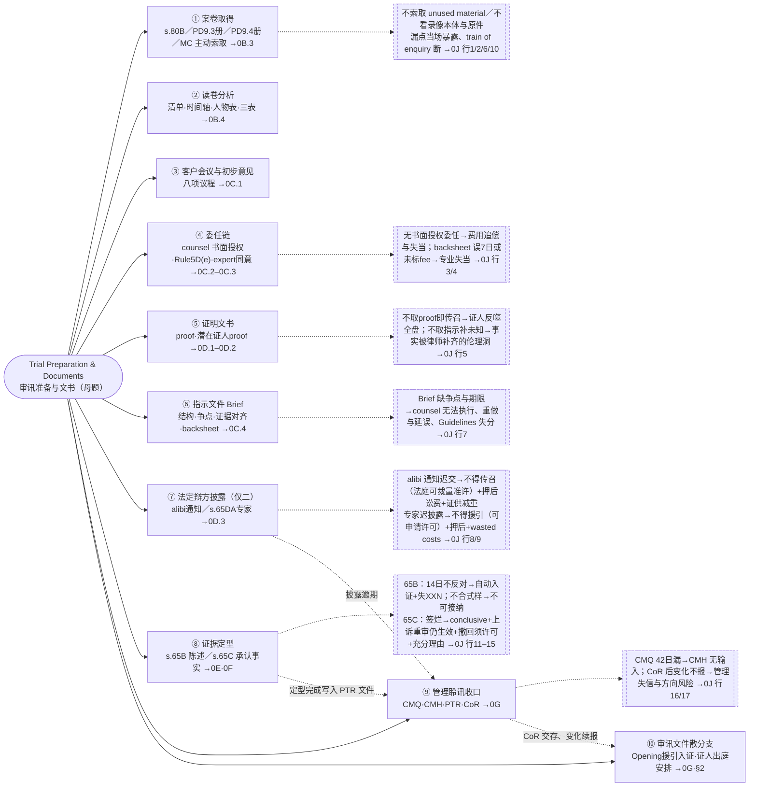
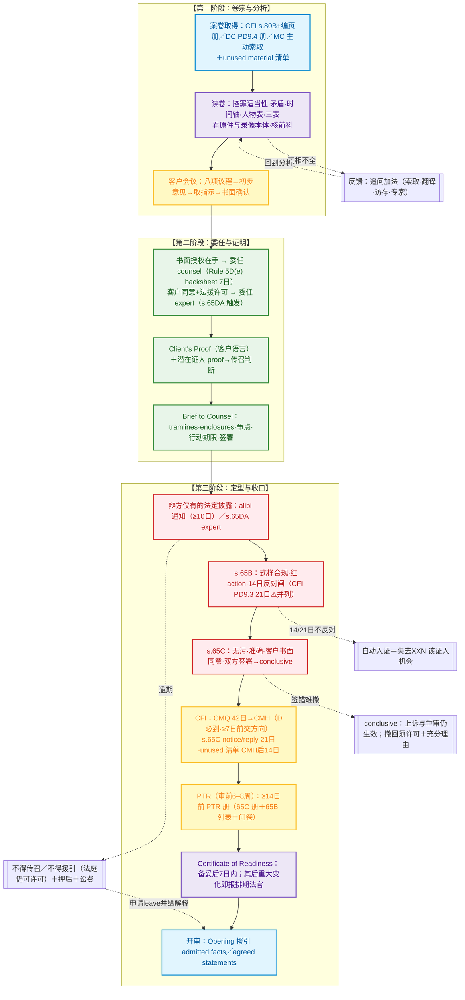

# 刑事审讯准备与关键文书体系

## 速读定位层（30 秒全景：范围 · 术语 · 环节任务）

> 本层为 2026-10-10 §18 深化重构新增的开篇导引；具体各层的规则、条件、例外与引注见下方 0A（既有）与 0B–0K（2026-10-10 深化、2026-11-16 重编），按本层术语定位后直达。

> **白话导引**：本卡是一条「把卷宗变成审讯文件」的流水线——先从法院拿齐该拿的案卷（CFI／DC 有自动送达，MC 要自己写信去要，unused material 永远要主动开口），把纸读成时间轴、人物表和控辩分析表；与客户开完会、拿到书面授权，再委任大律师与专家；用客户自己的话写下 proof，写出让大律师不重建卷宗就能办事的 Brief；然后把不争的证人以 s.65B 书面陈述送进证据、把无争议的事实用 s.65C 承认钉死；最后 CMQ→CMH→PTR→Certificate of Readiness 一路把准备钉成法院命令。流水线上每一站都有死线：错过不是「下次补」——证人传不得、陈述自动入证、承认撤不掉、审期失信，逐项后果见 0J 总表。

### a. 程序辐射范围（本卡覆盖什么，不覆盖什么）

**覆盖（按程序时序）**——从案卷到手到开审前夜的完整"卷宗 → 证明 → 指示 → 定型 → 收口"链：

1. **案卷取得（按司法区分流）**：CFI 交付前 s.80B 全披露＋交付后 paginated committal bundle（PD 9.3 Part 4）；DC 按 PD 9.4 Part I 移交时送达证人陈述与文件证物册；裁判法院无法定送达义务、须主动书面索取〔CR7 L74 "pursuant to s. 80B CPO"；CR7 L76 "The paginated bundle would include the indictment, the charge sheet"；CR7 L78 "Practice Direction 9.4, Criminal Proceedings in the District Court sets out the requirements"；CR7 L80 "there is no set for procedure or requirements"；CR7 L82 "be proactive in making disclosure requests to prevent the loss or destruction of evidence"〕；
2. **读卷与分析**：逐纸核读、记矛盾、做时间轴／人物表／控辩分析表、看原件与录像本体、核对前科、索取 unused material、现场视察〔CR7 L86 "Upon receipt the papers should be read and analysed carefully"；CR7 L92 "prepare a chronology, dramatis personae/trial charts"；CR7 L106 "check the client’s criminal record and those of any prosecution witnesses"〕；
3. **客户会议与初步意见**：控罪与证据、举证责任、刑期与折扣、抗辩、程序选择、脱罪机会（强悍陈词可及于"难脱罪"）、取指示、会後书面确认〔CR7 L164–L180 "Once the solicitor has thoroughly read and analysed the prosecution case papers"；CR7 L176 "Advice can be in strong terms that the client is unlikely to escape conviction"〕；
4. **委任链**：大律师（须先取**书面授权**；Rule 5D(e) 7 日内 backsheet；费用为事务律师责任）＋专家（客户同意／法援许可／报价／s.65DA 尽快供应书面意见）〔CR7 L184 "a solicitor MUST also seek the written authority of the client before instructing counsel"；CR7 L200 "not more than 7 days after counsel has been instructed"；CR7 L158 "the requirements of S.65DA of the Criminal Procedure Ordinance must be met"〕；
5. **证明文书**：Client's Proof of Evidence（客户自己语言、辩方内部、永不交控方）；潜在证人 proof（未取 proof 不应倚仗出庭）；辩方证人陈述不披露 **唯二例外**：alibi 通知（审讯开始前不少于 10 日）与 s.65DA 专家披露〔CR7 L258 "It would never be disclosed to the Prosecution"；CR7 L280 "The only exceptions to this rule of defence disclosure is in respect of alibi evidence and the report of an expert."；CR6 L246 "not less than 10 days before start of trial"〕；
6. **Brief to Counsel**：结构（tramlines／enclosures／程序沿革／控方案／辩方案／evidence generally／其他资料／行动指示／日期／签署）；必须把争点写具体并交叉引用证据；评分以本届 Guidelines 为基准〔CR7 L194 "The Brief should include all the relevant documents tabbed and ordered in a logical manner"；SG4S L108 "The “Guidelines for Drafting a Brief to Counsel” form the basis on which you will be assessed"〕；【P1】SGS5 课上交纸本 **2026-10-28／29**〔SG5S L60 "HAND IN YOUR COMPLETED BRIEF TO COUNSEL TO YOUR TUTOR IN SGS 5 ON OCTOBER 28TH / 29TH"〕；
7. **证据定型**：s.65B 书面证供陈述（式样合规、送达后 14 日反对、可协议豁免、不可借"后门"入传闻、同意后通常失去盘问该证人的机会）；s.65C Admitted Facts（conclusive evidence、上诉与重审仍然生效、撤回须许可＋充分理由）；司法区实务：CFI PD 9.3 §5.3.6–5.3.7（notice／reply 各 21 日）、DC PD 9.4 ¶14–16、MC PTR 问卷第 6／9 项〔CR7 L298 "must object within 14 days of service"；CR7 L316 "it is “conclusive evidence” according to s. 65C(1)"；PD93 L308 "Within 21 days after lodging the Paginated Committal Bundle"；PD93 L328 "within 21 days after the notice is served"；PD94 L60 "a notice to admit facts relating to"；📄PTRMC p.2〕；
8. **审讯收口文件**：CFI PD 9.3 链（CMQ 42 日→CMH→PTR（审前 6–8 周）→Certificate of Readiness 备妥后 7 日）；DC PTR 十项议程（PD 9.4 ¶17）；MC PTR 问卷（开庭前 2 个工作日交法院）；unused material 清单（CFI CMH 后 14 日）〔PD93 L282 "Within 42 days after the lodging of the Paginated Committal Bundle"；PD93 L350 "usually about 6 to 8 weeks before trial"；PD93 L366 "within 7 days after the completion of all preparatory steps"；PD93 L342 "a list of any unused materials … within 14 days after the Case Management Hearing"〕；
9. **攻防与 SG 应用**：SG04（Brief 讨论＋Bob 六问）、SG05（Jeff 三表／主管 memo 九问／s.65C 反建议）锚点与 open 待补（见 0K；材料矩阵移审计区，open 块在审计区机器边界内保留）。

**不覆盖（边界声明，相关主卡承担）**：① 披露义务本体与未用材料争议的攻防主体（→ 13 证据争议卡；本卡只在 0B.3／0G.4 作接口）；② 供认可采性争议、voir dire／alternative procedure 与 Grounds of Objection 起草本体（→ 13 证据争议卡 与 SG06／SG07 入口；本卡 0G 只留 PTR 上的申报位）；③ 答辩与认罪后处置（Newton、Brief Facts 谈判、O.N.E.）（→ 06 答辩意见卡；本卡只在与 Admitted Facts／Summary of Facts 接口处点到）；④ 控罪内容与审讯路线（→ 08 控罪卡）；⑤ 保释（→ 05 保释卡）；⑥ 永久中止诉讼（permanent stay）的申请主体与 PD 9.7 流程（→ 13 证据争议卡 与 SG04 PD9.5／PD9.7 逐段核验；本卡 0G.5 只作接口）；⑦ 上诉机制（→ 13 证据争议卡 与 SG08 入口；s.65C 在上诉面的效果只列后果链不动上诉规则）。

### b. 关键术语逐一一句精确定义（中文定义＝英文原词＋引注）

| 术语（英文原词） | 一句中文精确定义 | 依据 |
|---|---|---|
| 案卷／交付文件册（paginated committal bundle） | 交付原讼庭后由律政司向法院交存并送达辩方的编页册，含公诉书、控罪书、交付程序记录、控方证人名单、证人陈述、证物清单与各文件证物〔CR7 L76 "the indictment, the charge sheet, notes of the committal proceedings, a list of prosecution witnesses"〕 | PD 9.3 Part 4 |
| 未用材料（unused material） | 警方／控方在侦查或备案中收集但不拟在审讯倚赖的材料；是否须披露看其会否削弱控方或助益辩方〔CR6 L138 "material that has been collected by the police / Prosecution in the course of the investigation / preparing the case"；CR6 L146 "does not undermine the Prosecution case or advance the Defence case: HKSAR v. Lau Wing Wing"〕 | CR6 L134–L146 |
| 客户证供书（Client's Proof of Evidence） | 以客户自己的语言书写的"若出庭会说什么"，供辩方团队内部使用、永不交控方的证明文书〔CR7 L236 "It should be written in the client’s own words (i.e. no legalese)"；CR7 L258 "It would never be disclosed to the Prosecution"〕 | CR7 L234–L258 |
| 证人证供书／证人陈述（proof of a witness / witness statement） | 潜在证人会说的内容的书面版本；未取 proof 而倚仗客户介绍的证人出庭既不智又危险；辩方取得的证人陈述不交控方（两项例外除外）〔CR7 L262 "unwise and dangerous for a solicitor to rely at trial upon the evidence of a witness produced by the client unless a proof"；CR7 L278 "The witness statements obtained by the defence should not be disclosed to the prosecution"〕 | CR7 L260–L282 |
| 指示大律师书（brief to counsel） | 事务律师给大律师的内部专业指示文书，按所委工作组织，载任务、程序现状、控辩证据、争点与行动要求、签署日期的文书〔CR7 L194 "The type of work to be done should be specified, including any time limits, dates of hearing and relevant case number"〕 | CR7 L192–L228 |
| 双轨线（tramlines） | Brief 首页以双横线夹注指示性质与法院、案名、案号的排版区域〔CR7 L204 "Front page of brief should contain the case heading and the nature of the instructions between tramlines"〕 | CR7 L204 |
| 附件清单（enclosures） | Brief 开首编号列出的入卷文件（客户 proof、控方文件、公诉书、函件、报告、案情时间轴等），供与正文交叉引用〔CR7 L210 "Include a list of enclosures (e.g. defendant’s proof of evidence, prosecution case papers and indictment"〕 | CR7 L210 |
| 背书页（backsheet） | 委任出庭大律师时须交付的签署文页；Rule 5D(e)：刑事案件委任后 7 日内送交，载事务律师姓名亲签、律师行、案件／案号、大律师姓名与商定费用；未标 fee／"no fee payable"／"Legal Aid" 即专业失当〔CR7 L198 "It is professional misconduct for a barrister to appear in court without a fee marked on the brief"；CR7 L200 "not more than 7 days after counsel has been instructed"〕 | Rule 5D(e)；BC para 7.5 |
| 辩方案情陈述（defence statement） | ⚠️ 库内无明文：本届 LGS6／LGS7 未使用该词；香港制度下"辩方案情"由内部的 proof of evidence 与案头分析承载、不对外送达，对外法定披露仅 alibi 通知与 s.65DA 两项〔CR7 L280 "The only exceptions to this rule of defence disclosure is in respect of alibi evidence and the report of an expert."〕→ open O-T3 | open O-T3 |
| s.65B 书面证供陈述（s.65B witness statement） | 控辩同意把某证人书面陈述不经传召即接纳为证据的机制；入证后视作口头证供但证据规则（含传闻规则）仍然适用〔CR7 L292 "for the written statement of a witness to be admitted into evidence usually without that witness needing to testify"；CR7 L294 "treated as if oral evidence of its contents had been given in court"〕 | s.65B CPO |
| 送达后反对期（14 days to object） | 对方不接受 s.65B 陈述入证时自送达起 14 日内的反对期（但书可协议豁免送达与时限要求）；逾期不反对即入证〔CR7 L298 "they must object within 14 days of service"；CR7 L298 "Failure to object within the time limit means the statement is admitted into evidence"〕 | s.65B(2) CPO |
| s.65C 承认事实（s.65C Admitted Facts） | 双方签署、正式承认特定事实的文书；所承认事实为 conclusive evidence，不得再举相反证据〔CR7 L312 "this procedure applies to facts rather than written witness statements"；CR7 L316 "no evidence can be called which contradicts that fact"〕 | s.65C CPO |
| 承认事实通知书（Notice to Admit Facts） | 控方（CFI：编织页卷册交存后 21 日内）送交辩方、列明拟承认事实的通知；辩方须取指示并于 21 日内回覆〔CR6 L336 "sends the Defence a “Notice to Admit Facts”"；PD93 L308 "a notice to admit facts relating to"；PD93 L318 "within 21 days after the notice to admit facts is served"〕 | PD 9.3 §5.3.6 |
| 不在场证据通知（alibi notice） | 辩方拟传不在场证据时，须在审讯开始前不少于 10 日向控方发出并列明细节的通知；法定条文随法院而异（s.90 MO／s.75A DCO／s.65D CPO），裁判法院无正式要求但可引致押后与讼费〔CR6 L246 "not less than 10 days before start of trial"；CR6 L240 "(iii) s. 65D CPO – relating to the Court of First Instance"；CR6 L242 "there is no formal requirement of an alibi notice in the Magistrates’ Court"〕 | s.65D CPO 等 |
| 专家证据披露（s.65DA expert disclosure） | 交付／移交／重审后，拟援引专家证据（量刑除外）的一方须在切实可行范围内尽快向对方提供书面意见陈述；不遵者未经法庭许可不得在审讯援引〔CR6 L268 "applies to expert evidence to be called in the District Court and Court of First Instance"；CR6 L278 "cannot be adduced at the trial without leave of the court"〕 | s.65DA CPO |
| 案件管理聆讯（Case Management Hearing，CMH） | 原讼庭按 PD 9.3 在内庭召开的管理聆讯：被告**必须**出席、填写问卷的控辩大律师均须出席；区域法院无 CMH〔PD93 L298 "The defendant shall be present at the Case Management Hearing"；CR5P L118 "No CMH in DC."〕 | PD 9.3 §5.3 |
| 审前覆核（Pre-Trial Review，PTR） | CFI 通常在审前 6–8 周由内庭主审法官主持、把"已可开审"收口为命令的聆讯；被告出席可豁免、出庭大律师须出席；DC 与 MC 亦有 PTR 机制〔PD93 L350 "usually about 6 to 8 weeks before trial"；PD93 L360 "unless his legal representative informs the court that he does not wish to attend"〕 | PD 9.3 §5.5；PD 9.4 ¶14–20 |
| 定期审期表／速审表（Fixture List / Expedited List） | 原讼庭刑事排期两表；律政司在收册后 21 日内（经与辩方确认）通知法院属表，双方须尝试就表别与庭期长度达成一致〔CR7 L76 "whether the case should be listed in the fixture list or the expedited list"〕 | PD 9.3 Part 4 |
| 备妥审讯证明（Certificate of Readiness for Trial） | CFI 程序时表各准备步完成后 7 日内向法院交存、确认案件可于排期或法院所定更早时间开审的证明；交存后有重大变化须即时报刑事排期法官〔PD93 L366 "within 7 days after the completion of all preparatory steps"；PD93 L370 "immediately be brought to the attention of the Criminal Listing Judge"〕 | PD 9.3 §5.6 |
| 永久中止诉讼（permanent stay） | 法院固有管辖下终止程序的特殊救济：公平审讯不可能（如不当延误、控方不公、偏见性审前宣传），或虽可公平审讯但滥权严重至冒犯法庭公正感或公众对司法的信心；辩方负举证（相对可能衡量）、极少获准〔CR5P L139 "Court’s inherent jurisdiction to prevent abuse of its process"；CR5P L147 "Fair trial is impossible and to continue would be abuse of process"〕 | Lee Ming Tee；PGD 接口卡承担 |

### c. 各环节解决什么问题（按程序时序）

| 环节（时序） | 它解决的具体问题 | 依据 |
|---|---|---|
| 案卷取得 → 按法院分流 | 辩方从哪儿拿到能建议的底牌：CFI 交付前 s.80B 已全披露、交付后收编页册；DC 移交时收证人陈述＋证物册；MC 无自动送达、须主动去函索取并说明用于备审〔CR7 L80 "The documents must be specifically requested by instructing solicitors by writing to the OC Case"；CR7 L82 "be proactive in making disclosure requests"〕 | s.80B；PD 9.3 Part 4；PD 9.4 Part I |
| 读卷 → 分析三表 | 把"一摞纸"变成可决策的图景：要件→控证位置→辩方指示→争点→待查；不一致处、缺失证据、警察言行单独记；时间轴／人物表／控辩分析表；录像看本体〔CR7 L92 "note any inconsistencies and discrepancies in the prosecution statements and evidence, prepare a chronology"；CR7 L96 "the practitioner should always view the actual videotape"〕 | CR7 L86–L112 |
| 初步意见会议 | 客户在知情状态下决定答辩与方向：控罪证据、举证责任、刑期与折扣、可能抗辩、程序选择、脱罪机会、取指示并书面确认〔CR7 L176 "a true evaluation of the strengths and weaknesses of the evidence"；CR7 L180 "the solicitor should write to the client and confirm the instructions given"〕 | CR7 L164–L180 |
| 书面授权 → 委任 counsel | 谁有权代表客户、费用谁担：书面授权在手才委任；大律师费是事务律师代垫责任；初联与议费须律师本人亲自；Rule 5D(e) 7 日内 backsheet〔CR7 L184 "MUST also seek the written authority of the client"；CR7 L186 "Counsel’s costs are dealt with as disbursements by instructing solicitors"；CR7 L188 "the first contact with counsel or his clerk must be made by the solicitor personally"〕 | Rule 5D(e)；BC paras |
| 同意 → 委任 expert | 专家值不值：客户同意＋（法援个案）法援主任许可＋报价先行；专家义务对法院、意见须公正无偏；尽速委任防被控方抢占；决定传召即触发 s.65DA〔CR7 L150 "instruct the expert at the earliest opportunity"；CR7 L156 "his duty to the court is to give an unbiased opinion"；CR7 L158 "supplying all other parties in the case with a written copy of that opinion as soon as practicable"〕 | s.65DA；CR7 L146–L160 |
| proof → 证人证明 | 控制"作供内容"的未知风险：客户版本用自己语言安放；潜在证人先取 proof 再定传召，不利版本提前暴露；留未决问题代指示项〔CR7 L256 "more often than not, more information is needed"；CR7PP L58 "If the evidence does not support your case- do not call the witness"〕 | CR7 L234–L282 |
| Brief → 指示文件 | 让新接手的大律师不重建卷宗也能执行：任务、争点、证据对齐、行动与期限具体；不利面如实交代；样本风格多样、Guidelines 为评分基准〔CR7 L216 "Highlight any major point likely to arise at trial for the benefit of counsel"；CR7 L226 "these will form the basis on which you are assessed"〕 | CR7 L194–L228；SG4S L136–L162 |
| alibi ／ s.65DA → 辩方仅有的法定披露 | 辩方一般无披露义务，唯二例外要按形式与期限做，否则该证据可能传不得／不可用（法庭仍可裁量准许）〔CR7 L280 "The only exceptions to this rule of defence disclosure is in respect of alibi evidence and the report of an expert."；CR6 L246 "not less than 10 days before start of trial"；CR6 L278 "without leave of the court"〕 | s.65D；s.65DA |
| s.65B → 省证人 | 对不争证据省口头传唤：式样合规、14 日反对闸、传闻须删节、同意后通常失 XXN 机会、入证仍可反驳〔CR7 L306 "the other side can still call evidence to contradict the statement"；CR7 L308 "you must know your defence before you agree to admit a statement"〕 | s.65B；PD 9.3 §5.3.7；PD 9.4 ¶16 |
| s.65C → 缩争点 | 把无争议事实钉死成 conclusive：起草要全、准、无污；客户书面同意；clear record 必入（漏放是可上诉的点）；承认永久、撤回难〔CR7 L352 "It is a good ground of appeal if Defence Counsel fails to put his client’s clear record before the court"；CR7 L344 "very difficult to withdraw an admitted fact"〕 | s.65C；PD 9.3 §5.3.6；PD 9.4 ¶14–15 |
| CMQ／CMH／PTR → 管理聆讯把准备钉成命令 | CFI：42 日问卷→CMH（D 必到）→方向与定型（65C 通知 21 日、回覆 21 日、unused 清单 14 日）→PTR（6–8 周前，14 日前交册）→CoR（备妥 7 日内；其后变化即报）；DC：PTR 十项议程；MC：问卷开庭前 2 个工作日交〔PD93 L342 "5.3.11 The court will direct the prosecution to provide to the defence a list of any unused materials which have not yet been disclosed within"；PD93 L352 "an agreed paginated PTR Bundle"；PD94 L74 "At the pre-trial review, counsel or solicitors will inform the trial judge of the following"；📄PTRMC p.1〕 | PD 9.3；PD 9.4；MC 问卷 |

<!-- BEGIN:cite-legend -->
> [!info]- 引注图例
>
> | 码 | 文件 | 层级 | 学年 |
> |---|---|---|---|
> | CR5P | LGS5 Part3课后补充 | 本届讲义 | 2026-27 |
> | CR6 | LGS6 披露和证据争议 | 本届讲义 | 2026-27 |
> | CAP-K6 | PCLL8050 LGS6 PT 课堂字幕 | 本届讲义 | 2026-27 |
> | CAP-K7 | PCLL8050 LGS7 PT 课堂字幕（2026-09-25；1,199 条。只此兼职场，不含全日制） | 本届讲义 | 2026-27 |
> | CR7 | LGS7 诉讼实务及文书Final | 本届讲义 | 2026-27 |
> | CR5 | LGS5 审前程序与审讯过程讲义 | 本届讲义 | 2026-27 |
> | CR5S | LGS5 课堂幻灯 REVISED 版（parts 1&2） | 本届讲义 | 2026-27 |
> | CR5SO | LGS5 课堂幻灯旧版（parts 1&2；REVISED 已出，本码仅记版本链） | 本届讲义 | 2026-27 |
> | CR7PP | LGS7 课堂幻灯（LGS7 PP） | 本届讲义 | 2026-27 |
> | PD93 | [PD 9.3 原讼法庭刑事程序全文 md（文件实体在 [LG05] 解压夹内；本届 LGS5 同夹 .zip）](../../04%20Base%20Lectures/%5BLG05%5D%20Pre-trial%20Issues%20and%20Aspects%20of%20the%20Trial/Practice%20Direction%209.3%20-%20Criminal%20Proceedings%20in%20the%20CFI-20240905/PD%209.3%20-%20Criminal%20Proceedings%20in%20the%20CFI.md) | 本届官方 | 2026-27 |
> | PD93D1 | [PD 9.3 附录 D1 定期审期表时间表（[LG05] 解压夹内）](../../04%20Base%20Lectures/%5BLG05%5D%20Pre-trial%20Issues%20and%20Aspects%20of%20the%20Trial/Practice%20Direction%209.3%20-%20Criminal%20Proceedings%20in%20the%20CFI-20240905/PD9.3_eng_Appendix%20D1_V1%20%283%29.md) | 本届官方 | 2026-27 |
> | PD94 | [PD 9.4 区域法院刑事程序全文 md（文件实体在 [LG05] 解压夹内；本届 LGS5 同夹 .zip）](../../04%20Base%20Lectures/%5BLG05%5D%20Pre-trial%20Issues%20and%20Aspects%20of%20the%20Trial/Practice%20Direction%209.4%20-%20Criminal%20Proceedings%20in%20the%20DC-20240905/PD%209.4%20Criminal%20Proceedings%20in%20DC.md) | 本届官方 | 2026-27 |
> | PTRMC | Pre-Trial Review (Eastern) 裁判法院 PTR 问卷 PDF | 本届官方 | 2026-27 |
> | OLD-LG7 | 往届（2025-26）LG7 Preparing for Trial 讲义 | 往届官方 | 2025-26 |
> | OLD-SET2 | 往届学生稿·Set 2「Crim Lit - EXAM NOTES」 | 往届学生稿 | 2025-26 |
> | OLD-SET3LG | 往届学生稿·Set 3「LG Notes」 | 往届学生稿 | 2025-26 |
> | SG4S | 本届 SGS4 学生册 | 本届官方 | 2026-27 |
> | SG4GL | 本届 Guidelines for Drafting a Brief to Counsel | 本届官方 | 2026-27 |
> | SG4CD | 本届 SG04 主控 Classroom（任务总览与定稿槽） | 凝结层 | 2026-27 |
> | SG4OA | 本届 SG04 Brief 讨论完整英文答话 | 凝结层 | 2026-27 |
> | SG4MB | 本届 SG04 课后 Brief 范文（Willy Ma，含逐段出处） | 凝结层 | 2026-27 |
> | SG5S | 本届 SGS5 学生册 | 本届官方 | 2026-27 |
> | SG5CD | 本届 SG05 主控 Classroom（任务总览与定稿槽） | 凝结层 | 2026-27 |
> | SG5E3 | 本届 SG05 Exercise 3 完整 s.65C 反建议稿 | 凝结层 | 2026-27 |
> | SG5AF | SG05 随课示例 PRECEDENT ADMITTED FACTS s.65C | 本届官方 | 2026-27 |

> | LAW21 | Criminal Litigation SG04 - Authorities Verification - 2026-10-21 | 库外法源 | 2026-27 |
> | WANLEX | [Wan Ho-yeung中文判词：Lexis下载，HCMA673/2014／[2015]HKCU1062](../../04%20Base%20Lectures/00%20This%20Year%20Moodle%202026-27/Verified%20Judgments%20%282026-10-27%29/Wan%20Ho%20Yeung%20-%20HCMA%20673-2014%20-%20Lexis%202026-10-27.md) | 库外法源 | 2026-27 |
> | NGWEST | [Ng Chi-ching判词：Westlaw下载，HCMA737/1999／[2000]HKEC170](../../04%20Base%20Lectures/00%20This%20Year%20Moodle%202026-27/Verified%20Judgments%20%282026-10-27%29/Ng%20Chi%20Ching%20-%20HCMA%20737-1999%20-%20Westlaw%202026-10-27.md) | 库外法源 | 2026-27 |
> | SG5REC | SG05课堂录音全文（2026-10-28） | 本届讲义 | 2026-27 |
> | V6 | SG06法源与来源身份核验 | 库外法源 | 2026-27 |
<!-- END:cite-legend -->

## 🗺️ 本卡地图（章节位置与阅读顺序，2026-10-10）

> 本卡按"程序时序"排章：案卷 → 分析 → 会议 → 委任 → 证明 → Brief → 法定披露 → 定型 → 收口，主线自上而下顺读即流程；五原则节（§1–§6）是学理回扣层，随时可旁插。
>
> 本节两件套：**图 1 · 母题结构图**（下一张，审讯准备与文书的分支 roadmap＝全流程主干、十条分支与后果虚线；全景状态机＝**图 2** 见 0B.1）→ **任务直达表**（按要做的事跳章节）。

**图 1 · 审讯准备与文书分支 roadmap（全流程主干与后果虚线）**：

读图逻辑：实线是主干——十条分支按程序时序铺开，每条末尾的箭头指向承担深节；虚线 warnnode 是各分支「不做」的后果钩子，行号统一收口 0J 总表；§2 顺向推进给同一主干配上「触发→行动→产出」的十步展开，0B.1 的全景状态机（图 2）再补上三阶段与两条逾期反馈环。

| 你现在要做什么 | 直达章节 |
|---|---|
| 30 秒弄清范围/术语/每环任务 | [速读定位层](#速读定位层（30%20秒全景：范围%20·%20术语%20·%20环节任务）) |
| 刚接手卷宗要定读卷计划 | [0B.3 三司法区案卷](#0B.3%20三司法区的案卷取得与披露实务)＋[0B.4 读卷清单](#0B.4%20读卷方法：从清单到三表) |
| 要写 Brief to Counsel（**P1：SGS5 2026-10-28/29 交纸本**） | [0C.4 Brief 结构](#0C.4%20Brief%20to%20Counsel：结构、争点与证据对齐（SG04%20深节）)＋[0K.1 SG04 锚点](#0K.1%20SG04：Brief%20起草与本场作业锚点（2026-10-10%20深化）) |
| 要取客户／证人证明 | [0D.1 proof 清单](#0D.1%20Client's%20Proof%20of%20Evidence：逐项清单)＋[0D.2 潜在证人](#0D.2%20潜在证人：proof、传召判断与不披露) |
| 收到 s.65B 陈述／s.65C 草稿 | [0E s.65B](#0E.%20证据定型%20I：s.65B%20书面证供陈述——合规要点与司法区实务（2026-10-10%20深化）)／[0F s.65C](#0F.%20证据定型%20II：s.65C%20承认事实——文书功夫与攻防（2026-10-10%20深化）) |
| 有迟交的不在场证据／专家证据 | [0D.3 法定披露两项](#0D.3%20辩方仅有的两项法定披露：alibi%20通知与%20s.65DA%20专家证据) |
| 快开审要核程序文件 | [0G PTR/CMH](#0G.%20PTR／CMH%20与审讯收口文件：把准备钉成命令（2026-10-10%20深化）) |
| 想知道"某步不做会怎样" | [0J 总表](#0J.%20环节×不做后果链总表（索引）（2026-10-10%20深化；2026-11-16%20重编）)（正文各环节回点总表行） |
| 考前扫高频失误 | [0I.1 暗礁十二条](#0I.1%20实务暗礁十二条（考场与实务都看的高频失误）) |
| 做 SG05 三表／memo／承认事实作业 | [0K.2 SG05 锚点](#0K.2%20SG05：三表·主管%20memo·s.65C%20反建议（2026-10-10%20深化）) |
| 学理复盘（五原则） | §1 第一性 → §2 顺向 → §3 规则边界 → §4 控制论 → §5 横向 → §6 逆向 |

## 0A. 把卷宗转成大律师能执行的指示与审讯文件

### 0A.1 三份文书不是同一种“案情摘要”

| 文书 | 谁对谁说 | 应承载什么 | 不应混入什么 |
|---|---|---|---|
| Brief to Counsel | 事务律师指示大律师 | 任务、程序现状、控辩证据、问题、专业分析及行动要求 | 不把律师推论冒作客户原话 |
| Client’s Proof of Evidence | 客户说明自己若作证会说什么，供辩方团队 | 本人语言、事实、回应、特殊争点与真实声明 | 不写成律师法律陈词；不默认交给控方 |
| Witness statement | 证人陈述其所知 | 亲历、来源、与客户关系及有无讨论证据 | 不为了支持客户而改变证人记忆 |

功能区别来自LGS7：brief按所委工作组织；proof用客户自己的话；潜在证人先取其proof再决定是否传召。〔CR7 L194–L226 "Content: The Brief should include all the relevant documents tabbed"〕〔CR7 L234–L278 "The Client’s Proof of Evidence (see the Guidelines for Writing"〕

### 0A.2 阅读卷宗先建立哪几条线

一条是**程序线**：逮捕、提堂、答辩、移交/交付、保释、排期及已作命令；另一条是**证据线**：每个控罪要件由哪份证言/物证支持、客户如何回应、主要矛盾在哪。将两条线分开，大律师才看得出“已发生什么”和“现在要决定什么”。〔CR7 L164–L180 "Once the solicitor has thoroughly read and analysed the prosecution"〕〔CR7 L210–L220 "Introduction Include a list of enclosures (e.g. defendant’s proof of"〕

**本卡自拟证据表**：要件→控证位置→辩方指示→争议/承认状态→需进一步资料→拟庭上处理。保留证人各自版本，不把不一致拼成一个没人说过的“综合事实”。该表为读卷工具，并不自动成为应提交法庭的材料。〔CR7 L166–L176 "the charge and the evidence adduced by the prosecution on"〕

### 0A.3 Brief的完整结构与每节用途

| 节 | 应写的内容 | 检验标准 |
|---|---|---|
| Case heading / Instructions | 法院案号、当事人、拟委工作、日期与期限 | 大律师能否立即知道代表谁、去哪里、做什么 |
| Procedural history | 已获命令、答辩及下次聆讯、保释/还押状态 | 不把计划中事项写成已完成 |
| Enclosures | 文件编号、版本、页码、实际附入材料 | 引用是否点得到，修订版有无替代旧版 |
| Prosecution case | 控方指称与关键证据，交叉引用 | 不把控方主张写成法庭已经裁定 |
| Defence case | 客户指示、拟抗辩、证人及支持文件 | 不隐去已知弱点，不编造新指示 |
| Issues / Advice sought | 法律及事实问题、初步看法与分歧 | 问题是否具体到大律师能回答 |
| Action required | 出庭/提供意见/会见/申请及期限 | 不以“please do the needful”代替具体指示 |
| Date / Signature / Backsheet | 按角色及规则完成 | 正式委托、费用和签署可核对 |

结构为讲义内容的实务整理，允许不同写法；本届评分看内容及对应Guidelines，不能因范本有某节便机械复制。〔CR7 L194–L226 "Content: The Brief should include all the relevant documents tabbed"〕

### 0A.4 Brief必须把不利证据讲清楚

给大律师的文件是内部专业指示，不是向控方争取ONE的游说信。应交代控辩强弱、已给客户的意见、已失败的协商及待解决问题；不能为了看起来“有胜算”删去前科、矛盾证词或不利文件。写来源归属和解释，而非替事实下最终裁断。〔CR7 L194 "Content: The Brief should include all the relevant documents tabbed"〕〔CR7 L212–L220 "Prosecution case Provide a summary of the prosecution case as"〕

**自拟问题表达**：“Please advise whether the proposed challenge to the statement is supported by the custody record and the client’s account, and whether a separate hearing is required.” 比“请考虑证据问题”更可执行，因为交代证据、问题和预期产出。该例不是实际客户已给指示。〔CR7 L216–L220 "Evidence generally Highlight any major point likely to arise at"〕

### 0A.5 正式委任与backsheet

委任大律师须取得客户授权，重大支出亦应有依据；讲义要求书面授权及事务律师亲自处理初次联系/费用协商等事项。已经准备一份brief，不表示客户已经授权费用或大律师已经接受指示。〔CR7 L184–L190 "One of the pieces of advice that a solicitor will"〕

Rule5D(e)要求刑事案件委任后7日内送交载明事务律师姓名及本人签署、律师行、案件/案号、大律师姓名和商定费用的backsheet或其他书面指示。讲义并强调出庭brief的fee标记/免收费/Legal Aid表述；不能把这些空白用猜测填上。〔CR7 L196–L200 "When counsel is instructed to appear in court, instructing solicitor"〕

**2026-10-21 兼职班口播**：讲师没有说出 Rule 5D 这个条文号。口播是 backsheet 须由律师签署，并在指示大律师后不超过七日送达；没有 backsheet，连两分钟的聆讯也不能出庭。大律师费用是代垫，律师本人负责，应向客户预收。（根据字幕：PCLL8050 LGS7 PT，00:52:24–01:01:16；〔CAP-K7 L1393 "a solicitor is responsible for counsel's fees personally"；CAP-K7 L1606 "delivered not more than seven days after counsel is instructed"；CAP-K7 L1609 "even a two minute hearing without a back sheet"〕） 条文号仍以本段讲义为准。

### 0A.6 Proof：用客户语言，留下可盘问的真实版本

包含个人情况、控罪和拟答辩、与有关人物关系、事发经过、对控证回应、被捕/问话等特殊争点、真实声明及签署。事实未知就取指示，不用律师的“合理解释”帮客户补上动机。〔CR7 L234–L254 "The Client’s Proof of Evidence (see the Guidelines for Writing"〕

一份完成proof不等于调查完结；还可能需要见其他证人、调查文件或专家。潜在证人的版本可能不利于客户，所以应先知其真正所说，再作传召决定，不能预设所有客户介绍的人都支持辩方。〔CR7 L256–L278 "Once a client’s proof of evidence has been taken the"〕

### 0A.7 s.65B与s.65C：省时间的代价不同

| | s.65B书面陈述 | s.65C承认事实 |
|---|---|---|
| 被接纳的对象 | 某证人陈述，替代当庭口证的通常方式 | 双方正式承认的事实 |
| 效果 | 当作已给口头证据；仍可有相反证据 | 所承认事实属conclusive evidence |
| 主要风险 | 通常失去当场盘问该证人的机会，传召例外须许可 | 不能在审讯随意提出相反事实，撤回需许可与充分理由 |
| 准备动作 | 逐段读、是否需盘问、去除有问题部分、留意反对期限 | 逐项客户真实同意，明白效果，按要求签署/日期 |

s.65B法定形式、14日反对及可同意豁免服务/期限等安排见原讲义；它不使陈述中的本来不可采传闻自动变为可采。s.65C亦不能把不相关或不当内容借协议送入法庭。〔CR7 L292–L324 "This type of admission occurs when the Prosecution and Defence"〕

**实际例子（自拟）**：若争执毒品证物是否同一份，不能一边承认完整保管链，一边准备盘问该链中断；若只不争某照片的拍摄和真确性，可精确承认该部分，不顺带承认照片证明控罪全部要件。〔CR7 L332–L368 "photographs and plans that are uncontentious;"〕〔CR7 L386–L402 "Practical Tips when agreeing to s. 65B Witness Statements:"〕

客户曾有前科而控方误说清白，律师不一定须主动提供不利资料，但不能签“clear record”的Admitted Facts或积极误导法院。正面虚假承认与不主动披露有根本区别。〔CR7 L352–L358 "Defence Counsel should ensure the Defendant’s clear record is included."〕

### 0A.8 PTR/CMH：把争议变成可安排的聆讯

预先处理要传的证人、可协议的材料、供认异议、专家/alibi等通知、时间估计和法院方向。Case management要求节省资源不等于放弃实质抗辩；反过来，也不能坚持形式证明却在庭上对该点完全不争，制造无必要时长。〔CR5P L82–L122 "Consequences of not complying with court’s directions"〕〔CR7 L380–L400 "narrow the issues in dispute; and"〕

Permanent stay是不同救济：公平审讯不可能，或即使可公平审讯但滥权严重冒犯法庭公正等框架；不能把一般延误或披露疏漏直接等同永久终止。须先分析具体损害与较轻补救是否可处理。〔CR5P L137–L169 "Court’s inherent jurisdiction to prevent abuse of its process:"〕

〔CR5P L137–L169 "Court’s inherent jurisdiction to prevent abuse of its process:"〕

（图注）本节原附的七节点循环小图已并入 [0B.1 全景状态机](#0B.1%20全景状态机：从案卷到开审，以及两条逾期反馈环)（图 2）；分流叙述与引注保留。

### 0A.9 本届SG交付物的最后核对

SG04要交的brief应按本届题面、附件链及评分指引核对角色、日期和拟委工作；往届范本只提供可能结构，不能当成本届已经取得的文件或事实。此卡解释怎么做；具体可用完整稿和Word应从SG04 Classroom进入，避免凝结层再复制一份竞争版本。〔CR7 L226 "You will have an opportunity to draft a Brief to"〕

## 0B. 审讯准备总框架：案卷 → 分析 → 会议 → 委任 → 文书 → 定型 → 收口（2026-10-10 深化）

> 本节为 2026-10-10 §18 深化重构新增的主体之一。主线：**案卷取得（按司法区）→ 读卷与分析 → 客户会议与初步意见 → 委任大律师／专家 → Brief 与 Proof → 辩方两项法定披露 → s.65B／s.65C 证据定型 → CMQ／CMH／PTR → Certificate of Readiness → 开审**。旁挂两条风险线：**辩方仅有的法定披露逾期** 与 **定型文书做烂**。主体依据为本届 LGS7 讲义（CR7）与幻灯（CR7PP）、LGS5 Part 3 补充（CR5P）、PD 9.3／9.4 原文（PD93／PD94）与 LGS6 披露两条款（CR6）。

### 0B.1 全景状态机：从案卷到开审，以及两条逾期反馈环

**图 2 · 全景状态机（全流程主干、三阶段与两条逾期反馈环）**：

**图后依据（逐项）**：①案卷按司法区分流〔CR7 L74 "pursuant to s. 80B CPO"；CR7 L78 "Practice Direction 9.4, Criminal Proceedings in the District Court sets out the requirements"；CR7 L80 "The documents must be specifically requested by instructing solicitors by writing to the OC Case"〕；②读卷内容〔CR7 L86 "Case preparation is vital at this stage."；CR7 L92 "prepare a chronology, dramatis personae/trial charts"〕；③主动索取与 unused〔CR7 L82 "be proactive in making disclosure requests to prevent the loss or destruction of evidence"；CR6 L184 "ensure you view ALL unused material"〕；④八项议程〔CR7 L164–L180 "Once the solicitor has thoroughly read and analysed the prosecution case papers, advice can be given to the client personally."〕；⑤书面授权〔CR7 L184 "a solicitor MUST also seek the written authority of the client before instructing counsel"〕；⑥Rule 5D(e)〔CR7 L200 "not more than 7 days after counsel has been instructed"〕；⑦proof〔CR7 L236 "It should be written in the client’s own words (i.e. no legalese)"〕；⑧brief 按任务组织〔CR7 L206 "What follows next would be dictated by the task you are requiring counsel to complete"〕；⑨辩方披露唯二〔CR7 L280 "The only exceptions to this rule of defence disclosure is in respect of alibi evidence and the report of an expert."〕；⑩alibi 期限〔CR6 L246 "A Defendant must give an alibi notice not less than 10 days before start of trial."〕；⑪s.65DA〔CR6 L278 "Failure to comply with s.65DA means that the expert evidence cannot be adduced at the trial without leave of the court"〕；⑫s.65B 反对闸〔CR7 L298 "they must object within 14 days of service"〕；⑬PD9.3 链〔PD93 L282 "Within 42 days after the lodging of the Paginated Committal Bundle"；PD93 L298 "The defendant shall be present at the Case Management Hearing"；PD93 L342 "a list of any unused materials which have not yet been disclosed within 14 days after the Case Management Hearing"〕；⑭PTR〔PD93 L350 "usually about 6 to 8 weeks before trial"；PD93 L352 "an agreed paginated PTR Bundle"〕；⑮Certificate〔PD93 L366 "within 7 days after the completion of all preparatory steps"；PD93 L370 "immediately be brought to the attention of the Criminal Listing Judge"〕；⑯65C 永久〔CR7 L342 "A s.65C admission is permanent and stays with the parties on appeal and on a re-trial"〕；⑰Opening 援引〔CR5 L528 "As part of the Opening, certain admitted facts, agreed statements and exhibits may be introduced."〕。

### 0B.2 文书链与时限链一览（先收后用，逾期的代价集中在 0J 总表）

| 文书／行为 | 时限（起算点 → 死线） | 表式／依据 | 性质与备注 |
|---|---|---|---|
| CFI 编页交付文件册交存并送达辩方 | 公诉书提交后 14 日内〔PD93 L216 "within 14 days after filing of the indictment or any further time"〕 | PD 9.3 §4.1.1 | 含公诉书、控罪书、交付程序记录、证人名单、证人陈述、证物清单与文件证物〔CR7 L76 "On committal, the Department of Justice will lodge with the court and serve on the defence, the paginated committal bundle (or trial bundle). See Practice"〕 |
| CFI 辩方通知法院答辩意向 | 送达编页册后 **14 日**内〔CR7 L112 "within 14 days of service of the paginated committal bundle, the defence must notify the court of the defendant’s plea"；PD93D1 L30 "Within 14 days after the service of the Paginated Committal Bundle, the defence have to notify the court"〕 | PD 9.3 附录 D1/D2 | 供快速列入审讯或答辩与量刑程序 |
| CFI 律政司通知入表（fixture / expedited） | 收册后 **21 日**内〔CR7 L76 "Within 21 days of receiving the paginated committal bundle, the DoJ must notify the court"〕 | PD 9.3 §4.1.3 | 双方须尝试就表别与庭期长度达成一致〔CR7 L76 "The parties must try to reach an agreement on the nature of the list and the length of trial."〕 |
| CFI 交存案件管理问卷（CMQ，Fixture 表） | 编页册交存后 **42 日**内〔PD93 L282 "Within 42 days after the lodging of the Paginated Committal Bundle"〕 | PD 9.3 §5.2.2 | 填答须基于已向被告取得的指示〔PD93 L280 "obtain from the defendant instructions with a view to identifying the real issues involved"〕 |
| CFI 案件管理聆讯（CMH，Fixture 表） | 不早于 CMQ 交存后 **14 日**；速审表：不早于编页册交存后 **6 周**〔PD93 L294 "not earlier than 14 days after the filing of the Case Management Questionnaire (Fixture List)."；PD93 L392 "at a date not earlier than 6 weeks after lodging of the Committal Bundle"〕 | PD 9.3 §5.3.1／§6.2.1 | 内庭；被告**必须**出席；填写问卷的控辩大律师均须出席〔PD93 L298 "5.3.3 The Case Management Hearing shall take place in chambers. The defendant shall be present at the Case Management Hearing. Both prosecuting counsel and defence"〕 |
| CFI CMH 前交同意拟议方向 | CMH 前**不少于 7 日**〔PD93 L296 "Not less than 7 days before the Case Management Hearing"〕 | PD 9.3 §5.3.2 | 达不成同意则各自提交拟议方向清单 |
| CFI s.65C 承认事实通知与回覆 | 控方：编页册交存后 **21 日**内发 notice to admit facts；辩方：收通知后 **21 日**内回覆〔PD93 L308 "Within 21 days after lodging the Paginated Committal Bundle"；PD93 L318 "within 21 days after the notice to admit facts is served"〕 | PD 9.3 §5.3.6；s.65C(2) | 回覆须取指示；承认仍可依法求许可撤回〔PD93 L320 "includes the right to seek the leave of the court to withdraw any such admission"〕 |
| CFI s.65B 通知与反对通知 | 控方：编页册交存后 **21 日**内发拟援引 s.65B 的通知；辩方反对：收通知后 **21 日**内〔PD93 L326 "informing that the prosecution intends to tender the written statement of a witness pursuant to section 65B"；PD93 L328 "his notice of objection"〕 | PD 9.3 §5.3.7；s.65B(2) | ⚠️ 与 CPO s.65B(2) 的 **14 日**反对期并列不裁决（讲义口径 14 日；见 0E.1 与 open O-T4）〔CR7 L298 "if the other side does not want the statement admitted, they must object within 14 days of service (note parties can agree to dispense with"〕 |
| CFI 未披露 unused 材料清单 | CMH 后 **14 日**内由控方提供〔PD93 L342 "provide to the defence a list of any unused materials which have not yet been disclosed within 14 days after the Case Management Hearing"〕 | PD 9.3 §5.3.11 | 辩方另应一贯主动索取〔CR7 L82 "Despite the Prosecution’s duty of disclosure, instructing solicitors for the defence should be proactive in making disclosure requests to prevent the loss or destruction of"〕 |
| CFI 交 PTR 册 | PTR 前**不少于 14 日**；PTR 通常订于审前 **6–8 周**〔PD93 L352 "Not less than 14 days before the Pre-trial Review"；PD93 L350 "usually about 6 to 8 weeks before trial"〕 | PD 9.3 §5.5.2 | 册内含 s.65C 承认事实册／s.65B 陈述列表＋PTR 问卷＋拟议方向〔PD93 L354 "(1) a copy of the admitted facts under section 65C of the Criminal Procedure Ordinance and/or a list of admission of witness statements under section"〕；被告出席可豁免、出庭大律师必到〔PD93 L360 "5.5.3 The Pre-trial Review will take place in chambers before the Trial Judge. The defendant shall be present at the Pre-trial Review unless his legal"〕 |
| CFI 备妥审讯证明（CoR） | 准备步骤完成后 **7 日**内〔PD93 L366 "5.6.1 The court will direct the parties to file with the court a Certificate of Readiness for Trial[13] within 7 days after the completion of"〕 | PD 9.3 §5.6 | 交存＝确认案件可于排期或更早时间开审；其后重大变化立即报排期法官〔PD93 L368–L370 "5.6.2 Filing of the Certificate means that, unless there is any unforeseen and material change in circumstances, there is no more outstanding procedural matter and"〕 |
| DC 移交时送达证人陈述＋文件证物 | 移交日或之前送达〔PD94 L18 "they shall on or before the date of transfer serve on each accused copies of the witness statements"〕 | PD 9.4 ¶1–9 | 册须有连页码与索引；后续材料以"additional evidence"附表格送达〔PD94 L28 "6. Any further material upon which the prosecution seek to rely shall be served as additional evidence. It shall be accompanied by a form making"〕；未用材料以表格说明〔PD94 L36 "10. On the service of the original bundles the prosecution shall also serve a form stating whether or not unused materials exist and giving the"〕 |
| DC s.65C 通知与回覆／s.65B 送达 | 已订 PTR 者：互发 notice to admit facts，回覆须合 s.65C，副本服务 Registrar, DC；s.65B 陈述 PTR 前送达、**无反对协议才**送 Registrar〔PD94 L60–L70 "The party to whom a notice under para.14 is addressed may serve a notice in reply"；PD94 L72 "should not be served on the Registrar, District Court unless it is agreed by the parties that there is no objection"〕 | PD 9.4 ¶14–16 | PTR 上亦可由任一方口头承认〔PD94 L70 "15. The party to whom a notice under para.14 is addressed may serve a notice in reply stating any fact admitted. Such admission should be"〕 |
| DC 性罪行案件特别通知 | 律政司司长不迟于 PTR 前 10 日（或无 PTR 时开审前 21 日）通知屏风／特别通道／陪伴者意向；被告 7 日内答反对〔PD94 L46 "not later than 10 days before the pre-trial review (if a pre-trial review has been ordered) or 21 days before the commencement of the trial"〕 | PD 9.4 ¶13 | 与本卡的证人出庭安排接口（详 0G.2） |
| DC 审讯语言选择变更 | 开审前**不少于 28 日**书面申请〔PD94 L113 "not less than 28 days before the trial, for any change of election"〕 | PD 9.4 ¶23 | 误期要解释 |
| MC 索取案卷 | 无固定程序：书面致 OC Case 或法庭检控主任，说明备审需要〔CR7 L80 "The documents must be specifically requested by instructing solicitors by writing to the OC Case or the court prosecutor"〕 | CR7 L80–L82 | 尽早索取防证据灭失〔CR7 L82 "Despite the Prosecution’s duty of disclosure, instructing solicitors for the defence should be proactive in making disclosure requests to prevent the loss or destruction of"〕 |
| MC PTR 问卷 | 开庭前 **2 个工作日**交法院，尽可能经全体同意完成〔📄PTRMC p.1 "handed to the court two working days before the Pre-Trial Review"〕 | Eastern MC 问卷 | 参见 0G.3 逐项 |
| alibi 通知（各院）| 审讯开始前**不少于 10 日**，并列明细节〔CR6 L246 "not less than 10 days before start of trial"；CR6 L246 "The alibi notice must give particulars of the alibi: s.65D(2)"〕 | s.65D(2) CPO／s.90 MO／s.75A DCO | 条文随法院而异；MC 无正式要求但可致押后与讼费〔CR6 L242 "Note – there is no formal requirement of an alibi notice in the Magistrates’ Court but the Prosecution may request an adjournment if they have"〕 |
| s.65DA 专家披露 | 交付／移交／重审后，**切实可行范围内尽快**书面交对方〔CR6 L268–L278 "as soon as practicable, he must: —(a) furnish the other party"〕 | s.65DA CPO | 可经对方豁免改口头〔CR6 L274 "Either party can waive their right"；CR6 L276 "might lead to the intimidation"〕 |

### 0B.3 三司法区的案卷取得与披露实务

| 司法区 | 辩方收什么 | 义务与主动动作 | 引注 |
|---|---|---|---|
| 原讼庭（CFI） | 交付前：s.80B 下控方拟在法庭上倚赖的**全部**资料（控方证人陈述副本与文件证物）；交付后：编页交付文件册（公诉书、控罪书、交付程序记录、证人名单、证人陈述、证物清单、文件证物）〔CR7 L74 "required to disclose to the defence ALL the information they intend to rely on at court pursuant to s. 80B CPO"；CR7 L76 "On committal, the Department of Justice will lodge with the court and serve on the defence, the paginated committal bundle (or trial bundle). See Practice"〕 | 收册后 14 日内通知答辩意向；21 日内围绕入表达成一致；42 日内交 CMQ〔PD93 L282 "5.2.2 Within 42 days after the lodging of the Paginated Committal Bundle, the parties shall file with the court and serve on the other side"；CR7 L112 "Once the evidence for the prosecution has been analysed, it should be possible to give some initial advice to the client. Note that for cases"〕 | s.80B／PD 9.3 Part 4–5 |
| 区域法院（DC） | 移交时：控方拟传的证人陈述册＋拟倚赖文件证物册（连页码＋索引）；后续材料以"additional evidence"送达；未用材料以表格说明是何物、何处、如何看〔PD94 L18 "1. In all cases where the prosecution applies to transfer a case to the District Court from the magistracy, they shall on or before the"；PD94 L28 "served as additional evidence"；PD94 L36 "stating whether or not unused materials exist"〕 | 无编页册后 14 日通知答辩的硬性安排；PTR（如订）前处理 s.65C 回覆与 s.65B 送达〔PD94 L60–L72 "14. In criminal proceedings in the District Court wherein a pre-trial review has been ordered, the Secretary for Justice or an accused may each serve"〕 | PD 9.4 Part I／¶14–16 |
| 裁判法院（MC） | **无**送达程序要求：须以书面致 OC Case（卷宗未到法院）或法庭检控主任（已移交）索取；律师行常用就该类罪行备好的标准索取函〔CR7 L80 "A letter requesting such documents should specify that they are needed to prepare and conduct the client’s defence."〕 | 仅明确辩方应主动申请以免证据灭失——以 CCTV 为例的书面请求、指明具体文件〔CR7 L82 "Despite the Prosecution’s duty of disclosure, instructing solicitors for the defence should be proactive in making disclosure requests to prevent the loss or destruction of"；CR6 L72 "it is good practice to make such requests on a timely basis to preserve evidence e.g. CCTV footage"〕 | CR7 L80–L82 |
| 跨区共同 | — | 控方披露义务本身是**持续**的（直至案件终结），不因一册在手而完〔CR6 L70 "The Prosecution’s duty of disclosure is positive and continuing."〕；未用材料的"相关"筛选：削弱控方或助益辩方为披露界线〔CR6 L146 "There is no duty on the Prosecution to disclose unused material which is not relevant in that it does not undermine the Prosecution case or"〕 | CR6 L70–L146 |

> **接口声明**：披露义务的攻防主体（未披露的程序与实体后果、永久 stay 接口）在 13 证据争议卡；本卡只核"准备方哪里取材料"。unused material 深度展开见 0G.4。

### 0B.4 读卷方法：从清单到三表

**读卷十三件事（讲义逐条）**：① 控罪是否适当——是否会改控（改轻改重）、是否为法定罪名、是否 duplicitous、是否需律政司司长同意〔CR7 L88 "is it duplicitous, has the consent of the Secretary for Justice been obtained (if necessary)"〕；② 最高与可能刑期——查条例、Archbold、同类判决〔CR7 L90 "consider the maximum and likely sentencing on the charge(s)…research the Ordinance, Archbold"〕；③ 逐纸分析、记矛盾、做 chronology、dramatis personae／trial charts、锁定不利证据与缺失证据〔CR7 L92 "identify significant evidence against the defendant and any missing evidence"〕；④ 涉不当对待的警员陈述特别处理，可考虑索取纪律程序资料〔CR7 L94 "pay particular attention to police officers’ statements especially where allegations of mistreatment have been made"〕；⑤ 录像问话看**录像本体**（誊本只是辅助）〔CR7 L96 "the transcript is just an aid"〕；⑥ 需要的文件取认证翻译〔CR7 L98 "obtain any necessary certified translations of documents;"〕；⑦ 文件证物看**原件**〔CR7 L100 "review the originals of all documentary exhibits"〕；⑧ 非文件证物亲眼看〔CR7 L102 "all non-documentary exhibits should be viewed;"〕；⑨ 索取 unused material〔CR7 L104 "ask for the “unused material” (note the duty of disclosure)"〕；⑩ 核客户与控方证人前科——别信客户记忆〔CR7 L106 "Do not rely on the client’s recollection of his record. This is often wrong."〕；⑪ 核客户是否受 O.N.E. Bind Over、感化令或缓刑约束／违反中〔CR7 L108 "also consider whether the client is subject to any O.N.E. Bind Overs or in breach of a probation order or a suspended sentence; and"〕；⑫ 现场视察〔CR7 L110 "conduct a site visit."〕；⑬ 完成分析后才给初步意见（CFI：收册 14 日内须向法院通知答辩）〔CR7 L112 "Once the evidence for the prosecution has been analysed, it should be possible to give some initial advice to the client. Note that for cases"〕。

**三表法（时间轴／控方分析表／辩方分析表）**：SG05 Exercise One 以 Jeff Sham 案落实——目的在"驾驭事实并识别清晰争点"，与民事 5-Level Case Analysis 同类进路〔SG5S L78 "The purpose of these charts is to enable lawyers to master the facts of a case and identify the clear issues arising from the facts."〕；“analysis → theory of the case → 推动审讯策略”是该 SG 的技能目标〔SG5S L54 "develop a theory of the case and understanding how that drives trial strategy"〕。本卡 0A.2 的自拟证据表与三表同源：**要件→控证位置→辩方指示→争议/承认状态→需进一步资料→拟庭上处理**，保留证人各自版本不综合。

**成本约束（逆向提示）**：调查不是无限扩张——尤其客户非法援时，专家与反复法证须做成本平衡并**事前**向客户说明成本含义〔CR7 L116 "the practitioner must undertake a cost balancing exercise. Practitioners MUST discuss the cost implications with the client before undertaking such an inquiry."〕。

==**【SG05录音补充｜2026-10-28 12:41】** SG05把读卷缺口转成实地调查：立即保存CCTV／实物，再于相同星期及时段复访观察环境、员工及潜在证人；重要原件检查背面、铅笔字及订书钉痕。不是只列“发函索取证据”。 〔SG5REC L188 "Going the same day at the same time"〕〔SG5REC L228 "Ideally, originals, if you can"〕==

## 0C. 客户会议、委任链与 Brief 深节（2026-10-10 深化）

> 对应合同深节"给大律师的指示（结构/争点/证据对齐）"。本节把 0A.3–0A.5 的骨架填成本届明细：会议议程、授权链、专家链、Brief 九节与评分坐标。

### 0C.1 初步意见会议的八项议程（少一项都不是"已分析完"）

| # | 议程 | 操作口径 | 依据 |
|---|---|---|---|
| 1 | 控罪与控方证据 | 逐份陈述与证据走一遍，确认客户明白如何被牵连，并听取其评论〔CR7 L166 "making sure that the client understands how they implicate him in the charges"〕 | CR7 L166 |
| 2 | 举证责任与标准 | 用外行话解释〔CR7 L168 "the burden and standard of proof (in layman’s terms)"〕 | CR7 L168 |
| 3 | 刑期与认罪折扣 | 定罪后刑期＋认罪折扣（Ngo Van Nam）〔CR7 L170 "the likely sentence after any conviction after trial and the discount given on a guilty plea"〕 | CR7 L170 |
| 4 | 辩方证据与可能抗辩 | 〔CR7 L172 "the defence evidence and any defences in relation to the charges"〕 | CR7 L172 |
| 5 | 程序选择 | 如是否争取交付等（如有）〔CR7 L174 "procedural choices open to the client"〕 | CR7 L174 |
| 6 | 脱罪机会的真实评估 | 可强悍：告知"难脱罪"＋认罪一般获视为求情因素〔CR7 L176 "Advice can be in strong terms that the client is unlikely to escape conviction"〕 | CR7 L176；BC 10.56 |
| 7 | 客户的指示 | 〔CR7 L178 "instructions from the client"〕 | CR7 L178 |
| 8 | 会后书面确认 | 会后致函客户确认所获指示〔CR7 L180 "the solicitor should write to the client and confirm the instructions given"〕 | CR7 L180 |

**前摇**：未收齐案卷并研读前，律师应尽量抵挡"现在就建议"的催促，但可就当时材料附保留地给初步意见〔CR7 L68 "A practitioner should try to resist the attempt to advise until all the case papers have been received and studied"〕。

### 0C.2 委任大律师：授权链与失当红线

| 事项 | 规则 | 依据 |
|---|---|---|
| 书面授权 | 决定委任后，**必须**先取客户书面授权方可委任大律师〔CR7 L184 "If the decision has been made to instruct then a solicitor MUST also seek the written authority of the client before instructing counsel."〕 | CR7 L184 |
| 费用责任 | 大律师费属事务律师代垫的 disbursement、事务律师对付费负责；金额较大须经客户明示或默示授权，否则争议时客户可拒付〔CR7 L186 "All disbursements incurred by a solicitor should be expressly or impliedly authorized by the client"〕 | CR7 L186 |
| 禁止 touting | 与大律师或其书记的**初次联系**须由事务律师本人进行、不得由其文员进行（BC 5.16, 7.4, 9.1）；费用协商亦须本人进行（BC 9.10）〔CR7 L188 "the first contact with counsel or his clerk must be made by the solicitor personally and not his clerk"〕 | CR7 L188 |
| 委任前提 | 除例外情形，大律师只能按事务律师指示行事（BC 5.16-18, Annex 4）〔CR7 L190 "With some exceptions, a barrister can only act on the instructions of solicitor"〕 | CR7 L190 |
| 出庭 backsheet | 委任出庭必交签署 backsheet（BC para 7.5 资讯）；brief 未标 fee／未注明 no fee／"Legal Aid"者出庭＝专业失当〔CR7 L198 "It is professional misconduct for a barrister to appear in court without a fee marked on the brief"〕 | CR7 L198 |
| Rule 5D(e) 内容清单 | 尽快、相关聆讯前且委任后 **7 日内**送交 backsheet 或书面指示，载：事务律师姓名＋本人签署、律师行名称、案件名称与法院编号、大律师姓名、商定费用〔CR7 L200 "the solicitor’s firm must deliver a backsheet or other written instructions to counsel containing: the name and personal signature of the instructing solicitor"〕 | CR7 L200 |
| 费用结构 | 可按工作逐项收费或议定 lump sum（BC 9.1）；**不得**：固定月薪代表某人／机构；固定期间内固定费建议；同一 brief 单一费用跨多案出庭（BC 9.6）〔CR7 L228 "she may agree to a lump sum for the entire work"；CR7 L228 "or accept a single brief marked with a single fee to appear on behalf of a client in more than one case or matter"〕 | CR7 L228 |
| 资深大律师（SC） | 视案件复杂程度考虑，且须客户授权〔CR7 L232 "Consideration may be given to whether this is necessary, depending on the complexity of the case and the client’s authorisation."〕 | CR7 L232 |

**2026-10-21更新**：SGS4要求复习的Rule5D及Bar Code原文已由外部取得；核验摘要、准确原站URL及版本边界见LAW21，不再仅依CR7摘述〔SG4S L102 "you should look at The Solicitors’ Practice Rules, Rule 5D (see Part VI) and the Bar Code para 7.5-7.11"〕。

**改委Counsel的本届应用**：身份等重大变更后七日内书面通知客户并取得书面签署同意；S4指定Dennis Au不证明手续已做。〔LAW21 L42 "Counsel change: (b)发生重大变更（条文以Counse"〕。本题advice brief附backsheet直接依题面；Bar7.5的出庭范围与例外另核。〔LAW21 L44 "Backsheet timing: (e)须尽快、相关聆讯前且委任后不"〕

### 0C.3 委任专家：同意、费用与"尽早"

| 事项 | 规则 | 依据 |
|---|---|---|
| 客户同意 | 聘专家／法证检查前须得客户同意；报告与出庭通常分别收费；建议先付到账户〔CR7 L120 "A practitioner must seek the consent of the client before undertaking to employ experts"〕。兼职班：专家贵，但是否有助脱罪要另问；费用须先与客户算清并预收。（根据字幕：PCLL8050 LGS7 PT，00:44:56–00:46:24；〔CAP-K7 L1189 "expert witnesses, as I said, are expensive"；CAP-K7 L1228 "clear that disbursement with your client"〕） | CR7 L120；CAP-K7 L1228 |
| 法援个案 | 先向法援主任取得许可并说明为何需要专家〔CR7 L120 "the permission from the Legal Aid officer assigned to the case should be sought before proceeding"〕。兼职班补充：法援同意后，专家从法援自己的名单里选，不能像自费客户那样自选。（根据字幕：PCLL8050 LGS7 PT，00:46:24–00:46:40；〔CAP-K7 L1231 "get those costs on account beforehand"；CAP-K7 L1234 "their own panel of experts"〕） | CR7 L120；CAP-K7 L1234 |
| 专家性质 | 专家意见是意见证据规则之例外；考虑其会否帮助事实裁断者评估证据〔CR7 L122 "Expert evidence is essentially opinion evidence and is allowed as an exception to the general rule that a witness should not give opinion evidence."〕；**传闻规则不适用**〔CR7PP L24 "-expert witnesses and costs (note the hearsay rule does not apply)"〕 | CR7 L122；CR7PP L24 |
| 典型用途 | 指称警察袭击→即验伤（即使在警察羈留中）并取报告（须客户授权）；指纹、弹道、血检、笔迹、三合会会藉与写法、毒样含量（控方提供政府化验师证书）、死亡时间／精神状态、交通案工程机械〔CR7 L124–L142 "the client should be medically examined (even if still in police custody)"〕 | CR7 L124–L142 |
| 操作规则 | 查其过往案件曾否被质疑批评；尽早委任（好专家很忙）；专业冷门前先抢占；要报价；确认其明白对法院的公正意见义务；代理控方时见 2004 Code of Practice〔CR7 L148 "review previous cases in which the proposed expert has been instructed"；CR7 L150 "instruct the expert at the earliest opportunity"；CR7 L152 "the defence must move quickly to secure the expert of their choosing before the Prosecution does"；CR7 L154 "a quotation as to the likely cost should be sought"；CR7 L156 "his duty to the court is to give an unbiased opinion"；CR7 L160 "when acting for the Prosecution, see the Code of Practice for Expert Witnesses Engaged by the Prosecuting Authority 2004."〕 | CR7 L146–L160 |
| s.65DA 联动 | 决定传专家即触发披露义务——尽快向所有他方供应书面意见〔CR7 L158 "if the decision has been made to call an expert, the requirements of S.65DA of the Criminal Procedure Ordinance must be met by supplying all"〕；逾期后果与许可裁量见 0D.3 | s.65DA |

### 0C.4 Brief to Counsel：结构、争点与证据对齐（SG04 深节）

**定位**：不同法院的 Brief 任务不同（出庭保释／出庭 PTR／出庭审讯／evidence 优劣意见／上诉意见），结构随任务走、尽量详尽、分节可读〔CR7 L206 "e.g. appear for bail, appear for PTR, appear for trial, give advice on merits of evidence, on appeal etc."〕。无内容上的硬规则；范本只供参考、勿被格式误导〔CR7 L226 "The precedent you have been provided with is for reference only."；SG4S L136 "There are no strict rules with regard to the contents of a brief and they will vary in style, length and content."〕。兼职班把首页说得更具体：第一部分先写案件名称和案号，案号比客户姓名更重要；接着写清是预审、审阅控方证据，还是上诉。研讨课材料里已有先例和导师评分指引。（根据字幕：PCLL8050 LGS7 PT，00:05:38–00:57:32；〔CAP-K7 L163 "precedent in your SGS for materials"；CAP-K7 L1498 "the first part of the brief should say the name"；CAP-K7 L1516 "even more important than the name of the client"；CAP-K7 L1522 "Is it a brief to appear at a pretrial review?"〕）

**九节与每节的可检性**（合并 CR7 L194–224 与 SG4S L140–162）：

| 节 | 写什么 | 检验标准（怎么算写好） | 引注 |
|---|---|---|---|
| 版面首页 | 法院、案名、案号；指示性质夹在 tramlines 内〔CR7 L204 "Front page of brief should contain the case heading and the nature of the instructions between tramlines;"〕 | counsel 一眼知道去哪个法院、办什么案、做什么〔SG4S L116 "what is Counsel being asked to do specifically as well as the Court, case name and number"〕 | CR7 L204；SG4S L116 |
| Enclosures | 编号文件清单：控罪书／公诉书、控方文件、客户前科、客户与辩方证人 proof、专家报告、地图图则照片、档内笔记与函件摘录、法院通知、alibi notice（draft）、witness summons、时间轴〔SG4S L142 "chronology of events etc."〕 | 常分控／辩两册分卷带索引、供交叉引用："See map of the scene at File A, Annexure 16."〔SG4S L142 "Introduction…this deals with a numbered list of enclosures i.e. documents that might be included…charge sheet/indictment, prosecution papers, criminal record of defendant, proof of evidence of"〕；本届作业只需列出不必附〔SG4S L126 "You do not need to attach the enclosures but should list them on the Brief."〕 | SG4S L142；CR7 L210 |
| Introduction | 客户个人资料、控罪、案件沿革、保释安排、指示要点（clear record？保释？）〔SG4S L144–L148 "does D have a clear record? Is he on bail?"〕 | charge 必须在开头写清〔SG4S L148 "You must set out the charge for Counsel at the outset!"〕 | SG4S L144–L150 |
| Prosecution case | 按文件、证物、报告概述控方，**交叉引用**证人陈述与证据〔CR7 L212 "This would include cross-referencing to the prosecution witness statements and the other evidence"〕 | 不把指称写成已定事实；识别牵连性证人与文件〔SG4S L150 "BRIEF views/analysis/overview of the prosecution case i.e. statement of witnesses who implicate the client, any other documentary or hard evidence that implicates the client etc."〕 | CR7 L212 |
| Defence case | 辩方证据概述、**强弱并陈**〔CR7 L214 "Provide a summary of the defence evidence; its strengths and weaknesses"〕 | 不隐去已知弱点、不编造新指示 | CR7 L214 |
| Evidence generally | 审讯可能的重大争点为 counsel 点出〔CR7 L216 "Highlight any major point likely to arise at trial for the benefit of counsel"〕 | 法律与事实争点分列：自己已识别者主动提〔SG4S L154 "Identification of any factual and/or legal issues that you, as instructing solicitor, have identified"〕；研究所得类案（非大路判例）指出〔SG4S L154 "those with similar facts or that could be useful by analogy"〕 | CR7 L216；SG4S L154 |
| 其他资料 | 已给客户的关键意见、与警方及控方的往来、客户有否前科／clear record〔CR7 L218 "Any other information that would be of use to counsel e.g. any advice that the solicitor has given to the client thus far, whether the"；SG4S L156 "Advice given to client and contact with police and prosecuting authorities"〕 | 决策轨迹可追溯 | CR7 L218 |
| Instructions for action | 具体行动与期限——"请在 [日期] 前通知本行需要会诊／提供意见"〔CR7 L220 "Clear instructions must be given, especially if information is required by a certain date; ask counsel to inform you if a conference is needed etc."〕 | 不用 "please advise" 打发：写清 counsel 做的是什么；要建议须明确要回的日期〔SG4S L160 "If you are instructing Counsel to Advise on a certain matter you should specify the date when you require the information by."〕 | CR7 L220；SG4S L158–L160 |
| Date／Signature／Backsheet | 签署＋日期＋联络；backsheet 合式〔CR7 L222–L224 "Signature of the solicitor, in the firm’s name."〕 | 评分 presentation 项：tramlines、标题清晰、页码、简洁精确、语体恰当〔SG4S L169 "| PRESENTATION Uses correct grammar and spelling Nature of Counsel’s instructions is set out between tram lines Has headings and is well formatted with page"〕 | CR7 L222–L224 |

**评分坐标（本届官方 Guidelines 三栏原义）**：CONTENT——事实准确简要、控方优劣分析、辩方分析合客户指示、法律事实正确、提请 counsel 考虑法律与事实争点、**提出具体问题**、列正进行与未来的调查线、已给意见的摘要、律师意见不越代 counsel 判断（如"请确认是否同意此意见"）、内部不矛盾〔SG4GL L14 "Poses specific questions for Counsel to answer"；SG4GL L14 "States instructing solicitor’s opinion but does not usurp Counsel’s role"〕；STRUCTURE——开首准确定位指示与控罪、enclosures 置于开端、先重后轻、控辩不混、结论重述指示、注明回复期限、签日联络齐全、backsheet 合式〔SG4GL L16 "| STRUCTURE Introduction correctly summarizes Counsel’s instructions and the charge(s) Includes a list of enclosures at the outset Prioritizes the issues – deals with the"〕；PRESENTATION——语法拼写、tramlines 夹击指示、标题格式页码、简洁精确、语体〔SG4GL L17 "| PRESENTATION Uses correct grammar and spelling Nature of Counsel’s instructions is set out between tram lines Has headings and is well formatted with page"〕。**评分基准即此文件**〔SG4S L108 "The “Guidelines for Drafting a Brief to Counsel” form the basis on which you will be assessed."〕。

**争点写法（本卡分析）**：争点必须可被 counsel 直接回答——"能否以羁留记录与客户版本支持对该陈述的异议、需否独立聆讯"而非"请考虑证据问题"；每条争点都要能在 Brief 内找到支撑证据的交叉位置（personal notes：本稿分析／自拟口径，不产生规定）。

> **Exam / Advocacy Formulation:** "Tell counsel what the case is, where the evidence sits, what the weak points are, and what you need back and by when — a brief that forces counsel to re-read the file is not an instruction, it is a paper dump."（自拟考场口径；底层规则见本节各行引注）

### 0C.5 实务 playbook 与暗礁（Brief 面）

1. **换 counsel 的档案移交**：新任不熟案，Brief 自"给完全陌生专业读者写"起步——本届作业设定新任 Dennis Au、其事务所与世号、下次提讯 30/06/20XX〔SG4S L118 "He is not familiar with the facts of this case or the background so you should outline the key facts for him."〕。
2. **先导委托的痕迹**：前任 counsel 的 O.N.E. 函与 DOJ 拒绝函是 Brief 的 enclosures；Brief 日 15/06/20XX，建议须早于下次提讯 30/06/20XX 回复〔SG4S L130 "You can include reference to both letters in the Enclosures section of the Brief."〕。
3. **条件性答辩指示的原样传递**：客户"愿在 counsel 建议下认普通袭击"是条件性指示，不能写成已达成 plea bargain〔SG4S L132 "he is willing to PG to Common Assault if Counsel advises this as a course of action"〕。
4. **字数**：本届无字数上限，但要简洁不重复、抓住关键事实与问题〔SG4S L124 "There is no word limit for the brief but you should remember to be concise and non-repetitious."〕。
5. **非出庭 Brief 也带 backsheet**：本届要求即便不是出庭 brief 也附（good practice）〔SG4S L114 "Your Brief should include a Backsheet (even though it is not a Brief to appear in Court, this is a matter of good practice.)"〕。
6. **Agree brief fee 可议定**：本届设定可自行协商费用〔SG4S L120 "You can negotiate your own fee."〕。
7. **暗礁**：把样本里的事实搬来（0K.1 的 SG4OA Q2 批评面）；把"证据强"写成律师结论却无争点；enclosures 写"已附"其实未附；漏客方账户／法援状态；backsheet 不写费。

## 0D. 证明文书：Proof of Evidence、潜在证人与辩方仅有的两项法定披露（2026-10-10 深化）

> 对应合同深节"届证人准备与 proof"与"disclosure unused material 披露"。本节把"谁会说什么"从想法变为**可盘问的书面版本**，并钉住辩方仅有的两项对外披露。

### 0D.1 Client's Proof of Evidence：逐项清单

proof 反映客户若出庭会说什么、以客户自己的语言书写（免法律术语）〔CR7 L236 "The client’s proof should reflect what the client would say if he was to give evidence in court."〕。应载内容（逐项）：

| # | 内容项 | 引注 |
|---|---|---|
| 1 | 个人资料：姓名、地址、职业、教育程度、婚姻状况、**前科及判刑**细节〔CR7 L238 "details of any previous convictions and sentences of the court"〕 | CR7 L238 |
| 2 | 控罪细节与拟答辩〔CR7 L240 "details of the charges and the clients’ likely plea;"〕 | CR7 L240 |
| 3 | 与被害人的关系（如有）〔CR7 L242 "any relationship with the victims of any charges;"〕 | CR7 L242 |
| 4 | 围绕刑事侦查的事件的**时序纲要**（其本人对事实与争点的说法）〔CR7 L244 "chronological outline of the relevant events surrounding the criminal investigation"〕 | CR7 L244 |
| 5 | 考虑相关证人与有利证据〔CR7 L246 "consideration of any witnesses, helpful evidence;"〕 | CR7 L246 |
| 6 | 医疗证据及取得路径（如相关）〔CR7 L248 "where relevant, medical evidence and where it can be obtained from;"〕 | CR7 L248 |
| 7 | 特殊争点：警方不当对待、问话自愿性等的详细考虑〔CR7 L250 "detailed consideration of any special issues concerning e.g. improper treatment by the police, voluntariness of any interviews"〕 | CR7 L250 |
| 8 | 真实声明〔CR7 L252 "declaration as to truth;"〕 | CR7 L252 |
| 9 | 签署〔CR7 L252–L254 "declaration as to truth"〕 | CR7 L254 |

**三条操作红线**：① proof 多采用并由客户签署采纳——幻灯同口径〔CR7PP L52 "Make sure the proof is adopted and signed"〕；② proof 仅为辩方团队使用、**永不交控方**〔CR7 L258 "This proof of evidence is for the defence team only. It would never be disclosed to the Prosecution."；CR7PP L52 "The proof is for your use –never share it with the prosecution!"〕；③ proof 不等于调查终结——多数还要见潜在证人、继续调查线、求医疗与专家帮助〔CR7 L256 "more often than not, more information is needed"〕。

**proof 自己提出的问题（幻灯口径）**：CCTV 私源？潜在 alibi 或辩方证人面谈？〔CR7PP L48–L50 "CCTV from private sources? Interviews with potential alibi or defence witnesses?"〕——proof 自己写的是当前版本，其抛出的求证线是下一步。

### 0D.2 潜在证人：proof、传召判断与不披露

| 事项 | 规则 | 依据 |
|---|---|---|
| 先取 proof 再谈传召 | 倚仗客户介绍的证人出庭而不先取 proof，**不智且危险**——证人可能与客户作供冲突严重损害案件〔CR7 L262 "There is always the danger that the witness will contradict the client’s evidence and seriously damage the case."〕 | CR7 L262 |
| proof 内容 | 证人个人资料；与客户的关系；亲历事件详述；有否与被告讨论本案；为何愿意作供；真实声明签署〔CR7 L264–L276 "The witness’s statement may include:"〕 | CR7 L264–L276 |
| 传召判断 | 是否传召属证据审查＋专业判断：证人合不合传召按其陈述与支持度决定〔CR7 L278 "Whether a witness gives evidence on behalf of the client requires a careful examination of the evidence and an exercise of professional judgment"〕；不支持己方就不传召、也不向控方披露〔CR7PP L58 "If the evidence does not support your case- do not call the witness and do not disclose to the prosecution"〕 | CR7 L278；CR7PP L58 |
| 塞词禁令 | 不把自己构想的证词塞进证人嘴里〔CR7PP L56 "Do not put words in his/her mouth!"〕；客户证供同口径——用客户自己的话、不 coach〔CR7PP L46 "Use the client’s OWN words- not legalese and do not coach"〕 | CR7PP |
| 串供警觉 | 证人可能与客户串供——要考虑对证供的影响；并问"他为什么愿意帮忙"〔CR7PP L59 "Be aware there may be collusion with the client- consider the impact"〕 | CR7PP L59–L60 |
| 不披露原则与例外 | 辩方取得的证人陈述不披露——**唯二例外**：alibi 证据与专家报告〔CR7 L280 "The only exceptions to this rule of defence disclosure is in respect of alibi evidence and the report of an expert."〕 | 见 0D.3 |

### 0D.3 辩方仅有的两项法定披露：alibi 通知与 s.65DA 专家证据

**设置**：辩方一般无披露义务〔CR7 L280 "The only exceptions to this rule of defence disclosure is in respect of alibi evidence and the report of an expert."〕；若证人会提供 alibi 证据，须符合 alibi 通知的正式要求〔CR7 L282 "the formal requirements of an alibi notice need to be complied with"〕。

**① alibi 通知**：

| 面向 | 规则 | 依据 |
|---|---|---|
| 条文随法院 | 移交区域法院：s.90 MO；由裁判法院移交：s.75A DCO；原讼庭：s.65D CPO〔CR6 L240 "(i) s. 90 MO – on a transfer to the District Court; (ii) s. 75A DCO"〕 | CR6 L240 |
| MC 无明文 | 裁判法院无正式通知要求，但控方未获通知可申请押后，可能有讼费后果〔CR6 L242 "the Prosecution may request an adjournment if they have not been given notice that an alibi will be called. This could lead to costs consequences."〕 | CR6 L242 |
| 期限与内容 | 审讯开始前**不少于 10 日**发出；依s.65D(9)扣除general holidays，不一概称十个工作日；须列明不在场证据的细节（s.65D(2)）〔CR6 L246 "A Defendant must give an alibi notice not less than 10 days before start of trial."〕；幻灯同口径（usually 10 days advance notice to the Prosecution）〔CR7PP L61 "Alibi rules of disclosure s65D CPO (usually 10 days advance notice to the Prosecution)"〕 | CR6 L246 |
| 不遵守的后果 | 可能不得传召该不在场证据，但法官可裁量准许〔CR6 L244 "the Judge may still permit the alibi to be called in the exercise of his discretion"〕；迟通知也影响该证据的**分量**〔CR6 L244 "Late notice of the alibi may also affect the weight to be attached to such evidence."〕 | CR6 L244 |
| 举证与指引 | 控方负反证 alibi 的负担〔CR6 L246 "as the Prosecution has the burden to disprove the alibi"〕；陪审团指引：SJD 52（本届 LGS6 引作 alibi 方向旧编号体系 46.1 见往届 SET3LG L3541 修注——本卡以 CR6 为准）〔CR6 L246 "See Specimen Jury Direction 52"〕；raise alibi 时必须给完整 lies direction（Chan Chun Tak）〔CR6 L246–L250 "the trial Judge must give a full direction on lies"〕 | CR6 L246–L250 |
| 实务 | 必然先核 alibi 是否**可信**〔OLD-SET3LG L3545 "Always check whether the “alibi” is credible!"·往届仅参考〕 | 往届仅参考 |

**② s.65DA 专家证据披露**：

| 面向 | 规则 | 依据 |
|---|---|---|
| 适用 | 区域法院与原讼庭、控辩**双方**：交付审讯、移交或下令重审后，拟援引专家证据（量刑除外）〔CR6 L268 "applies to expert evidence to be called in the District Court and Court of First Instance by both the Prosecution and Defence"〕 | CR6 L268 |
| 义务内容 | 在切实可行范围内**尽快**：(a) 向他方提供拟援引意见的书面陈述；(b) 经书面要求，提供意见所依据的观察、测试、计算等记录副本（或合理查看机会）〔CR6 L268–L272 "furnish the other party… with a statement in writing of any finding or opinion"〕 | CR6 L268–L272 |
| 豁免与暂缓 | 他方可豁免改口头陈述（s.65DA(2)）；有合理理由相信披露可恐吓证人或干扰司法者，须通知他方暂缓并说明原因（s.65DA(3)&(4)）〔CR6 L274 "Either party can waive their right to be furnished"；CR6 L276 "might lead to the intimidation, or attempted intimidation, of any person"〕 | CR6 L274–L276 |
| 不遵守 | 未经法庭许可不得在审讯援引；并可能引致押后与 wasted costs 命令〔CR6 L278 "It may also mean an adjournment and wasted costs orders."〕；开庭首日开始才聘专家＋未 ASAPP 供报告→leave 被拒（Lai Chee Ying，另涉相关性问题）〔CR6 L280 "providing the report to the Prosecution and on this basis, leave was denied."〕 | CR6 L278–L280 |

**后果点题**：两项逾期都归 [0J 总表](#0J.%20环节×不做后果链总表（索引）（2026-10-10%20深化；2026-11-16%20重编）) 行 8–9。

**Alibi计算与leave补核（2026-10-21）**：〔LAW21 L30 "Alibi timing: s.65D(8)通常要求在开审前不少于十日"〕〔LAW21 L32 "Alibi leave: s.65D(1)–(2)通常以leave补救"〕〔LAW21 L34 "Alibi service: (2)须提供证人姓名地址或可寻人资料，必"〕。本届Bob已过审期，不影响其必须立即申请leave的判断；十日计算限定供以后实际计日使用。

### 0D.4 被告与其他辩方证人的作供次序

建议通常先传选择作供的被告，再传其他事实证人，以减少旁听后调整证言的争议。但不能把CPO54(1)(b)写成强制次序：它涉及控方不得评论被告不作供；s55只处理被告是唯一事实证人的情形。

〔V6 L34 "R4. Section 54(1)(b) concerns prosecution comment on silence, not witness sequence."〕 香港DCCC860/2011附录2013-06-14裁定¶52–58允许另一次序，强调可能的权重后果；这是须标识层级及事实的区院裁定，不冒称终审普遍规则。有实际理由拟改变通常安排时，提前向法院提出。对应SG06 Ex2.6。

## 0E. 证据定型 I：s.65B 书面证供陈述——合规要点与司法区实务（2026-10-10 深化）

> 对应合同深节"s.65B 证供陈述合规要点与司法区实务"。核心：s.65B 用**同意**换**证人**——把不争的证人口头传唤换成书面陈述；换错对象、漏了式样、睡过反对闸，代价直接落在盘问权与证据面上。

### 0E.1 合规清单（s.65B(2)–(5) 与讲义操作口径）

| # | 合规点 | 规则 | 依据 |
|---|---|---|---|
| 1 | 适用对象与机制 | 控方拟援引某证人书面陈述、通常**无需**该证人出庭；一般只用于控方无争议的证据〔CR7 L292 "This is usually only used for a prosecution witness who will give uncontentious evidence."〕；幻灯：任何陈述都可、但实务几乎只有控方使用〔CR7PP L98 "the procedure is usually only used by the Prosecution"〕 | s.65B CPO；CR7 L292 |
| 2 | 法定式样 | 陈述须合 s.65B(2)、(3) 的形式要求才**可接纳**〔CR7 L296 "the written statement must comply with the formalities in s. 65B(2) and (3) CPO to be admissible"〕——不合式样→不可接纳（拟"省证人"失败，该证人须传召出庭，否则该证据不存在） | s.65B(2)(3)；CR7 L296 |
| 3 | 送达后反对闸 | 对方不欲入证者须自送达起 **14 日内**反对（但书：双方可协议免除送达及时限要求）；**逾期不反对＝入证**〔CR7 L298 "note parties can agree to dispense with service requirement and time limits – see the proviso to s. 65B(2)"〕 | s.65B(2) proviso |
| 4 | 传闻规则不例外 | 证据规则仍然适用；陈述中的传闻部分须删节——s.65B **不是**允许传闻经后门入证的例外〔CR6 L312 "it does not allow the admission of hearsay statements by the back door!"；CR7 L300 "the rules of evidence still apply so hearsay is not permitted. Practically this means that hearsay sections of a written statement will have to be"〕 | CR6 L312 |
| 5 | 入证 = 失 XXN 机会（原则上） | 陈述入证后，他方失去盘问该陈述人的机会——除非 s.65B(4)(a)/(b)：经许可，交陈述一方可就某部分（通常一小点）传召该证人详述；或经任一方申请或法院主动，证人可被传召作供〔CR7 L302 "the party tendering the statement may be permitted to call the witness to elaborate on a particular part of his evidence"〕 | s.65B(4) |
| 6 | 庭上交代方式 | 已入证陈述的内容须在聆讯读出或交代其内容（除非法院另作指示）〔CR7 L304 "the contents of the admitted statement must be read out at the hearing or an account given of it under s. 65B(5)"〕 | s.65B(5) |
| 7 | 入证后仍可反驳 | 他方仍可举证据反驳陈述内容——但实务上**不该**同意一份你想盘问其作者的陈述〔CR7 L306 "do not agree to admit a written statement which contains statements you would wish to XXN a witness on"〕 | CR7 L306 |
| 8 | 签前须知己方抗辩 | 同意前必须先知己方抗辩＋确认无想盘问该证人之点〔CR7 L308 "In other words, you must know your defence before you agree to admit a statement under s. 65B CPO."；CR6 L320 "you must know your trial tactics before you agree to admit a statement"〕 | CR7 L308 |

==**【SG05录音校准｜2026-10-28 36:21】** 同意65B不使内容conclusive，也不永久封死传召；仍须按65B(4)的许可／法院要求路径处理。撤回“只余举反证一路”的绝对概括，事前需盘问仍应及时反对，不保证事后法院必准。 〔SG5REC L260 "60 5c is conclusive"〕〔CR7 L302 "unless s. 65B(4)(a) or (b) applies"〕==

==**【SG05录音补充｜2026-10-28 48:35】** 报告缺签名／法定声明时由提出方补正，可用合规补充声明确认原报告；沉默不当然补齐形式。A&E医生与法医问题分开，病人叙述不因经医生转述就变成证明袭击者的证据。 〔SG5REC L288 "not signed by the doctor"〕==

### 0E.2 司法区实务对照（CFI／DC／MC）

| 面向 | 原讼庭（CFI） | 区域法院（DC） | 裁判法院（MC） |
|---|---|---|---|
| 程序位置 | PD 9.3 §5.3.7：控方在编页册交存后 **21 日**内发拟援引 s.65B 的通知；辩方反对通知在收通知后 **21 日**内交存并送达〔PD93 L326 "file with the court and serve on the defendant or his legal representative a notice"；PD93 L328 "(2) If objection is made to a statement being tendered in evidence, the defendant’s legal representative shall, within 21 days after the notice is served"〕 | PD 9.4 ¶16：拟援引 s.65B 的陈述应于 **PTR 前**送达他方；**未经双方同意不反对**不得送达 Registrar, DC〔PD94 L72 "should not be served on the Registrar, District Court unless it is agreed by the parties that there is no objection to such statement"〕；PTR 议程 (j)：哪些 ¶16 送达的陈述不反对〔PD94 L99 "which statements served under para.16 hereof are not objected to"〕 | PTR 问卷第 6 项：列出其证据将经 s.65B 入证的**已同意**证人〔📄PTRMC p.2 "including agreed witnesses whose evidence will be admitted under s. 65B Criminal Procedure Ordinance"〕 |
| 反对期的两说 | CPO s.65B(2)：14 日（讲义口径〔CR7 L298 "if the other side does not want the statement admitted, they must object within 14 days of service (note parties can agree to dispense with"〕）↔ PD 9.3 §5.3.7(2)：21 日（原讼庭程序语境）——⚠️ 并列不裁决；同 ⚠️ 已登记于 SG05 Classroom L78 并互见 Deadlines 卡 F 节；本卡如实登记到 open O-T4 | 立法会层面 14 日（s.65B(2)）适用；PD 9.4 无须自己另判期限（PTR 前送达即可） | 问卷只问"agreed"与否；具体反对期以 s.65B(2) 通知为准 |
| 入证后的收口 | PTR 册须附 s.65C 承认事实册与 s.65B 陈述列表〔PD93 L354 "a list of admission of witness statements under section 65B"〕 | PTR 上确认传召名单与书面陈述列表〔PD94 L82 "(d) which witnesses the prosecution intends to call, and which the defence wishes to be made available;"；PD94 L80 "details of any admitted facts not already covered by a notice in reply"〕 | 问卷把同意范围写入程序记录 |

### 0E.3 同意与反对的攻防 playbook（八种自问）

1. **知己方案情理论了吗**——未知己方案情理论，无资格决定同不同意〔CR7 L388 "You must know your case theory before you can decide whether to admit a witness’ written statement."〕。
2. **陈述里有没有污的／不相关／不可采的内容**——有则要求删除（由控方红act），即便同意其余部分〔CR7 L390 "ask for these to be deleted from the statement, even if you agree to admit the rest of it"〕。
3. **这是我要盘问的证人吗**——若是，同意其陈述入证就很不寻常；例如保管链安全被争时，绝不同意负责检取的警员的陈述〔CR7 L392 "admit the statement of the officer who had secured the seizure of the drugs if you are arguing the chain"〕。
4. **有没有陈述之外的点想在盘问里发展**——陈述一旦入证，证人可能不到庭，那些新点无人可问〔CR7 L394 "if his statement is admitted under s. 65B, he may not be physically present to testify in court"〕。
5. **别赌法院给你 leave**——事后须经申请而不必然获准〔CR7 L396 "You would need to apply for leave and the court may not grant leave!"〕。
6. **不挑战却不同意的讼费面**——不同意入证但审讯时又不挑战该证人，可能招来不利讼费后果〔CR7 L398 "Consider the costs consequences if you do not agree to admit the statement but do not challenge the witness’ evidence."〕。
7. **14 日定时炸弹**——自送达起 14 日内反对；不反对即入证〔CR7 L400 "you only have 14 days from service of the statement upon you to object"〕；幻灯口径：14-day time bomb——要与客户讨论〔CR7PP L103 "14 day time bomb- discuss with the client"〕。
8. **与客户达成并留书面同意**——同意与否都与客户讨论清楚、同意写书面以自保〔CR7 L402 "Discuss the position with your client and get his agreement whether to admit or not admit the statement"〕。

### 0E.4 s.65B 做错的三档后果（梯度）

| 档 | 状态 | 后果逻辑 | 依据 |
|---|---|---|---|
| 1 | 陈述不合 s.65B(2)(3) 式样 | **不可接纳**——该书面陈述不能入证；证人须传召出庭（传唤不到/不传＝该证据不存在）〔CR7 L296 "the written statement must comply with the formalities in s. 65B(2) and (3) CPO to be admissible;"〕 | s.65B(2)(3) |
| 2 | 14（CFI 21）日内不反对 | 陈述**自动入证**＝失去对作者的盘问机会；s.65B(4) 只留给"小部分详述"或申请许可救济——不保证获准〔CR7 L298 "if the other side does not want the statement admitted, they must object within 14 days of service (note parties can agree to dispense with"；CR7 L302 "the consequence of a written statement admitted under s. 65B means the other party loses the right to XXN the statement-maker unless s. 65B(4)(a) or"；CR7 L396 "Do not rely on the fact that the court may permit the witness to testify, notwithstanding that the s. 65B statement has been admitted into"〕 | s.65B(2)/(4) |
| 3 | 同意了需要盘问的证人陈述 | ==通常免证人到庭，仍可依s.65B(4)寻求传召；亦可举相反证据，但不能保证法院事后准许传召==〔CR7 L306–L308 "once the statement is admitted, the other side can still call evidence to contradict the statement. In practice however do not agree to admit a"〕 | CR7 L306–L308 |

**反档（不同意却又不挑战）**：可引致不利讼费——实务上"不同意"也要有正当抗辩理由〔CR7 L398 "Consider the costs consequences if you do not agree to admit the statement but do not challenge the witness’ evidence."〕。**总表索引**：本梯度归 [0J 总表](#0J.%20环节×不做后果链总表（索引）（2026-10-10%20深化；2026-11-16%20重编）) 行 11–13。

## 0F. 证据定型 II：s.65C 承认事实——文书功夫与攻防（2026-10-10 深化）

> 对应合同深节"s.65C 承认事实文书功夫与攻防"。核心：**承认事实 = 永久性地钉死争点**——写窄了漏掉该钉的（如 clear record），写宽了把争点送掉；签出去的不是草稿而是"conclusive evidence"。

### 0F.1 s.65C 效力链（结论性＋可补充＋永久＋难撤）

| # | 效力点 | 规则 | 依据 |
|---|---|---|---|
| 1 | 对象与流程 | 适用于**事实**（非证人陈述）；达成协议后由控方起草 Admitted Facts 供双方签署〔CR7 L312 "Once an agreement is reached, a document called the “Admitted Facts” is drawn up by the Prosecutor for both sides to sign."〕；LGS6 口径：控方通常先以 Notice to Admit Facts 发草，辩方可增删，**联合**文件〔CR6 L336 "The agreed “Admitted Facts” is a joint document that is submitted to the court on behalf of both parties."〕 | CR7 L312；CR6 L336 |
| 2 | 证据规则 | 证据规则适用于 Admitted Facts：不相关、有污、传闻内容不得纳入〔CR7 L314 "Irrelevant, prejudicial and hearsay matters cannot be contained in the Admitted Facts"〕 | CR7 L314 |
| 3 | 格式要求 | 须合 s.65C(2) 的要求〔CR7 L320 "the Admitted Facts must comply with requirements in s. 65C(2);"〕 | s.65C(2) |
| 4 | 结论性 | 事实一经承认，不得举相反证据——s.65C(1) 的 conclusive evidence〔CR7 L316 "it is “conclusive evidence” according to s. 65C(1): see R v Chan Chun-man [1986] HKC 261"〕；LGS6 另引 Lam Chi Keung v. HKSAR [1988] 1 HKC 499〔CR6 L328 "once a fact is admitted, no evidence can be called which contradicts that fact: it is “conclusive evidence” according to s. 65C(1): Lam Chi Keung"〕 | s.65C(1) |
| 5 | 可补充 | 任一方可举证据**补充**已承认事实（不得矛盾）〔CR7 L318 "either side can call evidence to supplement the facts admitted: see R v. Tam Wing-kwong and Ors [1988] HKC 849"〕 | R v Tam Wing-kwong |
| 6 | 庭上交代 | 无法定须公开读出，但良好做法应读出〔CR7 L322 "there is no formal requirement to read out the facts admitted in open court but this should be done as a matter of good practice"〕 | CR7 L322 |
| 7 | 辩方主动权 | 收到控方草稿后，辩方可争取加入事实、并要求删去被告不同意承认的事实——**须取客户指示**〔CR7 L324 "require the deletion of any facts that the Defendant does not agree to admit. Instructions from the client will be necessary"〕 | CR7 L324 |
| 8 | 永久性 | 承认**跟随到上诉与重审**，即使换 counsel 或换战术亦然〔CR7 L342 "This is so even if the Counsel or tactics change."〕；往届 SET3LG 同口径〔OLD-SET2 L472 "A s.65C admission stays with you on appeal and on a re-trial"·往届仅参考〕 | s.65C(3)；Wu Wing Hong |
| 9 | 撤回（唯一"undo"） | 须法院**许可**＋充分理由（如：控方未披露关键事实导致误承认、新证人改观）；另可上诉称原 counsel 承认失当——但属严重指控且鲜有成功〔CR7 L344 "that his Counsel was incompetent in admitting the fact, however, that is a serious allegation to make"〕；PD9.3 确认承认可依法求撤〔PD93 L320 "(3) Any admission should comply with section 65C of the Criminal Procedure Ordinance which includes the right to seek the leave of the court to"〕 | s.65C(4) |

### 0F.2 起草功夫（十条）＋clear record 伦理

**常见承认项（讲义清单）**：被告 clear record；罪行确已发生（如是）；无争议照片与图则；被告即被捕之人（身份）；证据保管链——**但若拟争议政府化验师证书中物品性质／重量，就不得承认保管链**；被害人伤势的医疗证据〔CR7 L326–L338 "challenge the nature and weight of the drugs stated in the Government Chemist Certificate, he should not admit the chain of evidence"〕。

**起草十条**：① 无任何有污／不相关内容〔CR7 L348 "Ensure there is nothing prejudicial/irrelevant in the Admitted Facts;"〕；② 当庭删：以粗记号笔涂黑到看不出为准，不是圆珠笔划两道〔CR7 L350 "ensure they are removed or blacked out with a thick marker so that the prejudicial/irrelevant fact cannot be seen"〕；③ 承认即要"全"：向证人若作口头证供会说的内容看齐〔CR7 L360 "you must ensure that they are comprehensive and say what the witness would say, if oral evidence were given of that fact"〕；④ 加入客户 clear record（如适用）〔CR7 L352 "Defence Counsel should ensure the Defendant’s clear record is included. It is a good ground of appeal if Defence Counsel fails to put his client’s"〕；⑤ 取得客户**书面**同意，良好做法令客户签一份给你〔CR7 L362 "you should have the Defendant sign a copy of them"〕；⑥ 确保客户明白承认对审讯的含义〔CR7 L364 "Defence Counsel must also ensure the Defendant understands the implications of admitting facts for the trial"〕；⑦ 由双方 counsel 签日期〔CR7 L366 "The Admitted Facts must be dated and signed by Counsel for each party"〕；⑧ 可引用已同意册页／证物页码并附上〔CR7 L368 "Admitted Facts can include references to pages in the bundle/exhibits that have been agreed"〕；⑨ 承认内容会进入 Summary of Facts（已承认即不再争）〔CR7PP L84 "Facts that are admitted will be included in the Summary of Facts as these are no longer contentious once admitted"〕；⑩ 范例是 case-specific 不是模板——HKSAR v Mo Tak Nam 附载件〔CR7 L404 "Admitted Facts are very fact specific to the circumstances of the case, the offence charged and each side’s case theory."〕。

**clear record 三规则**：① 若客户无案底，clear record **应入**承认事实；辩方大律师未能在控方案情终结前把 clear record 呈堂＝可上诉的好理据——clear record 对**可信性**与**犯意倾向**双向有利〔CR7 L352 "A clear record goes both to credibility of character and propensity to commit a crime."〕；② 若客户有前科而控方误称其无——**不可签**"clear record"，那是误导法庭且违反 Bar Code（10.47、10.60、10.61）〔CR7 L354 "you cannot sign Admitted Facts stating the Defendant has a clear record. To do so amounts to misleading the court"〕；③ 反面：辩方大律师**无义务**主动纠正控方谬误或建议客户披露前科（BC 10.61），但不得亲自附和客户无罪的宣称，也不要借问控方证人有否定罪来取否定答案〔CR7 L358 "nor correct any information given by the prosecution if such disclosure or correction would be to his client’s detriment"〕。

**为什么承认**：省时省费＋收窄争点；法院会坚持要有承认事实〔CR7 L376–L382 "The court will not let you get away with no s65C admissions!"〕；反之——被告拒绝承认某点、审讯时却对该点不争，可能因不必要延长审讯被裁定**不利讼费**〔CR7 L384 "may suffer adverse costs’ consequences by having costs imposed against him for unnecessarily prolonging the trial"〕。

==**【SG05录音补充｜2026-10-28 1:05:43】** 承认事实每一连接词均可能改变案情理论：then可能暗示升级，propping up与举凳不同，单列两拳可能失去自卫背景。教授偏向不承认脱离情境的动作，但允许双方探索完整中性共同基础；这是本案战术意见，不是所有案件都不得承认身体接触。 〔SG5REC L344 "The use of word then"〕〔SG5REC L352 "I would not admit any of them"〕==

==**【SG05录音补充｜2026-10-28 1:12:02】** 逐字交叉核对临床记录，a cut与cuts不可互换；无争议且获授权时争取加入同日出院、无须鼻骨手术及真实clear record等有利事实。确保法庭收到净稿及已确认签署版本。 〔SG5REC L424 "Each word, each letter"〕〔SG5REC L452 "There was no operation to his nose"〕==

### 0F.3 司法区实务对照

| 面向 | 原讼庭（CFI） | 区域法院（DC） | 裁判法院（MC） |
|---|---|---|---|
| 通知与回覆 | 控方在编页册交存后 21 日内发 notice to admit facts（保管链／事实委任／文件证物／其他指定事项）；辩方**即取指示**并于 21 日内回覆，列明所承认事实〔PD93 L308–L318 "shall forthwith obtain instructions in relation to the matter"〕 | PD 9.4 ¶14–15：已订 PTR 者互发 notice to admit facts（保管链／罪行委任／文件证物／其他指定事项）；回覆通知须合 s.65C 并要求服务 Registrar, DC；无回覆通知的，可在 PTR 上**口头承认**〔PD94 L60–L70 "In the absence of such notice, oral admissions may be made by or on behalf of either party to the judge"〕 | PTR 问卷第 9 项：有否可成文的承认事实（附草稿）；并问认人队证据可否同意、证物保管链可否同意〔📄PTRMC p.2–3 "Are there any facts which are admitted and which can be reduced into writing?"〕 |
| CMH 卷宗接口 | CMQ 即要求各方识别可以 s.65C 或 s.65B 处理的事项〔PD93 L280 "informing the court of the matters which can be dealt with by way of admitted facts or by way of admission of statements"〕 | — | — |
| 呈堂时点 | PTR 册内附承认事实册；幻灯：承认事实由双方签署、在审讯**开始时**呈交（有也早至 PTR）〔CR7PP L83 "tendered at the start of the trial (sometimes earlier at a PTR)"〕 | 同左（PD9.4 PTR 议程 (c)：未在回覆通知内的承认事实细节）〔PD94 L80 "(c) details of any admitted facts not already covered by a notice in reply in terms of para.15 hereof;"〕 | 同左 |

### 0F.4 s.65C 做错的三档后果（梯度）

| 档 | 状态 | 后果逻辑 | 依据 |
|---|---|---|---|
| 1 | 漏入应入之项（典型：clear record） | 控方案结前未呈 clear record ＝可上诉好理据；双向有利证据被白白放弃〔CR7 L352 "Defence Counsel should ensure the Defendant’s clear record is included. It is a good ground of appeal if Defence Counsel fails to put his client’s"〕 | CR7 L352 |
| 2 | 签宽了：把争点写成承认 | 承认即 conclusive——审讯不可举相反证据；承认跟着上诉与重审，换 counsel 换战术也摆脱不了〔CR7 L316 "once a fact is admitted, no evidence can be called which contradicts that fact: it is “conclusive evidence” according to s. 65C(1): see R v"；CR7 L342 "A s.65C admission is permanent and stays with the parties on appeal and on a re-trial – see s. 65C(3) and HKSAR v. Wu Wing"〕；撤回须许可＋充分理由且鲜有成功〔CR7 L344 "The only possibility to “undo” an admitted fact would be to withdraw it. However, it is very difficult to withdraw an admitted fact under s."〕 | s.65C(1)/(3)/(4) |
| 3 | 签了明知不实项（典型：签 "clear record" 而客户有前科） | 误导法庭 + 违反 Bar Code 10.47/10.60/10.61 —— 职业失当面，非战术代价〔CR7 L354 "If the Defendant instructs you that he has a criminal record but the Prosecution tell you he does not have a record, you cannot sign"〕；上游方法：用 10.61 划线"不主动披露"与"亲自附和"之别〔CR7 L358 "Defence Counsel has no duty to advise his client to disclose a previous conviction. If the Court has been led by the prosecution to believe"〕 | Bar Code；CR7 L354–L358 |

**反档（该承认不承认）**：该点审讯不争却仍拒承认 → 可因不必要延长审讯承受不利讼费；且法院会坚持要有 Admitted Facts〔CR7 L382–L384 "The court will not let you get away with no s65C admissions!"〕。**总表索引**：本梯度归 [0J 总表](#0J.%20环节×不做后果链总表（索引）（2026-10-10%20深化；2026-11-16%20重编）) 行 14–16。

**点题**：承认事实"写烂"的暴露——承认事实=换永久——这三种做错形态在 SG05 Exercise 3 的 Jeff 草案逐项处理中有活课本（如由控方草稿写进"恶意、非法、非自卫"等于把争点送掉；见 0K.2）〔SG5E3 L92 "【删除，不予承认】"；SG5E3 L43 "以及否定自卫抗辩的措辞"〕。

> **Exam / Advocacy Formulation:** "Admitting a fact under s.65C closes that door permanently — on appeal and on retrial; admit only what is true, comprehensive and signed by the client, and never sign a 'clear record' you know to be false."（自拟考场口径；规则出处见 0F.1／0F.2）

## 0G. PTR／CMH 与审讯收口文件：把准备钉成命令（2026-10-10 深化）

> 对应合同深节"审前文书清单"。管理聆讯不是过场——它把**已完成的准备**（定型、披露、专家、证人、时间估计）钉成法院命令；缺口的代价其后在 PTR／CoR 环节逐一暴露。Kelvin YC Leung 的反面教材说明：案件失控不是某一方的独角戏——法院、控辩的管理义务常在〔CR5P L41 "(t)he court must use its judicial time responsibly and proportionately."；CR5P L52–L53 "the Deputy Magistrate had failed in her duty in properly managing the trial"〕。

### 0G.1 原讼庭：PD 9.3 的 CMQ → CMH → PTR → CoR 链

| 节点 | 规则与细节 | 依据 |
|---|---|---|
| 案件管理问卷（CMQ） | 编页册交存后 42 日内各方交存并互送（Fixture 表）；须如实细填以助法院按案件需要作方向；辩方以已向被告取得的指示填写〔PD93 L282 "5.2.2 Within 42 days after the lodging of the Paginated Committal Bundle, the parties shall file with the court and serve on the other side"；PD93 L280 "obtain from the defendant instructions with a view to identifying the real issues involved"；PD93 L286 "after instructions have been taken from the defendant"〕 | PD 9.3 §5.2 |
| CMH（Fixture 表） | 由刑事排期法官或主审法官主持、不早于 CMQ 交存后 14 日；内庭举行；**被告必须出席**；填问卷的控辩大律师均须出席；CMH 前不少于 7 日交一套同意拟议方向（或对标准时表的修订建议），无同意则各自交拟议方向清单〔PD93 L294 "not earlier than 14 days after the filing of the Case Management Questionnaire (Fixture List)."；PD93 L296 "or failing which, their respective lists of proposed directions/revisions"；PD93 L298 "Both prosecuting counsel and defence counsel who have prepared the Case Management Questionnaire (Fixture List) shall attend the Hearing."〕 | PD 9.3 §5.3.1–5.3.3 |
| CMH 管理事项 | 法院作适当方向与程序时表（默示采用 Standard Procedural Timetable）〔PD93 L302 "5.3.5 The court will give such directions as may be necessary for the proper and effective disposal of the case, including imposing a procedural timetable"〕；五项专事：(A) s.65C 通知（21 日）与回覆（21 日）〔PD93 L308–L318 "(1) Within 21 days after lodging the Paginated Committal Bundle or such time as the court may direct, the prosecution shall file with the court"〕；(B) s.65B 通知与反对（各 21 日）〔PD93 L326–L328 "(1) Within 21 days after lodging the Paginated Committal Bundle or such time as the court may direct, the prosecution shall file with the court"〕；(C) 专家证据：尽量在交付前提交、或按时表〔PD93 L330–L334 "the matter should immediately be brought to the attention of the Criminal Listing Judge"〕；(D) 先决法律问题立即请示如何及何时处理〔PD93 L338 "5.3.10 If any preliminary question of law arises, the parties should forthwith seek the court’s directions as to how and when that question is to"〕；(E) 未披露的 unused material：CMH 后 14 日列表〔PD93 L342 "5.3.11 The court will direct the prosecution to provide to the defence a list of any unused materials which have not yet been disclosed within"〕 | PD 9.3 §5.3.5(A)–(E) |
| 后续方向 | 必要时法院可书面作进一步管理方向、不设口头聆讯；再开 CMH 应属罕见（复杂案件除外）〔PD93 L346 "should be rare except in complex cases"〕 | PD 9.3 §5.4.1 |
| PTR | 如有需要订，**通常审前 6–8 周**；不少于 14 日前交同意编页 PTR 册（s.65C 承认事实／s.65B 陈述列表＋PTR 问卷＋拟议方向）；内庭、主审法官主持；被告出席可豁免；出庭大律师必到；可作更进一步方向以保按期有效审讯〔PD93 L350 "5.5.1 If necessary, the court may fix a Pre-trial Review, which is usually about 6 to 8 weeks before trial."；PD93 L354 "(1) a copy of the admitted facts under section 65C of the Criminal Procedure Ordinance and/or a list of admission of witness statements under section"；PD93 L360 "Trial counsel shall attend the Pre-trial Review."；PD93 L362 "5.5.4 The Trial Judge may give further directions in order to secure the proper and efficient trial of the case as scheduled."〕 | PD 9.3 §5.5 |
| Certificate of Readiness | 时表各准备步完成后 7 日内交存＝确认案件可于排期日**或法院所定更早时间**开审；其后有新重大发展或重大变化使案件不再备妥，须立即报刑事排期法官〔PD93 L366–L370 "unless there is any unforeseen and material change in circumstances"〕 | PD 9.3 §5.6 |
| 速审表差异 | CMH 不早于编页册交存后 **6 周**；CMH 前 **7 日**交 CMQ（速审表）；被告与出庭大律师均须到；出庭大律师就各案审讯次序争一致（不成由法官定）；原则上审前不再开 CMH——确需者可 **2 clear days 书面通知**紧急约见〔PD93 L392–L398 "by giving two clear days’ written notice to the Judge and the other party"〕 | PD 9.3 §6.2 |

### 0G.2 区域法院：PD 9.4 的 PTR 十项议程与特别规则

| 项目 | 规则 | 依据 |
|---|---|---|
| PTR 议程 (a)–(j) | 拟答答辩；控方额外证据的性质（非内容）；未在回覆通知内的承认事实细节；控方拟传证人与辩方希望对方传来的证人；对控方证据可采性的反对及需时；有否专家证供；审期估计；分项呈请（分拆被告或控罪／撤销控罪／要求控罪详情／其他审前先决事项）；审讯可能的法律点与权威；¶16 送达的陈述中哪些不反对〔PD94 L74–L99 "At the pre-trial review, counsel or solicitors will inform the trial judge of the following"〕 | PD 9.4 ¶17 |
| 性罪行特别通知 | 律政司司长不迟于 PTR 前 10 日（无 PTR 则开审前 21 日）书面通知屏风／特别通道／陪伴者意向；被告 7 日内答反对与否；无 PTR 时此等信息不迟于开审前 7 日交法官〔PD94 L44–L58 "13. For sexual offence cases[1], unless the trial judge allows otherwise:"；PD94 L107 "21. In criminal proceedings where no pre-trial review has been ordered, the Secretary for Justice shall furnish the trial judge with the information mentioned in"〕 | PD 9.4 ¶13、¶21 |
| 被告出席权 | 有代表的被告有权出席 PTR，**可放弃**；羈留中而拟出席的被告，须尽早通知 Registrar, DC 调度〔PD94 L105 "A represented accused has a right to attend the pre-trial review, but may waive that right if he wishes."〕 | PD 9.4 ¶20 |
| 方向权 | PTR 法官可作进一步程序方向〔PD94 L103 "19. The judge conducting the pre-trial review may give directions for the further conduct of the proceedings. If the District Court approves the request for"〕 | PD 9.4 ¶19 |
| 语言选择 | 审讯语言在移交／排期程序选定；变更须开审前不少于 28 日书面申请〔PD94 L111–L113 "22. An accused should elect the language used in the trial during the transfer proceedings at the Magistrate Court or the listing proceedings at the"〕 | PD 9.4 ¶22–23 |

### 0G.3 裁判法院：PTR 问卷（Eastern）逐项

问卷以"尽量经全体律师同意完成"为准，**开庭前 2 个工作日**交法院〔📄PTRMC p.1 "A copy of this questionnaire, completed so far as possible with the agreement of all counsel, is to be handed to the court two working days before the Pre-Trial Review."〕。其对准备工作的逐项核验即是**审前文书清单**，核心项：

| 题号 | 问什么（摘录） | 与本卡的接口 |
|---|---|---|
| 1.1–1.2 | 拟不认罪是否确定贯彻至审讯？控方会否接受部分认罪或替代认罪？〔📄PTRMC p.1〕 | 答辩状态；→ 06 答辩意见卡 |
| 2–5 | 预计庭期、争点、被告语言方言、被告或证人精神／医疗状况〔📄PTRMC p.1〕 | 估期与人事 |
| 6–8 | 控方证人中**已同意以 s.65B 入证**者连同列明；辩方证人数与形式（书面／口头）；额外证人与专家及其报告送达〔📄PTRMC p.2〕 | 0E；0D.3 |
| 9 | a) 是否已有可成文的承认事实（s.65C，附草稿）；b) 认人队证据可否同意；c) 证物保管链可否同意〔📄PTRMC p.2–3〕 | 0F |
| 10–11 | 拟入证的证物与清单（附列）；是否披露任何 alibi〔📄PTRMC p.3〕 | 0D.3 |
| 12–13 | 预期法律点／审前先决点／权利法案点；证据可采性问题（含被告供认）——voir dire 证人数、是否已告知控方、时长〔📄PTRMC p.3〕 | 供认异议的庭前申报位；→ 13 证据争议卡 |
| 14 | 影像设备／屏风／特别通道／陪伴者申请；PD 9.5（s.79B 直播、s.79C 预录证词）；是否已努力就誊本／摘要达成协议以省设备使用〔📄PTRMC p.4〕 | 证人出庭安排；详 SG04 Bob Q1 |
| 15–16 | 文件全部翻译并按要求认证；证人陈述已送达辩方；**unused material 已向辩方开放**〔📄PTRMC p.4〕 | 0B.4／0G.4 |
| 17–20 | 影响审讯的其他重大事项、审前待办、证人到庭问题与传译、其他事项；末署双方 counsel 签署及裁判官方向／命令栏（Further PTR fixed for／Trial confirmed for）〔📄PTRMC p.5–6〕 | 收口动作 |

### 0G.4 unused material：披露、索取与阅读（深节）

| 面向 | 规则 | 依据 |
|---|---|---|
| 定义 | 警方／控方在侦查或备案中收集、**不拟**在审讯倚赖的材料（通常因为对控方不利）〔CR6 L138 "material that has been collected by the police / Prosecution in the course of the investigation / preparing the case"〕——它与不可采证据都可能**引出**相关可采材料的调查线〔CR6 L136 "may lead the Defendant on a train of enquiry to relevant, admissible material"〕 | CR6 L134–L138 |
| 相关界线 | 无义务披露不相关者——"相关"＝足以削弱控方或助益辩方（Lau Wing Wing）；评估其重要性须问：与本案任何争点有何关联、辩方可以何种方式使用、材料的性质、辩方是否已知〔CR6 L146 "no duty on the Prosecution to disclose unused material which is not relevant"〕 | CR6 L146 |
| 控方主动义务 | 严重案件（尤涉同谋证据）控方须**主动**：主控应向侦查警员就潜在 unused material 作书面指示并要求书面回覆、指示与回覆均留存（Wun Shu Fai；法院建议改善披露制度）〔CR6 L138 "the Prosecution have a duty to be proactive in disclosing material especially in a serious case involving accomplice evidence"〕 | CR6 L138 |
| 辩方动作 | 即使披露义务在控方，辩方应主动以书面索取、指明已知的具体文件，防止灭失〔CR7 L82 "Despite the Prosecution’s duty of disclosure, instructing solicitors for the defence should be proactive in making disclosure requests to prevent the loss or destruction of"〕；讲义单列"view ALL unused material"为准备动作〔CR6 L184 "ensure you view ALL unused material;"〕；索取函用途写明备审〔CR7 L80 "Magistrates’ Court trials: there is no set for procedure or requirements governing the documents that the defence is entitled to when the trial is in"〕 | CR7 L80–L82；CR6 L184 |
| 各司法区格式 | CFI：CMH 后 14 日列表（PD 9.3 §5.3.11）〔PD93 L342 "5.3.11 The court will direct the prosecution to provide to the defence a list of any unused materials which have not yet been disclosed within"〕；DC：移交时随册附未用材料表格（何物／何处／何人联络看取）〔PD94 L36 "giving the name and contact numbers and address of the person to be contacted in respect of viewing any unused materials"〕；MC：PTR 问卷第 16.2 项〔📄PTRMC p.4〕 | PD93；PD94；📄PTRMC |
| 未披露的后果 | 详见 13 证据争议卡；往届学生稿整理（往届仅参考）：定罪前——押后与讼费、永久 stay（门槛高）；定罪后——以 material irregularity／unsafe and unsatisfactory 撤罪（Chong Ho Yin、Wong Tin Lung）、无罪或重审、以 s.83V CPO／s.118(1)(b) MO 引入 new evidence、对执法人员的纪律后果〔OLD-SET3LG L3437–L3457 "Conviction set aside – material irregularity / conviction unsafe and unsatisfactory"·往届仅参考〕 | 接口卡的规则主体；往届仅参考 |

### 0G.5 permanent stay 接口（本卡只作定位）==🔴但是这个卡作为了题目中的一个，所以审查是否只作为定位还是可以的==

永久中止诉讼是法院防止滥用程序的固有管辖：① 公平审讯不可能（不当延误、控方不公、偏见性审前宣传）；② 虽可公平审讯但滥权严重至冒犯法庭公正感或公众对司法的信心；两分支例证 Ng Chun To Raymond 与 Kissel (Stay: Media)〔CR5P L137–L153 "Granted in 2 circumstances"〕；辩方举证以相对可能为准、救济极少获准〔CR5P L143–L145 "Rarely exercised. Burden on D: on balance of probabilities."〕；程序按 PD 9.7〔CR5P L157–L165 "Procedure to make an application:"〕——通知时限（开审前不少于 21 日；辩方陈词纲要 14 日；控方 7 日）目前仅见往届 LG05 Part 3（2025-26）讲义、且库内无 PD 9.7 文件原文，沿 Deadlines 卡 F 节 ⚠️ 登记保持并列（SG04 07 Shared Authorities 对该 PD 的逐段核验为课程内文件）。**本卡不展开申请主体与攻防**——见 13 证据争议卡 与 SG04 PD9.5／PD9.7 逐段核验；其与本卡的接点在"披露与延误的较轻补救先用尽"：一般延误或披露疏漏不直接等同永久终止〔CR5P L137–L169 "PERMANENT STAY OF PROCEEDINGS"〕。==hogate case **_R v Holgate_ [1996] 3 HKC 315**== 

### 0G.6 控方开案与陪审团补救

开案只交代可采证据将如何展开。标明是控方指称，不预断争点。若想提有争议的旧案或物件用途，应在陪审团外求裁定，避免开案先把事情说成已证实。

1. **触发**：出现容易使陪审团据警方怀疑定罪的字眼。辩方及时、克制异议，请陪审团退庭。 
2. **选择**：法官听取双方意见。禁止继续、要求更正、提醒开案不是证据或针对性指示；若重复原话反而加深偏见，则不复述。 
3. **结果**：能补救就继续；偏见实质上不可消除才解散。解散不当然等同无罪。 

〔CR5 L528 "formal oral Opening Address is given before the Jury"〕；[Chow Wing Man 原判](https://babelcite.com/case/51814)。本届 Donald 案只说被调查和枕头是武器，未向陪审团说第一任妻之死；故先纠正与指示。B1 · R10 开案与解散陪审团。

## 0I. 实务暗礁与核对清单（2026-10-10 深化；2026-11-16 对齐四级蓝图）

> 对应合同「实务暗礁与核对清单」。0I.1 十二条高频失误把 0B–0G 各深节的红线反向列出（考场与实务都看）；0I.2 把接卷到开庭的每个闸门变成「自检问题＋未过时的动作」，逐闸走完才算备妥。各闸做错的具体后果与梯度统一收口 [0J 总表](#0J.%20环节×不做后果链总表（索引）（2026-10-10%20深化；2026-11-16%20重编）)。

### 0I.1 实务暗礁十二条（考场与实务都看的高频失误）

* [ ] **暗礁 1：把"案卷收齐"当"材料收齐"**。unused material 是**另一份清单**——CFI 在 CMH 后 14 日内由控方提供、DC 随册未用材料表格、MC 问卷第 16.2 项；不主动要就等于自愿用半副牌打牌〔PD93 L342 "5.3.11 The court will direct the prosecution to provide to the defence a list of any unused materials which have not yet been disclosed within"；PD94 L36 "10. On the service of the original bundles the prosecution shall also serve a form stating whether or not unused materials exist and giving the"〕。
* [ ] **暗礁 2：把 transcript 当录像**。誊本只是辅助，录像问话看录像本体；同样，文件证物看原件、非文件证物亲眼看〔CR7 L96–L102 "transcripts of videotaped interviews would be included in the bundle but the practitioner should always view the actual videotape (the transcript is just an aid);"〕。
* [ ] **暗礁 3：把"准备一份 Brief"当"客户已授权费用"**。委任大律师须**书面**授权；代垫 disbursement。\brief 写好了，书面授权没有——争议时客户可拒不付费〔CR7 L184–L186 "One of the pieces of advice that a solicitor will have to give is whether counsel should be instructed. The authority of the client is"〕。
* [ ] **暗礁 4：proof 写成律师语言、或交控方**。proof 用客户自己的话、不 coach；只为辩方团队、永不交控方〔CR7 L236–L258 "The client’s proof should reflect what the client would say if he was to give evidence in court. It should be written in the client’s"；CR7PP L46–L52 "What would the client say of you called him at trial?"〕。
* [ ] **暗礁 5：把"不同意 s.65B 入证"当"陈述不会入证"**。反对须在 14 日（CFI 21 日）内提出；睡过即自动入证——"不同意"不是一个实体障碍〔CR7 L298–L400 "if the other side does not want the statement admitted, they must object within 14 days of service (note parties can agree to dispense with"；PD93 L328 "(2) If objection is made to a statement being tendered in evidence, the defendant’s legal representative shall, within 21 days after the notice is served"〕。
* [ ] **暗礁 6：把要盘问的证人 s.65B 化**。同意前问自己 8 个问题；要盘问就别省——leave 是申请项不是权利〔CR7 L392–L396 "Ask yourself whether the witness is a witness you need to cross examine. If so, it would be unusual to agree to admit their written"〕。
* [ ] **暗礁 7：s.65C 未取客户**书面**同意就签**。接受、加删都先要指示；客户须明白承认对审讯的含义；良好做法请客户签一份给你〔CR7 L324–L364 "After receiving the draft from the Prosecution, the Defence may seek to add facts and should require the deletion of any facts that the Defendant"〕。
* [ ] **暗礁 8：帮客户"涂脂"签 clear record**。客户有前科就不能签；不主动披露（BC 10.61）与正面虚假承认是两回事〔CR7 L354–L358 "If the Defendant instructs you that he has a criminal record but the Prosecution tell you he does not have a record, you cannot sign"〕。
* [ ] **暗礁 9：承认保管链＝答应化验结论**。拟争议 GCC 中物品性质／重量者不得承认保管链——先用"承认照片的真确"式精确战线代替"承认全链"〔CR7 L332–L338 "photographs and plans that are uncontentious;"〕。
* [ ] **暗礁 10：把迟交 alibi 当绝对不能传**。逾期并非绝对不能传召——申请许可＋解释＋给控方调查机会；但迟即削弱分量，要前置 10 日〔CR6 L244–L246 "Failing to comply with the statutory provisions may mean the alibi cannot be called at trial. However, the Judge may still permit the alibi to"〕。
* [ ] **暗礁 11：CoR 一交就封卷**。其后任何重大变化立即报刑事排期法官；否则声明即失信〔PD93 L370 "5.6.3 Where, after filing the certificate, there is any new significant development or material change in circumstances which renders the case not ready for trial,"〕。
* [ ] **暗礁 12：等法院来排你的审讯文件**。MC 无自动送达、各院都有主动索取／填报／回复的死线——准备方不写就没人替你写〔CR7 L80–L82 "Magistrates’ Court trials: there is no set for procedure or requirements governing the documents that the defence is entitled to when the trial is in"〕。

### 0I.2 全流程核对清单（接卷→开庭，逐闸自检）

每个闸门给出一道自检问题与未过时的动作；闸门做错的具体后果与梯度统一收口 [0J 总表](#0J.%20环节×不做后果链总表（索引）（2026-10-10%20深化；2026-11-16%20重编）)。

| # | 闸门（时序） | 自检问题（辩方视角） | 未过时的动作 | 深节回点 |
|---|---|---|---|---|
| 1 | 案卷取得 | CFI／DC／MC 各自的案卷到手了吗？MC 是否已书面致 OC Case／法庭检控主任索取（写明备审用途）？unused material 另要了吗？ | 立即发索取函；DC 核对随册未用材料表格；CFI 清单（CMH 后 14 日）到期未到即函催 | 0B.2／0B.3／0G.4 |
| 2 | 读卷十三件 | 录像看本体、文件证物看原件、非文件证物亲眼看、前科不凭客户记忆、O.N.E.／缓刑约束查了吗？ | 逐件补做；矛盾与缺失证据清单入三表 | 0B.4 |
| 3 | 专家与成本 | 专家／法证检查的客户同意（与法援许可）拿到了吗？成本含义事先向客户说明了吗？过往被批评记录查了吗？ | 先同意后下单；先报价、告知其对法院的公正义务；冷门领域尽早锁定 | 0C.3 |
| 4 | 委任 counsel | 书面授权在手？初联与议费由本人亲为？Rule 5D(e) 7 日内 backsheet 已送？brief 标 fee／no fee／Legal Aid 了吗？ | 立即补书面授权与 backsheet；不靠口头安排 | 0C.2 |
| 5 | proof | 客户 proof 用客户语言并签署采纳？潜在证人先取 proof 再定传召？塞词与串供警觉了吗？ | 补 proof；不支持己方的证人不传召也不披露 | 0D.1–0D.2 |
| 6 | Brief | 九节齐：tramlines、enclosures、控方案交叉引用、辩方案强弱并陈、争点具体、行动期限、签日、backsheet？ | 逐节写完再交；不用 "please advise" 打发；Guidelines 三栏自查 | 0C.4 |
| 7 | alibi 通知 | 审讯开始前不少于 10 日发出并列明细节？条文随法院核（s.90 MO／s.75A DCO／s.65D CPO；MC 无明文）？ | 迟了即申请许可＋解释＋给控方调查机会；同时记该证据分量削弱 | 0D.3① |
| 8 | s.65DA | 专家书面意见已切实可行范围内尽快供对方？基础记录经书面要求可给？ | 迟了即申请许可＋解释；防押后＋wasted costs | 0D.3② |
| 9 | s.65B | 式样合规（s.65B(2)(3)）？反对期（14 日；CFI 21 日并列）睡着了吗？同意前八自问过了吗？ | 有污／传闻先要求删除；要盘问就不同意；别赌许可 | 0E.1–0E.4 |
| 10 | s.65C | 起草十条过了？clear record 入了吗？客户书面同意、明白含义？没有把争点写成承认？ | 漏入即补呈；签错了走撤回（须许可＋充分理由，鲜有成功） | 0F.1–0F.4 |
| 11 | 伦理线 | 客户有前科时没签 "clear record"？没把「不主动披露」与「正面附和」混同？ | 拒签误导项；按 BC 10.61 划线 | 0F.2 |
| 12 | 管理聆讯 | CFI：CMQ 42 日→CMH 前≥7 日方向→PTR 册≥14 日→CoR 备妥 7 日；DC：PTR 十项议程；MC：问卷开庭前 2 个工作日？ | 死线历成表；CMQ 填前取指示；CoR 后变化即报刑事排期法官 | 0G.1–0G.3 |

清单用法：接卷当日把 1–3 走完；委任与文书日走 4–6；两项法定披露与定型文书按 7–10 逐项落死线；管理聆讯前走 11–12。任何一格「未过」即回对应深节补救，不把问题带到开庭日。

## 0J. 环节×不做后果链总表（索引）（2026-10-10 深化；2026-11-16 重编）

> 对应合同「环节×不做后果链×依据总表＋点题」。每行归并入卡内相应环节（正文各处以「0J 总表」点题回链）。【自动后果】＝无需对方动作即发生；【制裁暴露】＝对方或法院可启动的不利命令或实务代价；【举证／补救门槛】＝想止血者要证明什么或走哪个程序。**三个点题：65B 不合样式的后果（行 11）、承认事实写烂的暴露（行 14–16）、Brief 缺争点的实务代价（行 7），以材料为据。**库内无明文者如实标"库内无明文"进 open O-T6，不臆造。

| # | 程序环节 | 不做／逾期的状态 | 后果链 | 依据 |
|---|---|---|---|---|
| 1 | MC 不主动索取案卷／不索取 unused material | 等控方自动送达 | 【实务代价】无上位程序义务护身：证据（如 CCTV）先灭；train of enquiry 断——准备依赖"已收册"传销【补救】立即书面致 OC Case／法庭检控主任，指明文件、写明备审用途〔CR7 L80–L82 "Magistrates’ Court trials: there is no set for procedure or requirements governing the documents that the defence is entitled to when the trial is in"〕 | 〔CR7 L82 "be proactive in making disclosure requests to prevent the loss or destruction of evidence"；CR6 L72 "There is, however, no onus on the Defence to make their own enquiries. i.e. take the initiative to request certain materials (however, note: it is"〕 |
| 2 | 只看 transcript、不看录像本体；只看副本不看原件 | 录像问话凭誊本核 | 【实务代价】誊本只是辅助：漏掉语气、停顿、画面外的处理；警員不当对待的线索错过【补救】看录像本体、看证物原件与非文件证物〔CR7 L96 "transcripts of videotaped interviews would be included in the bundle but the practitioner should always view the actual videotape (the transcript is just an aid);"；CR7 L100–L102 "review the originals of all documentary exhibits;"〕 | 〔CR7 L96 "the transcript is just an aid"；CR7 L100 "review the originals of all documentary exhibits;"〕 |
| 3 | 未取书面授权即委任大律师 | 授权只在口头 | 【制裁暴露】费用责任：代垫 disbursement 未经授权，争议时客户可拒付；专业操守面见 BC 失当条款【补救】立即补书面授权；初联与议费由律师本人亲为〔CR7 L186 "One of the biggest expenses in criminal litigation can be the cost of counsel. Counsel’s costs are dealt with as disbursements by instructing solicitors, as"〕 | 〔CR7 L184 "MUST also seek the written authority of the client before instructing counsel"；CR7 L186 "One of the biggest expenses in criminal litigation can be the cost of counsel. Counsel’s costs are dealt with as disbursements by instructing solicitors, as"〕 |
| 4 | 委任后 7 日未送 backsheet／brief 未标 fee | 委任手续拖欠 | 【制裁暴露】违反 Rule 5D(e)；未标 fee／未注 no fee／"Legal Aid"而出庭＝大律师专业失当，初联者何能推卸【补救】7 日内按五项内容送交 backsheet 或书面指示〔CR7 L200 "Rule 5D(e) of the Solicitors’ Practice Rules provides that in criminal matters, not more than 7 days after counsel has been instructed, the solicitor’s firm"〕 | 〔CR7 L198 "It is professional misconduct for a barrister to appear in court without a fee marked on the brief"；CR7 L200 "Rule 5D(e) of the Solicitors’ Practice Rules provides that in criminal matters, not more than 7 days after counsel has been instructed, the solicitor’s firm"〕 |
| 5 | 不取 proof 即传召证人／擅自把 proof／证人陈述交控方 | 未知证人会说什么的传召 | 【实务代价】证人作供与客户冲突、从重损害案件；proof 外泄＝辩方底牌出尽【补救】先取 proof 再传召判断；辩方 proof 永不交控方（唯二法定例外除外）〔CR7 L262 "Just as the proof of evidence was taken from the client, potential witnesses can be interviewed for a proof of evidence. It would be unwise"；CR7 L258 "This proof of evidence is for the defence team only. It would never be disclosed to the Prosecution."〕 | 〔CR7 L262 "It would be unwise and dangerous for a solicitor to rely at trial upon the evidence of a witness produced by the client"；CR7 L278 "Whether a witness gives evidence on behalf of the client requires a careful examination of the evidence and an exercise of professional judgment as whether"〕 |
| 6 | 不核客户与控方证人前科 | 凭客户自述 | 【实务代价】clear record 面或 XXN 弹药被反转——客户常记错卷【补救】卷未附即索取（以客户授权为限）〔CR7 L106 "check the client’s criminal record and those of any prosecution witnesses. Do not rely on the client’s recollection of his record. This is often wrong."〕 | 〔CR7 L106 "Do not rely on the client’s recollection of his record. This is often wrong."〕 |
| 7 | **Brief 缺争点／缺期限／藏短处（点题）** | 只写材料堆或"please advise" | 【实务代价】新任 counsel 必须重建全卷才能操作≠指示；未指明的决定被推回／延误至审讯前夜；Guidelines 评分 CONTENT 项具体质问、调查线与律师意见三栏失分【举证*】客户在 30/06 提讯前要答复——缺日期的指示无法管理 counsel 的档期【补救】九节齐备：tramlines、enclosures、控方案交叉引用、强弱并陈、争点具体、行动期限、签日、backsheet〔CR7 L206 "What follows next would be dictated by the task you are requiring counsel to complete e.g. appear for bail, appear for PTR, appear for trial,"；SG4S L108 "After the SGS, students will individually draft the Brief to Counsel in the case of HKSAR v Willy Ma. This is an assessed Coursework exercise"〕 | 〔CR7 L220 "especially if information is required by a certain date"；SG4GL L14 "Poses specific questions for Counsel to answer"；SG4S L136 "Look at the examples provided here and on your advocacy course (bail briefs). Other than the back sheet for attendance at court, (see Bar Code;"〕 |
| 8 | alibi 通知迟交 | 审讯前 10 日内才提 | 【自动后果】不经许可不得传召该 alibi 证据【举证／救济门槛】法官仍可裁量准许——说明何以迟、控方能否调查、有无代替（SG04 Bob 案 Carl 情形即原型）；迟通知也减该证据分量【制裁暴露】MC：控方可求押后＋讼费后果〔CR6 L244 "Failing to comply with the statutory provisions may mean the alibi cannot be called at trial. However, the Judge may still permit the alibi to"；CR6 L242 "Note – there is no formal requirement of an alibi notice in the Magistrates’ Court but the Prosecution may request an adjournment if they have"〕 | 〔CR6 L244 "the Judge may still permit the alibi to be called in the exercise of his discretion"；CR6 L246 "A Defendant must give an alibi notice not less than 10 days before start of trial. The alibi notice must give particulars of the alibi:"〕 |
| 9 | s.65DA 专家迟披露 | 交付／移交后迟迟不供书面意见 | 【自动后果】未经court许可不得在审讯援引【制裁暴露】押后＋wasted costs；开庭日才聘＋未 ASAPP 供报告→leave 被驳回（Lai Chee Ying）【举证／救济门槛】须显示何以迟与相关性强；另可用 s.65DA(3)(4) 的暂缓通知路径（恐吓／干扰司法）〔CR6 L278–L280 "Failure to comply with s.65DA means that the expert evidence cannot be adduced at the trial without leave of the court: s.65DA(5). It may also"〕 | 〔CR6 L278 "Failure to comply with s.65DA means that the expert evidence cannot be adduced"；CR6 L280 "providing the report to the Prosecution and on this basis, leave was denied"〕 |
| 10 | 委任专家未取客户同意／法援许可；没看其过往被批评记录 | 程序未走完就下单 | 【实务代价】客户拒不认账的空间；专家立场不可挽回；"professional expert"对法院的义务未核实；冷门领域被控方抢先锁定【补救】先取同意／许可与报价，先查过往、尽早委任〔CR7 L146–L156 "advise and seek consent of the client to instruct an expert;"〕 | 〔CR7 L150 "instruct the expert at the earliest opportunity"；CR7 L156 "a lot of experts are “professional experts” and are fully aware of their duties but the practitioner instructing an expert must ensure that the expert"〕 |
| 11 | **s.65B 陈述式样未核（点题）** | 未核 s.65B(2)(3) 即参互动 | 【自动后果】不合式样者**不可接纳**——拟省的证人没省成：须传召出庭，否则该证据不存在；传召不到＝在裁判 fact-finding 面前证据缺位【举证／补救门槛】接纳前按规定逐点核验；庭审上重新组织口头传唤与时间表〔CR7 L296 "the written statement must comply with the formalities in s. 65B(2) and (3) CPO to be admissible;"〕 | 〔CR7 L296 "must comply with the formalities in s. 65B(2) and (3) CPO to be admissible"〕 |
| 12 | s.65B 送达后不反对（14／21 日睡过） | 反对期放空 | 【自动后果】陈述**自动入证**＝原则上失去对该作者的盘问机会【举证／救济门槛】s.65B(4)：经许可可就一小部分详述传召、或申请许可传召——不保证获准【提示】CFI 程序按 PD 9.3 为 21 日，与 s.65B(2) 之 14 日并列不裁决（open O-T4）〔CR7 L298–L302 "if the other side does not want the statement admitted, they must object within 14 days of service (note parties can agree to dispense with"；PD93 L328 "(2) If objection is made to a statement being tendered in evidence, the defendant’s legal representative shall, within 21 days after the notice is served"〕 | 〔CR7 L298 "if the other side does not want the statement admitted, they must object within 14 days of service (note parties can agree to dispense with"；CR7 L396 "the court may not grant leave!"〕 |
| 13 | 同意了其实想盘问的证人的 s.65B | 省错证人 | 【实务代价】盘问权失：入证后该证人可能根本不到庭；欲发展陈述外的新点无人可问；同意后再想靠"举相反证据"攻信度效率较低【救济门槛】无——实务上别同意【预防】同意前 8 自问（0E.3）〔CR7 L392–L396 "Ask yourself whether the witness is a witness you need to cross examine. If so, it would be unusual to agree to admit their written"〕 | 〔CR7 L308 "you must know your defence before you agree"；CR7 L306 "once the statement is admitted, the other side can still call evidence to contradict the statement. In practice however do not agree to admit a"〕 |
| 14 | **s.65C 漏入应入之项（典型：clear record）（点题）** | 承认事实不全 | 【实务代价】clear record 对可信性与倾向双向有利；控方案结前未呈堂＝可上诉的好理据——己方白丢一张牌【补救】起草十条逐项查（0F.2）；客户书面同意、明白含义〔CR7 L352 "Defence Counsel should ensure the Defendant’s clear record is included. It is a good ground of appeal if Defence Counsel fails to put his client’s"〕 | 〔CR7 L352 "It is a good ground of appeal if Defence Counsel fails to put his client’s clear record before the court"〕 |
| 15 | **s.65C 签宽了：把争点写成承认（点题）** | 起草不精确／未取指示 | 【自动后果】conclusive：审讯不得举相反证据【举证／救济门槛】**永久**：上诉与重审亦然；撤回须 leave＋充分理由（如控方未披露、证人新现），鲜有成功；上诉称原 counsel 失当＝严重指控、罕见成功【预防】接受全／删／改前须取客户指示（0F.1 #7）〔CR7 L316 "once a fact is admitted, no evidence can be called which contradicts that fact: it is “conclusive evidence” according to s. 65C(1): see R v"；CR7 L342–L344 "A s.65C admission is permanent and stays with the parties on appeal and on a re-trial – see s. 65C(3) and HKSAR v. Wu Wing"〕 | 〔CR7 L324 "Instructions from the client will be necessary."；CR7 L344 "The only possibility to “undo” an admitted fact would be to withdraw it. However, it is very difficult to withdraw an admitted fact under s."〕 |
| 16 | 签了明知不实项（典型：签 "clear record" 而客户有前科） | 文书与指示不符 | 【制裁暴露】误导法庭＝违反 Bar Code 10.47/10.60/10.61——职业失当，涉事律师个人风险；不可借"控方先错"开脱正面虚假承认【界线】BC 10.61：不主动披露前科是允许的，但不得亲自附和"无罪"宣称〔CR7 L354–L358 "If the Defendant instructs you that he has a criminal record but the Prosecution tell you he does not have a record, you cannot sign"〕 | 〔CR7 L354 "To do so amounts to misleading the court (because it contradicts your instructions) and is unethical."〕 |
| 17 | CMQ／CMH／PTR 册的程序死线漏办 | CFI 42 日 CMQ 漏交；CMH 缺席；PTR 册迟交 | 【实务代价】CMH 无输入＝哑聆讯；CMH 被告必须出席（不出席＝对法院的直接失信；具体后果库内无明文 → open O-T6）；PTR 册迟交＝上庭无准备的"备妥声明"【补救】主动权方向（书面，无聆讯）／紧急约见排期法官〔PD93 L280 "5.2.1 For the purpose of the Case Management Hearing, the defendant’s legal representative should obtain from the defendant instructions with a view to identifying the"；PD93 L298 "5.3.3 The Case Management Hearing shall take place in chambers. The defendant shall be present at the Case Management Hearing. Both prosecuting counsel and defence"；PD93 L346–L398 "5.4.1 Where necessary, the court may, on its own motion or on application by any party in writing, give further case management directions in writing"〕 | 〔PD93 L298 "The defendant shall be present at the Case Management Hearing."；PD93 L342 "5.3.11 The court will direct the prosecution to provide to the defence a list of any unused materials which have not yet been disclosed within"；PD93 L352 "5.5.2 Not less than 14 days before the Pre-trial Review, the parties should file with the court an agreed paginated PTR Bundle, enclosing :"〕 |
| 18 | CoR 交存后重大变化不报 | 备妥声明成空文 | 【实务代价】声明＝确认可于排期或**更早**时间开审（法院可能提前调度）；变化不报＝排期失信与开庭当日的"突袭"【补救】立即书面报刑事排期法官求方向〔PD93 L366–L370 "5.6.1 The court will direct the parties to file with the court a Certificate of Readiness for Trial[13] within 7 days after the completion of"〕 | 〔PD93 L370 "5.6.3 Where, after filing the certificate, there is any new significant development or material change in circumstances which renders the case not ready for trial,"〕 |

**使用口径**：本表每行均可在本卡相应小节展开——行 1–2、5–6 回 0B.3–0B.4；行 3–4、7 回 0C；行 5 回 0D；行 8–9 回 0D.3；行 11–13 回 0E；行 14–16 回 0F；行 17–18 回 0G。

## 0K. SG 应用：SG04 Brief 与 SG05 s.65B／C 作业锚点（2026-10-10 深化；2026-11-16 重编，材料矩阵移审计留痕）

> 对应合同"SG 应用（SG04/SG05 作业锚点）"。本卡承载方法，SG 承载本届题面与可交稿——以下为**锚点与映射**，不在本卡再复制 SG 答案（§1 金字塔：**单点单承重**）。

### 0K.1 SG04：Brief 起草与本场作业锚点（2026-10-10 深化）

| 项目 | 内容 | 入口／依据 |
|---|---|---|
| 任务本体 | Litigation Exercise One：Brief to Counsel——45 分钟分组草拟 Willy Ma"To Advise on the Merits of the Evidence"之 Brief；课前须复习 Practical Tips、Guidelines、Rule 5D Part VI、BC 7.5–7.11〔SG4S L96–L104 "CRIMINAL LITIGATION: EXERCISE ONE: Moving forward with the criminal litigation – Instructing Counsel - Brief to Counsel (45 mins)"〕 | SG04 Classroom；SG4S L96–L106 |
| 委托设定 | 案号 ESCC 1641/20XX；新任 counsel Mr. Dennis Au（Prolific Chambers）；由 Able Sol（Rayson Hung Solicitors）指示；Brief 日 15/06/20XX；须早于下次提讯 30/06/20XX 得答复；O.N.E. 信与 DOJ 05/06 拒绝函入 enclosures；客户愿在 counsel 建议下 PG 普通袭击〔SG4S L116–L132 "You should set out the Brief properly: you should include the nature of the instructions between the tramlines e.g. what is Counsel being asked to"〕 | SG4S L116–L132 |
| 评分与交件 | 计分 6／18 分；Guidelines 为评估基准；**【P1】SGS5 课上（2026-10-28／29 按班次）交纸本**；逾期或减分；剽窃归零并转介〔SG4S L108 "A hard copy of your Brief to Counsel should be handed to your tutor in SGS 5 on October 28th / 29th."；SG5S L60 "PLAGIARISM WILL RESULT IN A MARK OF ZERO"；SG4CD L128 "计分练习（6/18 分）"〕 | SG4S L108；SG5S L60 |
| 成果锚点 | 现行23段Brief MD及逐节核对、下载原判复核；Word已同步当前MD，6页含背页（学习稿，待核资料按现有状态保留）——04 Model Brief〔SG4MB L23 "The Brief to Counsel should still be your own individual work"〕；讨论用完整英文答话——03 Brief Discussion | SG4OA Q1–Q4 |
| 关键课堂口径 | Brief 的目的＝让 counsel 读懂案情、找到决定、给可用建议而不必重建全卷；指明委托范围与日期；区分指称／指示／客观文件／律师分析；不在 Brief 中藏短；Vidler 样本三页原 PDF 有 disclosure／stay／PTR／trial 的真委托、不能笼批评"无指示"；不把样本案情（抗议指称、stay 申请）搬进 Willy 案〔SG4OA L60 "The brief should allow counsel to understand the case, identify the decisions required"；SG4OA L84 "确认p.2–3确有disclosure、stay、PTR及trial的具体委托"〕（SG4OA 第 1–2 段） | SG4OA |
| 程序六问锚点 | Bob 案 Q1–Q3（易受伤害证人保护措施、辩方反对、迟交 alibi——**本卡 0D.3 行 8 即其原型**）＋附加 Q1–Q3（认人队、永久 stay、前科／无罪记录与陪审团误听）——02 Procedure 六问完整稿〔SG4CD L140 "R10 准备缺口登记"；SG4S L50–L92 "CRIMINAL PROCEDURE BRIEF: HSKAR v. BOB BOOKER"〕 | 0D.3 行 8；0G.5 |
| 与本卡映射 | Brief 结构九节→0C.4；Guidelines 三栏→0C.4 评分坐标；授权与 backsheet→0C.2；客户书面授权→0J 行 3；"改写年代的不同 counsel 熟悉度"→0C.5 #1；六问中的 alibi→0D.3 行 8 | — |

### 0K.2 SG05：三表·主管 memo·s.65C 反建议（2026-10-10 深化）

| 练习 | 本届要求（含资料截止点） | 锚点与本卡映射 |
|---|---|---|
| Exercise One（a)–(c) | Jeff Sham 三表（chronological outline／prosecution analysis chart／defence analysis chart）；资料以 5 June 20XX（p.45 attendance note）为封顶，另允 pp.17–21（医疗报告、客户指示、Brian Yip proof）；带 Word 电子版上课；不准备三表＝课堂参与分扣减〔SG5S L64 "DO NOT USE ANY INFORMATION OR DOCUMENTS DATED AFTER THE ATTENDANCE NOTE"；SG5S L84 "YOU MUST BRING SOFT COPIES (WORD DOCUMENTS) OF THE COMPLETED CASE ANALYSIS CHARTS TO THE SGS SO THAT YOUR TUTOR CAN HAVE SIGHT OF THEM."〕 | 02 Jeff 三表；表法→0B.4 三表法 |
| Exercise Two | 以 Able Sol 身份就主管 memo 九问课前拟回覆要点：s.65B／65C 同意的效力；警员陈述有无争议；传召警员对辩方的影响；是否问 counsel；医疗报告以 s.65B 入证的要求与不回应后果；反对的对冲（医生传召与盘问）；医生是否浪费时间；被告是否须作供；当前的实务步骤与给客户的意见〔SG5S L116–L136 "I have reviewed the Jeff Sham File. In bullet point form, you should respond to the questions in this memo. At our scheduled meeting tomorrow,"〕 | 03 主管 memo 九问完整回答；s.65B 效力与传召取舍→0E.1–0E.3；医生报告→0C.3／0D.3；客户建议→0C.1 |
| Exercise Three | 课内改 1 September 控方 draft Admitted Facts——完整反建议（删除起因冲突、扶凳版本、GBH 意图、非法恶意与否定自卫；改以临床所见；图则相片待识别并限定真确范围）＋课堂解释〔SG5S L68 "based on the Draft Admitted Facts … dated 1 September 20XX"〕 | 04 s.65C 完整反建议；随课范例 PRECEDENT ADMITTED FACTS s.65C〔SG5AF L34 "The following facts are admitted pursuant to section 65C of the Criminal Procedure Ordinance, Cap.221"〕（⚠️ md 压平自动编号，格式以 docx 为准——SG5CD L64 已登记）；起草十条→0F.2 |
| Exercise Four | 课堂匿名期中教学评价，本人真填〔SG5S L104 "EXERCISE FOUR: At some point during the SGS, your tutor will ask you to fill in a mid-semester teaching evaluation form. This form should be"〕 | — |
| 本场交件 | **SG04 计分 Brief 纸本在本场交（2026-10-28／29）**〔SG5S L60 "YOU SHOULD HAND IN YOUR COMPLETED BRIEF TO COUNSEL TO YOUR TUTOR IN SGS 5 ON OCTOBER 28TH / 29TH FOR MARKING AS PART OF"〕；SG05 无后续 homework〔SG5S L106 "For this SGS there is no follow up homework task!"〕 | 0K.1 |

**SG05 与本卡的映射**：65B 合不合式与效力→0E.1；传召取舍与讼费面→0E.3 #6；admitted facts 的逐项攻防→0F；"conclusive＋撤回难"→0G.5 后果框架；clear record 伦理→0F.2 三规则；SG5CD L78 已并列登记 14 日 vs 21 日两说〔SG5CD L91 "s.65B 反对期另有 PD 9.3"〕。

## 1. 第一性原理（四问双列表）

> 文书的作用是使另一位律师和法庭可正确行动。资料堆积不能替代争点、指示和证据位置；减少口头证明可以节约时间，但承认之前必须知道它将关闭哪种争议。以下四问把各深节的规则串成因果链；所有法律结论仍以 0B–0G 的讲义与 PD 原文为准，本表只是解释框架，不作独立法源。

| 核心张力问题 | 制度平衡与机制 |
|---|---|
| 第一问：为什么"三份文书"分内外两层？ | Brief、proof、witness statement 都是辩方**内部**专业文书——让另一位律师（counsel）与未来的自己不重建卷宗就能执行，所以必须如实写弱点与未决〔CR7 L194 "Content: The Brief should include all the relevant documents tabbed and ordered in a logical manner. The type of work to be done should be"〕；对外只有两件法定披露（alibi、s.65DA）与两类定型文书（s.65B 同意、s.65C 共同文件）。制度如此分工的理由：辩方的**无罪推定与沉默权**底盘决定辩方无一般披露义务（A11 HKBOR；见 13 卡），但**证据效率**需要社会成本最低的"省证人、缩争点"机制——于是省时间以"同意＋书面版"为对价〔CR7 L376–L382 "narrow the issues in dispute; and"〕。 |
| 第二问：为什么承认事实如此"贵"？ | 事实若只作为"待证命题"存在，双方在审讯仍须各自举证；承认为获得**审期节约**而把它换成 conclusive——代价是该命题的争议面被永久关闭（上诉与重审亦然）〔CR7 L316 "it is “conclusive evidence” according to s. 65C(1)"；CR7 L342 "A s.65C admission is permanent and stays with the parties on appeal and on a re-trial – see s. 65C(3) and HKSAR v. Wu Wing"〕。所以承认前的追问（客户指示、书面同意、明白含义）不是程序洁癖，而是为"永久关闭"买保险〔CR7 L324 "After receiving the draft from the Prosecution, the Defence may seek to add facts and should require the deletion of any facts that the Defendant"；CR7 L362–L364 "Defence Counsel must obtain the client’s written agreement to the admission of such facts. As a matter of good practice, you should have the Defendant"〕。 |
| 第三问：为什么"盘问权"如此"贱"？ | s.65B 中"入证即代替口证"的意义恰恰相反：盘问机会本身是可**放弃**的权利——放弃的对价是 14 日静默（不反对＝同意）〔CR7 L298 "if the other side does not want the statement admitted, they must object within 14 days of service (note parties can agree to dispense with"；CR7 L302 "the consequence of a written statement admitted under s. 65B means the other party loses the right to XXN the statement-maker unless s. 65B(4)(a) or"〕。结果是**同意不是权利行使而是权利放弃**；指控"省下证人"话术的本来面目是"豁免盘问"〔CR7 L392 "Ask yourself whether the witness is a witness you need to cross examine. If so, it would be unusual to agree to admit their written"〕。 |
| 第四问：为什么 Brief、backsheet 这类文书被纪律化？ | 因为刑事程序的物质前提不止是**看得见的人**（大律师、专家、证人），还有**看不见的责任**（书面授权、费用责任、专业失当条款）：Rule 5D(e) 的 7 日 backsheet 把"谁指示谁、做什么、什么价"钉为书面事实，杜绝口头委任的责任漂移〔CR7 L184 "One of the pieces of advice that a solicitor will have to give is whether counsel should be instructed. The authority of the client is"；CR7 L200 "Rule 5D(e) of the Solicitors’ Practice Rules provides that in criminal matters, not more than 7 days after counsel has been instructed, the solicitor’s firm"〕；委任专家的同级纪律把"意见"的价格与义务提早固定〔CR7 L150–L156 "once consent is obtained and a suitable expert identified, instruct the expert at the earliest opportunity. Many good experts are busy and it is important"〕。 |

**该框架的代价线**：对**打算拖的人**——省证人、缩争点反而省不了（不同意须有正当抗辩理由，徒劳反抗招致讼费）〔CR7 L384 "In addition, a Defendant who refuses to admit a point that he then takes no issue in XXMN with at trial, may suffer adverse costs’"〕；对**想做好而马虎的人**——式样、期限、同意、backsheet 每一步都要付（不合式样不可接纳、不反对自动入证、撤回难、未标 fee 失当）；对**守规则的人**——所有加速路径（同意入证、承认事实、CMH 一致方向）都为他铺路。

## 2. 顺向推进

以下是学习与办案准备的顺向模型；每一闸门的实际法律条件回到第3节对应规则，不能仅凭箭头推定程序已完成。

1. 核对最新控罪、plea、法院路线、日期和客户指示。
2. 把证据按要件、证人、文件和争议编号，不只顺序装订。
3. 形成brief：中立摘要、证据交叉索引、争点、所求工作及尚缺资料。
4. 逐项比较s65B陈述与s65C事实；明确哪些需盘问，哪些可真正确认。
5. 检查服务、反对、方向命令与审期；实际命令优先，未核期限不猜。**【2026-10-04 补 R8】辩方另须检查两项法定披露：不在场证据通知（审讯前不少于 10 日）与专家证据（s.65DA），见 §3 新增三行。**〔CR6 L246 "A Defendant must give an alibi notice not less than 10 days before start of trial."〕
6. 承认或文书变更后更新证据计划及客户指示记录。

**十步顺向展开（触发 → 行动 → 产出三列表；2026-10-10 深化、2026-11-16 表格化）**：

| 步骤（触发） | 行动（规则与出处随行） | 产出 |
|---|---|---|
| 1. 触发：接案、已知嫌疑／控罪 | 行动：先定法院路线（MC／DC／CFI）与可得案卷类型；主动索取（MC 尤为）〔CR7 L72–L82 "This will depend upon the venue for trial."〕 | 产出：案卷清单＋待索清单（含 unused）〔CR7 L80 "Magistrates’ Court trials: there is no set for procedure or requirements governing the documents that the defence is entitled to when the trial is in"〕。 |
| 2. 触发：案卷到手 | 行动：十三件事读卷（0B.4）〔CR7 L86–L112 "Upon receipt the papers should be read and analysed carefully by instructing solicitors. Case preparation is vital at this stage. The practitioner should:"〕 | 产出：时间轴／人物表／控辩分析三表＋矛盾与缺失证据清单〔CR7 L92 "read and analyse the case papers…note any inconsistencies and discrepancies in the prosecution statements and evidence, prepare a chronology, dramatis personae/trial charts, identify significant evidence"〕。 |
| 3. 触发：分析成形 | 行动：客户会议（八项议程，0C.1）〔CR7 L164–L178 "Once the solicitor has thoroughly read and analysed the prosecution case papers, advice can be given to the client personally. At this conference most of"〕 | 产出：初步意见（有条件标注）＋会后书面确认指示〔CR7 L180 "Following such a conference with the client, the solicitor should write to the client and confirm the instructions given."〕。 |
| 4. 触发：需要 counsel／专家 | 行动：先取书面授权（counsel）／客户同意＋法援许可（expert）〔CR7 L184 "One of the pieces of advice that a solicitor will have to give is whether counsel should be instructed. The authority of the client is"；CR7 L120 "Although most criminal cases are resolved by a determination of the factual issues in the case, many serious cases centre on the expert, scientific and"〕 | 产出：授权与同意记录；Rule 5D(e) backsheet（7 日内）；s.65DA 披露（尽速）〔CR7 L200 "Rule 5D(e) of the Solicitors’ Practice Rules provides that in criminal matters, not more than 7 days after counsel has been instructed, the solicitor’s firm"；CR6 L268 "Section 65DA CPO applies to expert evidence to be called in the District Court and Court of First Instance by both the Prosecution and Defence:"〕。 |
| 5. 触发：要原状安放"客户会说的话" | 行动：以客户的语言写 proof、签署采纳；再取潜在证人 proof〔CR7 L236–L262 "The client’s proof should reflect what the client would say if he was to give evidence in court. It should be written in the client’s"〕 | 产出：client's proof＋证人 proof（内部的）；新增调查线〔CR7 L256 "Once a client’s proof of evidence has been taken the solicitor may be in a position to advise on plea, but, more often than not,"〕。 |
| 6. 触发：准备移交 counsel | 行动：写 Brief（0C.4 九节）──争点具体、证据交叉引用、行动期限、签署日期、backsheet〔CR7 L194–L224 "Content: The Brief should include all the relevant documents tabbed and ordered in a logical manner. The type of work to be done should be"〕 | 产出：可执行的指示文书〔SG4S L136 "Look at the examples provided here and on your advocacy course (bail briefs). Other than the back sheet for attendance at court, (see Bar Code;"〕。 |
| 7. 触发：有不在场证据／专家 | 行动：alibi 通知（≥10 日，列明细节）／s.65DA 书面意见（ASAPP）〔CR6 L246 "A Defendant must give an alibi notice not less than 10 days before start of trial. The alibi notice must give particulars of the alibi:"；CR6 L268 "Section 65DA CPO applies to expert evidence to be called in the District Court and Court of First Instance by both the Prosecution and Defence:"〕 | 产出：两项法定披露完成；（MC）控方押后风险已记〔CR6 L242 "Note – there is no formal requirement of an alibi notice in the Magistrates’ Court but the Prosecution may request an adjournment if they have"〕。 |
| 8. 触发：控方发 s.65B 通知／s.65C 草稿 | 行动：0E.3 八自问→反对（14／21 日内）或含红act的同意；0F.2 起草十条→取指示→书面同意→双方签署〔CR7 L298–L402 "if the other side does not want the statement admitted, they must object within 14 days of service (note parties can agree to dispense with"〕 | 产出：入证的陈述清单／签署的 Admitted Facts。 |
| 9. 触发：CFI 编页册交存（时间表起点） | 行动：CMQ（42 日）→CMH（≥7 日前同意方向）→PTR 册（≥14 日前）→CoR（备妥 7 日内）〔PD93 L282–L370 "5.2.2 Within 42 days after the lodging of the Paginated Committal Bundle, the parties shall file with the court and serve on the other side"〕 | 产出：定型与准备被钉成命令；CoR 后变化续报〔PD93 L370 "5.6.3 Where, after filing the certificate, there is any new significant development or material change in circumstances which renders the case not ready for trial,"〕。 |
| 10. 触发：开审 | 行动：Opening 只述无争议／已裁定可采内容；s.65B 陈述按 s.65B(5) 读出或交代；Admitted Facts 良好做法读出〔CR5 L528–L530 "In the CFI, on the other hand, a formal oral Opening Address is given before the Jury. The Prosecutor will outline the charge(s) with reference"；CR7 L304 "the contents of the admitted statement must be read out at the hearing or an account given of it under s. 65B(5) (unless the court"；CR7 L322 "there is no formal requirement to read out the facts admitted in open court but this should be done as a matter of good practice;"〕 | 产出：审讯日证据面定型 |

## 3. 本届规则与操作边界（速查矩阵）

| 规则节点 | 凝结后的规则或边界 | 明确出处 |
|---|---|---|
| 法院方向 | DC材料准备应核PD9.4及实际direction，不把一个法院模板通用于所有法院。 | 〔CR7 L78 "- District Court trials: Practice Direction 9.4, Criminal Proceedings in the District Court sets"〕 |
| 指示文书 | 向counsel提供brief应明确任务及相关指示，讲义亦强调backsheet要求。 | 〔CR7 L200 "Rule 5D(e) of the Solicitors’ Practice Rules provides that in criminal matters, not more"〕 |
| 证据索引 | brief中的案情摘要应cross-reference证人和其他证据，方便核验而非仅叙述。 | 〔CR7 L212 "- Prosecution case Provide a summary of the prosecution case as disclosed from papers,"〕 |
| proof不是全部 | 已有proof可能仍须进一步证人或医疗等证据，不能将其视为完整准备。 | 〔CR7 L256 "Once a client’s proof of evidence has been taken the solicitor may be in"〕 |
| s65B期限 | 讲义列书面陈述送达后14天反对框架，并提示可同意放弃；须核适用程序。 | 〔CR7 L298 "- if the other side does not want the statement admitted, they must object"〕 |
| s65B效力 | 书面陈述入证不完全等于内容不可争辩；仍可能提出相反证据。 | 〔CR7 L306 "- once the statement is admitted, the other side can still call evidence to"〕 |
| 盘问需求 | 若需盘问证人，不应只为节省出庭而接受其s65B陈述。 | 〔CR7 L306 "- once the statement is admitted, the other side can still call evidence to"〕 |
| s65C效力 | 正式事实承认具有conclusive效力，不是普通书面陈述的同一工具。 | 〔CR7 L316 "- once a fact is admitted, no evidence can be called which contradicts that"〕 |
| 客户指示 | 增删拟承认事实须先取客户指示，律师不能自行将未知事实转成正式承认。 | 〔CR7 L324 "- After receiving the draft from the Prosecution, the Defence may seek to add"〕 |
| 撤回承认 | withdrawal of admission须法庭leave及良好理由，不是一方自由撤回。 | 〔CR7 L344 "- The only possibility to “undo” an admitted fact would be to withdraw it."〕 |
| 事实范围 | 拟承认内容应准确且足够覆盖要证明事项，不能用含糊句制造争议。 | 〔CR7 L360 "- Since Admitted Facts are a substitute for oral evidence, you must ensure that"〕 |
| 删节 | statement的有害或不适宜内容须考虑redaction与对方／法院处理，而非偷偷修改证据。 | 〔CR7 L390 "- Review the statement carefully to ensure there is nothing prejudicial, irrelevant or inadmissible"〕 |
| 费用风险 | 无实际事实争议却拒绝适当书面简化，可能有cost consequences。 | 〔CR7 L398 "- Consider the costs consequences if you do not agree to admit the statement"〕 |
| 持续披露接口 | 准备工作要接持续披露反馈，不以第一次bundle为最终全部证据。 | 〔CR6 L70 "There is an onerous duty on Prosecution under the Prosecution Code to disclose all"〕 |
| 控制审讯 | case management目的包括避免失控审讯，应将争点和准备动作与法庭时间安排对应。 | 〔CR5P L47 "### This case is also a good example of how without careful case management,"〕 |
| 辩方披露的例外【2026-10-04 补 R8】 | 辩方一般无披露义务，例外只有两项：不在场证据和专家报告。两者都是审前文书，逾期会失去证据或须申请许可。 | 〔CR7 L280 "The only exceptions to this rule of defence disclosure is in respect of alibi evidence and the report of an expert."〕 |
| 不在场证据通知【2026-10-04 补 R8】 | 法定依据随审讯法院而定：s.90 MO（移交区域法院）、s.75A DCO（由裁判法院移交）、s.65D CPO（原讼法庭）。须在审讯开始前不少于 10 日发出，并列明不在场证据的细节。裁判法院没有正式通知要求，但控方未获通知可申请押后，并可能有讼费后果。不遵守法定要求可能不得传召不在场证据，但法官仍有酌情权准许。 | 〔CR6 L240 "(iii) s. 65D CPO – relating to the Court of First Instance"；CR6 L246 "A Defendant must give an alibi notice not less than 10 days before start of trial."；CR6 L242 "there is no formal requirement of an alibi notice in the Magistrates’ Court"；CR6 L244 "the Judge may still permit the alibi to be called in the exercise of his discretion"〕 |
| 专家证据披露【2026-10-04 补 R8】 | s.65DA CPO 适用于区域法院和原讼法庭的控辩双方：交付审讯、移交或下令重审后，拟传专家证据（量刑除外）的一方须在切实可行范围内尽快向对方提供。不遵守则未经法庭许可不得在审讯中援引，并可能导致押后和讼费命令。 | 〔CR6 L268 "Section 65DA CPO applies to expert evidence to be called in the District Court and Court of First Instance"；CR6 L278 "Failure to comply with s.65DA means that the expert evidence cannot be adduced at the trial without leave of the court"〕 |

**2026-10-10 §18 深化新增行**：

| 规则节点 | 凝结后的规则或边界 | 明确出处 |
|---|---|---|
| 案卷按司法区分流 | CFI：s.80B 交付前全披露＋交付后编页册；DC：PD9.4 移交时证人陈述＋证物册；MC：无送达程序须主动书面索取。 | 〔CR7 L74 "pursuant to s. 80B CPO"；PD94 L18 "on or before the date of transfer serve on each accused"；CR7 L80 "there is no set for procedure or requirements"〕 |
| CFI 14/21/42 时限核 | 14 日（答辩通知）、21 日（律政司入表通知）、42 日（CMQ）；速审表 CMH 不早于册后 6 周。 | 〔CR7 L112 "Once the evidence for the prosecution has been analysed, it should be possible to give some initial advice to the client. Note that for cases"；CR7 L76 "On committal, the Department of Justice will lodge with the court and serve on the defence, the paginated committal bundle (or trial bundle). See Practice"；PD93 L282 "5.2.2 Within 42 days after the lodging of the Paginated Committal Bundle, the parties shall file with the court and serve on the other side"；PD93 L392 "6.2.1 Within 42 days after lodging of the Paginated Committal Bundle, the parties will be informed of the hearing date of the Case Management Hearing"〕 |
| CMH 的出席规则 | CFI CMH 内庭举行、被告必须出席、填问卷的控辩大律师均到；CMH 前不少于 7 日交同意拟议方向。 | 〔PD93 L296 "5.3.2 Not less than 7 days before the Case Management Hearing, the prosecution and the defence shall file with the court a set of agreed"；PD93 L298 "5.3.3 The Case Management Hearing shall take place in chambers. The defendant shall be present at the Case Management Hearing. Both prosecuting counsel and defence"〕 |
| PTR 文件 | CFI：PTR 通常审前 6–8 周；不少于 14 日前交同意 PTR 册（s.65C／s.65B 列表＋问卷＋拟议方向）；被告出席可豁免、出庭大律师必到。 | 〔PD93 L350–L360 "5.5.1 If necessary, the court may fix a Pre-trial Review, which is usually about 6 to 8 weeks before trial."〕 |
| CoR 持续义务 | 备妥 7 日内交 Certificate of Readiness；其后重大变化立即报刑事排期法官，不是一交了事。 | 〔PD93 L366 "5.6.1 The court will direct the parties to file with the court a Certificate of Readiness for Trial[13] within 7 days after the completion of"；PD93 L370 "5.6.3 Where, after filing the certificate, there is any new significant development or material change in circumstances which renders the case not ready for trial,"〕 |
| CFI s.65C 通知／回覆 21 日 | 控方册后 21 日内发 notice to admit facts；辩方即取指示、21 日内回覆；承认可依法申请撤回。 | 〔PD93 L308–L320 "(1) Within 21 days after lodging the Paginated Committal Bundle or such time as the court may direct, the prosecution shall file with the court"〕 |
| CFI s.65B 通知／反对 21 日 | 控方册后 21 日内通知拟援引 s.65B；辩方 21 日内交反对通知；与 CPO 14 日并列不裁决（open O-T4）。 | 〔PD93 L326–L328 "(1) Within 21 days after lodging the Paginated Committal Bundle or such time as the court may direct, the prosecution shall file with the court"〕 |
| DC PTR 议程 | PD9.4 ¶17 十项：答辩、额外证据性质、承认事实、证人名单、可采性反对、专家、审期、先决呈请、法律点、不反对的陈述。 | 〔PD94 L74 "At the pre-trial review, counsel or solicitors will inform the trial judge of the following"〕 |
| DC 承认与陈述的送达 | s.65C 回覆须服务 Registrar, DC；s.65B 陈述 PTR 前送达、无反对协议才送 Registrar。 | 〔PD94 L70 "15. The party to whom a notice under para.14 is addressed may serve a notice in reply stating any fact admitted. Such admission should be"；PD94 L72 "16. A written statement proposed to be tendered in evidence in terms of s.65B of the Criminal Procedure Ordinance (Cap.221), should be served by the"〕 |
| MC PTR 问卷 | 开庭前 2 个工作日交法院，尽量经全体同意完成；逐项核验准备状态（含 s.65B 同意证人、s.65C 草稿、unused material 开放）。 | 〔📄PTRMC p.1 "handed to the court two working days before the Pre-Trial Review"〕 |
| unused material 索取 | 辩方应主动索取、查看全部；相关界线＝削弱控方或助益辩方（Lau Wing Wing）；严重案件控方有主动义务（Wun Shu Fai）。 | 〔CR6 L184 "ensure you view ALL unused material;"；CR6 L146 "There is no duty on the Prosecution to disclose unused material which is not relevant in that it does not undermine the Prosecution case or"；CR6 L138 "Unused material is material that has been collected by the police / Prosecution in the course of the investigation / preparing the case but upon"〕 |
| Brief 无硬性格式 | Brief 无内容硬规则，风格随所委工作变化；实用提示与 Guidelines 为本校评估基准。 | 〔SG4S L136 "There are no strict rules with regard to the contents of a brief"；SG4S L108 "After the SGS, students will individually draft the Brief to Counsel in the case of HKSAR v Willy Ma. This is an assessed Coursework exercise"〕 |
| 专家委任的四件事 | 同意／法援许可、查过往批评、尽早锁定、报价与告知对法院的公正义务。 | 〔CR7 L148–L156 "review previous cases in which the proposed expert has been instructed to see if their opinion has been doubted or criticized in the past;"〕 |

## 4. 办案流程控制与关键节点核查（工程控制论）

**建模目的**：把“读过讲义”变成可检查的状态。法定条件见第3节；这里记录信息输入、闸门及失败后的反馈动作。

| 状态变量 | 检查闸门 | 未通过时的反馈 |
|---|---|---|
| brief可执行性 | 接收者能否找到问题和证据 | 补交叉索引与明确工作要求 |
| 事实承认状态 | 真能确认且有指示吗 | 有疑问先补料，不以效率强迫承认 |
| 盘问状态 | 接受书面陈述是否保留需问问题 | 区分承認证据进入和承認事实真实性 |
| 程序状态 | 服务和反对期限是否与命令相符 | 建立日历并核送达记录 |

**主闭环（2026-10-10 回改展开）**：状态 → 触发事实 → 决策点 → 行动 → 反馈（代价）→ 补救（许可／撤回／报告）。该闭环与 0B.1 状态机是同一台引擎的两个视图；每行的后果归并 [0J 总表](#0J.%20环节×不做后果链总表（索引）（2026-10-10%20深化；2026-11-16%20重编）)。

| 状态变量 | 触发事实（输入信号） | 决策点 | 行动 | 反馈（代价） | 补救（许可／撤回／报告） |
|---|---|---|---|---|---|
| **P＝案卷状态**（册齐／待索／unused 的开闭） | 程序转入下一阶段；新案阶段起点（移交、交付、通知） | 现有什么、还缺什么由谁补？ | 按司法区索取：MC 主动函；DC／CFI 接册但查编页与索引；unused 另要〔CR7 L80 "Magistrates’ Court trials: there is no set for procedure or requirements governing the documents that the defence is entitled to when the trial is in"；PD94 L18–L36 "1. In all cases where the prosecution applies to transfer a case to the District Court from the magistracy, they shall on or before the"〕 | 灭失先发生；train of enquiry 断〔CR7 L82 "Despite the Prosecution’s duty of disclosure, instructing solicitors for the defence should be proactive in making disclosure requests to prevent the loss or destruction of"；CR6 L136 "The Prosecution’s duty of disclosure extends to these. Both unused material and inadmissible evidence may lead the Defendant on a train of enquiry to relevant,"〕 | 借口供卷不完整求押后 writ large；PD9.3 §5.3.11 CMI 后 14 日列表〔PD93 L342 "5.3.11 The court will direct the prosecution to provide to the defence a list of any unused materials which have not yet been disclosed within"〕 |
| **A＝分析与指示状态**（读卷至哪步、哪点仍待指示） | 有新信息（录像、原件、前科、医疗） | 是否足够给初步意见？何事仍待指示？ | 读卷十三件＋八项议程；customers 未知便列待取指示问题〔CR7 L86–L112 "Upon receipt the papers should be read and analysed carefully by instructing solicitors. Case preparation is vital at this stage. The practitioner should:"〕 | 意见写成"太早"或"太晚"：误导和解刑期窗口〔CR7 L68 "A practitioner should try to resist the attempt to advise until all the case papers have been received and studied, although preliminary advice can be"〕 | 附保留写明材料时点；会后书面确认指示〔CR7 L180 "Following such a conference with the client, the solicitor should write to the client and confirm the instructions given."〕 |
| **C＝委任状态**（书面授权×同意×backsheet×fee） | 拟委任 counsel／专家 | 授权与同意在手了吗？法援许可？7 日 backsheet 已交？ | 先授权后委任；初联与议费由律师本人；专家先查过往、报价、对法院义务〔CR7 L184 "One of the pieces of advice that a solicitor will have to give is whether counsel should be instructed. The authority of the client is"；CR7 L146–L156 "advise and seek consent of the client to instruct an expert;"〕 | 费用追偿风险＋失当（Rule 5D(e) 违反、未标 fee）〔CR7 L198–L200 "When counsel is instructed to appear in court, instructing solicitor must deliver to counsel a signed backsheet containing the information outlined in BC para 7.5"〕 | 不补救"期前"——立即补书面授权／补交 backsheet 并留痕 |
| **D＝披露状态**（唯二法定披露时与式） | 有 alibi／专家拟用？交付／移交已过？ | 现在是否已触发 10 日／ASAPP？能否暂缓（恐吓理由须通知）？ | 列明细节发通知／供书面意见＋（被书面要求时）供基础记录〔CR6 L246 "A Defendant must give an alibi notice not less than 10 days before start of trial. The alibi notice must give particulars of the alibi:"；CR6 L268–L272 "Section 65DA CPO applies to expert evidence to be called in the District Court and Court of First Instance by both the Prosecution and Defence:"〕 | 逾期：证据不可传／不可用（许可裁量）；押后＋wasted costs（expert）〔CR6 L244 "Failing to comply with the statutory provisions may mean the alibi cannot be called at trial. However, the Judge may still permit the alibi to"；CR6 L278 "Failure to comply with s.65DA means that the expert evidence cannot be adduced at the trial without leave of the court: s.65DA(5). It may also"〕 | 许可申请＋解释＋给对方调查机会；暂缓须按 s.65DA(3)(4) 通知及记理由〔CR6 L276 "These rules as to expert evidence apply unless a party has reasonable grounds for believing that the disclosure of any evidence in compliance with subsection"〕 |
| **S＝定型状态**（s.65B 陈述／s.65C 承认） | 控方 s.65B 通知／s.65C 草稿到 | 反对？同意？删？加？—— 我方案情理论与盘问需求决定〔CR7 L388 "You must know your case theory before you can decide whether to admit a witness’ written statement."〕 | s.65B：核式样、红act、14 日反对闸、写书面同意；s.65C：起草十条、客户书面同意、双方签〔CR7 L296–L402 "the written statement must comply with the formalities in s. 65B(2) and (3) CPO to be admissible;"〕 | 已入定：陈述自动入证失 XXN；承认 conclusive＋永久〔CR7 L298 "if the other side does not want the statement admitted, they must object within 14 days of service (note parties can agree to dispense with"；CR7 L316–L342 "once a fact is admitted, no evidence can be called which contradicts that fact: it is “conclusive evidence” according to s. 65C(1): see R v"〕 | s.65B(4) 许可（不保证获准）／s.65C(4) 撤回（须许可＋充分理由）〔CR7 L344 "The only possibility to “undo” an admitted fact would be to withdraw it. However, it is very difficult to withdraw an admitted fact under s."〕 |
| **M＝管理聆讯状态**（CMQ／CMH／PTR／CoR） | 编页册交存即时间表启动（PD9.3） | 我现在处于 14/21/42 何种死线？MH 的输入齐吗？ | CMQ 42 日→CMH≥7 日方向→PTR 册≥14 日→CoR 备妥 7 日〔PD93 L282–L370 "5.2.2 Within 42 days after the lodging of the Paginated Committal Bundle, the parties shall file with the court and serve on the other side"〕 | 哑聆讯／PTR 册迟＝失信与开庭前“无准备声明”〔PD93 L298 "5.3.3 The Case Management Hearing shall take place in chambers. The defendant shall be present at the Case Management Hearing. Both prosecuting counsel and defence"；PD93 L352 "5.5.2 Not less than 14 days before the Pre-trial Review, the parties should file with the court an agreed paginated PTR Bundle, enclosing :"〕 | 书面后续方向（无聆讯）／紧急约见（速审表 2 clear days）；CoR 后变化即报排期法官〔PD93 L346 "5.4.1 Where necessary, the court may, on its own motion or on application by any party in writing, give further case management directions in writing"；PD93 L398 "6.2.4 Unless otherwise ordered by the court, no further Case Management Hearing will be fixed before trial. However, when the need arises, the parties shall,"；PD93 L370 "5.6.3 Where, after filing the certificate, there is any new significant development or material change in circumstances which renders the case not ready for trial,"〕 |

**四类反模式（该闭环专门捕）**：(1) 把 draft 当 signed、待索当已取（断在 P／S）； (2) 把口头授权当书面、把费用当已付（断在 C）；(3) 把"我不反对"当"不入证"（断在 S 下的 14 日闸门）；(4) 把"备妥一次申明"当"永远备妥"（断在 M，CoR 后的新发展是活的）〔PD93 L368–L370 "5.6.2 Filing of the Certificate means that, unless there is any unforeseen and material change in circumstances, there is no more outstanding procedural matter and"〕。

## 5. 横向程序联动与机制衔接（横向耦合）

以下为跨程序的学习分析；先沿第3节查清各工具的边界，再处理相互影响。

- brief→伦理：指示不清可能使counsel误作事实承认。
- s65B→证人：接受书面陈述的效率要与是否需要盘问一起决定。
- s65C→事实基础：正式承认会影响审讯与之后程序，不能当临时说明。
- case management→成本：无争议事实仍拒绝合理简化可能有成本后果；并非所有事实都必须同意。

**耦合表（每条给具体例子与出处，2026-10-10 回改）**：

| 耦合点 | 变动如何牵动审讯准备的时间与证据面 | 具体例子与出处 |
|---|---|---|
| **ONE 谈判 ↔ Brief** | ONE 信是对外游说、不得露辩；Brief 是内部指示、必须如实写弱——两文件读者与目的相反，内容**不能共用**一套事实稿 | SG04 课堂答话 Q4：两文件差异来自收件人与目的，不许在任一文件里造事实（SG4OA 第 4 段）；One 信揭示风险：万一谈判失败、审讯 counsel 换人〔CR5 L126 "You should not reveal your Defence in the O.N.E. Bind Over letter (unless absolutely necessary and you have clear instructions from your client to do"〕 |
| **s.65C ↔ Summary of Facts** | 承认内容会写入 Summary of Facts（认罪求情用事或审讯 Opening 底稿）——已承认即不再争，等于把自己的开案"削掉一块" | 〔CR7 L404 "Any facts admitted can be referred to in the Summary of Facts"；CR5 L526 "the Prosecutor prepares a written Summary of Facts which stands as the Opening Address"〕；幻灯：tendered at start of trial（有时早在 PTR）〔CR7PP L83–L84 "Both Prosecutor and Defence Counsel sign the facts and they are tendered at the start of the trial (sometimes earlier at a PTR)"〕 |
| **s.65C ↔ good character 的上诉面** | clear record 漏放＝控方案结前的"可上诉好理据"；clear record 虚签＝Bar Code 失当——同一字段，两种反向代价 | 〔CR7 L352 "A clear record goes both to credibility of character and propensity to commit a crime."；CR7 L354 "If the Defendant instructs you that he has a criminal record but the Prosecution tell you he does not have a record, you cannot sign"〕；往届 SET2 PP2022 考例：承认 clear record ＋认另一罪 → 指引需按 R v Hunter 修口〔OLD-SET2 L223 "it was an admitted fact under s.65C that D has a clear record"·往届仅参考〕 |
| **s.65B ↔ 保管链攻击面** | 打算争保管链安全，就绝不同意保管证人的陈述——同意了＝盘问权让渡＋对面不动兵即完成实证 | 〔CR7 L392 "Ask yourself whether the witness is a witness you need to cross examine. If so, it would be unusual to agree to admit their written"〕（自拟例见 0A.7） |
| **alibi ↔ lies direction** | 提出 alibi 即触发陪审团 lies 方向义务（Chan Chun Tak）——alibi 被怀疑是谎称时，要相信之信用不只攻击该不在场证据 | 〔CR6 L246–L250 "the trial Judge must give a full direction on lies"〕（SJD 52） |
| **expert ↔ hearsay** | 专家意见不受传闻规则约束——传闻删节的 s.65B 措施不适用于专家报告本体；专家问题在**资格与意见**，不在传闻 | 〔CR7PP L24 "note the hearsay rule does not apply"；CR7 L122 "Expert evidence is essentially opinion evidence and is allowed as an exception to the general rule that a witness should not give opinion evidence. An"〕；挑战专家可从专业资格或 findings 两路〔CR7PP L27–L28 "If sensible, challenge a prosecution expert on expertise"〕 |
| **unused ↔ stay（接口）** | 未披露的攻防主体在 13 卡；本卡只备"哪里得到它"——永久 stay 两分支与 PD 9.7 是跨卡联动（披露位不足 ≠ 直接 stay） | 〔CR5P L137–L155 "PERMANENT STAY OF PROCEEDINGS"；OLD-SET3LG L3441–L3457 "Adjournment and costs consequences"·往届仅参考〕 |
| **case management ↔ 失误成本文化** | 法院对"无必要审讯延长"的定调成使 CFI／DC／MC 三层问卷与方向：同意陈述与承认为强预期；反向同样要求对拒绝承认负责任 | 〔CR5P L41 "judicial time responsibly and proportionately"；CR7 L382–L384 "The court will not let you get away with no s65C admissions!"；PD94 L74–L99 "17. At the pre-trial review, counsel or solicitors will inform the trial judge of the following:"〕 |
| **vulnerable witness ↔ PTR 文件位** | 性罪行屏风／通道／陪伴／PD 9.5 直播与预录是 PD 9.4 ¶13 的 10/7 日通知链与 MC 问卷第 14 项——审前文书位，不是开庭当日首次提出 | 〔PD94 L46–L58 "(a) the Secretary for Justice shall notify the accused of the following information not later than 10 days before the pre-trial review (if a pre-trial"；📄PTRMC p.4〕；SG04 Bob Q1 即其原型〔SG4S L52–L56 "Bob has pleaded not guilty to the rape of a woman, Suzannah Chan contrary to s. 118 of the Crimes Ordinance, Cap. 200. You, the"〕 |

## 6. 目标倒推与实务应对策略（逆向选择）

从客户目标倒推工具；工具名称不是结论。用第3节逐项检查准入、证据与后果，避免先选招式再拼事实。

| 客户目标 | 工具与优先检查 | 代价或反向风险 |
|---|---|---|
| 让审讯律师迅速接手 | 摘要、cross-reference、争点和缺料清单 | 文件齐不等于说明齐 |
| 避免不必要证人 | 用s65B处理适宜书面证明 | 仍需盘问时不能只为省时同意 |
| 固定无争议事实 | 客户指示后使用s65C | 撤回需许可，不是反悔即可删除 |
| 保留真正争议 | 具体说明反对理由和所需证据 | 无理由拒绝简化可能有费用后果 |

**四个目标的倒推链（2026-10-10 回改）**：每条从"成功那天需要出示什么"向回数环，断点直接落到 [0J 总表](#0J.%20环节×不做后果链总表（索引）（2026-10-10%20深化；2026-11-16%20重编）) 的行号。

| 目标 | 从终点向回数 | 关键证据／文件 | 最易断的环与对策 | 交叉 |
|---|---|---|---|---|
| **A 让接任审讯律师立刻能执行** | 审讯日 counsel 用 Brief→争点→证据位置→行动期限→当前程序状态→已交的 backsheet→真实客户授权 | Brief 九节齐（0C.4）；enclosures 编号＋交叉引用；签署／日期／fee／backsheet 合式；书面授权在手 | 断环 1：Brief 当"材料堆"——把九节逐个写完再交（0J 行 7）；断环 2：隐瞒已知弱点——counsel 在庭前夜才发现不利点；对策：弱处如实＋争点点破〔CR7 L214 "Defence case Provide a summary of the defence evidence; its strengths and weaknesses;"〕 | 0C；0J 行 7；0K.1 |
| **B 把争点缩到"该争的才争"** | 审讯 Opening 只绕仍争的点展开；s.65C 已签；s.65B 已入 | 起草十条＋客户书面同意（0F.2）；8 自问后只让不需盘问的陈述入证（0E.3） | 断环 1：签宽——conclusive + 永久（0J 行 15）；断环 2：clear record 漏放（0J 行 14）；断环 3：要盘问的证人被 65B 走（0J 行 13）；对策：先取案情理论再签名〔CR7 L308 "Defence Counsel needs to carefully read the Prosecution witness’ statement and ensure there is nothing he wants to XXN the witness on before he agrees"〕 | 0E–0F；0K.2 |
| **C 不让辩方仅有的两项披露引爆** | 审讯日 alibi 证人可传、专家证据可用 | ≥10 日 alibi 通知并列细；s.65DA ASAP 供书面意见＋基础记录 | 断环：先动手补报告——Lai Chee Ying 式的"开庭首日才聘"＝leave 被驳；对策：委任专家即记死线、把"何时供"写进 Brief 的 action 段〔CR6 L280 "For a recent case dealing with an application to adduce expert evidence after the commencement of the trial: see HKSAR v. Lai Chee Ying &"；CR6 L246 "A Defendant must give an alibi notice not less than 10 days before start of trial. The alibi notice must give particulars of the alibi:"〕 | 0C.3－0D.3；0J 行 8/9 |
| **D 准时、可开审地完成法庭期望的文件** | CoR 已交（＝可于排期或更早时间开审）且其后变化已续报 | CMQ／CMH 同意方向／PTR 册／CoR 各按死线；unused 清单已到 | 断环 1：CMH 无输入（0J 行 17）；断环 2：CoR 后变化不报（0J 行 18）；对策：程序死线成册后即时历成表，变化书面呈排期法官〔PD93 L342 "5.3.11 The court will direct the prosecution to provide to the defence a list of any unused materials which have not yet been disclosed within"；PD93 L370 "5.6.3 Where, after filing the certificate, there is any new significant development or material change in circumstances which renders the case not ready for trial,"〕 | 0G；0J 行 17/18 |

**使用提示**：四链既是攻（我怎样不被查、不被变、不被拖），也是防（对方要求承认、入证、排期时，我把正当抗辩理由与时间表拿在手里）；各链交叉定位的小节均已挂"总表索引"点题，互相咬合不再重复抄写。

## 7. 既有卡片关系和使用方法

**本轮新增接口**：控罪与审讯路线体系；刑事证据争议体系 披露 可接纳性与证明力。先看相邻体系的边界，再回本卡规则表核查。

**已有节点**：
- 10 Framework - Criminal Courts, Jurisdiction & Legal Representation：仅作已有脉络与原未决的入口；本卡法律规则仍由图例中的底层材料承重。

**SG练习使用**：先明确本届题面与客户角色，再在第3节定位所需规则；把未知事实列成取指示问题；沿顺向模型定步骤，按控制表找缺失输入；最后用逆向表比较至少两个可能工具。相关SG尚无本届题面时，这套方法只用于制度练习。

**证据与写法自检**：把每一句拆成“事实来自哪里／法律条件来自哪里／结论强度多大”。客户说法、模拟训练、自拟建议与法定规则各自标明；不要把本卡策略分析当成讲义原话。

#### 审计留痕：材料矩阵、待核事项与历史修订记录

> 本区收纳全部校对史、溯源装置、未决事项与材料边界；内部子标题一律四级标题，不入 TOC 主树。正文只保留核准后的现行规则；SG05 录音增量（==高亮==）按用户高亮保留在正文与历史区相应位置。

#### 辐射范围与制作时材料状态（原 §0，原样保留）

#### 0. 辐射范围与制作时的材料状态

> **快照分层**：下表保留2026-10-01制作时状态；2026-10-06新增阅读范围见0A。本轮内容扩充不表示每个关联SG的全部补充指示已齐。

| 辐射 | 对应课程及用途 |
|---|---|
| LG | 主辐射LGS6、LGS7；接口LGS3控罪、LGS5争议及LGS8量刑 |
| SG04 | 工作台；brief to counsel与证据组织；材料状态：本届学生册/题面已见；全套课后答复未齐 |
| SG05 | 工作台；s65B陈述及s65C事实承认；材料状态：本届学生册/题面已见；全套课后答复未齐 |
| SG06 | 工作台；异议与时间安排；材料状态：工作台存在，本届完整题面链未齐 |
| SG07 | 工作台；审讯问题准备；材料状态：本届学生册/题面已见；全套课后答复未齐 |

**底层材料快照**：本届LGS7 Final、LGS6讲义及LGS5 Part3已见；法院实务指示与方向范本资源已见但不冒称所有原件条款核完。SG4/5/7学生册已见，真实brief和完整指示链未齐。

| 已到源文 | 版本和用途 |
|---|---|
| LGS6 披露和证据争议 | 本届发布／2026-27；本卡按所选段落核引，不以文件存在宣称全部法源/课堂补充已核完。 |
| LGS7 诉讼实务及文书Final | 本届发布／2026-27；本卡按所选段落核引，不以文件存在宣称全部法源/课堂补充已核完。 |
| LGS5 Part3课后补充 | 本届发布／2026-27；本卡按所选段落核引，不以文件存在宣称全部法源/课堂补充已核完。 |

**总体判断**：书面讲义可支撑下列规则和体系，但本届材料链不视为全齐。具体缺口列在末尾open块；未发本届SG题面只登记辐射用途，不套用往届案情。

#### 材料矩阵（原 0I.3，原样保留）

#### 0I.3 材料矩阵（纳入／比较／仅作参考／尚未读取一览）

| 材料 | 届别／身份 | 本轮使用 |
|---|---|---|
| CR7：LGS7 Final 讲义（504 行）〔CR7 L26–L46 "LGS OUTLINE & OBJECTIVES"〕 | 本届讲义 | **全读**；0B–0F 主体依据；s.65B/65C、Brief、proof、expert、backsheet |
| CR7PP：LGS7 课堂幻灯（103 行） | 本届讲义 | **全读**；Brief 要点、proof/witness 红线、65B/65C 实务提示、PD 9.3/9.4 时限口径 |
| CR5：LGS5 Notes（906 行） | 本届讲义 | **全读**；Brief Facts/Opening 与审讯流程（接口定位）、PTR/CMH 程序名词 |
| CR5S：LGS5 幻灯 REVISED（630 行）／CR5SO 旧版（623 行） | 本届讲义 | **全读并实机 diff 两版**：差异仅 SJD 编号更正与 Coursework 标注〔CR5SO L415 "See Specimen Jury Direction 45"；CR5S L419 "See Specimen Jury Direction 61"〕——REVISED 为现行版，旧版仅版本链登记 |
| CR5P：LGS5 Part3 课后补充（169 行） | 本届讲义 | **全读**；Kelvin YC Leung、CMH/PTR/CoR 名词、stay 两分支与 PD 9.7 |
| CR6：LGS6 Notes（未全读本轮；定向核读 disclosure/alibi/expert/65B/65C 段） | 本届讲义 | 定向核读 L70–L184、L235–L360：披露义务与 unused、alibi、s.65DA、65B/65C 规则 |
| PD93／PD94：PD 9.3／9.4 全文 md（[LG05] 解压夹；本届 zip 同名） | 本届官方 | **全读 PD94（125 行）；PD93 聚焦核读 §4–§6**；CMQ/CMH/PTR/CoR/65C 通知/65B 通知/unused 清单 |
| PTRMC：MC PTR 问卷 PDF（6 页） | 本届官方 | 全文文本提取核读；0G.3 逐项 |
| OLD-LG7：往届 LGS7 2025（576 行） | 往届官方 | **全读（往届仅参考）**；与 2026 Final 的框构同构；Grounds of Objection 于该届 LG7 涵括、2026 版改由 LGS6／SG06–07 承担〔OLD-LG7 L336 "put in written form by the drafting of a formal Notice of Objection to the Admissibility of a Confession"·往届仅参考〕（版本链见文末日志） |
| OLD-SET2：Set 2 EXAM NOTES（定向：L468–472、L211–223） | 往届学生稿 | **定向核读（往届仅参考）**；65B/65C 考点化整理与上诉面上的 NON-GROUND 划法 |
| OLD-SET3LG：Set 3 LG Notes（定向：L3431–L3545） | 往届学生稿 | **定向核读（往届仅参考）**；辩方披露唯二三分法（含 stay、objection）、未披露后果谱系、alibi 实务提示 |
| SG4S／SG4GL：SGS4 学生册＋Brief Guidelines | 本届官方 | **全读**；Brief 委托设定、Practical Tips、Guidelines 三栏 |
| SG4CD／SG4OA／SG4MB：SG04 主控、讨论答话、模型 Brief | 凝结层（本届） | **全读**；0K.1 锚点 |
| SG5S／SG5CD／SG5E3／SG5AF：SGS5 学生册、主控、s.65C 反建议、随课示例 | 本届官方／凝结层 | **全读**；0K.2 锚点 |
| LGS7 录影（LGS7 Recording.webloc） | 本届（预录课） | **2026-10-21**：兼职班字幕已到并作定向校核（CAP-K7）。原格写「未取得／未看」。0C–0F 大纲引注尚未逐条对字幕，见 O-T1 |
| Specimen Directions 2025 PDF（本届 LGS5 同夹） | 本届官方 | 本轮未读：与本卡交集有限（jury directions 面）；登记不冒充已融合 |
| Rule 5D／Bar Code 原文 | 库外 | 库内无原文（仅 CR7 L200 摘述）——沿用 SG04 Classroom ⚠️ 登记（open O-T5） |

#### 未决事项与待核（open 块，机器边界保留）

<!-- BEGIN:open -->
#### ❓ 制作时未齐的材料与待核事项
- PD9.3／9.4及实际命令的全文时限、电子提交要求和本届SG后续范本未逐项齐核。
- 没有本届完整client instructions不能替其作s65C承认或最终brief。
- s65B／s65C的法定条件须回完整原段，时间示例不能覆盖所有豁免或延期。
- 未来新讲义、修订稿、课堂答疑及本届SG题面到货时，按本卡已登记来源定位补丁；不可用“本届”目录名消解原件内的学年或版本差异。
- **【O-T1｜2026-10-10】LGS7 课堂录影未取得**：LG7 为预录课（课表 Week 5 列出、未列固定上课日期——frontmatter 已列），同夹仅有 `LGS7 Recording.webloc` 快捷方式、无字幕或转写入库；课堂口头口径（例子、答问、保守口径）未核。到货后按既有字幕"定向补充与交叉核对"流程校 0C–0F 所有大纲引注（特别是 brief 结构、expert 费用与 Rule 5D(e) 的讲师口径），并在本节留痕。
- **【O-T1 续｜2026-10-21】兼职班字幕已用于三项校核，0C–0F 尚未逐条重核**：CAP-K7 是 2026-09-25 兼职场。已校 brief 开头、专家费用、backsheet 七日。字幕没有口播 “Rule 5D”；七日与律师个人负责大律师费用的条文号仍以书面讲义为准。0C–0F 其余大纲引注没有逐条对过这 1,199 条，不能写成整场已融合。全日制字幕不收。
- **【O-T2｜2026-10-10】PD 9.3／9.4 版本关系**：本卡 PD93／PD94 的文件实体在 `04 Base Lectures/[LG05]` 解压夹（.md 与 .docx 并存）；本届 LGS5 同夹为 .zip 原件（未解压）。ML 行号对应解压 md；司法机构现行版本（官网）未回查版本时点（解压文件 dated 2022-08-24），实际引用条文者应先对司法机构现行版本核字句定本。
- **【O-T3｜2026-10-10】"defence statement" 库内无明文**：本届 LGS6／LGS7、往届 LG07 与考注均未用此词；香港制度下辩方"案情陈述"由内部 proof of evidence 承载、不对外送达（对外法定披露仅 alibi 通知与 s.65DA 两项）。若判词或英文教材出现 defence statement（英格兰及威尔士法概念），须按上下文核、不擅自移植到本港。
- **【O-T4｜2026-10-10】s.65B 反对期两说并列、不裁决**：CPO s.65B(2) 14 日（CR7 L298／CR6 L298 口径一致）↔ PD 9.3 §5.3.7(2) 原讼庭 21 日（辩方反对通知）——性质不同（法定反对期 vs 实务指示程序时限）但后果面重叠，本卡与 SG05 Classroom L78 同口径 ⚠️ 并列登记，互见 Deadlines 卡 F 节。考试／交件用法：先核适用法院层与最新指示，不一刀切说"就是 14 日"或"就是 21 日"。
- **【O-T5已解决｜2026-10-21】Rule5D／Bar原文已取得，核验见LAW21；以下为2026-10-10历史缺口：Solicitors' Practice Rules Rule 5D（Part VI）与 Bar Code paras 7.5–7.11 原文库内无；本卡仅沿 CR7 L200 的 Rule 5D(e) 摘述与 CR7 L188–L228 的 BC 段引文，登记不设原创规则——与 SG04 Classroom ⚠️ 同（SG4CD L68）。
- **【O-T6｜2026-10-10】后果总表内"库内无明文"一处**：CFI CMH 被告缺席的具体后果——PD 9.3 §5.3.3 仅载"必须出席"，未写明缺席制裁（库内未见明文，不是"无后果"）；已读材料只显示未交 CMQ→CMH 无输入的实务代价（0J 行 17 如实标注），不设原创规则。

<!-- END:open -->

#### 旧更新记录与制作说明（历史保留）

#### 8. 更新记录
- 2026-10-01：按本次用户要求新增topic体系稿，列明LG/SG辐射、材料快照及五原则；已有凝结正文未改写。
- 2026-10-04：**R8 补辩方法定披露**（依据审核报告 `output/reviews/PCLL Condensation and Upcoming SG Review - 2026-10-04.md` B7 节、条目 C4-02）。本卡自称直接覆盖 SG4，而本届 SGS 4 学生册课上问题直接考迟交的不在场证据，brief 附件清单也列 "alibi notice (draft)"；原卡 §3 没有不在场证据和专家证据。§3 在「控制审讯」行后新增三行（辩方披露例外、不在场证据通知、专家证据披露），§2 第 5 步原句保留、后补一句。均引本届 LGS 6 Notes 与 LGS 7 Final 原文。修正前备份 `_workspace/audit-2026-10-04-fixes/pre/`。〔—〕
- 2026-10-10：**§18 深化重构**（依据用户 2026-10-10 指示：按样板把薄卡重建为 §18 全规格主卡；P1＝SGS5 Brief 交件 2026-10-28/29）。新增速读定位层（a/b/c）、本卡地图（母题结构图＋章节导航图＋任务直达表）、主体新节 0B–0I（总框架状态机与文书时限链／读完与三表／客户会议与委任链／Brief 深节／proof 与证人／辩方两项法定披露／s.65B 合规与司法区实务／s.65C 文书功夫与攻防／PTR·CMH·CoR 与 unused material 深节／后果链总表 18 行＋暗礁 12 条／SG 应用与材料矩阵）；frontmatter：`enrichment_snapshot` 与 `enriched` 更新为 "2026-10-10"；涵盖LG 增 LG5 为首位（本卡新主体直接教 LGS5 Part3 与 PD9.3/9.4 的 PTR/CMH/CoR 内容，原 关联LG 移除 LG5）；新登记引注码 CR5／CR5S／CR5SO／CR7PP／PD93／PD93D1／PD94／PTRMC／OLD-LG7／OLD-SET2／OLD-SET3LG／SG4S／SG4GL／SG4CD／SG4OA／SG4MB／SG5S／SG5CD／SG5E3／SG5AF（既有 CR5P／CR6／CR7 保留）。编辑前备份 `_workspace/backup-2026-10-10-8050-condensation/`〔—〕

#### 2026-10-04 N1–N3 补作与来源挂接（历史保留）

**本届SG04除Brief外的六问已补**：六问完整准备稿；之前R8的alibi／expert补丁继续有效。

- vulnerable witness：先选法定类别及作供方式；性罪行投诉人的直播入口，不自动延伸成预录证供／deposition〔CR6 L504 "the complainant (as defined in s. 156(8)"；CR6 L476 "not all of the above provisions apply to each category"〕。
- late alibi：尽快核实独立证人、通知控方、申请leave并处理调查机会，不把逾期写成绝对不能传召〔CR6 L244 "the Judge may still permit the alibi to be called in the exercise of his discretion."〕。
- ID refusal：没有强制参加，但可能带来更不利的替代识别；拒绝本身不等于有罪〔CR6 L938–L940 "the court cannot draw any adverse inferences from his failure to take part"〕。
- 永久stay：两分支及较小补救见本届补充讲义；具体PD期限的官方全文核验限制留在SG答案，不补假数字〔CR5P L145–L147 "Fair trial is impossible"〕。

留痕：仅加接口与关键控制点，不把本案未知医疗／warning资料改写为已知。

#### 2026-10-05 复审后续补充（历史保留）

**F6官方程序来源补齐**：SG4 PD9.5／PD9.7逐段核验；永久stay的通常21／14／7日流程现有官方正文，旧“获取失败”说明只作历史。法庭另定timetable与不合规后果不可省略；Cap.221J实时合并版本仍未取得，不宣称全部法源已齐。

> 留痕：新增引用和成果接口；原正文及此前字幕补充保留。

#### 2026-10-06 SG-USE 课堂成果映射（历史保留）

Willy三表 · SG04 Brief讨论 · Jeff三表。各稿区分实际指示与待核事项，资料时点按本届题册；新案例应用不改成本卡的普遍法律规则。

#### 2026-10-06 内容扩充记录（历史保留）

展开brief/proof/证人陈述的分工、完整brief结构与专业弱点分析、授权backsheet、65B/65C效果与指示、PTR及永久stay边界；加文书工作流。

旧文和此前未决事项保留；本次增加的规则分别回到本届底层来源，例子标注为自拟，不代入未取得的本届案情。

> **2026-10-06 链接修复留痕**：按本机Obsidian内部链接解析修正编码、跨库或定位问题；本次仅调整链接与技术标注，原有正文行序保留。逐处记录见课程总库 `output/reviews/Obsidian Link Repair - 2026-10-06.md`。 完整修复记录

#### 2026-10-10 §18 深化重构记录（本轮）（历史保留）

**依据**：①用户 2026-10-10 指示——本薄卡按样板（8010 [CO11]）重建为 §18 全规格主卡，合同＝速读定位层＋本卡地图＋深节序列＋后果链总表＋五原则实质化＋SG 应用＋材料矩阵＋enriched frontmatter＋open 块；②P1 硬截止：SGS5 Brief to Counsel 纸本 **2026-10-28／29**〔SG5S L60 "HAND IN YOUR COMPLETED BRIEF TO COUNSEL TO YOUR TUTOR IN SGS 5 ON OCTOBER 28TH / 29TH"〕；③样板：`Civil Litigation (PCLL8010)/03 Condensation/01 Institutions/[CO11] Case Management and Trial Organisation System.md`（989 行）为版式与深度基准。

**做了什么**：
1. **frontmatter**：`enrichment_snapshot`、`enriched` 更新为 "2026-10-10"；涵盖LG 增 LG5 为首位（新主体 0G 直接教 LGS5 Part3 与 PD9.3/9.4 的 PTR/CMH/CoR），关联LG 移除 LG5；其余字段（created、snapshot、课表坐标、说明）原样保留。
2. **速读定位层**：新增 a. 程序辐射范围（按司法区与时序九步）＋边界（七项不覆盖各指向承担卡）；b. 关键术语 18 条（一条一句中文定义＋英文原词＋引注；defence statement 如实标"库内无明文"入 O-T3）；c. 环节问题表 12 行。
3. **🗺️ 本卡地图**：母题结构图（卷宗→证明→指示→证据定型→审讯文件散分支，挂八条后果虚线）＋章节导航图＋任务直达表（10 条按任务跳章节）。
4. **引注图例**：保留既有 CR5P／CR6／CR7 三码；新增 20 码：CR5／CR5S／CR5SO（本届讲义）、CR7PP（本届讲义）、PD93／PD93D1／PD94／PTRMC（本届官方）、OLD-LG7（往届官方 2025-26）／OLD-SET2／OLD-SET3LG（往届学生稿 2025-26）、SG4S／SG4GL（本届官方）、SG4CD／SG4OA／SG4MB／SG5S／SG5CD／SG5E3／SG5AF（凝结层／本届官方——SG5S、SG5AF 为本届官方件入 SG 夹）。
5. **主体新增八节（0B–0I）**：0B 总框架（全景状态机＋图后逐项依据 17 条／文书链与时限链 17 行／三司法区案卷取得／读卷清单与三表）；0C 客户会议八议程／委任 counsel（Rule 5D(e) 内容清单、BC 段）／委任 expert（s.65DA 联动）／Brief 九节深节（含 Guidelines 三栏评分坐标）／playbook；0D proof 九项／潜在证人五条红线／alibi 与 s.65DA 两张聚焦表；0E s.65B 合规清单 8 行／司法区对照（CFI 21 日↔CPO 14 日⚠️并列、DC ¶16、MC 问卷）／八自问 playbook／三档后果梯度；0F s.65C 效力链 9 行／常见承认项／起草十条＋clear record 三规则／司法区对照／三档后果梯度；0G CFI PD9.3 全链（CMQ 42 日／CMH 必到／PTR 6–8 周／CoR 7 日／速审表差异）、DC PTR 十项议程、MC 问卷逐项、unused material 深节（Wun Shu Fai／Lau Wing Wing）、permanent stay 接口；0H 后果链总表 18 行（三点题：65B 不合式样行 11、承认事实写烂行 14–16、Brief 缺争点行 7）＋暗礁 12 条；0I SG04／SG05 锚点映射＋材料矩阵 19 项（含未读：LGS7 录影、Specimen Directions PDF）。
6. **五原则实质化**：§1 第一性扩为四问解释框架（解释非独立法源）；§2 顺向在原六步后加"触发→行动→产出"十步展开；§3 新增 13 行规则节点（PD9.3/9.4 时限与要求）；§4 加主闭环六变量表＋四类反模式；§5 加九条耦合表；§6 加四目标倒推链。原五原则正文零删减保留在各节开头。
7. **零删减保留**：既有 frontmatter 全部键值、标题横幅、§0、0A.1–0A.9、§1–§8 原正文、2026-10-04 N1–N3、open 块原四项、2026-10-05、2026-10-06 SG-USE、2026-10-06 内容扩充记录与链接修复留痕，全部原文保留（编辑前备份至 `_workspace/backup-2026-10-10-8050-condensation/Criminal Litigation (PCLL8050)/03 Condensation/`，MD5 与原卡一致）。
8. **open 块**：原四项保留；新增 O-T1（LGS7 录影未取得）、O-T2（PD 解压夹版本关系）、O-T3（defence statement 无明文）、O-T4（65B 14↔21 并列）、O-T5（Rule 5D／Bar Code 原文库内无）、O-T6（CMH 缺席后果无明文）。
9. **版本链更正登记**：2025 LG7（OLD-LG7）含"Drafting Grounds of Objection to the Admissibility of a Confession"（该届 LGS7 Part II）；2026 Final 该项改由 LGS6／SG06–SG07 承担（2026 Final 的 objectives 已无该项，新增 s.65B/65C 与 Admitted Facts 起草）——不视为矛盾，属届别间内容搬迁，登记于此不裁决。〔—〕

**未做什么**：未改 README.md／Structure Map.md／其他凝结卡／SG 文件／讲义原件（只读使用）；未删任何行；未把 LGS7 预录课堂口径写成已取得；未把"defence statement" 编造定义；未教导 65B 唯一反对期（14↔21 并列）;未编辑 `moodle-sync/`。

**门禁结果（2026-10-10 跑完回填）**：①`cite_check.py`（本卡单文件）：**error 0**；warn 20，全部 C10 启发式（落在新旧日志条目、材料矩阵行、任务直达/边界/表头行及既有保留行 F6 等——非实质规则行漏引，按 §13.3 登记不追归零；C6／C11 类经补摘录与补用码已清零）。②`check_one.py`（本卡单文件）：**67 links, 0 non-ok**（修复 1 处锚点空格后）。③零删减自证：备份 209 个非空行与现行文件逐字比对 **209/209 全保留**；仅 3 行 frontmatter 属既定修改（两处快照日期、LG5 由关联LG提入涵盖LG）。④备份：`Criminal Litigation (PCLL8050)/03 Condensation/14 Institution - Trial Preparation and Documents.md` → `_workspace/backup-2026-10-10-8050-condensation/` 同相对路径，MD5 `e089c6a7b75b899eeef5b2b87d1ab84c`（编辑前原卡与备份一致；备份另经只读规格核）。⑤未运行会写库的 vault 级门禁（gate_all 会写实验 Desk）；vault 级 `native-scan --check`／`baseline.py` 属全库面，按 §18.9 由具备全库写授权时执行。〔—〕

#### 2026-10-15 字幕增量校核：LGS6 PT（披露、正式承认与易受伤害证人）（历史保留）

**披露是持续的正面义务。** 控方须在审讯期间继续检视新出现的材料；迟延披露会令辩方申请押后，并可能产生讼费后果。字幕同时提醒刑事程序使用 `disclosure`，不要与民事 `discovery` 混称。（根据字幕：PCLL8050 LGS6 PT，00:04:04–00:04:56；〔CAP-K6 L124–L151 "positive duty which continues throughout the trial"〕）

**s.65B 与 s.65C 的产出不同。** s.65B 处理书面证人陈述，s.65C 处理双方正式同意的事实。律师可签署 s.65C 文件，但必须先取得客户指示并解释同意后事实具有终局性；不能把律师签字当作无需客户决定。（根据字幕：PCLL8050 LGS6 PT，00:38:51–00:42:49；〔CAP-K6 L1087–L1108 "written statements under 65 B"；CAP-K6 L1183–L1189 "facts are now conclusive"〕）

**易受伤害证人的措施须按类别核对。** live TV link、video-recorded evidence 和 deposition 是三类工具，但并非每一种措施均适用于每一类易受伤害证人；选工具前先识别法定类别，再核对应程序。（根据字幕：PCLL8050 LGS6 PT，01:05:03–01:10:16；〔CAP-K6 L1683–L1687 "there are four categories of vulnerable witnesses"；CAP-K6 L1744–L1759 "not all of these procedures apply to each category of vulnerable witness"〕）

#### 2026-10-21 SG04修订回流（历史保留）

本届面谈与警署版本不能静默择一；签署proof、真实advice attendance note与条件性plea指示必须分开。事实主记录及完整Brief：SG04事实矩阵／Brief。本轮只同步本卡所承规则及SG04接口，不改未授权底层。

#### 2026-10-21 字幕对齐：LGS7 兼职班（历史保留）

本卡覆盖的兼职班课堂字幕是 CAP-K7。下面只校 O-T1 点名的三项，并记与 SG 练习的接口。不是 1,199 条全读。

**Brief 开头先写案号和委托种类。** 讲师要求 brief 第一部分写案件名称和案号，案号比客户姓名更重要；接着写清是预审、审阅控方证据，还是上诉。（根据字幕：PCLL8050 LGS7 PT，00:56:47–00:57:46；〔CAP-K7 L1498 "the first part of the brief should say the name"；CAP-K7 L1522 "Is it a brief to appear at a pretrial review?"〕） SG 材料里已有 brief 先例和导师评分指引。（根据字幕：PCLL8050 LGS7 PT，00:05:38–00:05:50；〔CAP-K7 L163 "precedent in your SGS for materials"〕）

**专家费用要先问客户能不能付。** 专家贵，但是否有助脱罪要另问；费用须事先与客户算清并预收。法援则要法援同意，专家从法援名单里选。（根据字幕：PCLL8050 LGS7 PT，00:44:56–00:46:34；〔CAP-K7 L1189 "expert witnesses, as I said, are expensive"；CAP-K7 L1228 "clear that disbursement with your client"；CAP-K7 L1231 "get those costs on account beforehand"〕）

**Backsheet 的口播没有报出 Rule 5D。** 口播是：backsheet 由律师签署，在指示大律师后不超过七日送达；即使两分钟的聆讯，没有 backsheet 也不能出庭。大律师费用是代垫，应由客户预付，律师本人对大律师费用负责。（根据字幕：PCLL8050 LGS7 PT，00:52:24–01:01:16；〔CAP-K7 L1393 "a solicitor is responsible for counsel's fees personally"；CAP-K7 L1606 "delivered not more than seven days after counsel is instructed"〕） 条文号仍以书面讲义的 Rule 5D(e) 为准。字幕没有把这个号说出来。

**研讨课接口。** 讲师另要求做 chronology，并在该次研讨做 trial chart，用来看罪名元素哪里弱。（根据字幕：PCLL8050 LGS7 PT，00:34:48–00:35:23；〔CAP-K7 L922 "John Wang file that you have in your tutorials"；CAP-K7 L928 "prepare a trial chart, which we also do in that SGS"〕） 字幕里的 “John Wang” 没有在本卡 SG04／SG05 题面里出现。不把这个名字改写成 Willy Ma 或 Jeff Sham。

#### 2026-10-27 SG04两份下载判决的适用边界（历史保留）

| 判例 | 核验后的可复用判断 | 本案限制 |
|---|---|---|
| Wan Ho-yeung，HCMA673/2014；[2015]HKCU1062 | 〔WANLEX L238 "清楚不過地屬於猥褻"〕 〔WANLEX L144 "所以他能嗅索到X小姐雙腳"〕 法院以具体方式及外在情境将行为归为明显猥亵。 | 不能以脚或耳通常并非性部位就推出无罪；耳部类别是新事实适用。判词只记录两周原判，不给本案量刑基准。〔WANLEX L34 "處入獄2星期"〕 |
| Ng Chi-ching，HCMA737/1999；[2000]HKEC170 | 〔NGWEST L55 "The contact complained of was a single blow. It was not a caress"〕 〔NGWEST L56 "People smile for all sorts of reasons."〕 没有充分排除意外及无辜表情的推论，非礼定罪撤销。 | 该案主要是故意性及证据推论；Willy另有stroke与言语指控，不能静默省略不利区别。 |

来源为用户2026-10-27下载的数据库判词，不冒称本届课堂新增材料。法院理由、原审判断和上诉方主张须分别归属；正文与逐段核查集中在SG04 Brief原判复核。Word尚未同步。

#### 2026-10-28 SG04 Word同步状态（历史保留）

SG04当前Brief已同步至原MD链接的同名Word，正文及背页共6页，逐段一致并逐页核验。上文2026-10-27“Word尚未同步”为当时历史状态，不再代表当前版本。

#### 2026-10-28 SG04 六页定稿与材料提示

当前正式Brief为24段及独立背页，仍共6页。新增牧师信完整相关摘要、暂不建议庭上依赖的初步意见及理由、请Counsel判断信件使用／品格证人；触碰分类和言语充分性改为具体问题。全部原信息保留，核对表按新段号维护；详见SG04主稿§2.15。Word同步原链接，SG内五页实验副本保留作历史对照，不是当前正式成果。

#### 2026-10-28 SG04 逐项审阅后同步

当前正式Brief为23段及背页：注册护士身份采用SG02明确设定，原待确认独立段删除，回应被捕时的供词／Brief Facts差异及Plea操作衔接改写；来源和全段号映射在SG04主稿§2.16。Word同步原链接，上轮24段记录保留为历史，不再代表当前段号。

==**【2026-10-29录音入库留痕】** 本页新增黄色内容来自2026年10月28日SG05录音，均附时间／原文行引；原件与既有用户高亮保留，录音全文见SG5REC。==

#### 2026-11-03 SG06交叉映射更新

新答案与来源身份见SG06工作台；补上现代远程规则、次序与按法院分开的NCTA救济边界，未改变此前未裁决的录音／讲义争议。

#### 2026-11-16 四级蓝图重构记录（本轮）

**依据**：用户「四级标准体例蓝图」重构指示（对 master 与 institutions 全部凝结卡统一执行）；样板与流程沿用 05／06／07／08／13 卡已定型的手术管线（白话导引→图收敛→编号对齐 0I/0J/0K→五维表格化→审计归拢→守恒终核→门禁）。

**结构手术清单**：
1. **速读定位层**：顶部新增白话导引一段（「把卷宗变成审讯文件」流水线口径，无 LaTeX、无套话）；导引行改指 0A（既有）与 0B–0K；a.9 的 0I 指向改 0K 与审计区。
2. **地图收敛**：母题结构图升为**图 1**（全流程主干与后果虚线），新增图后审查逻辑总括段；**章节导航图删除**（不含引注，任务直达表承接导航功能）；任务直达表锚点全部改指新编号。
3. **图 2**：0B.1 全景状态机挂「图 2」标签（全流程主干、三阶段与两条逾期反馈环）；0A.8 七节点循环小图**删除**（不含引注），叙述与引注保留并挂图注指向图 2。
4. **编号对齐四级蓝图**：原 0H.2「实务暗礁十二条」升 **0I 实务暗礁与核对清单**（0I.1 暗礁十二条原样＋**新增 0I.2 全流程核对清单**十二闸）；原 0H.1「环节×不做后果链总表」升 **0J**（0H 旧导语随迁）；原 0I「SG 应用」升 **0K**（0K.1 SG04、0K.2 SG05）；原 0I.3 材料矩阵移审计区。全部正文内部锚点与文字指针同步（「0H 行 N」→「0J 行 N」、0I.1/0I.2→0K.1/0K.2、0I.3→审计留痕·材料矩阵）；**历史记录内旧编号按原样保留**，映射以本条为准。
5. **五维节表格化**：§1 四问改第一性原理双列表（原文逐字入格，代价线段保留）；§2 十步展开改「触发→行动→产出」三列表（原六步清单保留）；§3 改题「本届规则与操作边界（速查矩阵）」（两表原样）；§4 改题「办案流程控制与关键节点核查（工程控制论）」（基础四行＋主闭环六变量原样）；§5 改题「横向程序联动与机制衔接（横向耦合）」；§6 改题「目标倒推与实务应对策略（逆向选择）」。
6. **金句**：0C.4 末与 0F.4 末各加一条自拟 `Exam / Advocacy Formulation`（标明自拟、底层规则回指本卡引注）。
7. **审计归拢**：§0（辐射范围与材料状态）、0I.3 材料矩阵、open 块（机器边界原样保留）、§8 更新记录、2026-10-04 N1–N3 至 2026-11-03 全部日期日志移入审计区并降为四级标题；本区标题结构与 13 卡一致。
8. **frontmatter**：enrichment_snapshot／enriched／updated 更新为 2026-11-16；status／preservation 改为本轮口径；其余键值原样。

**引注守恒**：原卡 574 个引注单元（码＋行号＋摘录逐字比对）全部随块迁移，删除的章节导航图与 0A.8 小图不含引注；新增内容（白话导引、图后总括段、0I.2 清单、金句、0I/0J 导语）不带新引注码，只回指本卡既有出处。守恒脚本比对：原卡 574 单元 − 新稿 574 单元，缺失 0、新增 0（零丢失、零漂移）。

**空引注清剿登记**：正文 8 处空引注记号（方头括号内仅破折号）删除——原行号 L419 三表法、L493 争点写法、L503 暗礁 7、L601 反对期两说、L772 使用口径、L824 材料矩阵 CR5S 行、L880 十步 10、L935 主闭环；§8 与 2026-10-10 记录等历史区 4 处按原样保留（历史不改写）。

**未做什么**：未改底层讲义／PD 原件／SG 文件；未删任何实质规则行（0H/0I/材料矩阵逐字迁移）；==用户高亮==（0B.4、0E、0F、0G.5、2026-10-29 留痕）全部原位保留；未裁决 O-T4（14↔21 日并列）等 open 项；未编辑 `moodle-sync/`。

**既有缺陷跨卡修复登记**：①既有引注错误 5 处（4 簇）修复——SG4CD L107→L128、SG4OA L39→L84、SG5CD L78→L91 三处行号漂移重指；SG5E3 L36「不承认该限定描述」／L38「直接承认争议要件并否定全部抗辩」两处死摘录（全库仅本卡出现、SG5E3 实文无此语）改挂实际载体 SG5E3 L92「【删除，不予承认】」与 L43「以及否定自卫抗辩的措辞」（语义同向、逐字取自实文）。守恒差异单元以此登记为准。②既有断链修复：`07 Shared Authorities - PD9.5 and PD9.7.md`（×3，实文件为 05）改指实体；历史区 2026-10-21 条目内 `06 Shared Facts and Instruction Record - Brief to Counsel.md` 目标文件全库未建（SG04 夹无此件、「本届指示版本矩阵」内容无处承载）——按「历史记录保留、不臆造目标」原则保留原链并于此登记，与 SG02 层 07 Shared Research 缺失同列既有挂账。

**门禁结果（2026-11-16 跑完回填）**：①守恒：原卡 574 单元 − 新稿 574 单元，缺失 0、新增 0（既有 5 处错误引注修复的单元差异按上条登记）；②`cite_check.py`（本卡单文件）：**error 0**；warn 31，全部 C10 启发式（落在导语、边界声明、任务直达表、0I.2 清单行、材料矩阵行与历史记录行——非实质规则行漏引，按 §13.3 登记不追归零）；③`check_one.py`（本卡单文件）：修复 07→05 Shared Authorities 三处后 **0 non-ok**（既有 06 Shared Facts 断链按上条登记保留）。④未运行会写库的 vault 级门禁；vault 级全库面按 §18.9 由具备全库写授权时执行。

## SG08 上诉信与合伙人备忘录

客户信先说明建议、原决定及已获指示，再解释实际意义与风险。把请客户签本人的上诉通知、另授委聘大律师及保释条件资料拆开。Memo 先交付是否上诉、保释和最早期限；理由按「一处判词或程序→规则→对裁决的实际影响→强弱和请求」展开。三类上诉程序独立写，避免正文变成给客户讲解判例。课程明定 SGS 起草独立完成。客户信核查 · 备忘录核查。 ^sg08-drafting

## 开篇说明与更新历史（原置卡首，已移至文末）

> **2026-10-06内容扩充**：先读新增“0A. 把卷宗转成大律师能执行的指示与审讯文件”，其中逐条展开条件、例外、证据、行动和后果；原有分析与引注保留。课堂字幕只作教师解释及核对，ASR内容与书面规则有别。

> **2026-10-10 §18深化重构**：本卡按 §18 合同补齐速读定位层、本卡地图与 0B–0I 深化主体（案卷取得／读卷分析／客户会议与委任／Brief／Proof 与证人／辩方两项法定披露／s.65B／s.65C／PTR·CMH／后果链总表／暗礁／SG 应用与材料矩阵）；既有 §0、0A、§1–§8 与全部日期日志零删减保留。LG5（PTR／CMH 与审讯组织）由关联LG提入涵盖LG，变动见文末"2026-10-10 §18 深化重构记录"。

> **2026-11-16 四级蓝图重构**：速读定位层加白话导引；地图收敛为图 1（母题 roadmap＋后果虚线）＋任务直达表，0A.8 小图并入 0B.1 全景状态机（图 2）；编号对齐四级蓝图——原 0H.2 暗礁升 **0I**（0I.1 暗礁＋新增 0I.2 全流程核对清单）、原 0H.1 总表升 **0J**、原 0I SG 应用升 **0K**（材料矩阵移审计留痕）；五维节（§1–§6）表格化对齐蓝图；§0、材料矩阵、open 块、§8 与全部日期日志移审计区。引注单元守恒比对零缺失；历史记录内旧编号保留，映射登记于审计区本轮记录。

> 制作时间：2026-10-01（Asia/Shanghai）；材料快照为制作时本地已入库文件。以topic为单位，编号是本课现行目录锚点，不限制辐射讲次。
> 本文件是新增体系稿；相关旧卡的原文、引注和未决项仍保留。下述“学习建模／策略分析”是对已引规则的组织，不是新增法条或本届案情。
