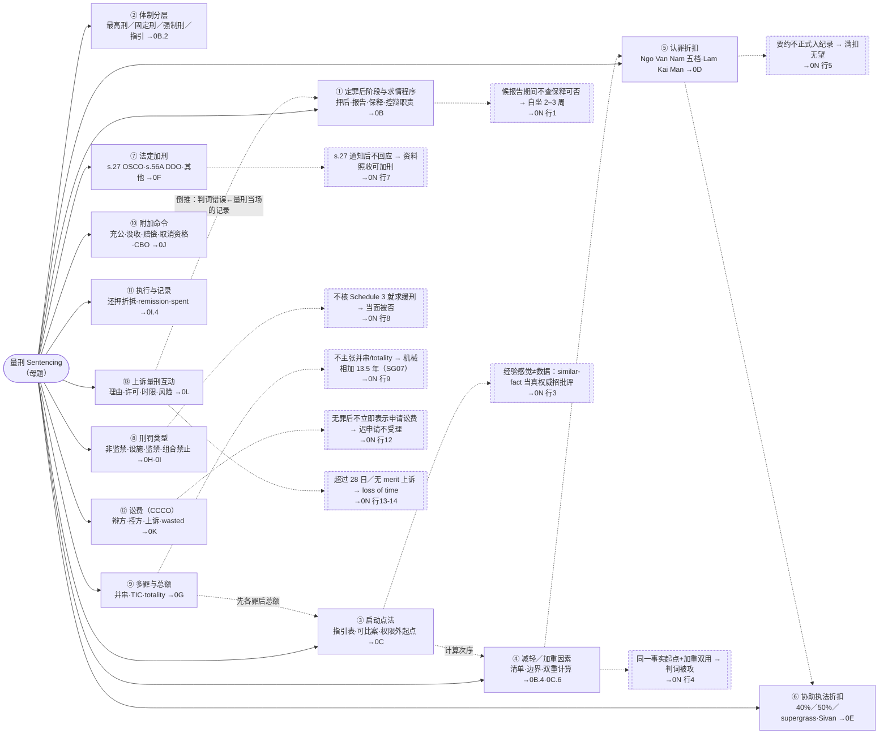
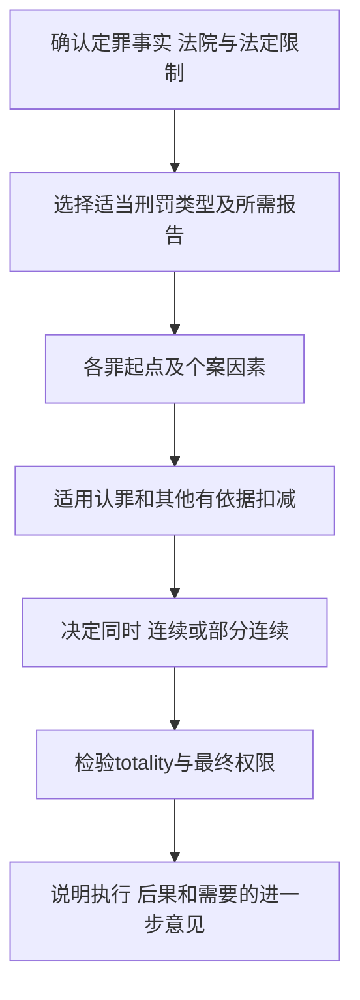

# 量刑体系 起点 调整与最终处置

## 速读定位层（30 秒全景：范围 · 术语 · 环节任务）

> 本层为 2026-10-10 重构新增的开篇导引；具体规则、条件、例外与引注见下方 0A（既有）与 0B–0O（2026-10-10 深化、2026-11-16 重编），按本层术语定位后直达。

> **白话导引**：量刑不是求情时堆可怜故事，而是一条计算流水线——先看罪名法定最高刑与法院权限（天花板），再用指引／tariff 或可比案定出**起点**；个案加重、减轻因素在起点上加减；认罪按答辩时点打折（1/3→25%→20%→更少），协助执法再打折（40%／50%／至多 2/3，通常已含认罪那份）；多项罪名先各判各的，再决定并立还是连续，最后用 totality 总检防止「相加即压碎」；然后选刑罚类型（罚款、感化、社会服务令、戒毒所、缓刑、监禁），每类各有法定门、报告门、同意门与组合禁令；刑罚之外还可能跟上来充公、没收、赔偿、取消资格与讼费。每一步做错会怎样，逐行收口 0N 总表。

### a. 程序辐射范围（本卡覆盖什么，不覆盖什么）

**覆盖（按程序时序）**——自定罪到判后上诉接口的完整量刑链：
1. **定罪后阶段与求情程序**：判刑时点与押后理由、候判报告与保释、控辩职责、求情（Plea in Mitigation）纪律、判刑理由〔CR8 L62–L80 "Sentencing takes place after the Defendant’s conviction"；CR8 L126 "The aim is to seek the most lenient sentence"；CR8 L1379 "A formal written Reasons for Sentence may also be prepared."〕；
2. **刑罚体制分层**：最高刑制／固定刑／强制刑／量刑指引，及法院权限对可判刑罚的天花板〔CR8 L100 "The maximum sentence should be reserved for the very worst kind of case"；CR8 L106 "the only options are imprisonment for not more than 3 years"〕；
3. **启动点法**：guideline／tariff 与 similar-fact 案的等级、法院权限外起点、各罪指引表、Herry Jane 六步〔CR8 L140 "The ‘Starting Point’ – the sentence that is fixed before"；CR8 L536 "They are ‘true’ sentencing authorities unlike similar fact cases."〕；
4. **加减因素与认罪折扣**：减轻／加重清单、Ngo Van Nam 五档、Lam Kai Man 四项指引、要约无效、罚款折扣〔CR8 L978 "a 1/3 discount on any term of imprisonment will only"；CR8 L1008 "The Defendant cannot have it both ways"〕；
5. **协助执法折扣**：40%／50%／supergrass 阶层的“通常”口径与 Sivan 保密程序〔CR8 L1052 "the usual discount is 50% (including the 1/3 for his guilty plea.)"；CR8 L1068 "special circumstances which on the papers justify a lenient view"〕；
6. **法定加刑**：s.27 OSCO 的程序链与幅度、s.56A DDO 招募未成年、s.20(2) FAO、s.6 Gambling 三档〔CR8 L1140 "Section 27 applies to convictions in the DC or CFI"；CR8 L1124 "to take part in that offence"〕；
7. **多罪与总额**：consecutive／concurrent／部分连续、one transaction、T.I.C.、已有刑期、totality〔CR8 L154 "the one transaction rule was not developed as an inflexible rule"；CR8 L182 "The totality principle should not be considered until"〕；
8. **刑罚类型选择**：bind over、discharge、罚款、PO、CSO、DATC、缓刑、监禁与终身、RC/DTC/TC、青少年与 s.109A、组合禁止与报告—保释矩阵〔CR8 L226 "as ancillary to his jurisdiction"；CR8 L460 "the Court first fixes a period of imprisonment of not more than 2 years"〕；
9. **附加命令**：住院令、充公（forfeiture）、没收（confiscation）、赔偿令、归还令、取消资格、刑事破产令〔CR8 L314 "Such property can be forfeited by the court under s.102(2)(b)(ii)"；CR8 L340 "the amount of the loss or damage is more than HK$150,000"〕；
10. **执行与记录**：还押折抵（s.67A）、remission（r.69）、失效定罪（spent conviction）〔CR8 L530 "the court does have a discretion to reduce sentence"；CR8 L700 "The conviction is not erased but remains on their record"〕；
11. **讼费（CCCO）**：辩方讼费、控方讼费、上诉讼费、wasted costs——**往届嘉宾讲稿与学生稿承重，本届未讲**〔OLD-LG99 L37 "No inherent jurisdiction to award costs in criminal cases"·往届仅参考〕；
12. **上诉量刑互动（倒推）**：刑期上诉理由五型、许可与表格、28日／7日规则、loss of time、律政司司长复核——**往届材料承重**〔OLD-EXA L106 "Judge sentenced on the basis of facts that were not in evidence"·往届仅参考〕。

**不覆盖（边界声明，相关承担卡）**：① 认罪协商与 O.N.E. Bind Over 前半段（→06 Institution - Plea Advice and ONE Bind Over 与 06 卡 9A 节（原 09 增补并入）；本卡只收折扣计算接口）；② Newton 事实聆讯程序本体（→13 Institution - Criminal Evidence Disputes 与 LGS5；本卡只引接口）；③ 求情的讼辩表达与演练（→8051 求情讼辩体系，2026-10-27 授课）；④ 上诉程序全景与定罪上诉主体（LGS9／LGS10 主题，本届未开——本卡 0L 只收与量刑直接互动的接口级规则，往届 LG10／学生稿承重）；⑤ NSL 国安量刑差异（仅在 CPO Schedule 3 第 11 项与 r.69(1A) 层面登记，不展开）〔CR8 L800 "11. An offence endangering national security."〕。

### b. 关键术语逐一一句精确定义（中文定义＝英文原词）

| 术语（英文原词） | 一句中文精确定义 | 出处 |
|---|---|---|
| 最高刑制（maximum sentencing regime） | 香港量刑基本框架：罪名法定最高刑（“shall be liable…”），最高刑保留给最坏类案件 | 〔CR8 L100 "a maximum sentence is prescribed by the legislation"〕 |
| 固定刑（fixed sentence） | 法定唯一刑、无裁量亦不可上诉的量刑，如成年谋杀终身监禁（s.2 OAPO）；但酌情终身监禁须定最短服刑期（s.67B CPO） | 〔CR8 L102 "shall be imprisoned for life."〕 |
| 强制刑（mandatory sentencing regime） | 在法定列举的刑罚类型／年限内必须判处的制度，如 s.33 POO 按年龄段限定选项 | 〔CR8 L106 "the only options are imprisonment for not more than 3 years"〕 |
| 启动点（starting point） | 未计任何减轻或加重因素前先定的基础刑期；调整在其上加减 | 〔CR8 L140 "the sentence that is fixed before taking into account"〕 |
| 量刑指引（guideline） | 上诉庭三名法官订立、供下级法院遵循的指引，非“紧身衣”，偏离须给说服力理由 | 〔CR8 L540 "they are not “straight-jackets”"〕 |
| 指标刑（tariff） | 按附表数量对应固定年数的指引（如贩毒量级表），订立后比 guideline 更难说服偏离；TDD 场景已被批为 misnomer | 〔CR8 L542 "it will be much harder to persuade the court to depart from the tariff"〕 |
| 同类事实案例（similar fact cases） | 事实相近的个案，**不是**真量刑权威，求情引用会招致批评 | 〔CR8 L536 "The latter are not authoritative and have little value"〕 |
| 减轻／加重因素（mitigating / aggravating factors） | 减责或增责、从而在起点下调或上调的事实；减轻影响刑种选择或刑期长度 | 〔CR8 L934 "decrease the Defendant’s culpability"〕 |
| 认罪折扣（guilty plea discount） | 先定起点再按答辩时点给予的扣减；满扣 1/3 只给“首次可得机会”认罪 | 〔CR8 L978 "will only be given if the Defendant pleads guilty at the ‘first available opportunity.’"〕 |
| 较轻罪认罪要约（plea offer to a lesser offence） | 辩方提议认较轻／替代罪；控方不接受则该答辩无效（nullity），要约可否换折扣按 Lam Kai Man 四项指引 | 〔CR8 L1020 "D’s guilty plea is a nullity"〕 |
| 协助执法（assistance to authorities） | 提供“有实际用途”的资料或作证换取扣减；40%／50%／2⁄3 为通常口径非保证 | 〔CR8 L1058 "these are just “usual” discounts"〕 |
| 加刑（enhancement of sentence） | 在特殊情况下为阻吓而对指明罪行判处比本来更重的刑罚，如 s.27 OSCO、s.56A DDO | 〔CR8 L1138 "This is only done in exceptional circumstances"〕 |
| s.27 OSCO 加刑 | 控方在 DC/CFI 就指明罪行提供伤害／得益／流行情报并经通知程序，法庭排除合理怀疑信纳后可加重（不超法定最高刑） | 〔CR8 L1174 "pass a sentence … that is more severe"；CR8 L1178 "shall not exceed the maximum penalty"〕 |
| s.56A DDO | 成人犯指明毒品罪行（可判15年或以上）且招募未成年参与，可加刑；未成年招募未成年亦不免 | 〔CR8 L1124 "does not preclude an enhanced sentence for a minor who recruits another minor"〕 |
| 连续／并立执行（consecutive / concurrent） | 一罪刑满才开始下一刑（s.68 CPO）／各刑同时起算；部分连续并立亦可 | 〔CR8 L146 "One sentence does not start to run until the other has been completed."〕 |
| 总额原则（totality principle） | 先定各罪应得刑，再检验总和反映全部罪责且不致“crushing” | 〔CR8 L180 "The importance of the totality principle cannot be overstated"〕 |
| 一并考虑（T.I.C.） | 法庭把被告承认的他罪纳入考量而不另行定罪；DC 法定依据 s.81 DCO，MC/CFI 为惯例 | 〔CR8 L188 "into account in deciding on the appropriate sentence"〕 |
| 感化令（Probation Order, PO） | 非法定刑罪名下代替监禁的更生刑，1–3 年、附条件、须先取报告、须被告同意 | 〔CR8 L352 "provided that the sentence for the offence is not fixed by law"〕 |
| 社会服务令（Community Service Order, CSO） | 年满14岁、经适合报告并获同意后判的无偿社区工作，上限 240 小时／12 个月 | 〔CR8 L392 "The maximum number of hours of unpaid work"〕 |
| 戒毒所令（DATC Order） | 任何可判监禁罪行均可、代替其他刑罚，2–12 个月、期间由惩教署长决定，取报告期间必须羁押 | 〔CR8 L446 "The Defendant shall be remanded in custody pending preparation of report"〕 |
| 缓刑（suspended sentence of imprisonment, S/S） | 先定不超过 2 年监禁再决定是否暂缓执行，operational period 1–3 年；Schedule 3 例外罪不可 | 〔CR8 L460 "between 1 and 3 years. This is known as the ‘operational period’"〕 |
| 充公令（forfeiture order） | 对涉罪财物的充公（ss.102–104 CPO），部分条例另设充公（如 s.33(7) POO） | 〔CR8 L314 "provided it is no longer required as an exhibit"〕 |
| 没收令（confiscation order） | 针对犯罪得益的没收命令（s.8 OSCO／s.3 DTRPO），只限 DC/CFI、须控方申请，举证为相对可能 | 〔CR8 L330 "is on the balance of probabilities"〕 |
| 赔偿令（compensation order） | 定罪后命被告向受害人赔偿人身伤害或财物损失；与被告自愿赔偿的求情因素不同 | 〔CR8 L288 "Do not confuse this with the Defendant’s offer"〕 |
| 归还令（restitution order） | 把财物发还予有权管有者（s.84 CPO，DC/CFI） | 〔CR8 L306 "to return property to the person entitled to it"〕 |
| 刑事破产令（Criminal Bankruptcy Order, CBO） | DC/CFI 罪行造成非人身伤害损失逾 HK$150,000 时附加作出的破产令，不可与赔偿令并存、s.84B 不可单独上诉 | 〔CR8 L346 "a CBO and a Compensation Order cannot be combined"〕 |
| 讼费（costs, CCCO） | 刑事程序讼费无法定外固有管辖，权源全部来自 Costs in Criminal Cases Ordinance；不随胜败自动归属 | （往届口径，仅参考）〔OLD-LG99 L271 "Golden Rule : Not automatic upon conviction"·往届仅参考〕 |
| 失效定罪（spent conviction） | 初犯、刑罚不超3个月或罚款不超$10,000 且3年内无新定罪时定罪转为“spent”，记录仍在并可在量刑时考虑 | 〔CR8 L704 "Spent convictions can be taken into account on sentencing"〕 |
| 还押折抵（time on remand, s.67A CPO） | 候判羁押期间在计算释放日期时算入；实务由惩教署长计算，法官对法定外期间保留酌情 | 〔CR8 L530 "the court does have a discretion to reduce sentence"〕 |
| 减刑（remission, r.69 Prison Rules） | 实际服刑超30日者因良好行为可减最多 1/3，终身监禁不适用；国安罪须署长信纳不违国安利益 | 〔CR8 L1371 "eligible for up to a 1/3 remission of his sentence"〕 |
| Sivan 程序（Sivan Procedure） | 协助执法细节不经公开庭审、以书面或内庭传达给法官的量刑保密程序 | 〔CR8 L1068 "Information of the Defendant’s assistance may be conveyed"〕 |
| 未决案件（outstanding cases） | 被告在其他法院待决的案件；可押后同场处理以保一致性并适用 totality | 〔CR8 L138 "currently pending against a Defendant"〕 |
| 求情（Plea in Mitigation） | 辩方在判刑前就刑罚作出的陈词，目标是全部情况下可合理科处的最轻处置；认罪后与审讯后求情截然不同 | 〔CR8 L1349 "There is a huge difference between mitigating after a plea of guilty"〕 |

### c. 各环节解决什么问题（按程序时序）

| 环节（时序） | 它解决的具体问题 | 依据 |
|---|---|---|
| 定罪 → 判刑启动 | 判于何时、由谁判、需要否押后取报告、押后期间保释可否——把“已定罪”转成可判刑状态 | 〔CR8 L68 "if pre-sentencing reports are being called for, there will be an adjournment"；CR8 L72 "the question of bail needs to be considered"〕 |
| 体制分层 | 先问罪名法定最高刑、审理法院权限、有无固定／强制刑——决定可判空间的天花板与下限 | 〔CR8 L100 "depends both on the maximum sentence prescribed"〕 |
| 启动点 | 用哪份指引／可比案、起点定在哪——给后续一切加减一个数 | 〔CR8 L140 "A sentencing Judge in imposing a sentence of imprisonment should first fix"〕 |
| 加减因素 | 哪些事实归起点、哪些归个案加重／减轻——防同一事实两边用 | 〔CR8 L1138 "This is only done in exceptional circumstances"；CR8 L1092 "aggravating factors increase the sentence from the starting point"〕 |
| 认罪折扣 | 答辩实际时点对应哪一档；较轻罪要约是否已正式入纪录——决定可主张的百分比 | 〔CR8 L980 "a 25% reduction if he pleads guilty before trial dates are fixed"〕 |
| 协助执法 | 有无资料、会否作证、何时提供、保密需求——决定第二笔扣减及程序 | 〔CR8 L1044 "the court will not take into account a promise to do so"〕 |
| 法定加刑 | 控方有没有按 s.27(5) 通知、资料可否采纳、幅度是否超范围——回应或利用加刑程序 | 〔CR8 L1162 "been given an opportunity to be heard on the matter"〕 |
| 刑罚选择 | 非监禁／设施／监禁哪类可用：先决报告、同意、年龄、健康、组合禁止——提出可执行的请求 | 〔CR8 L390 "the Court must first call for a suitability report"；CR8 L862 "must be remanded in custody"〕 |
| 总额检验 | 多罪怎么执行、合计是否 crushing——把逐项答案组装成整体刑罚 | 〔CR8 L182 "Then the overall length of imprisonment may be reduced"〕 |
| 附加命令 | 充公／没收／赔偿／取消资格是否也被请求或自动跟上——刑罚之外的资产与资格面 | 〔CR8 L334 "if no such application is made, then the court has no power to order confiscation"〕 |
| 执行与记录 | 还押折抵、remission、spent 怎么落——判后实际服刑与记录面 | 〔CR8 L1371 "eligible for up to a 1/3 remission of his sentence"；CR8 L700 "The conviction is not erased but remains on their record"〕 |
| 讼费 | 控方会否索费（s.12 CCCO 特殊情状）、辩方保住已支出费用（无罪／部分无罪）——金钱后果面 | （往届口径，仅参考）〔OLD-LG99 L271 "Not automatic upon conviction"·往届仅参考〕 |
| 上诉互动 | 判词有没有可上诉的错误、28日／21日时限、败诉风险——判后救济评估 | （往届口径，仅参考）〔OLD-EXA L110 "within 28 days of sentencing"·往届仅参考〕 |


<!-- BEGIN:cite-legend -->
> [!info]- 引注图例
>
> | 码 | 文件 | 层级 | 学年 |
> |---|---|---|---|
> | CR5 | LGS5 审前及审讯问题 | 本届讲义 | 2026-27 |
> | CR8 | LGS8 量刑 | 本届讲义 | 2026-27 |
> | CR8S | LGS8 量刑·本届课堂幻灯伴生 md（708 行；讲师 Alexandra Norton） | 本届讲义 | 2026-27 |
> | CAP-K8 | LGS8 PT 2026-10-12 第一讲 Otter 合并稿（Part 1+Part 2 同晚；不是 Panopto，不含 10-13，不含全日制） | 本届讲义 | 2026-27 |
> | CAP-K8A | 8050_LGS08_PT_200b61cf | 本届讲义 | 2026-27 |
> | CAP-K8B | 8050_LGS08_PT_15fa49fc | 本届讲义 | 2026-27 |
> | CAP-K8F1 | 8050_LGS08_FT_f284cfb5 | 本届讲义 | 2026-27 |
> | CAP-K8F2 | 8050_LGS08_FT_3c96f4f9 | 本届讲义 | 2026-27 |
> | S7 | 本届 SG07 学生册（题面） | 本届官方 | 2026-27 |
> | SG7C | SG07 Classroom（任务总览与自拟上诉框架） | 凝结层 | 2026-27 |
> | SG7A | SG07 Brief A Mohammed Q1–Q4 课堂答案 | 凝结层 | 2026-27 |
> | SG7B | SG07 Brief B Donald Q1–Q3 课堂答案 | 凝结层 | 2026-27 |
> | SG8C | SG08 Classroom（材料到货状态与大纲范围登记） | 凝结层 | 2026-27 |
> | OLD-LG8 | 往届（2025-26）LGS8 量刑讲义（1363 行；与本届大纲基本同构，差异见材料矩阵） | 往届官方 | 2025-26 |
> | OLD-LG99 | 往届（2025-26）David Leung SC 嘉宾讲稿 Costs in Criminal Cases（645 行幻灯伴生 md；讼费规则库内唯一系统来源） | 往届官方 | 2025-26 |
> | OLD-EXS | 往届学生稿·Set 2「Crim Lit - Sentencing」（55 行表格式应试笔记·非官方） | 往届学生稿 | 2025-26 |
> | OLD-EXC | 往届学生稿·Set 2「Crim Lit - Costs」（32 行表格式应试笔记·非官方） | 往届学生稿 | 2025-26 |
> | OLD-EXA | 往届学生稿·Set 2「Crim Lit - Appeals」（139 行表格式应试笔记·非官方；刑期上诉与讼费上诉条目源） | 往届学生稿 | 2025-26 |


> | CR10 | LGS10 Notes（本届） | 本届讲义 | 2026-27 |
<!-- END:cite-legend -->

## 🗺️ 本卡地图（章节位置与阅读顺序，2026-10-10）

> 本卡按“程序时序＋计算次序”排章：主线 0B→0L 顺读即流程（阶段程序→体制→起点→加减→折扣→加刑→类型→总额→类型深化→附加→执行→讼费→上诉）；0M.1／0N 是暗礁与后果总表检索层，§1–§6 是五原则学理回扣层。
>
> 本节两件套：**图 1 · 母题结构图**（下一张，量刑母题的分支 roadmap＝全流程主干与后果虚线；计算次序状态机＝**图 2** 见 0A.9）→ **任务直达表**（按要做的事跳章节）。

**图 1 · 量刑体系分支 roadmap（全流程主干与后果虚线）**：



读图逻辑：实线是十三条分支按「程序时序＋计算次序」铺开的主干，每条末尾箭头指向承担深节；虚线 warnnode 是该分支「不做」的后果钩子，行号统一收口 0N 总表；0A.9 的计算次序图（图 2）与 §2 顺向推进是同一主干的两面。


| 你现在要做什么 | 直达章节 |
|---|---|
| 30 秒弄清范围/术语/每环任务 | [速读定位层](#速读定位层（30%20秒全景：范围%20·%20术语%20·%20环节任务）) |
| LG8（10-12/13）上课跟堂 | 0B–0K 深节（母题图对照大纲目录） |
| 给客户估刑 | [0C 启动点法](#0C.%20启动点法与量刑指引（2026-10-10%20深化）)＋0M.1 暗礁 1/3/4 |
| 写求情陈词／提量刑请求 | [0A 既有计算步骤](#0A.%20量刑选择、计算步骤与可执行请求)＋0D＋0E＋0H |
| 答辩时机与较轻罪要约 | [0D 认罪折扣](#0D.%20认罪折扣：分档、时机与基数（2026-10-10%20深化）) |
| 控方提了加刑申请 | [0F 法定加刑](#0F.%20法定加刑：s.27%20OSCO%20与%20s.56A%20DDO（2026-10-10%20深化）) |
| 客户多罪／有未决案 | [0G 并串与总额](#0G.%20多罪并串、T.I.C.%20与总额原则（2026-10-10%20深化）) |
| 想求非监禁／缓刑 | [0H 非监禁与设施类](#0H.%20非监禁与设施类选择（2026-10-10%20深化）)（先核 Schedule 3） |
| 判后要评上诉／诉费 | [0L 上诉互动](#0L.%20上诉量刑互动：从判刑理由倒推（2026-10-10%20深化）)＋[0K 讼费](#0K.%20讼费（CCCO，往届承重，2026-10-10%20深化）) |
| 考前扫高频失误 | [0M.1 暗礁](#0M.%20实务暗礁与核对清单（2026-10-10%20深化；2026-11-16%20对齐四级蓝图）)＋[0N 总表](#0N.%20环节×不做后果链×依据%20总表（索引）（2026-10-10%20深化；2026-11-16%20重编）) |
| 准备 SG07（11-11） | [0O.1 SG07 应用](#0O.%20SG%20应用（2026-10-10%20深化；2026-11-16%20重编，材料矩阵移审计留痕）)＋0F／0G／0K／0L |
| 准备 SG08（11-18） | [0O.2 SG08 应用](#0O.%20SG%20应用（2026-10-10%20深化；2026-11-16%20重编，材料矩阵移审计留痕）)＋0L（上诉框架主体待 LGS9/10） |

## 0A. 量刑选择、计算步骤与可执行请求

### 0A.1 从刑罚目的进入具体选择

报应、阻吓、预防、更生可组合，最终须相称于罪责并符合公众利益。不能只因客户年轻就让更生压倒一切，也不能只因罪名严重就忽略个案。量刑是有原则的裁量，不是一张自动给出答案的分数表。〔CR8 L82–L96 "There are four classical sentencing principles"〕

**首要分层**：罪行法定最高刑→审理法院权限→特别强制刑或排除→适当刑罚类型→个案起点及调整。最高刑不是预测刑，法院一般权限也不能覆盖某罪的特别规定。〔CR8 L98–L110 "THE SENTENCING REGIME IN HONG KONG"〕〔CR8 L140–L142 "The ‘Starting Point’ – the sentence that is fixed before"〕

### 0A.2 起点、加减因素与认罪折扣怎样排

先识别罪行类别、伤害、罪责和适用指引，并说明起点与有关因素的关系；再处理个案加重/减轻及认罪。不要把同一事实既用于选择较高起点又重复加重，或把认罪与同一份悔意机械作两次同等扣减。这是避免重复计量的分析方法，具体仍按该罪判例。〔CR8 L94–L110 "A Judge may apply a combination of the above principles"〕〔CR8 L140 "The ‘Starting Point’ – the sentence that is fixed before"〕〔CR8 L972–L988 "The Defendant’s plea of Guilty can be treated as an"〕

**研究判例的可比要素**：同一罪名还不够，要比较伤害程度、角色、计划、金额/数量、前科、答辩时点和程序阶段；量刑指引/摘要只是起点，讲义要求回读实际案件。不能把往届客户的刑期当本届客户的固定tariff。〔CR8 L50 "Cross & Cheung on Sentencing in Hong Kong (12th Edition)"〕〔CR8 L100–L110 "For most offences, a maximum sentence is prescribed by the"〕

### 0A.3 非监禁处置不是“求轻”一个词

| 选项 | 所解决的问题 | 须先具备/核查 |
|---|---|---|
| 罚款等适当金钱处置 | 以经济制裁达相称目的 | 法律可用性、能力及实际严重性 |
| Probation | 在监督和条件下更生 | 报告、适合性、同意及可持续履行环境 |
| CSO | 无偿社区工作结合惩罚与更生 | 法定年龄、同意、适合报告及可执行安排 |
| Suspended imprisonment | 已认为监禁适当，再决定是否暂不执行 | 不超过2年监禁、1–3年operational period、非excepted offence等 |
| DATC等治疗/训练设施 | 针对特定需要及法定对象 | 适合报告、年龄/健康/制度条件；候报告羁押规则分别核对 |

依据各制度而非“初犯应该不用坐牢”；报告建议也不会代替法官决定。〔CR8 L350–L398 "A Probation Order (“PO”) can be ordered by the Court"〕〔CR8 L406 "Like a PO, the fact that a CSO has been"〕〔CR8 L446–L468 "Before imposing a DATC Order, the court must first call"〕

### 0A.4 Probation和CSO应怎样提出

Probation报告供法院了解背景、处境及适合性；取得报告不保证判感化。监督需要可执行，客户不在港或准备离开等会影响适合性；同意要求及与其他刑罚能否合并按制度分别检查。〔CR8 L350–L374 "A Probation Order (“PO”) can be ordered by the Court"〕

CSO通常须年满14、有适合报告及同意；最长240小时，在最多12个月内完成。多份CSO不能无视总剩余小时限制。讲义列Chow Chak Man等适合因素，并提醒不是每项都必须机械具备；不要把职业稳定或清白记录当成唯一条件。〔CR8 L386–L408 "This is another form of rehabilitative sentence in which a"〕

**本卡自拟论证方式**：不只说“愿意做服务”，要用指示说明居住、工作时间、健康、交通及可完成工作安排，再请求报告以供法院评估。没有报告时不能称“已被评估适合”。〔CR8 L390–L408 "Before making a CSO, the Court must first call for"〕

### 0A.5 缓刑必须先回答是否应判监

法庭先定适当监禁，再考虑缓刑；不能为了避免即时收监而先决定缓刑再倒推刑期。s.109B及Schedule3排除需核到具体罪名，例如s.19与s.122在本届附表摘录，s.39并未列出。**不能缓刑不等于必须判监**：刑罚类型的第一步仍须独立分析。〔CR8 L460–L468 "The Court can impose a suspended Sentence of Imprisonment (“S/S”)"〕〔CR8 L774–L800 "The following offences are declared to be excepted offences—"〕

缓刑仍属监禁刑罚，operational period内再犯等可能涉及启动。不要告诉客户是“没有坐牢记录”或把缓刑与ONE混同；后者不作该罪定罪，法律性质不同。〔CR8 L466–L468 "Conditions may be imposed in passing a S/S. A S/S"〕〔CR5 L108–L110 "An O.N.E. B/O is not a conviction. It is an"〕

### 0A.6 青少年：先核年龄取哪一天

不同规则可能看犯罪、定罪或判刑时年龄；刑事责任、罪责和可入某设施的资格不完全同一问题。把生日、犯罪日、定罪/判刑日列入事实表，回到具体法条文字，不能只写“现在20岁”。〔CR8 L718–L746 "Under the JOO, a ‘child’ is a person under the"〕

s.109A对16至未满21岁的监禁提出先考虑其他适当方法的要求；须与excepted offences及相关规则结合，不能称绝对不得判监。即使属excepted offence，亦不禁止法院为了量刑判断取报告；同样，不为显然不适合的方案无目的索取所有报告。〔CR8 L764–L806 "S. 109A CPO: SENTENCING YOUNG OFFENDERS"〕

### 0A.7 报告、押后与候判保释

背景报告与某设施的适合报告功能不同；要提出为什么该报告有助选择刑罚。押后判刑时重新考虑保释，但某些报告有法定羁押要求，例如DATC相关制度；不能从CSO报告可保释推定所有报告期间都可保释。〔CR8 L68–L72 "Sentencing may take place immediately after conviction or there may"〕〔CR8 L390 "Before making a CSO, the Court must first call for"〕〔CR8 L446–L454 "Before imposing a DATC Order, the court must first call"〕〔CR8 L710–L714 "To assist in determining the appropriate sentence, the court may"〕

### 0A.8 认罪折扣：时点及明确提议的价值

| 通常阶段 | 本届Ngo Van Nam指引 |
|---|---|
| 首次实际听取答辩的机会 | 1/3 |
| 已过首机会但未定审期 | 25% |
| 定审期后、开审前 | 25%–20% |
| 审讯首日 | 20% |
| 审讯进行中 | 少于20% |

这不是每次出现“认罪”两个字就自动扣该比例：明确性、实际时点及法官裁量仍重要。较轻罪早期提议的Lam Kai Man条件和书面例外见06卡（含原 09 增补）。〔CR8 L978–L986 "a 1/3 discount on any term of imprisonment will only"〕〔CR8 L1002–L1008 "(1) the Defendant should make a clear and unequivocal statement"〕

**自拟计算例**：若合理起点确已确定为12个月、适用25%扣减，则该步为9个月；这个算式不证明起点或扣减本身正确。先给法律和事实理由，再算，不从想要的最终刑期反算起点。〔CR8 L974–L986 "The Court will first fix the starting point in terms"〕

### 0A.9 多罪、已有刑期及totality

先分别确定各罪适当刑罚，再决定同时、连续或部分连续，最后检验整体是否反映全部犯罪程度而不过分压倒性。不能一见“同一事件”就全部同时，也不能单纯把全部刑期相加。〔CR8 L144–L184 "Consecutive vs. concurrent (see chapter 10, Cross & Cheung)"〕

同一交易通常考虑同时，但真正罪责可要求不同；时间与目的分开、各自增加犯罪程度的罪，可支持连续。保释期间再犯是严重加重因素，不机械套用旧的“一定连续”说法。〔CR8 L154–L168 "Where offences are committed in the course of ‘one transaction’,"〕

已有刑期或其他未决案也会影响整体安排；把程序状态如实呈现，不能把未决案当作前科，亦不要只看当前一项而忽略合计效果。〔CR8 L138 "‘Outstanding cases’ – these are cases before other courts which"〕〔CR8 L174–L184 "The Totality principle ensures the Defendant is not punished twice"〕

**图 2 · 量刑计算次序（定罪→类型→起点→折扣→并串→totality→说明）**：



### 0A.10 控辩角色与判后说明

控方协助避免法律/事实错误，提供适用资料，不以个人愿望追求最高刑；辩方争取在全部情况可合理作出的最轻处置，处理法院已知不利点，但不能积极虚构清白记录或诋毁他人。判刑后须确保客户得到解释及后续意见。〔CR8 L112–L134 "DUTIES OF COUNSEL ON SENTENCIN"〕

## 0B. 量刑程序与原则：从定罪到宣读判刑理由（2026-10-10 深化）

> 本节为 2026-10-10 重构新增深节 1。主线：**定罪 →（即判或押后取报告）→ 求情 → 法官考虑 → 宣判＋理由 → 判后会见客户 → 上诉评估**。程序面决定后面每一步能不能走——押后期间的保释处理、求情能说什么不能说什么的纪律，都是在这一步定调的。

### 0B.1 判刑阶段全景：法官、时点、押后与保释

1. **谁判、何时判**：判刑在定罪后发生——认罪定罪或审讯定罪均可；主持审讯的同一法官判刑，陪审团不参与量刑〔CR8 L62 "Sentencing takes place after the Defendant’s conviction."；CR8 L74 "The same Judge who presided over the trial sentences the Defendant."〕。可即判，也可押后索取判刑前报告（感化报告、更生中心报告等）；实务上一旦取报告，押后至少两周〔CR8 L68 "if pre-sentencing reports are being called for, there will be an adjournment of at least two weeks"〕。SGS3 这第一场求情练习没有 pre-sentencing report，只根据控方案情、个人情况和案情求情，结尾可以请求押后取报告。实务上应等报告到了再求情，不要先求一半、以后再补一半。（根据字幕：PCLL8050 LGS8 PT，00:00:00–00:04:38；〔CAP-K8 L32 "you will not have any pre-sentencing reports"〕）
2. **另一押后理由**：一案多被告、有人认罪有人不认罪时，法官通常把认罪者的判刑押后到其余被告审讯完结之后——为的是先听后审的全部案情，避免对认罪者在其同案受审前处以可能不均的刑罚（讲义以 Why 提问，口径见上）〔CR8 L70 "the Judge will usually adjourn sentencing for the Defendant who pleaded guilty"〕。
3. **押后＝重新想保释**：判刑押后时须考虑是否申请保释；**部分报告期间法定必须羁押**（DATC：s.4(3) DATCO／s.54A(1B) DDO；TC：s.4 TCO），不能笼统向客户承诺“取报告期间可以保释”〔CR8 L72 "the question of bail needs to be considered"；CR8 L446–L454 "so bail is not possible, nor should a request for bail be made"〕。报告—保释矩阵见 0H.9。
4. **只对已定罪之罪判刑**：被告只可就其被定罪的罪行受刑（例外：T.I.C.）；有同类前科的，法官在处本罪刑罚时可参看其先前所受刑罚〔CR8 L76 "The Defendant must only be sentenced for offences that he has been convicted of"〕。
5. **求情与考虑顺序**：判刑前先由辩方大律师作求情陈词，法官随后考虑适当刑罚与加减因素〔CR8 L78 "the Defendant’s Counsel will be invited to make submissions in mitigation"〕。客户指示不要你求情时，就不要求。one bullet tourist 的例子是轻微罪行加上口袋里一颗子弹，当事人想坐尽可能长的牢。（根据字幕：PCLL8050 LGS8 PT，00:04:38–00:09:19；〔CAP-K8 L36 "one bullet tourist case"；CAP-K8 L36 "bound by your client's instructions"〕）

### 0B.2 刑罚体制分层：最高刑制、固定刑、强制刑

| 层 | 规则 | 依据 |
|---|---|---|
| 最高刑制（一般） | 大多数罪名由法例以 “shall be liable…” 定最高刑；最高刑保留给该类案件中最坏者（*Yau Wai Hang*）；但 *Chang Yau Hung Alexander*：不臆想最坏，而看已到法院的最坏类型层，本案是否落入该宽带 | 〔CR8 L100 "should be reserved for the very worst kind of case"〕 |
| 最高刑＝法定×法院权限 | 可判上限同时受罪名法定最高刑与审理法院量刑权限限制（幻灯回扣 LGS1：MC 2 年／DC 7 年一般权限，特定罪名可经如 s.20(2) F&AO、s.4(3)(b) DDO 扩展——但**不等于**法例写了最高刑，MC/DC 就有权判满） | 〔CR8 L100 "depends both on the maximum sentence prescribed"；CR8S L65 "limited sentencing jurisdiction (2 years / 7 years)"〕 |
| 固定刑 | 成年谋杀“shall be imprisoned for life”（s.2 OAPO），无裁量、不可上诉；酌情终身监禁须定最短服刑期（s.67B CPO）；长期监禁复核委员会覆核不定期刑／10 年或以上／定罪时未满 21 岁者——“Life does not mean life” | 〔CR8 L102 "shall be imprisoned for life."〕 |
| 定额罚款 | Fixed Penalty (Criminal Proceedings) Ordinance, Cap. 240 等定额罚款类 | 〔CR8 L104 "Fixed Penalty (Criminal Proceedings) Ordinance, Cap. 240"〕 |
| 强制刑 | s.33 POO（公众地方管有攻击性武器）按年龄段列举唯一选项：17–25 岁只有 ≤3 年监禁／教导所／更生中心三选一（幻灯附全文：14–17 多 TC；≥25 只有 ≤3 年监禁） | 〔CR8 L106 "the only options are imprisonment for not more than 3 years"；CR8S L88 "if he is not less than 17 years of age"〕 |
| 普通法罪 | 部分已由法例取代（ss.159A/159C Crimes Ordinance）；保留普通法者（conspiracy to defraud）法定最高刑仍在（s.159C(6)） | 〔CR8 L108 "the statute still sets out the maximum sentence: s. 159C(6)"〕 |
| 上诉庭指引 | 对严重、流行或判刑分歧的罪名，CA 订 tariff／guideline（→0C） | 〔CR8 L110 "the Court of Appeal has set out tariffs or guidelines"〕 |

**体制分层的使用纪律**：给客户意见时，最高刑制这层只负责“可判空间”，不负责“会判多少”——客户要的是 likely sentence（→0C.5、0M.1 暗礁 1）〔CR8 L490 "Your client is much more interested in your advice as to the LIKELY SENTENCE"〕。

### 0B.3 控辩职责：法庭两边的角色边界

| 方 | 职责要点 | 依据 |
|---|---|---|
| 控方（Prosecution Code） | para 3.8：协助法庭避免可上诉的错误、纠正审讯或判刑程序中出现的法律／事实错误；para 21：提供相关判例与统计、就刑罚**类型**（而非长短）陈词 | 〔CR8 L116 "assist the court to avoid appealable errors"〕 |
| 控方（Bar Code 10.71） | 不试图以讼辩技巧影响量刑长短；但应备妥相关法定条文、上诉庭指引可在法庭要求时协助；被告无代表时可主动告知所知求情情况 | 〔CR8 L120 "should not attempt by advocacy to influence the Court"〕 |
| 控方（记录面） | 向法庭提供刑事记录（CRO）与 Antecedent Statement（CFI 按 PD 9.3；DC 亦可给法官；MC 通常只递 CRO） | 〔CR8 L122 "see PD 9.3 regarding Antecedent Statements"〕 |
| 辩方（求情定位） | Plea in Mitigation：目标是全部情况下可合理科处的最轻刑罚 | 〔CR8 L126 "The aim is to seek the most lenient sentence"〕 |
| 辩方（不利事实） | 无义务主动呈出加重因素；法庭**已知**的不利事实宜正面处理、解释或减弱；法庭不知的，提出反受其害 | 〔CR8 L128 "mentioning it will do more harm than good"〕 |
| 辩方（记录诚实） | 无义务纠正控方的记录错误，但**绝不可积极误导**——如签与实情不符的 s.65C 清白记录承认事实、或口头声称无前科／good character（Bar Code 10.61） | 〔CR8 L130 "Defence Counsel has no duty to advise his client to disclose"〕 |
| 辩方（表达底线） | 求情不作诽谤或侮辱性指控（Bar Code 10.63）；判后必须会见客户（不能亲自则由事务律师或其代表）告知定罪与刑罚（Bar Code 10.64） | 〔CR8 L132 "merely scandalous or calculated to vilify"；CR8 L134 "must see his lay client after conviction and sentence"〕 |

### 0B.4 四原则与“艺术而非科学”

报应（retribution）、阻吓（deterrence）、预防（prevention）、更生（rehabilitation）——可组合、可偏重；法官须作平衡，使刑罚与罪责相称并符合公众利益〔CR8 L94 "the sentence passed is proportionate to the Defendant’s culpability"〕。幻灯提示：部分原则重被告个人、部分重社会整体〔CR8S L58 "more focused on the individual D and some more on society"〕。更生原则有《人权法案》第 6(3) 条文呼应：监狱制度以改造与社会复归为根本目的〔CR8 L92 "The penitentiary system shall comprise treatment of prisoners"〕。

“量刑是艺术而非科学”：法官裁量广阔，刑罚落在裁量范围内则上诉难推（→0L 的接口：可上诉的是“裁量外”的错误，不是“判得重”）〔CR8 L96 "Sentencing is an “art not a science.”"〕。

### 0B.5 求情纪律：认罪后与审讯后两套口径

| 场景 | 要说的 | 不能说／不要做的 | 依据 |
|---|---|---|---|
| 认罪后求情 | 处理两份题：(1) 为何犯罪；(2) 为何不会再犯 | **不要**提抗辩；**不要**争议 Brief Facts（争议应在认罪前经修订或 Newton 解决） | 〔CR8 L1351 "(1) why was the offence committed?"〕〔CR8 L1353 "DO NOT: (1) raise a defence; (2) dispute the Brief Facts."〕 |
| 审讯后定罪求情 | 只打中性求情因素：个人背景、不隐含认罪的客观情况 | **不要**争议法官事实裁断（留待上诉）；**不要**透露上诉打算或隐含认罪；**不要**讲悔意（不会被视为真诚） | 〔CR8 L1361 "do not dispute the Judge’s findings – save it for appeal!"〕〔CR8 L1363 "do not mention plans to appeal"〕 |
| 通用结构 | 先处理报告 → 背景与案情 → 减轻因素 → 承认加重（如适当） → 提出可执行的刑罚请求（常备 plan B） | 引用判例非必须——除非是指引／tariff 罪（→0C）；未核记录别开口 | 〔CR8 L1331–L1341 "Deal with pre-sentencing reports at outset"〕 |

**两条 TIP（讲堂口径）**：① 必核控方提供的刑事记录——**不要凭客户记忆**（客户常忘、常少报），并核他是否在 PO／CSO／缓刑的 operational period 内犯本案（→0H 违反处理）；② 核定罪对执业的影响（医生、护士、教师、保安等——查明相关条例对继续执业的影响）〔CR8 L1343 "clients frequently forget or underestimate"；CR8 L1345 "will he be prevented from continuing his employment"〕。

### 0B.6 判刑理由、减刑与判后

- **判刑理由（Reasons for Sentence）**：当庭口头作出（被告在场），可另备正式书面理由；辩方须细读以评估有无针对刑罚的上诉理由（→0L）〔CR8 L1379 "These are given orally in court in the Defendant’s presence."；CR8 L1381 "You should review these carefully to see whether"〕。
- **减刑（remission）**：实际服刑逾 30 日（经 s.67A 折抵后）可因“勤勉与良好行为”获至多 1/3 减刑，但剩余刑期不得减至少于 31 日；释放日期由惩教署长计算；r.69 不适用终身监禁；国安罪犯须经署长信纳不违国安利益方获减刑（r.69(1A)，具追溯力，拒绝须每年复核）〔CR8 L1371 "the proviso to r.69(1)"；CR8 L1373 "Rule 69 does not apply to a life sentences."；CR8 L1375 "must not be granted remission unless the Commissioner is satisfied"〕。
- **失效定罪（spent conviction）**：ROO 三条件（初犯／刑罚 ≤3 个月或罚款 ≤$10,000／3 年内无新定罪）；“spent”≠清白记录或 good character，记录仍在但盖“spent”；量刑可考虑（s.3(3) ROO）；再犯时证据可采（s.3(4)）；法官可视公正需要酌情准盘问（s.3(2)）〔CR8 L700 "The conviction is not erased but remains on their record"；CR8 L704–L708 "Spent convictions can be taken into account on sentencing"〕。

**总表索引**：判刑启动与求情环节“不做／做错”的后果链，见 [0N 总表](#0N.%20环节×不做后果链×依据%20总表（索引）（2026-10-10%20深化；2026-11-16%20重编）) 行 1（候报告保释）、行 10（不核记录与前科）、行 11（求情踩界）；上诉接口见行 13–14。

## 0C. 启动点法与量刑指引（2026-10-10 深化）

> 本节为 2026-10-10 重构新增深节 2。主线：**先定位权威层级（法定最高刑 → 指引／tariff → similar-fact）→ 定起点（含权限外起点）→ 查指引表（各罪）→ 个案偏离（比要素）**。

### 0C.1 权威层级：类似事实案例不是权威

- **真权威**：CA 三名法官订立的 guideline／tariff，多为严重、流行或判刑分歧的罪名〔CR8 L538 "Guidelines and tariffs must be laid down by 3 Judges"〕。guideline 非“紧身衣”，偏离须说服力理由〔CR8 L540 "they are not “straight-jackets”"〕；tariff 按附表数量定年数，订立后更难说服偏离〔CR8 L542 "it will be much harder to persuade the court"〕。
- **类似事实案例（similar fact cases）**：不是权威，求情中价值极低；引用非真权威会招来批评（*HKSAR v. Lau Sau King*）〔CR8 L536 "you open yourself up to criticism in mitigation"〕。幻灯同口径：类似事实案不是 sentencing authorities〔CR8S L423 "‘Similar fact’ cases are not sentencing authorities."〕。
- **Cross & Cheung 附录**：只是量刑幅度的起点参考——讲义明言“this is a starting point only, you must read the actual cases!”〔CR8 L50 "Note: this is a starting point only, you must read the actual cases!"〕。
- **并非每罪都有指引**：盗窃高度事实敏感（店铺窃／拾遗／扒窃／失信各有不同），非法伤人看伤势与加重情节〔CR8 L686 "Guidelines / tariffs are not appropriate for all offences."〕。

### 0C.2 起点的确定与两道边界

1. **定义**：起点＝未计加减前所定刑罚；判监禁时应先定起点再作扣减或增加〔CR8 L140 "should first fix the appropriate starting point"〕。
2. **起点可以是法定最高刑**：*Chang Yau Hung Alexander* ——律师失信盗取 US$10M 且无归还指望，属已到法院的最坏类型宽带，以盗窃最高刑为起点〔CR8 L140 "within the broad band of the worst type of cases"〕。
3. **起点可超法院权限**：只要扣减后最终刑罚不超该法院权限即可（*HKSAR v. Li Yan*）；此时仍应给予有意义的认罪折扣〔CR8 L142 "A starting point can be set which is outside of the maximum"〕。幻灯将“起点能否是最高刑”列为课堂问题——答案是 *Chang Yau Hung* 允许〔CR8S L127 "Can the starting point be the maximum sentence?"〕。
4. **起点已是法定上限后**：幻灯留作思考问题——起点已顶格，还能否再因加重因素上调？——按 0F（s.27(13) 以法定最高刑为限）与 totality 框架处理；LGS8 课堂口径回流见审计区 2026-11-13 节与 open 块〔CR8S L707 "What if the court adopts a starting point which is already the maximum"〕。

### 0C.3 指引与 tariff 表（本届讲义所载，逐罪）

| 罪名 | 指引／tariff | 关键量刑逻辑 | 依据 |
|---|---|---|---|
| 抢劫（普通持刀） | 起点 5 年；入侵私人处所 6 年；捆绑事主 7 年（*Mo Kwong-Sang*） | 极严重者可更高：*Sahil Kumar*——$4M、预谋、脆弱事主、18 吋菜刀、光天化日、Form 8 身份——起点 9 年，前科各 +1 年／+6 月，Form 8 再 +1 年 → 名义 11 年；认罪 1/3＋协助 → D1 总扣 40%、D2 37%，各 6 年 7 月（D1 3 年与前刑连续） | 〔CR8 L546 "the starting point should be 5 years imprisonment"〕 |
| 持枪抢劫（真枪／假枪展示） | 起点 10 年（*SJ v. Lee Chun Ho Jeef*；*HKSAR v. Tai Tin Ho Zafar* [2026] 1 HKLRD 1005） | 本届新增对照；真假枪同源 | 〔CR8 L548 "the proper starting point for robbery with an imitation or real firearm"〕 |
| 扒窃 | 审讯定罪起点 12–15 个月（*Ngo Van Huy*） | 金额非唯一尺 | 〔CR8 L550 "a starting point of 12–15 months"〕 |
| 盗窃（违背信任） | 按金额分档（*Ng Kwok Wing*）：≥$15M→≥10 年；$3–15M→5–10 年；$1–3M→3–5 年；$250K–1M→2–3 年；≤$250K→<2 年 | 个案随具体加减浮动 | 〔CR8 L552 "the guidelines laid down in an earlier case were revised"〕 |
| 信用卡诈骗 | 无统一公式（*Chan Sui-to* 五要素：规模／策划／国际面／角色／认罪）；小案少卡起点 ≤3 年（*Tu I Lang*） | 1996 年量级参考：<$50K 小、$50–150K 中、>$150K 大；中型非关键角色审讯后 5–6 年 | 〔CR8 L554 "whether there was an international dimension"〕 |
| 盗用真卡（雇主） | 伪卡轻案 3 年起点同样适用真卡盗用；**损失潜力**重于实际损失（*Lam See Chung Stephen*；employer 案不是 breach of trust 而是 abuse of position） | 分案审理会失真——CA 批评同批罪行 MC/DC 分审致总量难见 | 〔CR8 L556 "the actual loss suffered is not necessarily an important factor"〕 |
| 网上诈骗 | 不设指引（手法多样）——通常即时监禁、专向阻吓（*Chung Pui Kit* 起点 6 年）；*Kong Chi Kiu* 同旨 | 不比照信用卡框架硬套；查规模、策划、匿名手段、受害人量、损失 | 〔CR8 L558 "it would not be appropriate to fix sentencing guidelines"〕〔CR8 L560 "A significant element of deterrence is needed for such crimes."〕 |
| 电话骗案（conspiracy to defraud） | 起点 4 年（*Hung Yung Chun*，比街头骗案更重）；OSCO 加刑可议（*SJ v. Chan Ho Kit* [2026]：加刑 1/3） | 高度组织、角色分工、专捕弱点 | 〔CR8 L562 "a starting point of 4 years should be adopted"〕 |
| 强奸 | 通常起点 5 年；*R v. Billam* 仅作辅助不再机械 | 九项可上调因素：超额暴力／武器恐吓伤害／预谋／身心重创（如怀孕）／进一步羞辱／侵入住所／儿童在场／偷用药物／性侵暴力史 | 〔CR8 L564 "Usually, a starting point of 5 years is adopted."〕 |
| 贩毒·海洛英/可卡因（TDD） | *Huang Ruifang (No. 3)* [2025] 修订 *Lau Tak Ming*／*Abdallah*：≤10g→2–5 年；10–50g→5–8；50–200g→8–12；200–500g→12–16；500–1,500g→16–20；1.5–5kg→20–24；5–15kg→24–27；15–30kg→27–30；>30kg→法官裁量（实务上限 35 年／法定终身） | 经审讯后的起点带；30kg 以上层 | 〔CR8 L566–L584 "the sentencing guidelines for trafficking in heroin and cocaine"〕 |
| 贩毒·冰毒（ICE） | *Huang Ruifang* 同案修订 *Ching Kwok Hung*／*Tam Yi Chun*：≤10g→3–7 年；10–70g→7–11；70–300g→11–15；300–600g→15–18；600–1,500g→18–20；1.5–5kg→20–24；5–15kg→24–27；15–30kg→27–30；>30kg 同上 | 较海洛英/可卡因同量更重 | 〔CR8 L588–L606 "revise the sentencing guidelines for trafficking in ICE"〕 |
| 贩毒·氯胺酮/摇头丸 | *Hii Siew Cheng*：≤1g 法官裁量；1–10g→2–4 年；10–50g→4–6；50–300g→6–9；300–600g→9–12；600–1,000g→12–14；>1,000g→14 年起 | “社会性转售”与小型商营供应同视；非监禁只限“exceptional in the extreme” | 〔CR8 L648–L664 "Guidelines were laid down in SJ v. Hii Siew Cheng"〕 |
| 贩毒·草本大麻/大麻精 | *Nguyen Thang Loi*：≤2kg→≤16 月；>2kg→16–24 月；>3kg→24–36；>6kg→36–48；>9kg→48–66；>15kg→66–96；>45kg→96–120；>90kg→≥120 月 | 因效能提升而修订 | 〔CR8 L666–L682 "the guidelines for trafficking in herbal cannabis were revised"〕 |
| 管毒（PDD） | *Mo Cho-tik*：真诚自用常备量起点 12–18 个月（DC/CFI 口径） | 不排除裁判官对极少量判更轻；量为首要尺度；可论证 <12 月或非监禁（*Mursaleen* 混合毒 6 个月） | 〔CR8 L684 "the starting point for mere possession of a quantity of dangerous drugs"〕 |

**使用纪律（回扣 0M.1 暗礁 3/4）**：上表是“经审讯后”的起点口径；先定罪名与量级带，再回到 0C.4 比要素、0D 扣减。要提醒的是 **possession for the purposes of trafficking 与 TDD 指引不同**——先核你客户的定罪罪名是哪一条〔CR8 L628 "a reminder to check carefully which offence your client is charged with"〕。

### 0C.4 TDD 六步与其他进阶路径

1. **Herry Jane Yusuph 六步**：①按毒量定指引带 → ②按证据评角色与罪责（courier/storekeeper 最低 → 实际贩卖 → 管理组织 → 经营/财务控制 → 跨境大案主脑；“courier”不可因最低而滥用标签；同类标签内个体差异仍须个别评估）→ ③定其在带内位置（可上可下）→ ④考虑应否上调起点的加重因素（重大偏离算数起点须解释）→ ⑤**同步**考虑全部减轻因素算总扣减（个人情况在 TDD 通常分量轻；1/3 认罪是“high watermark”非“impenetrable ceiling”）→ ⑥回看整体刑罚是否公平并适用 totality〔CR8 L612–L622 "identify the relevant guideline band applicable to the quantity"〕。CA 另批 “tariff” 一词在毒罪为 misnomer（不许裁量进入）；角色而非机械算数为纲〔CR8 L624–L626 "a “tariff” does not allow for the introduction of discretion"〕。
2. **国际因素旧规已废**：跨境 TDD 以往 ≥1kg 加 ≥2 年；*Raman Kapusamy* 起改采角色罪责弹性路径〔CR8 L630 "the flexible approach laid down in Herry Jane Yusuph"〕。
3. **混合毒品（cocktail）**：通常用 **combined approach**（*Islam SM Majharul* 七步：定最重毒为基数 → 按其量定起点 → 按轻毒指引比较与 absurdity/comparison/ratio 三测试酌增 → 两种及以上严重毒品的加重 → 其他加重（Form 8／国际面）→ 减轻因素 → totality）；individual approach 为另一路径〔CR8 L632–L646 "Usually, the combined approach is used."〕。
4. **个人情形分量**：TDD 案个人情况通常分量轻（六步第⑤环同旨）〔CR8 L620 "consider all mitigating factors simultaneously"〕。

### 0C.5 给客户意见：likely sentence 的三层纪律

幻灯讲堂口径（配套 0M.1 暗礁 1）：**只就 likely sentence 提供意见**；最高刑只有两个例外可讲——客户主动问、或其案件确属最坏一类（两者都极罕见）；避免“It's up to the Judge”式推托、“everything but the kitchen sink”式罗列、把 1/3 当口头禅（先问是否适用）〔CR8S L654 "DO NOT ADVISE ON THE MAXIMUM SENTENCE"；CR8S L656–L658 "Both (1) and (2) are extremely unlikely!"〕。

**总表索引**：起点与指引环节“不做／做错”的后果链，见 0N 行 2（误导客户的最高刑口径）、行 3（权威层级错用）、行 4（双重计算）。

> **Exam / Advocacy Formulation:** "Advise on the likely sentence — the maximum belongs to the worst band of cases actually before the court, and Cross & Cheung is a starting point to read cases from, never an authority to quote."（自拟考场口径；规则出处见 0C.1／0C.5 各行引注）

## 0D. 认罪折扣：分档、时机与基数（2026-10-10 深化）

> 本节为 2026-10-10 重构新增深节 3。主线：**先定基数（起点）→ 对表分档（时点）→ 较轻罪要约（Lam Kai Man 四项）→ 计算纪律（基数错算暗礁）**。认罪可被视作悔意表现；审讯定罪后的悔意表达通常不被接纳〔CR8 L972 "can be treated as an indication of remorse"〕。

### 0D.1 Ngo VanNam 五档（2016-09-02 起新指引）

| 阶段 | 通常扣减 | 依据 |
|---|---|---|
| 首次可得机会（首次听取答辩之日） | 1/3 | 〔CR8 L978 "will only be given if the Defendant pleads guilty at the ‘first available opportunity.’"〕 |
| 未定审讯日期前 | 25% | 〔CR8 L980 "a 25% reduction if he pleads guilty before trial dates are fixed"〕 |
| 已定速开审前 | 25%–20% | 〔CR8 L982 "a 25%-20% reduction if he pleads guilty once trial dates have been fixed"〕 |
| 审讯首日 | 20% | 〔CR8 L984 "a 20% reduction if he pleads guilty on the first day of the trial"〕 |
| 审讯进行中 | <20% | 〔CR8 L986 "a discount of less than 20% if he pleads guilty in the course of the trial"〕 |

- **立法理由**：鼓励认罪、节省法庭时间与讼费；先按年数定起点再给折扣〔CR8 L974–L976 "This is to encourage Defendants to plead guilty"〕。
- **追溯适用**：该指引属程序性量刑裁量规则——犯罪早于新指引、判于其后，仍适用新指引（*Chang Yau Hung*：被告交付时已明知新指引仍先称不认罪，只获 25%）〔CR8 L990 "the revised procedures should apply"〕。
- **罚款亦有折扣**：*Tai Hing Worldwide*——罚款通常亦给认罪折扣；*Paul Y* 曾给足 1/3，但数学上不一定足 1/3〔CR8 L988 "For fines, a discount for a guilty plea will usually be applied"〕。
- **适用范围**：折扣只就监禁刑期计算；PO/CSO/DTC/TC/RC 等非监禁或设施刑罚不适用 1/3 数学口径（往届学生稿提醒，往届仅参考）〔OLD-EXS L50 "The discounts in Ngo Van Nam only apply to terms of imprisonment"·往届仅参考〕。

### 0D.2 Lam Kai Man 四项指引（较轻罪／替代罪要约）

1. 被告应在庭上、纪录内，清楚且不含歧义地表明立场（正式认较轻罪，或由律师正式记入其拟认罪基础的意向）〔CR8 L1002 "the Defendant should make a clear and unequivocal statement"〕。
2. 有正当理由未入纪录时，致函控方提出清楚且不含歧义的要约仍可被考虑；但**被告负举证**：正当理由、要约与基础、且全程立场如一〔CR8 L1004 "the onus would be on the Defendant"〕。
3. 折扣幅度按入纪录时点计，仍受法官最终裁量与 Ngo Van Nam 原则约束〔CR8 L1006 "remained subject to the Judge’s overriding discretion"〕。
4. 谋杀／误杀类：**尤其要**在开审前把答辩与基础正式入纪录；事后才告知不是路径；“试探控方假设立场—不正式入纪录—审讯中跑不一致抗辩”＝没有清楚提出或贯彻，信件折扣0%〔CR8 L1008 "The Defendant cannot have it both ways"〕。

**Lam Kai Man 案事实**：三封信换三次拒绝、交付后控方改接受替代 s.119 罪；被告未在交付或案件管理聆讯入纪录、原排审日后 3 日始告知，辩方又曾以 consent 抗辩——实用价值大减，只给 25%（上诉庭本会以 8 年起点；上诉撤回后维持了该表述）〔CR8 L1012–L1016 "he should only get a 25% discount"〕。**Lee Wai Man (No. 2)**：早期认误杀、审讯中却跑多套不一致抗辩——不保全程立场，不获满扣〔CR8 L1022 "declined to award the full 1/3 discount"〕。**Cheung Tsz Hong**：开案陈词后、PW1 作证期间认罪只给 10%；律师给错“开审后仍有 20%”意见不等于答辩无效（未及“答辩决定核心”）〔CR8 L1018 "the D was only given a 10% discount"〕。

### 0D.3 要约无效（nullity）与陪审团

较轻罪要约不被接受 → 认罪无效；提堂通常在陪审团席外，除非辩方战术性引入，否则陪审团不会知悉（*Wong Chun Man*：辩方主动允许控方在开庭陈词引述认误杀事实，故不得上诉指陪审团把要约谈当不利自白）〔CR8 L1020 "D’s guilty plea is a nullity"〕。

### 0D.4 计算纪律：基数与次序（暗礁 5）

- **基数是起点（不定 final）**：折扣打在起点之上，顺序是定起点→加减→再总检；不从想要的最终刑期反推起点（0A.8 自拟例：起点 12 个月×25%＝9 个月，该算式不证明任何一步正确）〔CR8 L974 "The Court will first fix the starting point"〕。
- **同步考虑**：Herry Jane 第⑤环——所有减轻因素（含认罪）同步考虑算总扣，不要先为个人因素打折再对余数打 1/3〔CR8 L620 "consider all mitigating factors simultaneously"〕。
- **协助折扣的分子**：40%／50%／2/3 的“通常”总扣**已包含**认罪 1/3（→0E.3）〔CR8 L1052 "the usual discount is 50%"〕。
- **增加面也基于起点**：OSCO 加刑是“比本来应判的更重的刑罚”（s.27(11)）；Kong Wai-chun 确认曾用于定点的事实可在加刑层面再利用——但一般加减层仍须避免同一因素在起点与加重中双用（0M.1 暗礁 4）〔CR8 L1174 "more severe than the sentence it would"；CR8 L1303 "the provisions of OSCO add an additional layer of deterrence"〕。

**总表索引**：折扣环节“不做／做错”的后果链，见 0N 行 5（要约不入纪录）、行 6（基数错算/倒挂）。

## 0E. 协助执法折扣与 Sivan 程序（2026-10-10 深化）

> 本节为 2026-10-10 重构新增深节（认罪折扣的姊妹面）。第二大减轻因素：协助执法（*Z v. HKSAR*）〔CR8 L1028 "Where the Defendant provides useful assistance to authorities"〕。

### 0E.1 “实际用途”（practical use）测试与评估链

- **测试**：资料或协助须“有实际用途”——能以预防、监察或侦测犯罪的能力协助当局；不以成功拘捕／检控为限，但须可信可靠（*Yeung Hoi Ting*：初评应由独立于调查的较高阶人员复核，控方有责任确保评估可靠）〔CR8 L1032 "the key test is whether the information or assistance provided by D is “of practical use”"；CR8 L1034 "has the capability of preventing, monitoring or detecting criminal activity"〕。
- **考虑因素**（*Z v. HKSAR*）：披露的全面坦诚度、资料真确与可靠、所揭发罪行的范围与严重度、资料的意义与用途、当局是否已掌握、被告愿否出庭作证；及协助对被告的后果（人身风险、保护性羁押、出狱后本人与家人安危）〔CR8 L1036–L1040 "The nature and extent of the assistance"〕。
- **时限与对价**：未提供的协助（承诺）不计；将会作证的，判刑押后至作证价值可评估后〔CR8 L1044 "the court will not take into account a promise to do so"〕。越早越好——案发 16 个月后才给，只剩小折扣；在囚期间“学到”的内容更损价值〔CR8 L1062 "the sooner he does so after arrest"〕。定罪判刑后才提供、未致拘捕、再无作证可能的，仍可属“实际用途”（*HKSAR v. Z* [2025]：阻截大量毒品流入并给予走私手法与人物情报，18 年刑减 18 个月）〔CR8 L1064 "D received a discount of 18 months on an 18-year sentence"〕。
- **付费与“储分”**：收受报酬的协助照样可减，但大额报酬会降温；警惕职业罪犯以协助“储分”（*HKSAR v. A*）〔CR8 L1048–L1050 "the court should examine closely all the circumstances"〕。
- **法官角色**：无充分理由不推翻执法机关对价值的判定（*Pastana*；但控方当庭表“中立”可留门）〔CR8 L1060 "should not go behind the determination of the law enforcement authority"〕。
- **反例（零折扣）**：*HKSAR v. M*——含糊、前后不一、案发 8 个月后才给且部分警方已知，零折扣（另获 38% 系含认罪与自首未知之罪）〔CR8 L1046 "no discount was awarded to D"〕。

### 0E.2 Sivan 程序（保密）

协助细节不欲公开者，可经 Sivan 程序以书面或内庭呈交法官（*R v. Chan Kwok-hung*）；判刑仍在公开庭进行，庭上只须说“书面资料显示有特殊情况支持从宽处理”（*Tse Ka-wah*）〔CR8 L1068 "special circumstances which on the papers justify a lenient view"〕。

### 0E.3 “通常”折扣阶层（含认罪 1/3）

| 层级 | 内容 | 总扣减（含 1/3 认罪折扣） | 依据 |
|---|---|---|---|
| 供资料不作证 | 提供协助但未对被供者作证 | 通常 40% | 〔CR8 L1052 "the usual discount is 50%"〕 |
| 资料＋作证 | 并提供真实且重要的审讯证供 | 通常 50% | 〔CR8 L1052 "the usual discount is 50%"〕 |
| supergrass | 多次作证、全程合作、尽揭国际贩毒运作、自担重大风险（*Chiu Pak-wing*） | 至多 2/3 | 〔CR8 L1054 "Not every Defendant who provides assistance to the police is a supergrass!"〕 |
| 审讯定罪后协助 | 定罪后提供关键证供（小角色对主脑；风险自担） | *Chu Ho Wa*：21–22%（若认罪相当于 54–55%）；*Sysoev*：12% | 〔CR8 L1056–L1058 "these are just “usual” discounts"〕 |

**纪律**：这些是“通常”口径，协助不保证折扣或某一幅度——量刑是艺术非数学习题（*Sysoev*）〔CR8 L1058 "Sentencing is an art not a mathematical exercise!"〕。

**总表索引**：协助环节“不做／做错”的后果链，见 0N 行 5（Sivan/承诺误判并入折扣行）、暗礁 9。

## 0F. 法定加刑：s.27 OSCO 与 s.56A DDO（2026-10-10 深化）

> 本节为 2026-10-10 重构新增深节 4。区分两个层次：**一般加重因素**（在起点内加码，0B.4／0C.4）与**法定加刑**（条文授权、在本来应判之上再加）〔CR8 L1138 "This is only done in exceptional circumstances"〕。**SG07 Brief A Q4 的正面对口**——控方在判刑时提供爆窃流行情报并申请加刑〔S7 L108 "the Prosecutor gave information on the prevalence of burglaries in Hong Kong and applied to enhance sentence"〕。

### 0F.1 s.27 OSCO 程序链（DC/CFI 限定）

适用 SG07 A4.2：分别辨认 Form 8、普遍性与有组织犯罪三条加重理由。 ^sg07-osco

1. **适用面**：DC／CFI 就**指明罪行**（specified offence，s.2：Schedule 1／2 所列＋共谋、煽动、企图、协助教唆）定罪〔CR8 L1140 "Section 27 applies to convictions in the DC or CFI"；CR8 L1186–L1196 "any of the offences specified in Schedule 1 or Schedule 2"〕。**MC 不适用**——幻灯同旨〔CR8S L636 "Applies to specified offences in DC / CFI (not MC)"〕。
2. **控方可提供的资料（s.27(2)）**：(a) 对他人造成的伤害性质与程度；(b) 犯罪得益的性质与程度；(c) 该指明罪行的流行情况；(d) 该罪近期发生对社会的伤害；(e) 该罪近期发生所致的总得益；限于刑事程序可采纳的资料（s.27(3)）〔CR8 L1142–L1154 "Only information that would be admissible in evidence"〕。
3. **有组织犯罪裁定（s.27(4)–(7)）**：控方要求裁定的，法庭须看审讯证据（认罪者看定案事实）是否显示有组织犯罪；**通知须在被告最后答辩前发出**（逾期可经 s.27(6) 酌情宽限并许被告撤回认罪）；被告收到通知后须获机会陈词〔CR8 L1156–L1162 "unless such notice has been given prior to the plea last entered"〕。
4. **三合会连结（s.27(8)–(9)）**：裁定与特定三合会相关时，控方可供应该社活动及本案连结的资料，法庭可收取其认为可靠的资料〔CR8 L1164–L1166 "its connection with the activities of a particular triad society"〕。
5. **程序保障（s.27(10)）**：被告有机会反对收取资料；资料被收取后，有机会就同一事项提供资料〔CR8 L1168 "the court shall allow the person convicted an opportunity to object"〕。
6. **定罪门槛与刑罚（s.27(11)–(13)）**：**排除合理怀疑**信纳 (a) 该罪是有组织犯罪或 (b) 控方提供资料后——可判处比本来更重的刑罚；已申请 s.8 没收令的得益不计（s.27(12)）；**加刑不得超法定最高刑**（s.27(13)）〔CR8 L1170–L1178 "satisfied beyond reasonable doubt"〕。
7. **时点**：流行以**判刑时**为准，不以犯案时为准（*Wong Fung-ming*）〔CR8 L1184 "whether an offence is prevalent at the time of sentencing"〕。

### 0F.2 定义关：specified offence 与 organized crime

- **specified offence**＝Schedule 1／2 所列罪名及犯该类罪的共谋／煽动／企图／协助教唆（讲义附两表摘录：Sch.1 含谋杀、绑架、非法禁锢、DDO s.4/4A/6、Theft Ordinance ss.9–24 多项、强奸、Cap.212 s.17 等；Sch.2 含误杀、conspiracy to defraud、 aggravated burglary（s.12 TO）、Cap.212 s.19、 insider dealing 等）〔CR8 L1214–L1271 "Offences Relevant to Definitions of Organized Crime and Specified Offence"〕。**SG07 对口**：爆窃（TO s.11(1)）确在 Sch.1 摘录〔CR8 L1245 "burglary"〕。
- **organized crime**＝Schedule 1 罪行且 (a) 与特定三合会相关；(b) 与 2 人以上的结社活动相关、为犯 ≥2 项 Sch.1 罪行而结、涉实质策划组织；或 (c) 2 人以上所犯、涉实质策划组织、且涉死亡或其重大风险／严重身心伤害或其重大风险／严重剥夺自由〔CR8 L1198–L1210 "involves substantial planning and organization"〕。**单人犯案**：(b)(c) 在主体上难成立（被告人单独行事；SG07 自拟框架同旨，非官方）〔S7 L72 "for burglary of three neighbouring offices"〕。

### 0F.3 Tam Wai-pio 四步与幅度参照

程序（*Tam Wai-pio*）：(1) 先定起点（看被告角色）与计及求情、totality 后本应判处的刑罚 → (2) 是否 s.2 有组织犯罪 → (3) 是否须按 s.27(11)（经 s.27(2)(a)–(e)、(8) 资料或有组织犯罪一般性质）加刑 → (4) 加幅百分比〔CR8 L1291–L1301 "The procedure to be followed where enhancement of sentence is to be considered"〕。

- *Kong Wai-chun*：30% 加幅维持；法官以曾用于定起点的事项作加刑基础不属错误——OSCO 条文在通常量刑因素之外**另加一层阻吓**〔CR8 L1303 "the provisions of OSCO add an additional layer of deterrence"〕。
- 涉毒品／卖淫／走私的极重有组织犯罪：可加 **50% 或以上**（*Tam Wai-pio*）〔CR8 L1305 "an enhancement of 50% or more may be appropriate"〕。
- 街头骗案：可预期 50%——*Ma Suet-chun* 首案因无先例仅加 25%，但明言后来者可见 50%；*Xu Mai Qing* 已按 50% 执行〔CR8 L1307–L1309 "could expect an enhancement of 50% in similar cases"〕。
- **本题幅度**：2.5 年起点加 2 年即 80%；案情没有同类80%法定上限。法院应说明每项加幅依据，以及是否用 prevalence。s.27(5) 的提前通知属于 organized crime 裁断；prevalence 则核可采、答辩与证明。〔S7 L108 "I add a further 2 years to the starting point for each burglary"〕；R7。

### 0F.4 s.56A DDO 与其他法定加刑

| 条文 | 内容 | 依据 |
|---|---|---|
| s.56A DDO | 成人犯指明毒品罪（可判 ≥15 年监禁的可公诉罪）而招募未成年参与 → 可加刑；未成年招募未成年不免（*Ho Pak Hong*：17 岁被告招募 15 岁，加 1 年） | 〔CR8 L1124 "Recruiting a minor to commit a drugs related offence"；CR8 L1323 "provides for enhancement of sentence where the Defendant is convicted"〕 |
| s.20(2) FAO | 管有仿制枪械罪，若被告前 10 年内曾犯 FAO 或附表罪（s.60 纵火、盗窃、抢劫、爆窃、加重爆窃、s.19 伤人、s.36 袭警、s.39 AOABH、s.40 普通袭击），可判至 7 年（基准 2 年） | 〔CR8 L1313 "the Defendant can be imprisoned for up to 7 years"〕 |
| s.6 Gambling Ordinance | 三档累进罚款加监禁：首犯 3 月＋$10,000；再犯 6 月＋$20,000；三犯及以上 9 月＋$30,000 | 〔CR8 L1315–L1321 "three levels of penalty for the offence of gambling"〕 |

**注意**：法定加刑与“加重的构成版本”两回事——s.12 Theft Ordinance 把带武器等元素直接造成 aggravated burglary（最高刑升至终身），属**罪名层面**的加重，不走 s.27 程序〔CR8 L1132 "Burglary is considered aggravated under s. 12"〕。

### 0F.5 辩方回应加刑的核对单（本卡自拟，非官方）

1. 罪名是否 specified offence、法院是否 DC/CFI（MC 全不能）；2. 通知是否在 s.27(5) 时点前发出（s.27(6) 宽限是否可循、被告撤回答辩的选择）；3. 资料是否可采纳（s.27(3)）；4. 有组织犯罪的排除合理怀疑面（被告单人行事时主攻 (b)(c)）；5. 流行的证据基线与时点（判刑时）；6. 加幅相对本来刑罚的比例与解释；7. 是否与 s.8 没收申请重复计算得益（s.27(12)）；8. 超不超法定最高刑（s.27(13)）。逐项对应 0F.1–0F.3 条文与判例。

**总表索引**：加刑环节“不做／做错”的后果链，见 0N 行 7（OSCO 通知后不回应）；比例暗礁见 0M.1 暗礁 4。

## 0G. 多罪并串、T.I.C. 与总额原则（2026-10-10 深化）

> 本节为 2026-10-10 重构新增深节 5。顺序铁则：**先各罪定正确刑罚（起点→加减→折扣）→ 决定执行方式（consecutive／concurrent／部分连续）→ totality 总检**。求情必须正面处理并串问题〔CR8 L150 "You must address this point in your Plea in Mitigation."〕。

### 0G.1 执行方式的判定

- **目标**：罪行与刑罚相称（proportionality）〔CR8 L152 "seeking to achieve proportionality between the offences"〕。
- **one transaction 通常并立**：但只属经验法则，重在真实罪责——*Ngai Yiu Ching*：同一事主、数小时内三宗非礼并立、非法禁錮**连续**（该罪另增整体罪责）；“non-inflexible rule of law”“practical rule of thumb”〔CR8 L154 "a practical rule of thumb to guide judges"〕。
- **真正检验**（*Brian Alfred Hall*, Stock VP）：各罪在时间上与目的上是否各自独立、是否各自增加对方罪责——是则连续〔CR8 L156 "separate in time and objective"〕。
- **分立无关罪**：应连续；即使特征近似或同一事主（两宗不同日 TDD；*AG v. Shamsudin*）〔CR8 L158 "separate and unrelated, then consecutive sentences are appropriate"〕。
- **类型惯例**：袭警拒捕类（resisting arrest）通常连续以收阻吓（*Leung Ping-wa*）〔CR8 L160 "to deter offenders from resisting police officers"〕。
- **同一交易但性质迥异**：连续可（爆窃／非法禁锢中强奸：暴力性质程度不同；*Chan Chi-lai*）〔CR8 L162 "markedly different in nature"〕。
- **反面**：*Tsoi Man-chun*——身上毒品源自待贩毒品时，TDD 与 PDD 不应连续〔CR8 L164 "should not impose consecutive sentences upon the Defendant"〕。
- **即时监禁与缓刑不得混合**：无论连续或并立（*AG v. Tse On*；应判监则各刑并立判处）〔CR8 L166 "immediate and suspended sentences of imprisonment should not be combined"；CR8 L690 "It is not appropriate to combine imprisonment and a suspended sentence"〕。
- **保释期间再犯不再导致必然连续**：现行正确路径是作为严重加重因素**上调起点**（*Leung Ting-fung*）〔CR8 L168 "committing an offence while on bail is a seriously aggravating factor"；CR8 L1102 "this is a serious aggravating factor which will result in an increased sentence"〕。
- **缓刑启动**：operational period 内再犯并启动缓刑（s.109C）者，启动刑通常连续于新罪之刑，除非 exceptional circumstances（港现行：法官有不启动的裁量；英 *Carr* 旧例为强制启动下并立）〔CR8 L170 "the activated term is ordered to run consecutively unless exceptional circumstances exist"〕。

### 0G.2 Totality：二段式铁则

先定各罪正确刑罚，**再**因总额减总和——确保不因同一罪行重复受罚、总刑期不致“crushing”；*Ngai Yiu-ching*：“the importance of the totality principle cannot be overstated”〔CR8 L176–L184 "should reflect the ‘totality’ of the Defendant’s criminality"〕。**已在服刑**：为不相关罪行服刑中者，新罪判刑同样适用 totality（*Lin Chi Man* [2024] 3 HKLRD 83）〔CR8 L184 "already serving a sentence of imprisonment for an unrelated offence"〕。未决案件（outstanding cases）可先向控方查明，必要时押后同场处理以保一致性与 totality 适用〔CR8 L138 "cases before other courts which are currently pending"〕。

### 0G.3 T.I.C.（一并考虑）

把被告承认的他罪纳入考量而不另行定罪，可比未计 T.I.C. 时判得较高〔CR8 L188 "the Defendant has admitted to committing"〕。

| 面 | 内容 | 依据 |
|---|---|---|
| 利 | 他罪了结、免再出庭、刑满即清白；轻微或久远者可不增刑 | 〔CR8 L194–L198 "The Defendant can complete his sentence and emerge with a clean slate"〕 |
| 上限 | 判刑不得超过已定罪罪名的法定最高刑 | 〔CR8 L200 "cannot exceed the maximum sentence for the offences"〕 |
| 弊 | 若显示行为模式或保释期间再犯，可增刑（仍受最高刑约束） | 〔CR8 L204 "show a pattern of criminal behaviour"〕 |
| 技术 | 非定罪，理论上日后再诉可行（如主罪上诉推翻时）；日后判刑须避免双重惩罚 | 〔CR8 L206 "the Prosecution could prosecute the Defendant in the future for these offences"〕 |
| 权限 | DC：s.81 DCO 明文；MC／CFI：纯惯例无法定依据 | 〔CR8 L208 "a rule of practice for which there is no statutory basis"〕 |

**总表索引**：并串与总额环节“不做／做错”的后果链，见 0N 行 9（不主张并串/totality——SG07 型机械相加）；already-serving 漏报见行 10。

> **Exam / Advocacy Formulation:** "Fix the right sentence for each count first, choose concurrent or consecutive second, and test the aggregate against totality last — never add first and reason later."（自拟考场口径；规则出处见 0G 各行引注）

## 0H. 非监禁与设施类选择（2026-10-10 深化）

> 本节为 2026-10-10 重构新增深节 6（0A.3–0A.7 的规则面扩容）。顺序纪律：**每项选择先过四关——法定可用性（罪名／法院）→ 先决条件（报告／年龄／健康／同意）→ 组合禁止 → 候报告期间保释**。

### 0H.1 Bind Over（签保守行为）

- **五种场景**：作为刑罚、ONE B/O 协商、无罪释放者、证人、民事当事人〔CR8 L214–L224 "Bind Overs can be imposed in at least 5 different situations"〕；MC/DC/CFI 共有 s.109I CPO 权（保留原文：签不遵守可收监）；DC/CFI 另有普通法权〔CR8 L226 "as ancillary to his jurisdiction"；CR8 L234 "also have a common law power to impose a bind over"〕。
- **Lau Wai-wo（CFA）**：keep the peace 须涉及人身／财产暴力、威胁或可合理忧虑之暴力；be of good behaviour 须涉犯罪行为、威胁或可合理忧虑；两种可并用但**惯例式并用不再继续**；命令须具体指明不得作什么〔CR8 L230 "should be expressed specifically"〕。
- **公平程序三要件**（对无罪者／证人／民事当事人）：有事实可正当地推论将来有破坏安宁之虞；事先通知拟作命令（未通知通常无效）；确定金额前须信纳其合理负担能力〔CR8 L232 "In general, a failure to do so would invalidate the order."〕。

### 0H.2 Discharge（Absolute／Conditional）

- **无法普通法创设**：纯法定产物——CFI/DC 一般**无** Absolute Discharge 权（例外：s.76 CPO 下因精神错乱无罪裁决或不适应受审但作出行为者可，法定刑罪名除外）〔CR8 L238–L240 "statutory creations and have no basis in common law"〕。
- **Absolute Discharge**：s.36 MO，裁判官可对简易罪作出，罕见（严格责任／无道德可责性）〔CR8 L242 "An Absolute Discharge is rare"〕。
- **Conditional Discharge**：s.36 MO 与 s.107 CPO——代替监禁、具结（可有担保人）、≤3 年、条件为 good behaviour；s.107 疑只及 CFI，但 s.82(5) DCO 使 DC 同权（受其权限限制）〔CR8 L244–L254 "cannot exceed 3 years"〕；按 s.36/s.107 作 bind over 时不适用 s.109I〔CR8 L256 "then s. 109I does not apply"〕；s.36 下认额上限 $2,000 且可有 Absolute〔CR8 L264 "a recognisance is $2,000"〕。
- **考量与后果**：看品格、前科、年龄、健康、精神状态、案情轻微或情有可原；通常只限极轻微案；违反条件可被拘捕并就原罪判刑（s.108 CPO）〔CR8 L258–L262 "usually only imposed for very minor offences"〕。
- **三者勿混**：Absolute／Conditional Discharge 是刑罚（须定罪后）；ONE B/O 不定罪；Conditional Discharge 下可作 bind over；bind over 还可对无罪者甚至证人〔CR8 L266 "both Absolute Discharges and Conditional Discharges are sentences"〕。

### 0H.3 罚款（Fine）与赔偿／归还（预付于 0J 详表，本节收紧缩口径）

- 级别制：Levels 1–6＝$2,000–$100,000（Schedule 8 CPO）；顾及负担能力——不得“crippling financial effect”（*Ki Chor On*）〔CR8 L274–L276 "range from $2,000 to $100,000"〕。
- DC/CFI：s.113A 可代替或附加任何刑罚（法定刑或感化令下不可），并定 ≤12 个月监禁作欠缴后算；s.113A(2) 可给缴付期或分期——**取指示时必问**〔CR8 L278–L280 "can be given time to pay and the fine can be ordered to be paid in installments"〕。
- MC：s.97 MO 不及可公诉罪；无法定缴付期／分期（惯例可行）；特委 $50,000／常任 $100,000 上限；欠缴监禁不超该罪上限；附加监禁的欠缴监禁在前刑服毕后起算〔CR8 L282 "a special Magistrate cannot impose a fine of more than $50,000"〕。
- 认罪可减罚款（*Paul Y*；*Tai Hing* 同旨）〔CR8 L284 "the full 1/3 discount was applied to the fine"；CR8 L988 "a discount for a guilty plea will usually be applied"〕。
- 幻灯实务三问：付得起多少？要否缴付期／分期？可否从保释金中扣（须客户同意；**钱是客户自己的还是借来的**）〔CR8S L215–L219 "Can any fine imposed be deducted from his bail money?"〕。

### 0H.4 更生三件套：PO／CSO／DATC 对照

| 维度 | Probation Order（PO） | Community Service Order（CSO） | DATC Order |
|---|---|---|---|
| 法源 | PBOO Cap. 298；非法定刑罪名；代替监禁 | CSOO Cap. 378；无偿社区工作 | DATCO；任何可判监禁罪（欠缴罚款罪除外）；代替任何其他刑罚 〔CR8 L444 "made ‘in lieu of any other sentence’"〕 |
| 先决条件 | 法庭先取感化报告（2–3 周）；同意（14 岁以下免） | ≥14 岁；s.4(3)(b) 适合报告；s.4(3)(a) 同意 | 先取适合报告；s.4(3) **必须羁押**（≥2–3 周，$54A(1B) DDO 上限 3 周） |
| 候报告保释 | **可以** | **可以** | **不可以**（亦不应申请）〔CR8 L446 "The Defendant shall be remanded in custody pending preparation of report"〕 |
| 长度 | 1–3 年；条件常见（工作／居住／宵禁／心理治疗）；条件不得是“keep peace + good behaviour”（*Ngai King Ying*） | ≤240 小时／≤12 个月；多于一份 CSO 时总未履时数 ≤240 | 2–12 个月；**署长定长度**非法官 |
| 组合 | s.3A PBOO：不与其他刑种并（另一罪罚款可）；缓刑在身不可（s.109B(2)）；不得并罚金于同一罪（s.3 PBOO） | 可代替或附加；与缓刑原则上不并（*Starie*：削违令选项）；实务冲突警剔 | 代替任何其他刑罚；与即时监禁不并（*Ledesma*） |
| 监督/违反 | 感化官监督；违反条件／期间再犯：s.5 警诫／罚款$500／按原罪可判处置（非犯罪行为）；s.6 可就原罪重判 | 违反：罚款≤$1,000＋可撤销并按原罪处置（s.5）；期间再犯：新罪判刑＋可就原罪重判／变更／不作命令（s.9） | 释后 12 个月监督（s.5）；违反监督**是刑事罪**，可判 12 个月；s.4(4) 可对初犯少年不留定罪 |
| 适合面 | 重罪一般不必取报告（浪费）；例外真例外（*Chan Man-yum*：杀婴母患两极障碍，CA 维持感化）；不居港／将离港不宜（*Lacroix*）；绝症不宜（*Yick Bing*） | *Chow Chak Man* 六条件：初犯或轻案底／家庭稳定／工作纪录好／在职或有实在就业前景／真诚悔意／再犯风险轻微（不苛求六项俱全，*Wan Ka Kit*；年龄亦可计入，*Wong Chi Fung*／s.109A 联动）；审讯后定罪的悔意有条件地可信（*Chow Chak Man*、*Wong Chi Fung*、*HKSAR v. CC* 15 岁 200 小时）；重罪如爆窃仅真例外（*Po Yan-chuen* 不以为然 ） | “clients often prefer prison”——讲义设问：怕与同戒毒者为伍而不愿入 DATC，作为求情理据法庭会接受吗？（课堂讨论点，见 SG8C 类比对） |

依据：〔CR8 L352 "provided that the sentence for the offence is not fixed by law"；CR8 L386 "This is another form of rehabilitative sentence"；CR8 L440 "the court may make a DATC order"〕。

⚠️ **章号库内分歧**：DATCO 章号——本届大纲作 **Cap. 244**〔CR8 L438 "Drug Addiction Treatment Centres Ordinance, Cap. 244"〕，本届幻灯作 **Cap. 274**〔CR8S L353 "See Drug Addiction Treatment Centres Ordinance, Cap. 274"〕。两说并存不裁决；引用时以讲义正文为准、并列登记（入 open 块）。

### 0H.5 缓刑（s.109B–109G CPO）

- **两段式**：先定 ≤2 年监禁，再决定是否暂缓；不得为避收监先定缓刑再倒推〔CR8 L460–L462 "the Court first fixes a period of imprisonment of not more than 2 years"〕。
- **Schedule 3 排除**：例外罪一律不可缓刑（见 0H.8 全表）〔CR8 L464 "If the offence is an Excepted Offence, the Court cannot impose a S/S."〕。
- **性质**：非软选项——“the sword of Damocles”；仍是监禁刑（s.109B(5)(a) 例外列明）〔CR8 L468 "the sword of Damocles"〕。
- **违反后四选项（s.109C）**：原期启动／改较长或较短刑期启动／把 operational period 延至变动日起 ≤3 年／不作命令〔CR8 L474–L482 "activate the S/S with the original term"〕。
- **惯例与裁量**：违令通常视“flagrant breach”启动并连续于新罪刑；但法官有**不启动**的裁量，辩方须倡“exceptional circumstances”（如违令时缓刑期将满、违令有特殊理由）〔CR8 L472–L484 "the court has a discretion not to activate the S/S"〕。

### 0H.6 青少年路线：RC／DTC／TC／其他设施

| 维度 | RC 更生中心 | DTC 教导所 | TC 训练中心 |
|---|---|---|---|
| 法源/对象 | RCO Cap. 567：男女 14–<21 | DTCO Cap. 239：**只男** 14–<25 | TCO Cap. 280：男女 14–<21 |
| 期限 | 3–9 个月（院舍 2–5 月＋中途宿舍 1–4 月；s.4(4)/(5)）；**署长定** | ≤12 个月：≥21 岁 3–12 月；<21 岁 1–6 月；**署长定** | 6 月–3 年；**署长定** |
| 前科门 | 曾服刑或曾入 DTC/TC/DATC 者不可 | 曾判监禁或曾入 TC 者不可（s.4(3)） | （讲义未列同类前科门） |
| 报告/保释 | 适合报告≥2 周；s.4(3) “may” 有酌情，实务羁押 | 同左（s.4(5)） | s.4 “shall”——**必须羁押，无保释** |
| 释后 | 12 个月监督（s.6）；违反可 recall；法庭可不定罪而转 recall | 12 个月监督（s.5）；违反是罪行；可 recall（s.6，“may”实务多 recall）；与 RCO 不同：**无**不准定罪而交 recall 的选项 | 监督 ≤3 年（s.5）；里外合计可达 **6 年**；违反可 recall 服满 |
| 实务提示 | 较轻罪常见；须身心医药适合 | 非酒店：重体力劳动、须健康（糖尿／哮喘／心肺眼不宜） | 客户常宁愿选监禁（期长＋监督长）；习惯同取 DTC＋TC＋（可加 RC）报告 |

依据：〔CR8 L810 "The provisions of the Rehabilitation Centres Ordinance, Cap. 567"；CR8 L828 "only for males aged 14 to less than 25 years old"；CR8 L846 "applies to males and females aged 14 to less than 21 years of age"〕。

**其他青少年出口**：感化学校（RSO，10–<16，1–3 年但不超过 18 岁，须先考虑社署署长报告／陈词）；羁留院（JOO，10–<16，≤6 个月）；警诫（Superintendent’s Caution，<18，警方定，监督 2 年，非定罪但有记录）；警诫并转介、训诫后释放／交负责任成人（s.96 MO）；care & protection order（s.34 PCJO）；YOAP 联合评估报告（取报告期间羁押，与成年还押者分隔）〔CR8 L868–L930 "Only Defendants aged 10 to under 16 years are suitable"〕。

### 0H.7 JOO 与 s.109A 年龄起算

- **身份口径**：JOO 下 child <14；young person 14–<16〔CR8 L718 "a ‘child’ is a person under the age of 14"〕。
- **刑事责任**：看犯罪日年龄（s.3 JOO：<10 岁不可推翻地推定无罪）〔CR8 L742 "no child under the age of 10 can be guilty of a criminal offence"〕。
- **s.15 JOO 适用时点**：*CKC*——以**检控日**为准（obiter；刚过年龄门槛亦可适用更生导向；适用于一切判刑法院，不只少年庭）〔CR8 L756 "the date of the charge: HKSAR v. CKC"〕。
- **定罪日**：TCO s.4／RCO s.4(2) 明写“on the day of his conviction”〔CR8 L758 "on the day of his conviction"〕。
- **原则**：条文 wording 优先，逐条核（犯罪日／检控日／定罪日／判刑日）；不一致的司法见解并列（Obasi／Ghafoor：青少年还是成年按定罪日，罪责按犯罪日）〔CR8 L744–L746 "It is always important to look at the wording"〕。
- **s.109A（16–<21）**：引文——非有其他适当方法不得判监；法庭**须获取并考虑**关于处境、品格、身心状况的资料——实务上通常押后索取 PO/CSO/DTC/TC/RC 报告〔CR8 L766–L772 "no young person should be sent to prison if there is another suitable option"〕。除非法外（Schedule 3）；例外罪仍可依法取报告（下）；监禁既属必然，可不取报告〔CR8 L802–L804 "does not prohibit the Court from calling for Pre-Sentencing Reports"〕。适用于 MC/DC/CFI〔CR8 L806 "S. 109A applies to the MC, DC and CFI."〕。
- **14–<16**：监禁亦是最后手段（s.11(2) JOO）；**<14**：可有其他处理则不应监禁（s.11(1) JOO）〔CR8 L500–L502 "prison should also be a last resort: s.11(2) JOO."〕。

### 0H.8 组合禁止与 Schedule 3 全表

**组合禁止红线**：监禁＋缓刑不可（*Tse On*）；即时监禁＋更生刑不可（*Ledesma*）；PO＋CSO 同罪不可（s.3A PBOO）；PO＋缓刑在身不可（s.109B(2)）；PO＋罚金同一罪不可（s.3 PBOO）；DATC／RC／DTC／TC 各自“in lieu”不可并（0H.4）；罚款＋法定刑不可（s.113A）〔CR8 L690–L692 "It is not appropriate to combine imprisonment and a suspended sentence"；CR8 L374 "it should not be combined with another type of sentence"；CR8 L278 "can be ordered in lieu of or in addition to any other sentence"〕。

**CPO Schedule 3 例外罪（s.109A 与缓刑共用排除清单）**：误杀；强奸或企图强奸；Affray；DDO ss.4/5/6；OAPO ss.10/11/12/13/14/17/19/20/21/22/23/28/29/30/36/42；Crimes Ordinance s.122（含企图）；FAO Part III 任何条文；TO s.10 或 s.12；POO s.33；Weapons Ordinance s.4 或 s.10；危害国家安全罪〔CR8 L774–L800 "The following offences are declared to be excepted offences—"〕。**但**：例外罪**不排除取报告**——法庭总可为量刑取报告〔CR8 L802 "the Court can always call for Reports to assist in sentencing decisions."〕。**本课程两案对照**：s.19 伤人、s.122 非礼均在表内；s.39 AOABH **不在**表内（不列≠必获缓刑；先判监禁与否再谈）〔CR8 L786–L792 "Any offence or attempted offence against section 122 of the Crimes Ordinance"〕（口径沿 0A.5／2026-10-05 日志保留）。

### 0H.9 报告—押后—保释矩阵（本节收口）

| 报告 | 谁取 | 典型时长 | 候报告期间保释 | 依据 |
|---|---|---|---|---|
| Background Report | 法庭（感化官拟备） | — | 一般可（无法定羁押要求） | 〔CR8 L712–L714 "the court may adjourn sentencing to call for a Background Report"〕 |
| Probation Report | 法庭 | 2–3 周 | 可〔CR8 L358 "This Report will take 2 - 3 weeks to prepare"〕 | 〔CR8 L358–L362 "however, bail is possible during this time"〕 |
| CSO Suitability Report | 法庭 | 2–3 周 | 可〔CR8 L390 "the Court must first call for a suitability report under s. 4(3)(b)"〕 | 〔CR8 L390 "the Court must first call for a suitability report under s. 4(3)(b)"〕 |
| DATC Suitability Report | 法庭（s.54A DDO 下须取的情况） | ≥2–3 周；s.54A(1B) DDO 上限 3 周 | **不可**（法定羁押） | 〔CR8 L446–L454 "so bail is not possible, nor should a request for bail be made"〕 |
| RC Suitability Report | 法庭 | ≥2 周 | 条文有酌情、实务羁押 | 〔CR8 L820–L822 "This Report takes at least 2 weeks to prepare."〕 |
| DTC Suitability Report | 法庭 | ≥2 周 | 条文有酌情、实务羁押 | 〔CR8 L840–L842 "the offender must be suitable for admission and a place available"〕 |
| TC Suitability Report | 法庭 | ≥2 周 | **不可**（“shall”） | 〔CR8 L862 "the Court has no discretion to grant him / her bail"〕 |
| YOAP | 法庭 | — | 羁押（与成年还押分隔） | 〔CR8 L930 "Young Offender Assessment Panel"〕 |

**辩方动作纪律**：只有**法庭**能取报告——辩方的工作是论证“为什么该报告有助于本案刑罚选择”；报告建议不约束法庭；报告不公开宣读内容（谈段号）；不利评论不得回避，要正面处理〔CR8S L303–L306 "Only the court can call for the report, not D!"；CR8 L368 "the probation officer’s opinion is merely persuasive"〕。

**总表索引**：类型选择环节“不做／做错”的后果链，见 0N 行 1（候报告保释）、行 8（不核 Schedule 3／年龄门/前科门）。

## 0I. 监禁刑本体：最高刑、终身、还押折抵与减刑（2026-10-10 深化）

> 本节为 2026-10-10 重构新增深节 7。

### 0I.1 监禁的两条客户纪律

1. **不讲最高刑，讲 likely sentence**：最高刑保留给最坏类案件；无限了然见 0C.5〔CR8 L488–L490 "reserved for the very worst kind of the offence"〕。
2. **无法定刑罚的可公诉罪**：s.101I CPO——7 年监禁加罚款〔CR8 L504 "under s. 101I CPO, a Defendant is liable to 7 years imprisonment"〕。
3. **罚金与监禁的衔接**：见 0H.3（s.113A 欠缴 ≤12 月、起算次序；MC 另见 s.101/s.68 MO）。

### 0I.2 终身监禁：强制与酌情

- **强制终身**：成年谋杀（s.2 OAPO）——只可判终身、不可上诉该刑罚；未成年（犯案时 <18）谋杀属酌情〔CR8 L510 "no other sentence other than life imprisonment can be imposed"〕。
- **酌情终身**：如误杀——法官有空间在终身与确定刑期间选择；最高刑为终身者，二选一〔CR8 L512 "a Judge has 2 options"〕。适用面：被告“remain a serious danger to the public for a period which cannot be reliably estimated”（*Chan Li Fat*）；若确定刑已相称并足以保护公众，一般不应判酌情终身〔CR8 L514–L516 "remain a serious danger to the public for a period which cannot be reliably estimated"〕。
- **最短服刑期**：酌情终身必须定最短服刑期（s.67B CPO）；最短服刑期不适用 r.69 减刑；就该最短期间可单独依 s.83G CPO 上诉（不挑战终身本体亦然）；强制终身无上诉权〔CR8 L520–L522 "must specify the minimum length that the Defendant must serve"〕。
- **复核**：长期监禁复核委员会——不定期刑、≥10 年、定罪时 <21 岁三类；强制终身：判刑满 5 年后“as soon as practicable”转介、其后每 2 年一次；酌情终身：尽快转介后每 2 年一次〔CR8 L524 "reviews sentences every two years"〕。

### 0I.3 还押折抵（s.67A CPO）

候审讯／候判的**司法羁押**期间于定释放日期时计入；实务由惩教署长计算而非法官〔CR8 L530 "the court does have a discretion to reduce sentence"〕。法定外期间的酌情：*Iqbal Zahid*——(i) 与最终未定罪指控相关的司法羁押、(ii) 与定罪无关的行政羁押（Immigration／ICAC 条例）不在 s.67A 内，但法官保留酌情；该案就 148 日司法羁押行使酌情折抵，行政羁押不抵〔CR8 L530 "the court does have a discretion to reduce sentence"〕。**实务提示（往届学生稿，往届仅参考）**：别向法官就 s.67A 已覆盖的还押期间要求减刑——那是署长的计算〔OLD-EXS L32 "DO NOT ask sentencing Judge to reduce D’s sentence based on the time he spent in remand"·往届仅参考〕。

### 0I.4 减刑与记录面

见 0B.6（r.69 remission、NSL r.69(1A）、spent conviction 三例外）。幻灯提示 spent 的司法追问：海外定罪是否本地查得到？；被送 DTC/TC/RC 的定罪可否 spent？——课堂口径未出，入 open 块〔CR8S L447–L453 "What does ‘spent’ actually mean?"〕。

**总表索引**：监禁本体“不做／做错”的后果链，见 0N 行 2（误导客户）、行 11（求情与客户期望管理）。

## 0J. 附加命令：住院、充公、没收、赔偿、归还、取消资格与 CBO（2026-10-10 深化）

> 本节为 2026-10-10 重构新增深节 8。刑罚本体之外，法院定罪后尚可／须同时处理的资产、资格与人身命令。

| 命令 | 触发与条件 | 关键规则 | 依据 |
|---|---|---|---|
| 住院令（Hospital Order） | 精神错乱罪犯：s.45 MHO（Cap. 136）；2 名注册医生医疗证据；信纳精神紊乱足以入院及住院为最合适方法 | 可确定或不确定期限；有建议时通常跟医生意见（幻灯点名 Castle Peak、Siu Lam） | 〔CR8 L312 "A Hospital Order can be for a fixed term or indeterminate term"；CR8S L242–L249 "need medical evidence from 2 registered medical practitioners"〕 |
| 充公令（Forfeiture Order） | 涉罪财物／作案财物：s.102(2)(b)(ii)（不再需作证物时）；预备犯罪财物可检取（s.103）；搜查令取得（s.104）；特别条例：s.33(7) POO（可作命令，实务通常作）、Cap. 586 濒危物种 Part 7 | 幻灯设问：用**自己**财物犯案能否取回？ | 〔CR8 L314 "Such property can be forfeited by the court"；CR8S L254 "What if D has used his own property to commit a crime?"〕 |
| 没收令（Confiscation Order）·s.8 OSCO | **律政司司长申请**（DC/CFI，**MC 无**）；指明罪行；先判刑→定阴谋得益≥HK$100,000→酌定全付或部分 | 负担标准：**相对可能**（balance of probabilities）；欠缴可按 s.13 监禁（s.13(2) 附表）；可与罚款并存（非罚款性质） | 〔CR8 L320–L332 "the Secretary for Justice can make an application"〕 |
| 没收令·s.3 DTRPO | 控方申请（DC/CFI，**MC 无**）；**未申请法庭无权主动**；须信纳贩毒得益并评估 | 同属追赃体系 | 〔CR8 L334 "if no such application is made, then the court has no power to order confiscation"〕 |
| 取消资格（Disqualification） | 如 s.36 RTO（危险驾驶致死：首犯 ≥5 年、再犯 ≥10 年，特殊理由可减或不作）；公司董事取消资格（Companies Ordinance Cap. 622 s.480 未解除破产；Cap. 32 ss.168D–168H 欺诈或不诚实可公诉罪） | 幻灯点明 s.36 RTO“shall order”及 special reasons 的课堂讨论 | 〔CR8 L336 "disqualification of company directors under the Companies Ordinance"；CR8S L268–L272 "S. 36 RTO provides for an ‘enhanced sentence’ on a second conviction"〕 |
| 刑事破产令（CBO） | DC/CFI 定罪造成他人**非人身伤害**损失＞HK$150,000（s.84A CPO）；OSCO/DTRPO 下亦有 | 附加于其他命令（**不可**与赔偿令并存：赔偿属待评定非算定额）；可与罚款并（实务少见）；**s.84B 不得上诉**——定罪上诉推翻则随落 | 〔CR8 L338–L348 "the amount of the loss or damage is more than HK$150,000"〕 |
| 赔偿令（Compensation Order） | 定罪后：s.73 CPO（DC/CFI，附加任何刑罚；合理金额；属判定债务可民事执行；可令从保释金或缴存法庭款项支付）；s.98 MO（MC，≤$100,000） | 须先核被告财力（*Chan Nai Keung*）；可分期；**被告自愿赔偿是求情因素，与此命令分开**；幻灯：自愿赔偿经警方／控方转交、勿私下接触事主；赔偿不得造成受害人“financial windfall” | 〔CR8 L288–L304 "is ordered in such amount as is reasonable"；CR8S L230–L231 "do not offer directly to the victim, offer it through the police"〕 |
| 归还令（Restitution Order） | 可公诉罪定罪：s.84 CPO（DC/CFI） | MC：s.36／s.93／s.93A（转回案件） | 〔CR8 L306–L308 "to return property to the person entitled to it"〕 |

**辩方核对顺序（本卡自拟）**：罪名与法院 → 哪项命令可被申请／自动跟上 → 控方是否已申请（没收令非申请即无权） → 被告财力（fine、赔偿令） → 与刑罚本体及彼此的组合（CBO×赔偿令互斥） → 上诉影响（CBO 单独不可上诉）。

**总表索引**：附加命令环节“不做／做错”的后果链，见 0N 行 7（控方程序用足而你没回应）；自愿赔偿路径选择见暗礁 12。

## 0K. 讼费（CCCO，往届承重，2026-10-10 深化）

> **来源（2026-11-09）**：本届 LGS10 讲义将讼费入口指回嘉宾课与条例，见〔CR10 L725 "s. 113 MO, s. 19 CCCO and s. 31 HKCFAO"〕；本案以 Cap.492、Cap.492A、现有判词及检控守则为规则，往届嘉宾课补例子。R8 控方讼费。

### 0K.1 框架：CCCO 的适用面与总原则

- **权源**：刑事讼费**无固有管辖**，必须出自成文法——CCCO〔OLD-EXC L14 "No inherent jurisdiction to award costs in criminal cases"·往届仅参考〕（Costs in Criminal Cases Ordinance，**Cap. 492**，1997-01-17 施行；章号库内曾两说并列——SG7C 已考：作 Cap. 494 者仅往届官方答案与 Set 1 学生笔记，按分层取 Cap. 492）〔OLD-LG99 L20–L33 "Costs in Criminal Cases Ordinance, Cap. 492"·往届仅参考〕。
- **时际**：只适用于 1997-01-17 后所犯罪行的程序（s.25；看控罪书罪行日非审讯日：*Heung Chin Tong*）（往届口径，仅参考）〔OLD-LG99 L22–L27 "Came into operation on 17 January 1997"·往届仅参考〕。
- **CFA**：CCCO 不及 CFA；CFA 讼费由 s.43 HKCFAO 管，但 CCCO 一般原则仍适用（*Egan*）（往届口径，仅参考）〔OLD-LG99 L31–L33 "CCCO does not apply to the Court of Final Appeal"·往届仅参考〕。
- **流产审讯**：陪审团解散的 aborted trial 不属“is not tried for the offence”（s.4）——该阶段无讼费管辖（*Chen Keen*，CA 撤销、CFA 维持）（往届口径，仅参考）〔OLD-LG99 L39–L42 "An aborted trial (jury discharge) does not fall within"·往届仅参考〕。
- **s.15 总原则**：讼费随事件结果（无罪释放被告得费）；非惩罚而属补偿（indemnity principle）；须在支付能力之内（往届口径，仅参考）〔OLD-LG99 L47–L50 "Costs follow the event (costs to D on acquittal)"·往届仅参考〕。

### 0K.2 辩方讼费（无罪／部分无罪）

- **MC 四种情形（s.3(1)）**：不提呈／中止、撤销或无罪释放等；上限 $30,000 或评定（s.3(2)）；测试沿 *Kwok Moon-yan*（往届口径，仅参考）〔OLD-LG99 L54–L60 "HK$30,000 (unless agreed) or taxation"·往届仅参考〕。
- **一般规则**（*Chan Kam Ching*，FACC）：无罪释放后通常判给讼费，**除有正面理由**——最常见是被告自招嫌疑（行为可在调查或审讯中，亦可在此之前而构成检控背景）；但**不得**以与无罪裁决相悖的方式行使裁量——**永不可**以“本应定罪”为由拒费（往届口径，仅参考）〔OLD-LG99 L185–L205 "the court normally makes a costs order in favour of the accused"·往届仅参考〕。
- **可拒费的五类理由**（嘉宾讲稿整理）：自招嫌疑；误导控方高估案情；证据充分却因无实质技术理由脱罪（*Ronacrete*／*Tse Mui Chun*，且不违反无罪推定 *Tsang Wai Ping*）；有可及早提出的良好解释而迟迟不提（*Tsang Chiu Hung*——以实体是非抗辩者不因此而失费；以管辖或程序欠妥为据者可拒）；获奖将“affront to the administration of justice”（*Wong Tak Keung*／*Chan Yau Hei*）（往届口径，仅参考）〔OLD-LG99 L64–L97 "Costs be awarded on acquittal unless"·往届仅参考〕。
- **撤回控罪的讼费**（*Lam Chiu Fong (No 2)*／*Chan Hok Pan* 五步）：可看撤回理由、拟议证据强度、独立来源证据、不争议的行为印记；不宜因讼费申请另开证据聆讯；控方须预期申请并备理据（往届口径，仅参考）〔OLD-LG99 L145–L180 "It is not desirable that court lists be clogged"·往届仅参考〕。
- **部分无罪**：可就撤销之罪依 s.6 申请，但有正面理由可拒（*Chow Chi Wai*：定罪罪事实同时构成对脱罪罪的嫌疑；*梁玥晴*：无论如何都须传召的证据）（往届口径，仅参考）〔OLD-LG99 L233–L237 "subject to argument of “existence of positive reasons"·往届仅参考〕。
- **程序（Hui Yui Sang, CFA）**：无罪裁决后辩方应即时表示是否申请；控方须表明是否反对及所据事实；双方应即场备妥陈词；法官须精确说明裁量理由与所依事实（往届口径，仅参考）〔OLD-LG99 L219–L229 "Immediately after a not guilty verdict is delivered"·往届仅参考〕。
- **迟申请**：法院“loath to entertain”；额外聆讯的 wasted costs 或可抵销所得（往届口径，仅参考）〔OLD-LG99 L241–L250 "loath to entertain such application"·往届仅参考〕。
- **金额面**：亲身诉讼被告只得收入损失与交通费（*Li Koi-hop*）；辩方讼费**不含**与拘捕相关及附随费用（*Stephen Chan*）（往届口径，仅参考）〔OLD-LG99 L209–L215 "only entitled to his loss of income and travelling expenses"·往届仅参考；OLD-LG99 L403–L405 "does NOT include costs related to and incidental to the arrest"·往届仅参考〕。

### 0K.3 控方讼费（定罪后）

- **条文**：Part III CCCO——s.11（简易程序）／s.12（可公诉罪；SG7C 标注本案适用面）（往届口径，仅参考）〔OLD-LG99 L268–L272 "Not automatic upon conviction"·往届仅参考〕。
- **金科玉律**：**绝不随定罪自动产生**——须有特殊情况（控方支出超出通常程序之费用：*Chan Chor*）。*Chan Kwok-wah*：并非每个定罪被告都须付费；控方举证是被告的基本宪法性权利，因不认罪而被罚费＝间接剥夺该权利；须找“特殊情况”——故意刁难证人、故意拖延、坚持证明显然／无可争议的琐事（往届口径，仅参考）〔OLD-LG99 L272–L280 "Not every defendant who was convicted was required to pay costs"·往届仅参考〕。*Yuen Ming-sing*：不应让被告受“败则付费”的威吓；但无理拖延审讯者可恰当付〔OLD-LG99 L284–L288 "not worded in a manner that costs should automatically follow the event"·往届仅参考〕。*Man Chai Wah*：被告有权要控方证明案件；**仅例外情况**应付费〔OLD-LG99 L332–L338 "It is only in exceptional circumstances"·往届仅参考〕。
- **认罪者**：*Chan Kwok-hung*——认罪后判费非正常；只有被告处理调查／检控构成**滥用**致控方产生本不必要的额外费用时方可（$40,000 因无依据被撤）（往届口径，仅参考）〔OLD-LG99 L305–L315 "should not normally be made"·往届仅参考〕。
- **亲身诉讼**：以琐碎不负责任方式进行辩护不因无律师指导而豁免——但行使宪法性举证权利不因 LIP 而被罚（往届口径，仅参考）〔OLD-LG99 L298–L301 "not entitled to unlimited use of the limited resources"·往届仅参考〕。
- **金额**：s.11(2)——$30,000 或评定；**必须顾及被告财力**（*Harkishindas*；*Wai Sau-cheong* $3,000→$500）；不含执法机关侦查／拘捕费用（*Lui Kin Hong*）；法援者 s.16：(1) DLA 不付控方讼费、(2) 除 (3) 外法援被告不付（往届口径，仅参考）〔OLD-LG99 L380–L393 "MUST HAVE REGARD TO D’S MEANS"·往届仅参考〕。
- **“incurred by him”（s.15(a)）**：由第三人代付也可获补偿——看被告是否最终负责（*Miller & Glennie*；*Lam Lai Wah* 三步，雇主／保险公司／亲属代付场景）（往届口径，仅参考）〔OLD-LG99 L415–L434 "responsible or liable for the costs"·往届仅参考〕。

### 0K.4 上诉谈了费（双方）

- **s.13 CCCO**：上诉败方付控方费——**不随败诉自动**；测试是上诉“was or is without merit”（**not reasonably arguable**）；法官须按 s.15 考虑金额（补偿性＋公正合理）；控方须提供估算；**被告须获机会**就应否判费（liability）与负担能力（quantum）陈词（*Chui Shu Shing*）（往届口径，仅参考）〔OLD-LG99 L342–L376 "“without merit” means the appeal is not reasonably arguable"·往届仅参考〕。
- **without merit 的样态**：上诉只是把审讯论点重提（*Poon Chi-hung*）；纯事实重审；不获采纳的“错误指导”指控；全无 merit 形迹者（往届口径，仅参考）〔OLD-LG99 L349–L364 "raised the same points in the appeal that he has raised previously"·往届仅参考〕。
- **辩方得上诉费**：成功撤销定罪时可得；可因多提不成立理由耗时而扣减（*趙鳳娟*／*Ng Shui Lun*）（往届口径，仅参考）〔OLD-LG99 L254–L264 "本庭認為不應行使酌情權"·往届仅参考〕。

### 0K.5 Wasted costs（s.18）与 s.17

- **对象**：针对法律或其他代表**个人**；定义：一方因代表（或其雇员）**严重不当作为或不作为**、**不当拖延或其他严重失当行为**而招致的、事发后认为不应由该方承担的费用（往届口径，仅参考）〔OLD-LG99 L493–L505 "any seriously improper act or omission"·往届仅参考〕。
- **排除**：不适用于上诉委员会或 CFA（s.2 定义只含 MC/DC/CFI/CA）（往届口径，仅参考）〔OLD-LG99 L509–L512 "Does not apply to Appeal Committee or CFA"·往届仅参考〕。
- **程序**：作出前须给代表合理机会陈词（s.18(2)）；政府律师被命令则由政府收入支付（s.18(6)）；须兼顾对抗制下无畏讼辩的利益（s.18(3)）；须定明确数额，不得交评定（往届口径，仅参考）〔OLD-LG99 L516–L524 "a reasonable opportunity to appear before the court"·往届仅参考〕。
- **门槛**：*Medcalf*——最后手段；有法律专业特权约束其答辩时，须极其谨慎；*Tam Yi Chun*——提出经验律师应知不成立的上诉理由本身**不是**严重不当；*Mark Sutherland*——比民事与英国更高的门槛：针对个人的 draconian 命令，只限严重不当行为或严重失当，失误判断不足（往届口径，仅参考）〔OLD-LG99 L554–L637 "It is a last resort."·往届仅参考〕。
- **s.17（不必要或不正当作为所致费用）**：无须严重不当——凡案件若处理妥当就不会发生的作为或不作为（*Denning*；*Au Yeung Lai Hung* 采用）；“as a result of”须因果关系（往届口径，仅参考）〔OLD-LG99 L484–L490 "A causal link is required"·往届仅参考〕。

**SG07 讼费争点的落位**：法官说本应认罪，未指明额外费用或特殊诉讼行为。先撤令；金额、财力及法援是另层。客户称现金是积蓄，题书未裁定财力。〔S7 L108 "I also order you to pay the Prosecution’s costs."〕；A4.3。

**总表索引**：讼费环节“不做／做错”的后果链，见 0N 行 12（无罪后不即时申请／被索费不回应负担能力）。

## 0L. 上诉量刑互动：从判刑理由倒推（2026-10-10 深化）

> **来源（2026-11-09）**：本届 LGS10 Notes 已入库；刑期上诉以〔CR10 L543 "leave of the CA is required to appeal against sentence"〕与〔CR10 L625 "the Defendant should use Form XI"〕为起点。R9 两条上诉路径。

### 0L.1 辩方刑期上诉（DC/CFI→CA）：门槛、理由、程序

适用 SG07 A4.1：从判词明确采用的事实与理由倒推可上诉错误。 ^sg07-sentence-appeal

- **排除**：法定刑（如成年谋杀终身）不得上诉该刑罚；“shall be sentenced to…”＝固定／强制不可上诉；“shall be liable to…”＝酌情可上诉（往届口径，仅参考）〔OLD-EXA L103 "‘Shall be sentenced to …’: Fixed / mandatory sentence"·往届仅参考〕。
- **许可**：s.83I CPO——刑期上诉**须上诉庭许可**（权利本身在 s.83G：SG7C 已考两条文分工）〔OLD-EXA L104 "Leave from CA is required to appeal against sentence"·往届仅参考；CR10 L543 "leave of the CA is required to appeal against sentence"〕。
- **五型理由**（往届框架）：① **not justified in law**（超出法院权限，罕见）；② **wrong in principle**（刑种错误，如本应感化／CSO 却判监）；③ **manifestly excessive**（*Yao William*：不止“长了一点”；看总刑是否与全部罪责不成比例至 crushing）；④ **wrong factual premise**（以证据外事实或不相关因素量刑——SG07 “serial burglar／came to Hong Kong to offend”正落此型）；⑤ **significant alteration in circumstances**（判罚后指引下调可受惠 *Seabrook*；判后协助当局 *Yau Kwok Yin*）〔OLD-EXA L106 "Judge sentenced on the basis of facts that were not in evidence"·往届仅参考〕。
- **CA 权力**：撤销并改判（不超过原审法院权限）、加重或减轻、驳回（往届口径，仅参考）〔OLD-EXA L105 "Quash the sentence and substitute another sentence"·往届仅参考〕。
- **程序**：Form XI（许可类）／Form VIII（定罪纯法律问题）；单一上诉庭法官批许可；拒后 **14 日**内向全庭 renew（往届口径，仅参考）〔OLD-EXA L111 "within 14 days of the refusal"·往届仅参考〕。
- **时限（s.83Q）**：双方均 28 日；**判刑迟于定罪逾 7 日者**，定罪与刑期上诉自判刑日起计——SG07 案：定罪 2026-10-19、判刑 2026-11-09（隔 21 日>7 日）→ 自 2026-11-09 起计 28 日〔OLD-EXA L110 "can be given within 28 days of sentencing"·往届仅参考；S7 L108 "the sentencing hearing on 9th November 2026"〕；逾期可申请延长（不得包装成 renew——*Kalawila*）（往届口径，仅参考）〔OLD-EXA L110 "can be given within 28 days of sentencing"·往届仅参考〕。
- **理由门槛**：arguable——PD 4.2《刑事上诉》para 5 与 Bar Code 10.24（不可成立理由可被颁废讼费）（SG7C 登记）〔CR10 L631 "PD 4.2, Criminal Appeals to the CA"〕。
- **风险**：无 merit 者可遭**加刑**或 **loss of time**（s.83W：上诉期羁押不计入刑期）；标准＝total lack of merit；无律师亦可作（*Wong Chun Yin & Muhammad Shehbaz* 各 4 周）；renew 可再加；**尽早弃**：Form VII（r.39 CAR），勿等聆讯日（往届口径，仅参考）〔OLD-EXA L124–L126 "A total lack of merit"·往届仅参考〕。
- **上诉保释**：大部分刑期将于上诉聆讯前服毕、或上诉有实质 merit 二选一；实质 merit 为首要考虑（*Lau Man Kin*）（往届口径，仅参考）〔OLD-EXA L134 "Overriding consideration is whether the appeal has substantial merit"·往届仅参考〕。

### 0L.2 律政司复核与裁判法院路径（接口级）

- **SJ review of sentence（s.81A CPO）**：律政司司长对 MC/DC/CFI 任何判罚（法定刑除外）申请复核——须许可、门槛高（wrong in principle／manifestly inadequate／manifestly excessive／not authorised by law）；判决 21 日内书面提出；CA完成可：不改／撤销／改判任何应判刑罚；惯例上 CA 加刑时给“上诉加刑折扣”或以已服大部分而不插手（*Yan Shen*）；被告已上诉定罪／已申请 s.104 review／s.105 案件呈述者不得复核（撤回或处置后除外；s.81C 可与被告刑期上诉同听）（往届口径，仅参考）〔OLD-EXA L50–L53 "High burden of proof by Pros. for CA to intervene"·往届仅参考〕。
- **裁判法院量刑救济（接口级）**：s.113 MO 上诉 CFI（14 日、无需许可、rehearing 测试 **Hui Lai Ki**）；s.105 MO 案件呈述（14 clear days、纯法律点，控方路径为主）；s.104 MO 复核（14 clear days 、同一裁判官、较上诉便宜——讼费考量在 SG07 语境）（往届口径，仅参考）〔OLD-EXA L34–L48 "MUCH CHEAPER to proceed by way of review than by appeal"·往届仅参考〕。

### 0L.3 量刑当场的“上诉倒推”纪律（本卡自拟，非官方）

三件事在宣判日就决定上诉成败：① **记录**——把 s.65C 承认事实、控方提供的资料、法官明示的起点与加幅理由点时钉牢（wrong factual premise 与无证据支持的推定才能被证明）；② **反对**——对加刑资料行使 s.27(10) 反对与回应权（不用＝放弃记录）；③ **解释**——法官偏离算数起点的大调整应在理由中解释（Herry Jane 第④环），没解释则是可攻击的形式缺口〔CR8 L618 "any significant departure from the arithmetically determined starting point should be explained"；CR8 L1168 "the court shall allow the person convicted an opportunity to object"〕。反过来，辩方量刑当场失误（不认记录、中途才拿出“曾提认罪”说法）会在上诉时被 Lam Kai Man 第 (2)(4) 项反噬（SG07 Brief B Q3 型）〔CR8 L1004–L1008 "the onus would be on the Defendant"；S7 L122 "No further details are given in the letter"〕。

### 0L.4 倒推五链（目标→回数）

| 目标 | 从终点向回数 | 断点与对策 | 交叉 |
|---|---|---|---|
| A 减一项**错误起点／加幅** | CA 改判 → wrong factual premise／wrong in principle → 判词明示的起点与加幅理由 → 量刑当场的记录 | 断点：判词没写理由。对策：当庭要求／书面理由到手；28 日钟已开 | →0F.5、行 13 |
| B 减一项**机械相加总刑** | CA 总检 → manifestly excessive → totality 二段式证据（各罪起点→执行→总检缺失） | 断点：把“分罪个别合理”误当总合理。对策：求情已主张并串/totality（没主张也会输记录） | →0G、行 9 |
| C 撤**控方讼费** | s.19 CCCO + 21 日 Notice of Motion（见 0L.5）→ 无滥用特殊情状＋负担能力 → 法官明言理由 | 断点：“不同意每单对被定罪者的讼费令都非法”（SG7A 自律）。对策：打“明言理由＋宪法性拒绝认罪线” | →0K.3、行 12 |
| D 争取**上诉可行** | 许可 → arguable 理由 → 时限 → 弃与损险评估 | 断点：无 merit 仍上 → s.83W；对策：不达标用 Form VII 早弃 | →0L.1、行 14 |
| E 判后**改判或减刑的替代** | SJ 复核被排除条件／s.104 review（MC）／判后新因素（Seabrook／Yau Kwok Yin） | 断点：被告已上诉时 SJ 复核封路（s.81B）；选路前先看谁已启动 | →0L.2 |

### 0L.5 讼费命令的上诉（独立路径）

- **Cap.492 s.19＋Cap.492A r.4**：DC／CFI 作令 → CA；21 日内向作令法院书面给 notice of appeal 及 grounds，缴规定费，向利害关系人送达；按 O.59 作必要调整。法官可因充分理由延时。题书 11月9日作令，11月30日届满，独立于刑期的12月7日。R9：规则4、上诉通知及延期。
- **无固有管辖**：只在该等条文（s.113 MO、s.19 CCCO、s.31 HKCFAO）许可范围内可上诉讼费（往届口径，仅参考）〔OLD-EXA L138 "NO statutory right of appeal against refusal to order costs"·往届仅参考〕。
- **DC 层面拒给释后费**：无罪被告无呈请权——只余司法复核（*Kanjanapas*；SG7C 登记 *Kanjanapas Premlee v SJ* [2023] HKCFA 29 为裁判官覆核讼费权限面）（往届口径，仅参考）〔OLD-EXA L138 "D can only apply to judicially review"·往届仅参考〕。
- **成功定罪上诉的讼费**：见 0K.4（成功可得、可扣减）。

**总表索引**：上诉环节“不做／做错”的后果链，见 0N 行 13（超 28 日／21 日）、行 14（无 merit 上诉）。

## 0M. 实务暗礁与核对清单（2026-10-10 深化；2026-11-16 对齐四级蓝图）

> 对应合同「实务暗礁与核对清单」。0M.1 十二条高频失误把 0B–0L 各深节的红线反向列出（考场与实务都看）；0M.2 把定罪到判后的每个闸门变成「自检问题＋未过时的动作」，逐闸走完才算备妥。各闸做错的具体后果与依据统一收口 [0N 总表](#0N.%20环节×不做后果链×依据%20总表（索引）（2026-10-10%20深化；2026-11-16%20重编）)。

### 0M.1 实务暗礁十二条（考场与实务高频失误）

* [ ] **暗礁 1：对“会坐几耐”给最高刑答案**。只就 likely sentence 提供意见；两例外才提最高刑（客户主动问／确属最坏类）〔CR8S L654–L658 "DO NOT ADVISE ON THE MAXIMUM SENTENCE, ADVISE ON THE LIKELY SENTENCE"〕。
* [ ] **暗礁 2：把 guideline 当 straight-jacket、或把 similar-fact 当真权威**。前者邀请偏离但未给说服力理由；后者根本非权威（Lau Sau King）〔CR8 L536–L540 "they are not “straight-jackets”"〕。
* [ ] **暗礁 3：指引表的届别用旧**。TDD 量级表已修订（Huang Ruifang 2025 取代 Lau Tak Ming／Abdallah；ICE 同）；持枪抢劫与电话骗案已增新例（Tai Tin Ho Zafar [2026]、Chan Ho Kit [2026]）——先查本届表〔CR8 L566 "the sentencing guidelines for trafficking in heroin and cocaine laid down in R v. Lau Tak Ming"；CR8 L548 "robbery with an imitation or real firearm"；CR8 L562 "telephone deception (conspiracy to defraud)"〕。
* [ ] **暗礁 4：同一事实起点与加重双用／OSCO 层面的误解**。一般层禁双用；OSCO 属另一层阻吓（Kong Wai-chun）；加幅按“比平时应判重多少%”表述，不是绝对年数〔CR8 L1303 "the provisions of OSCO add an additional layer of deterrence"；S7 L108 "I add a further 2 years to the starting point for each burglary"〕。
* [ ] **暗礁 5：折扣基数错算**。顺序＝起点→加减→同步总扣→totality；三分之一打的是监禁刑期的起点；协助 40%/50% **已含**认罪 1/3；不从目标刑期反推起点〔CR8 L620 "consider all mitigating factors simultaneously"；CR8 L974 "The Court will first fix the starting point in terms of the number of years"；CR8 L1052 "the usual discount is 50%"〕。
* [ ] **暗礁 6：经验感觉≠数据**。往届客户／师兄忆述的“这类判 1–2 月”不是 tariff；Cross & Cheung 附录只是起点，必须读实际案件；SG02 已撤回把“likely 1–2 月”当已确定起点再算 3–7 周的旧例（见文末“SG答案同步记录”）〔CR8 L50 "this is a starting point only, you must read the actual cases!"〕。兼职班第一讲补充：被问到权威时要给案件名称和引用，不能把 Cross and Cheung 当庭上权威。字幕把书名听成 Chern，书面书名仍以讲义为准。（根据字幕：PCLL8050 LGS8 PT，00:00:00–00:04:38；〔CAP-K8 L32 "not authoritative to to quote Cross and Chern"〕）
* [ ] **暗礁 7：求情只讲“愿意做服务”**。用指示支撑可执行面：居住、工作时间、健康、交通、工作安排，才请求取报告；没有报告时不称“已被评估适合”（0A.4 本卡自拟口径）〔CR8 L390 "the Court must first call for a suitability report under s. 4(3)(b)"〕。
* [ ] **暗礁 8：缓刑的次序与例外**。先应判监→再缓刑；Schedule 3 排除；不能缓刑≠必须判监；违 operational period 不必然启动（exceptional circumstances）〔CR8 L460–L484 "the Court first fixes a period of imprisonment of not more than 2 years"〕。
* [ ] **暗礁 9：协助执法当存款**。承诺不计；付款可调低；法官不轻翻执法机关评估；无实际用途零折扣；需保密走 Sivan〔CR8 L1044–L1068 "the court will not take into account a promise to do so"〕。
* [ ] **暗礁 10：审讯后求情带悔意/争裁断/提上诉**。三者分别不真诚、留待上诉、暗示认罪——求情收窄为中性因素〔CR8 L1361–L1367 "do not dispute the Judge’s findings"〕。
* [ ] **暗礁 11：把 PO/CSO/DATC 当“求轻”一个词**。各自法定门、同意门、前科门、组合禁止；DATC 候期羁押、违监督是刑事罪；TC 6/3 年令客户常宁选监禁〔CR8 L444–L458 "Breaching the terms of this supervision is a criminal offence"；CR8 L852–L858 "a Defendant will often prefer imprisonment to the TC"〕。客户不愿进 DATC、宁愿监禁时，对法庭说监禁在这些理由下更适当，不要说他喜欢坐牢。（根据字幕：PCLL8050 LGS8 PT，00:47:55–00:53:04；〔CAP-K8 L276 "prefer to go to jail"；CAP-K8 L276 "imprisonment is a more appropriate option"〕）
* [ ] **暗礁 12：自愿赔偿私下接触事主、忘问保释金扣款与分期**。经警方／控方转交；非减刑捷径（受害者不应获 financial windfall）；付款能力、分期、保释金扣款要到指示〔CR8S L230–L231 "do not offer directly to the victim, offer it through the police"；CR8S L215–L219 "Can any fine imposed be deducted from his bail money?"〕。

### 0M.2 全流程核对清单（定罪→判后，逐闸自检）

每个闸门给出一道自检问题与未过时的动作；做错的具体后果与依据统一收口 [0N 总表](#0N.%20环节×不做后果链×依据%20总表（索引）（2026-10-10%20深化；2026-11-16%20重编）)。

| # | 闸门（时序） | 自检问题（辩方视角） | 未过时的动作 | 深节回点 |
|---|---|---|---|---|
| 1 | 体制与权限 | 罪名法定最高刑、法院权限、有无固定／强制刑核了吗？无法定刑罚罪的 s.101I 兜底记了吗？ | 回 0B.2 分层表重核；最高刑只管「可判空间」 | 0B.2／0I.1 |
| 2 | 权威与起点 | 指引／tariff 是首选锚吗？similar-fact 只作被追问时的备用？起点可超法院权限（Li Yan）？ | 查本届指引表（0C.3）；回读实际案件再引用 | 0C.1–0C.3 |
| 3 | 加减纪律 | 同一事实有没有起点＋加重双用？认罪与悔意有没有机械双扣？ | 列清单归位；OSCO 层例外（Kong Wai-chun）另记 | 0B.4／0C.4／0D.4 |
| 4 | 认罪折扣 | 答辩实际时点对哪档？较轻罪要约入纪录了吗（Lam Kai Man 四项）？全程立场一致吗？ | 对表 0D.1；入纪录前先定抗辩相容性 | 0D.1–0D.3 |
| 5 | 协助执法 | 资料有「实际用途」吗？何时给的？承诺协助不计——需求保密走 Sivan 了吗？ | 走 0E.1 评估链；保密细节书面／内庭呈交 | 0E.1–0E.3 |
| 6 | 法定加刑 | s.27(5) 通知在最后答辩前收到吗？资料可采？有组织犯罪 BRD 面？加幅比例与 s.27(13) 上限？ | 逐项过 0F.5 核对单；行使 s.27(10) 反对与回应权 | 0F.1–0F.5 |
| 7 | 并串与总额 | 求情处理 consecutive／concurrent 了吗？totality 二段式证据（各罪起点→执行方式→总检）在吗？ | 求情稿内置三行：one transaction 面／crushing 面／加幅比例面 | 0G.1–0G.3 |
| 8 | 类型选择四关 | 法定可用→先决报告→同意→组合禁止都过了吗？Schedule 3 核到具体罪名？年龄按哪一天起算？ | 逐项过 0H；先核再请求；plan B 备妥 | 0H.1–0H.8 |
| 9 | 报告与保释 | 该类报告候期可否保释向客户讲清了吗（DATC／TC 法定羁押）？ | 按 0H.9 矩阵讲明；不该申请就不申请 | 0H.9 |
| 10 | 事实台账 | CRO 亲自核了吗（不凭客户记忆）？在 PO／CSO／缓刑 operational period 内吗？未决案／已在服刑报了吗？ | 判前核台账；未决案先向控方查明，必要时押后同场 | 0B.5 TIP／0G.2 |
| 11 | 求情口径 | 认罪后答两问（为何犯／为何不再犯）且不提抗辩？审讯后不悔意／不争裁断／不提上诉？有报告先处理报告？ | 按 0B.5 两套口径写稿；最强因素置前（primacy and recency） | 0B.5 |
| 12 | 判后与讼费 | 判刑理由细读了？28／21 日钟起算点核了？无罪后即时表示是否申请讼费？被索费时回应特殊情况与负担能力了吗？ | 按 0L.3 记录—反对—解释三件事当场做足；0K.2 即场表态 | 0K.2／0L.1／0L.3 |

清单用法：宣判前把 1–9 走完（计算与请求面）；宣判日当场做 10–12（记录与救济面）。任何一格「未过」即回对应深节补救，不要把缺口留到上诉时才第一次看见。

## 0N. 环节×不做后果链×依据 总表（索引）（2026-10-10 深化；2026-11-16 重编）

> 对应 §18.6：把“不做／做错会怎样”集中在一张总表，正文各环节以其行号回点（0B→行 1/10/11、0C→行 2/3/4、0D→行 5/6、0F→行 7、0G→行 9/10、0H→行 1/8、0K→行 12、0L→行 13/14）。【要素错失】＝该核没核而踩空；【记录缺失】＝失去日后可主张的位置；【自动后果】＝无需对方动作即发生；【制裁暴露】＝对方或法院可启动的不利命令。库内无明文后果者如实标注，不臆造。

| # | 程序环节 | 不做／做错的状态 | 后果链 | 依据 |
|---|---|---|---|---|
| 1 | 报告与押后：不查该类报告候期可否保释、不向客户讲清 | 客户以为取报告＝可保释 | 【要素错失】DATC／TC 报告期间法定羁押——白坐 2–3 周且**不应申请**保释；【记录缺失】客户不满与指示冲突 | 〔CR8 L446 "so bail is not possible, nor should a request for bail be made"；CR8 L862 "must be remanded in custody"〕 |
| 2 | 建议刑罚：给客户最高刑当 likely sentence | 误导客户的决定基础 | 【记录缺失】影响答辩与求情选择的指示本身；【制裁暴露】两极期望致上诉后处理被动；讲堂口径：只有两例外讲最高刑 | 〔CR8S L654 "DO NOT ADVISE ON THE MAXIMUM SENTENCE"；CR8 L490 "Your client is much more interested in your advice"〕 |
| 3 | 定起点：拿 similar-fact 或师兄经验值当真 tariff | 权威层级错用 | 【要素错失】求情被批“criticism in mitigation”；指引表该是首选锚 | 〔CR8 L536 "you open yourself up to criticism in mitigation"〕 |
| 4 | 加减：同一事实起点内用一次、加重层再用（或认罪与悔意机械双扣） | 双重计算 | 【记录缺失】判词被攻缺口；例外只在 OSCO 层面（Kong Wai-chun）；Lam Kai Man 下要约与抗辩双轨同跑＝满扣无望 | 〔CR8 L1303 "the provisions of OSCO add an additional layer of deterrence"；CR8 L1008 "The Defendant cannot have it both ways"〕 |
| 5 | 较轻罪要约：只发函试探、不正式入纪录、审讯中跑不一致抗辩；或未评估 Sivan 需求与协助时点 | 折扣证据链不达标 | 【记录缺失】不获满 1/3——Lam Kai Man 只给 25%；承诺协助不计、迟协助只余小折扣；细节公开危及安全 | 〔CR8 L1004–L1014 "the Court must be satisfied that there was a good reason"；CR8 L1044 "the court will not take into account a promise to do so"；CR8 L1062–L1068 "the sooner he does so after arrest"〕 |
| 6 | 折扣基数：不按六步顺序、对非监禁刑套 1/3、或对罚款想当然 1/3 | 折扣基数错算 | 【要素错失】口头幅度当场被核算戳穿；1/3 只针对监禁刑期；罚款通常有折扣但数学非必足 1/3 | 〔CR8 L620 "consider all mitigating factors simultaneously"；OLD-EXS L50 "only apply to terms of imprisonment"·往届仅参考；CR8 L284 "the full 1/3 discount was applied to the fine"〕 |
| 7 | 加刑程序：收到 s.27(5) 通知后不反对资料、不回应；或不核没收申请与加刑的得益互斥 | 默认对方程序用足 | 【制裁暴露】法庭可收取资料并加刑（BRD）；s.27(10) 机会不用即失记录；幅度之争起步已输半截 | 〔CR8 L1156–L1178 "pass a sentence on the person for that offence that is more severe"〕 |
| 8 | 类型选择：不核 Schedule 3 就求缓刑／不谈 s.109A；不核年龄起算与前科门 | 请求在法律上不可用 | 【要素错失】缓刑请求当面被否；RC／DTC 前科门拒入；少年按错日期定设施资格 | 〔CR8 L464 "If the offence is an Excepted Offence, the Court cannot impose a S/S."；CR8 L812 "An RC Order cannot be imposed if the Defendant previously served imprisonment"；CR8 L838 "previously been sentenced to imprisonment or a Training Centre"；CR8 L756 "the date of the charge: HKSAR v. CKC"〕 |
| 9 | 多罪：求情不处理 consecutive/concurrent 与 totality | 组装权完全交给法庭 | 【制裁暴露】机械相加至 crushing——SG07 型 3×4.5=13.5 年；【记录缺失】上诉须重建“总检缺失” | 〔CR8 L150 "You must address this point"；S7 L108 "Accused, you will go to jail for 13 1/2 years."〕 |
| 10 | 事实台账：不核 CRO、不核 operational period 在身刑罚、不报未决案／已在服刑 | 事实前提失真 | 【要素错失】判后发现 breach 才处理——S/S 启动、PO/CSO 重判接连；【记录缺失】未决案混作前科、totality 漏用（Lin Chi Man） | 〔CR8 L1343 "clients frequently forget or underestimate"；CR8 L184 "already serving a sentence of imprisonment for an unrelated offence"；CR8 L380–L382 "He may then be cautioned or fined $500"〕 |
| 11 | 求情口径：认罪后提抗辩/争议 Brief Facts；审讯后讲悔意/透露上诉 | 场合错位的发言 | 【记录缺失】可采性归零或反向伤害；保证求情是两份题：为何犯、为何不再犯 | 〔CR8 L1353 "DO NOT: (1) raise a defence; (2) dispute the Brief Facts."；CR8 L1363–L1367 "do not mention plans to appeal"〕 |
| 12 | 讼费：无罪后不即时表示申请；被索费不回应“特殊情况”与负担能力；超 21 日才想起上诉讼费令 | 金钱后果固化 | 【自动后果】迟申请“loath to entertain”；【制裁暴露】abuse 线被默认；负担能力未记录则数额无从压 | 往届课堂例子；命令上诉见0L.5。〔OLD-LG99 L223–L245 "Immediately after a not guilty verdict is delivered"·往届仅参考〕 |
| 13 | 上诉启动：不读判刑理由、不核 28 日钟起算点（s.83Q） | 时限与理由基础流失 | 【自动后果】28 日钟持续走；【要素错失】理由不 arguable 即被费用反噬 | 〔OLD-EXA L110 "can be given within 28 days of sentencing"·往届仅参考；CR8 L1381 "You should review these carefully to see whether"〕 |
| 14 | 上诉评估：不达标仍递上诉（total lack of merit），或不达标不弃 | 风险命令 | 【制裁暴露】s.83W loss of time（上诉期羁押不计刑）＋可加刑；续 renew 可再加；应尽早 Form VII | （往届口径，仅参考）〔OLD-EXA L124–L126 "A total lack of merit"·往届仅参考〕 |

**使用口径**：本表每行回对应深节展开；写 SG07 答案时按行 4/7/9/10/12/13 挑论点（“法官言行→程序错→后果”三段式），写 SG08 备忘录按行 13/14 作可行性与风险面。

## 0O. SG 应用（2026-10-10 深化；2026-11-16 重编，材料矩阵移审计留痕）

> 对应 §18 深节序列的 SG 应用与材料矩阵。

### 0O.1 SG07（2026-11-11；题面已入库）：量刑／讼费上诉的上游应用

- **SG07 与本卡的映射**：

| SG07 争点（Brief A Q4／Brief B Q3） | 本卡落点 | 关键定位 |
|---|---|---|
| 每罪 2.5 年起点上加 2 年＋流行情报加刑 | [0F 法定加刑](#0F.%20法定加刑：s.27%20OSCO%20与%20s.56A%20DDO（2026-10-10%20深化）) | TO s.11(1) 在 OSCO Sch.1 摘录；s.27 普遍性与有组织犯罪是不同入口；无统一50%上限 |
| “serial burglar（Somalia 前科）”与 s.65C 清白记录冲突 | [0B.3 记录面]＋[0L.1 理由④] | wrong factual premise；承认事实约束与撤回 |
| “came to Hong Kong to commit these burglaries” | [0B.4]＋[0L.1] | 无证据支持的推定；Form 8 身份可加重原则与比例（Mahabul Alam Khan／Junaid Ahmed） |
| 三罪 4.5×3＝13.5 年 | [0G 并串与 totality] | 二段式；总刑 crushing 面 |
| 拒绝认罪即付控方讼费 | [0K.3 控方讼费]＋[0L.5] | 宪法性举证权（Chan Kwok-wah）；abuse 线；负担能力（Wai Sau-cheong）；s.19 CCCO 21 日 |
| 程序：28 日起算（判刑日 2026-11-09） | [0L.1 时限] | s.83Q(2) 起算；(3) 延期 |
| Brief B Q3 误杀要约求 1/3 | [0D.2 Lam Kai Man] | 无细节 without-prejudice 信＋审讯中跑自然死亡抗辩＝没有清楚提出或贯彻，信件折扣0%；L8 L996–L1012 |
| 上诉可行性与风险 | [0L.1／0L.4] | Form XI、许可、arguable、s.83W／Form VII |

- **入口**：SG07 Classroom 上诉框架（自拟提示 A/B）（强弱评估逐行）·Brief A 完整答案 Q4·Brief B 完整答案 Q3。
- **答案先行版与本卡关系**：SG7A/SG7B 是可直接说出的课堂答案；本卡负责规则展开与补强（层面划分、条文链、幅度参照），不倒填个别论证的强弱结论；SG7C 自拟框架（LLM 自拟、非官方）保留其标签，本卡不升格其为官方依据。

### 0O.2 SG08（2026-11-18；题书已到）

旧「题面未到」状态撤回，原段见备份。本届任务入口；定罪与刑期之外，费用按独立期限和法源提交，详见本卡 SG08 判后救济小节。

## 1. 第一性原理（五问双列表）

> 本节回答“量刑制度为什么长这样”。**所有法律结论仍以 0B–0L 对应条文与判例的转述为准**；本段是把它们串成因果链的解释，不当作新增规则引用。

量刑不是堆积可怜事实，而是把犯罪严重性、被告个人情况、可用处置和总效果有序连接。起点、加重减轻、认罪减幅、多个罪项的组合和最终总刑罚须分开，避免同一因素重复计算。以下五问把各深节的规则串成因果链；所有法律结论仍以 0B–0L 的讲义与判例为准，本表只是解释框架，不作独立法源。

| 核心张力问题 | 制度平衡与机制 |
|---|---|
| 第一问：为什么最高刑不是目标而是天花板？ | 最高刑制的分工：法例把公众的集体回答预先写成上限（“shall be liable…”），把个案的回答留给法官——上限只锁该类中**已到法院的最坏宽带**，不是每宗案的对标（*Yau Wai Hang*／*Chang Yau Hung*）。由此产生两个客户面后果：其一，建议永远从 likely sentence 出发而非最高刑〔CR8 L490 "Your client is much more interested in your advice"〕；其二，法定刑（成年谋杀、mandatory 条款）把这块天花板降成地板——裁量空间归零，刑罚失去上诉通道〔CR8 L100–L106 "a maximum sentence is prescribed by the legislation"；OLD-EXA L103 "‘Shall be liable to …’: Discretionary sentence"·往届仅参考〕。 |
| 第二问：为什么设“起点—加减—折扣”三段而不一步到位？ | 三段制把三类不同性质的事实各归其位：罪行严重度（起点，由指引锁定一致性）、个案罪责（加重／减轻，由法官裁量）、功利性激励（认罪／协助，由资源与悔意驱动）。一刀切会让“同类案件同判”与“个案公平”互相吃掉。代价是纪律负担：同一事实两边用（双重计算）、基数次序错（暗礁 4/5）都是这套分工的典型故障〔CR8 L140 "should first fix the appropriate starting point"；CR8 L620 "consider all mitigating factors simultaneously"〕。 |
| 第三问：为什么认罪有折扣、协助再打折——折扣的钱从哪来？ | 折扣是制度用刑期购买两样东西：节省的公共资源（审讯时间、讼费）与可验证的悔意／情报。所以折扣跟**时点**走（资源省了多少）、跟**可核性**走（“实际用途”测试、Sivan 的程序保障）；不是对“态度好”的打赏。1/3 是“high watermark”，不是天花板亦是上限两侧的裁量（Herry Jane）〔CR8 L620 "consider all mitigating factors simultaneously"；CR8 L1032 "should be reviewed by a more senior officer"〕。 |
| 第四问：为什么要 totality 和并串规则？ | 逐项各罪都合理不保证整体合理——三段制在多项罪名下会把每段的“合理”叠加成“crushing”。totality 是系统级的最后校验：先各罪、后组合、再总检，把“算式的正确”换回“比例的公平”〔CR8 L176–L182 "Then the overall length of imprisonment may be reduced"〕。 |
| 第五问：这套机制对谁最贵？ | 对**不处理程序的人**最贵：时点的折扣因拖延而蒸发（1/3→25%→<20%）；不接 s.27 通知程序则资料自动进门；判后不读理由不核 28 日钟则救济渐冻。对**用到程序的人**便宜：报告—同意—Sivan—T.I.C.—totality 都是现成的减压阀。量刑的制度性格：**奖励早、清、实；惩罚拖、糊、空**〔CR8 L978–L986 "will only be given if the Defendant pleads guilty at the ‘first available opportunity.’"；CR8 L1174 "pass a sentence on the person for that offence that is more severe"；OLD-EXA L110 "can be given within 28 days of sentencing"·往届仅参考〕。 |

## 2. 顺向推进

以下是学习与办案准备的顺向模型；每一闸门的实际法律条件回到第3节对应规则，不能仅凭箭头推定程序已完成。

1. 确认定罪控罪、法定处置权限及可用报告。
2. 依犯罪事实和适用指引形成起点，检查事实是否真正同意。
3. 分开加重、减轻与个人情形；对影响刑罚的争议先解决事实。
4. 按认罪实际时点和适用原则分析折扣，不机械承诺幅度。
5. 决定刑罚类型、各项并行／连续及totality；检查青年与康复选项。
6. 解释最终命令、条件及上诉接口；反向检查理由是否完整。

**触发→行动→产出三列表（2026-10-10 扩充注记、2026-11-16 表格化）**：

| 步骤（触发） | 行动（规则与出处随行） | 产出 |
|---|---|---|
| ① 触发：定罪／认罪落定 | 行动：查明最高刑与法院权限、评估报告需求与候期保释（0B、0H.9） | 产出：判刑期建议与报告申请方案 |
| ② 触发：报告／听审就绪 | 行动：求情（0B.5 两套口径；0C.3 指引表；0F.5 应对加刑） | 产出：有依据的刑罚请求（含 plan B） |
| ③ 触发：宣判 | 行动：捕捉起点、加幅、并串与理由（0L.3） | 产出：判后会见＋上诉评估 |
| ④ 触发：判后 | 行动：执行面（还押折抵、remission、spent、CBO 等）与 28/21 日钟（0I.4、0L） | 产出：客户书面意见与上诉决定。 |


## 3. 本届规则与操作边界（速查矩阵）

| 规则节点 | 凝结后的规则或边界 | 明确出处 |
|---|---|---|
| 起点 | starting point是犯罪严重性基础；与之后aggravation／mitigation和认罪调整分开。 | 〔CR8 L140 "- The ‘Starting Point’ – the sentence that is fixed before taking into account"〕 |
| 单一事务 | single transaction不是必然所有刑罚并行，罪项性质明显不同仍可能连续。 | 〔CR8 L162 "- Also, where although two offences occur as part of a single transaction, they"〕 |
| 罚款权限 | 罚款是否单独或与其他刑罚并用须核具体法例权限。 | 〔CR8 L278 "- In the DC / CFI: Payment of a fine can be ordered in"〕 |
| probation | probation有其定罪和适合性要求，不等同bind over。 | 〔CR8 L352 "- A Probation Order (“PO”) can be ordered by the Court upon the Defendant’s"〕 |
| community service | CSO须检查年龄、适合性、报告及其他条件，不能只列名称。 | 〔CR8 L388–L422 "- A Defendant must be at least 14 years old to be sentenced to"〕 |
| totality | 多个罪项最终刑罚应作totality检查。 | 〔CR8 L506 "- Where the Defendant has been convicted of more than one offence, then the"〕 |
| 指引偏离 | 明显偏离量刑指引需要说明，指引亦不能脱离罪型和事实机械使用。 | 〔CR8 L618 "- consider aggravating factors bearing upon the"〕 |
| 青年监禁 | s109A对适用的年轻被告要求检查有无合适替代处置，不是绝对不可监禁。 | 〔CR8 L766 "- S. 109A basically provides that no young person should be sent to prison"〕 |
| positive good character | 积极良好品格与仅无前科不同，不相关善行的减轻价值须具体分析。 | 〔CR8 L946 "- ‘Positive’ Good Character – this is where the Defendant has a clear record"〕 |
| clear record | 讲义把单纯clear record通常作为中性因素，不能保证额外减刑。 | 〔CR8 L1072 "- A Clear Record is not a mitigating factor: it is merely neutral: HKSAR"〕 |
| 认罪通常减幅 | 首个可用机会认罪通常获1/3减幅，是通常高位而非量刑starting point；其后按程序阶段递减，仍有司法裁量 | 〔CR8 L978 "a 1/3 discount on any term of imprisonment"；CR8 L620 "high watermark"〕 |
| 时间节点 | Ngo Van Nam原则强调认罪时间及程序进展，不能只看首次出庭日期。 | 〔CR8 L978–L990 "- a 1/3 discount on any term of imprisonment will only be given if"〕 |
| 重犯 | 既往处罚未阻止再犯可影响起点，但须具体说明关联，不把任何旧定罪一概同等处理。 | 〔CR8 L1116 "- Persistent re-offending in the same or similar offences – an offender should not"〕 |
| Newton争议 | 法庭不愿按被告版本判刑且存在实质争议时，须检查事实聆讯需要。 | 〔CR5 L378 "Where there is a substantial dispute on the facts and the court is not"〕 |
| summary边界 | 已同意的认罪事实基础与控方单方面summary不同；不能把未同意、未证明的加重故事直接算入刑罚。 | 〔CR5 L354 "The crucial reason why the appeal was allowed in respect of counts 1 &"〕 |

**本届规则补充与操作边界注（2026-10-10 回改，接回 0B–0L）**：
1. **加刑与一般加重分层**——s.27 OSCO／s.56A DDO 是条文授权的“另一层”，先走其程序链，不得与一般加重因素混用；s.12 TO 式“加重罪名”属罪名层（→0F.4）、s.27 属判刑层（→0F.1–0F.3）。
2. **折扣适用范围**——1/3 数学口径只就监禁刑期；罚款通常有折扣但幅度非必；PO/CSO/设施类不适用（→0D.1）。
3. **组合禁止红线**——监禁×缓刑、即时监禁×更生刑、PO×CSO、PO×缓刑、PO×罚款同罪，均不可（→0H.8）。
4. **时效与时点三件套**——认罪折扣看答辩实际时点；OSCO 流行看判刑时；青少年资格看各条文指定日（→0D.1、0F.1、0H.7）。
5. **层级声明**——0K（讼费）与 0L（上诉）全部往届材料承重、往届仅参考；0B–0J 以本届 LG8 为主体；DATCO 章号两说并列（→0H.4 ⚠️、open 块）。

## 4. 办案流程控制与关键节点核查（工程控制论）

**建模目的**：把“读过讲义”变成可检查的状态。法定条件见第3节；这里记录信息输入、闸门及失败后的反馈动作。

| 状态变量 | 检查闸门 | 未通过时的反馈 |
|---|---|---|
| 事实基础 | 法院据以判刑的事实是否确定 | 有实质争议先提出，不在求情中偷换 |
| 起点状态 | 指引与本罪事实是否相配 | 区别罪型和案情，不套不同罪名区间 |
| 减幅状态 | 不同因素是否重复计算 | 列清每次调整所解决的事项 |
| 总效果 | 逐项合理是否仍导致总刑罚不相称 | 作totality检查，不只相加 |

**主闭环（2026-10-10 回改展开）**：状态 → 触发事实 → 决策点 → 行动 → 反馈（制裁/代价） → 补救（重作/上诉）。该闭环与母题图的虚线后果是同一台引擎的两个视图；每行的后果归并 0N 总表。

| 状态变量 | 触发事实（输入信号） | 决策点 | 行动 | 反馈（制裁／代价） | 补救 |
|---|---|---|---|---|---|
| **F＝事实台账**（s.65C 承认事实、CRO、前科、已在服刑、未决案、报告内容） | 判刑事实与承认事实或客观文件冲突；Background Report 出现新记录 | 依哪一面判刑？要不要 Newton／撤回程序？ | 先固定承认事实的效力；报告逐段核；不利处正面处理 | 法官依错误前提加刑──wrong factual premise（SG07 型） | 上诉理由④（0L.1）；判前争取更正记录 |
| **T＝时点台账**（答辩时点、要约是否入纪录、s.27 通知时点、流行时点、年龄指定日） | 答辩日迫近；控方发出 s.27(5) 通知 | 现在认与以后认差几成？入不入纪录？ | 时点—折扣对表（0D.1）；入纪录（Lam Kai Man） | 拖延＝折扣蒸发（1/3→25%→<20%）；通知后不回应＝资料进门 | 已失时点就争取下一档；上诉只看程序错 |
| **R＝请求可行**（刑种法定门/同意门/前科门/组合禁止/法院权限） | 拟求 PO/CSO/缓刑/设施 | 该项在本罪本法院可用吗？客户同意吗？会被组合禁止击落吗？ | 过四关（0H）；先取报告再谈请求 | 不可用请求被否＝信用损失；组合错配＝请求崩塌 | 备 plan B（0B.5） |
| **S＝加刑与制裁面**（OSCO 资料、违法所得、充公/没收/CBO、讼费索求） | 控方供资料申请加刑／索费 | 资料可否采纳？幅度？负担能力？ | 行使反对与回应权（s.27(10)）；费用估算与财力证据 | 不回应＝默认进门；金额按对方口径定 | 上诉／复核（0L） |
| **A＝判后救济钟**（28 日刑期、21 日讼费、单一法官许可、renew 14 日） | 判词终于到手；客户犹豫上不上 | 理由 arguable 吗？风险（s.83W）容忍吗？ | 先递初步理由保钟（可撤），同步取书面理由 | 钟过不复；无 merit → loss of time | 延期申请（good cause）；尽早 Form VII |

**四类反模式（该闭环专门捕）**：(1) 把算术顺序倒挂（先定想要刑期反推起点）——断在 F/T；(2) 把程序时点当“形式”（要约不入纪录、s.27 不回应）——断在 T/S；(3) 把“求轻”当请求（PO/CSO 裸奔，无执行面）——断在 R；(4) 把判后当结束（不读理由、不核钟）——断在 A。

## 5. 横向程序联动与机制衔接（横向耦合）

以下为跨程序的学习分析；先沿第3节查清各工具的边界，再处理相互影响。

- 认罪→起点：认罪折扣在流程中的位置不同于犯罪事实的起点。
- 证据→量刑：控方opening不是证据；实质事实争议可能需Newton。
- 个人情况→处置：康复、年龄和报告应指向可依法使用的工具。
- 多罪→总量：并行／连续不是纯算术选择，应同时查罪项关系和totality。

**耦合增补（2026-10-10）**：
- **认罪协商→折扣**：较轻罪要约的“入纪录纪律”决定折扣档位（Lam Kai Man）——协商的实体面在 06 卡（含原 09 增补），本卡只收计算面（→0D.2）。
- **审讯策略→求情场面**：开审后才认罪 = 折扣面塌缩（<20%／约 10%）；审讯后求情不能带悔意——审前答辩决策与判后求情是同一条线（→0B.5、0D.1）。
- **OSCO 加刑↔没收**：同案已有 s.8 没收申请的，得益不计入 s.27(11)（s.27(12)）——控方的“财产面”和“刑期面”在同一被告身上互相排斥（→0F.1、0J）。
- **保释面→量刑面**：保释期间再犯＝起点上调（不再连续）；候报告期保释分制度——量刑事前从 LG2 保释卡接口进入（→0G.1、0H.9）。
- **上梯与下梯的互斥**：即时监禁×缓刑、即时监禁×更生刑——刑种选择是一条单行道，先定方向再谈长度（→0H.8）。
- **判后各救济的互斥**：被告上诉/ s.104 review/ s.105 在途，SJ 复核（s.81A/81B）封路——程序路口先问谁已启动（→0L.2）。

## 6. 目标倒推与实务应对策略（逆向选择）

从客户目标倒推工具；工具名称不是结论。用第3节逐项检查准入、证据与后果，避免先选招式再拼事实。

| 客户目标 | 工具与优先检查 | 代价或反向风险 |
|---|---|---|
| 争取非监禁处置 | 核法律可用性、报告、适合性和客户同意要求 | 不只因为家庭困难就当然可用 |
| 争取较低起点 | 核罪型和真实犯罪事实 | 不能借个人求情否认已承认的构成事实 |
| 争取认罪减幅 | 核首次机会与实际plea时点 | 不能将通常比例保证成固定权利 |
| 避免总刑过重 | 核罪项关系、连续／并行和totality | 不能靠每count独立最低值推最终总刑 |

**四个目标各自的倒推链（2026-10-10 回改）**：每条从“成功那天需要出示什么”向回数环，断点直接落到 0N 总表的行号。

| 目标 | 从终点向回数 | 断点与对策 | 交叉 |
|---|---|---|---|
| **A 非监禁处置（PO/CSO/设施）** | 法庭愿判 → 报告正面 → 可执行面（居住/工作/健康/交通） → 法定门与同意 → 罪名与法院权限 | 断环 1：只有“愿意”没有执行面——报告不利；断环 2：重罪面——报告须对应“真例外”论证或不索（避免浪费论）。对策：指示先行（暗礁 7）；plan B 备妥 | 0H.4、0N 行 1/8 |
| **B 保住折扣** | 目标档位（1/3/25%） → 答辩时点 → 要约入纪录 → 全程立场如一 | 断环：试探后跑不一致抗辩（Lam Kai Man）。对策：入纪录前先定抗辩相容性 | 0D.2、0N 行 5 |
| **C 抗住加刑与总刑** | 判后总刑不过界 → 并串主张 → totality → s.27 程序点 | 断环：求情不处理并串（0G）＋OSCO 不回应（0F.5）。对策：求情稿内置三行：one transaction 面／crushing 面／加幅比例面 | 0G、0F、0N 行 7/9 |
| **D 判后救济** | 减刑或撤费 → arguable 理由 → 时限 → 记录 | 断环：判词无破绽却求“再评一次”——无 merit 风险。s.83W／讼费反噬。对策：不达标用 Form VII 早弃，量力而行 | 0L、0N 行 13/14 |

## 7. 既有卡片关系和使用方法

**本轮新增接口**：答辩 协商与案件处置体系 本届增补（原 09 卡，2026-10-10 一母题一卡并入 06）；求情讼辩体系。先看相邻体系的边界，再回本卡规则表核查。

**已有节点**：
- 06 Institution - Plea Advice and ONE Bind Over：仅作已有脉络与原未决的入口；本卡法律规则仍由图例中的底层材料承重。

**跨课程接口（2026-10-10 增补）**：13 Institution - Criminal Evidence Disputes——Newton 与 s.65C 承认事实的正面前站；量刑事前核实承认事实的效力在彼，本卡只收其对量刑前提的影响（0B.3、0L.3）。

**SG练习使用**：先明确本届题面与客户角色，再在第3节定位所需规则；把未知事实列成取指示问题；沿顺向模型定步骤，按控制表找缺失输入；最后用逆向表比较至少两个可能工具。相关SG尚无本届题面时，这套方法只用于制度练习。

**证据与写法自检**：把每一句拆成“事实来自哪里／法律条件来自哪里／结论强度多大”。客户说法、模拟训练、自拟建议与法定规则各自标明；不要把本卡策略分析当成讲义原话。

#### 审计留痕：材料矩阵、待核事项与历史修订记录

> 本区收纳全部校对史、溯源装置、未决事项与材料边界；内部子标题一律四级标题，不入 TOC 主树。正文只保留核准后的现行规则。

#### 辐射范围与制作时材料状态（原 §0，原样保留）

#### 0. 辐射范围与制作时的材料状态

> **快照分层**：下表保留2026-10-01制作时状态；2026-10-06新增阅读范围见0A。本轮内容扩充不表示每个关联SG的全部补充指示已齐。
>
> **2026-10-10 重构增量**：2026-10-10 重构新增阅读范围见下「2026-10-10 本轮新读（重构）」及扩表；本条原句保留。

> **2026-10-10 本轮新读（重构）**：本届 LG8 大纲（CR8，1381 行）与幻灯（CR8S，708 行）**全文重读**；往届 LG8 大纲（OLD-LG8，1363 行）**全文比对**；往届 David Leung SC 讼费嘉宾讲稿（OLD-LG99，645 行）**全文首读**；往届学生稿 Set 2 三份应试笔记（OLD-EXS／OLD-EXC／OLD-EXA）**全文首读**；SG07（Classroom＋Brief A/B 答案＋本届学生册到货状态）与 SG08（Classroom＋Desk 到货状态）**只读核读**。往届 LG10 上诉讲义与幻灯**未逐行重读**（SG07 此前工作层按行引用并标 Tier 2），登记材料矩阵与 open 块。

| 辐射 | 对应课程及用途 |
|---|---|
| LG | 主辐射LGS8；接口LGS5 Newton及LGS4答辩；跨课讼辩LG3–4求情 |
| SG07 | 工作台；量刑事实及讼费；材料状态：本届学生册/题面已见；全套课后答复未齐 |
| SG08 | 工作台；刑罚上诉的反向审查；材料状态：工作台存在，本届完整题面链未齐 |

**底层材料快照**：本届LGS8主讲义及课件已见，LGS5事实争议材料已见；SG7学生册已见、SG8本届完整题面链未齐。个案判刑报告、最终判词及全部最新量刑案例未作为齐全材料。

| 已到源文 | 版本和用途 |
|---|---|
| LGS8 量刑 | 本届发布／2026-27；本卡按所选段落核引，不以文件存在宣称全部法源/课堂补充已核完。 |
| LGS5 审前及审讯问题 | 本届发布／2026-27；本卡按所选段落核引，不以文件存在宣称全部法源/课堂补充已核完。 |
| LGS8 幻灯 2026 | 本届发布／2026-27（CR8S）；课堂提问与实务提示的直接来源；DATCO 章号与大纲有出入，见 0H.4 ⚠️ 与 open 块。 |
| 往届 LGS8 大纲 2025 | 往届官方／2025-26（OLD-LG8）；与本届大纲基本同构，仅作版本对照与往届仅参考，不顶替本届依据。 |
| 往届讼费嘉宾讲稿 2025 | 往届官方／2025-26（OLD-LG99）；0K 讼费节的规则面主要来源，**往届仅参考**，本届 LGS 未讲讼费（SG8C L45 “上诉与讼费无本届等价讲义”）。 |
| Set 2 应试笔记三份 | 往届学生稿／2025-26（OLD-EXS/EXC/EXA）；结构与表述方法的往届参考，不作一手规则主述。 |

**总体判断**：书面讲义可支撑下列规则和体系，但本届材料链不视为全齐。具体缺口列在末尾open块；未发本届SG题面只登记辐射用途，不套用往届案情。

#### 材料矩阵（原 0N.3，原样保留）

#### 0N.3 材料矩阵（纳入／参考／未读一览）

| 材料 | 届别／身份 | 本轮使用 |
|---|---|---|
| CR8：本届 LG8 大纲（1381 行） | 本届讲义 | **全文重读**；0B–0J 主体依据 |
| CR8S：本届 LG8 幻灯（708 行） | 本届讲义 | **全文重读**；课堂提问、实务提示与 DATCO 章号分歧登记 |
| CR5：本届 LG5 Notes | 本届讲义 | 沿用（Newton／s.65C 接口；既有行注保留） |
| OLD-LG8：往届 LG8 大纲（1363 行） | 往届官方 | **全文比对**——与本届同构；教材版本差异：Whitfort 第 3 版（本届）／第 2 版（往届）、Cancy Liu 第 3 版〔CR8 L46 "Chapter 8 in Criminal Procedure in Hong Kong (3rd edition) by Cancy Liu."〕与往届第 2 版〔OLD-LG8 L46 "Chapter 8 in Criminal Procedure in Hong Kong (2nd edition) by Cancy Liu"·往届仅参考〕、Cross & Cheung 第 12 版〔CR8 L50 "Cross & Cheung on Sentencing in Hong Kong (12th Edition)"〕／第 11 版〔OLD-LG8 L50 "Cross & Cheung on Sentencing in Hong Kong (11th Edition)"·往届仅参考〕；本届新增：持枪抢劫（Tai Tin Ho Zafar）、电话骗案段（Hung Yung Chun／Chan Ho Kit）、氯胺酮/摇头丸指引段、强奸段位置；往届仅参考 |
| OLD-LG99：往届 David Leung SC 讼费讲稿（645 行） | 往届官方 | **全文首读**；0K 主体依据，往届仅参考 |
| OLD-EXS／EXC／EXA：Set 2 应试笔记三份 | 往届学生稿 | **全文首读**；结构与表述往届参考（如时间还押提示、Ngo Van Nam 适用范围）；往届仅参考，不作一手规则 |
| S7：本届 SG07 学生册 | 本届官方 | 题面与判词引文定位（如 L108 法官原话、L112 任务句） |
| SG7C／SG7A／SG7B：SG07 工作层与两 Brief 答案 | 运行层（本届） | **只读**；0N.1 应用锚点；其自拟框架保持“非官方”标签 |
| SG8C：SG08 Classroom／Desk | 运行层（本届） | **只读**；到货状态与大纲范围登记 |
| 往届 LG10 上诉讲义与幻灯 | 往届官方 | **未逐行重读**；SG07 此前工作层按行引用并标 Tier 2；本卡上诉规则不经其直接承重（用 OLD-EXA），到货后和 SG08 答题时按 SG7C 指引回核——登记 open 块 |
| 本届 LG5 幻灯 REVISED（提及“guest lecture materials”讼费） | 本届讲义 | 只作线索登记：本届是否有讼费嘉宾讲座未确认，入 open 块 |
| 一手法例／判词原文（e-legislation、各级判词） | 库外法源 | 未查；本卡条文与判例均沿讲义／讲稿转述；判案级引用前应先核官方定本——登记 open 块 |
| LG8 Part 1／Part 2（2026-10-12／13）课堂口径／字幕 | 本届 | **2026-11-13**：平台字幕全套入库——P1 与 Otter 同场（CAP-K8A 交叉核对一致）、P2 首次校核回流（CAP-K8B，见文末新节）、FT 两场入库未逐字消化（CAP-K8F1/F2）；0B–0J 仍非逐条重核。O-S1 解除 |

#### 未决事项与待核（open 块，机器边界保留）

<!-- BEGIN:open -->
#### ❓ 制作时未齐的材料与待核事项
- 本届SG8题面、个案报告和完整法院判词未齐；本卡不是针对具体被告的最终求情或刑罚预测。
- 精确法定最高刑、量刑区间及当时有效最新判例须个案核验，不由材料目录或本卡概括保证。
- 特殊折扣、协助检控及NSL处置不以普通认罪比例公式覆盖。
- 未来新讲义、修订稿、课堂答疑及本届SG题面到货时，按本卡已登记来源定位补丁；不可用“本届”目录名消解原件内的学年或版本差异。

- **【O-S1｜2026-10-10→2026-11-13 解除】LG8 两讲课堂口径与字幕**：~~未取得~~→平台字幕全套已入库并回流：one bullet tourist（CAP-K8A L193-L196 与 CAP-K8 一致）、spent conviction 三个追问（CAP-K8B L672-L768：overseas 不提／spent ≠ good character／可盘问情形）、Slide 58-60 型 s.33 POO 五问的课上答案（CAP-K8B L2665-L2749）、DATC 取舍口径（CAP-K8A 首讲＋K8B L1111-L1135）。**保留开放部分**：0B–0J 大纲引注仍未逐条对字幕；FT 两场未逐字消化；s.109A 年龄基准、s.33 段号等仍沿讲义转述（O-S5）。
- **【O-S1 续｜2026-10-21→2026-11-13】**：~~10-13 第二讲字幕不在指定位置~~→已入库（CAP-K8B）并整份阅读回流；quiz 答案与 spent conviction 追问见上条与文末新节。0B–0J 未逐条对字幕的限制保留；~~全日制两场不收~~→FT 两场（CAP-K8F1/F2）已随全量清单入库（登记未消化）。
- **【O-S2｜2026-11-09】** 本届 LGS10 Notes 已核；旧“未到货”状态撤回。讼费条文与程序见本卡0K、0L.5 及 R8／R9；SG07 和11月10日本届 PT LGS10 课堂讲解未发生，课后复核。
- **【O-S3｜2026-10-10】DATCO 章号两说并列**：本届大纲作 Cap. 244〔CR8 L438 "Drug Addiction Treatment Centres Ordinance, Cap. 244"〕、本届幻灯作 Cap. 274〔CR8S L353 "See Drug Addiction Treatment Centres Ordinance, Cap. 274"〕——同级材料互斥，⚠️ 并列不裁决；引用时暂以讲义正文为准并保留两说。同类既有未裁项（沿 SG7C 登记）：CCCO 章号（取 Cap. 492，Cap. 494 两说并在）、*Mahabul Alam Khan* 案引两号（HKCA 356／HKCU 2286）。
- **【O-S4｜2026-10-10】本届讼费嘉宾讲座未确认**：本届 LG5 REVISED 幻灯 L629 只写 “Costs: … See guest lecture materials”，未确认本届是否重办 LG99 型嘉宾讲座或slides。
- **【O-S5｜2026-10-10】一手法源未出库核验**：本卡全部条文与判例沿讲义／讲稿转述（如 s.27(11)–(13)、s.12/s.19 CCCO、s.83G/83I/83Q、s.81A/81B）；正式上庭引用前，须对 e-legislation 与判词原文定本（同款纪律见 8010 「[CO11] 案件管理卡」O-T4 登记）。
- **【O-S6｜2026-10-10】SG08 定罪上诉主体不在本卡**：定罪上诉的三理由、proviso、s.83A/83E、fresh evidence（s.83V）为 LGS10 主题；往届学生稿（OLD-EXA L100–L108）仅作接口级参考，不展开；到货后按本届讲义建／挂主卡。


- **【O-LOA20261018｜具体刑期及要约】**：SG02客户信量刑估计已由进一步判词比较及个案评估补足；旧AOABH接洽的明确程度、基础及记录仍按真实材料判断。相关条件在05内核对区open栏，不用后来判决填早期预测。
<!-- END:open -->

#### 旧更新记录与制作说明（历史保留）

#### 8. 更新记录

- 2026-10-01：按本次用户要求新增topic体系稿，列明LG/SG辐射、材料快照及五原则；已有凝结正文未改写。
- 2026-10-06：增补 0A 量刑选择、计算步骤与可执行请求（见“2026-10-06 内容扩充记录”节）。
- 2026-10-10：**§18 结构重建**——薄卡重建为全规格主卡；frontmatter `enrichment_snapshot`/`enriched` 更新为 2026-10-10（见文末“2026-10-10 重构与零删减自证”节）。


#### 2026-10-18 SG02逐句校准接口

当前LoA及五问逐句表已按SG2/SG3对受众与推理重写。历史1–2个月不当统一tariff；本轮客户信提供约2–3个月、已含审前PG考虑的个案估计，判词比较和换算在05内核对区。客户净稿不再堆折扣公式；先定可靠基数再计算的研究路线保留。证人关系不自动减权；WP协商信的证据使用、庭上答辩、立场一致及量刑利益分开，不能由本卡泛称必遭盘问。这里更新本届应用入口，不修改底层材料或扩大到Willy信。

#### 2026-10-21 字幕对齐：LGS8 兼职班第一讲（历史保留）

本卡覆盖的兼职班课堂字幕：2026-10-12 Otter（CAP-K8）＋2026-11-13 起平台字幕全套（CAP-K8A 同场复核、**CAP-K8B 第二讲首次校核**、FT 两场 CAP-K8F1/F2 已入库未逐字消化）。以下四条是 10-12 第一讲与求情研讨直接相关的口播；第二讲回流见文末「2026-11-13 LG8 PT 平台字幕回流」。0B–0J 的书面引注没有逐条重核。

**客户不要你求情时，就不要求。** one bullet tourist 的例子是：轻微罪行加上口袋里一颗子弹，当事人想坐尽可能长的牢，所以不要律师求情。律师受客户指示约束。（根据字幕：PCLL8050 LGS8 PT，00:04:38–00:09:19；〔CAP-K8 L36 "one bullet tourist case"；CAP-K8 L36 "bound by your client's instructions"〕）

**SGS3 没有量刑前报告，仍可请求押后取报告。** 第一场求情练习没有 pre-sentencing report，只根据控方案情、个人情况和案情求情；结尾可以请求押后以便取报告。实务上应等报告到了再求情，不要先求一半、以后再补一半。（根据字幕：PCLL8050 LGS8 PT，00:00:00–00:04:38；〔CAP-K8 L32 "you will not have any pre-sentencing reports"〕） 这是 SGS3／SGS4 的练习边界，不改书面大纲里的报告规则。

**Cross and Cheung 不能当庭上权威引用。** 书后附录只是常见罪行通常刑罚的起点；被问到权威时要给案件名称和引用，不能引用 Cross and Cheung。（根据字幕：PCLL8050 LGS8 PT，00:00:00–00:04:38；〔CAP-K8 L32 "not authoritative to to quote Cross and Chern"〕） 字幕把书名听成 Chern。书面讲义的书名仍是 Cross and Cheung。

**客户不愿进 DATC 时，不要说他喜欢坐牢。** 客户可以因为不想在戒毒中心碰到旧毒友而宁愿监禁。对法庭的说法是：监禁在这些理由下更适当。不要说客户偏好监禁。（根据字幕：PCLL8050 LGS8 PT，00:47:55–00:53:04；〔CAP-K8 L276 "prefer to go to jail"；CAP-K8 L276 "imprisonment is a more appropriate option"〕）

#### 2026-10-05 复审修订留痕（历史保留）

**F5／C4-05**：把认罪通常减幅与犯罪严重性的starting point分开；不是固定自动权利。

<details><summary>修订1：修改前原文（保留）</summary>

````text
| 认罪通常减幅 | 首个可用机会认罪通常以三分一为起点；后续节点及例外要另核。 | 〔CR8 L978 "- a 1/3 discount on any term of imprisonment will only be given if"〕 |
````

</details>

#### 2026-10-05 复审后续补充（历史保留）

**F5／C4-01：认较轻罪、时间及缓刑的实用补全**

| 问题 | 本届规则 |
|---|---|
| Ngo Van Nam时点 | 首次可行答辩机会1/3；定trial dates前25%；定期后开审前25%–20%；开审首日20%；审讯中少于20%，均须按个案裁量理解〔CR8 L978–L986 "After that it’s a sliding scale"〕 |
| Lam Kai Man | 若最终按先前所提较轻／替代罪定罪或控方接受，须明确、不含糊地在庭上记录立场及基础；有充分理由未入record时可考虑给控方的明确函件，但由D证明理由、offer基础及全程坚持。不是写封信就自动1/3〔CR8 L1002–L1006 "the Court must be satisfied that there was a good reason"〕 |
| 自卫与认罪 | 辩方案情要与认较轻罪基础相容；不能一面坚持全部合法，一面拿较轻罪offer索完全折扣。Lam本案拒绝全额1/3的具体理由见讲义〔CR8 L1008–L1014 "run a defence of consent"〕 |
| Suspended imprisonment | s.109B–109G：先定不超过2年监禁，再考虑悬缓1–3年operation period；先问是否属于Schedule3 excepted offence，属于则不可判该缓刑〔CR8 L460–L464 "If the offence is an Excepted Offence, the Court cannot impose a S/S."〕 |
| 本课程两案 | s.19伤人及s.122非礼均在Schedule3；s.39 AOABH不列其中并不等于必获缓刑；先判断监禁、适用权限与酌情因素〔CR8 L786–L792 "section 122 of the Crimes Ordinance"〕 |

对应刑诉SG2研究表及SG7较轻罪折扣问题；不以往届题的事实代入本届。

> 留痕：新增引用和成果接口；原正文及此前字幕补充保留。

#### 2026-10-06 内容扩充记录（历史保留）

展开刑罚目的到实际选择、起点/折扣、probation/CSO/缓刑、青少年及候报告羁押、多罪totality和控辩职责；同步06的“不可缓刑≠必判监”。

旧文和此前未决事项保留；本次增加的规则分别回到本届底层来源，例子标注为自拟，不代入未取得的本届案情。

> **2026-10-06 链接修复留痕**：按本机Obsidian内部链接解析修正编码、跨库或定位问题；本次仅调整链接与技术标注，原有正文行序保留。逐处记录见课程总库 `output/reviews/Obsidian Link Repair - 2026-10-06.md`。 完整修复记录

#### SG答案同步记录（2026-10-06）（历史保留）

SG02撤回将往届likely sentence 1–2个月当作已确定起点再算3–7／4–7周。该历史估计保留身份及限制，不能反用案卷后来5周裁决证明写信时预测。具体原件、适用推理和修订记录见对应SG判断依据。本段是应用接口更新，制度原文与既有法源不删改。

#### 2026-10-10 重构与零删减自证（本轮）（历史保留）

**依据**：用户 2026-10-10 指示——把本卡（24KB 薄卡）重建为 §18 全规格主卡；LG8 Part 1／Part 2 于 2026-10-12／13 授课、SG7（11-11）／SG8（11-18）前到位。

**做了什么**：
1. **frontmatter**：`enrichment_snapshot`、`enriched` 更新为 "2026-10-10"；其余字段（cohort、涵盖LG／关联LG／覆盖SG、课表各行）原样保留。
2. **速读定位层**：新增开篇三层（a. 程序辐射范围与五条边界；b. 26 个关键术语逐一定义＋引注；c. 13 个环节“解决什么问题”）。
3. **引注图例**：新增 CR8S（本届幻灯）、S7／SG7C／SG7A／SG7B／SG8C（SG 工作层，运行层（本届））、OLD-LG8（往届大纲）、OLD-LG99（往届讼费嘉宾讲稿）、OLD-EXS／OLD-EXC／OLD-EXA（往届学生稿三份）；既有 CR5／CR8 两行原样保留。
4. **🗺️ 本卡地图**：新增母题结构图（13 分支＋后果虚线）、章节导航图与任务直达表。
5. **§0 材料状态**：原文保留，新增“2026-10-10 本轮新读”块与五行“已到源文”扩表（CR8S／OLD-LG8／OLD-LG99／Set 2 三份）；原有“总体判断”保留。
6. **主体新增十二节（0B–0N）**〔—〕：0B 量刑程序与原则（含体制分层表、控辩职责表、求情纪律表）、0C 启动点法（权威层级、两道边界、14 罪指引表、TDD 六步、likely sentence 纪律）、0D 认罪折扣（五档、Lam Kai Man 四项、nullity、计算纪律）、0E 协助执法（practical use、Sivan、阶层表）、0F 法定加刑（s.27 程序链 7 步、定义关、Tam Wai-pio 幅度、s.56A 与其他、辩方核对单）、0G 并串与 totality／TIC（one transaction 判例链、二段铁则、TIC 利弊表）、0H 非监禁与设施（bind over、discharge、罚款、PO/CSO/DATC 对照表、缓刑、RC/DTC/TC 对照表、JOO 与 s.109A、组合禁止与 Schedule 3 全表、报告—押后—保释矩阵）、0I 监禁本体（终身、还押折抵、减刑）、0J 附加命令（7 类命令表）、0K 讼费（CCCO 框架、辩方／控方／上诉／wasted costs，往届承重声明）、0L 上诉互动（五型理由、程序时限风险、倒推纪律、倒推五链、讼费上诉，往届承重声明）、0M 14 行后果总表＋暗礁十二条、0N SG 应用（SG07 争点映射表、SG08 预备面）与材料矩阵。
7. **保留全部既有内容（零删减）**：0A 全部 10 小节、§0–§8 原文、open 块原四条、2026-10-05 两节日志、2026-10-06 扩充记录与链接留痕、SG答案同步记录、既有 mermaid——均原样在位；§1–§6 五原则按合同实质化扩写（原文逐句保留，新增标注“2026-10-10 回改/增补”的部分）。
8. **open 块**：原四条保留；新增 O-S1（LG8 课堂口径未出）、O-S2（0K/0L 往届承重与 LGS9/10 未开）、O-S3（DATCO 章号等两说并列）、O-S4（本届讼费嘉宾讲座未确认）、O-S5（一手法源未库外核）、O-S6（定罪上诉主体不在本卡）。
9. **点题**：0M 总表 14 行；正文回点 16 处（0B.6、0C.5、0D.4、0E.3、0F.5、0G.3、0H.9、0I.4、0J、0K 尾、0L 尾、0M 使用口径、§1、§4、§6、本节）。

**未做什么**：未改 README.md／Structure Map.md／其他卡／SG 文件／讲义原件与 99 原件（只读使用）；未把往届材料写作本届依据（全带“往届仅参考”）；未把 LG8 课堂口径写成已取得；未把 SG07 自拟框架升格为官方依据；未删任何行。

**零删减自证（2026-10-10 执行）**：以备份 `_workspace/backup-2026-10-10-8050-condensation/Criminal Litigation (PCLL8050)/03 Condensation/15 Institution - Sentencing System.md`（24,898 字节）逐行比对：备份全部内容行中，除以下既定变更外均在新卡原位或原节在位——(i) frontmatter `enrichment_snapshot`/`enriched` 两值由 2026-10-06 改为 2026-10-10；(ii) 引注图例块由 2 码扩为 13 码（原 2 行保留）；(iii) §8 更新记录尾追加两条；(iv) open 块尾追加 O-S1–O-S6 六条与其间空行。

**零删减自证（2026-10-10 执行，实机回填，两次复跑）**：以备份 `_workspace/backup-2026-10-10-8050-condensation/Criminal Litigation (PCLL8050)/03 Condensation/15 Institution - Sentencing System.md`（24,898 字节，199 个非空行）逐条与新卡做在位比对。**第一次**（本卡定稿时）：199 行中 197 行原句在位；未在位者仅 2 行＝上列第 (i) 项既定变更（两个 frontmatter 日期值）。比对中先发现的 4 处走样（快照分层句被改写、0A.4 引注尾被并写、§1／§2 标题被加长）已即场按备份原句一对一还原后复跑，最终口径如上。**第二次复跑**（10:27 并行批次重指结算后）：199 行中 **195 行原句在位**，未在位者共 4 行，逐条登记如下——
1. `enrichment_snapshot: "2026-10-06"`（既定变更 i）；
2. `enriched: "2026-10-06"`（既定变更 i）；
3. §7「本轮新增接口」行——**本卡执行的重指**：原 href 指 `09 Institution - Pleas Negotiation…Topic Supplement.md`，因 2026-10-10 一母题一卡批次已把 09 零删减并入 06 卡 9A 节并从库删除（README L30/L35/L77 登记；同批 16 并入 05），href 改指同库 06 卡 9A 锚点，显示文字保留并加批注；
4. 0A.8「见06/09卡」行——**并行批次的重指批注**（10:27:17 落盘）：将原句尾「见06/09卡」改为「见06卡（含原 09 增补）」，同一批次同步把本卡 §5 耦合增补行「协商的实体面在 06／09 卡」加注「（含原 09 增补）」。该两处改动内容与本卡重指一致、方向无误；本卡不撤销、如实留痕。

**链接修复留痕（本卡执行）**：除上第 3 条外，另有 ① 速读定位层边界①的 09 增补链接改指 06 卡 9A 节；② SG07 Classroom 锚链由自定义锚点改为文件级链接；③ 0B.6 与 0N.1 两处 `(#0M.)`／`(#0F.)` 简写锚点补全为实际标题锚。门禁实跑：`cite_check.py`＝503 引注全部核验通过（error 0），仅留两条**薄卡既有**警告（C6「high watermark」2 词、C10 SG答案同步记录日志行——均为 2026-10-06 旧档原样，不属本轮新增且不为归零而删改）；`check_one.py`＝35 链接 0 non-ok。

#### 2026-10-18 客户信与核对页分离

客户净稿 · 逐句核对及量刑评估。净稿已删除研究进度和工作待办，具体量刑为本案评估而非法院固定tariff。

> **LoA统一入口**：05：客户信、逐句核对、SG风格引文及全部相关研究。Word仍只含客户信；本页的LoA当前主述以05为准。

#### 2026-11-13 LG8 PT 平台字幕回流（P1 交叉核对＋P2 首次校核）（历史保留）

> 校核时间 2026-11-13。P1（【CAP-K8A】，10-12）与 Otter（CAP-K8）为同场课，关键口播交叉一致（one bullet tourist、报告押后、Cross and Cheung 起点）；P2（【CAP-K8B】，10-13）**首次校核**，整份阅读后定向回流。MD 行号＋相对时间定位；ASR 案名照录（no Van Nam／Lam Kai man 等按书面讲义定本，见下）。本节只增不删。

#### A. P2 首次校核的实质增量（按卡内落点）

- **求情禁忌：不建议具体刑期（0I/暗礁补）**：「do not suggest a particular number of years of imprisonment to the court...Ask for a lenient sentence of imprisonment」；讲师以 McNaughton 式灾难例说明（建议 6 个月→裁判官改判 6 个月且加重理由）〔CAP-K8B L526-L556 "Um, but one piece of advice I will give you is do not suggest a particular number of"〕；被追问时**取 tariff 下限并可经辩护**（「Are there any mitigating factors...justify the court adopting the lowest starting point indicated by the tariff?」）〔CAP-K8B L574-L586 "So what you can do in those circumstances, of course, if there's a tariff in place,"〕；非 guideline/tariff 案的备用话术——similar fact case 只在被逼问时呈交并声明非 sentencing authority〔CAP-K8B L601-L637 "How long should he go to jail for? You can say, your worship."〕；干净副本提前呈交（无高亮无涂写；SG/评估无 court clerk）〔CAP-K8B L622-L631 "Make sure you have a clean copy."〕。**跨科接口**：此口径与 8051 求情卡 0A.5 的「两说并存」直接相关，来源身份为 PCLL8050 LGS8 PT（讲师 Alexandra Norton），非 8051 LG4 课堂口径。
- **similar fact ≠ sentencing authority（0D 补）**：求情中只可引 guideline/tariff 案——由上诉法庭三名法官定下并明言 laying down guidelines/tariffs；similar fact 案只能在庭上以备用方式提及〔CAP-K8B L148-L190 "They are not what we call true sentencing authorities, and so you should not refer to them in your pleas and mitigation"〕；备课研究标准：**≥10 个近五年** similar fact cases〔CAP-K8B L148-L166 "So I would advise you when you start to prepare your briefs."〕〔CAP-K8B L2389 "And to determine the likely sentence, you look at at least ten similar fact cases on"〕。
- **guideline vs tariff 之别与 non-straitjacket（0D 校准）**：guideline 给量刑指引；tariff 按数量定年数（毒品）；两者非紧身衣，例外情况可偏离但须好理由〔CAP-K8B L199-L217 "So what's the difference between a guideline and a tariff. Sometimes those changes"〕；毒品案法院倾向算术式适用〔CAP-K8B L226-L235 "Look at situations where you may be able to distinguish that case, but it is harder to"〕。
- **client advice 纪律（0N/暗礁补）**：给现实区间而非「0 到 12 年」式无用 advice（且 DC 12 年不可能）〔CAP-K8B L361-L376 "So when you give your clients advice, you should be able to advise them on what the"〕；报忧不报喜、不给 false hope、不说「sentencing is discretionary」、不给 kitchen-sink 清单、不主动报最高刑〔CAP-K8B L2353-L2388 "Okay, so when you advise your client on sentence, you must be realistic."〕。
- **背景报告（0B.6 补）**：background report 是第四类 pre-sentence report（拟判监时索取），感化官制备、2–3 周、辩方取得副本并与客户复核〔CAP-K8B L769-L784 "he's not been sentenced to imprisonment of more than three months. So I mentioned"〕。
- **spent convictions 三问全解（O-S1 点名项）**：①spent 在庭上不提但**量刑时法院仍可看**〔CAP-K8B L672-L682 "Okay, so we've talked about spent convictions."〕；②**overseas convictions 一律不提**（保释与求情皆然）；被问时口径「your worship, that is not relevant with respect to these proceedings」，且 "with respect" 要少用〔CAP-K8B L685-L718 "Um, now overseas convictions, if your client tells you he has an overseas conviction,"〕；③spent ≠ good character——可**请求**法院按 good character 对待；可被交叉询问（不诚实类/同类前科）；CTC/RC 不破 spent（≤3 个月监禁）〔CAP-K8B L724-L768 "So it is not for myself to comment on that. Um, what does a spent conviction actually"〕。
- **superintendent's caution 不是定罪、求情不提**〔CAP-K8B L796-L814 "I believe in one of the briefs there is the information that the defendant has"〕。
- **remand 时间不求减刑（0B.1 校准）**：还押期由惩教署计入释放日计算（另可获狱中行为最多 1/3 减免）；**求情中不要请法院因还押减刑**；仅 s.67 以外羁押（如入境条例行政羁押）才由法院考虑〔CAP-K8B L103-L136 "What about where your client has spent a lot of time on remand?"〕。
- **s.109A 基准日＝判刑日（0B/0G 校准）**：与其他条例按犯罪时年龄不同〔CAP-K8B L838-L856 "So what is the relevant date? Um, I would say that there is a difference between, um,"〕；罪行严重至监禁必然时**无须索报告**〔CAP-K8B L862-L877 "So does the court always have to call for pre-sentence reports for a young offender?"〕。
- **RC/DC/TC 实务三件（0G 深化）**：RC——理论上可保释候报告，**实务一律还押**入中心评适合性；出狱后强制 12 个月监督，违反属刑事罪但法院可召回收监中心〔CAP-K8B L916-L937 "If you look at the wording of the ordinance, it says that bail may be granted pending"〕；DC——仅男性 14–25，「hard labor camp...The inmates don't walk. They march. The whole regime is designed to break their spirits」；既有健康问题（心脏/癫痫/视障/糖尿病）＝不适合，可据以劝法院不索 DC 报告以免白押三周〔CAP-K8B L949-L1009 "It's only applicable for male defendants, and they have to be between 14 and 25."〕〔CAP-K8B L1045-L1057 "Mm. Well, in the first place, if your client has preexisting health conditions,"〕；TC——条文要求还押候报告（**bail 不可能**），职业训练；最长 3 年＋3 年出狱监督〔CAP-K8B L1081-L1108 "Um, okay. And then there's also training center."〕；三者取舍得看报告建议——法院通常跟随建议但有裁量〔CAP-K8B L1153-L1162 "Okay. Then when the report comes back,"〕；客户「偏好」不入庭（「his preference is not relevant. So you should never use that language in court」），改为论证某一处置更适合〔CAP-K8B L1180-L1189 "Right. So sometimes your client will say, well, I would prefer to go to the detention"〕。
- **求情结构（0I 大幅补强）**：mitigating factors 双栏表＋**primacy and recency**——最大折扣因素开头〔CAP-K8B L1402-L1426 "Okay, you want to think I would draw up a chart and on my chart on the left hand side"〕；clear record 仅中性、**positive good character**（见义勇为/慈善）才算求情因素〔CAP-K8B L1300-L1318 "So you can see here pleading guilty, assisting authorities."〕；remorse 须以认罪为前提，否则须独立佐证〔CAP-K8B L1321-L1330 "Genuine remorse. Remember I told you last night that that is only really accepted if"〕；误信毒品性质——按实际毒品量刑但给折扣；不是 Newton inquiry（控方无可补充），由被告在求情聆讯作证〔CAP-K8B L1339-L1357 "If the defendant is, um, convicted of trafficking, for example."〕〔CAP-K8B L1867-L1888 "So for something that we have to go to YouTube. Um, no."〕；自我吸食折扣 10–25%（Cheng Wai Man）〔CAP-K8B L1378-L1396 "But also if he is, if he is caught with trafficking drugs."〕；求情信 quality not quantity、独立人士较母亲有用、**内容有负面即整封撤下（if in doubt, keep it out）**〔CAP-K8B L2134-L2182 "Yeah. So the question is do mitigation letters really make a difference?"〕。
- **认罪折扣细则（0B.2/0J 校准）**：Ngo Van Nam 阶梯（首次机会 1/3→定期前 25–20%→开审首日 20%→审中显著少于 20%）课堂复述〔CAP-K8B L1432-L1504 "Okay. So what Nova Nam says is that if the defendant pleads guilty at the first"〕；不说「enjoy a discount」、**无既得权利**——说 likely to receive〔CAP-K8B L1441-L1456 "Right. Um, now, students often use some strange language."〕；为客户**算天数**〔CAP-K8B L1513-L1516 "Um, and what does the one third discount actually mean?"〕；**Lam Chi Man**——信件要约不算，clear and unequivocal plea 入记录并全程坚持；与认罪相矛盾的辩护＝折扣尽失，由法院定〔CAP-K8B L1540-L1582 "So Lam Chi Man expanded even further on no Van Nam, because then what was happening"〕；Jeff Sham 场景：先前已答不认罪→首日提出不是 first opportunity〔CAP-K8B L1816-L1831 "Okay. But in your Jeff Sham case, he's already pleaded not guilty earlier."〕。
- **协助执法折扣表（0C.3 精确化）**：只供情报不出庭≈40%（**含**认罪折扣）；审后定罪＋协助现实上限约 7%（课堂口播原话，疑为口误/ASR，待核）；供情报且作证＝50%（含认罪）；supergrass 最多 2/3（含认罪）〔CAP-K8B L1648-L1675 "Okay, so how much discount if the defendant has provided information to the police but"〕；警察 affidavit 由独立高级警司出具、法院通常跟随〔CAP-K8B L1677-L1687 "Who decides on whether the assistance is useful?"〕；**未来承诺不减刑**但可申请押后量刑待其价值可评（点名本届 SGS3/4 客户情形）〔CAP-K8B L1618-L1645 "Then usually he will get a larger discount. But if all the defendant has done is"〕；**保密程序**（ASR 作 "civil procedure"）：书面或 closed chambers 进行，判词以代码语「there are special circumstances which justify a more lenient view being taken」示意已考虑协助〔CAP-K8B L1717-L1780 "Where the defendant has given um assistance to authorities."〕。
- **OSCO 两层增强（0C.1 校准）**：控方**须申请**方有增强（不申请＝无，但仍可作加重因素——同一因素不得双重计入）〔CAP-K8B L2188-L2345 "But let's look now to the specific provisions of the Organized and Serious Crimes"〕；organized crime 定义（三合会／两人两行为＋实质策划／致死亡重伤或剥夺自由）〔CAP-K8B L2269-L2299 "But if a specified offense is also an organized crime and we can look here,"〕；街头骗案可增强至 50%（ASR 案名 Zoom／My king and Monsieur Chan Chun）〔CAP-K8B L2301-L2311 "So in those cases, they're at the bottom of your notes. Zoom."〕。
- **认罪后 vs 审后定罪的求情（0I 新增）**：认罪后须答两问（为何犯、为何不再犯）；**不可再提辩护理由**、不争辩 brief facts（应此前修改或 Newton）〔CAP-K8B L2392-L2416 "you should not raise a defense because if he had a defense, he should not have pleaded guilty"〕；审后定罪——不上诉宣言、只用中性求情因素、措辞勿违反指示（不说「被告犯了罪」）〔CAP-K8B L2419-L2458 "If you're mitigating where he's been convicted after trial,"〕。
- **报告优先惯例（0I 新增，评估直接相关）**：有 pre-sentence report 时**先处理报告**——完整脚本：开场→「On the last occasion, you called for a probation order report. Does Your Worship have a copy?」→「the report has been read and explained to Mr. Wong, and I confirm he understands and agrees the contents（混合内容＝largely agrees + clarification）」→报告结论先行→引报告正面段（para 8）→处理负面→最强求情因素→结尾**至少留一分钟**提处置建议，且 plan A＋备用方案〔CAP-K8B L2479-L2637 "So let me tell you that the convention is the expected practice."〕。
- **判刑理由当场纠错**：不在 bar table 静默纠错→上诉时「glaring silence from the bar table」〔CAP-K8B L2644-L2659 "So the the judge will give the reasons for sentence following mitigation."〕。
- **tariff 课堂清单（0D 佐证）**：robbery Mo Kwong Sang 5 年（捆绑 6/入屋 7；Sahil Kumar 加重至 9 年起点；持枪 10 年）〔CAP-K8B L244-L277 "Sorry for robbery In the case of Mo Kwong Sang right in an ordinary case of robbery"〕；breach of trust ≥15m→10 年〔CAP-K8B L286-L289 "We can see there the guidelines for thefts involving breach of trust."〕；电话骗案 4 年起点〔CAP-K8B L319-L325 "And the courts have said that for telephone fraud, a starting point of four years would"〕；rape 五年起点（英 Belmari? 指引，港通常跟随）〔CAP-K8B L328-L346 "For rape, there are Belum guidelines in the UK which set down a starting point of five"〕；毒品新 tariff（Huang Roy Fang：10–50g→5–8 年；大麻 Sio Cheng；藏毒 Mo cho tick 12–18 个月）〔CAP-K8B L349-L457 "Um, last year there was some revised tariffs laid down for trafficking in heroin and"〕；**入屋行窃 tariff 不在 notes**（商业 2.5 年/住宅 3 年，讲师将上载 Moodle）〔CAP-K8B L463-L481 "The other tariff, which I think you should be aware of and I didn't put it in the"〕；刑罚组合禁则：probation 不得与他罚并用、CSO 可叠加〔CAP-K8B L484-L496 "So when you have a defendant who's been convicted of multiple offenses,"〕。
- **起点已达最高刑不得再加重**；认罪折扣后终判不超过最高刑即可（课堂 quiz 答案）〔CAP-K8B L2773-L2836 "The maximum is the maximum. So if the court already has in mind the maximum, it can't enhance it any further"〕。
- **s.33 POO 五问课上答案（O-S1 点名项）**：15 岁→无 probation（按年龄强制分流：14–17→≤3 年监禁/DC/TC/RC）；23 岁女性→无 DC（仅男性）；33 岁→监禁；缓刑不可（excepted offense）；13 岁→Juvenile Offenders Ordinance；18 岁初犯简式持械→probation/CSO/缓刑较可能〔CAP-K8B L2665-L2749 "So quiz on the operation of section 33 of the probation order."〕。

#### B. P1 平台字幕交叉核对（vs CAP-K8 Otter）

同场课（10-12）。关键口播一致：Cross and Cheung 参考价值〔CAP-K8A L82 "I think that it would be very helpful for your purposes to take a look at Cross and"〕、one bullet tourist〔CAP-K8A L193-L196 "So I think I may have told some of you before about the one bullet tourist case."〕、报告押后 2–3 周〔CAP-K8A L2833 "your client will be remanded for 2 to 3 weeks while that report is being prepared and"〕。未发现与 Otter 稿矛盾处；CAP-K8 引注继续有效。

#### C. FT 两场登记（未逐字消化）

【CAP-K8F1】（10-06）与【CAP-K8F2】（10-08）均为 FT 场且**两场标题同为 Part 1**（教师命名），内容覆盖 tariff/starting points〔CAP-K8F2 L133-L184 "So, for example, up to ten grams of trafficking in a particular kind of drug will"〕。与 PT 分讲结构不同（FT 另有拆分），未逐字消化前不用于修订 0B–0J；若需 FT 口径再定向读。

#### D. 未处理范围

- 0B–0J 大纲引注仍未逐条对字幕（本节为定向回流，非全表重核）。
- ASR 案名/数字（no Van Nam、Lam Kai man、Huang Roy Fang、Sahil Kumar、Cheng Wai Man、"maximum of 7%"、Belmari）未与判词核对；正式引用前按 O-S5 出库定本。
- burglary tariff 的 Moodle 公告件未在 11-13 同步出现；到货再入库。

#### 2026-11-16 四级蓝图重构记录（本轮）

**依据**：用户「四级标准体例蓝图」重构指示（对 master 与 institutions 全部凝结卡统一执行）；样板与流程沿用 05／06／07／08／13／14 卡已定型的手术管线。

**结构手术清单**：
1. **速读定位层**：顶部新增白话导引（量刑计算流水线口径，无 LaTeX）；导引行改指 0A（既有）与 0B–0O。
2. **地图收敛**：母题结构图升为**图 1**（13 分支＋后果虚线），新增图后审查逻辑总括段；**章节导航图删除**（不含引注，任务直达表承接导航功能）；任务直达表锚点全部改指新编号。
3. **图 2**：0A.9 计算次序小图挂「图 2」标签（定罪→类型→起点→折扣→并串→totality→说明，原文原位保留）。
4. **编号对齐四级蓝图**：原 0M「总表与暗礁」拆分——暗礁十二条升 **0M 实务暗礁与核对清单**（0M.1 暗礁＋**新增 0M.2 全流程核对清单**十二闸）；总表 14 行升 **0N 环节×不做后果链×依据 总表（索引）**（0M 旧导语随迁）；原 0N「SG 应用与材料矩阵」升 **0O**（0O.1 SG07、0O.2 SG08；0N.3 材料矩阵移审计区）。全部正文内部锚点与文字指针同步（「0M 行 N」→「0N 行 N」、「0M 暗礁 N」→「0M.1 暗礁 N」、「0M 总表」→「0N 总表」、0N.1/0N.2→0O.1/0O.2、0N.3→审计留痕·材料矩阵）；**历史记录内旧编号按原样保留**，映射以本条为准。
5. **五维节表格化**：§1 五问改第一性原理双列表（原文逐字入格）；§2 触发→行动→产出四链改三列表（原六步清单保留）；§3 改题「本届规则与操作边界（速查矩阵）」（表与五条边界注原样）；§4 改题「办案流程控制与关键节点核查（工程控制论）」（基础四行＋主闭环五变量原样）；§5 改题「横向程序联动与机制衔接（横向耦合）」；§6 改题「目标倒推与实务应对策略（逆向选择）」。
6. **金句**：0C.5 末与 0G.3 末各加一条自拟 `Exam / Advocacy Formulation`（标明自拟、底层规则回指本卡引注）。
7. **审计归拢**：§0（含两条 2026-10-10 增量块）、0N.3 材料矩阵、open 块（机器边界原样保留）、§8 更新记录与 2026-10-18 SG02 接口节、2026-10-21 至 2026-11-13 全部日期日志移入审计区并降为四级标题；本区标题结构与 13／14 卡一致。
8. **frontmatter**：enrichment_snapshot／enriched／updated 更新为 2026-11-16；status／preservation 改为本轮口径；其余键值原样。

**引注守恒**：原卡 501 个引注单元（码＋行号＋摘录逐字比对）全部随块迁移；删除的章节导航图不含引注；图 2 原位保留；新增内容（白话导引、图后总括段、0M.2 清单、金句、0M/0N/0O 导语）不带新引注码，只回指本卡既有出处。守恒脚本比对与既有错误引注修复的单元差异见门禁回填。

**空引注清剿登记**：正文空引注记号（方头括号内仅破折号）删除——原 0A–0L 深节行内、任务直达表、五维节、0M/0N 区块共数十处；历史区（§8、2026-10-10 自证、2026-11-13 节等）内该类记号按原样保留（历史不改写）。精确计数见门禁回填。

**未做什么**：未改底层讲义／判例转述／SG 文件；未删任何实质规则行（0M/0N/材料矩阵逐字迁移）；块引用 ^sg07-osco／^sg07-sentence-appeal（SG07 答案页跨卡锚点）原位保留；未裁决 O-S3（DATCO 章号两说）等 open 项；未编辑 `moodle-sync/`。

**既有引注错误修复登记**：0O.2（原 0N.2）三处 SG8C 行号漂移修复——L44→L52、L45→L53、L46→L54（摘录逐字未动，SG08 Classroom 实文定位）。守恒差异单元以此登记为准。

**既有断链保留登记**：历史区「SG答案同步记录（2026-10-06）」内 `07 Shared Research - LoA and ONE BO.md` 目标文件全库未建（SG02 层既有挂账项，与本卡 2026-10-10 自证时状态一致）——按「历史记录保留、不臆造目标」原则保留原链并于此登记。open 块内两条 obsidian:// 跨库链接与 R8/R9 指针原样保留。

**门禁结果（2026-11-16 跑完回填）**：①守恒：原卡 501 单元 − 新稿 501 单元，缺失 0、新增 0（既有 3 处行号漂移修复的单元差异按上条登记）；②`cite_check.py`（本卡单文件）：**error 0**；warn 49，全部 C10 启发式（落在导语、边界声明、任务直达表、0M.2 清单行、材料矩阵行、往届承重声明行与历史记录行——非实质规则行漏引，按 §13.3 登记不追归零）；③`check_one.py`：修复后仅余 1 处既有断链（上条登记，历史区 SG02 层未建文件）；④未运行会写库的 vault 级门禁。

## SG08 判后救济的两个审级

**MC → CFI。** 同一裁断已经上诉时禁止 s.104 复核；s.113 由原讼庭独立看证据并参考原审优势，不用先证明明显错误。期限、Form 101/102/103、s.119 和 s.122 的保释分工见 R2 裁判法院的复核上诉及保释。Jeff 的五周刑期使时间紧迫。 ^sg08-mc

**认罪折扣与替代处分。** 改控前未取答辩，首次正式认普通袭击通常获三分之一；裁判官不能只以早先到庭日衡量。量刑上诉先找事实或原则错，再给替代处分。对枪械刑罚以技术状态、用途、风险、个人情况比较；不把法律上限或判例减刑后数字当起点。R3 Ma 的认罪折扣与替代处罚 · R6 Lace 的刑期与求情。 ^sg08-ma

**DC → CA。** 定罪和刑期可以同一 Form XI 申请许可。s.83Q(2) 判刑迟于定罪逾七日的但书保护定罪通知时钟；费用 Cap.492A r.4 另交原审法院。用 s.83R、s.83Y、s.83Z 向 CA 申请保释；判后只在有权法院启动。R7 控方讼费是否成立 · R8 地院上诉时限与保释。 ^sg08-ca

SG08 对应口答

## 开篇说明与更新历史（原置卡首，已移至文末）

> **2026-10-06内容扩充**：先读新增“0A. 量刑选择、计算步骤与可执行请求”，其中逐条展开条件、例外、证据、行动和后果；原有分析与引注保留。课堂字幕只作教师解释及核对，ASR内容与书面规则有别。

> **2026-10-10结构重建（§18全规格主卡）**：本卡由24KB薄卡重建——新增速读定位层、🗺️本卡地图（母题roadmap＋章节导航＋任务直达）、深节0B–0N（程序原则／启动点法／认罪折扣／协助执法／s.27 OSCO与s.56A DDO／并串与总额／非监禁与监禁／附加命令／讼费／上诉互动）、0M“环节×不做后果×依据”总表与暗礁、0N SG应用与材料矩阵；五原则节实质化。原0A、§0–§8与全部修订日志原位保留（零删减自证见文末“2026-10-10 重构与零删减自证”）。本届LG8 Part 1／Part 2（2026-10-12／13）课堂口径与字幕未出，讼费与上诉规则目前由往届材料承重，均登记open块。

> **2026-11-16 四级蓝图重构**：速读定位层加白话导引；地图收敛为图 1（母题 roadmap＋后果虚线）＋任务直达表，章节导航图删除；0A.9 计算次序小图挂**图 2**；编号对齐四级蓝图——原 0M 拆分升 **0M 实务暗礁与核对清单**（0M.1 暗礁＋新增 0M.2 全流程核对清单）与 **0N 环节×不做后果链×依据 总表（索引）**、原 0N SG 应用升 **0O**（材料矩阵移审计留痕）；五维节（§1–§6）表格化对齐蓝图；§0、材料矩阵、open 块、§8 与全部日期日志移审计区。引注单元守恒（比对与既有错误修复登记见审计区本轮记录）；历史记录内旧编号保留。

> 制作时间：2026-10-01（Asia/Shanghai）；材料快照为制作时本地已入库文件。以topic为单位，编号是本课现行目录锚点，不限制辐射讲次。
> 本文件是新增体系稿；相关旧卡的原文、引注和未决项仍保留。下述“学习建模／策略分析”是对已引规则的组织，不是新增法条或本届案情。
