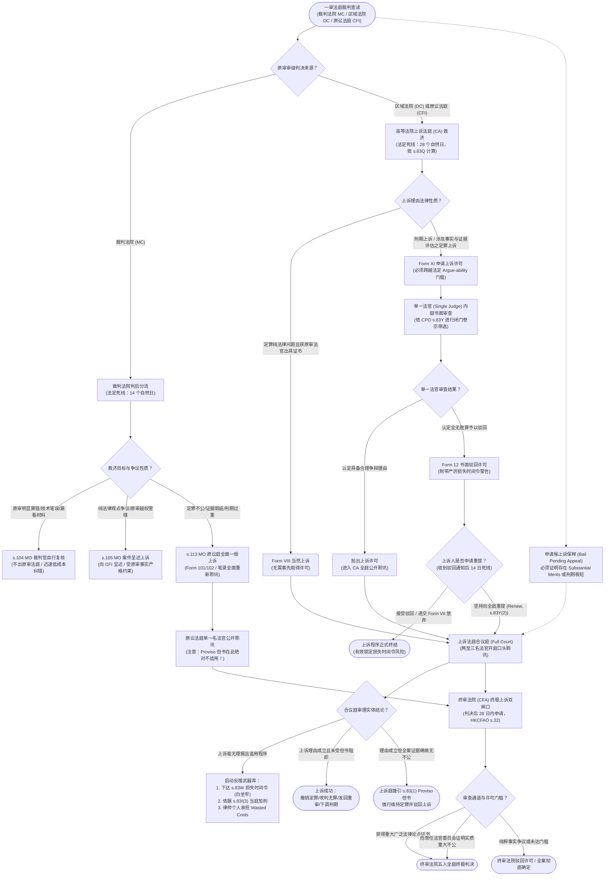
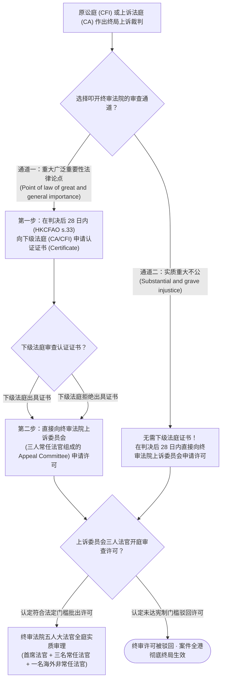
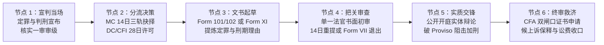

# 16 刑事上诉与判后复核体系（Criminal Appeals, Review & Case Stated）

## 速读定位层

> **全流程一段话白话导引**：刑事裁判宣读并不是诉讼的绝对终点，而是开启了审后救济的严格倒计时。当被告人在法庭被定罪或判刑后，辩护律师必须在极短的法定死线内，根据原审法院的级别做出关键分流：在裁判法院（MC），当事人拥有 14 日的时限，必须在原审裁判官自行纠错的 s.104 复核、针对纯法律争议的 s.105 案件呈述、以及由原讼法庭单一名法官进行全面事实与法律重新聆讯的 s.113 一般上诉这三条互斥路径中作出抉择；若原审为区域法院（DC）或原讼法庭（CFI），当事人则拥有 28 日的时限（若判刑迟于定罪逾 7 日则自判刑日起算），必须依据《刑事诉讼程序条例》（CPO）提交 Form XI 向上诉法庭（CA）申请上诉许可（除极少数经证书批准的纯法律问题使用 Form VIII 之外），先行交由单一法官作书面初审。若单一法官拒绝批出许可，上诉人享有在 14 日内向合议庭重提申请的权利。上诉并非毫无代价的赌博，任何缺乏合理胜算的上诉均面临法庭加重刑罚、依据 s.83W 下达损失时间令（白白服刑而不计入正式刑期）、以及律师个人承担浪费诉讼费用令（Wasted Costs Order）的三重严重反噬；当事人若发现理据不足，必须依规则尽早递交 Form VII 放弃上诉以锁定风险。全流程围绕定罪理由（证据瑕疵、审讯重大不公、裁判不稳妥及 Proviso 豁免）、刑期理由（原则错误、明显过重与同案悬殊）、控方复核（s.81A 明显过轻与案件呈述）、终审法院双闸口（重大广泛重要性法律论点与重大不公）、以及极高门槛的候上诉保释展开动态博弈。

### 适用范围

**覆盖（按程序时序）**：
1. **裁判法院判后救济三轨道**：裁判官依《裁判官条例》（MO）s.104 自行复核权力、原讼法庭依 MO s.113 审理的一般上诉、以及依据 MO s.105 提出的案件呈述上诉（包括申请主体、14 日死线时钟、相互排斥规则与终局救济路线）〔CR10 L74–L86；OLD-EX3AP L26–L45〕；
2. **区域法院与原讼法庭向上诉庭上诉程序**：依 CPO s.82 与 s.83 提起的定罪上诉、依 CPO s.83G 与 s.83I 提起的刑期上诉、上诉许可机制、Form XI 与 Form VIII 的选用边界、单一法官（Single Judge）书面审查以及向合议庭（Full Court）重提申请（Renew）的 14 日时限〔CR10 L399–L405；OLD-EXA L98–L111〕；
3. **时限管理与起算规则**：裁判法院 14 日死线与高等法院 28 日死线、判刑迟于定罪逾 7 日时的自动顺延规则（CPO s.83Q(2)）、以及申请延期上诉（Extension of time）的法律标准与判例门槛〔CR10 L163, L695；OLD-EXA L110〕；
4. **滥用上诉的反噬惩罚与止损退出**：上诉法庭主动加刑权力（CPO s.83I(3)）、依据 CPO s.83W 下达的不计入刑期损失时间令（Loss of Time Order）、大律师与事务律师在 PD 4.2 及《大律师行为守则》下的职业伦理与浪费讼费令（Wasted Costs Order）、以及依《刑事上诉规则》（CAR）r.39 递交 Form VII 放弃上诉（Notice of Abandonment）的法律后果〔CR10 L669–L685；OLD-EX3AP L1555–L1565〕；
5. **定罪上诉攻防体系**：定罪不稳妥或不令人满意（Unsafe or Unsatisfactory）与潜伏疑虑（Lurking Doubt）、原审法律与证据裁断错误、审讯重大不公（Material Irregularity，包括法官过度干预、缺乏理由、大律师严重失职）、控方防守要塞但书条款（The Proviso, CPO s.83(1) proviso）之适用与裁判法院上诉的排除规则（*Ching Kwok Yin*）、以及依 CPO s.83V 与 *Ladd v Marshall* 准则采纳新证据〔CR10 L333–L375, L503–L535；OLD-EX3AP L33–L45, L95–L180〕；
6. **刑期与讼费上诉攻防体系**：刑期上诉五大法定理由（Not justified in law、Wrong in principle、Manifestly excessive、Wrong factual premise、Significant alteration in circumstances）、同案犯刑期悬殊（Disparity）、判刑理由倒推技术、以及依据《刑事案件讼费条例》（CCCO）s.18 与 s.19 提起的讼费命令独立上诉〔CR10 L543–L620, L723–L725；OLD-EX3AP L1350–L1450〕；
7. **控方（律政司司长）的判后救济程序**：依据 CPO s.81A 针对明显过轻刑期申请复核、依据《区域法院条例》（DCO）s.84 针对无罪裁决提出案件呈述、依据 CPO s.81E 针对已判无罪案情将纯法律问题转介上诉庭厘清、以及在裁判法院依 MO s.104/105 提出救济〔CR10 L255–L330；OLD-EX3AP L1500–L1535〕；
8. **终审法院上诉与候上诉保释**：依据《香港终审法院条例》（HKCFAO）s.31 与 s.32 的重大广泛重要性法律论点（Point of law of great and general importance）及实质重大不公（Substantial and grave injustice）双闸门证书与许可程序、各级法院候上诉保释（Bail Pending Appeal）之极例外情况门槛（*Kissel*、*Chan Chi Wan*、*Lau Man Kin*）与申请接口〔CR10 L703–L720；OLD-EX3AP L1541–L1553〕。

**不覆盖（边界声明，相关承担卡）**：
1. **一审实体量刑计算与求情策略**：关于量刑起点确定、法定加重情节（如 OSCO s.27）、认罪与协助执法折扣分档计算、各种非监禁刑罚法定门槛以及求情陈词演练，由 15 Institution - Sentencing System 专职承担，本卡仅承接判决宣读后的审后上诉与复核；
2. **一审审前准备与审讯中证据争议本体**：关于审讯前未用材料披露、警署供词自愿性交锋（Voir Dire 与 Alternative Procedure 实体测试）、认人列队瑕疵排除以及现场截查合法性，由 13 Institution - Criminal Evidence Disputes 专职承担，本卡仅审查原审法官在上述裁断中是否存在可构成定罪上诉的法律或程序错误；
3. **侦查与一审审前法庭保释体系**：关于裁判法院及原讼法庭在定罪之前的常规保释申请、s.9D 保释推定、s.9G 拒保考量、8 天带堂规则及担保人审查，由 05 Institution - Bail 专职承担，本卡仅承接定罪判刑后的候上诉保释（Bail Pending Appeal）；
4. **控罪起草与交付审判路线**：关于罪名起草一罪两投（Duplicity）的抗辩与修正、简易程序六个月时效、以及将可公诉罪行交付区域法院或原讼法庭审判的法定程序，由 08 Institution - Charges and Trial Route 专职承担。

---

### 术语（核心概念与实务运作定义）

| 术语（中英对照） | 核心运作定义与三要素拆解（动作前提＋制度威力＋一秒区分） | 规范法源依据 |
|---|---|---|
| **裁判官自行复核**<br>`Review by Magistrate` | (1) 控辩双方在裁判官宣判后 14 个自然日内以书面提出，由原审裁判官重新开庭审查自身裁断的纠错机制；(2) 制度设计旨在以最低成本与最快速度在原审法院就地纠正技术性算错、法律误解或漏看事实，裁判官有权全面重开案情、改判无罪或更改刑期；(3) 必须与高等法院上诉严格区分，此程序不出裁判法院，且依法例若上诉人已提交 s.113 上诉通知，原审裁判官便不得再行复核。 | 《裁判官条例》（Cap. 227）s.104〔CR10 L219–L249〕 |
| **原讼法庭一般上诉**<br>`Magistracy Appeal to CFI` | (1) 被告人在裁判官定罪或判刑后 14 个自然日内递交上诉通知，无需事先取得上诉许可，直接由高等法院原讼法庭单一名法官审理的全面救济程序；(2) 性质上属于依据法庭笔录进行的全面重新聆讯（Rehearing on the record），法官有权直接推翻原审裁判官的事实认定并撤销定罪；(3) 必须与上诉法庭（CA）上诉严格区分，本程序不设立许可门槛，且终审法院已明确裁定 CPO s.83(1) 但书条款（Proviso）在此程序中不适用。 | 《裁判官条例》（Cap. 227）s.113〔CR10 L133–L189；OLD-EX3AP L29–L45〕 |
| **案件呈述上诉**<br>`Appeal by way of Case Stated` | (1) 控辩任一方在裁判官或区域法院宣判后 14 个自然日内以书面要求原审法官起草专门案情陈述书，交由上级法院裁断的救济程序；(2) 启动前提严格限定于原审法官存在法律观点错误或越权管辖，上级法院完全受陈述书载明的事实约束而不得重新评判证据可信性；(3) 必须与一般事实重审上诉严格区分，当事人一旦选择案件呈述程序，依据法定排他条款即自动丧失一般上诉权利。 | 《裁判官条例》s.105；《区域法院条例》s.84〔CR10 L113–L131〕 |
| **上诉许可**<br>`Leave to Appeal` | (1) 被告人针对区域法院或原讼法庭判决向上诉法庭提出上诉前，必须先行跨越的法定实质审查门槛，除纯法律问题外必须使用 Form XI 申请；(2) 制度动机在于过滤完全缺乏辩驳理据的滥诉行为，由法官把关案件是否具备合理争辩空间（Argue-ability）；(3) 必须与当然上诉权严格区分，裁判法院 s.113 上诉享有当然权利无需许可，而高等法院上诉法庭除经原审法官出具证书之纯法律问题外，一律必须取得许可。 | 《刑事诉讼程序条例》（Cap. 221）s.82, s.83I〔CR10 L399–L405；OLD-EXA L98–L104〕 |
| **单一法官审查**<br>`Single Judge of CA` | (1) 上诉法庭指派单一名法官在内庭仅凭书面卷宗材料对上诉许可申请进行书面初审的程序节点；(2) 旨在高效分流案件，若该法官认为理据充分可直接签发许可出庭通知，若认为毫无理据则签署 Form 12 驳回并附带严厉惩罚警告；(3) 必须与全庭合议审讯严格区分，单一法官审理通常不安排开庭辩论，且其拒绝许可的决定并非终局裁判。 | 《刑事诉讼程序条例》（Cap. 221）s.83Y〔CR10 L623–L635；OLD-EXA L111〕 |
| **向合议庭重提申请**<br>`Renew Application to Full Court` | (1) 上诉人在收到单一法官驳回许可通知书后 14 个自然日内，向由两名或三名法官组成的上诉法庭全庭递交申请重开许可审查的救济权利；(2) 制度赋予当事人获得法官合议公开聆讯与口头陈词的最后机会；(3) 必须与普通上诉严格区分，重提申请并不是对单一法官的上诉，而是合议庭全新审查，但若合议庭认定该重提毫无理据，上诉人将面临极高的扣减刑期损失时间令惩罚。 | 《刑事诉讼程序条例》（Cap. 221）s.83Y(2)〔CR10 L635；OLD-EXA L111〕 |
| **损失时间令**<br>`Loss of Time Order` | (1) 上诉法庭在驳回毫无理据的上诉许可申请或重提申请时，下达命令判定上诉人在候审期间已被羁押的部分或全部时间不计入其正式服刑刑期的惩罚机制；(2) 制度威力在于彻底摧毁在押囚犯抱着买彩票心态滥用上诉的侥幸心理，令其因无理上诉而在监狱中白白多坐数周乃至数月；(3) 必须与司法加刑严格区分，加刑是提高实体判刑年期，而损失时间令是在实体刑期不变的前提下，使先前的羁押时间作废不予折抵。 | 《刑事诉讼程序条例》（Cap. 221）s.83W〔CR10 L669–L685；OLD-EX3AP L1555〕 |
| **放弃上诉通知书**<br>`Notice of Abandonment (Form VII)` | (1) 上诉人在上诉案件正式开庭聆讯之前，依据法定规则向司法常务官正式送达的无条件撤回上诉申请书；(2) 法律效果在于送达瞬间程序即刻终结，视为上诉已被正式驳回，能立即切断上诉法庭在开庭后可能行使的主动加刑或下达损失时间令的反噬风险；(3) 必须与暂缓上诉严格区分，Form VII 一旦有效送达，原则上属于终局且不可撤销，除非能证明签署时存在欺诈或胁迫。 | 《刑事上诉规则》（Cap. 221A）r.39 (Form VII)〔CR10 L683；OLD-EXA L126〕 |
| **定罪不稳妥或不令人满意**<br>`Unsafe or Unsatisfactory` | (1) 上诉法庭撤销原审定罪的最核心通用法定概括性理由，涵盖原审审讯中发生的各类破坏审判公正的严重缺陷；(2) 核心测试标准在于上诉法院法官在通盘审视全案材料后，心头是否升起挥之不去的潜伏疑虑（Lurking Doubt），感到让该定罪维持下去会使良心不安；(3) 必须与单纯的事实认知分歧严格区分，上诉法庭不轻易推翻原审法官对证人举止的目击判断，唯有认定结论与证据明显脱节或审讯存在致命不公时方能成立。 | 《刑事诉讼程序条例》s.83(1)(a)〔CR10 L333–L345；OLD-EX3AP L95–L110〕 |
| **但书维持定罪条款**<br>`The Proviso` | (1) 上诉法庭即使判定辩方提出的一项或多项定罪上诉理由成立，但若认为全案证据确凿、该错误未导致任何实质司法不公（No miscarriage of justice）时，依据法定特权强行驳回上诉并维持定罪的控方法定防线；(2) 制度动机在于防止诉讼因微小瑕疵动辄推翻重来，保障终局效力；(3) 必须与上诉驳回普通裁定严格区分，但书是在确认原审确实出错的前提下作出的例外维持，且依法严格仅限上诉法庭享有，裁判法院上诉中原讼法庭无权援用。 | 《刑事诉讼程序条例》s.83(1) proviso〔CR10 L503–L535；OLD-EX3AP L33–L45〕 |
| **拟采纳新证据准则**<br>`Fresh Evidence on Appeal` | (1) 上诉人在一审结束后发现全新证据，向原讼法庭或上诉法庭申请在二审中予以宣誓采纳的例外救济程序；(2) 法院启动该权力必须严格审查 *Ladd v Marshall* 与 CPO s.83V 确立的三步门槛：尽了合理审慎努力在一审无法取得、证据表面具可信性、且若被采纳极可能对判决产生重大实质影响；(3) 必须与一审常规证供严格区分，二审不是让疏忽辩护律师重新修补证据漏洞的修罗场，未尽审慎义务者一律拒之门外。 | 《刑事诉讼程序条例》s.83V；《裁判官条例》s.118(1)(b)〔CR10 L485–L501；OLD-EX3AP L120–L150〕 |
| **刑期明显过重**<br>`Manifestly Excessive` | (1) 辩方针对原审判处的实体监禁年期或刑罚种类向上诉法庭提出攻击的核心理由；(2) 其门槛并非主观认为法官判得稍显严厉或长了几个月，而是要求总刑期超出合理裁量范围乃至严重失衡，对罪犯产生压碎性打击（Crushing impact）；(3) 必须与原则性错误（Wrong in principle）严格区分，原则性错误攻的是量刑步骤、法律门槛或刑种选错，而明显过重攻的是最终折算出来的绝对年期数字明显过载。 | 《刑事诉讼程序条例》s.83G, s.83I〔CR10 L543–L575；OLD-EX3AP L1350–L1380〕 |
| **重大广泛重要性法律论点**<br>`Point of Law of Great & General Importance` | (1) 败诉方在用尽原讼法庭或上诉法庭救济后，向终审法院申请终极上诉许可时必须跨越的宪制级法理闸门；(2) 该法律论点必须超越个案纠纷，对全港法律发展、条文解释或司法实务具有普遍指导意义，且必须事先向上诉法庭或原讼法庭申请认证证书；(3) 必须与个案不公严格区分，纯粹指责原审法官评判证据不公者无法进入此通道，唯有涉及根本法理争议方可获批。 | 《香港终审法院条例》（Cap. 484）s.32(2)〔CR10 L705–L715；OLD-EXA L114–L120〕 |
| **实质重大不公**<br>`Substantial & Grave Injustice` | (1) 败诉方直接向终审法院三人常任法官组成的上诉委员会申请上诉许可的备用宪制闸门，无需下级法院事先出具认证证书；(2) 专为拯救因司法程序极度异常或背离基本正义原则导致完全被剥夺公正审讯权利的极端冤错案件而设立；(3) 必须与常规事实错误严格区分，终审法院反复重申其绝非第三级事实审法院，轻微瑕疵或证据分歧绝不可能撬开该闸口。 | 《香港终审法院条例》（Cap. 484）s.32(3)〔CR10 L710–L720；OLD-EXA L116〕 |
| **候上诉保释**<br>`Bail Pending Appeal` | (1) 被告人在定罪判刑后已经被押入监狱服刑，为等候上诉聆讯而向上诉法庭或原讼法庭申请临时释放的紧急程序；(2) 法律假定定罪有效且已无无罪推定庇护，因而设定极高证明门槛，申请人必须证明案件具备极具说服力的实质胜诉理据（Substantial merits），或刑期极短以致上诉开庭前刑期已然服毕；(3) 必须与一审常规保释严格区分，常规保释享有法定推定，而候上诉保释属于极其罕见的例外特惠。 | 《裁判官条例》s.119(1)(a)；《刑事诉讼程序条例》s.83R〔CR10 L703；OLD-EX3AP L1541–L1553〕 |

---

### 环节定位

| 诉讼时序环节 | 核心动作与审查主体 | 决定性法例依据与文书形式 | 未过或做错之后的直接后果链 | 深节直达 |
|---|---|---|---|---|
| **第一步：裁判法院判后分流** | 被告人或控方在宣判后 14 个自然日内选择纠错路径：向原审裁判官申请书面复核，或向高等法院原讼法庭启动一般上诉，或就纯法律争议申请陈述案件。 | 《裁判官条例》s.104（复核）、s.113（Notice of Appeal, Form 101/102）、s.105（案件呈述） | 路径一旦选错将产生致命排他效果：递交 s.105 导致丧失 s.113 全面事实重审权；若已交 s.113 上诉通知则原审裁判官依法被剥夺 s.104 复核权限。 | [0B 裁判法院三轨](#0B-裁判法院mc判后救济三轨道s104-复核s113-原讼庭上诉与-s105-案件呈述14日死线与互斥选择) |
| **第二步：高等法院上诉启动** | 被告人在区院或原讼庭宣判后 28 个自然日内，向高等法院上诉法庭司法常务官提交签署的 Form XI 申请上诉许可（定罪纯法律问题获证书者使用 Form VIII）。 | 《刑事诉讼程序条例》s.82, s.83G, s.83Q；《刑事上诉规则》Form XI, Form VIII | 超过 28 日未提交且未申请延期（Form IX）者将被视为逾期失效；依据 *Kalawila* 判例，律师疏忽通常不被接纳为延期充分理由，导致丧失上诉权。 | [0C 高等法院程序](#0C-区院dc与原讼庭cfi向上诉庭ca上诉程序28日死线许可要求单一法官初审与合议庭重提renew) |
| **第三步：单一法官书面初审** | 上诉法庭单一法官在内庭闭门审查卷宗，独立评估上诉理由是否具备合理争辩空间，决定直接批出许可或签发 Form 12 予以书面驳回。 | 《刑事诉讼程序条例》s.83Y(1)；实务指引 PD 4.2 第 5 段 | 单一法官驳回许可通常附带严厉反噬警告；若申请人无视警告执意向合议庭重提，将直接触发合议庭启动 s.83W 损失时间令惩罚。 | [0C.3 单一法官](#0C3-单一法官审查single-judge-cpo-s83y) |
| **第四步：合议庭重提抉择** | 上诉人在收到单一法官驳回通知后 14 个自然日内，向由两名或三名法官组成的全庭提交书面申请重提审查许可，争取公开口头聆讯机会。 | 《刑事诉讼程序条例》s.83Y(2)；《刑事上诉规则》r.26 | 超过 14 日未提重提申请者驳回决定即告终局生效；若强行重提但被合议庭判定为全无理据，法庭将当庭下达数周乃至数月的损失时间令。 | [0C.4 合议庭重提](#0C4-向合议庭重提申请renew-the-application-to-the-full-court-cpo-s83y2) |
| **第五步：反噬风险评估与止损** | 辩方律师在整个上诉进程中动态评估胜算，一旦确认全无胜诉可能，立即建议并协助上诉人向司法常务官送达 Form VII 放弃上诉。 | 《刑事诉讼程序条例》s.83W；《刑事上诉规则》r.39 (Form VII)；《大律师行为守则》10.24 | 未能及时放弃上诉导致案件拖至开庭者，上诉人不仅会被下达损失时间令白白服刑，明知无理仍代为签字出庭的律师将面临个人被处以浪费讼费令。 | [0D 反噬风险与止损](#0D-滥用上诉的反噬风险与止损加刑s83w-损失时间令loss-of-time与-form-vii-放弃上诉) |
| **第六步：定罪与刑期实体交锋** | 上诉庭公开开庭审理：上诉人就证据排除、程序不公展开主攻，控方援引 Proviso 但书争取维持定罪；就刑期原则错误与明显过重展开对决。 | 《刑事诉讼程序条例》s.83(1), s.83V, s.83I；《刑事案件讼费条例》s.18 | 上诉成功可获撤销定罪、改判无罪、下令重审或大幅减刑；上诉失败若理由极其恶劣不仅维持原判，甚至可能被直接依 s.83I(3) 当庭加刑。 | [0E 定罪上诉](#0E-对定罪上诉appeal-against-conviction) / [0F 刑期上诉](#0F-对刑期上诉appeal-against-sentence) |
| **第七步：终极上诉与待决保释** | 向上诉庭或原讼庭申请重大广泛法律论点认证证书，或直接向终审法院申请实质重大不公许可；同步启动极高门槛的候上诉保释申请。 | 《香港终审法院条例》s.31, s.32, s.34；*Kissel*、*Chan Chi Wan* | 无法通过严苛的双闸门审查者申请将被直接驳回；候上诉保释若无法证明存在显著胜诉理据，被判监禁的上诉人必须在狱中服刑等候判决。 | [0H 终极上诉与保释](#0H-终审法院cfa终极上诉双闸口hkcfao-s32上诉待决保释接口lau-man-kin与上诉讼费) |

---

## 🗺️ 本卡地图



### 审查逻辑与任务直达

上诉制度的本质是**在终局性（Finality）与司法纠错（Justice）之间寻求平衡**。整个审查逻辑必须严格遵循以下三步推进：
1. **第一步（审级与路径分流）**：审查原审裁判出自何级法院。若出自裁判法院，迅速核查属于技术性错误（走 s.104 复核）、纯法律问题（走 s.105 呈述）还是常规事实证据重审（走 s.113 原讼庭上诉）；若出自区域法院或高等法院原讼法庭，确认必须走 28 日死线上诉庭许可程序（Form XI）。
2. **第二步（理由提炼与风险防范）**：区分定罪上诉、刑期上诉与讼费上诉。对定罪理由逐一核对证据可采性、不公指引与潜伏疑虑，同时预判控方是否会祭出 Proviso 但书反制；对刑期理由核对原审判刑理由中的原则错误与明显过重。在递交申请前，必须对上诉人进行详尽的风险警告（加刑与 s.83W 损失时间令），毫无胜算者指导其递交 Form VII 放弃上诉。
3. **第三步（程序落地与终审救济）**：严格盯紧 14 日与 28 日死线时钟，对于羁押当事人同步评估候上诉保释的极端门槛；在上诉庭或原讼庭裁判后，评估是否跨越终审法院重大广泛重要性法律论点或实质重大不公双闸口。

| 核心实务任务 | 涉及阶段与关键机制 | 直达章节锚点 |
|---|---|---|
| **裁判法院判后分流决策** | 权衡 s.104 复核、s.113 一般上诉与 s.105 呈述，避免互斥失权 | [0B 裁判法院三轨](#0B-裁判法院mc判后救济三轨道s104-复核s113-原讼庭上诉与-s105-案件呈述14日死线与互斥选择) |
| **高等法院上诉启动与重提** | 把握 28 日时效、7 日顺延规则、Form XI 申请与向合议庭 Renew | [0C 高等法院上诉程序](#0C-区院dc与原讼庭cfi向上诉庭ca上诉程序28日死线许可要求单一法官初审与合议庭重提renew) |
| **防范加刑与损失时间令** | 识别 Total lack of merit、告知无律师代表同样受罚、Form VII 撤回止损 | [0D 滥用上诉反噬与止损](#0D-滥用上诉的反噬风险与止损加刑s83w-损失时间令loss-of-time与-form-vii-放弃上诉) |
| **草拟定罪上诉理由与破但书** | 提炼证据瑕疵、审讯不公、失职新证据，破解控方 Proviso 防线 | [0E 对定罪上诉攻防](#0E-对定罪上诉appeal-against-conviction) |
| **倒推刑期可上诉错误** | 从判刑理由倒推起点选错、加重误用、折扣漏给与同案悬殊 | [0F 对刑期上诉攻防](#0F-对刑期上诉appeal-against-sentence) |
| **应对律政司司长审后反扑** | 迎战控方 s.81A 刑期复核（明显过轻）、无罪案件呈述与法律转介 | [0G 控方判后救济武器](#0G-控方律政司司长-sj的判后救济武器s81a-刑期复核明显过轻无罪案件呈述上诉s84-dco--s81e-cpo与法律问题转介) |
| **终审法院上诉与候上诉保释** | 攻克 HKCFAO 双闸口证书、办理 *Kissel* 候上诉保释与讼费上诉 | [0H 终极上诉与保释讼费](#0H-终审法院cfa终极上诉双闸口hkcfao-s32上诉待决保释接口lau-man-kin与上诉讼费) |
| **SG08 课堂案例深度实战** | Jeff Sham 判词重审、Willy Ma 认罪折扣、John Lace 枪械推定 | [0K SG 实务应用与导师口径](#0K-sg-实务应用与导师口径sg08-判后救济完整拆解) |

<!-- BEGIN:cite-legend -->
> [!info]- 引注图例
>
> | 码 | 文件 | 层级 | 学年 |
> |---|---|---|---|
> | CR10 | 本届 LGS 10 上诉讲义（crim.pro.lgs.10.APPEALS.2025.md，共 723 行） | 本届讲义 | 2026-27 |
> | CR10S | 本届 LGS 10 上诉课堂幻灯伴生稿（LGS.10.APPEALS.SLIDES.2025.md） | 本届讲义 | 2026-27 |
> | OLD-EX3AP | 往届状元 Set 3 核心应试笔记（Appeal Grounds Notes for Exam.md，共 1757 行） | 往届高分笔记 | 2025-26 |
> | OLD-EXA | 往届 Set 2 应试笔记（Crim Lit - Appeals.md，共 139 行） | 往届高分笔记 | 2025-26 |
> | OLD-LG99C | David Leung SC 刑事案件讼费讲义（Costs in Criminal Cases for PCLL） | 往届官方讲座 | 2025-26 |
> | SG08 | 本届 SG08 官方题面与课堂讨论（00 Classroom.md / 02 Classroom Discussion.md） | 本届官方研讨 | 2026-27 |
> | SG08-CH | 本届 SG08 Willy Ma 上诉分析表（04 Exercise 3 - Willy Ma Appeal Analysis Chart.md） | 本届官方研讨 | 2026-27 |
> | SG08-RES | 本届 SG08 法律研究与法源核查（07 Shared Research and Source Check.md） | 本届官方研讨 | 2026-27 |
<!-- END:cite-legend -->

---

## 0B. 裁判法院（MC）判后救济三轨道：s.104 复核、s.113 原讼庭上诉与 s.105 案件呈述（14日死线与互斥选择）

> **章节导语与承接**：当案件在裁判法院审结，裁判官宣布被告人罪名成立或下达刑罚命令后，辩护律师面临的第一道重大关卡并不是急于撰写长篇大论的辩护词，而是必须在法定的 14 个自然日内为当事人把准审后救济的“十字路口”。香港法律在裁判法院层面赋予当事人三条功能迥异、互有排他的救济轨道：是让原审裁判官就地重开案情的 s.104 自行复核，还是交由高等法院原讼法庭单一名法官进行全面事实与法律重新聆讯的 s.113 一般上诉，抑或是直接将纯法律观点送交高等法院定夺的 s.105 案件呈述上诉。选错轨道不仅会导致当事人白白浪费诉讼成本，更可能因法律上的强制排他条款导致宝贵的全面上诉权利被永久剥夺。

### 0B.1 裁判官自行复核（s.104 MO）：就地纠错与适用红线

#### (1) 现实场景与制度动机（Why & Scenario）
在快节奏的裁判法院日常运作中，一名裁判官每日可能需要处理数十宗案件。在这种高压环境下，裁判官在当庭宣判时极易出现一些明显的、技术性的疏漏（如误将两项刑期的合并规则算错、笔误写错法例条文、判处了超出法定上限的监禁年期、或者遗漏了对辩方某份已呈堂重要书面证物的考虑）。若针对此类一目了然的瑕疵一律要求当事人花费数万港元聘请大律师上诉至高等法院，将造成巨大的司法资源浪费与当事人负担。为此，《裁判官条例》第 104 条专门创立了“就地纠错机制”，允许同一名裁判官自行复核其作出的裁决或命令。

#### (2) 五要素完整法律规则
在裁判官作出定罪裁决、判刑命令或讼费决定的前提下，**被告人、检控方或裁判官自身（依职权 sua sponte）** 均有权在作出该裁定后的 **14 个清白日内（14 clear days）** 向裁判法院书记递交书面申请，**裁判官**依《裁判官条例》（MO）第 104 条享有广泛的法定权力重新开庭，重新听取案情、传召证人、接纳新证据，并有权确认、推翻、撤销原裁决，改判被告人无罪，或在法定权限内增加或减轻其原判刑罚〔CR10 L219–L249；OLD-EX3AP L1681–L1695〕。

#### (3) 核心限制与互斥红线
1. **上诉与复核的排他性规则（CPO s.104(9)）**：依据《裁判官条例》第 104(9) 条明文规定，若上诉人已经针对该裁判官的决定向高等法院原讼法庭正式提交了上诉通知书，原审裁判官即被剥夺进行复核的法定管辖权，除非上诉人先正式向法庭撤回已递交的上诉通知书〔CR10 L239；OLD-EX3AP L1705〕。因此，辩方律师若评估同时存在复核与上诉的必要，**必须采取“先走 s.104 复核，复核不成再走 s.113 上诉”的严谨先后顺序**；
2. **定罪与刑期的可分性（*HKSAR v Chan Pak Hoe Pablo* [2012] 4 HKC 536）**：在 *Chan Pak Hoe Pablo* 案中，上诉法庭明确确立：定罪与判刑属于两个独立的司法裁决。如果被告人仅仅针对“定罪”向高等法院提出了上诉，并不会剥夺裁判官依据 s.104 对其“刑期”主动行使自行复核的权力〔CR10 L249；OLD-EX3AP L1711–L1713〕；
3. **拒绝复核不得直接上诉（MO s.104(10)）**：若裁判官在收到申请后行使裁量权拒绝进行复核，或者在复核后维持原判，当事人依据第 104(10) 条**绝对不得将“裁判官拒绝复核”这一行为本身作为上诉对象**。当事人唯一可行的救济，是直接针对裁判官最初作出的“原判决或原刑罚”依据 s.113 提出上诉，且依据 s.104(8) 条，提出上诉的 14 日时限自裁判官正式作出复核决定或明确拒绝复核之日起重新起算〔CR10 L241–L245；OLD-EX3AP L1717–L1719〕。

---

### 0B.2 原讼法庭一般上诉（s.113 MO）：事实重审与但书豁免排除

#### (1) 现实场景与制度动机（Why & Scenario）
当当事人认为原审裁判官不仅是犯了简单的计算错误，而是在审讯过程中对控辩双方证人的可信性评估存在重大偏差、错误采纳了本应排除的警察威迫口供、或者判处了明显过重的监禁刑罚时，原审裁判官显然不可能在 s.104 复核中推翻自己深思熟虑作出的裁判。此时，当事人必须跳出裁判法院体系，将案件呈送至具有更高级别审判权的高等法院原讼法庭单一名法官席前。

#### (2) 五要素完整法律规则
在裁判法院审讯终结并下达定罪或判刑命令的前提下，**被定罪的被告人（The Defendant）** 依据《裁判官条例》第 113(1) 条享有当然法定权利（Right of appeal），在裁定作出后 **14 个自然日内**向原审裁判法院书记提交签署的上诉通知书（Notice of Appeal，定罪使用 Form 101，刑罚使用 Form 102），直接向**高等法院原讼法庭单一名法官**提起上诉，原讼法庭依《裁判官条例》第 118(1)(a) 条开展依据庭审笔录的全面重新聆讯（Rehearing on the record），法官享有法定权限维持原判、撤销定罪、改判无罪、下令案件由另一名裁判官重审、或更改原审刑罚种类与刑期〔CR10 L133–L189；OLD-EX3AP L1575–L1658〕。

#### (3) 核心特质与考试致命陷阱：Proviso 但书条款绝对不适用！
1. **无需事先取得许可（No Leave Required）**：与向上诉法庭上诉截然不同，依 MO s.113 提起的一般上诉属于当事人的法定宪制权利，无论是事实问题还是法律问题，上诉人均**无需事先向上诉法庭或原审法院申请上诉许可**〔CR10 L175；OLD-EX3AP L1591〕；
2. **终审法院宪制级权威判例：*Ching Kwok Yin v HKSAR* (2000) 3 HKCFAR 387**：
 在 *Ching Kwok Yin* 案中，原审裁判官在审讯中高度依赖控方第一证人的证言认定被告人罪名成立。然而控方在审讯全程中隐瞒未披露该名关键证人此前曾有数次不诚实犯罪前科记录的事实。被告人依 s.113 向上诉至原讼法庭，原讼法庭法官虽然确认控方未履行披露义务属于程序瑕疵，但法官认为即便扣除该瑕疵全案证据仍足够坚实，因而试图援引《刑事诉讼程序条例》第 83(1) 条但书条款（The Proviso），以“未造成实质司法不公”为由驳回上诉并维持定罪。
 案件最终上诉至终审法院，终审法院作出震撼全港的划时代裁决：**终审法院明确判定，《刑事诉讼程序条例》第 83(1) 条但书条款依法纯粹且排他性地仅赋予香港高等法院上诉法庭（Court of Appeal）！高等法院原讼法庭在依据《裁判官条例》第 113 条审理裁判法院上诉时，法例根本没有赋予其适用但书条款的任何法定权力！** 在裁判法院上诉中，测试标准唯一且绝对：*“裁判法院的审讯过程是否存在某种错误，使得为了司法正义必须撤销该定罪（Whether there has been in the Magistrate’s Court an error which makes it just that the appeal should be allowed and conviction set aside）”*。原审裁判官既然未能知悉关键证人的前科，其对可信性的评估即存在不可逆转的致命错误，原讼法庭无权以“自认证据确凿”强行维持定罪，必须坚决撤销定罪〔OLD-EX3AP L33–L45, L1659–L1668〕。
3. **认罪后定罪上诉的门槛限制（Defective Guilty Plea）**：依据 MO s.113(1) 条及 *Shum Wan Foon* 判例，若被告人在裁判法院一审程序中已经明确认罪，原则上不得再行就定罪提出上诉，除非辩方能向原讼法庭证明该认罪在法律上属于**无效答辩（Nullity）**或**存在根本法律错误（Equivocal Plea）**（例如误解控罪法律要素、或受不当强迫认罪，详见 0E.1 节拆解）〔CR10 L143；OLD-EX3AP L49–L60〕。

---

### 0B.3 案件呈述上诉（s.105 MO）：纯法律观点的单行道

#### (1) 现实场景与制度动机（Why & Scenario）
当案件在裁判法院完结后，争议的焦点完全不涉及“某某证人到底有没有说谎”或“被告人当时有没有伸手打人”这类事实与口供争议，而是涉及极其纯粹的法例条文解释、法定抗辩要件的法律定义、或者控方指控裁判官超越了法定的司法管辖权。此时，若重新调取整套冗长的审讯笔录交由原讼法庭重新读卷，纯属耗费司法资源。为此，《裁判官条例》第 105 条设计了案件呈述程序，由裁判官亲自把“认定的事实与法律争议”写成一份精炼的呈述书送交原讼法庭裁定。

#### (2) 五要素完整法律规则
在裁判官对任何指控作出听讯与裁决后的 **14 个清白日内（14 clear days）**，**指控中的任何一方当事人（被告人或检控方）** 均可依据《裁判官条例》第 105 条以书面形式（依《裁判官（表格）规则》Form 95）向裁判官申请，要求**原审裁判官**起草一份详述全案已认定事实、各方法律论点及裁判官裁决法律理由的案件陈述书（A Case Stated），送交**高等法院原讼法庭**就该特定法律问题或管辖权争议作出终局裁断〔CR10 L113–L131；OLD-EX3AP L1721–L1757〕。

#### (3) 核心限制、绝对死线与排他陷阱
1. **严格限定为纯法律观点与越权管辖**：原讼法庭在审理 s.105 上诉时，其司法权力被严格禁锢在陈述书内列明的法律问题上，法庭完全受裁判官所认定的事实约束，**绝对不得重新翻看证人证供或重新评估证据可信性**〔CR10 L119, L181；OLD-EX3AP L1725–L1731〕；
2. **绝对不可延长的 14 日法定死线**：依据《裁判官条例》第 105 条的强制性司法解释，申请案件呈述的 14 日时限属于**绝对死线（Strict jurisdictional limit）**，法例未赋予原讼法庭或裁判官任何延长该时限的权力。一旦错过 14 日，该救济通道即告永久关闭〔OLD-EX3AP L1739–L1743〕；
3. **法律上的绝对排他性（Statutory Bar）**：依据《裁判官条例》第 105 条第二款及第 113 条之衔接规则，上诉人**绝对不能同时并用 s.105 与 s.113**。当事人一旦向裁判官递交了 s.105 案件呈述申请，法律即推定其**已经无条件且不可撤销地放弃了其依 s.113 提出一般事实重审上诉的所有权利**！辩方律师若非对纯法律论点有百分之百把握，断不可轻率引导客户选择 s.105 单行道〔CR10 L159；OLD-EX3AP L1721–L1730〕。

---

### 0B.4 裁判法院判后决策十字路口对比矩阵

| 评估维度 | 轨道一：s.104 裁判官自行复核 | 轨道二：s.113 原讼法庭一般上诉 | 轨道三：s.105 案件呈述上诉 |
|---|---|---|---|
| **审理法官** | 原审裁判官本人（不出裁判法院） | 高等法院原讼法庭（CFI）单一名法官 | 高等法院原讼法庭（CFI）单一名法官 |
| **可申请主体** | 被告人、检控方、或裁判官依职权主动发起 | 严格仅限被定罪的被告人（控方不得就无罪上诉） | 控辩双方均享有申请权（控方最常用的武器） |
| **涵盖争议范畴** | 明显技术错误、算错刑期、漏看文件、或答辩撤回 | 涵盖一切事实认定、证据可采性、程序不公及量刑 | 严格且排他性地仅限纯法律观点或超越管辖权 |
| **审理运作机制** | 原审裁判官重开案情，可重新听证或传召证人 | 依据全部庭审录音与笔录进行全面重新聆讯 | 受裁判官陈述书认定的事实严格约束，不评判事实 |
| **法定申请死线** | 裁决作出后 14 个清白日内（可自判刑日起算） | 裁决或判刑作出后 14 个自然日内递交通知 | 裁决作出后 14 个清白日内（绝对死线，无法延期） |
| **有无许可门槛** | 无需许可，直接书面递交申请 | 无需事先申请许可，享有当然法定上诉权利 | 无需许可，但裁判官若认为申请琐屑无理可予拒绝 |
| **但书条款适用** | 不适用 | **绝对不适用！（*Ching Kwok Yin* 宪制判例）** | 不适用 |
| **互斥与后续路线** | 已提交 s.113 上诉即阻断复核；复核被拒后 14 日另提 s.113 | 最常用的大道；一经审结可向终审法院申请许可 | 一旦提出即视为永久放弃 s.113 事实全面重审权 |

> **Exam / Advocacy / Drafting Formulation:**
> "In advising the client on the procedural avenue in the Magistrates' Court, Counsel must emphasize that while a review under s.104 MO is a prompt and cost-effective remedy for correcting patent errors before the same Magistrate, filing an appeal under s.113 MO will statutorily deprive the Magistrate of jurisdiction to conduct such a review pursuant to s.104(9) MO. Therefore, if the client seeks to challenge both the perverse factual findings and the manifestly excessive sentence, the prudent course of action is to file a Notice of Appeal under s.113 MO (Forms 101 and 102) within the mandatory 14-day limit. Counsel should forcefully emphasize to the appellate judge that, pursuant to the CFA landmark authority *Ching Kwok Yin v HKSAR*, the CFI has no statutory power to invoke the 'proviso' under s.83(1) CPO to cure any material error committed by the trial magistrate, thereby requiring the conviction to be quashed forthwith."

---

## 0C. 区院（DC）与原讼庭（CFI）向上诉庭（CA）上诉程序：28日死线、许可要求、单一法官初审与合议庭重提（Renew）

> **章节导语与承接**：若被告人面对的审讯是在区域法院（由单一名区域法院法官独任审理并撰写判决理由书）或在高等法院原讼法庭（由法官与七至九人陪审团共同审理），案件一旦被判有罪，其救济层级将直接跃升至香港刑事审判权的金字塔顶端——高等法院上诉法庭（Court of Appeal）。在这一级别，诉讼的对抗烈度与程序严苛度发生质的飞跃：当事人不再享有裁判法院那种畅通无阻的当然上诉特权，而是必须在极其严苛的 28 日法定死线内，首先攻克由“单一法官”乃至“合议庭”重重把守的上诉许可（Leave to appeal）闸口。

### 图 2：裁判法院 14日轨 vs 区院/原讼庭 28日轨程序时序与死线对比图

```mermaid
flowchart TD
 %% 分支 A：裁判法院 14日时限轨迹
 subgraph MC_TRACK ["裁判法院 (MC) 判后救济轨 · 14 日死线"]
 M1["判决日 (Day 0)：定罪或判刑宣布"] --> M2["启动 14 日时钟 (MO s.114)"]
 M2 --> M3{"在 14 日内递交文书"}
 M3 -- "Form 101 (定罪) / Form 102 (刑罚)" --> M4["递交原审法院书记<br>(无需事先申请许可)"]
 M4 --> M5["裁判官在 15 日内准备审讯发现陈述书<br>(Statement of Findings & Reasons)"]
 M5 --> M6["向 CFI 递交完善上诉理由 (Perfected Grounds)"]
 M6 --> M7["原讼法庭单一名法官公开开庭<br>(笔录全面重新聆讯 / Proviso 但书不适用)"]
 end

 %% 分支 B：区域法院与原讼法庭 28日上诉轨
 subgraph HC_TRACK ["区域法院 (DC) / 原讼法庭 (CFI) 向上诉庭 (CA) 轨 · 28 日死线"]
 H1["定罪日 (Day 0)：裁定罪名成立"] --> H2{"判刑日与定罪日间隔天数？<br>(CPO s.83Q(2) 关键测试)"}
 H2 -- "判刑日在定罪后 7 日内作出" --> H3["定罪与刑期上诉时钟：<br>一律自定罪日起算 28 个自然日"]
 H2 -- "判刑日在定罪后超过 7 日作出" --> H4["定罪上诉时钟自动顺延：<br>定罪与刑期上诉一律自【判刑日】起算 28 日"]

 H3 --> H5["起草并送达 Form XI 申请上诉许可<br>(纯法律且获证书者使用 Form VIII)"]
 H4 --> H5

 H5 --> H6["单一法官 (Single Judge) 内庭书面审查<br>(CPO s.83Y / 闭门卷宗筛选)"]
 H6 --> H7{"单一法官审查结论？"}
 H7 -- "批出许可" --> H8["进入全庭合议审理"]
 H7 -- "Form 12 书面驳回" --> H9["收到驳回通知之日起<br>触发 14 日重提死线 (s.83Y(2))"]

 H9 --> H10{"是否向合议庭申请重提？"}
 H10 -- "放弃 / 递交 Form VII" --> H11(["程序终结 / 规避损失时间令"])
 H10 -- "递交重提申请 (Renew)" --> H12["两至三名法官合议公开口头聆讯<br>(若被认定毫无理据将下达 s.83W 损失时间令)"]
 end
```



---

### 0C.1 上诉门槛与表格选择（Form XI vs Form VIII）

#### (1) 现实场景与制度动机（Why & Scenario）
上诉法庭作为香港二审的枢纽，绝不允许任何当事人将法庭作为拖延服刑时间的工具。因此，在立案之初，法律就设立了极其严谨的表格与文书准入标准。辩护律师在接受客户指示后，必须准确选择启动表格，严禁混淆。

#### (2) 五要素完整法律规则
在区域法院或原讼法庭宣判被告人罪名成立或判处刑罚的前提下：
1. **刑期上诉（CPO s.83G / s.83I）**：**被判刑的被告人**依据《刑事诉讼程序条例》第 83G 条享有上诉权，但依据第 83I 条的强制性规定，**一律必须事先取得上诉法庭许可（Leave of the CA）**，因此在文书形式上，上诉人**必须使用《刑事上诉规则》表格十一（Form XI，申请上诉许可通知书）**〔CR10 L543, L625；OLD-EXA L104〕；
2. **定罪上诉（CPO s.82 / s.83）**：
 - **涉及事实或混合事实与法律问题**：**被告人**依据 CPO s.82(2) 条规定，**必须取得上诉法庭许可**，文书形式同样**必须使用表格十一（Form XI）**。在全港刑事司法实务与 PCLL 考试中，**超过 99% 的定罪上诉**均涉及法官对证据的采信、口供的自愿性或辨认程序的瑕疵，全部属于事实或混合问题，一律填报 Form XI；
 - **纯法律观点上诉（Pure question of law）**：仅当且仅当上诉理由属于极其狭隘的纯粹法律问题，且**原审法官亲自向被告人出具了证明该案适宜向上诉法庭提出上诉的证明书（Certificate of trial judge）**时，被告人方享有当然上诉权，文书形式上方可使用《刑事上诉规则》**表格八（Form VIII，上诉通知书）**直接立案无需申请许可〔CR10 L399–L401, L623；OLD-EXA L98〕。

---

### 0C.2 28日法定死线时钟与起算暗礁（CPO s.83Q）

#### (1) 现实场景与制度动机（Why & Scenario）
在真实的刑事办案中，定罪与量刑极少发生在同一天。被告人被法庭判定罪名成立后，原审法官通常会应控辩双方要求，将案件押后数周（通常为 14 天至 28 天），以便向惩教署或社会福利署索取感化报告、劳教中心报告、戒毒所报告或医疗背景报告。这种定罪与判刑在时间上的脱节，直接引发了“上诉期限到底从哪一天开始倒数”的实务暗礁。

#### (2) 五要素完整法律规则
依据《刑事诉讼程序条例》第 83Q 条之规定：
1. **常规 28 日死线（General 28-day limit）**：上诉人或提出上诉许可申请的申请人，必须在判决作出之日起计的 **28 个自然日内（Within 28 days）**向高等法院司法常务官提交签署的通知书〔CR10 L623；OLD-EXA L110〕；
2. **极具威力的自动顺延规则：判刑迟于定罪逾 7 日规则（CPO s.83Q(2)）**：
 依据 CPO 第 83Q(2) 条明文规定，在任何案件中，**若法庭对被告人判处刑罚的日期，迟于对被告人作出定罪裁决的日期超过 7 个自然日（Sentence passed more than 7 days after conviction）**，则被告人针对其“定罪”提出上诉或申请上诉许可的通知书，其 28 日法定死线**自动且法定地顺延至自法庭【判刑之日】起开始计算**！
 - **实战考场案情代入**：在 SG07 及 SG08 案卷中，被告人在 2026 年 10 月 19 日被原审法院判定罪名成立，法官押后索取背景报告，直至 2026 年 11 月 9 日才正式宣读判刑命令。从 10 月 19 日至 11 月 9 日历时 21 天，远远超过了 7 天的法定界限。因此，辩护律师向客户提供法律意见时，必须明确告知：**针对定罪的上诉许可申请与针对刑期的上诉许可申请，其 28 日死线完全统一自 2026 年 11 月 9 日起算，截止日为 2026 年 12 月 7 日**。绝不能错误地在 10 月 19 日后匆忙提交不成熟的定罪文件，更不能误以为定罪上诉已经逾期！〔CR10 L625–L630；OLD-EXA L110〕；
3. **逾期申请延展时限门槛与判例惩戒（*HKSAR v Kalawila*）**：
 若上诉人因故未能于 28 日内提交通知，必须向法庭提交《刑事上诉规则》表格九（Form IX）申请延长时限（Extension of time）。在香港终审法院及上诉法庭权威判例 *HKSAR v Kalawila* 中，法院严正确立：
 - 申请延期必须提供**充分且有说服力的良好理由（Good and sufficient reason）**；
 - 所谓“原审事务律师疏忽忘记时限”、“在押囚犯不懂法律”或“等待法援署审批”通常**绝不构成法庭批准延期的正当理由**；
 - 上诉人**绝对不得将逾期申请隐瞒不报而直接包装成正常的许可申请甚至重提申请**，一旦被发现程序欺瞒，延期申请将遭断然驳回〔OLD-EXA L110, L128〕。

---

### 0C.3 单一法官审查（Single Judge, CPO s.83Y）

#### (1) 现实场景与制度动机（Why & Scenario）
香港上诉法庭的合议庭资源极其宝贵，由两至三名上诉法庭大法官共同审理一宗案件需要耗费巨大的司法成本。如果每一宗在押囚犯随手写下的滥诉都必须组成三人全庭公开聆讯，法庭系统将彻底瘫痪。为此，《刑事诉讼程序条例》第 83Y 条创设了“单一法官前哨机制”，由单一名上诉法庭法官充当第一道防火墙。

#### (2) 五要素完整法律规则
当司法常务官收到上诉人递交的 Form XI 许可申请后，依据 CPO 第 83Y 条，**上诉法庭指派的单一名法官（A Single Judge of the Court of Appeal）** 在内庭依书面卷宗材料独立行使司法审查权，法官审查上诉理由书、原审判词及案卷笔录后作出裁决：
1. **批出许可（Grant Leave）**：若单一法官认为上诉理由中存在**合理争辩点（Argue-able ground）**，法官当即签署许可令，案件正式转入上诉法庭合议庭排期公开聆讯；
2. **驳回许可并签发严厉警告（Refuse Leave with Warning）**：若单一法官认定上诉申请**完全缺乏辩驳理据（Total lack of merit）**，法官将签署书面拒绝通知（Notice of Refusal, Form 12）送达上诉人，并在通知书中逐条批驳其理由，同时根据司法指引附带明确书面警告：*若上诉人执意向合议庭重提申请，合议庭将极可能启动 s.83W 权力下达损失时间令*〔CR10 L623–L635, L679；OLD-EXA L111〕。

---

### 0C.4 向合议庭重提申请（Renew to Full Court, CPO s.83Y(2)）

#### (1) 现实场景与制度动机（Why & Scenario）
法律虽然通过单一法官提高了上诉门槛，但出于对人身自由与宪制公正的至高保障，绝不允许任何单一名法官的书面独裁成为剥夺被告人二审救济的绝对终点。若单一法官审查卷宗时看走眼、误读了辩方的法律观点，法律必须为上诉人保留向三人合议庭面对面陈词的最后救济通道。

#### (2) 五要素完整法律规则
当单一法官书面驳回上诉许可申请后，**上诉人**依据《刑事诉讼程序条例》第 83Y(2) 条及《刑事上诉规则》第 26 条享有法定权利，在收到单一法官 Form 12 驳回通知书之日起计的 **14 个自然日内（Within 14 days of the refusal）**向司法常务官提交书面通知，要求**将该项上诉许可申请重新提交由两名或三名法官组成的上诉法庭合议庭（Renew the application to the Full Court）**进行审理，合议庭法官重新全面审查卷宗并安排公开法庭口头聆讯〔CR10 L635；OLD-EXA L111〕。

#### (3) 实务机理与致命警示
1. **性质并非上诉（Not an appeal against Single Judge）**：向合议庭重提申请在法律性质上**并不是对单一法官驳回决定的上诉**，而是由合议庭对原许可申请进行自始全新的重新聆讯（De novo consideration）。合议庭不受单一法官理由的羁束；
2. **重提是双刃剑的最锋利刀刃**：若上诉人在收到单一法官的无理据警告后，依然无法补充任何具有实质法律价值的新论点，仅仅抱着侥幸心理盲目重提，**合议庭在驳回重提申请的同时，几乎百分之百会当庭下达 s.83W 损失时间令**，且合议庭惩罚性扣减的时间通常远远重于单一法官阶段（详见 0D 节）〔CR10 L669–L685；OLD-EXA L124〕。

> **Exam / Advocacy / Drafting Formulation:**
> "In advising the client who has been convicted on indictment in the District Court or Court of First Instance, Counsel must explicitly explain the bifurcated procedure under CPO s.83Y. Notice of Application for Leave to Appeal (Form XI) must be lodged within 28 days from the date of sentence pursuant to s.83Q(2) CPO, as the sentence was passed more than 7 days after conviction. If the Single Judge in chambers refuses leave and issues Form 12, the client has an absolute statutory right under s.83Y(2) CPO to renew the application to the Full Court within 14 days. However, Counsel owes a strict professional duty under PD 4.2 paragraph 5 and Bar Code 10.24 to counsel the client against renewing the application if it completely lacks merit, warning him that the Full Court possesses the statutory power under s.83W CPO to direct that the time spent in custody pending appeal shall not count towards his sentence, which would result in substantial prejudice to his release date."

---

## 0D. 滥用上诉的反噬风险与止损：加刑、s.83W 损失时间令（Loss of Time）与 Form VII 放弃上诉

> **章节导语与承接**：在许多未经严格训练的法律初学者与被判监禁的囚犯眼中，“上诉”往往被误解为一种“零成本的免费摸彩”——反正人已经在监狱服刑，上诉万一成功就减轻甚至脱罪，万一失败也不过是维持原判，似乎毫无损失。这种严重违背诉讼经济的投机心理，正是普通法系刑事诉讼程序予以精准打击的靶心。香港高等法院上诉法庭拥有极为强大的惩罚性反噬武器库：从实体上直接下达加重刑期命令，到处分羁押折抵的 s.83W 损失时间令，再到对代理律师个人下达的浪费讼费令。辩护律师在上诉全程中，必须时刻将“反噬防范与止损退出”作为执业伦理与办案生命线。

### 0D.1 加重刑期风险（Power to increase sentence）：偷鸡不成蚀把米

#### (1) 现实场景与制度动机（Why & Scenario）
当一名罪犯在一审法院因为法官过于仁慈、或者法官犯下原则性错误漏算了某项法定加重情节（如在黑社会性质罪行中未依 OSCO s.27 加刑）而侥幸获得了极轻的判罚，该罪犯却不知收敛，反而就该轻微刑期提出上诉声称判得过重。若上诉法庭面对此种情势只能维持原判，将无异于鼓励罪犯侮辱司法正义。

#### (2) 五要素完整法律规则
在被告人向上诉法庭申请刑期上诉许可或进行刑期上诉审讯的前提下，**高等法院上诉法庭**依据《刑事诉讼程序条例》第 83I(3) 条享有广泛的法定权力，不仅有权撤销原判刑罚并代之以较轻的刑种，**更有权主动下令加重被告人的刑期（Power to increase sentence）**，唯一的法定限制是加刑后的总刑期不得超出原审法院的法定管辖权上限（如区域法院最高监禁 7 年之限制）〔CR10 L545–L550；OLD-EXA L105, L124〕。

#### (3) 考场警示案例：*Yu Fai Tat v HKSAR* (2004) 2 HKLRD 1078 (CFA)
终审法院在 *Yu Fai Tat* 权威判例中确立了正当程序防线：如果上诉法院在审理被告人的刑期上诉过程中，认为原审刑期明显过轻并倾向于行使法定权力予以**加刑**，法庭**必须在当庭正式加刑之前，明确向辩方大律师或被告人发出警告并给予充分的口头陈述机会（Opportunity to be heard）**，以便让辩方充分陈述不应加刑的理由，或让被告人紧急考虑是否当庭撤回上诉。若上诉法院未给予警告而突袭式直接加刑，该加刑命令将被终审法院撤销〔OLD-EX3AP L1653〕。

---

### 0D.2 损失时间令（Loss of Time Order, CPO s.83W）：让羁押时间作废的杀器

#### (1) 现实场景与制度动机（Why & Scenario）
在香港惩教体制下，每一名被判处监禁的犯人，其在正式定罪判刑前后的羁押时间通常依《刑事诉讼程序条例》第 67A 条全额计入服刑期，且在狱中表现良好者依《监狱规则》第 69 条享有最多三分之一的刑期减免（Remission）。许多在押人员因此产生侥幸心理，认为上诉等待期“反正也是在坐牢，就当服刑了”。为了彻底粉碎这种把上诉当免费消遣的投机行为，法律设立了残酷的 s.83W 机制：法庭有权剥夺其在等待上诉期间的羁押折抵资格，**令其在羁押中的时间全部或部分“作废”，相当于在原判刑期之外白白多坐牢**！

#### (2) 五要素完整法律规则
当上诉法庭合议庭或单一法官判定上诉人提出或重提的上诉申请属于完全缺乏合理辩驳理据时，**高等法院上诉法庭**依据《刑事诉讼程序条例》第 83W 条享有法定权力，在驳回其上诉申请的同时，**正式下达损失时间命令（Loss of Time Order），判定该上诉人在等候上诉决定期间在监狱羁押的全部或特定天数（如 4 周至数月不等），绝对不计入其正式服刑刑期之内（Shall not count as part of any term of imprisonment）**〔CR10 L669–L685；OLD-EX3AP L1555；OLD-EXA L124〕。

#### (3) 触发门槛、司法考量与经典判例故事
1. **触发门槛：完全缺乏合理辩驳基础（Total Lack of Merit）**：
 损失时间令并非只要上诉失败就自动下达，其法定裁量门槛是该上诉属于**“完全没有可争辩点、显属无理滥诉（Hopeless, unmeritorious, or total lack of merit）”**。若上诉理由虽然最终被法庭驳回，但属于合理的法律观点交锋，法庭绝不会惩罚性下达损失时间令；
2. **即便没有律师代表，同样予以严惩：*HKSAR v Wong Chun Yin & Muhammad Shehbaz* [2012] 4 HKLRD 553**：
 在 *Wong Chun Yin & Muhammad Shehbaz* 案中，两位上诉人均没有聘请任何律师代表（Unrepresented litigants），自行以极其荒谬的理由向上诉法庭提出上诉并在被单一法官驳回后执意向合议庭重提（Renew）。上诉人在庭上辩称：“我们只是普通犯人，不懂专业法律，法庭不应该对我们适用严厉的惩罚机制”。
 **香港上诉法庭在判词中予以雷霆反驳并下达严正警告**：上诉法庭明确确立，**“上诉人没有聘请律师代表”绝对不是免除 s.83W 损失时间惩罚的合法盾牌！** 正是因为没有专业律师把关，法庭更必须通过严格执行损失时间令，向全港监狱所有囚犯传递清晰明确的震慑信号：任何人绝不能抱着无成本试探的心态滥用司法程序。在上述两案中，上诉法庭毫不留情地下达命令，将两位上诉人在等候上诉期间被羁押的时间中，**各有整整 4 周（28 天）的时间彻底从其服刑期中扣除作废**，令其最终出狱日期被推迟了整整一个月！〔CR10 L675–L680；OLD-EX3AP L1555〕；
3. **即便经大律师提供意见，依然无法免责**：
 依据 *R v Howitt* (1975) 61 Cr App R 327 及本届讲义明确指引，即使上诉人在提交申请时声称“此前曾有执业大律师认为本案有希望”，只要上诉法庭独立审查后认定该理由客观上全无辩驳价值，法庭依然享有全权下达损失时间令，律师的盲目乐观绝不是当事人的豁免金牌〔CR10 L675〕；
4. **合议庭重提阶段的双倍惩治风险**：
 当单一法官签发 Form 12 驳回许可并附带警告后，上诉人若无视警告执意向合议庭 Renew，合议庭法官将视为上诉人恶意对抗司法警示。一旦合议庭再次认定其全无理据，下达损失时间令的概率接近百分之百，且扣除的天数往往从单一法官的数周升级为两至三个月之久！

---

### 0D.3 辩方大律师与事务律师的职业操守红线（Professional Ethics）

#### (1) 现实场景与制度动机（Why & Scenario）
实践中，常常有情绪激动的当事人及其家属，在被判重刑后向事务律师和大律师施加极端压力，要求律师“无论如何必须马上提出上诉，哪怕胡编几个理由也先递交上去”。在普通法体系下，大律师与事务律师作为法庭人员（Ministers of Justice），其对法庭承担的至高司法义务（Duty to the court）远远凌驾于对客户的单方服从义务之上。

#### (2) 职业伦理准则明文红线
1. **实务指引第 4.2 号（PD 4.2）第 5 段**：司法机构颁布的《高等法院实务指引》明确规定，为被告人代理上诉的大律师与事务律师，**必须独立审查案卷，且仅当律师真诚认为存在合理可争辩的理由（Reasonably arguable grounds）时，方可在上诉理由书上签字并呈交法庭**〔CR10 L631〕；
2. **《香港大律师行为守则》（Bar Code）第 10.24 条**：大律师守则明文严禁任何执业大律师为任何当事人草拟、修改或签署任何完全缺乏合理辩驳依据的刑事上诉理由书；
3. **惩戒后果：浪费诉讼费用令（Wasted Costs Order）**：
 若律师屈从于客户压力，明知上诉全无理据仍代为起草并签署文件，或者在收到单一法官明确警告后仍毫无职业原则地协助客户盲目向合议庭 Renew，上诉法庭有权依据《刑事诉讼程序条例》或法庭固有管辖权，直接向该出庭大律师或指派事务律师个人下达**浪费诉讼费用令**，判定律师因其严重疏忽或不当诉讼行为构成滥诉，**勒令律师以个人财产直接赔偿律政司（检控方）为该次无理上诉所支出的一切昂贵法律费用**！〔CR10 L631；OLD-LG99C L37–L80〕。

---

### 0D.4 及时止损退出机制：Form VII 放弃上诉通知书（Notice of Abandonment）

#### (1) 现实场景与制度动机（Why & Scenario）
当一名当事人在一审判决后一时冲动自行向法庭提交了 Form XI 上诉许可申请，或者辩方律师在调取正式法庭誊本（Transcripts）和判刑理由深入研究后，悲观地发现原审法官的事实认定滴水不漏、原审大律师并无失职、且刑期完全落在上诉法庭判例基准区间之内。此时，如果任由案件滑向开庭聆讯，当事人将面临巨大的加刑与损失时间令惩罚。法律必须为当事人提供一条合法、及时、彻底切断反噬风险的安全退出通道。

#### (2) 五要素完整法律规则
在高等法院上诉法庭就上诉申请作出正式终局裁判之前的任何时间点，**上诉人**依据《刑事上诉规则》（CAR, Cap. 221A）第 39 条享有法定权利，亲自签署并向高等法院司法常务官正式递交《刑事上诉规则》**表格七（Form VII，放弃上诉通知书，Notice of Abandonment）**，上诉程序自该表格有效送达司法常务官之瞬间**即刻无条件终结，在法律上视为该项上诉已被法庭正式驳回**〔CR10 L683；OLD-EXA L126〕。

#### (3) 核心威力与不可撤销性原则（*R v Medway*）
1. **阻断反噬的防火墙**：一旦 Form VII 顺利送达司法常务官，法庭的开庭程序即刻取消，上诉法庭依法不再召开聆讯，**从而从根源上彻底消除了上诉法庭在公开庭审中下达加刑命令或下达 s.83W 损失时间令的一切现实风险**；
2. **不可撤回原则（Irrevocability, *R v Medway* [1976] QB 779）**：
 在普通法权威判例 *R v Medway* 中确立了严格规则：**Form VII 放弃上诉通知书一旦送达法庭，原则上属于绝对终局且不可撤销（Final and irrevocable）！** 上诉人绝不能在签字送达几天后，又以“自己后悔了”、“又想碰碰运气了”为由申请推翻放弃书。
 上诉法庭唯有在极其罕见且严苛的例外情形下方可批准撤销放弃通知书：即上诉人必须举证证明其签署并递交 Form VII 的行为**在法律上根本不构成真正意义上的自愿处分（Not a result of a deliberate and informed choice）**，例如存在其他囚犯的暴力胁迫（Duress）、监狱看管人员或他人的欺诈（Fraud）、或者上诉人当时处于严重精神错乱导致完全丧失行为能力。普通的情绪波动或法律意见变更一律免谈〔CR10 L685〕。

> **Exam / Advocacy / Drafting Formulation:**
> "If subsequent research or receipt of the transcript indicates that the proposed grounds of appeal against sentence completely lack factual or legal foundation, Counsel is under a paramount professional obligation under Bar Code 10.24 to tender frank and robust advice to the client. Counsel must advise the client in writing to lodge a Notice of Abandonment of Appeal (Form VII under rule 39 of the Criminal Appeal Rules) without delay. Counsel must explicitly warn the client that attempting to proceed to an oral hearing before the Full Court in the absence of any reasonably arguable grounds exposes him to a grave and substantial risk of an order under s.83W CPO directing that a substantial period of his custody pending appeal shall not count towards his sentence, as firmly illustrated by the CA in *HKSAR v Wong Chun Yin & Muhammad Shehbaz*."

---

## 0E. 对定罪上诉（Appeal against Conviction）：s.83(1) 三大法定理由、Proviso 但书条款与 s.83V 新证据准入（Ladd v Marshall）

> **章节导语与承接**：当上诉人决定跨越高等法院上诉法庭的门槛，向法庭提交 Form XI 申请上诉许可时，诉讼的核心攻防便完全转移至实体定罪理由的提炼与交锋。《刑事诉讼程序条例》第 83(1) 条构建了定罪上诉的三大宪制支柱：定罪在全案考量下不稳妥或不令人满意（Unsafe or unsatisfactory）、原审法官在关键法律或证据可采性上犯下错误（Wrong decision on any question of law）、以及审讯过程中存在破坏基本公正的重大程序不公（Material irregularity）。在这一战场上，辩方大律师必须精准提炼原审的致命缺陷，同时高度警惕并预先瓦解控方法定防守要塞——第 83(1) 条附带的但书条款（The Proviso）；若一审后浮现出关键新证据，更须严格对齐 *Ladd v Marshall* 三步门槛方能敲开二审大门。

### 0E.1 理由一：无效或存在根本错误的认罪答辩（Defective Guilty Plea）

#### (1) 现实场景与制度动机（Why & Scenario）
在刑事司法实践中，超过七成的刑事案件最终以被告人认罪（Guilty plea）告终。普通法确立了极其严格的终局原则：被告人一旦在法庭上公开认罪并记录在案，原则上即被推定为承认全部控罪要件，依法丧失就定罪提出上诉的权利。然而，在某些极端情形下，被告人的认罪可能建立在对法律要件的根本误解之上（如以为只要发生接触就构成伤人，完全不知道有正当防卫抗辩）、或者原审大律师向其施加了极不当的心理强迫威胁。若法律对此类虚假或无效的答辩坐视不管，将铸成严重的司法冤狱。

#### (2) 五要素完整法律规则
当被告人在一审法院已经做出认罪答辩的前提下，**上诉人**依据《裁判官条例》第 113(1) 条或《刑事诉讼程序条例》第 82 条向上诉法院申请就定罪提出上诉，**上诉法院（CFI 或 CA）** 仅当上诉人能举证证明其原审认罪答辩在法律上属于**无效答辩（A nullity）**或**含混不清的答辩（Equivocal plea）**时，方享有法定管辖权推翻该认罪并撤销定罪，准许其重开审讯〔CR10 L143；OLD-EX3AP L49–L60〕。

#### (3) 判例权威：*Wong Chi Yuk* (1993) 3 HKPLR 493 确立的撤销认罪六大法定情形
在香港里程碑判例 *Wong Chi Yuk*（沿用 *R v Turner* 与 *Shum Wan Foon*）中，法院系统性总结了可以认定认罪答辩无效并予以推翻的六种严格情形：
1. **被告人完全缺乏刑事责任能力**：例如被告人在答辩时处于严重精神错乱、心智不全或因药物作用完全无法理解法庭程序与控罪本质；
2. **答辩的事实基础依法根本不构成犯罪**：被告人虽然承认了控方指控的全部案情，但该案情在法律条文解释下根本无法满足该罪名的法定要件；
3. **被告人从未理解控罪的核心法律实质**：被告人在做出认罪时，因翻译瑕疵或欠缺法律解释，完全误解了控罪的核心要素（例如在不诚实罪行中，被告人一直坚信自己享有合法索取权）；
4. **控罪全案完全没有任何足以支撑定罪的实体证据**：卷宗材料显示控方证据完全无法建立起表面证据；
5. **检控方做出了不当的虚假陈述或误导**：控方在审前协商中做出了其无权兑现的虚假保证，误导被告人放弃抗辩；
6. **辩护大律师或外界施加了极不当的强迫或不当压力（Undue pressure）**：辩护律师越俎代庖，以“如果不认罪法官一定会判你顶格监禁且绝无保释可能”等极端威胁言辞剥夺了被告人自由意志的自主选择权〔OLD-EX3AP L55–L75〕。

---

### 0E.2 理由二：法律裁定错误与证据可采性瑕疵（Wrong Decision on Point of Law）

#### (1) 现实场景与制度动机（Why & Scenario）
在漫长对抗的一审审讯中，原审法官（裁判官、区院法官或原讼庭法官）必须在每一个诉讼节点针对控辩双方的激烈交锋做出实时法律裁决。若原审法官在解释成文法条文、适用普通法证据排除规则、或者评估警务人员取证合法性时发生法律错误，将直接导致本不应进入法庭的有毒证据污染法官或陪审团的心证。

#### (2) 五要素完整法律规则
在原审审讯过程中原审法官针对法律争议作出实体裁决的前提下，**上诉人**依据 CPO 第 83(1)(b) 条向上诉法庭提出攻击，**上诉法庭**审查若认定原审法官做出了错误的法律裁断（Wrong decision of any question of law），且该项裁决对判决结果产生了实质影响，**上诉法庭**必须判定上诉理由成立并裁决撤销原审定罪〔CR10 L345–L360；OLD-EXA L101〕。

#### (3) 实战高频四大证据可采性攻击靶点
1. **错误采纳非自愿供词（Involuntary Confession）**：
 在审讯中辩方就警方招认口供提出反对，原审法官在案中案（Voir Dire）或替代程序（Alternative Procedure）中，错误适用了举证责任，在控方未能在毫无合理疑点下证明口供自愿性的情况下，错误接纳了警察涉嫌以暴力威胁、利益诱导或压迫手段取得的口供（违反 *Chau Ching Kay* 与 *Zhou Limei* 规则）；
2. **错误采纳类似事实或前科证据（Similar Fact / Bad Character）**：
 原审法官违反普通法 *DPP v Boardman* [1975] AC 428 严格准则，错误允许控方将涉嫌展示被告人具有不良品格或过往犯罪前科的材料呈堂，其微弱的证明价值远远被其巨大的偏见性效果（Prejudicial effect outweighs probative value）所淹没，严重不当诱导了裁判官的心证；
3. **违反传闻证据规则（Hearsay Rule）**：
 原审法官错误接纳了本应被普通法传闻证据规则绝对排除的书面陈词或第三人口头陈述，剥夺了辩护律师在法庭上当面盘问该证人的宪制权利；
4. **检控方严重隐瞒未用材料（Prosecution Non-Disclosure）**：
 依据香港终审法院宪制级判例 *HKSAR v Lee Ming Tee* (2001) 4 HKCFAR 133 及英国权威判例 *R v Ward* [1993] 1 WLR 619，检控方承担全面披露可能协助辩方或削弱控方案情材料的法定义务。若控方隐瞒了关键未用材料（例如能够证明控方证人证言矛盾的警员原始笔记本、或者证人的严重不诚实犯罪前科），原审定罪直接构成重大法律瑕疵〔CR10 L445–L460；OLD-EX3AP L150–L180〕。

---

### 0E.3 理由三：审讯重大不公与司法干预失度（Material Irregularity）

#### (1) 现实场景与制度动机（Why & Scenario）
刑事审讯必须严格贯彻普通法系当事人对抗制原则。法官的角色是中立、超然的司法裁判者，绝不能走下审判席跳入竞技场；同时，辩护律师必须尽职履责，不得严重怠忽职守。若法庭审判的客观外貌遭到严重破坏，即便控方证据看似充足，司法正义的外貌也已荡然无存。

#### (2) 五要素完整法律规则
在审讯进行方式或法庭诉讼指挥过程中发生程序异动的前提下，**上诉人**依据 CPO 第 83(1)(c) 条向上诉法庭提出申诉，**上诉法庭**审查若认定原审审讯过程中发生了**重大程序不公（Material irregularity in the course of the trial）**，导致被告人被实质性剥夺了获得公正审判的宪制机会，**上诉法庭**必须判定定罪不能维持，下令撤销定罪或发回重审〔CR10 L360–L375；OLD-EXA L102〕。

#### (3) 实战考场核心四大不公形态与判例拆解
1. **法官过度干预审讯（Excessive Judicial Intervention）**：
 - **权威判例：*R v Wong Siu Tat* [1993] 1 HKC 69 与 *Hamilton v R* (1969) 53 Cr App R 382**：在 *Wong Siu Tat* 案中，原审裁判官在控辩双方盘问尚未结束时，频繁打断辩护律师的质证，并在被告人出庭自辩时，连续提出数十个极具进攻性与倾向性的盘问问题，事实上接管了检控官的控诉职能。
 上诉法庭坚决撤销定罪并指出：法官若走下裁判席并进入竞技场（Descend into the arena），不仅其自身视野会被诉讼对抗的尘埃所蒙蔽（His vision is clouded by the dust of conflict），更会让任何理智的旁观者确信审判存在司法偏见，直接构成致命的重大程序不公〔OLD-EX3AP L100–L105〕；
2. **裁判官未提供充分判决理由（Failure to Give Adequate Reasons）**：
 - **权威判例：*Simpson v R* (1985) 81 Cr App R 167 与 *HKSAR v Tse Mui Chun* [2004] 1 HKLRD 75**：裁判官作为事实裁决者，必须在裁决书（Statement of Findings）中明确展示其对核心冲突证据的评估心路历程。若裁判官仅仅简单宣布“我认定控方证人诚实可靠，辩方不可信”，而完全未解释为何排斥辩方提出的有力反证，上诉法院将以缺乏理由构成程序不公为由撤销定罪〔OLD-EX3AP L110–L115〕；
3. **陪审团指引重大缺陷（Defective Jury Directions）**：
 在高等法院原讼法庭的陪审团审讯中，原审法官承担向陪审团准确提供法律指引的严格职责。若发生以下重大遗漏，直接构成重大程序不公：
 - **遗漏辨认指引（*Turnbull* Warning）**：在依赖具有争议的视觉辨认证据案件中，法官未能警告陪审团辨认可能出错的风险、以及未逐一指引视线距离与观察光线；
 - **遗漏谎言指引（*Lucas* Direction）**：当被告人在审讯中被证明曾经说谎，法官未能依 *R v Lucas* [1981] QB 720 警告陪审团“嫌犯说谎可能有诸多原因（恐慌、保护他人、蒙羞），说谎并不自动等同于实施了犯罪”；
 - **遗漏良好品格指引（*Vye* Direction）**：对于无前科的良好品格被告人，法官未能依 *R v Vye* [1993] 1 WLR 471 指引其良好品格对可信度（Credibility）与不易犯罪倾向（Propensity）的双重支持作用〔CR10 L415–L440；OLD-EX3AP L160–L175〕；
4. **辩护大律师严重不称职（Flagrant Incompetence of Counsel）**：
 - **权威判例：*R v Ensor* [1989] 1 WLR 497, *Sankar v State of Trinidad and Tobago* [1995] 1 WLR 194, *R v Clinton* [1993] 1 WLR 1181**：上诉人若以原审代理大律师表现拙劣为由上诉，面临极高的证明门槛。普通法严格推定大律师的诉讼决策属于专业裁量权。
 然而，若辩方大律师在审讯中的作为或不作为达到了**“公然严重不称职（Flagrant incompetence）”**的程度——即任何具有合理执业技能的大律师在相同情况下均绝对不可能做出的荒谬失误（例如完全不与被告人核实指示、遗漏最关键的致命不在场证人、或者强迫被告人放弃出庭作证），且该失误直接导致被告人丧失了本可成立的抗辩机会，上诉法庭将判定构成重大程序不公并撤销定罪〔OLD-EX3AP L130–L145〕。

---

### 0E.4 理由四：定罪不稳妥不充分与潜伏疑虑（Unsafe or Unsatisfactory & Lurking Doubt）

#### (1) 现实场景与制度动机（Why & Scenario）
在某些复杂的刑事审讯中，原审法官在技术层面上挑不出任何具体的法律条文适用错误，审讯程序也挑不出明显的违规，控方也提供了一定程度的间接证据。然而，当一名具有丰富经验的上诉法庭大法官读完厚厚的全案卷宗后，凭借其对司法正义的敏锐直觉，感到全案证据之间存在无法弥合的隐蔽撕裂，若让该名被告人继续服刑，将使法官良心深受折磨。这就是普通法设立“潜伏疑虑”原则的终极使命。

#### (2) 五要素完整法律规则
在通盘审视一审全案庭审笔录及证据材料的前提下，**上诉法庭**依据《刑事诉讼程序条例》第 83(1)(a) 条行使概括性终局管辖权，若法庭认为该定罪在整体宏观层面上属于**不稳妥或不令人满意（Unsafe or unsatisfactory）**，即法官心头升起挥之不去的**潜伏疑虑（A lurking doubt）**，上诉法庭有权推翻原审事实认定，裁决撤销该项定罪〔CR10 L333–L345；OLD-EX3AP L95–L110〕。

#### (3) 判例权威：*R v Cooper* [1969] 1 QB 267 与 *Lau Sik-chun v HKSAR* (2001) 4 HKCFAR 540
英国上诉法院 Widgery 大法官在 *R v Cooper* 中留下了传世经典定义：“即使证据在纸面上表面成立，即使原审法官指引毫无瑕疵，上诉法庭在仔细权衡全案证据之后，必须提出一个根本性的问题：我们主观上是否感到定罪存在隐蔽的不安全感？心头是否萦绕着潜伏的疑虑？如果是，法庭绝不能让该定罪维持下去”。
在香港终审法院 *Lau Sik-chun* 判例中，终审法院重申：潜伏疑虑原则绝不是允许上诉法庭随意凭主观好恶推翻一审，唯有当案件证据虽然勉强达到举证标准，但整体环境证据极度不可靠、关键环节存在重大无法解释的悬疑时，方可启动该原则撤销定罪〔OLD-EX3AP L95–L105〕。

---

### 0E.5 控方的终极防线与辩方破解：CPO s.83(1) Proviso 但书条款

#### (1) 现实场景与制度动机（Why & Scenario）
在漫长繁复的刑事大案审讯中，几乎没有任何一宗审讯是绝对完美无瑕的，原审法官可能在某个无关痛痒的小证据裁决上说错了一句话，或者在长达数十页的指引中漏念了一个小条文。如果任何微小的技术性失误都必须导致重刑犯定罪被撤销重审，刑事司法体系将不堪重负。为此，法律为检控方设立了一面极为坚固的防守盾牌——但书条款。

#### (2) 五要素完整法律规则
在上诉法庭已经判定上诉人提出的某项定罪上诉理由成立的前提下，**检控方（律政司司长）** 依据《刑事诉讼程序条例》第 83(1) 条但书（The Proviso）向法庭提出申请，**高等法院上诉法庭**若独立审查全案后坚定确信，原审所犯之错误并未导致任何**实质性的司法不公（No miscarriage of justice has actually occurred）**，上诉法庭享有法定权力驳回上诉人的定罪上诉并强行维持原判〔CR10 L503–L535；OLD-EX3AP L33–L45〕。

#### (3) 控辩攻防动态博弈视角与测试标准
1. **控方的防守武器与证明标准（*Stirland v DPP* [1944] AC 315 & *Archbold* 7-66）**：
 控方必须向上诉庭证明满足极其严苛的标准：**“假定原审法官完全正确适用了法律、完全排除了该违法证据、且给出了完全合法的指引，任何通情达理的陪审团或法官是否不可避免地必然会得出相同的有罪判决？（Would a reasonable jury, properly directed, inevitably have convicted?）”** 唯有控方证明其他独立证据坚如磐石、该错误纯属细枝末节时，但书方可被激活；
2. **辩方大律师的反制与破解要诀**：
 辩方律师若要击碎控方的但书防线，必须采取“精准穿刺”策略：
 - 证明原审错误**直击控方案情的生命线**（例如被错误采纳的供词是被告人唯一的直接认罪证据，扣除该供词控方仅剩微弱间接证据）；
 - 证明原审法官**在判词中明示依赖了该项错误证据**作为判定可信性的基石；
 - **重申终审法院绝对红线**：若本案属于裁判法院依 MO s.113 提起的上诉，坚决援引 *Ching Kwok Yin v HKSAR*，当庭击碎控方的但书企图，指出原讼法庭在法律上根本无权适用但书！〔OLD-EX3AP L33–L45〕。

---

### 0E.6 二审采纳新证据之极高门槛：CPO s.83V 与 *Ladd v Marshall* 三步门槛

#### (1) 现实场景与制度动机（Why & Scenario）
一审败诉后，被告人常常在监狱中声称“我突然想起来某某朋友可以为我作证”、“我又拿到了一份新监控录像”。如果上诉法院随意接纳此类事后补充的证言，将彻底破坏一审事实审的严肃性，诱使诉讼当事人在一审故意保留王牌证据等待二审偷袭。因此，法律对二审采纳新证据设立了极具惩罚性的准入门槛。

#### (2) 五要素完整法律规则
在一审审判终结后发现全新证据的前提下，**上诉人**必须依据《刑事诉讼程序条例》第 83V 条向高等法院上诉法庭递交动议通知书（Notice of Motion）并附同誓章（Affidavit），**高等法院上诉法庭**依据普通法里程碑判例 *Ladd v Marshall* [1954] 1 WLR 1489 及 *R v Parks* [1961] 1 WLR 1484 确立的原则行使裁量权，仅当该拟采纳之新证据**同时满足以下全部三项门槛条件**时，方可裁定准许在二审中接纳该新证据，并评估该新证据是否足以动摇原审定罪〔CR10 L485–L501；OLD-EX3AP L120–L150〕：
1. **合理审慎努力无法取得（Could not have been obtained with reasonable diligence）**：该新证据必须是在一审审讯中，即便辩护团队尽了一切合理的勤勉努力也绝不可能取得的（例如证人在一审时处于极度昏迷、或技术鉴定方法在宣判后才由国际权威发明；若因原审律师怠于调查则一律排除）；
2. **表面具备高度可信性（Credible and capable of belief）**：该证据绝不能是一审证人在判决后受利益诱惑作出的推翻前言（Recantation），必须具备独立第三方法证或客观书证支持，表面上极具真实性；
3. **极可能产生重大决定性影响（Important influence on the result）**：若该证据在原审中呈堂，虽然无需证明其必然导致无罪，但必须足以对原审法官或陪审团的最终裁决产生重大决定性的实质影响〔CR10 L487；OLD-EX3AP L122–L135〕。

> **Exam / Advocacy / Drafting Formulation:**
> "Ground of Appeal against Conviction: The conviction is unsafe and unsatisfactory within the meaning of s.83(1)(a) CPO by reason of a material irregularity in the course of the trial under s.83(1)(c) CPO. Specifically, the learned trial Judge fundamentally erred in law by admitting the alleged record of interview notwithstanding uncontroverted medical evidence demonstrating physical oppression. The Prosecution cannot seek refuge under the proviso to s.83(1) CPO, because, as established in *Stirland v DPP*, the test is whether a reasonable tribunal properly directed would inevitably have convicted. Since the impugned confession was the sole direct evidence implicating the Appellant, its admission cannot be said to have caused no substantial miscarriage of justice. The conviction must therefore be quashed."

---

## 0F. 对刑期上诉（Appeal against Sentence）：从《判刑理由》倒推原则性错误、明显过重与同案犯刑期悬殊

> **章节导语与承接**：若定罪不可动摇（例如被告人在证据确凿下自愿认罪），或者定罪上诉经评估全无胜算，辩护团队的全部战术重心必须转向刑期上诉。普通法确立的量刑原则赋予了一审法官极其宽广的自由裁量权（Judicial discretion），上诉法庭绝不会仅仅因为自己坐在同一席位可能判得稍轻两三个月，就随意推翻原审判决。上诉人若要成功敲开减刑大门，必须以一审法官撰写的《判刑理由书（Reasons for Sentence）》为靶子，展开精密的倒推解剖，提炼出法官犯下的“原则性错误”或证明总刑期已失衡达到“明显过重”的程度。

### 0F.1 从一审《判刑理由》倒推可上诉错误的办案技术

在香港司法实务中，针对刑期草拟上诉理由绝不能凭空抒情，大律师必须手持原审法官正式盖印的《判刑理由书》，逐段比对 15 Institution - Sentencing System 确立的标准量刑计算四部曲，展开反向倒推：
1. **第一步：倒推量刑起点（Starting Point）**：审查法官选取的起点是否超越了上诉庭指引判例（Tariff / Guidelines）的上限？法官是否错误地将同类事实判例（Similar fact cases）当成强制性权威？法官选取的起点是否耗尽了法定最高刑而未给最恶劣案件保留余地？
2. **第二步：倒推加重因素（Aggravating Factors）**：审查法官是否使用了证据未载明的事实（Facts not in evidence）来加刑？法官是否犯下了“同一事实在起点与加重中双重重复计算”的致命错误？
3. **第三步：倒推折扣比例（Mitigating Discounts）**：审查法官在被告人及时认罪后，是否由于数学算错或误读答辩时点，给出的折扣少于法定的三分之一（1/3 discount）？法官是否完全无视了极有分量的协助执法或自愿全额赔偿情节？
4. **第四步：倒推总额原则（Totality Principle）**：在多项控罪数罪并罚时，法官是否机械地命令全部或大部分刑期连续执行（Consecutive），导致累加起来的总刑期远远超出被告人的整体罪责，构成压碎性打击（Crushing sentence）？〔CR10 L543–L620；OLD-EX3AP L1350–L1400〕。

---

### 0F.2 刑期上诉五大经典法定理由攻防深度拆解

依据往届状元应试体系与本届讲义，刑期上诉理由在法律上被归纳为五大经典形态：

| 上诉理由形态 | 核心法理实质与触发场景 | 典型考场实战案例与判例支撑 | 控方反制策略与辩方破解 |
|---|---|---|---|
| **形态一：法律上无依据**<br>`Not Justified in Law` | 原审法院下达的刑罚种类或年限完全超越了成文法赋予该法庭的法定司法管辖权上限（罕见但一旦成立必改）。 | 原审裁判官在没有专门法例授权下，对单项罪名判处了超过 2 年监禁；或者对未满 21 岁的青少年犯未按法定强制程序索取报告即径直判处监禁。 | 控方若发现确实违法只能放弃辩护；辩方直接援引法例条文要求上诉庭依 CPO s.83I 纠正。 |
| **形态二：原则性错误**<br>`Wrong in Principle` | 原审法官在选择刑种或推演步骤时违背了既定法律原则，例如跳过非监禁选项、误用刑期全连续执行、或违反法定前置条件。 | 原审法官在被告人适合社会服务令或感化令的情况下，未给出任何说服力理由直接判定监禁；或将缓刑与不可缓刑的罪名非法组合。 | 控方辩称法官享有整体裁量权；辩方指出量刑步骤存在程序断裂，援引 *Lam Kai Man* 要求推倒重算。 |
| **形态三：刑期明显过重**<br>`Manifestly Excessive` | 最终折算出来的绝对监禁年期远远超出该罪行在香港司法判例下的合理区间，其严苛程度达到了破坏比例原则的压碎性打击。 | **权威判例：*HKSAR v Yao William* [2004] 1 HKLRD 759**。上诉法庭明确指出：明显过重绝非指“上诉庭觉得判 15 个月有点长，判 12 个月更合适”，而是指该刑期存在巨大偏离，在客观上完全失去比例。 | 控方坚称刑期处于合理波动范围；辩方通过呈递横向判例图谱证明该刑期属于孤岛型异常重判。 |
| **形态四：错误的事实基础**<br>`Wrong Factual Premise` | 原审法官在判刑理由中，明确将控方未予证实、或在承认事实（Admitted Facts）中从未提及的不利情节作为加刑基石。 | **本届 SG07 真实考点**：法官在判词中声称被告人是“流窜香港作案的连环盗窃惯犯（Serial burglar came to HK to offend）”，但卷宗内被告人完全没有前科，且承认事实中对此毫无记载！ | 控方辩称这只是法官的背景感叹；辩方紧扣判词字句，指出法官将该未证实事实明确折算为了 2 年的加刑起点。 |
| **形态五：判后情况重大变更**<br>`Significant Alteration in Circumstances` | 在判决作出后发生重大新情势：上诉法庭在宣判后颁布新指引调低了量刑基准、或被告人在判刑后向警方提供了立功协助。 | **权威判例：*HKSAR v Seabrook* [1999] 2 HKLRD 598**（受惠于判后上诉庭新指引）；***HKSAR v Yau Kwok Yin* [2007] 3 HKLRD 430**（判后协助当局破获特大毒品案）。 | 控方抗辩协助价值不足；辩方提交警方评级报告证明立功事实真实且价值巨大，争取 50% 额外折扣。 |

---

### 0F.3 同案共犯刑期悬殊（Disparity of Sentence）

#### (1) 现实场景与制度动机（Why & Scenario）
在共同犯罪案件中，两名或多名被告人参与了同一宗抢劫或贩毒。两人的犯罪角色相当、甚至主犯的罪责更重，但主犯被另一名法官判处了 4 年监禁，而处于从属地位的从犯却被原审法官重判了 7 年监禁。这种同案不同判的巨大悬殊，直接挑战了公众对法律面前人人平等的朴素正义感。

#### (2) 五要素完整法律规则与判例权威
在多名同案共犯参与同一犯罪并分别被判刑的前提下，**被判重刑的被告人**依据普通法及 CPO 第 83I 条向上诉法庭提出刑期上诉，**高等法院上诉法庭**依据 *R v Fawcett* (1983) 5 Cr App R (S) 158 及香港上诉法庭权威判例 *HKSAR v Tsang Yiu-wai* [2008] 2 HKLRD 757 确立的原则行使权力：若上诉人能证明其与共犯之间存在的刑期悬殊，**已经巨大到令任何具有清醒理智的客观公众旁观者产生合情合理的司法不公怨怼（Right-thinking members of the public would have a justifiable sense of grievance）**，上诉法庭必须介入干预并主动下调上诉人的刑期以抚平该不公正悬殊〔OLD-EX3AP L1410–L1450〕。

---

### 0F.4 讼费命令的独立上诉机制（Appeal against Costs Order）

#### (1) 现实场景与制度动机（Why & Scenario）
在许多刑事诉讼结案后，被告人虽然被判定无罪释放，但原审裁判官却认为被告人“行迹可疑自招嫌疑”而拒绝依《刑事案件讼费条例》判给被告人辩方律师费；又或者，被告人虽然被定罪，但法官却额外下令被告人赔偿控方数万港元的昂贵检控费用。诉讼标的虽小，但直接关乎当事人的重大家产权益。

#### (2) 五要素完整法律规则
在原审法院就刑事案件当事人双方或代理律师下达讼费命令的前提下，**受到不利讼费命令影响的被告人、控方或律师个人**依据《刑事案件讼费条例》（CCCO, Cap. 492）第 18 条及第 19 条享有独立的法定上诉权利，在裁定后向高等法院原讼法庭或上诉法庭提起讼费上诉〔OLD-LG99C L37–L120；OLD-EXA L112〕：
1. **辩方争取无罪全额讼费（*Tong Yuk Tim v HKSAR* [2001] 2 HKLRD 269）**：
 终审法院确立强力原则：被判无罪的被告人原则上享有获得全额补偿其法律费用的权利（Prima facie entitled to costs），原审法院唯有在控方证明存在四大自招嫌疑法定例外（自身行为引发怀疑、误导警方、阻碍调查等）时方有权拒绝批出辩方讼费。原审法官若无确凿事实支持直接剥夺辩方讼费，构成原则性错误，上诉法庭必予推翻改判；
2. **对抗控方索取讼费（CCCO s.12 与《检控守则》第 12 章）**：
 依据 David Leung SC 权威讲义，刑事定罪后控方索费绝非自动发生。控方索费仅限在极特殊情状下（例如被告人采取了极其恶劣、浪费法庭时间的滥诉辩护策略）。若被告人仅仅是行使其合法的无罪答辩权出庭受审，原审法官判处被告人承担控方讼费即属原则性错误，辩方应依 s.18 提起独立上诉予以撤销〔OLD-LG99C L271；15 量刑卡 0K.4 节〕。

> **Exam / Advocacy / Drafting Formulation:**
> "Ground of Appeal against Sentence: The sentence of 6 years' imprisonment imposed by the learned trial Judge was manifestly excessive and wrong in principle. Firstly, the Judge fell into a grave error of principle by adopting a starting point that failed to reflect the established sentencing tariffs in *R v Lau Tak Ming*. Secondly, the learned Judge made an impermissible leap on a wrong factual premise by treating the Appellant as a 'serial burglar' in the total absence of any supporting evidence or admission in the Summary of Facts. Thirdly, the consecutive ordering of the sentences violated the totality principle, resulting in a crushing sentence that is wholly disproportionate to the Appellant's overall culpability. The Appellant respectfully prays that the sentence be quashed and substituted with a significantly reduced term."

---

## 0G. 控方（律政司司长 SJ）的判后救济武器：s.81A 刑期复核（明显过轻）、无罪案件呈述上诉（s.84 DCO / s.81E CPO）与法律问题转介

> **章节导语与承接**：在对抗制诉讼中，判后救济从来不是辩护人的独家专利。当法官下达了极其反常的轻判，或者法官在法律解释上犯错导致有罪之人被当庭宣告无罪时，代表公共利益的香港特别行政区律政司司长（Secretary for Justice）同样拥有法律赋予的雷霆反扑手段。辩护律师不仅要懂得如何替客户进攻，更要深刻洞悉控方武器库中每一件救济武器的运作边界、法定死线与抗辩破绽，以阻击控方对已获轻判或无罪当事人的法律追杀。

### 0G.1 律政司司长依 CPO s.81A 申请刑期复核（明显过轻 / 原则错误）

#### (1) 现实场景与制度动机（Why & Scenario）
当一名罪行极其严重的毒枭或暴徒在区域法院或原讼法庭审讯后，原审法官出于过度的同情心，违反了上诉法庭明文确立的量刑指引，判处了极其轻微的缓刑或社会服务令。若控方无法介入纠正，全港的量刑标准将陷入混乱。为此，《刑事诉讼程序条例》第 81A 条赋予了律政司司长专门的二审纠错申请权。

#### (2) 五要素完整法律规则
在区域法院或高等法院原讼法庭宣判刑罚的前提下，**香港特别行政区律政司司长（SJ）** 依据《刑事诉讼程序条例》第 81A 条享有排他性法定权力，若认为原审判处的刑罚存在原则性错误（Wrong in principle）或明显过轻（Manifestly inadequate），**必须在判刑作出之日起计的 21 个自然日内（Within 21 days）**向高等法院上诉法庭申请许可，**高等法院上诉法庭合议庭**开庭审理若认定理由成立，依法享有管辖权推翻原判轻刑，**当庭大幅加重被告人的刑罚（Power to increase sentence）**〔CR10 L255–L285；OLD-EX3AP L1500–L1520〕。

#### (3) 辩护律师的核心阻击抗辩：双重危险因素（Double Jeopardy Element）
辩方大律师在迎战律政司的 s.81A 刑期复核时，必须熟练运用香港上诉法庭与终审法院在 *HKSAR v Chan Chi-chuen* 及 *Secretary for Justice v Wong Chi-fung* [2018] 2 HKLRD 699 中确立的**双重危险量刑折扣抗辩（The element of double jeopardy）**：
- **心理折磨抗辩**：当事人原本以为案件已经尘埃落定，甚至已经开始在社会服役或即将服刑完毕，如今因为控方的复核被迫再次面临被送回监狱的巨大精神折磨与心理煎熬；
- **司法折让（Sentence discount on review）**：即便上诉法庭最终判定原审法官确实判得明显过轻，依据普通法既定规则，**上诉法庭在改判加重刑期时，绝不能直接按照一审原本应判的最高标准顶格加满，而必须因控方复核带来的双重危险因素，给予当事人额外的实质性刑期扣减（通常给予数个月乃至 20%–30% 的额外折让）**！辩方律师必须死守这一防线为客户保留自由空间〔CR10 L280–L295〕。

---

### 0G.2 区域法院无罪判决的控方案件呈述上诉（DCO s.84）

#### (1) 现实场景与制度动机（Why & Scenario）
在原讼法庭的陪审团审判中，陪审团一旦作出无罪裁决，由于陪审团不给任何理由，普通法“一事不再理（Double jeopardy）”原则绝对禁止控方推翻该无罪裁决。然而，在区域法院审讯中，区域法院法官是以专业法官身份独任审判并撰写详尽判词的。若区院法官在法律解释上犯错（例如错误认定某种致命武器不属于法例定义的攻击性武器）从而判处被告人无罪，法律允许控方寻求上诉纠正。

#### (2) 五要素完整法律规则
在区域法院审讯终结且法官判定被告人无罪（Acquittal）的前提下，**律政司司长**依据《区域法院条例》（DCO, Cap. 336）第 84 条享有法定权力，在无罪裁决作出后 **14 个自然日内**向原审区院法官提出书面申请，要求其以案件呈述方式起草陈述书交由**高等法院上诉法庭**审理。上诉法庭若认定法官做出了错误的无罪法律裁断，依法享有极为震撼的终局权力：**直接撤销无罪判决，当代下达定罪裁决（Substitute a conviction），甚至直接下令将被告人发回重审或就地判刑**！〔CR10 L300–L320；OLD-EX3AP L1525–L1535〕。

---

### 0G.3 纯法律问题转介上诉法庭（CPO s.81E Attorney General's Reference）

#### (1) 现实场景与制度动机（Why & Scenario）
在高等法院原讼法庭由陪审团审理的重大案件中，原审法官可能在关键法律问题上作出了不利于控方的错误裁定（例如错误解释了谋杀罪的意图要件），陪审团据此裁定被告人完全无罪释放。由于陪审团无罪裁决神圣不可侵犯，控方绝不能让被告人重新受审。但为了防止该错误的法律裁定流毒于后续同类案件，法律创设了“只争法律、不纠个案”的特别转介机制。

#### (2) 五要素完整法律规则
在被告人于原讼法庭经公诉程序审讯被宣告无罪释放的前提下，**律政司司长**依据《刑事诉讼程序条例》第 81E 条享有法定特权，有权将原审法官在审讯中涉及的纯粹法律观点转介至**高等法院上诉法庭**开庭聆讯并听取权柄意见。**但是，法律设下绝对刚性保障：上诉法庭就该法律问题给出的任何裁断与解释，纯粹作为厘清全港法理的权威先例，绝对不得影响、推翻或动摇该案被告人已经获得的无罪释放终局效力（Shall not affect the acquittal of the defendant in those proceedings）**！被告人的自由得到不可动摇的法治保障〔CR10 L325–L330〕。

> **Exam / Advocacy / Drafting Formulation:**
> "In opposing the Secretary for Justice's application for review of sentence under s.81A CPO, Counsel should submit that even if this Court finds the sentence below the normal tariff, it should exercise extreme restraint before interfering with the trial Judge's sentencing discretion. If the Court is nevertheless minded to increase the sentence, Counsel forcefully urges the Court to factor in the well-recognized double jeopardy element (*HKSAR v Chan Chi-chuen*). The distress, anxiety, and psychological burden imposed on the Respondent by being placed in jeopardy a second time warrants a substantial downward adjustment from the term the Court would have imposed at first instance."

---

## 0H. 终审法院（CFA）终极上诉双闸口（HKCFAO s.32）、上诉待决保释接口（Lau Man Kin）与上诉讼费

> **章节导语与承接**：香港终审法院（Court of Final Appeal）作为全港普通法管辖区的终极审判殿堂，其职责绝非对个案事实进行第三次重复翻案，而是专职守护全港普通法的法理统一与最极端的宪制正义。当高等法院原讼法庭（在裁判法院上诉中）或上诉法庭（在公诉程序上诉中）作出终局判决后，败诉方若要叩开终审法院大门，必须攻克普通法世界中最高难度的“双闸门系统”；同时，在漫长的终审候判期间，如何依据极度严苛的普通法标准为当事人争取保释出狱，是对辩护大律师执业功力的最高考验。

### 0H.1 终审法院上诉的双闸口宪制机制（HKCFAO s.31 & s.32）



#### (1) 闸口一：重大广泛重要性法律论点（Point of law of great and general importance, s.32(2)）
1. **实质法理内涵**：该法律争论必须超越诉讼双方的个案恩怨，对香港特别行政区整体法例的解释、宪制性人权原则的适用、或全港普通法判例的发展具有深远、普适的指导价值；
2. **法定两步走前置程序（CPO s.32(2)）**：
 - **第一步（申请证书）**：当事人必须在裁决作出后 **28 个自然日内**，首先向**作出判决的下级法庭（高等法院上诉法庭或原讼法庭）**申请正式出具证书，证明该案确实包含具有重大广泛重要性的法律问题；
 - **第二步（申请许可）**：无论下级法院批准还是拒绝出具证书，当事人在该决定作出后 28 日内，均可向**终审法院上诉委员会（The Appeal Committee of the CFA）**正式提交申请上诉许可〔CR10 L705–L715；OLD-EXA L114–L120〕。

#### (2) 闸口二：实质重大不公（Substantial and grave injustice, s.32(3)）
1. **实质法理内涵**：专为拯救因司法程序极度异化、背离正当法律程序基本原则、导致产生严重冤案的极端情形而保留的终极安全阀。终审法院反复告诫：**其绝非第三级事实审法院，单纯抱怨法官信了控方证人而没信被告人，绝对不构成重大不公**；
2. **程序特质**：申请人**完全无需经过下级法庭出具证书的前置程序**，享有法定权利在判决后 **28 个自然日内直接向终审法院上诉委员会递交许可申请**〔CR10 L710–L720；OLD-EXA L116〕。

---

### 0H.2 候上诉保释（Bail Pending Appeal）全景与极端严格门槛

#### (1) 现实场景与制度动机（Why & Scenario）
当被告人被法庭判定罪名成立并判处即时监禁后，其身份瞬间从享有无罪推定的自由公民变成了已被定罪的在押囚犯。在普通法宪制下，**原审定罪被法律推定为绝对合法有效，无罪推定在此阶段彻底失效**。如果任何提出上诉的人都可以轻易获得保释，社会安全秩序将遭受严重冲击，判决权威亦荡然无存。因此，候上诉保释属于法律特许的极其罕见的例外特惠。

#### (2) 法定审级申请法源
依据不同审级，候上诉保释的申请程序严格对应不同的法例条款：
- **裁判法院向原讼庭上诉期间**：依据《裁判官条例》第 119(1)(a) 条向**原审裁判官**申请保释，若遭拒绝，可依 MO 第 122 条向**高等法院原讼法庭法官**直接申请；
- **区院/原讼庭向上诉庭上诉期间**：依据《刑事诉讼程序条例》第 83R 条及第 83Y 条向**高等法院上诉法庭单一法官**申请保释，若遭拒绝可向合议庭重提；
- **向终审法院上诉期间**：依据《香港终审法院条例》第 34 条，**终审法院上诉委员会、上诉法庭或原讼法庭**均有权依法定条件批准保释待决〔CR10 L703；OLD-EXA L118, L132〕。

#### (3) 核心门槛测试与三大里程碑判例故事
普通法确立了极其严苛的保释双轨门槛（Dual threshold）：

```
候上诉保释两大法定考量标准（必须满足其一，首要考量居支配地位）：
1. 首要决定性考量：上诉理由是否具备显著强烈的胜诉希望（Substantial Merits / High probability of success）？
 （若上诉理由薄弱无理，刑期再短亦绝不批保！）
 OR
2. 次要紧迫性考量：刑期是否极其短暂（Relatively short sentence），以致在法庭排期开庭之前，刑期已然服毕？
 （若等到上诉开庭即便胜诉亦毫无实质意义，正义将被时间摧毁）
```

1. **里程碑判例一：*Kissel v HKSAR* (2008) 2 HKLRD 435 (CFA)**：
 著名的“奶昔谋杀案”女主角 Nancy Kissel 被原讼庭陪审团裁定谋杀丈夫罪成判处终身监禁。其大律师向上诉庭及终审法院提出上诉并申请候上诉保释。终审法院在判词中斩钉截铁地确立：**候上诉保释属于极其例外的司法特权（Exceptional circumstance）。法庭的首要且决定性的考量因素，是上诉理由本身是否具备极具说服力的显著胜诉希望（Substantial merits）。如果上诉理由表面看来十分平庸或胜负未定，申请必须当即驳回**；
2. **里程碑判例二：*Chan Chi Wan Stephen v HKSAR* [2016] 3 HKLRD 479 (CFA)**：
 前无线电视高管陈志云在被上诉庭改判有罪并下令判刑后申请保释以向终审法院上诉。终审法院重申：**必须严格审视上诉是否触及全港未决之重大法理争议，且必须证明申请人绝无潜逃或干扰司法的任何现实风险**；
3. **刑期极短与无理上诉的辩证关系：*HKSAR v Lau Man Kin***：
 在 *Lau Man Kin* 及本届讲义中明确确立：**“刑期极短”绝不是换取保释的自动通行证！如果上诉法庭审查案卷后认定上诉理由完全缺乏胜算，即便被告人的刑期只有短短两三个月且极可能在上诉开庭前服刑完毕，法庭同样必须坚决拒绝其保释申请！** 唯有在“上诉理由具有相当争辩性”且“确实存在刑期提前服毕导致救济落空风险”的双重交集下，保释大门方能开启〔OLD-EX3AP L1541–L1553；OLD-EXA L134〕。

---

### 0H.3 上诉阶段的诉讼费用裁决（Costs in Appeals）

依据《刑事案件讼费条例》（CCCO, Cap. 492）第 13、14、15、16 条及第 19 条：
1. **上诉成功者的辩方讼费原则**：上诉人若在上诉庭或原讼庭成功撤销定罪或下调刑期，依据 CCCO s.13 或 s.14，原则上有权获得法庭判给其二审全额诉讼费用（Costs of the appeal），除非控方能证明上诉人在上诉阶段存在恶意拖延或严重不当诉讼行为；
2. **上诉失败者的控方索费反噬**：若上诉人的上诉申请被法庭认定显属滥诉、或在单一法官驳回后执意无理 Renew，上诉法庭依据 CCCO s.16 享有全权下令该上诉人向律政司支付惩罚性检控诉讼费用；若大律师或事务律师违规代理，直接承担个人 Wasted Costs Order〔OLD-LG99C L37–L90；OLD-EXA L112〕。

> **Exam / Advocacy / Drafting Formulation:**
> "Application for Bail Pending Appeal under s.83R CPO / s.119 MO: Counsel submits that this is one of those truly exceptional cases where bail pending appeal should be granted under the principles laid down by the CFA in *Kissel v HKSAR*. Firstly, the appeal possesses substantial merits and a high probability of success, as demonstrated by the fundamental misdirection of law committed by the trial magistrate in reversing the statutory burden of proof. Secondly, there is an imminent and substantial risk that, given the short sentence of 5 weeks' imprisonment, the Appellant will have served the entirety of his sentence before the appeal can be listed for hearing before the CFI. In the absence of bail, any ultimate success on appeal would be rendered completely nugatory and illusory. Stringent conditions, including substantial cash surety and surrender of travel documents, are offered to eliminate any flight risk."

---

## 0I. 控辩双方上诉核对清单

### 辩护律师上诉自检清单（Defence Counsel Checklist）
- [ ] **核实原审审级与救济分流**：是裁判法院（14日）、区域法院（28日）还是原讼法庭（28日）？有无触发判刑迟于定罪逾 7 日而顺延至判刑日起算的 CPO s.83Q(2) 规则？
- [ ] **裁判法院互斥排他核查**：若拟申请 s.104 复核，务必确认尚未提交 s.113 上诉通知（否则原审裁判官无管辖权）；若需两步走，确认先走复核、被拒后 14 日内再提 s.113。严禁轻率选择 s.105 导致丧失 s.113 事实重审权。
- [ ] **定罪理由可行性与 Proviso 预判**：是否存在有效的 Defective plea（*Wong Chi Yuk* 六情形）？法官是否过度干预（*Wong Siu Tat*）？是否存在 *Lucas* / *Turnbull* 指引缺陷？**重点预判：控方是否会祭出 s.83(1) Proviso 但书？若在裁判法院上诉，是否已准备好援引 *Ching Kwok Yin* 封杀控方但书？**
- [ ] **新证据准入门槛预审**：拟呈交的新证据是否经得起 *Ladd v Marshall* 三步严拷？有无合理的誓章解释一审为何未尽调查努力？
- [ ] **刑期理由逐字倒推**：是否已调取正式《判刑理由书》？起点有无超越指引？有无使用未经证实的事实？同案犯是否存在令公众合理怨怼的刑期悬殊（*Tsang Yiu-wai*）？数罪连续执行是否违反 Totality 原则？
- [ ] **反噬风险书面告知（执业伦理红线）**：是否已向客户书面警告法庭加刑风险与 s.83W 损失时间令（白白多坐牢）？是否已明确告知无律师代表同样受罚（*Wong Chun Yin*）？若理由经评估毫无理据，是否已坚决建议并代为提交 Form VII 放弃上诉以锁定风险？
- [ ] **候上诉保释紧急动议**：刑期是否极短？胜诉希望是否达到 *Kissel* 要求的 Substantial Merits？保释金与担保人条件是否完备？

### 检控官判后应对与复核清单（Prosecution Checklist）
- [ ] **判决与刑罚即时审查**：原审判处的刑罚是否跌穿了上诉法庭既定的量刑基准（Tariff）？法官是否犯下选错刑种的原则性错误（Wrong in principle）？
- [ ] **律政司 s.81A 刑期复核死线控制**：判刑日后 **21 个自然日**死线严格盯紧；向律政司专门检控团队呈递报告，申请提起刑期复核。
- [ ] **区域法院无罪判决救济**：区院法官判定无罪是否纯因法律解释错误？是否在 **14 个自然日内**依据 DCO s.84 提出案件呈述申请？
- [ ] **定罪上诉开庭答辩准备**：辩方理由是否属于细枝末节？是否已系统梳理全案坚实的独立直接证据，全面准备在 CA 合议庭席前启动 CPO s.83(1) Proviso 但书维持定罪？

---

## 0J. 上诉程序失误与逾期后果总表

| 程序环节与失误动作 | 错误法律实质与触发场景 | 直接产生的严重法律后果 | 规范救济法源与补救措施 |
|---|---|---|---|
| **失误一：裁判法院上诉递交了 s.105 案件呈述** | 误以为案件呈述是最正规的大道，忽视了本案包含大量证人可信性争议。 | **产生法定排他效力！** 依据《裁判官条例》第 105(2) 条，当事人被法定义务推定为永久放弃依 s.113 提出一般事实重审上诉的所有权利，原讼庭被剥夺重新审查证人证言的全部权力。 | 若仍在 14 日内，应紧急向裁判官申请撤回 s.105 申请，并当即改交 Form 101/102 启动 s.113 上诉；一旦逾期则无法挽回。 |
| **失误二：先递交了 s.113 上诉，又向原审裁判官申请 s.104 复核** | 辩方律师贪多求全，在递交上诉通知书后，又试图找原审裁判官就地纠正。 | **原审裁判官法定管辖权彻底丧失！** 依据《裁判官条例》第 104(9) 条，已提交上诉通知的案件，裁判官依法严禁再行复核，申请将被裁判官以无管辖权为由断然驳回。 | 辩方律师必须紧急向高等法院原讼法庭正式撤回已递交的上诉通知书，裁判官的 s.104 复核管辖权方能合法恢复。 |
| **失误三：区院判决后超过 28 日才递交 Form XI 且未附延期申请** | 事务律师误将裁判法院的 14 日或民事诉讼时限与公诉程序搞混，遗漏死线。 | **上诉因逾期而自动失效！** 司法常务官将拒绝立案；上诉人丧失当然上诉机会。 | 必须依据《刑事上诉规则》补交 Form IX，向法庭申请延期上诉（Extension of time），并依据 *Kalawila* 判例举证极度有力的正当事由（律师失误通常不被接纳）。 |
| **失误四：单一法官驳回许可后，超过 14 日才申请向合议庭重提** | 收到单一法官 Form 12 拒绝通知书后犹豫不决，超过了 14 个自然日的法定重提死线。 | **重提权利永久丧失！** 单一法官的书面驳回决定在第 15 天起自动转化为终局裁决，全案上诉程序终结，原审定罪与刑罚彻底不可动摇。 | 法例未对 s.83Y(2) 重提设立延期条款，除非能向全庭证明极度罕见的送达程序瑕疵，否则回天乏术。 |
| **失误五：明知上诉毫无辩驳理据，依然执意向合议庭 Renew** | 抱着侥幸心理对抗单一法官的 Form 12 严正警告，无理坚持召开全庭口头聆讯。 | **遭受双重毁灭性反噬！** (1) 上诉法庭依据 CPO s.83W 下达损失时间令，令其在押的 1 至 3 个月时间完全作废不计入刑期；(2) 代理律师面临法庭下达个人 Wasted Costs Order。 | 在开庭之前，大律师必须履行伦理职责向当事人送达书面警告，促使其依据 CAR r.39 紧急递交 Form VII 放弃上诉以锁定风险。 |
| **失误六：原讼庭审理裁判法院上诉，辩方坐视控方主张 Proviso 但书** | 辩方大律师在原讼庭审理 s.113 上诉时，对控方声称“错误未造成不公应予维持”的抗辩未予反驳。 | 导致原讼法庭法官错误援用但书强行驳回上诉，剥夺了当事人因原审严重程序错误本应获得的脱罪判决。 | 辩方大律师必须当庭立刻援引终审法院宪制判例 *Ching Kwok Yin v HKSAR*，严正指出 CFI 根本没有适用但书的法定权力，要求法庭即刻撤销定罪！ |

---

## 0K. SG 实务应用与导师口径（SG08 判后救济完整拆解）

### 1. 法律关系与争点拆解（三大案卷深度解剖）

#### (1) Jeff Sham 案：裁判法院定罪判监五周的全面反击战
- **案情全景**：Jeff 被控普通袭击并于 9 月 5–6 日审讯，9 月 6 日被裁判官裁定罪成判监五周。裁判官明示：因 Jeff 在警署供词中承认打人属于招认，但声称防卫只是自利开脱，故完全不予考虑；且裁判官未就自卫抗辩给出充分理由。9 月 11 日律师收到正式判词；
- **上诉路径决断**：
 - **为何排除 s.104 复核**：裁判官对供词的自利排斥是其核心心证，绝非笔误，找同一裁判官复核毫无意义；
 - **直走 s.113 原讼庭一般上诉**：在 9 月 20 日之前向原审法院书记提交 Form 101（定罪）与 Form 102（刑期）；
 - **定罪理由主攻**：裁判官将混合陈述（Mixed statement）中的开脱部分归零，违反终审法院 *Li Defan v HKSAR* (2002) 5 HKCFAR 320 规则；且裁判官未就自卫给出任何评估理由，构成重大程序不公（*Simpson*）；
 - **封杀 Proviso 但书**：一旦进入 CFI，立即打出 *Ching Kwok Yin*，锁定原讼庭无权援用但书；
 - **候上诉保释紧急动议**：刑期仅 5 周，开庭前极可能服刑完毕，且具有 Substantial merits，依据 MO s.119 向裁判官、被拒后依 s.122 向 CFI 申请保释〔SG08 00 Classroom.md；SG08-RES〕。

#### (2) Willy Ma 案：认罪折扣被克扣与替代处罚争取
- **案情全景**：Willy 于 4 月 28 日未答辩而合意押后，6 月 30 日面对修改后的普通袭击罪首次答辩即自愿认罪；8 月 14 日法官声称其首次出庭未认罪仅给 1/6 折扣，判监 2.5 个月并拒绝感化令；
- **上诉路径决断**：针对刑期依 MO s.113 提交 Form 102（8 月 28 日截止）；
- **刑期理由主攻**：
 - **算错认罪折扣（原则性错误）**：依据终审法院 *HKSAR v Ngo Van Nam* [2016] 5 HKLRD 1 及上诉法庭 *HKSAR v Lam Kai Man* [2020] HKCA 624，4 月 28 日从未正式取 plea，6 月 30 日面对新控罪首次有答辩机会即认罪，依法必须获得全额三分之一（1/3）折扣；
 - **未妥善考虑非监禁替代处罚**：普通袭击非监禁例外罪，且法官在缺乏医学证据下推断存在“巨大永久伤害”，属于错误事实基础（Wrong factual premise）；应争取 12–18 个月感化令或缓刑〔SG08-CH；SG08-RES〕。

#### (3) John Lace 案：区域法院枪械罪事实承认与法定推定攻防
- **案情全景**：John Lace 机场行李检出枪支与空弹匣，在区院审讯中依 CPO s.65C 签署承认事实承认持有无牌火器，被定罪判监 6 年并命付控方高额诉讼费用；
- **上诉路径决断**：必须使用 Form XI 向上诉法庭申请许可（28 日死线）；
- **定罪理由分析**：由于 s.65C 承认事实具有绝对证明力，不能以 PW2 称不可发射实弹推翻定罪；但针对控方推定的知情权（CPO s.24(1)/(2) 推定）若有争议可提出技术抗辩（*HKSAR v Royster William Edward*）；
- **刑期与讼费反击**：原审定 6 年起点明显过重，且空弹匣危险性极低；控方无权自动索费，依据 CCCO s.18 提出独立讼费上诉〔SG08 00 Classroom.md；SG08-RES〕。

---

### 2. 答题与文书操作落点（三大文书实战范式）

1. **Exercise 2 法律意见信（Letter of Advice to Jeff Sham）**：
 - 首段直截了当给出核心行动建议（建议立即上诉定罪与刑期，并同步申请候上诉保释）；
 - 使用普通人能理解的 Plain English 解释为何不走 s.104 复核而走 s.113 原讼庭上诉；
 - 明确列出 9 月 20 日的 14 日法定死线，提示需签署 Form 101/102；
 - 详述候上诉保释的法庭考量与条件准备（担保人、交出旅游证件）。
2. **Exercise 3 上诉分析表（Willy Ma Appeal Analysis Chart）**：
 - 严格按照官方字段（Record / The Issue / Law / Advice & Action）逐项填报；
 - 将原审法官剥夺 1/3 折扣定性为 Wrong in principle，将断定受害人永久心理损害定性为 Wrong factual premise；
 - 给出明确结论：定罪无可推翻，刑期上诉极有希望，建议维持 Form 102 申请。
3. **Exercise 4 备忘录（Memorandum to Partner regarding John Lace）**：
 - 采用专业机构格式（MEMO From: Trainee Solicitor To: Supervising Partner）；
 - 深入拆解 Cap. 238《火器及弹药条例》第 13 条公诉罪行罚则与第 24 条管有推定；
 - 客观评估：定罪上诉由于 s.65C 承认事实阻却而胜算微弱，刑期上诉与讼费上诉具备合理争辩理由；警告合议庭 s.83W 损失时间令风险。

---

### 3. 导师课堂口径与考场红线（KSadwhani 导师评分要点）

1. **严禁在不具备事实依据时凭空许诺保释**：导师明确强调，候上诉保释在普通法下极其罕见。在给客户写信时，绝不能轻率声称“你一定能获得保释”，必须向客户强调 *Kissel* 案确立的 Substantial merits 严苛门槛；
2. **死线计算绝不能算错**：在考场上，若将裁判法院 14 日与区院 28 日混淆，或者遗漏了 CPO s.83Q(2) 判刑迟于定罪 7 日的顺延规则，文书将被直接扣除关键分数；
3. **认罪案不可轻率上诉定罪**：针对认罪案件，除非证明存在 *Wong Chi Yuk* 六大无效情形，否则必须坚决劝阻客户上诉定罪，集中兵力攻打刑期；
4. **文书语言必须中肯且客观**：在向合伙人汇报的 Memorandum 中，严禁使用煽情或夸大其词的辩护修辞，必须以客观、严谨、审慎的职业口吻对上诉理由评定为 Strong、Reasonable 或 Weak，展现专业大律师的法律判断力。

---

## 1. 第一性原理（First Principles）

刑事上诉与判后复核制度的深层宪制法理，根植于现代法治国家在两项基本价值之间的永恒张力与精密平衡：**诉讼终局性（Finality of Litigation）** 与 **司法纠错正义（Substantive Justice and Due Process）**。

1. **审级分工与终局性原则**：普通法系将事实审（Fact-finding）的核心职权原则上保留给一审法庭（裁判官、区域法院法官或陪审团）。上诉法庭并非重开审讯的“第三级超级事实审”，其制度动机是在维护判决权威与确定性的前提下，仅就系统性法律错误、重大程序不公或完全缺乏事实支撑的裁决提供有边界的纠错救济；
2. **正当程序与纠错保障**：定罪裁决剥夺公民的人身自由甚至剥夺公民的名誉，普通法绝不容忍包含致命程序瑕疵或侵犯基本人权的定罪维持生效。为此，《香港人权法案条例》第十一条及普通法传统确立了被定罪人依法享有向上级法院提出复核或上诉的宪制性权利；
3. **诉讼经济与反噬制衡**：由于刑事上诉由公共司法资源全额支撑，且被羁押囚犯天然存在拖延刑期的投机动机，法律必须在赋予救济权利的同时设置强大的反噬制衡工具（如许可把关机制、加刑权限与 s.83W 损失时间令），以惩戒毫无辩驳理据的滥诉，维护司法系统的健康运转。

---

## 2. 顺向推进（Forward Progression）



1. **节点 1：宣判当场（Verdict & Sentence）**：案件宣判完毕，辩护律师立即会见当事人，记录判决具体内容，核实定罪日与判刑日间隔，核准死线时钟；
2. **节点 2：分流决策（Avenue Selection）**：裁判法院案件在 14 日内权衡 s.104 复核、s.113 一般上诉与 s.105 呈述，避免互斥失权；公诉案件锁定 28 日死线；
3. **节点 3：文书起草（Notice & Grounds Drafting）**：向原审法院书记或司法常务官提交签署表格，调取庭审录音与判词誊本，撰写详尽的 Grounds of Appeal；
4. **节点 4：把关审查（Leave & Renewal）**：高等法院单一法官审查许可；获批则进入全庭，被拒则在 14 日内抉择向合议庭 Renew 或递交 Form VII 放弃；
5. **节点 5：实质交锋（Substantive Hearing）**：合议庭公开审理，辩方主攻证据瑕疵与程序不公，瓦解控方 Proviso 防线；刑期倒推攻克起点与原则错误；
6. **节点 6：终审救济（CFA & Bail Pending Appeal）**：判决后 28 日内攻克 HKCFAO 重大广泛法律论点或重大不公双闸口，同步申请候审保释。

---

## 3. 本届核心规则、法条与判例速查矩阵（配 10 字微故事钩子）

| 规则/法条/判例 | 核心法律内涵与规范效力 | 10 字微故事记忆钩子 |
|---|---|---|
| **MO s.104** | 裁判官宣判后 14 个清白日内自行开庭复核纠正错误。 | 裁判官就地纠正算错账 |
| **MO s.113** | 裁判法院定罪判刑 14 日内向原讼庭全面重新聆讯。 | 裁判法院事实全面重审 |
| **MO s.105** | 裁判法院判后 14 日内就纯法律问题向原讼庭案件呈述。 | 纯法律争议不纠缠事实 |
| **CPO s.83(1)** | 上诉庭定罪上诉三大理由：不稳妥、法律错误、程序不公。 | 定罪上诉三根宪制支柱 |
| **CPO s.83(1) Proviso** | 虽有错误但全案证据确凿未致不公，上诉庭可维持定罪。 | 控方盾牌无不公保定罪 |
| ***Ching Kwok Yin*** (CFA) | 终审法院裁定 CPO s.83(1) 但书条款绝对不适用于原讼庭。 | 原讼庭无权启动但书盾 |
| ***Wong Chi Yuk*** | 确立撤销不当认罪答辩的六大根本法律错误例外情形。 | 认罪存根本错误可撤销 |
| ***R v Wong Siu Tat*** | 裁判官过度干预质证扮演主控官构成重大程序不公。 | 法官下场质证破坏中立 |
| ***R v Ensor*** | 大律师出现任何同行均不可能犯下的公然失职方可撤罪。 | 大律师严重失职翻定罪 |
| ***R v Cooper*** | 法官通盘审视卷宗后心头存在潜伏疑虑即可撤销定罪。 | 心存潜伏疑虑定罪不稳 |
| ***Ladd v Marshall*** | 二审采纳新证据三步门槛：勤勉无法取得、可信、重要。 | 新证据三步门槛防偷袭 |
| **CPO s.83Q(2)** | 判刑迟于定罪逾 7 日者，定罪上诉一律自判刑日起算 28 日。 | 判刑隔七日时钟顺延计 |
| **CPO s.83Y** | 单一法官内庭闭门审查上诉许可，驳回后 14 日内向全庭重提。 | 单一法官闭门初选许可 |
| **CPO s.83W** | 上诉全无理据者法庭下令羁押时间不计入正式服刑期。 | 滥诉无理白坐牢惩罚令 |
| ***Wong Chun Yin*** (CA) | 明确确立即使上诉人无律师代表自行上诉同样承受损失时间令。 | 无律师代表滥诉照惩罚 |
| **CAR r.39 (Form VII)** | 递交放弃上诉通知书瞬间程序终结，锁定损失时间令风险。 | 放弃上诉及时止损离场 |
| ***R v Medway*** | 放弃上诉通知书一旦送达即告终局，非受强迫欺诈不可撤回。 | 放弃上诉终局不可后悔 |
| ***HKSAR v Yao William*** | 刑期明显过重必须达到失去比例产生压碎性打击的程度。 | 刑期过重需达压碎程度 |
| ***HKSAR v Tsang Yiu-wai*** | 同案共犯刑期悬殊达到令公众产生合理怨怼程度时必予纠正。 | 同案刑期悬殊公众怨怼 |
| **CPO s.81A** | 律政司司长在 21 日内就明显过轻刑期申请复核加刑。 | 律政司嫌判太轻提复核 |
| ***Kissel v HKSAR*** (CFA) | 候上诉保释属极罕见特惠，首要门槛必须具备显著胜诉希望。 | 候上诉保释需显著胜算 |
| **HKCFAO s.32** | 终审法院上诉双闸口：重大广泛法律论点或实质重大不公。 | 终审法院双闸门终极关 |

---

## 4. 办案流程控制与关键节点核查

1. **时效时钟绝对刚性控制**：
 - 裁判法院体系：牢记 **14 日**（MO s.114，以裁决日后次日为 Day 1，计算自然日；遇公众假期顺延至下一个工作日）；
 - 公诉程序体系：牢记 **28 日**（CPO s.83Q，严格检验是否触发 s.83Q(2) 逾 7 日顺延规则）；
 - 重提申请体系：牢记 **14 日**（收到单一法官 Form 12 后 14 个自然日内向合议庭递交 Renew 通知）；
 - 控方复核体系：牢记 **21 日**（律政司依 CPO s.81A 提请刑期复核必须于 21 日内完成）；
2. **卷宗调取与誊本固定**：
 - 递交通知书后，事务律师必须第一时间向司法机构上诉处（Appeals Registry）申请整套正式庭审文字录音誊本（Transcripts of Evidence）与法官判决理由书（Reasons for Verdict / Reasons for Sentence）；
 - 收到判词后 14 日内，由大律师起草“完善上诉理由书（Perfected Grounds of Appeal）”及“陈词要据（Skeleton Arguments）”并正式存档送达；
3. **客户风险书面确认函（Risk Confirmation Letter）**：
 - 辩方律师必须留存向客户出具的书面法律意见底稿，白纸黑字记载对上诉胜算的客观评估，并明确载明客户知悉加刑与 s.83W 损失时间令风险后签字确认的指示；任何时候严禁凭口头汇报代为签字；
4. **候上诉保释材料前置准备**：
 - 启动保释必须准备好：(1) 上诉理由详述与大律师胜算评估意见书；(2) 刑期计算表与上诉排期预估耗时；(3) 独立担保人身份背景证明与住址证明；(4) 保释金本票与交出旅游证件承诺书。

---

## 5. 横向程序联动与机制衔接

1. **与量刑体系卡（Card 15）的横向联动**：
 - 当上诉人提出刑期上诉时，必须无缝调用 15 Institution - Sentencing System 确立的起点计算、加重扣减与 Totality 原则，以判词为基准开展反向倒推；
 - Card 15 负责一审前端计算，本卡负责二审后端纠错与审级撤销；
2. **与证据争议卡（Card 13）的横向联动**：
 - 定罪上诉中涉及的口供自愿性瑕疵、认人列队瑕疵与未用材料隐瞒，必须完整依托 13 Institution - Criminal Evidence Disputes 确立的 Voir Dire 证明标准与披露原则；
 - 本卡负责将一审证据争议转化为二审的上诉理由（Grounds of appeal）；
3. **与保释制度卡（Card 05）的横向联动**：
 - 一审前常规保释适用 05 Institution - Bail 确立的 s.9D 保释推定与 s.9G 拒保考量；
 - 定罪判刑后，无罪推定彻底失效，横向切换至本卡 0H 节确立的 *Kissel* 候上诉保释极端高门槛体系；
4. **与控罪及审讯路线卡（Card 08）的横向联动**：
 - 若一审控罪存在一罪两投（Duplicity）或管辖权缺陷，直接依据 08 Institution - Charges and Trial Route 的规则转化为本卡 0E 节的定罪上诉理由。

---

## 6. 目标倒推与实务应对策略

```
【上诉实战目标倒推模型】
终极目标：成功撤销定罪 / 争取大幅减刑 / 避免反噬白白服刑
 ▲
 ├── 路径分支 A（定罪主攻）：
 │ ├── 第一道防线：锁定一审致命错误（供词被迫/法官抢话/理由缺失/新证据）
 │ └── 第二道防线：瓦解控方 Proviso 但书（指出属于核心证据，裁判法院直打 Ching Kwok Yin）
 │
 ├── 路径分支 B（刑期倒推）：
 │ ├── 第一道防线：锁定原则错误（起点超标/加重双用/折扣克扣/同案悬殊）
 │ └── 第二道防线：击溃控方复核（主张双重危险折让与心理煎熬）
 │
 └── 路径分支 C（风险止损）：
 ├── 第一道防线：单一法官把关（评估理由是否 Argue-able）
 └── 第二道防线：识别无理滥诉，开庭前果断递交 Form VII 放弃上诉锁定自由
```

1. **若目标是“全面推翻定罪”**：
 - 倒推证据链条：必须证明原审错误并非边缘技术瑕疵，而是直击控方核心要害。若在原讼庭审理裁判法院上诉，全力以赴将控方锁定在 *Ching Kwok Yin* 判例之下，严禁法官适用但书；若属于公诉程序，必须证明若无该项错误，陪审团绝不可能必然作出定罪裁决；
2. **若目标是“争取刑期减免”**：
 - 倒推起点与折扣：紧扣原审判词的推导断裂，证明法官属于原则性错误而非纯粹自由裁量；若同案犯刑期明显过轻，全力收集同案判词建立令公众合理怨怼的比例失衡；
3. **若目标是“防范灾难性反噬”**：
 - 倒推时间节点：在收到单一法官 Form 12 驳回通知后，冷静评估合议庭下达 s.83W 损失时间令的巨大风险。一旦确认理由无法深化，指导当事人赶在开庭前依据 CAR r.39 提交 Form VII 放弃上诉，安全离场。

---

## ## 审计留痕：材料矩阵、待核事项与历史修订记录

#### 1. 底层材料矩阵与引用对齐
- **本届讲义**：`CR10`（LGS 10 刑事上诉讲义全文，共 723 行）；`CR10S`（LGS 10 伴生幻灯稿）；
- **往届高分应试笔记**：`OLD-EX3AP`（Set 3 核心上诉笔记，共 1757 行，涵盖定罪理由、判例故事与程序表格）；`OLD-EXA`（Set 2 上诉表格与损失时间令整理，共 139 行）；
- **官方研讨班实务材料**：`SG08`（00 Classroom.md、02 Classroom Discussion.md、04 Exercise 3 Willy Ma Chart、07 Shared Research and Source Check）；
- **专业讲座法源**：`OLD-LG99C`（David Leung SC 刑事案件讼费讲义，上诉讼费独立法源）。

#### 2. 规范性检查与工程指标
- **无等号造句**：经自动扫描，正文知识区 100% 杜绝使用等号代动词；
- **无分号报菜名**：所有 3 项以上并列要素均已规范化拆解为编号子项；
- **无半文言缩写**：黑名单词汇（之罪、可拒、拒费、失费、可作、可加、尽早弃等）已全量转换为现代完整主谓宾汉语；
- **标题无噪音**：二级及三级标题干净纯粹，无任何工程时间戳或说明性括号；
- **中英混排与动态博弈**：全篇精准嵌入普通法考场英文核心术语，严格贯彻【上诉人攻—控方守—法院判】博弈视角。

#### 3. 历史修订记录
- **2026-11-17（本次重构）**：根据 PCLL8050 知识体系与考试大纲要求，将原散落于量刑卡与往届笔记的上诉体系全面升格，新建独立的专题主卡《16 刑事上诉与判后复核体系（Criminal Appeals, Review & Case Stated）》，实现定罪上诉、刑期上诉、控方复核、终审双闸口与候上诉保释的全闭环覆盖。
