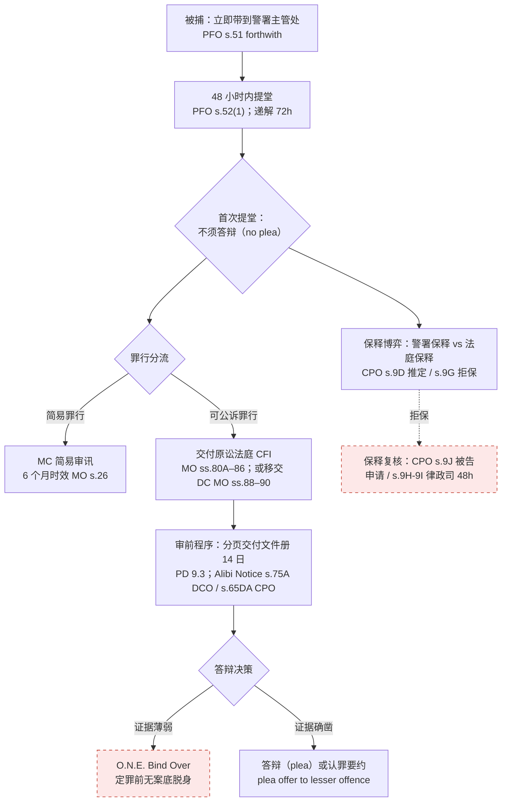
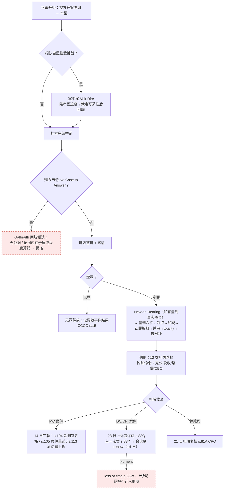

# 刑事诉讼全科总览 — 一份文件掌握整体结构

> 目的：先建立整套刑事程序的整体感，再进入条文、期限和文书细节。其余专题卡是查阅型的；本文是**理解型与决策型**的。
> 组织方式：先讲制度为什么存在（第一性原理），再讲案件有哪些状态、闸门与时钟（工程控制论），最后从客户目的反推工具与最佳时点（逆向选择）。

## 模块 1：全流程一段话白话总导引

> 香港刑事诉讼从被捕那一刻起就被时钟追着跑：警方拘捕被告后必须立即将其带到警署主管处，最迟在 48 小时内（递解案件 72 小时，依《警方通告》（PFO）s.52）带他到裁判官面前；在此之前，被告可以申请警署保释（由警署主管决定）或法庭保释（依《刑事诉讼程序条例》（CPO）s.9D 推定保释、s.9G 才可拒保），保释附带的条件与担保安排直接决定他能否继续工作与准备答辩。检控时效方面，简易程序罪行须在 6 个月内提出（《裁判官条例》（MO）s.26），可公诉罪行则无一般时效；案件随后按罪行性质分流——裁判法院（MC）简易审讯、移交区域法院（DC，依 MO ss.88–90）或交付原讼法庭（CFI）由陪审团审讯，交付程序中控方须提交分页交付文件册（Paginated Committal Bundle）、辩方可申请初级侦讯（PI）筛选证据。首次提堂时被告不须答辩（plea），辩方此时的核心工作是评估证据强弱、决定答辩策略：证据薄弱可争取不提证供起诉签保守行为（O.N.E. Bind Over，定罪前无案底脱身），证据确凿则可考虑认较轻罪名要约（plea offer）。进入审前阶段后，控方须依 PD 9.3 完成披露，被告若要提出不在场证明（alibi）须按 s.75A DCO 或 s.65DA CPO 的时限发出警告；正审中若招认（confession）的自愿性受挑战，陪审团须先退庭进行案中案（voir dire）裁定可采性，中段控方证据不足时辩方可申请无须答辩陈词（no case to answer，依 *R v Galbraith* 两肢测试）。定罪后，法官先开 Newton Hearing 查明有争议的量刑事实，再按“定起点→加减→认罪折扣→并串→totality→选刑种”六步量刑，被告可在 12 类刑罚（罚款、感化令、社服令、戒毒所、缓刑、监禁、青少年设施等）中争取最轻处置。判刑后还有判后救济双轨：裁判法院案件可依 MO s.104/105/113 在 14 日内复核或上诉，区域法院与原讼法庭案件须在 28 日内（CPO s.83Q）向上诉庭申请上诉许可，律政司另有 21 日的刑期复核权（s.81A CPO）——每一步踏错时限或程序，后果都可能是终审定局。

## 模块 2：刑诉全科卡片“三维生态位”总表

全科 10 张专题卡并非平行罗列，而是围绕一条主干轴展开，辅以四把“拦截武器”和一层底层底座。下表把每张卡定位到其所在的阶段、核心问题与关键法条。

### 第一维：纵向主干推进轴（6 大顺向阶段）

| 阶段 | 覆盖卡片 | 该阶段解决的核心问题 | 关键法条与入口 |
|---|---|---|---|
| ① 侦查、拘捕与警署程序 | [07 调查取证与辩方权利](../institutions/07-institution-investigation-rights/) · [11 警权行使与搜查](../institutions/11-framework-police-powers-search/) | 被捕后 48 小时内能做什么、供词如何取得、搜查与截查的边界 | PFO ss.51–52（48 小时提堂）；PFO s.54 录影采访；1992 Rules（供词排除） |
| ② 保释制度全周期 | [05 保释制度体系](../institutions/05-institution-bail/) | 警署保释与法庭保释的门槛、条件设计、8 日上限与违令后果 | CPO ss.9D–9P（保释推定与例外）；MO s.79（每次还押 ≤8 日） |
| ③ 检控启动、首次提堂、移交与交付 | [12 检控与程序启动](../institutions/12-framework-prosecution-rules/) · [08 控罪与审讯管辖](../institutions/08-institution-charges-trial-route/) · [10 法院层级与辩护代理](../institutions/10-framework-courts-jurisdiction/) | 罪行分流到哪一级法院、交付程序怎么走、法律援助如何取得 | MO s.26（6 个月时效）；MO ss.80A–86（交付）；MO ss.88–90（移交 DC）；DCO ss.75/77/82 |
| ④ 审前披露与控罪/被告合并分拆 | [14 备审准备与 s.65B/65C](../institutions/14-institution-trial-preparation/) | 控方披露义务、被告合并分拆（severance）、证据定型 | PD 9.3（披露与排期）；CPO s.51（控罪修订）；CPO ss.65B–65C |
| ⑤ 正审程序、案中案与证据攻防 | [13 刑事证据争议](../institutions/13-institution-criminal-evidence/) | 招认自愿性案中案、辨认证据、不在场证明、剩余酌情权 | *R v Turnbull*；*R v Galbraith*；CPO s.83（证据）；MO s.79F（易受伤害证人） |
| ⑥ 定罪后量刑与判后救济 | [15 量刑体系](../institutions/15-institution-sentencing-system/) | 起点法、认罪折扣、协助执法、刑罚选择、讼费与上诉 | CPO ss.81–83Z；CCCO Cap. 492；MO ss.104/105/113 |

### 第二维：横向插队终止/拦截武器库（4 大战术切口）

| 武器 | 触发时机 | 实质效果 | 对应卡片 |
|---|---|---|---|
| O.N.E. Bind Over | 首次提堂、答辩前，控方不提证供 | 定罪前脱身、不留定罪案底；代价是须认同控方案情 | [06 答辩与 O.N.E.](../institutions/06-institution-plea-bind-over/) |
| Permanent Stay of Proceedings | 审前或审中，程序严重滥用致无法公平审讯 | 整个检控永久中止，等同无罪终结 | [14 备审准备](../institutions/14-institution-trial-preparation/) |
| No Case to Answer | 控方完结举证后、辩方答辩前 | 法官依 *R v Galbraith* 两肢测试裁定控方证据不足，当庭撤控 | [13 证据争议](../institutions/13-institution-criminal-evidence/) |
| 高院保释复核 | 保释被拒或条件过苛后 | 被告依 CPO s.9J 申请高院复核翻盘；律政司依 s.9H/9I 在 48 小时内复核即时还押 | [05 保释](../institutions/05-institution-bail/) |

### 第三维：跨阶段通用底座

| 底座 | 覆盖内容 | 关键法条 |
|---|---|---|
| 法律援助与当值律师 | 刑事法律援助双轨（法援署指派 vs 当值律师 DLS）、大律师委聘程序（Rule 5D SPR） | 法律援助条例；Supreme Court (Criminal) Rules |
| 刑事讼费 | 刑事案件讼费的权源、适用面与金科玉律（不随定罪自动产生） | CCCO Cap. 492 ss.3–18 |
| 律师操守红线 | 受客户指示约束、严禁捏造事实、求情不得作诽谤性指控、判后必须会见客户 | Bar Code 10.61–10.64；*Kissel* 言论风险 |

## 模块 3：全流程纵向状态机图

### 图 1：审前段——从被捕到答辩/O.N.E. 决策

### 图 2：审中至判后——从 Voir Dire 到上诉双轨

## 模块 4：五大高频易混制度横向对比矩阵

### 4.1 两大“签保守行为”（Bind Over）对比

| 维度 | O.N.E. Bind Over（答辩前） | Post-Conviction Bind Over（定罪后） |
|---|---|---|
| 触发时点 | 首次提堂、被告答辩之前；控方决定不提证供（offer no evidence） | 定罪之后，作为刑罚或附加命令作出 |
| 法律性质 | 不构成定罪，被告不留案底 | 属于刑罚，被告已有定罪记录 |
| 实体要求 | 被告须认同控方所述案情属实；控方须有合理理由相信被告不会再犯 | 法庭须信纳被告未来不会破坏安宁；对无罪者/证人/民事当事人另有公平程序三要件（*Lau Wai-wo*） |
| 法条依据 | 惯例与控方裁量（Prosecution Code） | CPO s.107（CFI）/ MO s.36（MC/DC，s.82(5) DCO） |
| 并用限制 | 不可与罚款、赔偿令并判 | 可附加罚金；Conditional Discharge 下亦可再作 bind over |
| 典型场景 | 轻微首犯、证据薄弱但案情明确的案件 | 极轻微定罪、法庭想给被告一次警告机会的案件 |

### 4.2 招认呈堂性两大异议程序对比

| 维度 | 传统 Voir Dire（案中案） | Alternative Procedure（替代程序） |
|---|---|---|
| 适用法院 | 原讼法庭（有陪审团） | 裁判法院、区域法院（无陪审团） |
| 程序形态 | 陪审团退庭，由法官单独听证；裁定后陪审团回庭重选或继续 | 无陪审团退庭问题，法官在同一法庭内先裁定可采性、再由同一法庭定权重 |
| 审查范围 | 只审自愿性（voluntariness）与总体公平性（fairness） | 自愿性与真实性（reliability）合并听证 |
| 典型场景 | 被告指控招认系诱供、威吓或程序不当取得 | 裁判法院/区院审讯中招认被挑战 |
| 结果 | 不可采则陪审团不得知悉招认内容 | 不可采则排除；可采则由同一法官考虑权重 |

### 4.3 三大提前终结/过滤机制对比

| 维度 | O.N.E. Bind Over | No Case to Answer | Permanent Stay |
|---|---|---|---|
| 触发时点 | 答辩前、控方主动不提证供 | 控方完结举证后、辩方答辩前 | 审前或审中任何阶段 |
| 法律基础 | 控方裁量 + 被告认同案情 | *R v Galbraith* 两肢测试（法官裁定） | 普通法固有管辖（滥用程序） |
| 门槛 | 控方认为无合理定罪前景 + 被告自愿接受 | 第一肢：控方证据连 prima facie case 都构不成；第二肢：证据虽构成案件但内在矛盾或极度薄弱 | 极高——须证明程序滥用严重到无法公平审讯（两类：侦查/检控滥用、审讯不可补救的不公平） |
| 结果 | 无定罪、无案底 | 当庭撤控，等同无罪 | 检控永久中止，等同无罪终结 |
| 风险 | 被告须放弃抗辩权 | 失败则继续答辩，可能暴露辩方策略 | 失败则审讯继续，且可能被视为滥用程序本身 |

### 4.4 六大判刑前报告与三青少年院所对比

| 维度 | PO 感化 | CSO 社服 | RC 更生中心 | DTC 劳教中心 | TC 教导所 | DATC 戒毒所 |
|---|---|---|---|---|---|---|
| 适用对象 | 成人（非法定刑罪名） | ≥14 岁 | 14–<21 岁青少年 | 14–<21 岁青少年 | 14–<21 岁青少年 | 任何可判监禁罪行（欠缴罚款罪除外） |
| 刑期/时长 | 1–3 年 | ≤240 小时/≤12 月 | 3–9 个月 | ≤12 个月 | 6 个月–3 年 | 2–12 个月（署长定） |
| 候报告期间 | 可保释（法庭裁量） | 可保释 | 可保释（法庭裁量） | 可保释（法庭裁量） | 法定羁押（shall） | 法定羁押（shall，s.54A DDO） |
| 体格要求 | 无 | 无 | 须身心适合 | 须健康（拒糖尿/哮喘/心肺眼疾） | 无 | 无 |
| 三秒分流 | — | — | 案情较轻、不耐高强度操练 | 初犯、体格强健、需短期震慑 | 罪行较重、需长期改造 | 涉毒相关罪行 |
| s.109A 保护 | 不适用（非监禁） | 不适用 | 适用（16–<21 岁） | 适用 | 适用 | 适用 |
| 组合禁止 | 不可与其他刑种并（s.3A PBOO） | 可代替或附加 | 不可并 | 不可并 | 不可并 | 不可并 |

### 4.5 判后救济五轨道对比

| 轨道 | 适用法院 | 时限 | 法条 | 关键特点 |
|---|---|---|---|---|
| 裁判官复核 | MC | 14 日 | MO s.104 | 裁判官可自我复核定罪或刑罚，门槛较低 |
| 原讼庭一般上诉 | MC | 14 日 | MO s.113 | 向原讼法庭上诉，须 Form 101/102；选此路即失 s.105 案件呈述权 |
| 案件呈述 | MC | 14 日 | MO s.105 | 向高等法院呈述，门槛更高但可上诉法律问题；与 s.113 互斥 |
| 上诉庭上诉 | DC/CFI | 28 日 | CPO s.83Q | 须先获单一法官许可（s.83Y），被拒可 14 日内向合议庭 renew；无 merit 可遭 loss of time（s.83W） |
| 律政司刑期复核 | DC/CFI | 21 日 | CPO s.81A | 律政司司长申请，门槛高（wrong in principle / manifestly excessive 等）；被告已上诉者不得复核 |

## 附：章节导航与任务直达

| 要做的事 | 跳转 |
|---|---|
| 30 秒弄清范围/术语/每环任务 | [速读定位层见各专题卡开头](../institutions/15-institution-sentencing-system/) |
| 给客户估刑 | [15 量刑体系](../institutions/15-institution-sentencing-system/) 0C/0D |
| 保释条件设计与违令后果 | [05 保释](../institutions/05-institution-bail/) |
| 侦查阶段权利与供词攻击 | [07 调查取证](../institutions/07-institution-investigation-rights/) · [13 证据争议](../institutions/13-institution-criminal-evidence/) |
| 控罪分流与交付程序 | [08 控罪与审讯管辖](../institutions/08-institution-charges-trial-route/) · [12 检控与程序启动](../institutions/12-framework-prosecution-rules/) |
| 审前披露与文书 | [14 备审准备](../institutions/14-institution-trial-preparation/) |
| 定罪后量刑与上诉 | [15 量刑体系](../institutions/15-institution-sentencing-system/) |
| 考前扫高频失误 | [时限与判例矩阵](./cr00-deadlines-case-matrix/) · [考场路由器](./cr00-exam-sg-router/) |
